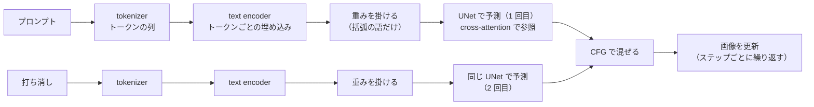

```text
masterpiece, best quality, no humans, still life, (blue ceramic teapot:1.4), lemons, glass bottle
```

上記は、画像生成のプロンプト（描きたい絵の内容を語で並べた文面）の 1 行です。`(blue ceramic teapot:1.4)` の括弧と数字が Prompt Weighting（プロンプトの重み付け）の書式で、括弧で囲んだ語の効き具合を 1.4 倍に強める、という意味で書きます。描きたくないものを並べる打ち消し（ネガティブプロンプト）にも、同じ書式で重みを付けられます。

この書式は「その語を 1.4 倍しっかり描け」という指示に見えます。しかし、重みが動かすのは指定した語だけではありません。以下は、上の 1 行とは別の条件で、白いポットの静物の打ち消しに並べた 12 語（品質の語など。本記事の実験 2 で示します）に重みを付ける前と後の絵です。打ち消しには「赤」とは一言も書いていないのに、重み 1.8 では壁が赤く、テーブルクロスが桃色に焼けました。

<div style="display:flex;gap:8px;justify-content:center;margin:1.5rem 0">
<figure style="margin:0;flex:0 1 260px;min-width:0">

<figcaption style="margin:4px 0 0;text-align:center;font-weight:normal;font-size:14px">打ち消しの 12 語に重みなし</figcaption></figure>
<figure style="margin:0;flex:0 1 260px;min-width:0">

<figcaption style="margin:4px 0 0;text-align:center;font-weight:normal;font-size:14px">12 語に重み 1.8</figcaption></figure>
</div>

<br>

本記事では、[ComfyUI](https://github.com/Comfy-Org/ComfyUI)（ノードをつないで画像生成の処理を組む OSS）の実装と、手元で生成した画像の色の統計から、次の疑問に答えます。

- 重みの数字は、内部で何を何倍にしているのか。
- 1 つの語に重みを付けると、他の語はどうなるのか。
- 打ち消しの重みを上げると、なぜ色が崩れるのか。
- 照明の語は、打ち消しの重みとどう組み合わさるのか。

長いプロンプトの後ろに書いた語が効くのか、1 語で絵全体が変わった時に原因の語をどう探すのかは、[CLIP Token Limit のノート](/notes/generative-ai/clip-token-limit/)で扱います。実験はすべて 2026 年 11 月 10 日に、ComfyUI v0.35.0 と、SDXL（後述する画像生成モデル）系のモデル 1 つで行いました。数値はこの条件での結果です。

---

### 前提: プロンプトが UNet に届くまで

画像生成モデルの [SDXL](https://arxiv.org/abs/2307.01952)（Stable Diffusion XL）は、ノイズだけの画像から少しずつノイズを取り除いて絵を作る[拡散モデル](../diffusion-model/)です。各ステップで「どこがノイズか」を予測するネットワークを [UNet](https://arxiv.org/abs/1505.04597)（もとは医用画像の領域分割のために提案された構造）、プロンプトの文字列を UNet が使える数値に変える部品を text encoder と呼びます。

text encoder には [CLIP](https://arxiv.org/abs/2103.00020)（画像と文章を同じベクトルの空間に対応付けるよう学習したモデル）の文章側が使われています。SDXL は大きさの違う 2 つの text encoder（CLIP の ViT-L と、[OpenCLIP](https://github.com/mlfoundations/open_clip)（CLIP を再実装・再学習した OSS）の ViT-bigG）を持ち、処理は次の順に進みます。

1. tokenizer が、プロンプトをトークン（語や語の断片）の番号の列に分けます。`blue ceramic teapot` なら 3 トークンで、重みはトークンごとに付きます（分け方は [Tokenizer のノート](/notes/generative-ai/tokenizer/)を参照）。
2. text encoder が、トークン 1 個につき 1 本のベクトルを返します。このベクトルを埋め込み（embedding）と呼び、SDXL では 2 つの encoder の出力をつないだ 2,048 次元です。
3. UNet は、ノイズを予測する各ステップで、画像の各位置からこのベクトルの列を参照します。この参照を cross-attention と呼びます。画像の各位置は、参照する割合を全てのトークンで分け合います。

以下は、この流れを描いた図です。



プロンプトと打ち消しは、それぞれ別に encoder を通り、同じ UNet の 2 回の予測に使われます。重みは encoder の出力に掛かります（計算は後の節で説明します）。2 つの予測を混ぜるのが、次の CFG です。

<br>

#### 打ち消しは CFG の引き算に入る

打ち消しは「この語を消せ」という命令ではありません。CFG（[Classifier-Free Guidance](https://arxiv.org/abs/2207.12598)）という仕組みで、引き算される方に入るプロンプトです。CFG は、各ステップで UNet に 2 回予測させ、次の式で混ぜます。

```text
予測 = 打ち消しでの予測 + cfg × (プロンプトでの予測 − 打ち消しでの予測)
```

ここでの予測は、各ステップで「どこがノイズか」を予測した結果で、画像はこの予測を取り除く向きに更新されます。`cfg` は生成の設定の CFG の値（本記事の実験では 5.5）です。ComfyUI v0.35.0 では [comfy/samplers.py の cfg_function](https://github.com/Comfy-Org/ComfyUI/blob/v0.35.0/comfy/samplers.py#L598) がこの式です。以下の図の通り、打ち消しでの予測からプロンプトでの予測への差は、常に 5.5 倍に引き伸ばされます。



そのため、混ぜた予測は打ち消しの文が表す絵から離れた側を指し、画像は「打ち消しの文から遠ざかる」方向に押されます。打ち消しの文や重みが変われば、打ち消しでの予測が変わり、押される向きも変わります。

---

### 重み付けの計算

書式は [ComfyUI の CLIP Text Encode ノードのドキュメント](https://docs.comfy.org/built-in-nodes/ClipTextEncode)にも書かれています。ComfyUI v0.35.0 の重み付けの実装は、[comfy/sd1_clip.py](https://github.com/Comfy-Org/ComfyUI/blob/v0.35.0/comfy/sd1_clip.py) の 2 か所にあります。1 つ目の [token_weights()](https://github.com/Comfy-Org/ComfyUI/blob/v0.35.0/comfy/sd1_clip.py#L348-L366) は、括弧を読んでトークンごとの重みを決めます。

- `(word:1.3)` は、重みを 1.3 に置き換えます。掛け算ではないので、`((word:1.3))` も 1.3 です。
- `(word)` のように数字が無い時は、外側の重みの 1.1 倍です。`((word))` は 1.21 になります。

2 つ目の [encode_token_weights()](https://github.com/Comfy-Org/ComfyUI/blob/v0.35.0/comfy/sd1_clip.py#L28-L78) が、text encoder の出力に重みを掛けます。重みが 1 でないトークンが 1 つでもあると、空のプロンプトも一緒に encoder に通し、トークンの位置ごとに次の計算をします（変数名は実装の通りです）。空のプロンプトも、始まりと終わりの記号と埋め草（padding）で 77 トークンに揃えられるので、位置ごとにベクトルがあります。

```python
# comfy/sd1_clip.py（v0.35.0）の encode_token_weights() から抜粋
z_empty = out[-1]                      # 空のプロンプトの出力
for j in range(len(z[i])):             # トークンの位置ごと
    weight = token_weight_pairs[k][j][1]
    if weight != 1.0:
        z[i][j] = (z[i][j] - z_empty[j]) * weight + z_empty[j]
```

`z - z_empty` は「空のプロンプトと比べて、この語が足した分」で、重みはその差を w 倍します。以下の図は、この式を 2 次元に描いたものです。



重みが 1.0 なら、語の埋め込みはそのままです。1 を超えると、ベクトルは空のプロンプトから見て、語の位置を通り越した先に置かれます。これは普通の文章を encoder に通しても出てこない外挿で、モデルがそうした入力に慣れているとは限りません。

---

### 実験の条件

手元の ComfyUI（v0.35.0、GPU は AMD Radeon 8060S）の API に、ワークフロー（ノードのつながりを書いた JSON）を 1 枚ずつ送りました。変えたのはプロンプトと打ち消しの文字列だけで、それ以外は全ての実験で同じです。

| 項目 | 値 |
|---|---|
| モデル | [WAI-illustrious-SDXL v17.0](https://civitai.com/models/827184?modelVersionId=2883731)（SDXL のアーキテクチャのイラスト向けのモデル）。LoRA は使わない |
| seed | 条件ごとに 3 個（101〜103）。seed は初期のノイズを決める乱数の種で、同じ seed と同じ設定なら同じ絵が出る |
| ステップ数・CFG・サンプラー | 24・5.5・euler（ノイズを取り除く計算の手順。scheduler は normal） |
| 解像度・CLIP | 1024 × 1024・最後から 2 番目の層の出力（clip skip 2） |
| 題材 | 机の上のティーポット・レモンなどの静物（イラスト向けのモデルは人物を描きやすいので、`no humans` を入れ、打ち消しに人物の語を入れる） |

全ての生成を終えた後に、いくつかの条件を同じ設定でもう一度生成すると、画素が完全に一致しました。つまり、以下の差は生成のたびに出るぶれではなく、文字列を変えた結果です。

画像の色は、全画素（1024 × 1024）を HSV（色相・彩度・明度）に変換し、青・黄・赤などの色相に入る画素の割合として数えました。例えば赤い画素は、色相が赤の範囲で、彩度と明度が一定以上の画素です。白い画素は彩度が低く明度が高い画素、黒に近い画素は明度が低い画素、蛍光色に寄った画素は色相が黄〜緑〜青〜紫で、彩度と明度がともに高い画素です。

基準との差（`diff`）は、同じ seed の基準の画像との、RGB（赤・緑・青）の値の差の絶対値の平均（0〜255）です。しきい値は [lab/analyze.py](https://github.com/nao1215/debimate/blob/main/content/notes/generative-ai/prompt-weighting/lab/analyze.py) にあります。

---

### 実験 1: 色の語に重みを付ける

プロンプトの `blue ceramic teapot` に、1.0 から 2.0 までの重みを付けました。以下は seed 101 の重み 1.0・1.4・2.0 の 3 枚です（6 段階の全ては下のグラフ）。画像の下の数字が重みです。

<div style="display:flex;justify-content:center;gap:8px;margin:1.5rem 0">
<figure style="margin:0;flex:0 1 240px;min-width:0">

<figcaption style="margin:4px 0 0;text-align:center;font-weight:normal;font-size:14px">1.0</figcaption></figure>
<figure style="margin:0;flex:0 1 240px;min-width:0">

<figcaption style="margin:4px 0 0;text-align:center;font-weight:normal;font-size:14px">1.4</figcaption></figure>
<figure style="margin:0;flex:0 1 240px;min-width:0">

<figcaption style="margin:4px 0 0;text-align:center;font-weight:normal;font-size:14px">2.0</figcaption></figure>
</div>

重みを上げるほど、青は濃くなり、ポットの数が増えました。一方で、重みを付けていないレモンとガラス瓶は小さくなり、2.0 では消えています。3 つの seed で平均すると、青い画素は 11.4% から 18.1% に増え、レモンの黄色い画素は 1.9% から 0.3% に減りました。



<details>
<summary>基準との画素の差を含む表（3 seed の平均）</summary>

```text
condition      blue  yellow   diff   (3 seeds の平均)
w1.0          0.114   0.019    0.0
w1.2          0.125   0.022   28.1
w1.4          0.159   0.021   37.3
w1.6          0.174   0.017   47.8
w1.8          0.174   0.007   54.3
w2.0          0.181   0.003   56.0
```

</details>

重みは、指定した語を強めると同時に、他の語の取り分を減らします。前提の節の通り、画像の各位置は参照する割合を全てのトークンで分け合います。以下は、その分け合い方を説明用の数値で描いた図です。



重みで引き伸ばした埋め込みは、各位置との一致度を計算する時の値も大きくなりやすいので、その語が割合を多く取り、他の語の割合が減ると考えられます（cross-attention の中の割合までは測っていません）。重みを付けた語が 1 つでも、画面の配分は全体で変わります。なお、彩度の平均は 0.485〜0.504 で、正の重み 2.0 までは画面全体の色は崩れませんでした。

ちなみに、重み 1.0 の絵でも、カップのお茶とグラスの水が青く塗られています。色の語が、修飾した名詞とは別の対象に移る現象です（[Attribute Binding のノート](/notes/generative-ai/attribute-binding/)で詳しく扱っています）。

### 実験 2: 打ち消しに重みを付ける

次は打ち消しです。プロンプトは実験 1 のポットを `white ceramic teapot`（白いポット、重みなし）に替えた文面に固定し（青の重みの影響を外し、色の変化を見やすくするため）、打ち消しに次の 12 語を並べました。よく使われる品質の語と、白黒の絵を避ける 2 語です。この後ろに、人物を避ける `1girl, 1boy, person` を重みなしで足しています。

```text
lowres, worst quality, bad quality, low quality, jpeg artifacts, blurry,
text, signature, watermark, logo, monochrome, greyscale
```

先頭から k 語（k = 1, 6, 12）に、1.2〜1.8 の重みを付けました。例えば k = 6、重み 1.3 なら `(lowres:1.3), ..., (blurry:1.3), text, ...` です。k = 6 の結果は、後の表の下に補足として置きます。

12 語の全てに重みを付けて色が崩れた後、白黒の 2 語（`monochrome`, `greyscale`）だけに付ける場合と、その 2 語を除いた 10 語に付ける場合も追加しました。以下は seed 101 の 6 枚で、画像の下が重みを付けた語と重みです。

<div class="pw-strip" style="display:flex;flex-wrap:wrap;justify-content:center;gap:8px;margin:1.5rem 0">
<figure style="margin:0;flex:1 1 100px;max-width:130px;min-width:0">

<figcaption style="margin:4px 0 0;text-align:center;font-weight:normal;font-size:14px">重みなし</figcaption></figure>
<figure style="margin:0;flex:1 1 100px;max-width:130px;min-width:0">

<figcaption style="margin:4px 0 0;text-align:center;font-weight:normal;font-size:14px">12 語 × 1.5</figcaption></figure>
<figure style="margin:0;flex:1 1 100px;max-width:130px;min-width:0">

<figcaption style="margin:4px 0 0;text-align:center;font-weight:normal;font-size:14px">12 語 × 1.8</figcaption></figure>
<figure style="margin:0;flex:1 1 100px;max-width:130px;min-width:0">

<figcaption style="margin:4px 0 0;text-align:center;font-weight:normal;font-size:14px">白黒の 2 語 × 1.8</figcaption></figure>
<figure style="margin:0;flex:1 1 100px;max-width:130px;min-width:0">

<figcaption style="margin:4px 0 0;text-align:center;font-weight:normal;font-size:14px">残りの 10 語 × 1.8</figcaption></figure>
<figure style="margin:0;flex:1 1 100px;max-width:130px;min-width:0">

<figcaption style="margin:4px 0 0;text-align:center;font-weight:normal;font-size:14px">lowres × 1.8</figcaption></figure>
</div>

12 語 × 1.8 では、壁が赤く、テーブルクロスが桃色に焼けました。打ち消しには「赤くしろ」とは一言も書いていません。以下は、3 つの seed で平均した彩度と、赤い画素の割合です。



赤への崩れは、ほぼ白黒の 2 語（monochrome + greyscale）だけで起きています。2 語 × 1.8 の赤い画素は 27.3% で、12 語 × 1.8 の 27.5% と変わりません。打ち消しの語に重みを付けると、打ち消しの埋め込みが重みの図の通りに外挿され、打ち消し側の予測が変わります。CFG の式では、画像はその予測から遠ざかる方向に押されます。この式に当てはめると、打ち消しの「白黒」を強めるほど、画像は「白黒から遠い」方向、つまり彩度の高い方向に押されると考えられます。ただし、なぜ他の色ではなく赤に寄ったのかまでは確かめていません。この条件で崩れを決めたのは、語の数より、打ち消した語の意味と重みでした。

一方で、品質の語にも別の崩れ方があります。白黒の 2 語を除いた 10 語 × 1.8 では、赤は 6.8% に留まる代わりに、黄色い画素が 7.4% から 26.5% に増え、黒に近い画素も 5.4% から 13.1% に増えました。画面全体が黄色に寄り、線と影が強くなっています。`lowres` 1 語 × 1.8 でも、黒に近い画素は 15.4% まで増えました。

<details>
<summary>彩度・赤・黄・黒に近い画素と、基準との差の表（3 seed の平均）と補足</summary>

```text
condition       sat    red  yellow   dark   diff   (3 seeds の平均)
w1.0          0.471  0.001   0.074  0.054    0.0
k1_w1.8       0.646  0.053   0.085  0.154   36.3
k12_w1.3      0.533  0.011   0.109  0.033   25.9
k12_w1.8      0.680  0.275   0.159  0.082   58.3
mono_w1.8     0.621  0.273   0.086  0.042   44.2
k10_w1.8      0.620  0.068   0.265  0.131   47.8
```

k = 6 は、赤い画素は 1 語とほぼ同じで、1.8 では黄色と黒に近い画素が 1 語・12 語のどちらより多くなりました（全ての値は [lab/output_negative.txt](https://github.com/nao1215/debimate/blob/main/content/notes/generative-ai/prompt-weighting/lab/output_negative.txt)）。

</details>


---

### 著者の生成で起きた崩れ

ここまでの実験は、モデル 1 つと静物の題材での結果です。著者が[キャラクターの立ち絵](../character-consistency/)（人物の全身や上半身を 1 人ずつ描いた絵）を大量に作っていた時は、もっと低い重みで色が崩れました。この時は、本記事の実験と同じモデルに、絵柄を学習させた追加の学習済みパラメータ（画風の [LoRA](/notes/generative-ai/lora/)）を当てていました。

打ち消しの 1 語の重みを 1.2 から 1.3 に上げただけで、以降の絵が緑や黄の蛍光色に転びました。同じ seed で前後を比べて、重みが原因だと確かめています。

もう 1 つの原因は、夜・照明・きらびやかさの語でした。重みを付けていなくても、肌や髪が光の色に染まりました。以下は、著者が色の理由で外した顔です（[2026/11/02 週の weeknotes](/weeknotes/2026-11-02/e2cecb994e2c/) に掲載）。緑や黄に色がかぶった顔と、白く色が抜けた顔が並んでいます。



<details>
<summary>著者の生成での集計と、その後に決めたこと</summary>

人が評価した 526 枚を後で集計すると、重み付きの打ち消しが 6 語以上の絵は 20 枚中 13 枚が色か画風（絵柄）が崩れた不合格で、2 語以下の絵では不合格の割合が 5% でした。著者は最終的に、足す語は重みの無い短い語を数語までにし、照明の語は文面に書かない（打ち消しに書くのは良い）と決めました。明るさは、何も書かない既定に任せています。

</details>

実験 2 の静物では、重み 1.3 で蛍光色には転びませんでした。違いの候補の 1 つは、著者の文面に入っていた照明の語です。

実験 2 でも、蛍光色に寄った画素（色相が黄〜緑〜青〜紫で、彩度と明度がともに高い画素）の割合も数えましたが、最大でも 12 語 × 1.8 の 6.0% でした。本記事の条件では、色は蛍光の緑ではなく赤と黄に崩れています。どちらの色に転ぶかは、打ち消した語と題材で変わると考えられます。

### 実験 3: 照明の語と打ち消しの重みを組み合わせる

照明の語だけで色が動くのか、重みと組み合わせた時に崩れるのかを切り分けるために、実験 2 と同じ題材・seed（101〜103）で、次の 2 つを掛け合わせました。

- 照明の語（プロンプトの末尾に 1 語足す）: なし、`night`、`neon light`、`sunset`、`dramatic lighting`。前の 3 つは、著者の文面に入っていた語です。
- 打ち消しの 12 語の重み: なし、1.2、1.3

照明の語が無い 3 通りは、実験 2 と同じ文面なので、実験 2 の画像を使いました。以下は seed 101 で、打ち消しに重みを付けていない 5 枚と、`sunset` に 12 語 × 1.3 を足した 1 枚です。

<div class="pw-strip" style="display:flex;flex-wrap:wrap;justify-content:center;gap:8px;margin:1.5rem 0">
<figure style="margin:0;flex:1 1 100px;max-width:130px;min-width:0">

<figcaption style="margin:4px 0 0;text-align:center;font-weight:normal;font-size:14px">なし</figcaption></figure>
<figure style="margin:0;flex:1 1 100px;max-width:130px;min-width:0">

<figcaption style="margin:4px 0 0;text-align:center;font-weight:normal;font-size:14px">night</figcaption></figure>
<figure style="margin:0;flex:1 1 100px;max-width:130px;min-width:0">

<figcaption style="margin:4px 0 0;text-align:center;font-weight:normal;font-size:14px">neon light</figcaption></figure>
<figure style="margin:0;flex:1 1 100px;max-width:130px;min-width:0">

<figcaption style="margin:4px 0 0;text-align:center;font-weight:normal;font-size:14px">sunset</figcaption></figure>
<figure style="margin:0;flex:1 1 100px;max-width:130px;min-width:0">

<figcaption style="margin:4px 0 0;text-align:center;font-weight:normal;font-size:14px">dramatic lighting</figcaption></figure>
<figure style="margin:0;flex:1 1 100px;max-width:130px;min-width:0">

<figcaption style="margin:4px 0 0;text-align:center;font-weight:normal;font-size:14px">sunset + 12 語 × 1.3</figcaption></figure>
</div>

照明の語を 1 語足すだけで、窓の外と部屋全体の色が変わりました。`sunset` では、白いポットやテーブルクロスに橙色がかかっています。以下は、3 つの seed で平均した白い画素の割合と彩度です。



照明の語の効き目は、打ち消しの重みより大きく出ました。白い画素は、打ち消しの重みだけを 1.3 にしても 16.8% から 15.5% にしか減りませんが、照明の語を足すと、重みなしでも 4.4〜13.9% に減りました。基準の絵との画素の差でも、重みだけの 25.9 に対して、照明の語では 34.1（`dramatic lighting`）〜67.6（`night`）でした（画素の差には夜の窓のような構図の変化も含まれます）。

白い画素が減ったのは、`sunset` の 4.4%、`neon light` の 7.0% のように、白い対象が光の色に染まったためです。これを色かぶりと呼びます。

<details>
<summary>彩度・蛍光色・白・黒に近い画素と、基準との差の表（3 seed の平均）</summary>

```text
condition                  sat   neon  white   dark   diff   (3 seeds の平均)
none_neg1.0              0.471  0.000  0.168  0.054    0.0
none_neg1.3              0.533  0.000  0.155  0.033   25.9
night_neg1.0             0.521  0.019  0.113  0.202   67.6
night_neg1.3             0.593  0.020  0.090  0.233   72.3
neon_light_neg1.0        0.574  0.000  0.070  0.155   51.9
neon_light_neg1.3        0.593  0.000  0.071  0.155   56.9
sunset_neg1.0            0.599  0.000  0.044  0.099   47.4
sunset_neg1.3            0.665  0.001  0.041  0.057   51.1
dramatic_lighting_neg1.0 0.524  0.000  0.139  0.098   34.1
dramatic_lighting_neg1.3 0.588  0.000  0.120  0.079   38.0
```

</details>

打ち消しの重みは、どの照明の語でも彩度を少しずつ押し上げました。重み 1.0 から 1.3 で 0.02〜0.07 です。しかし、1.2 から 1.3 で急に崩れる境目は、照明の語があっても現れませんでした。

蛍光色の割合が 0.1% を超えたのは `night` だけ（約 2%）で、これは seed 103 の窓の外の青い夜空の分です。重みを 1.0 から 1.3 に上げても、0.019 から 0.020 とほぼ動いていません。

つまり、この条件では「照明の語が悪さをする」は色かぶりとして再現し、効き目は打ち消しの重みより大きく出ました。一方で、「1.2 から 1.3 で蛍光色に転ぶ」は、照明の語と組み合わせても再現しませんでした。著者の当時の文面には、画風 LoRA、人物、重み付きの語が他にも多く入っていたので、それらとの組み合わせで境目が下がった可能性があります。ここは推測で、境目を条件ごとに測ったわけではありません。

<br>

どの条件でも言えるのは、照明の語は打ち消しの重みより大きく色を動かすこと、重みは 1 語ずつ同じ seed で前後を比べてから上げること、の 2 つです。

---

### 重み付けの使いどころと限界

重み付けは、語を書き足さずに効き具合だけを変えられる手軽な道具です。しかし、ここまでの実験の通り、効くのは指定した語だけではありません。

| したいこと | 重みで起きること | 先に試すこと |
|---|---|---|
| 1 つの対象を目立たせる | その対象が増え、他の語が描く対象が減る（実験 1） | 重み 1.1〜1.2 から、同じ seed で比べながら上げる |
| 色を確実に付ける | 色が他の対象に移る（実験 1 のお茶） | 重みを上げず、足りない分は画像処理で塗り替える（色が移る仕組みは [Attribute Binding のノート](/notes/generative-ai/attribute-binding/)） |
| 描きたくないものを消す | 重みを上げると色が崩れる。白黒の語は赤に、品質の語は黄と強い影に寄る（実験 2） | 打ち消しは重みを付けずに必要な数語だけ書く |
| 照明や時間帯で雰囲気を出す | 重みが無くても、白い対象が光の色に染まる（実験 3） | 照明の語を書かず、雰囲気は壁や小物の色で出す |

長いプロンプトの後ろの語を効かせたい時も、重みより先に、道具が上限を超えた語を捨てていないかを確かめます（[CLIP Token Limit のノート](/notes/generative-ai/clip-token-limit/)）。

最後に、同じ書式は [AUTOMATIC1111 の stable-diffusion-webui](https://github.com/AUTOMATIC1111/stable-diffusion-webui/wiki/Features#attentionemphasis)（ブラウザから Stable Diffusion を操作する OSS）でも使えますが、計算は違います。webui の既定の設定（Original）は、埋め込みをそのまま w 倍してから、全体の平均値が掛ける前と同じになるよう、平均の比を全体に掛け直します（[modules/sd_emphasis.py](https://github.com/AUTOMATIC1111/stable-diffusion-webui/blob/82a973c04367123ae98bd9abdf80d9eda9b910e2/modules/sd_emphasis.py#L36-L46)、2024 年 7 月のコミット）。同じ `(word:1.3)` でも道具を変えると効き方が変わるので、ワークフローを移したら重みも測り直す必要があります。
