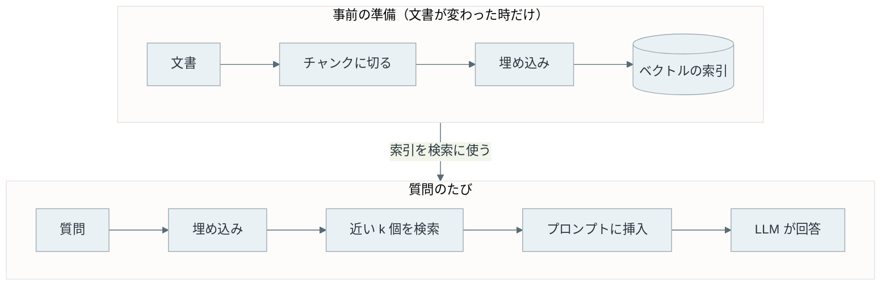

RAG（Retrieval-Augmented Generation、検索拡張生成）は、質問に答える前に手元の文書を検索し、見つけた文章を質問と一緒に LLM（Large Language Model、大規模言語モデル）に渡して答えさせる仕組みです。

LLM は学習した時点までの知識しか持たず、社内の文書や昨日書いたメモは知りません。RAG は、その不足を「モデルを学習し直す」のではなく「答える時に資料を添える」ことで補います。この名前は、検索する部品と文章を生成するモデルを組み合わせた [Lewis 氏らの論文](https://arxiv.org/abs/2005.11401)（2020 年）の題名に使われています。

文書は事前にチャンク（chunk）と呼ぶ短い断片に切り、断片ごとに意味を表すベクトル（埋め込み）を計算しておきます。質問が来たら、質問も同じ方法でベクトルにし、近いベクトルを持つ断片だけを LLM に渡します。以下は、その流れを位置の近さで描いた図です。



円の外にある点は、どれほど正しい答えを含んでいても LLM に届きません。RAG の答えの質は、LLM の賢さより先に、この円の中に正解の断片が入るかどうかで決まります。

<br>

本記事では、debimate の技術ノート 84 本を文書集合にした実験で、RAG の仕組みを説明します。手元の埋め込みモデル（[bge-m3](https://huggingface.co/BAAI/bge-m3)）と小さな LLM（[qwen3:4b](https://ollama.com/library/qwen3)）を使い、次の疑問に答えます。

- LLM に質問するだけでは、何が足りないのか。
- 文書を切り、ベクトルにし、近いものを探す処理は、それぞれ何をしているのか。
- チャンクの大きさを変えると、正解の断片を引ける割合はどう変わるのか。
- 検索が外れた時、LLM の答えはどうなるのか。

ベクトル DB（データベース）の製品比較と、検索結果を並べ直す再ランキング（reranking）の手法は説明しません。

---

### RAG が必要な理由

LLM の知識は、学習に使ったテキストに含まれていたことに限られます。学習の後に起きた出来事、公開されていない社内の手順書、自分のリポジトリの設計メモは、モデルの重みのどこにもありません。知らないことを聞かれた LLM は、「分かりません」と答えるとは限らず、それらしい文章を組み立てて返します。

例えば、qwen3:4b に資料を渡さずに「同じ表を CSV と Parquet で保存すると、大きさは何分の 1 になった？」と聞くと、以下の答えが返りました（思考の文を除いた回答。条件は実験 2 で説明します）。

```text
=== Q21: 同じ表を CSV と Parquet で保存すると、大きさは何分の 1 になった？  (正解: columnar-storage)
--- qwen3:4b (k=0, chunks=200, thinking 4,775 chars, 1,575 tokens generated)
同じデータを CSV と Parquet で保存すると、Parquet のファイルサイズは CSV の約 1/10 になる。  
これは、列ストレージと効率的な圧縮技術が活用されているためである。  
したがって、データのサイズが大幅に削減される。
```

debimate の [Columnar Storage のノート](/notes/database-systems/columnar-storage/)の実験では、[Parquet](https://parquet.apache.org/) のファイルは CSV の 15.6 分の 1 でした。モデルはこの実験を知らないので、一般論か作った数字で答えるしかありません。

知識を足す方法には、追加の学習（fine-tuning。[LoRA](https://arxiv.org/abs/2106.09685) もその 1 つで、[LoRA のノート](/notes/generative-ai/lora/)で説明しています）もあります。しかし、学習は文書が変わるたびにやり直しが必要で、答えのどこが学習データのどの文に由来するかも分かりません。RAG なら、文書を差し替えて索引を作り直せば次の質問から反映され、LLM に渡した断片をそのまま出典として示せます。

[文書を全部プロンプトに入れる方法](../long-context/)も考えられます。しかし、LLM が一度に読める長さ（コンテキスト長。[KV キャッシュとコンテキスト長のノート](/notes/generative-ai/kv-cache/)を参照）には上限があり、長くするほど計算も遅くなります。実験の 84 本は前処理の後で約 58 万字あり、実験 2 で qwen3:4b に設定したコンテキスト長（16,384 トークン）を大きく超えます。そのため、質問に関係しそうな数千字だけを選んで渡します。

---

### 仕組みの全体像

RAG の処理は、質問の前に済ませておく索引作りと、質問のたびに走る検索と生成の 2 つに分かれます。



上記の図の「近い k 個を検索」は、事前の準備で作った索引を探します。2 つの「埋め込み」は、同じ埋め込みモデルで行います。モデルが違うとベクトルの意味する方向も違うので、質問と文書の距離が比べられなくなります。

<br>

#### チャンク分割

文書を切る理由は 2 つあります。1 つは、LLM に渡せる量に上限があるので、関係する部分だけを選べる単位が必要だからです。もう 1 つは、長い文章を 1 本のベクトルにまとめると、いくつもの話題が平均されて、どの質問にもそこそこ近く、どの質問にも一番近くはないベクトルになるからです。

切り方には、文字数やトークン数で機械的に切る、段落や見出しで切る、前後を少し重ねて切る（overlap）などがあります。小さく切ると 1 つの断片は 1 つの話題に絞られますが、答えに必要な前後の文が別の断片に分かれます。大きく切ると文脈は残りますが、ベクトルがぼやけ、LLM に渡す文字数も増えます。どちらが良いかは文書と質問によるので、後の実験で測ります。

<br>

#### 埋め込みと余弦類似度

埋め込み（embedding）は、文章を固定長の数値の列（ベクトル）に変換したものです。意味の近い文章ほど、ベクトルの向きが近くなるように学習された埋め込みモデルが計算します。実験で使う [bge-m3](https://huggingface.co/BAAI/bge-m3) は、100 以上の言語を扱い、最大 8,192 トークンの入力を 1,024 次元のベクトルにする埋め込みモデルです。トークンは LLM が文章を数える単位で、詳しくは[トークナイザーのノート](/notes/generative-ai/tokenizer/)で説明しています。

2 つのベクトルの近さには、向きの近さを表す[余弦類似度](/ml/math/vector-matrix-ops/)（cosine similarity）がよく使われます。余弦類似度は、内積を 2 つのベクトルの長さで割った値で、同じ向きなら 1、直交なら 0 です。全てのベクトルを長さ 1 に揃えておけば、内積がそのまま余弦類似度になります。

```python
# lab/rag_lab.py から抜粋
v = np.array(vecs, dtype=np.float32)
v = v / np.linalg.norm(v, axis=1, keepdims=True)   # 長さを 1 に揃える

def search(index_vecs, query_vec, k):
    scores = index_vecs @ query_vec    # 全チャンクとの内積 = 余弦類似度
    top = np.argsort(-scores)[:k]      # 大きい順に k 個
    return [(int(i), float(scores[i])) for i in top]
```

<br>

#### 近傍検索

上記の `search()` は、全てのチャンクとの類似度を 1 つずつ計算する全件検索です。実験の 2,900 個程度なら一瞬ですが、数百万個になると質問のたびに全件を計算するのは重くなります。そこで、ベクトル DB や検索ライブラリは、[HNSW](https://arxiv.org/abs/1603.09320)（ベクトルをグラフでつなぎ、近い方へたどって探す索引）のような[近似最近傍探索](/ml/ml/knn/)（ANN、Approximate Nearest Neighbor）を使います。

ANN は速さと引き換えに、本当の上位 k 個を取りこぼすことがあります。本記事の実験は全件検索なので、この取りこぼしは起きません。

<br>

#### プロンプトへの挿入

検索した断片は、番号を付けて質問の前に並べます。LLM には「資料だけを根拠に答え、使った資料の番号を示す」「資料に無ければ分からないと答える」と指示します。番号があれば、答えのどの部分がどの断片から来たかを利用者が確認できます。

```python
# lab/ask.py から抜粋
SYSTEM = ("あなたは debimate の技術ノートについて答えるアシスタントです。"
          "与えられた資料だけを根拠に、日本語で 3 文以内で答えてください。"
          "根拠にした資料の番号を [1] のように示してください。"
          "資料に答えが無ければ「資料からは分かりません」と答えてください。")

def build_prompt(question, hits):
    docs = "\n\n".join(f"[{i}] ({c['slug']})\n{c['text'].strip()}"
                       for i, c in enumerate(hits, 1))
    return f"資料:\n{docs}\n\n質問: {question}"
```

この指示は、モデルが必ず守るものではありません。資料に無いことを足したり、番号を付け間違えたりすることはあります。

---

### 実験 1: チャンクの大きさと Recall@k

チャンクの大きさを変えると、正解を含む断片を上位に引ける割合がどう変わるかを測りました。文書集合は、debimate のコミット `16c40d26` 時点の技術ノート 84 本（`content/notes/` の `index.md`）です。コードブロック・画像・HTML のタグを除いて地の文と表だけを残すと、575,605 字になりました。

| 項目 | 値 |
|---|---|
| 埋め込みモデル | bge-m3（digest `790764642607`、[Ollama](https://github.com/ollama/ollama) 0.22.1、1,024 次元） |
| 検索 | [NumPy](https://numpy.org/) による全件検索（余弦類似度の上位 k 個） |
| チャンクの切り方 | 200 / 500 / 1,000 / 2,000 字で機械的に切る（重なり無し）、`###` の節ごとに切る |
| 質問 | 30 個（筆者が作成、[lab/questions.json](https://github.com/nao1215/debimate/blob/main/content/notes/generative-ai/rag/lab/questions.json)） |

質問は、ノートを読んで答えの根拠になる文の一部（句）を選び、その言い回しをなるべく避けて書きました。以下、この句を根拠の文と呼びます。以下は、30 個のうち 2 個です。`evidence` が根拠の文で、本文に 1 回だけ出ることを確認してあります。

```json
{"id": 21, "q": "同じ表を CSV と Parquet で保存すると、大きさは何分の 1 になった？", "slug": "columnar-storage", "section": "CSV と Parquet で読む量を数える実験", "evidence": "`sales.parquet` は 15.6 分の 1 です"}
{"id": 27, "q": "特定の入力でプロセスが落ちる要求を再試行すると、全台が落ちるのを防ぐ構成は？", "slug": "cell-based-architecture", "section": "Blast Radius を小さくする理由", "evidence": "cell に分けると再送先も同じ cell の中なので"}
```

正解の判定は 2 段階にしました。1 つは、上位 k 個に正解のノートの断片が 1 つでもあるか（note）です。もう 1 つは、根拠の文の半分以上を含む断片が上位 k 個にあるか（evidence）です。

本記事では、evidence の割合を Recall@k（上位 k 個に正解が入った質問の割合）と呼びます。同じ答えがノートの別の箇所に書かれていても当たりに数えないので、厳しめの値です。実験 2 の Q22 のように、evidence が外れても別の断片から答えが書けることはあります。

```python
# lab/eval_recall.py から抜粋（全体は下の折りたたみ）
p = notes[q["slug"]]["text"].index(q["evidence"])
ev_s, ev_e = p, p + len(q["evidence"])          # 根拠の文の位置
for r, (ci, _) in enumerate(rag_lab.search(vecs, qv, 20)):
    c = chunks[ci]
    same = c["slug"] == q["slug"]
    overlap = min(c["end"], ev_e) - max(c["start"], ev_s) if same else 0
    note_hit[qi, r:] |= same                    # 正解のノートの断片か
    if overlap * 2 >= ev_e - ev_s:              # 根拠の文の半分以上を含むか
        evid_hit[qi, r:] = True
```

<br>

<details>
<summary>rag_lab.py の全体（前処理・チャンク分割・埋め込み・検索、126 行）</summary>

```python
"""debimate の技術ノートを文書集合にした、RAG の検索部分の実験コード。

- 文書集合: コミット COMMIT 時点の content/notes/**/index.md（git show で読む）
- 前処理: front matter・コードブロック・画像・HTML タグ・Hugo の shortcode を除き、
  リンクは文字だけを残す
- チャンク: 固定長（文字数で機械的に切る。重なり無し）と、### の節単位
- 埋め込み: Ollama の bge-m3（/api/embed）。ベクトルは長さ 1 に揃えて保存する
- 検索: 質問のベクトルとの内積（= 余弦類似度）が大きい順に k 個

使い方:
    python3 rag_lab.py build <キャッシュのディレクトリ>   # 全チャンクを埋め込んで保存する
依存: numpy（uv run --with numpy==2.3.4 python3 rag_lab.py ...）
"""
import json
import os
import re
import subprocess
import sys
import urllib.request

import numpy as np

COMMIT = "16c40d266f3b22752613f56f41fc1ca5e2f37c08"
REPO = os.path.abspath(os.path.join(os.path.dirname(__file__), *[".."] * 5))
OLLAMA = "http://" + os.environ.get("OLLAMA_HOST", "127.0.0.1:11435")
EMBED_MODEL = "bge-m3"
STRATEGIES = ["200", "500", "1000", "2000", "section"]


def git(*args):
    return subprocess.run(["git", "-C", REPO, *args], check=True,
                          capture_output=True, text=True).stdout


def clean(md):
    """Markdown から地の文と見出しだけを残す。見出しは '### ' のまま残す。"""
    md = re.sub(r"\A---\n.*?\n---\n", "", md, flags=re.S)       # front matter
    md = re.sub(r"^```.*?^```[ \t]*$", "", md, flags=re.S | re.M)  # コードブロック・mermaid
    md = re.sub(r"\{\{[<%].*?[%>]\}\}", "", md, flags=re.S)      # shortcode
    md = re.sub(r"!\[[^\]]*\]\([^)]*\)", "", md)                 # 画像
    md = re.sub(r"\[([^\]]+)\]\([^)]*\)", r"\1", md)             # リンクは文字だけ
    md = re.sub(r"<[^>\n]+>", "", md)                            # HTML タグ
    lines = [ln.rstrip() for ln in md.splitlines()]
    lines = [ln for ln in lines if ln.strip() not in ("---", "")]
    return "\n".join(lines) + "\n"


def load_notes():
    """{slug: {"title", "text", "sections": [(見出し, 開始, 終了)]}} を返す。"""
    paths = [p for p in git("ls-tree", "-r", "--name-only", COMMIT, "content/notes").split()
             if p.endswith("/index.md")]
    notes = {}
    for p in sorted(paths):
        md = git("show", f"{COMMIT}:{p}")
        title = re.search(r'^title:\s*"(.*)"', md, flags=re.M).group(1)
        text = clean(md)
        heads = [(m.group(1).strip(), m.start()) for m in re.finditer(r"^### (.+)$", text, flags=re.M)]
        starts = [("(冒頭)", 0)] + heads
        sections = [(h, s, starts[i + 1][1] if i + 1 < len(starts) else len(text))
                    for i, (h, s) in enumerate(starts)]
        slug = p.split("/")[-2]
        notes[slug] = {"title": title, "text": text, "sections": sections,
                       "path": p}
    return notes


def chunk(notes, strategy):
    """[{"slug", "start", "end", "text"}] を返す。ノートをまたぐチャンクは作らない。"""
    out = []
    for slug, n in notes.items():
        text = n["text"]
        if strategy == "section":
            spans = [(s, e) for _, s, e in n["sections"]]
        else:
            size = int(strategy)
            spans = [(i, min(i + size, len(text))) for i in range(0, len(text), size)]
        for s, e in spans:
            if text[s:e].strip():
                out.append({"slug": slug, "start": s, "end": e, "text": text[s:e]})
    return out


def embed(texts, batch=16):
    vecs = []
    for i in range(0, len(texts), batch):
        body = json.dumps({"model": EMBED_MODEL, "input": texts[i:i + batch],
                           "truncate": False, "options": {"num_ctx": 8192}}).encode()
        req = urllib.request.Request(OLLAMA + "/api/embed", body,
                                     {"Content-Type": "application/json"})
        with urllib.request.urlopen(req, timeout=600) as r:
            vecs.extend(json.load(r)["embeddings"])
    v = np.array(vecs, dtype=np.float32)
    return v / np.linalg.norm(v, axis=1, keepdims=True)


def search(index_vecs, query_vec, k):
    """余弦類似度の上位 k 個の (チャンクの番号, 類似度)。"""
    scores = index_vecs @ query_vec          # 長さ 1 のベクトル同士なので内積 = 余弦類似度
    top = np.argsort(-scores)[:k]
    return [(int(i), float(scores[i])) for i in top]


def load_index(cache, strategy):
    chunks = json.load(open(os.path.join(cache, f"chunks_{strategy}.json")))
    vecs = np.load(os.path.join(cache, f"vecs_{strategy}.npy"))
    return chunks, vecs


def build(cache):
    os.makedirs(cache, exist_ok=True)
    notes = load_notes()
    total = sum(len(n["text"]) for n in notes.values())
    print(f"notes: {len(notes)}, characters after cleaning: {total:,}")
    for st in STRATEGIES:
        chunks = chunk(notes, st)
        vecs = embed([c["text"] for c in chunks])
        json.dump(chunks, open(os.path.join(cache, f"chunks_{st}.json"), "w"), ensure_ascii=False)
        np.save(os.path.join(cache, f"vecs_{st}.npy"), vecs)
        lens = [len(c["text"]) for c in chunks]
        print(f"strategy {st:>7}: {len(chunks):5,} chunks, "
              f"chars median {int(np.median(lens)):5,} max {max(lens):5,}")


if __name__ == "__main__":
    if sys.argv[1] == "build":
        build(sys.argv[2])
```

</details>

<br>

<details>
<summary>eval_recall.py の全体（77 行）</summary>

```python
"""チャンクの切り方ごとに Recall@k を測る。

正解の判定は 2 段階:
- note    : 上位 k 個に、正解のノートのチャンクが 1 つでもある
- evidence: 上位 k 個に、答えの根拠の文（questions.json の evidence）の半分以上を含むチャンクがある

使い方:
    python3 eval_recall.py <キャッシュのディレクトリ> [結果の JSON]
"""
import json
import os
import sys

import numpy as np

import rag_lab

KS = [1, 3, 5, 10]


def main():
    cache = sys.argv[1]
    out = sys.argv[2] if len(sys.argv) > 2 else None
    here = os.path.dirname(os.path.abspath(__file__))
    questions = json.load(open(os.path.join(here, "questions.json")))
    notes = rag_lab.load_notes()
    qvecs = rag_lab.embed([q["q"] for q in questions])

    result = {}
    print(f"{len(questions)} questions, {len(notes)} notes (commit {rag_lab.COMMIT[:8]})")
    print(f"{'strategy':>8} {'chunks':>6} | " +
          " ".join(f"note@{k:<2}" for k in KS) + " | " +
          " ".join(f"evid@{k:<2}" for k in KS) + " | chars@5")
    for st in rag_lab.STRATEGIES:
        chunks, vecs = rag_lab.load_index(cache, st)
        note_hit = np.zeros((len(questions), 20), bool)
        evid_hit = np.zeros((len(questions), 20), bool)
        chars = np.zeros((len(questions), 20))
        first_evid = []
        for qi, (q, qv) in enumerate(zip(questions, qvecs)):
            p = notes[q["slug"]]["text"].index(q["evidence"])
            ev_s, ev_e = p, p + len(q["evidence"])
            rank = None
            for r, (ci, _) in enumerate(rag_lab.search(vecs, qv, 20)):
                c = chunks[ci]
                same = c["slug"] == q["slug"]
                overlap = min(c["end"], ev_e) - max(c["start"], ev_s) if same else 0
                note_hit[qi, r:] |= same
                if overlap * 2 >= ev_e - ev_s:
                    evid_hit[qi, r:] = True
                    rank = r + 1 if rank is None else rank
                chars[qi, r] = len(c["text"])
            first_evid.append(rank)
        chars = chars.cumsum(axis=1)
        result[st] = {
            "chunks": len(chunks),
            "note": note_hit.mean(axis=0).tolist(),
            "evidence": evid_hit.mean(axis=0).tolist(),
            "chars": np.median(chars, axis=0).tolist(),
            "first_evidence_rank": first_evid,
        }
        row = [note_hit[:, k - 1].mean() for k in KS] + [evid_hit[:, k - 1].mean() for k in KS]
        print(f"{st:>8} {len(chunks):>6} | " +
              " ".join(f"{v:7.2f}" for v in row[:4]) + " | " +
              " ".join(f"{v:7.2f}" for v in row[4:]) +
              f" | {int(np.median(chars[:, 4])):>6,}")
    print("\nrank of the first chunk holding the evidence (- = not in top 20)")
    print("  id " + " ".join(f"{st:>7}" for st in rag_lab.STRATEGIES))
    for qi, q in enumerate(questions):
        ranks = [result[st]["first_evidence_rank"][qi] for st in rag_lab.STRATEGIES]
        print(f"  {q['id']:>2} " + " ".join(f"{r if r else '-':>7}" for r in ranks))
    if out:
        json.dump(result, open(out, "w"), indent=1)


if __name__ == "__main__":
    main()
```

</details>

<br>

以下が実行結果です。`note@k` と `evid@k` は上記の 2 段階の割合、`chars@5` は上位 5 個の断片の文字数の合計（30 問の中央値）で、LLM に渡す量を表します。

```text
30 questions, 84 notes (commit 16c40d26)
strategy chunks | note@1  note@3  note@5  note@10 | evid@1  evid@3  evid@5  evid@10 | chars@5
     200   2918 |    0.83    0.90    0.93    0.97 |    0.30    0.47    0.57    0.63 |  1,000
     500   1188 |    0.83    0.97    1.00    1.00 |    0.40    0.50    0.70    0.80 |  2,500
    1000    614 |    0.90    1.00    1.00    1.00 |    0.43    0.70    0.87    0.90 |  5,000
    2000    325 |    0.83    0.93    0.97    0.97 |    0.43    0.70    0.80    0.87 |  9,795
 section    771 |    0.83    0.93    0.93    0.97 |    0.53    0.73    0.80    0.93 |  4,612
```

以下のグラフは、左が k を 1 から 20 まで変えた Recall@k、右が横軸を LLM に渡す文字数（characters passed to the LLM）に置き換えたものです。



正解のノートまでは、どの切り方でも上位 5 個で 93〜100% の質問が届いています。しかし、根拠の文まで届いた割合は 57〜87% に下がります。検索は「どのノートの話か」を当てるのは得意でも、「ノートのどの文か」を当てるのは苦手でした。

左のグラフだけを見ると、大きいチャンクほど良く見えます。しかし、右のグラフで同じ文字数を渡す条件に揃えると、200・500・1,000 字と節単位（section）の線はほぼ重なります。大きいチャンクが有利に見えたのは、主に LLM に渡す文字数が多いからです。

その中で 2,000 字の線だけは右にずれ、同じ文字数でも当たりにくくなりました。1 つのチャンクに複数の話題が入り、ベクトルがどの話題にも寄り切らなくなったと考えられます。

以下は、同じ実行の出力の続きを描いた図で、根拠の文を含む断片が質問ごとに何位に来たかです。



<br>

<details>
<summary>順位の出力（<code>-</code> は 20 位以内に無い）</summary>

```text
rank of the first chunk holding the evidence (- = not in top 20)
  id     200     500    1000    2000 section
   1       1       1       1       1       1
   2       1       1       1       1       1
   3      13       1       1       2       1
   4       2       4       2       3       2
   5       -       4       3       3       -
   6       8       8       5       2       7
   7       3       2       1       1       1
   8       1       1       1       1       1
   9       1       1       1       1       1
  10       -       -      10      15       2
  11       4       5       1       1       1
  12       -       7       3       4       3
  13       1       1       1       1       1
  14       2       1       1       6       1
  15       1       4      12       6       1
  16       6       1       1       1       2
  17       -      12       5       2       7
  18       -      16       4       2       6
  19       4       1       1       1       1
  20      12       -       -       -       3
  21       1       1       1       1       1
  22       1      11       -      18       1
  23       -       3       3       3       5
  24       2       8       5       5       5
  25      16       4       2       1       1
  26       5       1       1       4       1
  27       -       2       3       -       -
  28       3       4       4       1       6
  29       1       1       2       3       1
  30      11      11       2       1       3
```

</details>

<br>

200 字では、30 問のうち 7 問の根拠が 20 位以内に入りませんでした（図の not in top 20）。例えば Q10（[プリペアドステートメント](/notes/database-systems/query-plan-cache/)を 6 回目に実行したら遅くなった）の根拠は「実行時間は 40 ms から 117 ms に延びました」という文です。この文を含む 200 字の断片には、「プリペアドステートメント」も「6 回目」も入っていません。短く切ると、断片の意味を決める前後の文脈が別の断片に行ってしまいます。

節単位は、k=1 で 53% と最も高くなりました。著者が 1 つの話題ごとに見出しを立てているので、節がそのまま話題の単位になっているからだと考えられます。

一方で、Q27 は節単位で 20 位以内にも入りませんでした。[cell-based architecture のノート](/notes/software-architecture/cell-based-architecture/)では、毒入りの要求（poison pill）の話は「Blast Radius を小さくする理由」という節の表の 1 行と 1 段落だけで、節の大半は冗長化や他の障害の説明です。節全体のベクトルが別の話題に引っ張られたと考えられます。

質問は 30 個しかないので、1 問の違いが 3.3 ポイントになります。数ポイントの差は、質問の選び方で入れ替わる程度の差です。また、質問は答えを知っている筆者が作ったので、実際の利用者の質問より当たりやすい可能性があります。

この結果から読めるのは、「どの切り方が最良か」ではなく、「切り方で根拠の文に届く割合が変わる」ことです。同じ k=5 で比べると、差は 30 ポイント近くあります。しかし、渡す文字数を 2,000〜5,000 字に揃えると、200・500・1,000 字と節単位の差は 10 ポイント程度（3 問分程度）に縮みます。2,000 字は、同じ文字数でも他より 10 ポイント以上低い所があります。

---

### 実験 2: 上位のチャンクで答えさせる

実験 1 の索引から上位 5 個の断片を取り出し（Q21 と Q27 は節単位、Q22 は 1,000 字の索引）、[qwen3:4b](https://ollama.com/library/qwen3) に答えさせました。Q22 だけ 1,000 字の索引にしたのは、チャンクの切れ目で根拠の文が上位から外れる例を見せるためです（節単位では 1 位でした）。

qwen3:4b は Alibaba の Qwen3 系列の 40 億パラメータのモデルで、[Ollama](https://github.com/ollama/ollama)（手元で LLM を動かす OSS）で 4 bit に量子化したもの（[量子化のノート](/notes/generative-ai/quantization/)を参照）を使いました。生成は [temperature](../sampling/) 0、seed 固定です。

Ollama の `qwen3:4b` というタグは、指す中身が後から差し替わることがあります。本記事で使ったのは digest `359d7dd4bcda` のもので、中身は [Qwen3-4B-Thinking-2507](https://huggingface.co/Qwen/Qwen3-4B-Thinking-2507) です。

この qwen3:4b は、Ollama の表示では `finetune: Thinking` で、回答の前に必ず思考（thinking）の文を生成するモデルでした。API に `"think": false` を渡しても思考は止まらず、思考の文が回答に混ざって返りました。そのため、`"think": true` で思考を回答と別の項目に分けて受け取り、以下には回答だけを載せています。

「RAG が必要な理由」で示した通り、検索無しのモデルは Q21 に一般論の「約 1/10」を根拠無しで答えました。同じ質問に 5 個の断片を添えた結果と、検索が外れた Q27、チャンクの切れ目に根拠の文が掛かった Q22 の結果を順に示します。各組の上の 5 行が検索した断片と類似度、下が回答です。

```text
=== Q21: 同じ表を CSV と Parquet で保存すると、大きさは何分の 1 になった？  (正解: columnar-storage)
  [1] 0.723 columnar-storage             ### CSV と Parquet で読む量を数える実験 Parquet のファ…
  [2] 0.551 columnar-storage             ### 統計で読まない塊を決める Predicate Pushdown Pred…
  [3] 0.540 partitioning                 ### Partitioning の効果が小さくなりやすいケース - 表が小さく…
  [4] 0.525 columnar-storage             ### 似た値が並ぶ列の圧縮 列ごとに並べると、同じ型で似た値が隣り合います。都…
  [5] 0.516 lsm-tree                     ### compaction の 2 つのやり方 compaction は、複数…
--- qwen3:4b (k=5, chunks=section, thinking 8,836 chars, 3,485 tokens generated)
同じ表を CSV と Parquet で保存すると、大きさは CSV の 1/15.6 分の 1 になりました。[1]
```

Q21 は、1 位の断片に実験の節が入り、回答も「15.6 分の 1」と資料の番号 `[1]` を返しました（「1/15.6 分の 1」という言い回しは崩れています）。

```text
=== Q27: 特定の入力でプロセスが落ちる要求を再試行すると、全台が落ちるのを防ぐ構成は？  (正解: cell-based-architecture)
  [1] 0.569 deadlock                     ### 再試行まで含めた設計 順序をどれだけ揃えても、中止されたトランザクション…
  [2] 0.562 flp-impossibility            ### 3 プロセスの合意で再現する実験 Python で書いた 3 プロセスの…
  [3] 0.556 two-phase-commit             ### blocking を避ける手順 blocking を避ける狙いで提案され…
  [4] 0.554 strangler-fig                ### 切り戻しやすい順序 1 つの機能を移す時は、戻す操作が軽い段階から順に進…
  [5] 0.552 byzantine-fault-tolerance    ### PBFT の通常動作 PBFT（Practical Byzantine …
--- qwen3:4b (k=5, chunks=section, thinking 9,893 chars, 2,590 tokens generated)
再試行の上限回数と試行の間隔を設定し、失敗した処理をキューに移すことで全台が落ちるのを防ぎます。[1]
```

Q27 は、上位 5 個に cell-based architecture のノートが 1 つも入りませんでした。モデルは指示に反して「資料からは分かりません」とは答えず、[デッドロックのノート](/notes/database-systems/deadlock/)の「再試行まで含めた設計」の節から、再試行の上限とキューの話を組み立てています。資料の番号も付いているので、出典を確認しない読者には正しい答えに見えます。検索が外れると、LLM は外れた資料を根拠にもっともらしい答えを作ります。

```text
=== Q22: ウォレットを作る時に出てくる 12 語や 24 語は何のため？  (正解: wallet)
  [1] 0.549 wallet                       パスワードとは役割が異なります。 英語の復元フレーズは、次のように単語が並ぶ形式…
  [2] 0.534 wallet                       を一つの取引にまとめています。ウォレットには、個々の指示だけでなく、まとめて何を…
  [3] 0.532 wallet                       ウォレット（wallet）は、Bitcoin などの暗号資産を受け取り、残高を確…
  [4] 0.518 sha-256                      出力するからです。 ### 1 bit の違いが出力全体に広がる理由 1 bit…
  [5] 0.508 random-number                暗号の安全性は、攻撃者が鍵などの値を当てられないことに支えられていて、当てられな…
--- qwen3:4b (k=5, chunks=1000, thinking 4,766 chars, 1,655 tokens generated)
ウォレットを作る時に出てくる12語や24語は、BIP39で定義された復元フレーズです。この復元フレーズはシードを生成し、階層的な鍵を生成するための基盤となります。資料[1]によると、復元フレーズが盗まれると別の端末で同じ鍵を生成できる可能性があります。
```

Q22 は、1,000 字の切れ目が「これは秘密鍵を再生成するための情報であり、アプリを開く」と「パスワードとは役割が異なります。」の間に来ました。見出しと定義の文が入った断片は、前半が [Ethereum](https://ethereum.org/) の手数料の話だったため 94 位まで沈んでいます。

今回は続きの断片に [BIP39](https://github.com/bitcoin/bips/blob/master/bip-0039.mediawiki)（復元フレーズを定める仕様）の説明があったので、答えはおおむね合っていました。切れ目の位置が違えば、続きの断片にも答えが無かった筈です。

---

### RAG の利点

RAG は、モデルの重みを変えずに知識を足せます。実験の索引は、84 本のノートを手元の GPU で 5 通りに切って埋め込み、合わせて約 5,800 個で約 20 分でした（他の作業と GPU を共有した状態で 1 回だけ測った目安）。ノートを書き足したら、変わったノートの断片だけを埋め込み直せば次の質問から反映されます。

答えの根拠を示せることも利点です。Q21 のように資料の番号を返させれば、利用者は元のノートの節を開いて確認できます。学習で覚えさせた知識は、どの文から来たかを辿れません。

モデルと文書を別々に差し替えられます。LLM をより大きいモデルに替えても索引はそのまま使えますし、文書を足してもモデルを学習し直す必要はありません。ただし、埋め込みモデルを替えた時は、全ての断片を埋め込み直す必要があります。

---

### RAG の欠点

#### 検索を外すと答えも外れる

手元の文書について LLM が答えられるのは、渡された断片に書かれた範囲だけです。Q27 のように正解の断片が上位 k 個に入らなければ、モデルは手元の断片から別の答えを組み立てます。「資料に無ければ分からないと答える」という指示も、実験では守られませんでした。RAG の答えを評価する時は、生成の前に検索だけを Recall@k で測ると、外れの原因が検索か生成かを分けられます。

<br>

#### チャンクの切り方に結果が左右される

実験 1 では、同じ文書・同じ質問・同じモデルでも、切り方だけで k=5 の Recall が 57% から 87% まで動きました（渡す文字数を揃えると、差の多くは縮みます）。Q22 のように、定義の文が切れ目の手前に残り、見出しと無関係な話題と同じ断片に入ることもあります。どの切り方が良いかは文書の書き方と質問の種類によるので、自分の文書で質問と正解の組を作って測るしかありません。

<br>

#### 意味が近いことと答えを含むことは別

埋め込みは文章の話題の近さを測ります。質問と同じ話題の断片は上位に来ますが、その断片が答えを含むとは限りません。実験 1 で、正解のノートまでは届くのに根拠の文に届かない質問が多かったのはこのためです。製品名・エラーメッセージ・数値のような、語そのものが一致することに意味がある質問は、キーワード検索の方が強い場合があり、両者を組み合わせる構成もあります。

<br>

#### 文書が古ければ答えも古い

索引は、作った時点の文書の写しです。実験の索引もコミット `16c40d26` の時点で固定しており、その後に直したノートの内容は反映されていません。文書の更新と索引の作り直しを結び付けないと、古い答えに最新の出典が付いているように見えます。
