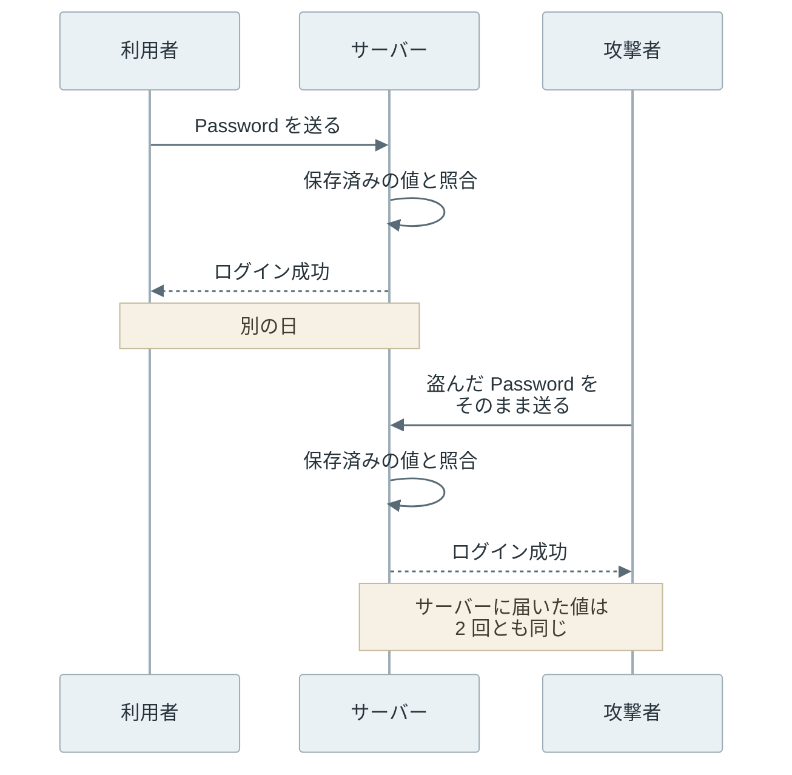
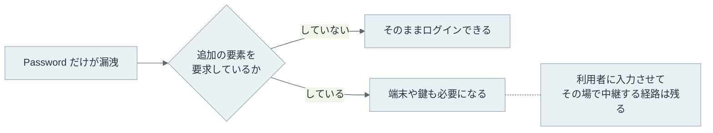
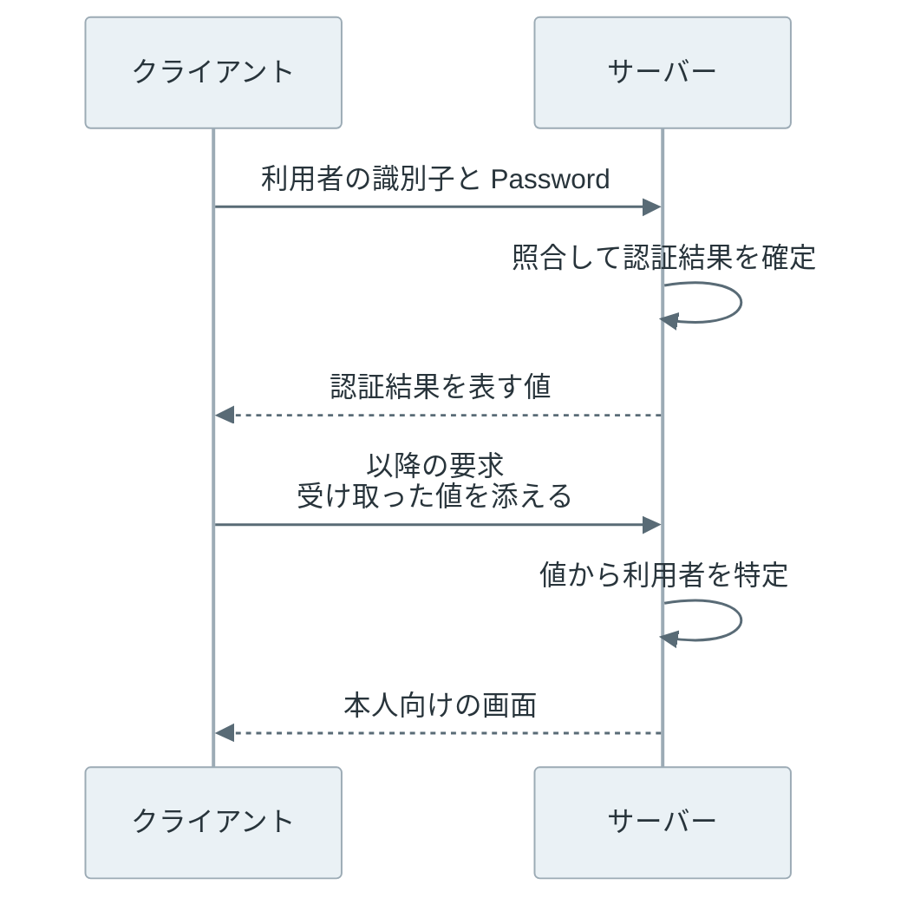
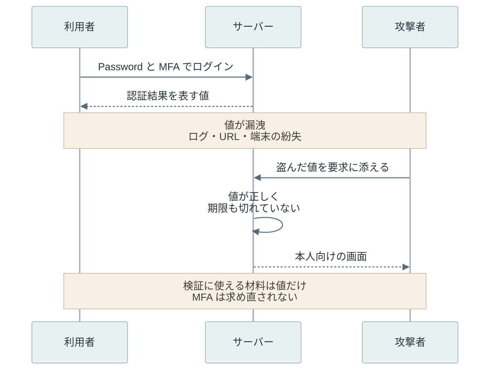
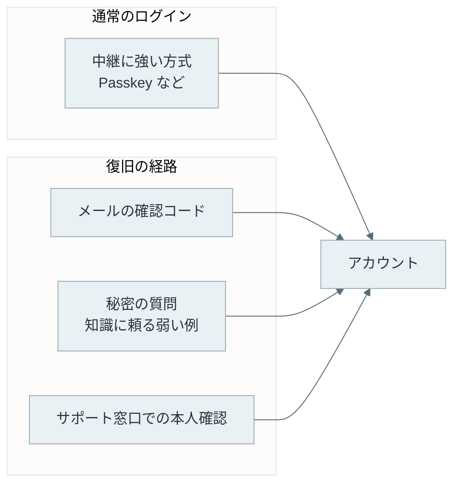
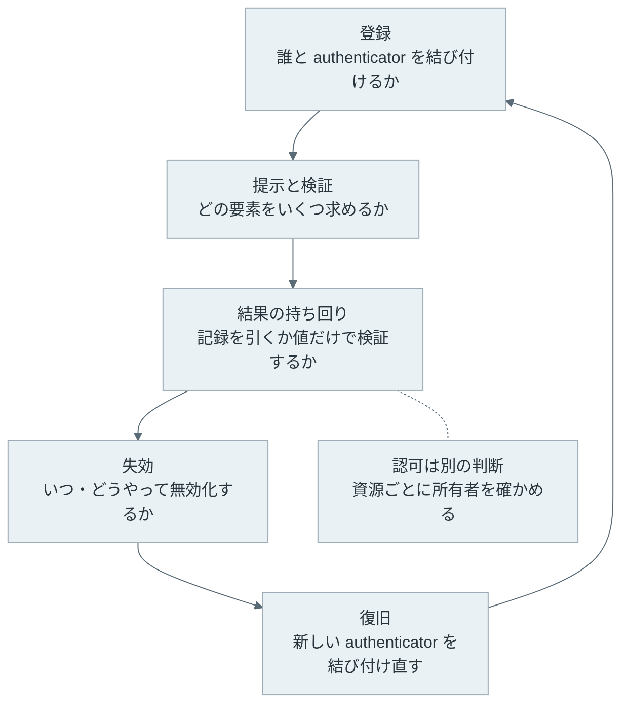

Authentication（認証）は、アクセスしてきた相手がどの利用者かを確認し、その利用者として扱うための処理です。例えば、注文履歴や配送先、決済手段を表示する画面は本人だけが開いて良いので、サーバーは画面を返す前に相手を確認します。認証は、その相手にその操作を許すかどうかを決める Authorization（認可）とは別の処理です。

サーバーが確認できるのは、相手が authenticator（認証器）を提示・制御できたことだけです。authenticator は、利用者に結び付けて登録しておく Password、セキュリティキー、OTP（One-Time Password）を生成するアプリ、秘密鍵を保持する端末のような、認証に使う手段を指します。「登録済みの authenticator を使った検証に成功した」から「本人だ」までには飛躍があります。

以下は、登録からログイン後の要求までの流れです。


- title: 登録
  body: 利用者と authenticator を結び付ける。
- title: 提示
  body: authenticator を使う。
- title: 検証
  body: 登録済みのものかを確認する。
- title: 結果の持ち回り
  body: 以降の要求に認証結果を運ぶ。


上記の図の登録が、後の全ての判断の土台になります。ここで結び付ける相手を誤ると、以降の検証をどれだけ厳密にしても別人を通し続けます。

ただし、アカウントに入る経路はログインだけではありません。以下は、通常のログインと復旧の経路を同じアカウントに入る扉として並べた図です。



ログインを Passkey で固めても、秘密の質問やサポート窓口で復旧できるなら、攻撃者は復旧の経路から入ります。

<br>

本記事では、Web アプリケーションが自分の利用者を認証する場合について、以下の疑問に答えます。

- 検証に成功したことと、相手が本人であることは何が違うのか。
- 認証要素の種類ごとに、何を根拠に相手を確認し、どこで外れるのか。
- MFA を通した後のセッションの値が漏れると、何が起きるのか。
- 復旧の経路は、なぜアカウントの強さを左右するのか。
- Authentication と Authorization は、何が違うのか。

組織をまたいで認証結果を受け渡す SAML や [OpenID Connect](../oauth-openid-connect/) の詳細は、本記事では扱いません。

---

### 値の一致と本人の区別

Password による認証では、届いた文字列と保存済みの値を突き合わせます。サーバーが保存しているのは文字列そのものではなく、利用者ごとに違うランダムな値（salt）を混ぜて、総当たりを遅くするよう計算を重くした[ハッシュ関数](/notes/blockchain-systems/hash-function/)（password hashing function）に掛けた検証用の値です。届いた文字列に同じ計算を掛けて、その値と比べます。

どう保存しても、比べているのは届いた値だけです。送ってきたのが登録した利用者なのか、その値を手に入れた別の相手なのかは区別できません。例えば、盗まれた Password が使われた時、サーバーからは次のように見えます。



上記の図の 2 回目の要求を止める材料は、照合の中にはありません。信用の根拠は照合そのものではなく、「その authenticator を使えるのは本人だけだ」とどこまで期待できるかにあります。認証方式の違いは、本人だけが使える状態をどう保つかの違いです。

ここで「本人確認」と呼んでいるものも、現実世界の身元の確認ではありません。氏名や生年月日のような属性を利用者に結び付ける工程は identity proofing（身元確認）と呼ばれ、認証とは別の工程になります。

---

### 認証要素の種類と根拠

authenticator は、何を根拠に本人だと見なすかで整理できます。軸になるのは、記憶していること・物を持っていること・身体や振る舞いの特徴の 3 つです。3 つが何を確認し、どこで外れるのかを整理すると、以下の通りです。

| 要素 | 確認していること | 例 | 外れる経路 |
| --- | --- | --- | --- |
| 知識 | 記憶している値を出せる | Password、PIN（暗証番号） | 推測・漏洩・入力先の誤り |
| 所持 | 登録済みのものを今持っている | セキュリティキー、秘密鍵を持つ端末 | 盗難・紛失・複製 |
| 生体 | 身体や振る舞いの特徴が一致する | 指紋、顔、虹彩 | 偽造・照合の誤り |

生体は、単独の authenticator としてサーバーに送られるとは限りません。[Passkey](../passkey/) では、指紋や PIN の照合を端末の中で行う user verification（利用者の確認）として使い、その結果によって秘密鍵を使うことが許可されます。サーバーに届くのは秘密鍵で作った[署名](/notes/blockchain-systems/digital-signature/)と、確認が済んだかどうかの印です。

[NIST SP 800-63B](https://pages.nist.gov/800-63-4/sp800-63b.html) も、生体的特徴がそれ単独では認証器と認められないとしています。

認証要素を分類するだけでなく、本人と判断できる条件も確認する必要があります。SMS で送る確認コードは、登録済みの電話番号を持つ端末に届くという意味で所持の要素として使われます。ただし、その保証は SIM swap（携帯会社をだまして番号を攻撃者の SIM に移す攻撃）や電話番号の移転で崩れます。

メールで送る確認コードは形が似ていても、確認しているのはそのメールアカウントにログインできることで、強さはそのメールアカウントの認証に依存します。NIST SP 800-63B も、メールは Password だけで読める場合や途中で傍受される場合があるとして、別の通信路で確認する authenticator（out-of-band authenticator）に使うことを禁じています。

<br>

MFA（Multi-Factor Authentication、多要素認証）は、異なる要素を 2 つ以上そろえないと通らないようにする考え方です。[同じ指針](https://pages.nist.gov/800-63-4/sp800-63b.html)は認証の保証水準（AAL、Authentication Assurance Level）を 3 段に分け、2 段目の AAL2 から異なる 2 つの要素による証明を求めています。以下は、要素を重ねた場合と重ねない場合の違いです。



上記の図で MFA が塞いでいるのは、漏洩した値だけで通る経路です。攻撃者が偽サイトを用意して確認コードをその場で本物のサーバーに中継する経路と、認証を通した後に発行された値を盗む経路は残ります。後の経路は「Bearer Token の性質と漏洩」で扱います。

中継への強さは方式で分かれます。[同じ指針](https://pages.nist.gov/800-63-4/sp800-63b.html)は、フィッシング耐性の方法として、応答を通信路に結び付けるチャネルの束縛と、応答に宛先のドメインを含めて照合させる検証者名の束縛の 2 つを挙げています。[Passkey](../passkey/) は後者で、偽サイトで作らせた応答には偽サイトのドメインが入るので、中継しても本物のサーバーの検証を通りません。

---

### 認証結果の持ち回り

HTTP の要求は 1 本ずつ独立しているので、要求のたびに authenticator を使う形も取れます。[HTTP Basic 認証](https://www.rfc-editor.org/rfc/rfc7617.html)がその例で、クライアントは同じ範囲への要求に利用者名と Password を毎回付け直します。この形では Password が全ての要求に載り、ログインのたびに発行して個別に失効させられる認証状態も無いので、止める手段は Password の変更やアカウントの無効化になります。

そのため、1 回の認証の結果を表す値を発行し、以降の要求ではその値を提示させる形が広く使われます。ログインから以降の要求までの流れは以下の通りです。



上記の図の 2 本目の矢印より後には Password が出てこず、認証の代わりを務めているのはサーバーが発行した値です。設計の分かれ目は「Session か Token か」という名前ではなく、検証のたびにサーバーの記録を引くかどうかにあります。

| | 記録を引いて検証する | 値の中だけで検証する |
| --- | --- | --- |
| 値の中身 | 記録を指す識別子。値に意味は無い | 利用者の識別子・有効期限と、その保護 |
| 検証の仕方 | 記録を引いて突き合わせる | 署名や MAC（Message Authentication Code）を検証する |
| 失効のさせ方 | 記録を消せば以降の照会で弾ける | 有効期限切れを待つか、失効の記録を別に引く |
| 保存の負担 | 発行した分だけ記録が必要 | 記録を持たない構成にできる |

Session ID は左の列の代表で、Cookie（サーバーが発行した値をブラウザが保存し、同じサイトへの要求に自動で添える仕組み）で運ぶ構成が広く使われます。Token も、中身を持たない opaque token を発行してサーバーに問い合わせる方式なら左の列に入ります。

[JWT](https://www.rfc-editor.org/rfc/rfc7519.html)（JSON Web Token）のような self-contained token は右の列を取りやすく、値の中に必要な情報が入っているので記録を引かずに済みます。右の列の値は署名や MAC で守られているので、中身を 1 文字でも書き換えると検証に失敗します。

上記の表で設計を大きく分けるのは、失効の行です。値の中だけで検証する方式では、失効の記録を別に引かない限り、個別の値を狙って無効にする手段がありません。ここを詰めずに有効期限を長く取ると、ログアウトしたはずの端末や、盗まれた値が期限まで動き続けます。

以下は、ログアウトの後に盗まれた値が使われた場合の 2 つの方式です。



---

### Bearer Token の性質と漏洩

発行した値は、提示すれば通るという意味で authenticator と同じ性質を持ちます。Session ID を Cookie で運ぶ構成も同じで、Cookie は値を自動で添えるので、値を持っていることがそのまま提示になります。

持っている相手が使えるトークンを Bearer Token と呼びます。RFC 6750 は「[any party in possession of the token (a "bearer") can use the token in any way that any other party in possession of it can](https://www.rfc-editor.org/rfc/rfc6750#section-1.2)」（その Token を保持するどの当事者も、他の保持者と同じようにその Token を使える）という性質を持つセキュリティトークンだと定義しています。

以下は、値が漏れた時の流れです。



サーバーには、攻撃者を利用者と区別する材料がありません。ログインに MFA を足しても、上記の図の攻撃者の要求は防げません。初回の認証はログインの時点で終わっており、この値はその結果を運んでいるだけだからです。

そのため、値が経路上に露出しないことが前提になります。[RFC 6750](https://www.rfc-editor.org/rfc/rfc6750#section-5.3) も、Bearer Token を伴う要求で常に TLS か同等の転送路の保護を使うよう求めています。TLS は、通信路を暗号化して経路上での盗み見と書き換えを防ぐ規約です。

TLS で経路を守っても、値は経路の外からも漏れます。2023 年に [Okta のサポート用システムが不正アクセスを受けた](https://sec.okta.com/articles/2023/11/unauthorized-access-oktas-support-case-management-system-root-cause/)時は、顧客が不具合の調査のために送った HAR ファイル（ブラウザの通信の記録）から、5 社の Okta のセッションが乗っ取られました。

Okta は、他社のサービスに代わって利用者を認証する事業者です。値はログインを済ませた後のものなので、上記の図のとおり Password も MFA も求め直されません。

<br>

値の漏洩は完全には避けられません。そのため、被害の続く時間を短くする手や、盗んだ値だけでは通らないようにする手が併用されます。有効期限を分単位まで縮める、重要な操作の前に認証をやり直させる、といった方法です。Okta も事件の後、管理者のセッションの値を通信元のネットワークに結び付け、ネットワークが変わったら認証をやり直させるようにしました。

他のサービスへのアクセスを許可する [OAuth](https://www.rfc-editor.org/rfc/rfc6749.html) では、[DPoP](https://www.rfc-editor.org/rfc/rfc9449.html)（Demonstrating Proof of Possession）のように、Bearer Token として渡していた Access Token を鍵に結び付け、要求のたびに対応する秘密鍵の保持を証明させる方法もあります。

---

### Account Recovery と認証の強さ

利用者は端末を失い、Password を忘れます。復旧の経路を用意しないと、そのアカウントは二度と開けなくなります。Account Recovery とは、利用できる authenticator を失った利用者が、新しい authenticator をアカウントに結び付けられる状態に戻るための手順です。

攻撃者から見ると、この復旧の経路も入口の 1 つです。ログインの経路と復旧の経路のどちらでも試せる状況では、アカウントの強さは弱い方の経路の強さで決まります。以下が 2 つの経路です。



上記の図の復旧の経路に並べた 3 つは、どれも通常のログインとは別の材料で通ります。メールの確認コードで復旧できるなら、そのアカウントの強さはメールアカウントの強さで決まります。秘密の質問の答えは、公開情報や過去の漏洩から推測できてしまいます。

メールの確認コードは、コード自体も総当たりの対象です。6 桁のコードを 1 つのアカウントに対して推測し続けた場合の突破確率は、[試行回数の制限](/notes/distributed-systems/rate-limiting/)ごとに計算できます。コードは 100 万通りから一様に選ばれ、攻撃者は同じコードに同じ値を 2 度試さないとします。

NIST SP 800-63B は別経路のコードの有効期限を [10 分以内](https://pages.nist.gov/800-63-4/sp800-63b.html#out-of-band-verifiers)とし、[連続した失敗を 100 回以下](https://pages.nist.gov/800-63-4/sp800-63b.html#throttle)に制限することを求めています。そこで、コードは 10 分で失効して攻撃者が新しいコードを要求し、制限が無ければ毎秒 10 回試すと仮定しました（全体は [lab/otp_guessing.py](https://github.com/nao1215/debimate/blob/main/content/notes/security/authentication/lab/otp_guessing.py)）。

```python
def success(rate, lockout, seconds):
    per_code = min(rate * CODE_LIFETIME, SPACE)  # 1 つのコードに試せる回数
    total = rate * seconds
    if lockout is not None:
        total = min(total, lockout)
    full_codes, rest = divmod(total, per_code)
    fail = (1 - per_code / SPACE) ** full_codes * (1 - rest / SPACE)
    return 1 - fail
```

<br>

<details>
<summary>lab/otp_guessing.py の出力</summary>

```console
$ python3 lab/otp_guessing.py
code space=1,000,000  code lifetime=600 s
setting                            1 min         1 h       1 day     30 days
no limit (10 guesses/s)          0.0600%     3.5464%    57.9623%   100.0000%
rate limit 5 guesses/min         0.0005%     0.0300%     0.7174%    19.4269%
lockout after 100 failures       0.0100%     0.0100%     0.0100%     0.0100%
lockout after 10 failures        0.0010%     0.0010%     0.0010%     0.0010%
```

</details>

<br>



6 桁という長さは同じでも、制限が無ければ 1 日推測を続けるだけで 58% の確率で当たります。毎分 5 回の制限は時間を稼ぐだけで、30 日続ければ 19% に達します。突破確率に上限を置くのは、失敗の回数でロックする設定です。

サポート窓口での本人確認も、認証の一部として扱う対象です。オペレーターが電話で伝えられた氏名と生年月日だけで Password を再発行できるなら、その手順が最も通りやすい入口になります。

頼る材料は、本人が知っていそうな知識ではなく、既に登録されている別の authenticator、登録時に渡した使い捨ての Recovery Code、確認済みの予備の連絡先（Recovery Contact）のように、登録の時点で結び付けたものにします。

弱い復旧の経路を減らす手当ての 1 つに、authenticator をあらかじめ複数登録させる方法があります。予備が登録されていれば、端末を 1 台失っても通常の経路で通れるので、復旧のためだけに弱い手順を用意する必要が減ります。

もう 1 つは、復旧の経路を強くする方向です。既に身元確認を行っているアカウントなら、復旧の時に identity proofing の一部をやり直し、以前確認した人物との一致を改めて照合する方法もあります。

復旧の完了までに待機期間を置いて本人に通知し、取り消せるようにする方法も、突破がそのまま乗っ取りにならないようにする手当てです。NIST SP 800-63B は、復旧のたびに本人へ通知することを必須にしています。

---

### Authentication と Authorization の違い

Authorization（認可）は、その相手にその操作を許すかどうかを決める処理です。相手が誰かを確認する認証とは、答える問いが違います。

| | Authentication | Authorization |
| --- | --- | --- |
| 答える問い | どの利用者として扱うか | その利用者にこの操作を許すか |
| 判断の材料 | authenticator の検証結果 | 利用者の属性・役割・資源の所有者 |

2 つを混ぜると、認証を通した相手が他人の資源に届く実装ができます。他人の注文番号を URL に入れると中身が見える、という形が代表です。認証は「誰か」までしか答えないので、その資源の所有者かどうかは要求ごとに確認する必要があります。役割や所有者をどう表すかという認可の設計は、本記事では扱いません。

---

### 実装で Authentication として設計する範囲

ログイン画面と照合の処理だけを Authentication として扱うと、ここまでで見た穴がその外側に残ります。以下が設計の対象になる範囲です。



上記の図は、冒頭で見た流れに、失効と復旧を足した形です。復旧から登録に線が戻るのは、復旧が新しい authenticator を結び付け直す処理だからです。点線で外した認可は、通った相手に何を許すかの判断なので、この流れとは別に設計します。

失効の段は、ログアウト・Password の変更・端末の紛失の届け出に対して、発行済みの値をどう扱うかの設計です。値の中だけで検証する形なら、無効になるまでの時間の上限は有効期限の長さで決まります。

「ログインできた相手を本人として扱って良い」と言うには、この 5 つの段のどこにも弱い所が無いことが必要です。authenticator を本人だけが使えることは、その条件の 1 つにすぎません。攻撃者は段を選べるので、認証方式を比較する前に、最も弱い手順を改善する必要があります。
