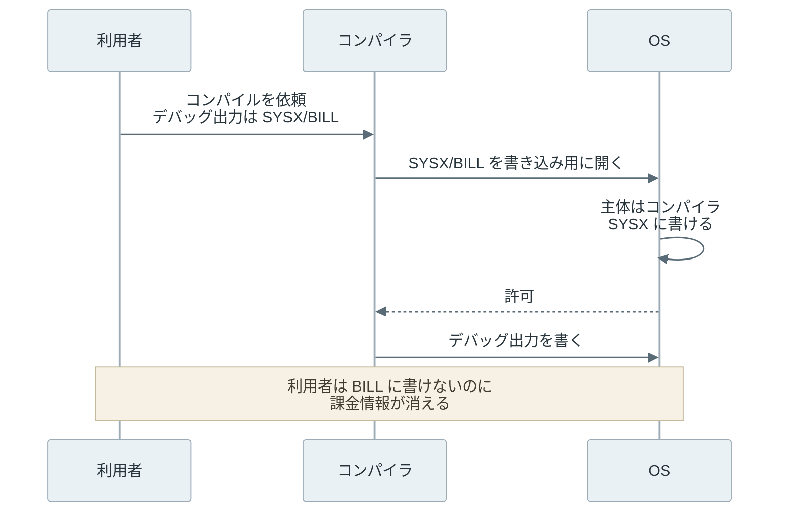
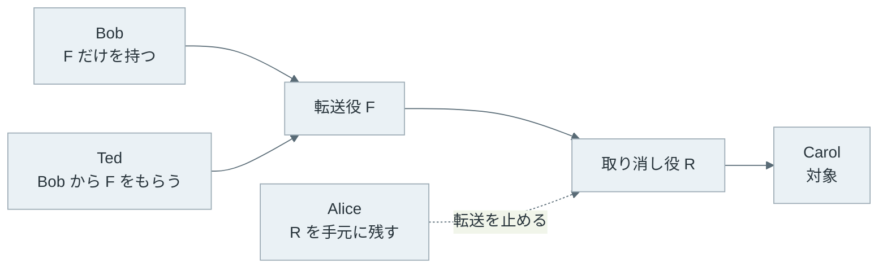

1970 年代後半の Tymshare のタイムシェアリングシステムで、コンパイラが課金情報のファイルを上書きしました。コンパイラは利用統計を書くために、SYSX ディレクトリに書ける権限を持っていました。

同じディレクトリには課金ファイル `SYSX/BILL`（原文の表記は `(SYSX)BILL`）もありました。ある利用者がデバッグ出力の書き込み先に `SYSX/BILL` を指定すると、OS はコンパイラの権限で書き込みを許し、課金情報が消えました。

Norm Hardy 氏が 1988 年に [The Confused Deputy](http://cap-lore.com/CapTheory/ConfusedDeputy.html) として発表した話です（本人は細部を変えた「ほぼ実話」としています）。依頼者の指定で自分の権限を使ってしまうこの種の問題は、Confused Deputy（混乱した代理人）と呼ばれます。

Capability-based Security（ケイパビリティベースのセキュリティ）は、対象を指す参照と、その対象への権限を 1 つにまとめた capability を持っている時だけ操作を許す設計です。OS やサーバーは「誰が頼んだか」ではなく、「どの capability を提示したか」で判断します。上記の事故に当てはめると、コンパイラがデバッグ出力を書けるのは、利用者が自分で開いて渡したファイルだけです。

以下は、主体と対象の間の権限を 1 つの表にしたアクセス行列で、ACL（Access Control List）と capability がそれぞれどこを切り出したものかを示した図です。



ACL は列を対象に付け、capability は行を主体に持たせます。

次は、課金ファイルの事故を 2 つの設計で比べた図です。左の ACL 型は、ファイルごとに「誰が何をして良いか」の表を持ち、要求した主体の名前で表を引きます。



なお、Linux の [capabilities(7)](https://man7.org/linux/man-pages/man7/capabilities.7.html)（`CAP_NET_ADMIN` など）は root の特権を細かく分けた仕組みで、本記事の capability とは別物です。

<br>

本記事では、ファイルディスクリプタを使った実験と一緒に、capability の考え方を説明します。次の疑問を扱います。

- ACL や RBAC と比べて、権限をどこに置き、何で判断するのか。
- コンパイラはなぜ課金ファイルを上書きできたのか。
- 渡した権限は、複製・委譲・漏洩・取り消しでどう振る舞うのか。
- ファイルディスクリプタ、WASI、署名付き URL は、どこまで capability として働くのか。

CPU が capability を扱うハードウェア（[CHERI](https://www.cl.cam.ac.uk/research/security/ctsrd/cheri/) など）は、本記事では説明しません。

---

### アクセス行列の行と列

ACL と capability の違いは、[Lampson 氏の Protection](https://www.bwlampson.site/08-Protection/WebPage.html)（1971 年）で整理されたアクセス行列で比べると掴みやすくなります。行に主体（操作する側）、列にオブジェクト（操作される側）を並べ、交わるセルに許す操作を書きます。課金ファイルの例では、以下の通りです。

| 主体 \ オブジェクト | alice/debug.txt | SYSX/STAT | SYSX/BILL |
| --- | --- | --- | --- |
| 利用者 alice | 読み書き | なし | なし |
| コンパイラ | なし | 書き込み | 書き込み |

列を切り出してオブジェクトに付けると ACL になり、OS は要求した主体を確認してからこの表を引きます。行を切り出して主体に持たせると capability の一覧（C-list）になります。1966 年の [Dennis 氏と Van Horn 氏の論文](https://doi.org/10.1145/365230.365252)は、計算が使って良い対象と操作の一覧を C-list として表しました。

Miller 氏らの [Capability Myths Demolished](https://papers.agoric.com/papers/capability-myths-demolished/full-text/)（2003 年）は、2 つを等価とみなす考えを「Equivalence Myth」と呼んで否定しています。ACL 型では、対象の名前と、それを使って良いかの判断が別々に流れます。

capability 型（論文の言う object-capability）では、1 つの参照が対象の指定と権限を兼ねるので、権限を持たずに対象だけを指せません。論文は、使う権限を要求の中で選ぶ性質が Confused Deputy を避けるのに役立つとしています。

[RBAC](https://csrc.nist.gov/projects/role-based-access-control)（Role-Based Access Control）は、主体と権限の間に役割（role）を挟みます。権限の管理は楽になりますが、判断の入口は「この主体はどの役割を持つか」で、誰が頼んだかで判断する点は ACL と変わりません。

capability が権限として成り立つには、持ち主が勝手に作れないことが前提です。Unix のファイルディスクリプタ（fd）はカーネルの表を指す番号で、数字を書き換えても自分の表にない対象には届きません。

ただし、Capability Myths Demolished は fd を「nearly, but not quite」（ほぼ同じだが完全ではない）object capability と評価しています。fd を運ぶ Unix ドメインソケット自体は、ファイルのパーミッション（ACL）で守られているからです（後の実験でもソケットを `0o666` にしています）。

---

### Confused Deputy と ambient authority

代理人（deputy）は、他者に頼まれた仕事を自分の権限で行うプログラムで、コンパイラもその 1 つです。事故の流れを順に並べると、以下の通りです。



上記の図で、利用者もコンパイラも規則を破っていません。Hardy 氏は、コンパイラが 2 つの出どころの権限を持ち、どちらを使うかを表す手段がなかったことを原因に挙げています。統計は自分の権限で、デバッグ出力は利用者の権限で書くつもりでも、OS への要求は「このファイルを開く」の 1 種類しかありません。

<br>

その場にいるだけで使われる権限は、ambient authority と呼ばれます。Capability Myths Demolished は「使い手が選ばずに行使される権限」と定義し、Unix のファイルパーミッションを例に挙げています。`open()` の呼び出し元は資格情報を選んで渡さないからです。

Tymshare では、使う権限を切り替えるシステムコールを足しましたが、一部のアプリケーションでは出どころが 2 つでは足りませんでした。capability 型の解決では、コンパイラは統計ファイルへの capability を最初から持ち、デバッグ出力は利用者が渡した capability に書きます。

Web にも似た構図があります。[CSRF](https://owasp.org/www-community/attacks/csrf)（Cross-Site Request Forgery）では、ブラウザが別サイトから起動された要求にも Cookie を付けて送ります（`SameSite` 属性の扱いはブラウザと設定で異なります）。ブラウザが代理人として利用者の権限を使い、サーバーは Cookie の持ち主の操作として処理します。

[SSRF](https://owasp.org/www-community/attacks/Server_Side_Request_Forgery)（Server-Side Request Forgery）では、サーバーが代理人です。利用者の指定した URL を取得し、サーバーだけが届く内部のネットワークに要求を出します。どちらも対策は Cookie の属性や接続先の制限など個別に用意されており、capability だけで解決するわけではありません。

---

### ファイルディスクリプタを渡す実験

Unix の fd は、身近な capability の例です。`open()` は、パスと呼び出し元の資格情報（UID・GID など）から許可を判断し、開いたファイルを指す fd を返します。その後の `write()` は fd を開いた時のモードで判断され、パス名は使われません（[open(2)](https://man7.org/linux/man-pages/man2/open.2.html)）。

fd は、Unix ドメインソケットの `SCM_RIGHTS` で別のプロセスに渡せます。受け取ったプロセスには、`dup()` と同じく同じ開いたファイルを指す fd が増えます（[unix(7)](https://man7.org/linux/man-pages/man7/unix.7.html)）。Python では 3.9 で追加された [socket.send_fds と socket.recv_fds](https://docs.python.org/3/library/socket.html#socket.send_fds) で扱えます。

実験では、UID 2001 をコンパイラ、UID 2002 を利用者 alice にして事故を再現しました。`SYSX/` はコンパイラだけ、`alice/` は alice だけが読み書きできます。以下は、[run.py](lab/run.py) のコンパイラ側で、名前を受け取るか fd を受け取るかを分ける部分です。

```python
    if mode == "path":
        name = conn.recv(1024).decode()
        out = os.open(name, WRITE, 0o644)  # opened with the compiler's authority
    else:
        _, fds, _, _ = socket.recv_fds(conn, 1024, 1)
        if not fds:
            return
        out = fds[0]  # only what the caller handed over
```

名前を受け取った時はコンパイラ自身の権限で `open()` し、fd を受け取った時は渡されたものをそのまま使います。

<br>

<details>
<summary>run.py の全体（2 つの UID でコンパイラと alice を動かし、4 つのケースを順に実行する）</summary>

```python
"""Confused deputy: passing a path name vs. passing an open file descriptor.

Run as root inside a throwaway container. Two unprivileged UIDs play the
compiler (owner of SYSX) and the user (alice).
"""

import os
import socket
import subprocess
import sys
import tempfile

COMPILER, ALICE = 2001, 2002
WRITE = os.O_WRONLY | os.O_CREAT | os.O_TRUNC


def compiler(mode, sock_path, sysx):
    # The compiler's own authority: it may write files in its home directory.
    stat = os.open(os.path.join(sysx, "STAT"), os.O_WRONLY | os.O_APPEND)
    server = socket.socket(socket.AF_UNIX)
    server.bind(sock_path)
    os.chmod(sock_path, 0o666)
    server.listen()
    print("ready", flush=True)
    conn, _ = server.accept()
    if mode == "path":
        name = conn.recv(1024).decode()
        out = os.open(name, WRITE, 0o644)  # opened with the compiler's authority
    else:
        _, fds, _, _ = socket.recv_fds(conn, 1024, 1)
        if not fds:
            return
        out = fds[0]  # only what the caller handed over
    try:
        os.write(out, b"debug: compiled main.f\n")
        result = "wrote debug output"
    except OSError as e:
        result = f"{type(e).__name__}: {e.strerror}"
    os.write(stat, b"FORT used\n")
    conn.sendall(result.encode())


def user(mode, sock_path, target, flags):
    conn = socket.socket(socket.AF_UNIX)
    conn.connect(sock_path)
    if mode == "path":
        conn.sendall(target.encode())
    else:
        try:
            fd = os.open(target, int(flags), 0o644)  # opened with alice's authority
        except PermissionError as e:
            print(f"  alice: cannot open {os.path.basename(target)}: {e.strerror}")
            return
        socket.send_fds(conn, [b"compile main.f"], [fd])
        os.close(fd)
    print("  compiler:", conn.recv(1024).decode())
    if mode == "fd":
        with open(target) as f:
            print(f"  alice reads {os.path.basename(target)}:", f.read().strip() or "(empty)")


def run_as(uid, *args, **kwargs):
    return subprocess.Popen(
        [sys.executable, __file__, *map(str, args)],
        user=uid, group=uid, extra_groups=[], text=True, **kwargs,
    )


def main():
    sys.stdout.reconfigure(line_buffering=True)
    with tempfile.TemporaryDirectory() as lab:
        os.chmod(lab, 0o755)
        sysx, home = os.path.join(lab, "SYSX"), os.path.join(lab, "alice")
        run_dir = os.path.join(lab, "run")
        for directory, uid, perm in ((sysx, COMPILER, 0o700), (home, ALICE, 0o700), (run_dir, COMPILER, 0o755)):
            os.mkdir(directory)
            os.chmod(directory, perm)
            os.chown(directory, uid, uid)
        bill = os.path.join(sysx, "BILL")
        notes = os.path.join(home, "notes.txt")
        for path, uid in ((os.path.join(sysx, "STAT"), COMPILER), (notes, ALICE)):
            open(path, "w").close()
            os.chown(path, uid, uid)
        cases = [
            ("1. path name SYSX/BILL", "path", bill, 0),
            ("2. fd of alice/debug.txt", "fd", os.path.join(home, "debug.txt"), WRITE),
            ("3. fd of SYSX/BILL", "fd", bill, WRITE),
            ("4. read-only fd of alice/notes.txt", "fd", notes, os.O_RDONLY),
        ]
        for label, mode, target, flags in cases:
            with open(bill, "w") as f:
                f.write("alice 3h 1200yen\n")
            os.chown(bill, COMPILER, COMPILER)
            sock_path = os.path.join(run_dir, "fort.sock")
            print(label)
            server = run_as(COMPILER, "compiler", mode, sock_path, sysx, stdout=subprocess.PIPE)
            assert server.stdout.readline() == "ready\n"
            run_as(ALICE, "user", mode, sock_path, target, flags).wait()
            server.wait()
            os.unlink(sock_path)
            with open(bill) as f:
                print("  BILL:", f.read().strip())
        with open(os.path.join(sysx, "STAT")) as f:
            print("STAT:", len(f.readlines()), "lines written with the compiler's own authority")


if __name__ == "__main__":
    if len(sys.argv) == 1:
        main()
    elif sys.argv[1] == "compiler":
        compiler(*sys.argv[2:])
    else:
        user(*sys.argv[2:])
```

</details>

<br>

UID を切り替えるために root で起動するので、使い捨てのコンテナで動かします。`lab/` で次のように実行します。

```bash
docker run --rm --network none -v "$PWD":/lab:ro python:3.13-slim python3 /lab/run.py
```

Python 3.13.18 での結果をケースごとにまとめると、以下の通りです。

| ケース | 何を渡したか | 結果 |
| --- | --- | --- |
| 1 | 名前 `SYSX/BILL` | コンパイラの権限で開かれ、課金情報が上書きされた |
| 2 | alice が書き込み用に開いた `debug.txt` の fd | `debug.txt` にだけ書かれ、BILL は無傷 |
| 3 | alice が `SYSX/BILL` を開こうとした | alice の権限で開けず、渡すものが作れない |
| 4 | alice が読み取り専用で開いた fd | コンパイラの `write()` が `EBADF` で失敗 |

<br>

<details>
<summary>run.py の出力</summary>

```text
$ docker run --rm --network none -v "$PWD":/lab:ro python:3.13-slim python3 /lab/run.py
1. path name SYSX/BILL
  compiler: wrote debug output
  BILL: debug: compiled main.f
2. fd of alice/debug.txt
  compiler: wrote debug output
  alice reads debug.txt: debug: compiled main.f
  BILL: alice 3h 1200yen
3. fd of SYSX/BILL
  alice: cannot open BILL: Permission denied
  BILL: alice 3h 1200yen
4. read-only fd of alice/notes.txt
  compiler: OSError: Bad file descriptor
  alice reads notes.txt: (empty)
  BILL: alice 3h 1200yen
STAT: 3 lines written with the compiler's own authority
```

</details>

<br>

出力は [output.txt](lab/output.txt) にもあります。

ケース 1 では、alice 自身は BILL を開けないのに、コンパイラを通すと書けました。fd を渡す設計では、権限の確認は alice が `open()` した時点で alice の権限で行われます。ケース 4 のように、fd は「読み取りだけ」という範囲も運びます。`STAT` は、要求が届かなかったケース 3 以外の 3 回分が記録されています。

ただし、コンパイラのプロセスは UID 2001 のままなので、コードが `open("SYSX/BILL")` を呼べば今も書けます。消えたのは、利用者の指定が名前としてコンパイラの権限に届く経路だけです。名前で開く権限まで取り上げるには、次の節の Capsicum のような OS の仕組みが必要です。

---

### 複製・委譲・漏洩・取り消し

capability は、持っている者が使える権限です。実験の alice が fd を渡したように、渡すことがそのまま委譲になり、管理者の承認を挟みません。受け取ったコンパイラも、同じ方法で fd を別のプロセスに渡せます。

ネットワーク越しの capability は、多くの場合に推測できない文字列です。[Amazon S3 の署名付き URL](https://docs.aws.amazon.com/AmazonS3/latest/userguide/using-presigned-url.html) は、受け取った人が特定のオブジェクトをダウンロード（またはアップロード）でき、期限までは何度でも使えます。[RFC 6750](https://www.rfc-editor.org/rfc/rfc6750) の Bearer Token として運ぶ OAuth の Access Token も、持っている者なら誰でも使えます（漏洩の例は [Authentication](/notes/security/authentication/) のノートで説明しています）。

その代わりに、ログやスクリーンショットから漏れた文字列は、拾った人がそのまま使えます。そのため、capability は漏れた時の範囲を最初から絞って作ります。署名付き URL なら、1 つのオブジェクト、1 つの HTTP メソッド、短い有効期限に限って発行します。

<br>

取り消しは、ACL より工夫が必要です。ACL なら主体の項目を消せば終わりますが、capability は持ち主の手元にあり、発行した側が取り上げることはできません。

Capability Myths Demolished は、間に転送役を挟めばアクセスを取り消せることを示しています。1974 年の Redell 氏の方式で、Miller 氏の[博士論文](http://www.erights.org/talks/thesis/)では caretaker（世話役）パターンと呼ばれています。



Alice は Carol ではなく転送役 F を Bob に渡し、取り消し役 R を手元に残します。Bob が Ted に渡せるのも F だけなので、Alice が R で転送を止めると、Bob と Ted の両方が Carol に届かなくなります。

S3 の署名付き URL は、生成に使った認証情報を無効にするか、その主体やバケットのポリシーで拒否すれば、期限前でも使えなくなります。しかし、どれも主体単位・オブジェクト単位の操作で、URL を 1 本だけ止める API はありません。取り消し役 R のように、1 つの委譲だけを選んで止める形ではないのです。

Linux の fd にも、渡した後に送り手が取り上げる汎用の仕組みがありません。fd で取り消しまで設計するなら、間に中継するプロセスを置き、そのプロセスが中継を止める形になります。

---

### 適用例と ambient authority が残る所

どの層が capability として働き、何が capability の外で決まるかで整理すると、以下の通りです。

| 仕組み | capability として働くもの | capability の外で決まるもの |
| --- | --- | --- |
| Unix の fd | 開いた後の fd。書き込みは開いた時のモードで判断される | パス名での `open()` や `connect()` は UID などで判断される（ambient authority） |
| [Capsicum](https://www.usenix.org/conference/usenixsecurity10/capsicum-practical-capabilities-unix)（FreeBSD） | fd と、その fd に許す操作の範囲 | `cap_enter()` を呼ぶまでの処理。その間に開いた fd は、権限を絞らないと広いまま残る |
| [WASI](https://github.com/WebAssembly/WASI) のファイルシステム | ホストが事前に開いて渡したディレクトリ（preopened directory） | どのディレクトリを渡すかは、ホストの設定で決まる |
| 署名付き URL | URL（対象・操作・期限が署名で固定される） | 要求は、URL を生成した IAM 主体の資格情報と権限で処理される |
| OAuth の Access Token | Token と、その scope | Token に何を許すかは、発行時の同意と認可サーバーの判断で決まる |

[capsicum(4)](https://man.freebsd.org/cgi/man.cgi?query=capsicum&sektion=4) によると、Capsicum は fd を capability にし、`cap_enter()` で capability mode に入ったプロセスからファイルシステムなどのグローバルな名前空間を取り上げます。この状態では、`openat()` も渡されたディレクトリの fd の下しか開けません。

実験のコンパイラが capability mode で動いていれば、`open("SYSX/BILL")` も失敗します。Unix の API を残したまま capability を足す設計で、man ページは hybrid capability system と呼んでいます。

[wasi-filesystem](https://github.com/WebAssembly/wasi-filesystem) も、グローバルな名前空間を暗黙に参照せず、渡されたディレクトリのハンドルの中だけでパスを解決します。[Wasmtime](https://docs.wasmtime.dev/cli-options.html) なら `wasmtime --dir . foo.wasm` のように、渡すディレクトリを起動時に指定します。

OAuth の Access Token の発行までの流れは、[OAuth 2.0 / OpenID Connect](/notes/security/oauth-openid-connect/) のノートで説明しています。

<br>

一方で、ambient authority を全て消すのは簡単ではありません。普通の Linux のプロセスは、UID が許すパスなら名前で開け、到達できる IP アドレスならどこにでも接続できます。SSRF は、このネットワークの ambient authority を突く攻撃です。また、同じプロセスの中のライブラリは、プロセスが持つ fd や認証情報を全て使えるので、プロセス内の部品同士は区切れません。

---

### 利点

- 要求の中で使う権限を選ぶので、代理人が他人の指定で自分の権限を使う Confused Deputy を作りにくい
- ambient authority を外せば渡したものしか使えないので、部品ごとに最小限の権限を与えやすい
- fd のように参照が権限を兼ねる場合、開いた後の操作では名前を引き直さない

### 欠点

capability は、権限を持ち主の手元に置き、渡すだけで委譲できるようにしています。その代わりに、次の制約があります。

- 誰が今その権限を持っているかは発行側の表から一覧できず、監査が難しい
- 取り消すには、転送役や期限を最初から設計に入れておく必要がある
- ネットワーク越しの文字列の capability は、漏れると拾った者がそのまま使える
- 既存の OS やライブラリは名前で開く API が前提で、ambient authority を外すと書き直しが多い

### 適さないケース

- 「誰に何を許しているか」の一覧が監査で求められ、権限の流れを追う仕組みを作れない場合
- 権限を即時に、かつ持ち主の協力なしに取り上げる必要があるのに、転送役を挟めない場合
- プロセス内の全てのコードが同じ権限で動き、capability を渡す境界を作れない場合

上記は、ACL と組み合わせる場所を決める材料です。例えば、署名付き URL の発行は AWS の IAM（Identity and Access Management）のポリシーで許可し、発行した URL は capability として配ります。
