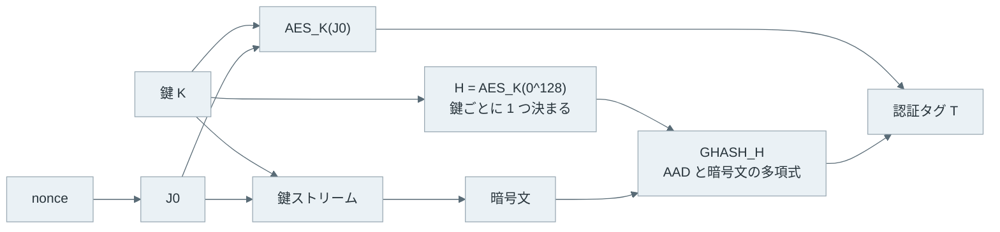
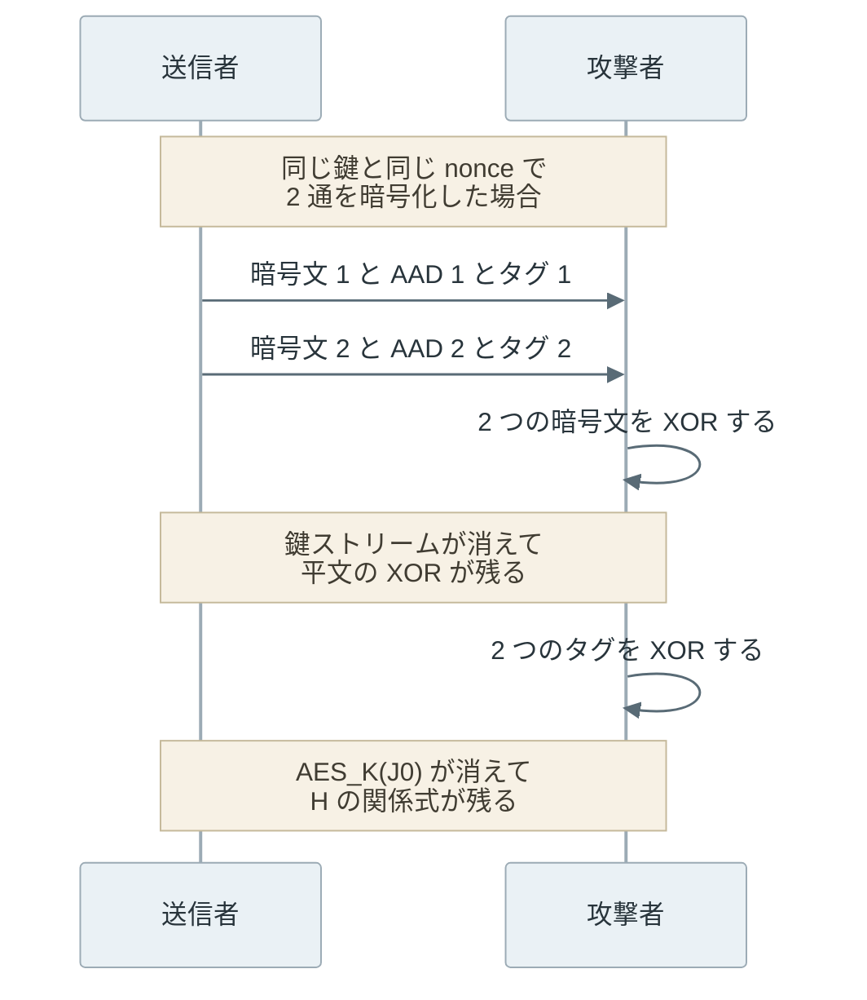
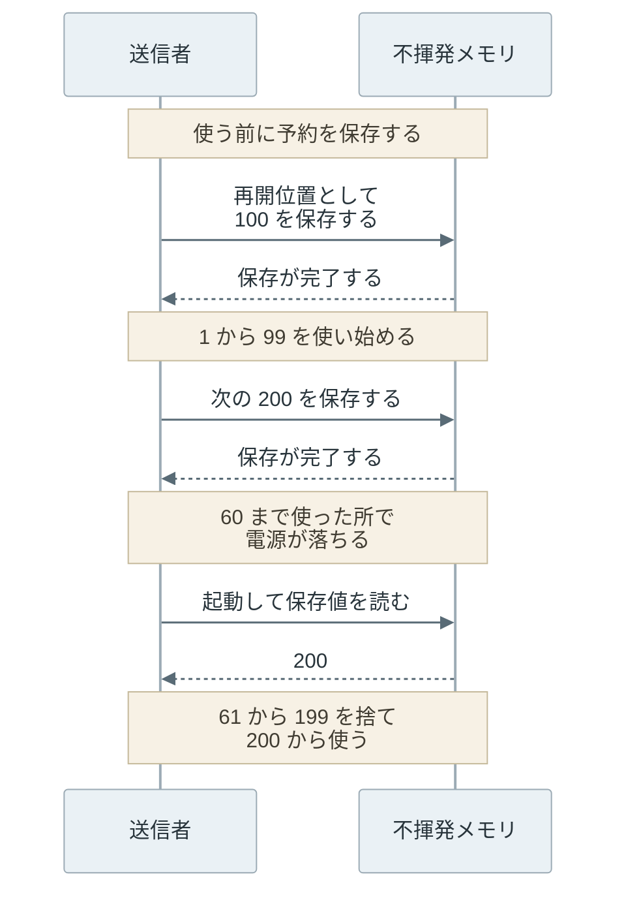
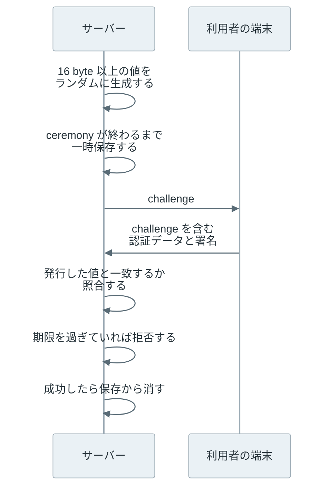
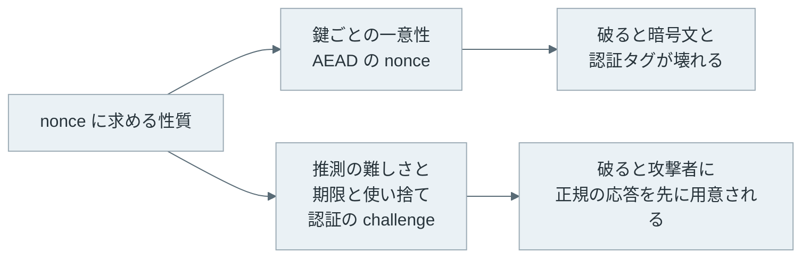
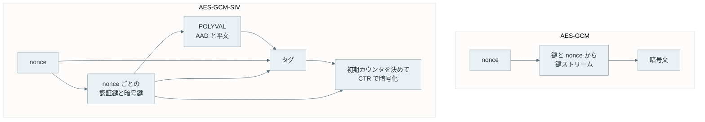

nonce（number used once）は、プロトコルがやり取りするデータに含める、繰り返して使わない値です。[RFC 4949](https://www.rfc-editor.org/rfc/rfc4949.txt) は「A random or non-repeating value that is included in data exchanged by a protocol」（プロトコルがやり取りするデータに含める、ランダムまたは繰り返さない値）と定義しています。

同じ定義は、その目的を「usually for the purpose of guaranteeing liveness and thus detecting and protecting against replay attacks」（多くは liveness、つまり相手がその場で応答していることを保証し、それによって replay 攻撃を検出して防ぐ目的で使う）と続けます。[replay](/notes/blockchain-systems/replay-protection/) は、過去のやり取りを記録して後から送り直す攻撃です。

ただし、nonce と呼ばれる値に求められる性質は、用途によって違います。本記事では 3 つの用途を扱います。1 つ目は、暗号化と改竄の検出を 1 つの操作で行う方式である AEAD（authenticated encryption with associated data）に渡す nonce です。2 つ目は、ログインで使う challenge（サーバーが毎回出し、利用者が署名して返す値）です。3 つ目は、署名方式の ECDSA（Elliptic Curve Digital Signature Algorithm）が署名のたびに選ぶ秘密の値 k で、文献では k も nonce と呼びます。


- title: AEAD の nonce
  items:
  - 同じ鍵の中で重複しない
  - 予測されても構わない
- title: 認証の challenge
  items:
  - 推測できない
  - 期限内に 1 度だけ受け付ける
- title: 署名の nonce（k）
  items:
  - 違うメッセージに同じ値を使わない
  - 予測できず、署名の後も秘密のまま


nonce の値を選ぶのは、多くの場合ライブラリではなく呼び出す側です。AEAD の 1 つである AES-GCM を低レベルな API から使うと、鍵とは別に nonce という値を渡します。nonce を内部で作る高レベルな API もあります。

同じ鍵と同じ nonce で、内容の違う 2 通のメッセージを暗号化すると、攻撃者は 2 通の平文の関係を計算できます。改竄の検出のために暗号文に添える認証タグも、その鍵で作ったものは信用できなくなります。鍵は漏れておらず、暗号文の形式も普段通りで、受信側の復号も成功します。

以下は、1 つの鍵で使う nonce の範囲を帯で表し、送信者ごとに範囲を分けた場合と、再起動でカウンタが戻った場合を比べた図です。



赤い枠の区間では、同じ鍵と nonce の組が 2 度使われます。

<br>

本記事では、その「一度」が何に対する一度なのかと、用途ごとに何が要求されるのかを説明します。扱う疑問は次の 5 つです。

- 同じ鍵と nonce の組を再利用すると、なぜ暗号文と認証タグの両方が壊れるのか。
- 「一度」は、何の範囲で数えるのか。
- カウンタと乱数のどちらで nonce を作り、それぞれ何を管理するのか。
- AEAD の nonce、認証の challenge、署名の k で、要求はどう違うのか。
- 一意性を保証できない場合に、どの AEAD を検討するのか。

nonce を乱数で作る時に、乱数の生成器に求める性質は [Random Number](../random-number/) のノートに譲ります。

---

### 鍵と nonce の組の再利用

AES-GCM は、鍵と nonce から鍵ストリーム（平文と同じ長さの疑似乱数列）を作り、平文と XOR して暗号文にします。XOR は bit を桁ごとに比べ、違えば 1、同じなら 0 を返す演算で、同じ値を 2 回 XOR すると元に戻ります。

同じ鍵ストリームを 2 度使うと、この性質を攻撃者が利用できます。平文を `P1`・`P2`、鍵ストリームを `S` と書くと、暗号文は `P1 xor S` と `P2 xor S` で、2 つを XOR すると `S` が消えて `P1 xor P2` が残ります。攻撃者は鍵を知らないまま、2 通の平文の関係を手に入れます。

壊れるのは、中身を隠す機密性だけではありません。攻撃者が、書き換えた暗号文に合う認証タグを作れるようになることもあります。タグが書き換えを検出する範囲は、暗号文と AAD（additional authenticated data。暗号化はせず、改竄の検出だけを受け持たせるデータで、宛先やヘッダのような部分を入れます）です。

nonce が 96 bit で、タグを短縮せずに 128 bit すべて使う場合、その組み立ては次の 2 段です。ここからは暗号鍵を `K` と書きます。`AES_K(x)` は鍵 `K` で `x` を暗号化すること、`0^128` は 0 が 128 個並んだブロック（AES が一度に暗号化する 128 bit の単位）を表します。

```text
H = AES_K(0^128)
T = AES_K(J0) xor GHASH_H(AAD, ciphertext)
```

`H` は鍵で 0 のブロックを暗号化した値で、鍵ごとに 1 つ決まります。nonce は入りません。`J0` は nonce から作られる値で、`GHASH_H` は `H` を未知数と見ると、AAD と暗号文を係数に持つ多項式の計算です。



タグを nonce に結び付けているのは `AES_K(J0)` です。タグ全体は nonce にも依存するので、同じ鍵と同じ nonce を 2 度使えば `AES_K(J0)` も同じ値になります。

2 つのタグを XOR すると共通の `AES_K(J0)` が消え、`H` を未知数とする関係式が残ります。1 組では `H` の候補が複数残りますが、同じ鍵と同じ nonce で作られた暗号文とタグの組を集めるほど、候補は減ります。



候補が 1 つに絞れると、攻撃者は観測した暗号文・AAD・タグからその nonce の `AES_K(J0)` を復元し、改変した暗号文と AAD に合うタグを計算できます。観測していない nonce では `AES_K(J0)` が分からないので、何も見ずに任意のタグを作れるわけではありません。

しかし `H` はその鍵に 1 つなので、影響は再利用した nonce だけに閉じません。`H` が分かれば、1 度しか使っていない nonce の通信でも、観測した暗号文と AAD から `GHASH_H` を計算し、タグと XOR してその nonce の `AES_K(J0)` を求められます。あとは上記と同じく、改変した暗号文に合うタグを作れます。[RFC 5116](https://www.rfc-editor.org/rfc/rfc5116.txt) §5.1.1 は、内容の違う 2 通で nonce を再利用すると「undermines all of the authenticity and integrity protection provided by that key」（その鍵が与える認証と完全性の保護の全てを損なう）と述べています。

完全性は、データが書き換えられていないことです。そのため、その鍵で作ったタグは以後も信用できないものとして扱い、鍵ごと交換します。

「毎回違う値を入れれば良い」で済まないのは、この失敗が暗号ライブラリの外で起きるからです。重複するかどうかは、誰が番号を割り当てるのかと、その状態が再起動をまたいで残るのかの 2 つで決まります。

---

### 「一度」を数える範囲

AEAD が求めるのは、nonce の値そのものがどこでも重複しないことではありません。求められるのは「the pair of (key, nonce) shall only ever be used once」（鍵と nonce の組が 1 度しか使われないこと）です（[RFC 8452](https://www.rfc-editor.org/rfc/rfc8452.txt) §1）。鍵が違えば同じ nonce をもう一度使えるので、鍵を替えるたびに 0 から数え直せます。

TLS（Transport Layer Security）1.3 がこの性質を使っています。TLS は送るデータをレコードという単位に区切り、traffic key（レコードの暗号化に使う鍵）で暗号化します。レコードごとの 64 bit の sequence number を読み取りと書き込みで別々に持ち、接続の開始時と鍵を替えた時に 0 に戻します（[RFC 8446](https://www.rfc-editor.org/rfc/rfc8446.txt) §5.3）。各レコードの nonce は、この番号から組み立てます（組み立て方は後の節の図）。

64 bit は使い切ることを想定していない大きさですが、wrap（上限を超えて 0 に戻ること）しそうな実装は rekey（使っている鍵を新しい鍵に入れ替える処理）か接続の切断を求められます。番号を 0 に巻き戻して同じ鍵で使い続けることは、規格が認めていません。

<br>

一方、Wi-Fi の鍵交換では、同じ鍵のまま nonce が初期値に戻る問題がありました。2017 年に公表された [KRACK](https://www.krackattacks.com/)（Key Reinstallation Attacks）です。Wi-Fi の WPA2 は、接続時に鍵を取り決める 4-way handshake で端末に鍵を設定し、送るたびに増える packet number を nonce に使います。



攻撃者が取り決めのメッセージを記録して送り直すと、端末は使用中の鍵を設定し直し、そのたびに nonce が初期値に戻りました。図は、帯 1 本を 1 つの鍵の nonce の範囲として、この戻り方を TLS 1.3 と比べたものです。

上段の TLS 1.3 は鍵を替えてから 0 に戻しますが、下段の KRACK では同じ鍵のまま番号だけが 0 に戻りました。鍵も Wi-Fi のパスワードも漏れていませんが、同じ組が繰り返されたので、WPA2 で通常使われる暗号化方式の CCMP でも暗号文を復号できました。AES-GCM を使う GCMP では、上記の H の関係式からパケットの偽造まで可能になりました。

数える範囲が鍵ではない nonce もあります。ログインで使う challenge の範囲は、1 回の登録や認証のやり取り（ceremony）です。

---

### カウンタによる一意な採番

カウンタの状態を保存できるなら、番号を 1 ずつ進めるのが確実です。確率に頼らず、同じ値が 2 度出ないことを手順で決められます。

RFC 5116 §3.2 が推奨する形式は、Fixed field と Counter field の連結です。Fixed field は送信者ごとに違う固定値、Counter field は呼び出しごとに進む部分です。

同じ §3.2 は、12 octet（96 bit。octet は 8 bit）の nonce で Counter field を 4 octet とする組み合わせを実装が扱えることを SHOULD で求めています（MUST・SHOULD は、仕様で必須と推奨を表す語です）。

TLS 1.3 の作り方は、この推奨形とは別です。sequence number をネットワークバイト順（上位の byte が先）で書き、IV（initialization vector。暗号化の入力に添える初期値）の長さまで左を 0 で埋めてから、クライアントとサーバーの送信方向ごとに導かれる static IV と XOR します。その結果がレコードごとの nonce です。

以下は、12 octet の nonce を 1 octet ずつのマスに分け、2 つの作り方を並べた図です。



Fixed field は暗号文に添えて送れますが、static IV は traffic key と一緒に導かれる固定値で、外には出ません。復号側が nonce を得られれば良いので、nonce の一部を保存された位置のような文脈から組み立てる形も認められています（RFC 5116 §3.2.1）。

<br>

一意性が壊れる場面の 1 つは、同じ鍵を複数の送信者が使う場合です。それぞれが 0 から数え始めれば組は重なるので、RFC 5116 §3.2 は、装置ごとに違う Fixed field を使うことを MUST で求めています。

もう 1 つは、再起動でカウンタの状態が失われる場合です。1 つの鍵を再起動をまたいで使い続けるなら、カウンタを不揮発なメモリに置き、使う前に保存します。保存する値は、使用済みの最大値ではなく、これから使う区間の先にある番号です。



予約を先に保存すれば、保存の完了を待つ間も番号を使えます。予約した範囲を使い切っても保存が終わっていなければ、完了するまで新しい nonce の発行を止めます。番号が飛ぶことは問題になりませんが、同じ番号を 2 度使うことは問題になります。順序を逆にして使ってから保存すると、保存が間に合わなかった分は必ずもう一度使われます。

保存の順序で生じる差をシミュレーションで確かめます。1 つの鍵で 1,000 万通を送り、平均 1 万通に 1 回（seed、つまり乱数の生成器に最初に与える値を固定して決めた間隔）プロセスが落ちるとします。

使ってから m 本ごとに保存する場合、落ちた時点で最後の保存より後の番号は、再起動後にもう一度使われます。比較として、96 bit と 192 bit（[XChaCha20-Poly1305](https://datatracker.ietf.org/doc/html/draft-irtf-cfrg-xchacha) などが使う長い nonce）の乱数の nonce で重なる組の期待値も、同じ通数で計算しました（抜粋。全体は [lab/counter_restart.py](https://github.com/nao1215/debimate/blob/main/content/notes/security/nonce/lab/counter_restart.py)）。

```python
for stop in events:                      # 次に落ちるまで送り続ける
    while sent < stop:
        if reserve and counter >= saved:
            saved = counter + m          # 使う前に予約を保存する
        if counter <= max_used:
            reused += 1                  # 使用済みの番号をもう一度使った
        max_used = max(max_used, counter)
        counter += 1
        sent += 1
        if not reserve and counter % m == 0:
            saved = counter              # 使ってから保存する
    counter = saved                      # 落ちて、保存値から再開する
```

<details>
<summary>lab/counter_restart.py の出力</summary>

```console
$ python3 lab/counter_restart.py
messages=10,000,000  crashes=1,002  mean gap=10,000  seed=20261110
messages sent                     10,000     100,000   1,000,000  10,000,000
save after use, m=10                   6          40         424       4,488
reserve ahead, m=10                    0           0           0           0
save after use, m=1,000            1,466       9,290      54,924     508,998
reserve ahead, m=1,000                 0           0           0           0
random 96-bit (expected)         6.3e-22     6.3e-20     6.3e-18     6.3e-16
random 192-bit (expected)        8.0e-51     8.0e-49     8.0e-47     8.0e-45
```

</details>

以下は、この出力のうち 96 bit の乱数と、2 つの間隔で使ってから保存するカウンタを描いたグラフです。



使ってから保存すると（図の「カウンタ、10 本使うごとに保存」と「1,000 本使うごとに保存」）、1 回落ちるたびに平均で m/2 本前後の番号が重なり、保存の間隔を 10 本に縮めても 0 にはなりません。予約を先に保存すれば（図の「予約を先に保存するカウンタ」）、同じ落ち方でも重複は 0 です。この通数なら、96 bit の乱数で重なる組の期待値の方が、使ってから保存するカウンタよりはるかに小さくなります。

---

### 乱数で作る nonce の管理

カウンタの状態を安全に保存できない場合、nonce を乱数で作る選択肢があります。ただし、カウンタは手順で重複を排除しますが、乱数では衝突の確率が残るので、鍵あたりの発行回数と、許容する確率を管理します。

乱数で作る時に確かめるのは、nonce の長さに対して何本発行すると衝突の確率がどこまで上がるかです。

具体的な上限は [NIST SP 800-38D](https://nvlpubs.nist.gov/nistpubs/Legacy/SP/nistspecialpublication800-38d.pdf) にあります。この文書は GCM の nonce を IV と呼び、96 bit の IV を乱数から作る構成について、その鍵を使う全ての暗号化主体を合わせた呼び出しを 2^32 回以下に収めることを求めています。2^32 本を発行した時点で 96 bit の値のどれか 2 本が重なる確率は、2^-33 程度です（計算は [Random Number](../random-number/) のノート）。

以下は、96 bit の乱数の nonce を 1 つの鍵で発行した本数と、そのどれか 2 本が重なる確率を式から描いたグラフです。



本数が 2 倍になると確率は約 4 倍になるので、上限の 2^32 回を超えて使い続けると、確率は急速に上がります。

判断の順序を整理すると、以下の通りです。

| 状況 | 手段 |
| --- | --- |
| カウンタの状態を安全に保存して読み戻せる | カウンタで採番する |
| 同じ鍵を複数の主体が使う | 主体ごとに Fixed field を割り当てるか、鍵を分ける |
| 番号の割り当ての調整が難しい | 鍵を替えて、数える範囲を作り直す |
| 一意性を保証できない | 方式ごとのランダム nonce の制限（長さ・鍵あたりの発行回数・衝突の確率）を評価する |
| 評価しても一意性を保証できない | nonce が重なっても被害が広がらない AEAD を検討する |

RFC 5116 §3.1 が挙げている手は、装置ごとに違う field、不揮発メモリへの保存、鍵の入れ替えです。一意性を保証できないなら乱数を使え、という推奨はありません。

---

### 用途ごとに違う要求

AEAD の nonce は、一意でありさえすれば予測されて構いません。鍵ストリームを作るには鍵と nonce の両方が必要なので、nonce を手に入れただけの相手には再現できません。

一方で、認証の challenge には、予測できないことが求められます。challenge を使う認証では、サーバーが毎回違う値を出し、利用者が手元の秘密鍵でその値を含むデータに署名して返します。次に出る値を予測できると、攻撃者は将来の値に対する利用者の署名を先に手に入れておき、本物のサーバーがその値を出した時に提出できます。

challenge は、この目的でサーバーが出す 1 回限りの値です。[W3C Web Authentication Level 3](https://www.w3.org/TR/webauthn-3/) §13.4.3 は、Relying Party（認証を求める側のサービス）が信頼できる環境、つまり通常はサーバー側でランダムに生成すること、返ってきた challenge が発行した値と一致すること、推測が現実的でなくなるだけのエントロピー（予測の難しさの量）を含むことを MUST で求めています。

16 byte 以上の長さ、ceremony が終わるまでの一時保存、ceremony の timeout の推奨上限と同程度の有効期限は、SHOULD で求めています。



厳密には、署名の対象は authenticatorData と、challenge を含む clientDataJSON のハッシュを繋いだ値です（[Passkey](../passkey/)）。

仕様では、challenge がランダムで推測できないことを要求しています。

記録した応答をそのまま送り直す攻撃は、サーバー側の運用で弾きます。発行した値との照合と有効期限、そして成功した challenge を保存から消す扱いです。

要求が違えば、破った時に失うものも違います。



一意性が壊れると、その鍵で作った暗号文とタグの保護が失われます。challenge が推測できるようになっても暗号文は無事で、失われるのは、応答を返したのが本人だという判断です。

<br>

#### 署名の nonce（k）

違うメッセージで繰り返さず、しかも秘密でなければならない nonce もあります。冒頭で取り上げた ECDSA は、楕円曲線を使う署名方式で、署名のたびに秘密の乱数 k を選びます。署名は 2 つの数の組 (r, s) です（署名の役割は [Digital Signature](/notes/blockchain-systems/digital-signature/) のノート）。

r は k だけから決まる値ですが、r から k を逆算することは計算上できません。s は、秘密鍵 d とメッセージのハッシュ値 z を使って次の式で計算します。計算は全て、曲線ごとに決まる大きな素数 n（基準になる点 G の位数）で割った余りで行います。

```text
s = (z + r·d) / k   (mod n)
```

`/ k` は、n で割った余りの世界で k に掛けると 1 になる数（逆数）を掛けることです。署名を受け取った人は r・s を受け取り、z もメッセージから自分で計算できるので、この式は k と d の片方が分かればもう片方が求まる形をしています。

NIST の署名の標準である [FIPS 186-5](https://csrc.nist.gov/pubs/fips/186-5/final) §6.3 は、署名ごとに新しい k を生成し、他人に知られないよう守ることを求めています。k は署名に含めず、秘密鍵と同じように手元から出さない値です。以下は、k の扱いと、公開された署名から秘密鍵 d が求まる条件を並べた図です。



違う 2 つのメッセージに同じ k を使うと r が一致し、2 つの式から d を消すと、公開されている s と z だけで k が求まります。k が分かれば、上記の式から d も求まります。k を予測できる場合は、署名 1 つで足ります。

そのため k には、AEAD の nonce に近い「同じ鍵で、違うメッセージに同じ値を使わない」と、challenge と同じ「予測できない」ことに加え、署名の後も秘密のままであることが要ります。値の選び方に[わずかな偏り](../random-number/)があるだけでも、攻撃に使われる場合があります（[RFC 6979](https://www.rfc-editor.org/rfc/rfc6979.txt) §1）。

実際に 2010 年 12 月のハッカーの会議 27C3（27th Chaos Communication Congress）で、ゲーム機を解析していたグループの fail0verflow は、PlayStation 3 のソフトウェアに付けた Sony の ECDSA 署名で k が固定の値で使い回されていたため、秘密鍵を計算できると[発表](https://fahrplan.events.ccc.de/congress/2010/Fahrplan/attachments/1780_27c3_console_hacking_2010.pdf)しました（スライドでは k を m、秘密鍵を k と書いています）。

<br>

乱数の質に頼らない作り方もあります。RFC 6979 は、k を秘密鍵 d とメッセージのハッシュ値から HMAC（鍵付きハッシュ）で決定的に導く手順で、FIPS 186-5 も §1 で承認し、§6.3.2 と付録 A.3.3 で規定しています。同じメッセージなら k も署名も同じになり、違うメッセージなら k も変わります。

同じ k になるのは同じメッセージを署名し直す時だけで、その時は z も s も同じなので、図の中央の式は分母の s₁ − s₂ が 0 になり、何も求まりません。導かれた k は、秘密鍵を知らない相手には乱数と見分けが付かないことを要件として設計されています。

---

### 一意性を保証できない場合の AEAD

鍵と nonce の組が重複する原因は、暗号方式の外にあります。複数の送信者と再起動のほかに、仮想マシンやディスクイメージの複製と、複数のホストへ分散した番号の割り当てがあります。複製は、カウンタと乱数のどちらでも起きます。カウンタなら保存済みの番号ごと複製先に渡ります。乱数なら、生成器の seed まで一緒にコピーされる場合があります（[Random Number](../random-number/)）。

nonce が繰り返されても、被害が広がらない AEAD もあります。RFC 8452 が定める AES-GCM-SIV は、同じ鍵と nonce で 2 通を暗号化しても、機密性と完全性が一度に崩れないように設計された方式です。

作り方は、2 つの鍵の導出から始まります。鍵と nonce から、その nonce だけで使う認証鍵と暗号鍵を導きます。AAD と平文を POLYVAL（GHASH と同じ役割で、入力を 1 つの値に潰す計算）に通し、その結果に nonce を混ぜ、暗号鍵で暗号化した値がタグです。そのタグから作る値を CTR（counter）モード（カウンタを暗号化して鍵ストリームを作る方式で、AES-GCM も内部で使う）の初期カウンタにして、平文を暗号化します。



AES-GCM の鍵ストリームは鍵と nonce だけから決まるので、nonce が同じなら平文が違っても同じ鍵ストリームが出ます。AES-GCM-SIV では平文と AAD が POLYVAL を通ってタグに入り、そのタグが初期カウンタを決めるので、入力が違えば鍵ストリームも変わります。

その結果、同じ nonce で 2 通を暗号化しても平文の XOR は漏れません。nonce ごとに認証鍵と暗号鍵を導出するため、ある nonce で漏れた情報は、別の nonce で使う内部鍵には及びません。漏れるのは、2 通の入力が同じだったかどうかだけです。決定的な方式では、nonce・AAD・平文が全て一致すれば暗号文とタグも一致するので、この 1 bit は隠せません。

<br>

RFC 8452 は Internet Standards Track の仕様ではなく、IRTF（Internet Research Task Force）の研究グループである CFRG（Crypto Forum Research Group）の consensus として公開された Informational RFC です。

その §9 は、同じ nonce を繰り返す回数に応じて鍵あたりのメッセージ数と 1 通の平文の大きさに上限を置き、実装がタグを確かめる前の平文を外に出すことを MUST NOT で禁じています。

再利用に耐える方式に移しても、nonce を毎回変える設計は残ります。§9 は nonce をランダムに生成することを RECOMMENDED とし、固定の nonce を方針として使うことは勧めていません。同じ nonce を使い続ければ、同じ入力を 2 度送ったことが観測者に見え続けるからです。
