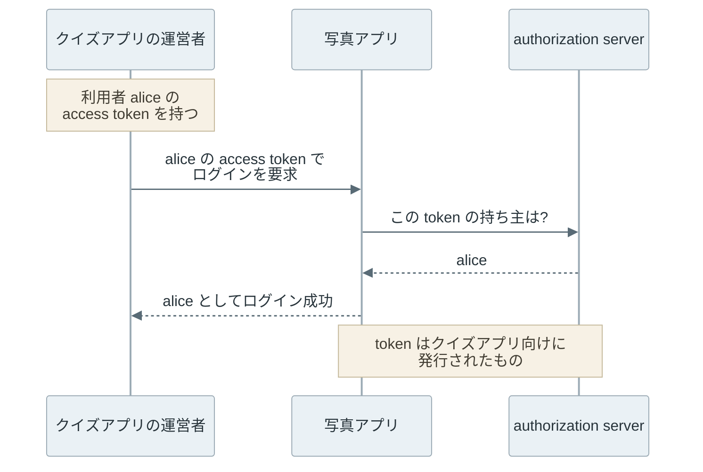
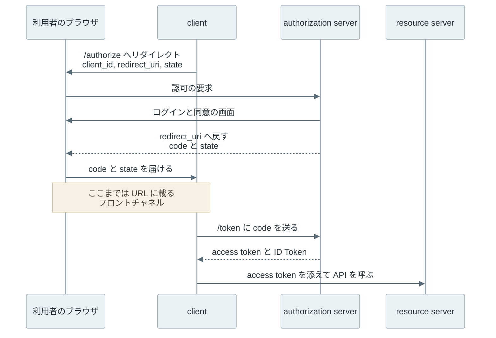

写真アプリが「access token を受け取り、その持ち主としてログインさせる」API を持っていたとします。利用者が以前、同じアカウントでクイズアプリにも連携していた場合、クイズアプリの運営者は手元にある access token を写真アプリに送るだけで、その利用者として写真アプリにログインできます。token は本物で期限も切れていないので、写真アプリのサーバーには攻撃を見分ける材料がありません。

[OAuth 2.0](https://www.rfc-editor.org/rfc/rfc6749.html) は、利用者の資源へのアクセスを第三者のアプリに委ねるための認可の枠組みです。[OpenID Connect](https://openid.net/specs/openid-connect-core-1_0.html)（OIDC）は、その上に「誰が、どのアプリにログインしたか」を伝える ID Token を足した認証の層です。上記の事故は、アクセスの委譲のために発行された access token をログインの証明として読んだことで起きます。

登場するのは、利用者・利用者の代わりに API を呼ぶアプリ（client）・token を発行する authorization server・API を提供する resource server の 4 者です。2 種類の token は、宛先が違います。

以下は、2 種類の token がどこで止まるかを示した図です。



上記の図で、client は access token を運ぶだけで、その宛先ではありません。client が自分宛てとして検証して良いのは ID Token の方です。下段は、後半の実験の (d) の結果です。

<br>

本記事では、OAuth 2.0 と OIDC で一般的な Authorization Code Flow（code を先に受け取り、別の経路で token と交換する流れ）を中心に、次の疑問に答えます。後半では、localhost 上の小さな authorization server で、横取りした code が使える場合と使えない場合を実験で確認します。

- 認可の access token と、認証の ID Token は何が違うのか。
- なぜ authorization server は、token ではなく code を先に返すのか。
- PKCE は、横取りされた code をどうやって無効にするのか。
- redirect URI・state・nonce は、それぞれ何を確認しているのか。
- 2025 年以降の推奨では、どのやり方を使わないのか。

refresh token と、利用者のいない client credentials grant の詳細は、本記事では扱いません。

---

### 認可と認証の違い

OAuth 2.0 の access token は、resource server に対して「この client に、この範囲の操作を許した」ことを示す値です。[Authentication](../authentication/) のノートで見た通り、相手が誰かを確認する認証と、その相手に操作を許すかを決める認可は別の処理です。

OAuth 2.0 が標準化したのは後者で、[RFC 6749](https://www.rfc-editor.org/rfc/rfc6749.html) には、ログインした利用者を client に伝える仕組みがありません（[OAuth.net の解説](https://oauth.net/articles/authentication/)）。

access token は [RFC 6750](https://www.rfc-editor.org/rfc/rfc6750.html) の Bearer Token として使われることが多く、持っている相手なら誰でも使えます。持っていることが権限になるという点で、[Capability-based Security](../capability-based-security/) の capability と同じ性質です。そのため、token を受け取った側（写真アプリ）からは「誰がこの token を持ち込んだか」は分かりません。冒頭の事故の流れは以下の通りです。



上記の図の authorization server は、token の持ち主を正しく答えています。誤りは、写真アプリが「持ち主を教えてもらえた」ことを「alice が今ここでログインした」と読んだ所にあります。

access token は refresh token から利用者のいない所で発行し直すこともできるので、持っているだけではログインの証明になりません。前述の解説は、この壊れ方を access token の注入と audience restriction（宛先の制限）の欠如として説明しており、token substitution とも呼ばれます。

OIDC の ID Token は、この穴を埋めるために client 宛てに発行される、署名付きの認証結果です。[OpenID Connect Core 1.0 §2](https://openid.net/specs/openid-connect-core-1_0.html#IDToken) は、ID Token の `aud`（audience、宛先）に client の `client_id` を含めることを必須にしています。クイズアプリ向けの ID Token の `aud` はクイズアプリなので、写真アプリが `aud` を確認すれば、冒頭の事故は起きません。

---

### Authorization Code Flow

Authorization Code Flow は、authorization server がまず短命の authorization code（以下 code）を返し、client が別の経路で code を token と交換するやり方です。OIDC のログインでは、この要求の `scope` に `openid` を含め、交換の応答で ID Token も受け取ります。流れは以下の通りです。



上記の図で、code はブラウザの URL に載って client に届きます。ブラウザを経由する経路をフロントチャネルと呼び、URL は履歴やログなどから外に出ることがあります。

一方で、`/token` への要求は client から authorization server への直接の HTTPS 通信で、バックチャネルと呼びます。token をバックチャネルだけに載せるために、フロントチャネルには code という引換券だけを流すわけです。

code にも制約があります。[RFC 6749 §4.1.2](https://www.rfc-editor.org/rfc/rfc6749.html#section-4.1.2) は、code の有効期限を短くし（最大 10 分を推奨）、1 度しか使えないようにすることを求めています。さらに、client が自分の秘密を持てる場合は、交換の時に client 認証を行います。

しかし、client の全てが秘密を持てるわけではありません。RFC 6749 §2.1 は、サーバーで動き秘密を守れる client を confidential client、スマートフォンのアプリや SPA（Single Page Application、ブラウザの中で動くアプリ）のように配布物の中身を読まれる client を public client と呼んで区別しています。public client では、code と `client_id` さえあれば誰でも交換できてしまいます。

---

### PKCE

[PKCE](https://www.rfc-editor.org/rfc/rfc7636.html)（Proof Key for Code Exchange）は、事前に秘密を登録しなくても、code を発行させた client と交換しに来た client が同じだと確認できる拡張です。[RFC 7636 §1](https://www.rfc-editor.org/rfc/rfc7636.html#section-1) が想定する攻撃は、正規のアプリと同じ独自の URL スキーム（`com.example.app:/callback` のような形）を悪意のあるアプリが登録し、OS がそのアプリに code を渡してしまうものです。

PKCE では、client がログインを始めるたびに code_verifier（43〜128 文字の乱数）を作ります。最初の `/authorize` には、そのハッシュである code_challenge だけを載せます。

- `code_challenge = BASE64URL(SHA256(code_verifier))`（`S256` という方式）
- code_challenge は `/authorize` に、code_verifier は `/token` に送る
- authorization server は、届いた code_verifier をハッシュして、保存した code_challenge と比べる

一致しなければ `invalid_grant` で拒否します（[§4.6](https://www.rfc-editor.org/rfc/rfc7636.html#section-4.6)）。code を横取りした相手は URL に載った code_challenge を見られても、ハッシュから code_verifier を逆算できません。code_verifier はフロントチャネルに載らず、バックチャネルの `/token` への要求にだけ載るからです。

なお、ハッシュせずに送る `plain` 方式もありますが、`S256` を使える client は `S256` を使う必要があります（§4.2）。code_verifier は推測されると意味が無いので、[Random Number](../random-number/) のノートで見た暗号用の乱数生成器で作ります。

---

### code の横取りと login CSRF の実験

PKCE・state・nonce と ID Token の `aud` の効き目は、[ローカルで実行するコード](lab/run.py)で確認できます。Python 標準ライブラリで、127.0.0.1 の空きポートに `/authorize`・`/token`・`/userinfo` を持つ authorization server を立て、client を同じプロセスの中の関数として書きました。

client は全て public client で、client 認証はありません。

この実験は説明用で、本番の実装ではありません。ID Token の署名は公開鍵暗号ではなく、共通鍵で改竄検出の値を作る HMAC で代用し、ログイン画面と同意画面を省いて利用者名をクエリで渡しています。code と token の有効期限、`exp` などの検証も省き、`scope=openid` も送っていません（[lab/README.md](https://github.com/nao1215/debimate/blob/main/content/notes/security/oauth-openid-connect/lab/README.md)）。

以下は `run.py` から、`/token` の検証と client の検証を抜き出し、インデントを詰めたものです。全体は 220 行ほどあります。

```python
# AuthorizationServer.do_POST (/token) の抜粋
grant = codes.get(form.get("code"))
if (
    grant is None
    or grant["client_id"] != form.get("client_id")
    or grant["redirect_uri"] != form.get("redirect_uri")
):
    return self.reply(400, {"error": "invalid_grant"})
verifier = form.get("code_verifier")
if grant["challenge"] and s256(verifier or "") != grant["challenge"]:
    return self.reply(400, {"error": "invalid_grant"})
if DOWNGRADE_CHECK and verifier and not grant["challenge"]:  # PKCE downgrade
    return self.reply(400, {"error": "invalid_grant"})
del codes[form["code"]]  # a code is used only once
claims = {"iss": ISSUER, "sub": grant["sub"], "aud": grant["client_id"]}

# Client の抜粋
def callback(self, session, code, state):
    for key, used in (("state", self.state), ("nonce", self.nonce), ("verifier", self.pkce)):
        if used and key not in session:
            return "rejected: no login in progress"
    if self.state and state != session["state"]:
        return "rejected: state mismatch"
    status, body = token_request(self.client_id, code, session.get("verifier"))
    if status != 200:
        return "rejected: " + body["error"]
    return self.login_with_id_token(session, body["id_token"])

def login_with_id_token(self, session, id_token):
    claims = verify(id_token)
    if claims["iss"] != ISSUER or claims["aud"] != self.client_id:
        return f"rejected: aud={claims['aud']}"
    if self.nonce and claims.get("nonce") != session["nonce"]:
        return "rejected: nonce mismatch"
    session["user"] = claims["sub"]
    return "logged in as " + claims["sub"]
```

`main()` では 4 つの場面を順に試します。callback は、state・nonce・code_verifier のうち使う値がセッションに保存されていなければ拒否します。

(a) と (b) は、alice のログインで返った code を攻撃者が横取りして `/token` に送る場面、(c) は攻撃者 mallory が自分のアカウントで code を取り、交換する前に、ログインを始めた被害者のブラウザにその code を踏ませる場面です。

(d) は冒頭の事故で、クイズアプリが受け取った alice の token を写真アプリに持ち込みます。access token を受け付ける `login_with_access_token()` は、`/userinfo` が返した持ち主をそのままログインさせます。

```sh
python3 lab/run.py
```

以下が[実行結果](lab/output.txt)です。`pkce=0` などは、その client が PKCE・state・nonce を使うかどうかを表します。`challenge=0` は攻撃者が自分の要求から code_challenge を外したこと、`as_check` は authorization server が後述の downgrade 対策をするかどうかです。

```text
(a) no PKCE, stolen code:   token 200 -> userinfo {'sub': 'alice'}
(b) PKCE, stolen code:      token 400 {'error': 'invalid_grant'}
    legitimate client:      logged in as alice
(c) pkce=0 state=0 nonce=0: logged in as mallory
(c) pkce=0 state=1 nonce=0: rejected: state mismatch
(c) pkce=1 state=0 nonce=0: rejected: invalid_grant
(c) pkce=0 state=0 nonce=1: rejected: nonce mismatch
(c) pkce=1 state=0 nonce=0 challenge=0 as_check=0: logged in as mallory
(c) pkce=1 state=0 nonce=0 challenge=0 as_check=1: rejected: invalid_grant
(c) empty victim session:   rejected: no login in progress
(d) access token -> photo-app: logged in as alice
    ID Token     -> photo-app: rejected: aud=quiz-app
```

(a) では、横取りした code だけで alice の access token が手に入りました。(b) では同じ code でも `invalid_grant` で拒否され、code_verifier を持つ正規の client はその後に交換できています。後から交換できたのは、この lab の authorization server が、失敗した試行では code を消さないからです。

(c) の 1 行目では、被害者のブラウザが mallory としてログインしました。この状態で被害者が写真をアップロードすると、写真は mallory のアカウントに入ります。この攻撃を login CSRF（Cross-Site Request Forgery）と呼びます。

(c) の 2〜4 行目の通り、攻撃者が client の通常の手順で要求を作った場合は、state・PKCE・nonce のどれか 1 つを検証すれば止まります。つまり、どれも「この callback は、このブラウザが始めたログインの続きか」を別々の値で確認しています。

しかし、PKCE だけに頼る client は条件付きです。5 行目では、攻撃者が自分の要求から code_challenge を外しました。code_challenge の無い code に被害者の code_verifier が添えられても、authorization server が比べる値を持たないので交換が通ります。これを PKCE downgrade と呼びます。

[RFC 9700 §2.1.1](https://www.rfc-editor.org/rfc/rfc9700.html#section-2.1.1) は、code_challenge の無い要求で発行した code に code_verifier が届いたら拒否することを authorization server に MUST で求めており、6 行目はその対策を入れた結果です。最後の行のように、ログインを始めていないセッションへの callback も拒否します。

(d) では、access token で通ったログインが、ID Token では `aud` の確認で止まりました。

---

### Redirect URI・state・nonce

実験の (c) で効いた値と redirect URI は、それぞれ別の結び付きを確認しています。整理すると以下の通りです。

| 値 | 検証する者 | 結び付けるもの | 検証しないと |
| --- | --- | --- | --- |
| redirect URI | authorization server | code の届け先と、登録済みの client | 攻撃者の URL に code が届く |
| state | client | callback と、ログインを始めたブラウザのセッション | 攻撃者の code を被害者のセッションに注入できる |
| nonce | client | ID Token と、ログインを始めたセッション | 別の場面で発行された ID Token を受け入れる |

redirect URI（code を送り返す先の URL）は、authorization server が完全一致で比べます。[RFC 9700 §2.1](https://www.rfc-editor.org/rfc/rfc9700.html#section-2.1) は、登録済みの値との比較に exact string matching を使うことを MUST で求めており、例外はネイティブアプリの localhost の port 番号だけです。

例えば、前方一致やワイルドカードを許すと、登録したドメインの別のパスや、そのドメインにある open redirector（任意の URL に転送するページ）を経由して、code が攻撃者の手に渡ります。

state は、client がログインの開始時にセッションに保存しておく推測できない値で、callback で戻ってきた値と比べます（[RFC 6749 §10.12](https://www.rfc-editor.org/rfc/rfc6749.html#section-10.12)）。[RFC 9700 §2.1](https://www.rfc-editor.org/rfc/rfc9700.html#section-2.1) は、authorization server が PKCE に対応していることを確認した client なら、PKCE による CSRF 対策に頼って良いとしています。上記の downgrade 対策も、その対応に含まれます。

nonce は OIDC の値で、client が認証要求に入れ、authorization server が ID Token の `nonce` クレームにそのまま写します。nonce の目的は、client のセッションと ID Token を結び付け、[replay](/notes/blockchain-systems/replay-protection/)（過去の値を送り直す攻撃）を緩和することです（[OpenID Connect Core 1.0 §2](https://openid.net/specs/openid-connect-core-1_0.html#IDToken)）。

RFC 9700 §2.1 は、OIDC のフローでは nonce が CSRF 対策になるとしています。nonce はログインを始めたセッションに保存され、ID Token に写った値と比べられるので、他人のログインで発行された ID Token は一致しないからです。replay を防ぐ値として予測できないことが必要になる点は、[Nonce](../nonce/) のノートで見た認証の challenge と同じです。

---

### Access Token と ID Token の使い分け

2 つの token は、どちらも JWT（JSON Web Token）で表されることがあり、見た目では区別が付かない場合があります。しかし、検証する者と使い道は以下の通り違います。

| | access token | ID Token |
| --- | --- | --- |
| 宛先（`aud`） | resource server | client の `client_id` |
| 検証する者 | resource server | client |
| client が中身を読むか | 読まない。形式は authorization server が決める | 読む。署名・`iss`・`aud`・`exp`・`nonce` を確認する |
| API に送るか | `Authorization: Bearer` で送る | 送らない |
| 形式 | 意味を持たない文字列でも JWT でも良い | 署名付きの JWT |

access token を JWT で発行する場合の形式は、[RFC 9068](https://www.rfc-editor.org/rfc/rfc9068.html) が定めています。§6 は client が access token の中身を読むことを MUST NOT で禁じ、§4 は resource server に、`typ` ヘッダが `at+jwt` または `application/at+jwt` であることの確認を MUST で求めています。

`typ` は、形の似た ID Token を access token として受け入れないための区別です。

逆向きに、ID Token を API に送って認可に使うと、resource server は「ログインした」という結果を「操作を許された」と読むことになります。

ID Token の署名の検証には、authorization server が公開する鍵を使います。公開鍵と署名の関係は [Digital Signature](/notes/blockchain-systems/digital-signature/) のノートにあります。その鍵は TLS（通信路を暗号化し、相手のサーバーを証明書で確認する規約）で取得するので、[PKI](../pki/) が前提になります。

---

### 現在の推奨

2025 年 1 月に公開された [RFC 9700](https://www.rfc-editor.org/rfc/rfc9700.html)（OAuth 2.0 Security Best Current Practice、BCP 240）は、RFC 6749 の後に見つかった攻撃を踏まえて、次のように推奨を改めています。redirect URI の完全一致と PKCE downgrade の対策は、前の節までで見た通りです。

- public client は PKCE を使わなければならない（MUST）。confidential client も PKCE の利用を推奨する（§2.1.1）
- implicit grant（`/authorize` の応答で token を URL に載せて返すやり方）は使うべきではない（SHOULD NOT、§2.1.2）
- resource owner password credentials grant（利用者の Password を client が受け取り、token と交換するやり方）は使ってはならない（MUST NOT、§2.4）

implicit grant は token をフロントチャネルに載せ、password grant は OAuth が避けたかった Password の受け渡しを client に許します。

これらを本体に取り込んだ改訂版として、OAuth 2.1 の策定が進んでいます。2026 年 11 月時点の最新は、RFC を策定する IETF（Internet Engineering Task Force）の Internet-Draft である [draft-ietf-oauth-v2-1-17](https://datatracker.ietf.org/doc/draft-ietf-oauth-v2-1/)（2026 年 10 月 30 日）で、RFC にはなっていません。

この draft は implicit grant と password grant を仕様から外し、PKCE を原則として必須にし、`plain` 方式を禁じています。必須の例外は、confidential client が OIDC の nonce を正しく使うと authorization server が判断できる場合だけです（§4.1.1、§7.5.1.1）。内容は今後も変わり得ます。

---

### 利点

- client が利用者の Password を受け取らずに、利用者の資源にアクセスできる
- `scope` で client に委ねる範囲を絞れ、Password を変えずに client ごとの委譲を取り消せる
- ログインを authorization server に任せると、[Passkey](../passkey/) や MFA（多要素認証）を client ごとに実装し直さずに済む
- ID Token の `aud` と `nonce` で、どの client のどのログインの結果かを client 自身が確認できる

---

### 欠点

OAuth 2.0 は、多様な client に合わせるために多くの選択肢を残しました。その代わりに、次の制約があります。

- 安全性が authorization server と client の検証に分かれていて、実装者が省いても動いてしまう。実験の通り、state も PKCE も nonce も検証しない client は login CSRF を通す
- access token は Bearer Token なので、漏れれば有効期限まで他人が使える
- authorization server が止まると、それに頼る全ての client で新しいログインができなくなる
- grant の種類や拡張の RFC が多く、どれが現在の推奨かを RFC 9700 と突き合わせる必要がある

---

### 適さないケース

- 自社の 1 つのアプリに、自前の利用者だけがログインする構成。外部の client が無ければ、通常のセッションによる認証で足りる
- access token を「ログインした証明」として client が受け取る設計。認証が目的なら ID Token を使う
