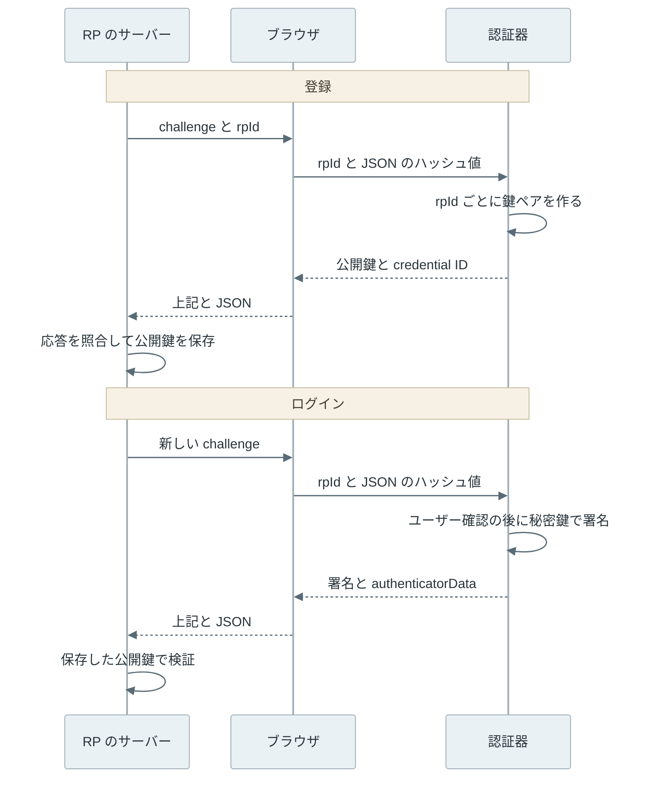

Passkey（パスキー）は、パスワードの代わりに、利用者の端末に入っている秘密鍵で署名してログインする仕組みです。業界団体の FIDO Alliance は、[passkey](https://fidoalliance.org/passkeys/) を FIDO の標準に基づく認証の資格情報と位置付けています。ブラウザから使う API は W3C の [WebAuthn](https://www.w3.org/TR/webauthn-3/) で決まっています。[Google のアカウント](https://blog.google/technology/safety-security/passkeys-default-google-accounts/)では、2023 年 10 月から既定でパスキーを使えるようになりました。

自分のサービスで、ログインに Passkey を足そうとすると、次の前提を置きがちです。

- 署名が正しければ、本人が正規のサイトでログインした
- サーバーは、秘密鍵か、それに当たる秘密を預かる
- 署名カウンタを見れば、鍵の複製に気付ける
- Passkey を足せば、アカウントはフィッシングに強くなる
- 端末をなくすと、もうログインできない

どれも条件付きでしか成り立ちません。1 つ目は、ログインの応答から 1 か所だけ変えた応答を 7 通り作り、2 つのサーバーに渡すと崩れます。



origin は、応答を作ったページの URL から取ったスキーム・ホスト・ポートの組です。rpId は、どのサービス向けの鍵かを表す名前です。どちらも次の節で詳しく見ます。

サブドメインのページで作った応答は、署名も rpId も正規の応答と同じく正しい値でした。違うのは応答の中に記録された origin だけで、それをチェックしないサーバーは正規の応答と同じく通しました。

<br>

本記事では、ログインに Passkey を足そうとしている Web の開発者に向けて、上の前提を実験と仕様で 1 つずつ崩します。扱う問いは次の通りです。

- ログインの時、何がサーバーに届き、何に署名しているのか
- パスワードや TOTP と比べて、フィッシングに強いのはなぜか
- 偽サイトを止めるのはブラウザか、サーバーか
- 署名カウンタで何が分かり、何が分からないのか
- 端末をなくした時に備えて、何を登録し、何を残すのか

---

### ログインで届くもの

登場するのは 3 者です。ログインを受け付けるサービスは RP（Relying Party）です。鍵を作って署名する部分は認証器（authenticator）と呼び、利用者が開いているブラウザが両者の間を仲介します。

認証器には、スマートフォンや PC の OS に組み込まれたものと、USB や NFC でつなぐセキュリティキーがあります。ブラウザがセキュリティキーと話す手順は CTAP（Client to Authenticator Protocol）で、WebAuthn と CTAP を合わせて [FIDO2](https://fidoalliance.org/fido2/) と呼びます。



登録の時、認証器は鍵ペアを作り、公開鍵と、その鍵を指す credential ID をサーバーに返します。サーバーは登録の応答でも、ログインと同じく challenge・origin・rpIdHash を照合してから、この 2 つを保存します。秘密鍵は認証器に残ります。鍵を同期する認証器では、パスキーを保存するソフト（Passkey Provider）が同じ利用者の端末に秘密鍵を写しますが、その場合もサーバーには届きません。

パスワードのハッシュ値は、漏れると総当たりで元の値を探す対象になります。一方、公開鍵から秘密鍵を求めることは現実的な時間では困難です。また、鍵はサービスごとに別に作るので、パスワードの使い回しのように 1 か所の漏洩が他のサービスに広がることもありません。

<br>

ログインの時は、サーバーが毎回新しい乱数を challenge として渡します。この値を[推測できないようにする理由](../random-number/)は、乱数のノートで扱っています。ブラウザは challenge と、今開いているページの origin を JSON にまとめます。

認証器は、どのサービス向けの鍵かを表す rpId の[ハッシュ値](/notes/blockchain-systems/hash-function/)などを並べた authenticatorData を作り、両方に秘密鍵で署名します。この署名と付随するデータの組を assertion と呼び、以降は応答と書きます。



図で左にある 37 byte は認証器が、右にある 32 byte はブラウザが書きます。37 byte は拡張機能（extensions）を使わない時の長さで、拡張機能を使うとその分だけ伸びます。origin はブラウザが書き込む値で、ページのスクリプトから書き換える手段は無いです。認証器に届くのは JSON のハッシュ値だけなので、origin で判断するのはブラウザとサーバーの役目です。

flags の UP（user presence）は、人が認証器に触れるなどの操作をしたかを表す 1 bit です。

UV は、指紋や PIN によるユーザー確認を端末の中で済ませたかを表す 1 bit で、user verification の略です。UV はその認証器を使って良い人かを確認した印で、氏名のような身元を証明するものではありません。

指紋そのものは端末の中で照合し、サーバーに届くのは UV の 1 bit です。flags も署名の対象なので、途中で UV を書き換えると署名の検証に失敗します。

UV を求めるかは、RP がログインを求める時に渡す [userVerification](https://www.w3.org/TR/webauthn-3/#dom-publickeycredentialrequestoptions-userverification) で選びます。`required` なら UV の無い応答を拒否し、`preferred` なら PIN を設定していないセキュリティキーの応答も通せます。UP の方は、仕様の手順で常に求めます。

<br>

#### 公開鍵で分かること

サーバーは、登録時に受け取った公開鍵でこの署名を検証します。解説では「サーバーが署名を公開鍵で復号し、challenge と比べる」と書かれることがあります。この説明と教科書の公開鍵暗号が合わないという[質問](https://mond.how/ja/topics/8t9i33a9lt6rh87/t9tua01k8j5m39h)は、2025 年 9 月にはてなブックマークで 1,083 users を集めました。

Passkey でよく使われる ECDSA（P-256）の署名は、暗号化ではありません。公開鍵で分かるのは、署名がこの 69 byte とこの鍵の組で作られたかどうかだけです。署名と暗号化の違いは[デジタル署名](/notes/blockchain-systems/digital-signature/)のノートで扱っています。

冒頭の図で一番下の行は、登録していない鍵で署名した応答です。サーバーの DB（データベース）から公開鍵が漏れても、秘密鍵が無ければ、この行と同じく署名のチェックで止まります。つまり、2 つ目の前提にあった「サーバーが預かる秘密」は、Passkey では存在しないのです。

<br>

#### 利用者名の要らないログイン

ログインの時にサーバーが credential ID を渡さなくても、認証器が rpId から鍵を見付けられる資格情報を [discoverable credential](https://www.w3.org/TR/webauthn-3/#client-side-discoverable-credential) と呼びます。WebAuthn Level 3 は passkey をこの別名として挙げており、本記事の Passkey もこれを指します。credential ID を指定するログインにも、同じ鍵を使えます。

利用者名を入力させないログインの画面は、この性質で作れます。応答には、登録の時にサーバーが渡した利用者の識別子である [user handle](https://www.w3.org/TR/webauthn-3/#dom-authenticatorassertionresponse-userhandle) が入り、サーバーはそこからアカウントを引きます。古い資料の resident key は、[passkeys.dev](https://passkeys.dev/docs/reference/terms/) によると同じものの旧称です。

---

### パスワード・TOTP との違い

比べる相手の [TOTP](https://datatracker.ietf.org/doc/html/rfc6238) は、時刻から作る 6 桁のコードを認証アプリに出させ、パスワードと一緒に入力させる方式です。

フィッシングに強いかどうかは、偽サイトで手に入れたものが本物のサイトでそのまま使えるかで決まります。方式ごとに並べると以下の通りです。

| 方式 | 偽サイトが受け取るもの | 本物のサイトで使えるか |
| --- | --- | --- |
| パスワード | パスワードそのもの | 使える |
| パスワードと TOTP | パスワードと 6 桁のコード | コードの有効な 30 秒ほどの間なら使える |
| SMS のコード | 電話に届いたコード | 有効期限の間なら使える |
| Passkey | 偽サイトの origin が入った署名か、何も無い | 使えない |

パスワードと TOTP は、利用者が自分で読んで入力する値です。利用者が偽サイトに気付かなければ、同じ値が偽サイトにも届きます。Passkey の行の「何も無い」は、次の節で見る通り、偽サイトがブラウザに断られて署名を得られない場合です。

<br>

#### Cloudflare で止まった中継

2022 年 7 月、[Cloudflare](https://blog.cloudflare.com/2022-07-sms-phishing-attacks/)では少なくとも 76 人の社員に、Okta のログイン画面を真似た偽サイト `cloudflare-okta.com` へのリンクが SMS で届きました。偽のページは、入力されたパスワードと TOTP のコードをすぐに攻撃者に送る作りでした。

3 人がパスワードを入力しましたが、Cloudflare は全社員に FIDO2 のセキュリティキーを持たせていました。偽サイトではキーの応答を得られず、侵入は止まりました。TOTP を使う組織なら、コードの有効な間に中継されて突破されていた作りです。

使われたのは本記事の Passkey とは種類の違うセキュリティキーですが、照合の仕組みは同じです。Passkey の署名にも、上の図で見た通り origin と rpId が入ります。偽サイトで作らせた署名には偽サイトの名前が入るので、本物のサーバーではチェックを通りません。

[NIST SP 800-63B](https://pages.nist.gov/800-63-4/sp800-63b.html) は、応答に宛先の名前を含めて照合させるこの方法を検証者名の束縛（verifier name binding）と呼び、フィッシング耐性を持たせる方法の 1 つに挙げています。

認証の要素ごとの違いと、ログインの後に発行する Cookie やトークンの扱いは、[Authentication](../authentication/) のノートで扱っています。

ただし、表の「使えない」は、ブラウザとサーバーの両方がチェックを済ませた時の話です。次の節では、どちらが何を止めるかを分けて見ます。

---

### 偽サイトを止める 2 段

1 段目はブラウザです。WebAuthn の仕様では、ページが指定できる [rpId](https://www.w3.org/TR/webauthn-3/#rp-id) は、そのページのドメインと同じか、その親に当たる `example.com` のようなドメインに限られます。`com` のような公開接尾辞は指定できません。`login.example.com` のページは `example.com` を指定できますが、`example-login.com` は指定できません。

Chrome の仮想認証器でこれを実際に動かしました。CDP（Chrome DevTools Protocol）の [WebAuthn ドメイン](https://chromedevtools.github.io/devtools-protocol/tot/WebAuthn/)は、指紋や PIN を求めずに署名する仮想認証器を Chrome に足せます。`app.localhost` のページで rpId を `app.localhost` として鍵を登録した後、ホスト名だけを変えたページで同じ鍵を使えるかを試しました。

WebAuthn は https のような安全な接続のページでしか動きません。`*.localhost` の名前は全て手元の 127.0.0.1 を指し、Chrome は http でも安全な接続として扱うので、証明書を用意せずに試せます。

```javascript
// 抜粋。全体は lab/browser.mjs、ページは lab/webauthn_page.html.txt
await send('WebAuthn.addVirtualAuthenticator', {options: {protocol: 'ctap2', transport: 'internal',
  hasResidentKey: true, hasUserVerification: true, isUserVerified: true, automaticPresenceSimulation: true}});

await open(`http://app.localhost:${port}/`);
await evalJs('register("app.localhost")');          // ここで鍵を登録する
const cases = [
  ['app.localhost', 'app.localhost'],
  ['uploads.app.localhost', 'app.localhost'],
  ['app-localhost.localhost', 'app.localhost'],
  ['app-localhost.localhost', 'app-localhost.localhost'],
];
for (const [host, rpId] of cases) {
  await open(`http://${host}:${port}/`);
  const r = await evalJs(`login(${JSON.stringify(rpId)})`);   // navigator.credentials.get を呼ぶ
  // 成功なら clientDataJSON の origin と signCount、失敗なら例外の名前を出す
}
```

出力は次の通りです。

```text
ページ app.localhost / rpId app.localhost -> 成功 origin=http://app.localhost:18080 signCount=2 flags=0x5
ページ uploads.app.localhost / rpId app.localhost -> 成功 origin=http://uploads.app.localhost:18080 signCount=3 flags=0x5
ページ app-localhost.localhost / rpId app.localhost -> 失敗 SecurityError
ページ app-localhost.localhost / rpId app-localhost.localhost -> 失敗 NotAllowedError
```

`flags=0x5` は、UP の 0x01 と UV の 0x04 を足した値で、両方が立っていることを表します。



似た名前の `app-localhost.localhost` は、本物の rpId を指定すると SecurityError で止まりました。自分の rpId を指定しても、その rpId の鍵は認証器に無いので NotAllowedError です。偽のドメインで動くサイトは、ブラウザの段で本物の鍵に届きません。なお、WebAuthn Level 3 の [Related Origin Requests](https://www.w3.org/TR/webauthn-3/#sctn-related-origins) では、rpId のドメインが `/.well-known/webauthn` に書いた別のドメインに限り、その rpId を使わせることができます。

一方で、`uploads.app.localhost` は本物の rpId のまま署名を得ました。返った署名は正しく、clientDataJSON の origin にだけ `uploads.app.localhost` が入っています。

<br>

#### サーバーのチェック

2 段目はサーバーです。上の `uploads` のように、同じ rpId の下で利用者が作ったページを配るサービスを考えます。攻撃者は、本物のサーバーから受け取った challenge を自分が作ったページのスクリプトに渡しておきます。別の利用者がそのページを訪れて確認の操作をすると、スクリプトはその利用者の鍵で正しい署名を得られます。攻撃者はその応答を本物のサーバーに送れば、訪れた利用者としてログインできます。

WebAuthn の仕様は、[コードの注入](https://www.w3.org/TR/webauthn-3/#sctn-code-injection)を扱う節で `usercontent.example.org` と `example.org` の組をこの例として挙げ、[origin のチェック](https://www.w3.org/TR/webauthn-3/#sctn-validating-origin)を MUST としています。

冒頭の図は、このチェックを Python で書いて試した結果です。ブラウザと認証器の役も Python で書き、正規の応答から 1 か所だけ変えた応答を作りました。チェックの順は仕様の [7.2 節](https://www.w3.org/TR/webauthn-3/#sctn-verifying-assertion)の主な手順に合わせました。サーバーは UV を `required` にした設定で、署名は [cryptography](https://cryptography.io/) の ECDSA（P-256）で作っています。

```python
# 抜粋。全体は lab/verify.py
class Authenticator:
    def sign(self, client_data_json, uv=True):
        if not self.synced:
            self.count += 1
        flags = 0x01 | (0x04 if uv else 0)           # UP（触れた）と UV（ユーザー確認）
        auth_data = (hashlib.sha256(self.rp_id.encode()).digest()
                     + bytes([flags]) + self.count.to_bytes(4, "big"))
        sig = self.key.sign(auth_data + hashlib.sha256(client_data_json).digest(),
                            ec.ECDSA(hashes.SHA256()))
        return {"clientDataJSON": client_data_json, "authenticatorData": auth_data, "signature": sig}

class RelyingParty:
    def verify(self, r):
        c = json.loads(r["clientDataJSON"])
        a = r["authenticatorData"]
        if c["type"] != "webauthn.get":
            return "拒否: type"
        if c["challenge"] != b64url(self.challenge):
            return "拒否: challenge"
        if self.check_origin and c["origin"] != ORIGIN:
            return "拒否: origin"
        if a[:32] != hashlib.sha256(RP_ID.encode()).digest():
            return "拒否: rpIdHash"
        if not a[32] & 0x01:
            return "拒否: UP フラグ"
        if self.require_uv and not a[32] & 0x04:     # userVerification が required の時
            return "拒否: UV フラグ"
        try:
            self.public_key.verify(r["signature"], a + hashlib.sha256(r["clientDataJSON"]).digest(),
                                   ec.ECDSA(hashes.SHA256()))
        except InvalidSignature:
            return "拒否: 署名"
        ...  # 署名カウンタの比較（後の節）
        return "通す"

# サブドメインのページで作った応答: 鍵も rpId も正規のまま、origin だけが違う
ch = rp.new_challenge()
rp.verify(dev.sign(client_data(ch, "https://uploads.app.example")))
```

`check_origin=False` は、冒頭の図で右の列に当たります。7 通りのうち、challenge・rpIdHash・UV フラグ・署名で止まる 5 通りは、origin のチェックが無くても止まりました。サブドメインの応答だけは、署名の検証から見ると正規の応答と区別が付かず、origin の 1 行が無いと通ります。

前回の challenge を使い回した応答が止まるのは、サーバーが challenge を 1 回ごとに作り直しているからです。使い回しを防ぐ値の作り方は [Nonce](../nonce/) のノートで扱っています。

なお、ライブラリを使えば、このチェックを書き忘れることはまず無いです。例えば [py_webauthn](https://github.com/duo-labs/py_webauthn)（3.0.1）の `verify_authentication_response` は `expected_origin` が必須の引数で、文字列なら完全一致、リストならそのどれかとの一致を見ます。危ないのは、ログインのページを増やした時に、許す origin を「`app.example` で終わる名前」のように広げる時です。広げた範囲に利用者のページを配る名前が入ると、冒頭の図で右の列と同じことが起きます。

---

### 署名カウンタで分かること

authenticatorData の signCount は、認証器が署名するたびに増やす数です。仕様で[署名カウンタを扱う節](https://www.w3.org/TR/webauthn-3/#sctn-sign-counter)は、サーバーが前回の値を保存し、次の値がそれ以下なら複製された認証器を疑うよう書いています。同じ節は、カウンタを持たない認証器は常に 0 を返す、とも決めています。

lab/verify.py の `counters()` では、同じ秘密鍵を持つ 2 台目の端末 B を作り、端末 A で 2 回、端末 B で 1 回ログインしました。

```text
1 台の中で数える鍵
  端末 A signCount=1 -> 通す
  端末 A signCount=2 -> 通す
  端末 B signCount=1 -> 通す（カウンタ 1 <= 2、複製の疑い）
カウンタを 0 で返す鍵
  端末 A signCount=0 -> 通す
  端末 A signCount=0 -> 通す
  端末 B signCount=0 -> 通す
```



1 台の中で数える鍵では、端末 B の 1 が端末 A の 2 を下回り、複製を疑えました。カウンタを 0 で返す鍵では、3 回とも 0 で比べる材料がありません。

複数の端末で同じ鍵を使うパスキーでは、端末ごとに数えた値を 1 つの増え続ける数に揃えるのは難しいと考えられ、0 を返すのは仕様が認めた形です。1 台の鍵でも、同時に走ったログインの応答が届く順が入れ替わると、値は前後します。ちなみに、どの製品が 0 を返すかは測っていないです。前の節で使った Chrome の仮想認証器は、出力の通り 2、3 と数を増やしました。サーバーは、カウンタを止める条件ではなく記録として持ち、0 が来た時に比べられないことを前提にします。

---

### 端末をなくした時

仕様で[鍵の紛失を扱う節](https://www.w3.org/TR/webauthn-3/#sctn-credential-loss-key-mobility)は、秘密鍵をバックアップしたり認証器の間で共有したりする手順を WebAuthn では決めていない、としています。代わりに、1 つのアカウントに複数の鍵を登録できるようにすることをサーバーに求めています。

実際には、[iCloud キーチェーン](https://support.apple.com/ja-jp/102195)や [Google パスワードマネージャー](https://developers.google.com/identity/passkeys?hl=ja)のように、同じアカウントで使う端末の間で鍵を同期する認証器が多く使われています。どちらの形かは、authenticatorData の flags にある BE（backup eligible）と BS（backup state）の 2 bit で分かります。

BE は鍵を作った時に決まり、後から変わりません。仕様は BE が 1 の鍵を multi-device credential、0 の鍵を [single-device credential](https://www.w3.org/TR/webauthn-3/#single-device-credential) と呼びます。BS は同期の状態に合わせて後から変わります。

| BE | BS | 鍵の状態 | サーバーが備えること |
| --- | --- | --- | --- |
| 0 | 0 | 1 台に閉じた鍵 | 端末をなくすと使えないので、別の鍵か復旧の手順 |
| 1 | 0 | 同期できるが、まだバックアップされていない | 状態は後で変わるので、ログインのたびに保存し直す |
| 1 | 1 | 同期できて、バックアップ済み | 端末の紛失だけでは使えなくならない |

BE が 0 で BS が 1 の組は、[仕様](https://www.w3.org/TR/webauthn-3/#sctn-credential-backup)で認められていません。仕様は BE が 0 の鍵を断る使い方は挙げず、別の鍵を登録させるか、復旧の手順を用意するよう勧めています。

BE と BS が表すのは、Passkey Provider が管理するバックアップだけです。攻撃や不具合で秘密鍵が管理の外に写った複製は、この 2 bit に現れません。flags は署名の対象ですが、値を出した認証器をどこまで信頼するかは、認証器の製造元を示す証明である attestation のような別の根拠が必要です。

同期するパスキーの安全性は、Passkey Provider で使うアカウントの保護に左右されます。系列の違う端末やブラウザに移ると、同期が引き継がれないこともあります。

<br>

#### 残したログインの手段

4 つ目の前提が崩れるのはここです。Passkey を足しても、パスワードや SMS のコードでログインできる道を残せば、偽サイトはパスワードとコードを入力させれば済みます。

フィッシングに対するアカウントの強さは、残したログインの手段と復旧の手順のうち、一番弱いものに揃います。例えば、メールの確認コードで復旧できるなら、攻撃者はその手順からアカウントに入れます。復旧の手順がどう突破されるかは、[Authentication](../authentication/) のノートで、Account Recovery を扱う節にあります。

<br>

#### attestation を求めるか

Hacker News では、2026 年 10 月に「[Passkeys are a trap](https://nonfunctional.substack.com/p/passkeys-are-a-trap-do-not-use-them)」が [1,150 points](https://news.ycombinator.com/item?id=50048312) を集めました。サービスが登録の時に attestation を求めれば、使える認証器を絞れてしまう、という主張です。

3 日後の反論「[Passkeys are not a trap](https://scotthelme.co.uk/passkeys-are-not-a-trap/)」（[677 points](https://news.ycombinator.com/item?id=50088935)）は、同期するパスキーは attestation を返さず `none` が届くので、求めれば利用者の大半を締め出す、と答えています。Passkey を足す側から見ると、一般の利用者が使うサービスで attestation を必須にすると、同期するパスキーでは登録できなくなる、という判断の材料です。

---

### 足す前に

冒頭の図で赤く塗ったマスは、署名の正しさだけを見るサーバーが、正規のサイトとは別の名前で作られた応答を通すことを示していました。Passkey の強さは、署名の数学よりも、サーバーが何をチェックし、何を残すかで決まります。そのため、足す前に次の順で決めておくと迷わずに済みます。

1. 登録とログインの両方で、許す origin を完全一致の一覧で決め、利用者のページを配る名前を入れない
2. challenge はログインのたびにサーバーで作り、使ったら消す
3. 署名カウンタは記録として持ち、0 の鍵では比べられないと決めておく
4. 1 つのアカウントに鍵を 2 つ以上登録でき、BE と BS を保存する
5. 残すログインの手段と復旧の手順も、Passkey と同じ強さで設計する

1 は、受け付ける origin の一覧に、利用者のページを配る名前が入っていないかを見れば済みます。lab/verify.py の `ORIGIN` をその一覧での判定に置き換え、サブドメインの行と同じ応答を渡せば、冒頭の図で右の列と同じ結果になるかを手元で試せます。実験のコードは [lab/verify.py](https://github.com/nao1215/debimate/blob/main/content/notes/security/passkey/lab/verify.py) と [lab/browser.mjs](https://github.com/nao1215/debimate/blob/main/content/notes/security/passkey/lab/browser.mjs)、出力は [lab/output.txt](https://github.com/nao1215/debimate/blob/main/content/notes/security/passkey/lab/output.txt) にあります。
