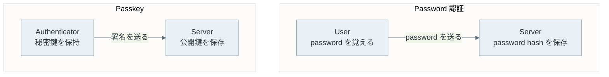
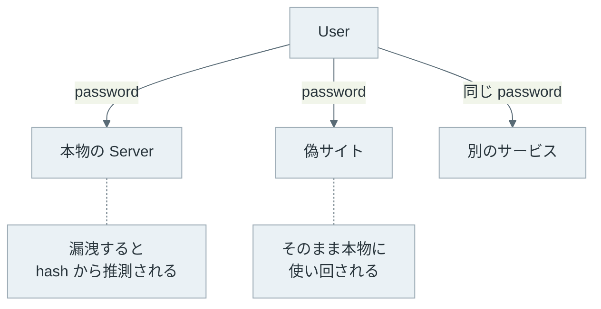
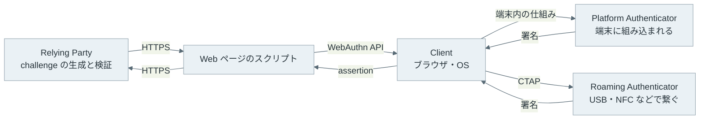
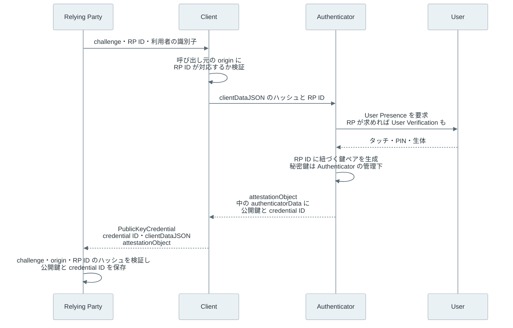
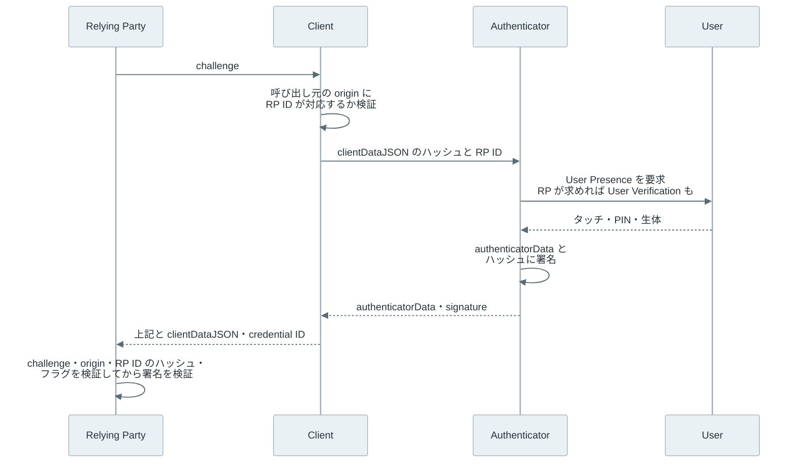
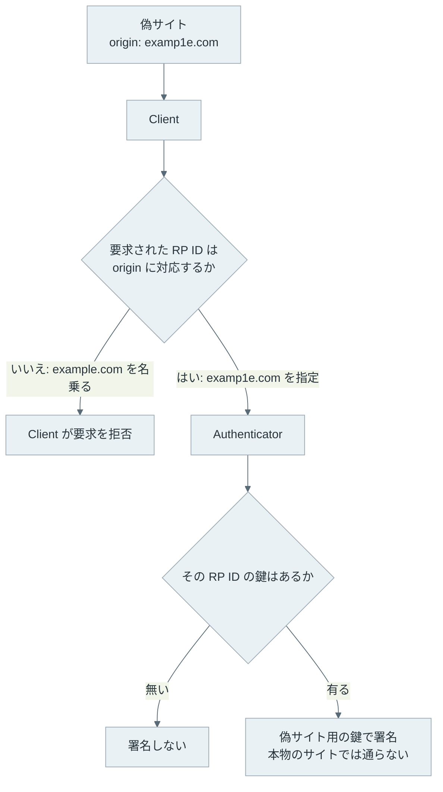
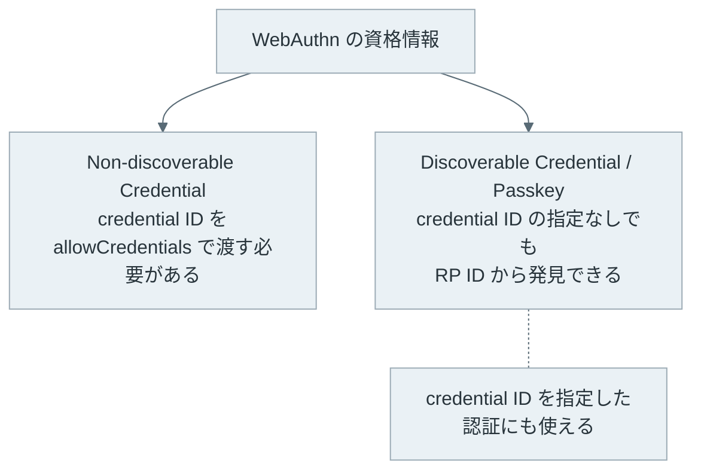
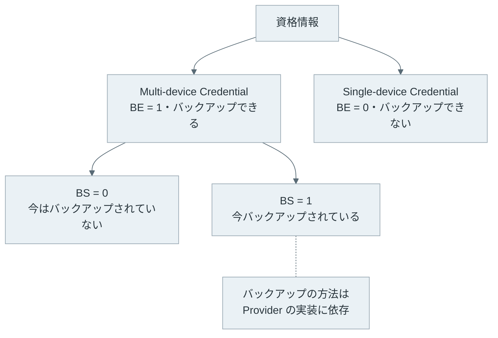

Passkey は、手元の端末（Authenticator）が管理する秘密鍵をサービス側（Relying Party）に渡さずに署名を作り、サーバーが対になる公開鍵で署名を検証する認証の方式です。FIDO Alliance は passkey を「[a FIDO authentication credential based on FIDO standards](https://fidoalliance.org/passkeys/)」（FIDO 標準に基づく認証資格情報）と定義し、端末のロックを解除するのと同じ操作でアプリや Web サイトにサインインできるものだとしています。

この方式が必要な場面の代表は、ログイン画面をそのまま真似た偽サイトへの入力です。Password は利用者が読み書きできる文字列なので、相手を間違えればそのまま攻撃者の手に渡り、本物のサイトで使われます。署名は、宛先のドメインと 1 回限りの乱数に結び付いた値になるので、覗き見ても別のサイトや次回のログインでは通りません。

以下は、2 つの方式で何がどこに置かれるかを比べた図です。

上記の図の Passkey では、秘密鍵が Authenticator の管理下に留まり、サーバーに渡るのは署名です。秘密鍵で作った署名は、対になる公開鍵で検証できます。公開鍵から秘密鍵を導くことはできないため、検証する側は署名を作れません。署名を作る鍵と確かめる鍵が別なので、サーバーは秘密鍵を預からずに「相手が秘密鍵を持っていること」を確かめられます。

 

本記事では、Web ブラウザから Passkey を使う場合の処理の流れを追い、以下の疑問に答えます。

- Password を共有する方式は、どこから狙われるのか。
- Registration と Authentication で、端末とサーバーの間に何が起きるのか。
- サービスの識別子（RP ID）とページの URL（origin）の照合で、なぜ phishing を防げるのか。
- 人が居ることの確認（User Presence）と、利用者本人の確認（User Verification）は、何が違うのか。
- サーバーは、バックアップできる鍵とできない鍵をどう見分けるのか。

Authenticator の内部実装、組織での配布運用、Authenticator の出自を Relying Party に証明する attestation の検証方式は扱いません。署名を作る手順と検証の計算は [Digital Signature](../../blockchain-systems/digital-signature/)、ハッシュ値の性質は [Hash Function](../../blockchain-systems/hash-function/) のノートで扱っているので、ここでは繰り返しません。以降、単に「サーバー」と書く場合は、認証を行う Relying Party のサーバーを指します。

本記事の Passkey は、WebAuthn Level 3 が passkey の別名として挙げる Discoverable Credential（credential ID を渡さなくても端末が見付けられる資格情報）を指します。FIDO Alliance の一般向けの説明では、より広い意味で使われる場合があります。

---

### Password を共有する方式の弱点

Password 認証が前提にしているのは、利用者とサーバーが同じ文字列を共有している状態です。サーバーは照合のために hash を保存し、利用者は入力のために文字列を覚えます。共有している以上、攻撃者はその文字列を利用者からもサーバーからも狙えます。

以下は、同じ文字列が届き得る先です。

上記の図の偽サイトに向かう経路が phishing です。利用者が相手のドメインを見誤ると、認証に必要な材料がそろった形で攻撃者に渡ります。別のサービスに同じ文字列を使い回していれば、1 か所の漏洩が他のサービスに波及します。

本物のサーバーから hash が漏れた場合も、利用者が選ぶ文字列は候補が限られるので、候補を片端から hash に掛けて元の文字列を割り出されます。

Password に TOTP（認証アプリが時刻から作る使い捨ての数字）や SMS の確認コードを足すと、Password だけを盗まれた場合の被害は抑えられます。ただし、再利用できる共有秘密という Password の性質は残ります。Passkey が変えているのは、サーバーが保存する値と、利用者が相手に渡す値の両方です。

---

### 3 つの主体と役割

Passkey という言葉は資格情報を指し、それを扱う仕組みは複数の仕様に分かれています。役割は 3 つの主体で整理できます。

- Relying Party: 認証したい Web アプリケーションと、そのサーバー
- Client: ブラウザや OS。WebAuthn の API を実装する
- Authenticator: 鍵を作り、保持し、署名する部品

Authenticator には、端末に組み込まれた Platform Authenticator と、USB や NFC などで繋ぐ Roaming Authenticator があります。W3C の [Web Authentication 仕様](https://www.w3.org/TR/webauthn-3/)は、この部品を「that can register a user with a given Relying Party and later assert possession of the registered public key credential」（ある Relying Party に対して利用者を登録し、後から登録済みの公開鍵資格情報の保持を主張できるもの）と定義しています。

定義はこの後に「[and optionally verify the user to the Relying Party](https://www.w3.org/TR/webauthn-3/#authenticator)」（任意で、利用者を Relying Party に確認する）と続きます。通常の認証では、Authenticator は操作している人が居ることを User Presence で確かめ、Relying Party が求めれば、その人が正しい利用者かどうかも確かめます。

以下が主体とプロトコルの関係です。

上記の図の WebAuthn は、Web ページのスクリプトが Client を呼び出すための API です。Client と Roaming Authenticator の間は CTAP（Client to Authenticator Protocol）で繋がり、WebAuthn と CTAP はまとめて [FIDO2](https://fidoalliance.org/passkeys/) と呼ばれます。Platform Authenticator には端末の中の仕組みで繋がるので、CTAP を通るとは限りません。Authenticator が返す署名と付随データの組を assertion と呼び、これがサーバーまで運ばれます。

---

### Registration と公開鍵の保存

登録は、サーバーが 1 回限りの乱数である challenge を作る所から始まります。ブラウザは `navigator.credentials.create()` を呼び、Authenticator が鍵ペアを作ります。図には RP ID と clientDataJSON も出てきます。前者は資格情報を紐づける対象を表す識別子、後者は Client が組み立てる要求のデータです。登録の流れは以下の通りです。

上記の図の clientDataJSON には、要求の種類・challenge・呼び出し元の origin が入ります。origin は、ページを読み込んだ URL のスキーム・ホスト・ポートの組で、ブラウザが決める値です。ページのスクリプトから書き換える手段はありません。

Authenticator に渡るのは clientDataJSON のハッシュで、origin そのものは届きません。どの URL から呼ばれたのかの判断は Client が担います。RP ID は通常サービスのドメインになり、Authenticator は RP ID ごとに鍵を分けて扱います。

1 件の資格情報には、秘密鍵・その資格情報を指す credential ID・RP ID が入ります。attestationObject の中の authenticatorData には、Authenticator が作った公開鍵などの登録情報が含まれます。

サーバーは、ここから以降の認証で使う公開鍵と credential ID を取り出し、利用者の識別子と結び付けて保存します。

---

### Authentication と署名の検証

認証でも、始まりはサーバーが作る challenge です。ブラウザは `navigator.credentials.get()` を呼び、Authenticator は登録済みの秘密鍵で署名を作ります。認証の流れは以下の通りです。

上記の図の authenticatorData には、RP ID のハッシュ・利用者の確認結果を表すフラグ・signCount が入ります。署名の対象は、この authenticatorData と clientDataJSON のハッシュを繋いだ値です。その結果、challenge も origin も署名の範囲に入ります。

[署名の検証](https://www.w3.org/TR/webauthn-3/#sctn-sample-scenarios)で分かるのは、署名の対象が書き換えられていないことと、登録済みの公開鍵に対応する秘密鍵で署名されたことです。署名が正しくても、その中の challenge や origin がサーバーの期待した値だったとは限りません。そのためサーバーは、署名の検証とは別に、challenge が自分の出した値か、origin が期待する相手か、RP ID のハッシュが自分のものかを 1 つずつ突き合わせます。

 

signCount は、対応する Authenticator が実装している場合に、認証に伴って増える署名カウンタです。資格情報が複製されると、複製した Authenticator と元の Authenticator がそれぞれ独立に数えるので、サーバーから見た増え方が乱れます。

保存済みの値と整合しない値が届いた場合、資格情報の複製などを疑うシグナルとして使えます。ただし、実装の都合や並行した認証でも値はずれ、カウンタを持たない Authenticator は常に 0 を返します。

---

### RP ID と origin による phishing 対策

Passkey が phishing に強いのは、利用者ではなく Client が、要求された RP ID と呼び出し元の origin を照合するからです。判断の材料になるのは、利用者が読む画面の見た目ではありません。

見た目に騙された社員がいても、ログインは通りませんでした。2022 年 7 月の [Cloudflare の社員を狙った SMS の phishing](https://blog.cloudflare.com/2022-07-sms-phishing-attacks/) では、少なくとも 76 人に `cloudflare-okta.com` という偽のログイン画面へのリンクが届き、3 人が Password を入力しました。攻撃者は盗んだ Password で本物のサイトに入ろうとしましたが、セキュリティキーの応答を求められて先に進めませんでした。

偽サイトは TOTP も入力させて攻撃者へ中継する作りで、TOTP を使う組織なら突破されていました。使われたのは同期する Passkey ではなく USB のセキュリティキー（Roaming Authenticator）ですが、照合の仕組みは同じです。仮に偽サイトがキーの応答を求めても、作られるのは偽サイトの origin に結び付いた応答で、本物のサイトでは通りません。

例えば、偽サイトが Passkey を要求した場合は、次のように処理されます。

上記の図の判定は 2 段あります。Client は、スクリプトが指定した RP ID が呼び出し元の origin に対応することを確かめ、対応しない RP ID を渡された要求を拒否します。対応するとは、RP ID が origin のホスト名と同じか、その親のドメインであることです（login.example.com の origin なら example.com も指定できます）。偽サイトが本物のドメインを RP ID として名乗っても、ここで止まります。

偽サイトが自分の origin を RP ID として指定した場合は、Authenticator まで届きます。Authenticator は origin を見ませんが、鍵が RP ID ごとに分かれているので、そこで作れる署名は偽サイト向けの鍵によるものだけです。

サーバーも、自分が出した値と、受け取った clientDataJSON の origin と challenge、authenticatorData の中の RP ID のハッシュを突き合わせます。この 3 段のどこにも、利用者がアドレス欄を目で確かめる手順は入っていません。

守られるのは、この手順が始まってからの範囲です。偽サイトが「Passkey を使えないので Password で」と誘導する経路は、手順の外側に残ります。

---

### User Presence と User Verification の違い

サーバーが公開鍵で署名を検証する Authentication とは別に、利用者に対する確認が 2 種類あり、どちらも Authenticator の中で完結します。

| 用語 | 誰が何を確かめるか | 結果の伝わり方 |
| --- | --- | --- |
| User Presence | Authenticator が、人が操作していることを確かめる | authenticatorData の UP フラグ |
| User Verification | Authenticator が、PIN や生体で利用者をローカルに検証する | authenticatorData の UV フラグ |

User Presence は、セキュリティキーに触れるような単純な操作で満たされます。User Verification は PIN の入力や生体認証で、その Authenticator を使って良い相手かどうかまで確かめます。通常の認証の手順では User Presence が求められ、Relying Party はさらに User Verification を必須にするかどうかを選べます。

確かめているのは、Authenticator を操作している利用者です。氏名のような現実世界の身元を Relying Party に証明する仕組みではありません。

生体情報は、この確認のために Authenticator の中で照合されます。サーバーに送られるのは、確認が済んだかどうかを表すフラグだけです。

2 つのフラグは authenticatorData の中にあり、署名の対象に含まれます。途中の経路やスクリプトから立て直すことはできません。

---

### Discoverable Credential と資格情報の発見

WebAuthn の資格情報は、credential ID の指定が必要かどうかで 2 通りに分かれます。以下が 2 つの性質です。

上記の図の点線が示すとおり、[発見できること](https://www.w3.org/TR/webauthn-3/#client-side-discoverable-credential)と credential ID を指定して使うことは排他ではありません。

Relying Party が利用者を先に特定しなくても Authenticator が資格情報を発見できるので、Username の入力欄を置かないログインの画面を作れます。

旧称の resident credential・resident key については、[passkeys.dev](https://passkeys.dev/docs/reference/terms/) が古い呼び方だと整理しています。

---

### Multi-device Credential と Single-device Credential

「秘密鍵は絶対に端末から出ない」という説明は、Passkey 全体には当てはまりません。[W3C の仕様](https://www.w3.org/TR/webauthn-3/#sctn-credential-backup)は、資格情報をバックアップできるかどうかを Backup Eligibility（BE）、今バックアップされているかどうかを Backup State（BS）として、authenticatorData のフラグで表します。

BE は作成時に決まり、後から変わりません。仕様は「[A backup eligible public key credential source is referred to as a multi-device credential](https://www.w3.org/TR/webauthn-3/#sctn-credential-backup)」（バックアップの対象にできる公開鍵資格情報は multi-device credential と呼ばれる）と定めています。対象にできないものは single-device credential と呼ばれます。

BS は現在の状態を表し、時間とともに変わります。BE が 1 の資格情報でも、今すでに別の端末に同期されているとは限りません。以下が 3 つの状態です。

仕様が表すのはバックアップの有無までで、バックアップや端末の間の同期をどう実現するかは、Passkey Provider など資格情報を管理する仕組みに依存します。

Passkey Provider は、OS やブラウザ、資格情報管理ソフトのように、passkey の作成と保存を担うソフトウェアです。

ここでいうバックアップは、Passkey Provider の管理の中で資格情報を別の端末に写すことです。攻撃や不具合で秘密鍵が管理の外に写る credential clone とは別で、clone は BE・BS には現れません。

BE と BS のフラグは署名の対象ですが、その値を出した Authenticator の実装や性質まで信頼して良いかは別の問題で、attestation のような根拠が必要です。

仕様は、このフラグを single-device credential を弾くために使うことは挙げていません。端末を 1 台失うと復旧できなくなるため、追加の Authenticator を登録させるか、復旧の手続きを用意するよう勧めています。

---

### 利点

- サーバーが保存するのは公開鍵なので、DB が漏洩しても署名を作る材料にならない
- 利用者が相手のドメインを見誤っても、Client が RP ID と origin を照合して要求を止める
- サーバーが challenge を 1 回限りの値として扱う限り、記録した通信を再利用できない
- Discoverable Credential では、Username の入力なしでログインの候補を出せる
- サービスごとに別の鍵が作られ、使い回しが構造として起こらない

---

### 欠点

Passkey は、利用者が覚えて入力する材料をなくし、鍵の保管を端末と Passkey Provider に寄せます。その分、次の制約を抱えます。

- 端末を失うと、その端末にしかない資格情報は使えなくなる
- 復旧の手段はサーバー側の設計に残り、そこが弱ければ認証全体の強さが頭打ちになる
- 同期される Passkey の安全性は、Passkey Provider の保護の強さに依存する
- 別の系列の端末やブラウザに移る際に、同期の仕組みが引き継がれるとは限らない
- 代替の認証手段を用意すると、それが攻撃者に狙われる経路になる

復旧の設計は、Passkey を導入しても消えない課題です。端末の紛失に備えて複数の Authenticator を登録しておく方法と、サーバー側の復旧手続きを用意する方法があります。後者を Password やメールの確認コードで組むと、アカウントの強さはその手続きの強さで頭打ちになり、phishing に強い経路を作った意味が薄れます。
