暗号の安全性は、攻撃者が鍵などの値を当てられないことに支えられていて、当てられない値を作るのが乱数の役目です。鍵の長さを 256 bit にしても、その鍵を作った seed（種。生成器に最初に与える値）の取り得る値が 15 bit 分しかないなら、攻撃者が試す鍵は 32768 通りです。

乱数を必要とするのは、TLS サーバーの鍵を作る処理、ログインで challenge（相手が答えを用意できない 1 回限りの値）を出す処理、電子署名を作る処理などです。作られる値は、暗号鍵・IV（initialization vector。暗号化のたびに変える初期値）・nonce（1 回しか使わない値）・salt（ハッシュに混ぜる公開の値）・署名ごとの秘密の値 k・session ID などです。

典型的なアプリケーションでは、これらの値の多くを OS や暗号ライブラリが持つ共通の CSPRNG（暗号として安全な擬似乱数生成器）から取得します。物理現象やシステムの状態から予測できない bit を集める entropy source（エントロピー源）が seed を作り、DRBG（deterministic random bit generator。seed を決まった手順で伸ばし、必要な長さの bit 列を返す関数）がそれを伸ばします。決定的なので、同じ seed を入れれば同じ bit 列が何度でも出ます。

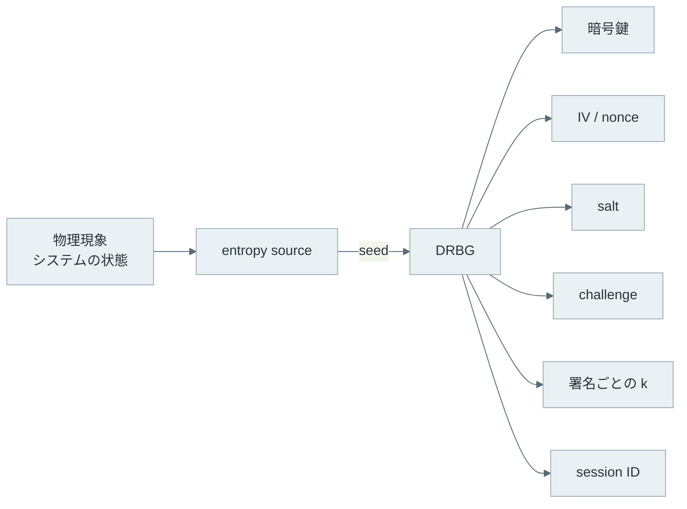

上記の図の DRBG が予測できる値を返すなら、その生成器に依存する用途は同時に影響を受けます。予測できないことを要求するのは、暗号鍵・challenge・署名の k・session ID です。IV と nonce に必要な性質は暗号方式によって違うので、後の節で扱います。ただし、用途ごとに別の生成器や独立した状態を持つ実装もあります。

例えば [Passkey](../passkey/) の認証でサーバーが出す challenge を予測できると、将来使われる challenge に対する利用者の端末に正規の応答を先に作らせておく preplay が成り立ちます。秘密鍵を持たない攻撃者が署名を作れるようになる、という意味ではありません。

本記事では、暗号で使う乱数について、予測できない値の作り方と壊れ方を説明します。手掛かりにするのは、次の 5 つの問いです。

- 鍵の長さではなく seed の情報量が、なぜ安全性を決めるのか。
- 予測できなさの量は、どう見積もるのか。
- entropy source と DRBG は、それぞれ何を受け持つのか。
- 起動直後の OS の乱数で作った鍵は、なぜ他の機器と重なるのか。
- 乱数生成器は、どのように壊れるのか。

---

### 予測できない値が必要な理由

探索の量を決めるのは、鍵の長さではなく seed が持つ情報量です。128 bit の鍵でも、8 bit の seed で初期化した擬似乱数生成器で作れば、攻撃者が試すのは 256 個です（[RFC 4086](https://www.rfc-editor.org/rfc/rfc4086.txt) §2）。

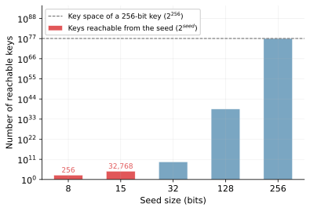

8 bit と 15 bit の棒は、256 bit 鍵の水平線から 70 桁以上、下にあります。鍵長を 512 bit へ伸ばしても、seed から到達できる鍵の個数は 256 個と 32768 個のままです。

seed のエントロピーが落ちる事故は、配布された製品でも起きています。Debian の OpenSSL では、valgrind（メモリの誤用を検査するツール）の警告を消すためにコメントアウトした `md_rand.c` の 2 行のうち 1 行が、エントロピー（entropy。予測できなさを bit で数えた量）をプール（集めたエントロピーをためておく領域）に追加する呼び出しでした（CVE-2008-0166）。

その結果、seed に残ったのはプロセス ID だけで、範囲は 1 から 32767 です。乱数列はアーキテクチャごとに 32767 通りに収まりました（[Debian Wiki SSLkeys](https://wiki.debian.org/SSLkeys)）。影響は SSH・OpenVPN・DNSSEC の鍵、X.509 証明書で使う鍵材料、SSL/TLS の session key に及んでいます（[DSA-1571-1](https://www.debian.org/security/2008/dsa-1571)）。

攻撃者は、同じ生成器を手元で再現して seed を総当たりします。

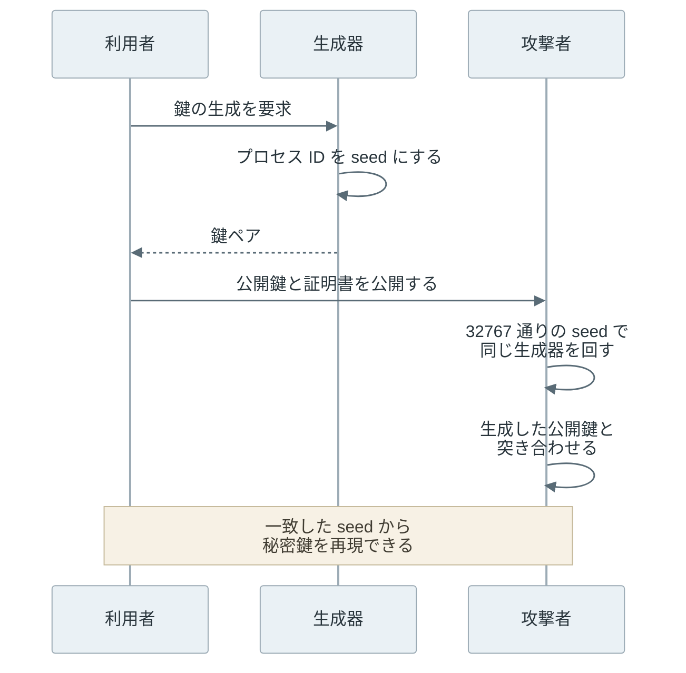

この攻撃は、RSA の演算にも SSH のプロトコルにも触れていません。壊れたのは seed を作る部分だけで、鍵の形式は正しく、接続も普段通り成立します。

---

### min-entropy による見積もり

min-entropy は、最も出やすい値の確率を `p_max` とした時の `-log2(p_max)` で、最頻値から順に推測する攻撃を想定した保守的な見積もりです（NIST の SP（Special Publication）[800-90B](https://csrc.nist.gov/pubs/sp/800/90/b/final) §2.1）。

つまり min-entropy が H bit なら、どの値が観測される確率も `2^-H` 以下で、1 回目で当たる確率も `2^-H` を超えません。k 通りの値を取る変数では min-entropy の上限が `log2 k` で、この上限に届くのは分布が一様な場合だけです。

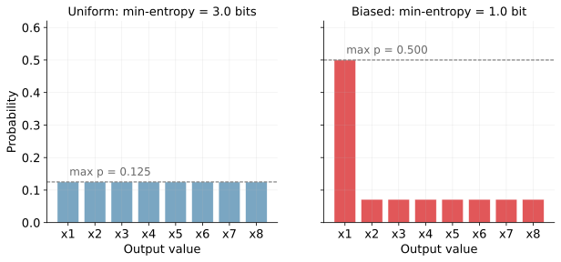

候補はどちらも 8 通りです。しかし 1 回目で当たる確率は 12.5% と 50% で 4 倍違います。平均ではなく最頻値を見るので、確率の偏りがそのまま数値に出ます。

統計テストを通ることと予測できないことは別です。計算機が無かった時代には、乱数を印刷した数表が統計の標本抽出に使われていました。この数表に並ぶ値は、分布や離れた位置どうしの相関を見る Knuth 氏の統計テストを全て通ります。しかし、攻撃者も同じ数表を持っていると考えるべきです。出力を数個見れば数表のどこから読んでいるかが分かり、その先の値は数表から読み取れます（[RFC 4086](https://www.rfc-editor.org/rfc/rfc4086.txt) §6.1.3）。

---

### エントロピー源と DRBG の分担

NIST の文書では、90A が DRBG mechanism、90B が entropy source を定め、両者を組み合わせた RBG（random bit generator）の構成は [SP 800-90C](https://csrc.nist.gov/pubs/sp/800/90/c/final) が定めています。

[NIST SP 800-90B](https://csrc.nist.gov/pubs/sp/800/90/b/final) §2.2 が定めるエントロピー源（entropy source）は、3 つの部品でできています。予測できない bit を集める noise source、偏りを減らす決定的な関数の conditioning component（省略可）、壊れていないかを検査する health test です。

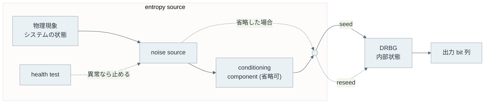

90B の health test が対象にするのは entropy source で、DRBG 側には 90A が別に self-test を求めています。破線の reseed は、新しいエントロピーを内部状態へ入れ直します。

noise source は、entropy source と乱数生成器全体にとっての root of security（安全性の根）です。ここが予測できる出力しか作らない場合、後ろのどの部品もその不足を補えないので、この生成器を使うアプリケーションの安全性は担保できません（[NIST SP 800-90B](https://csrc.nist.gov/pubs/sp/800/90/b/final) §2.2.1）。

出力の予測できなさは seed のエントロピーを超えません。90A は、seed に入れるエントロピーが、名乗る security strength（想定する攻撃者の計算量の上限。128 bit なら 2^128 回）以上であることを求めています。DRBG は、ハッシュ関数やブロック暗号といった暗号学的プリミティブを使い、出力から内部状態を効率よく復元できないように構成されます（[NIST SP 800-90A Rev. 1](https://csrc.nist.gov/pubs/sp/800/90/a/r1/final)）。ハッシュ関数を使う構成が寄りかかるのは、出力から入力を戻せない性質です（[Hash Function](../../blockchain-systems/hash-function/)）。

<br>

backtracking resistance は、ある時点より後で内部状態を知った攻撃者が、それより前の出力と本物の乱数列を並べても、どちらがどちらか判定できない性質です。prediction resistance は、それより後の出力について同じことが言える性質です。内部状態が漏れた後は、reseed によってこの性質を回復します。

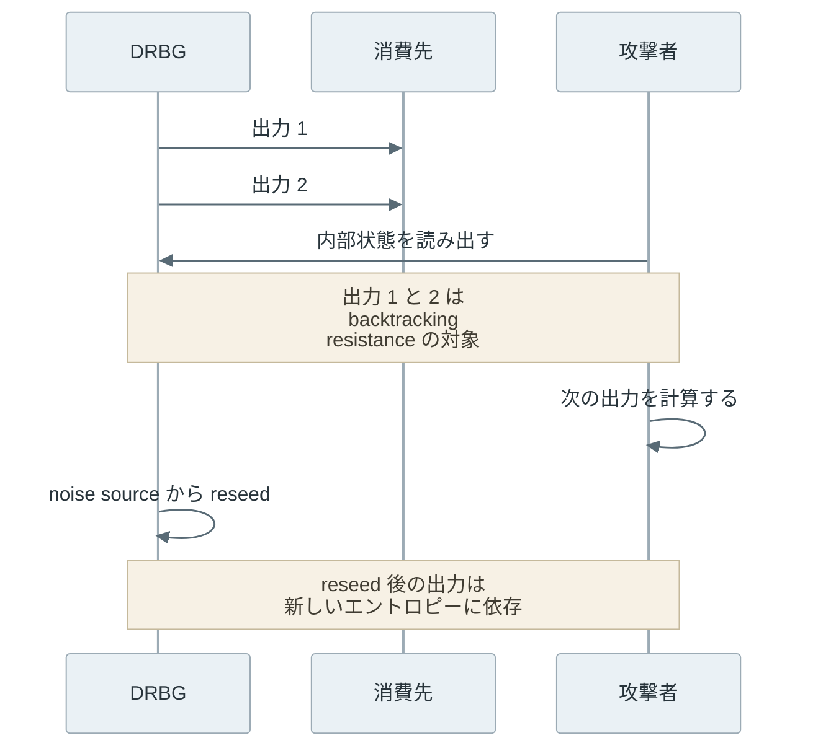

90A の DRBG 機構は、いずれもこの性質を持つように設計されています。prediction resistance の方は、要求のたびに新しいエントロピーで reseed して初めて得られる性質で、reseed しない限り、攻撃者は漏れた内部状態から先の出力を計算できます。

どちらも、実装が名乗る security strength に見合う計算量を攻撃者が実行できない、という仮定の下の話です（[NIST SP 800-90A Rev. 1](https://csrc.nist.gov/pubs/sp/800/90/a/r1/final) §8.8）。
---

### OS の乱数の呼び出し

実際の OS がこの構成をそのまま採用しているとは限りません。以降は Linux と Go を例に取ります。noise source を自分で集めるアプリケーションはほとんどありません。カーネルが割り込みなどから bit を集めてプールに入れ、その出力を配っているからです。Linux の入口は 2 つあります。

`getrandom(2)` はカーネルの乱数生成器（urandom source）から読んだ値でバッファを埋めるシステムコールで、乱数生成器の seed としても暗号の用途としても使えます。要求どおりの長さが埋まる保証があるのは、プールが初期化済みで、かつ 256 byte 以下を読む場合だけです。それより大きい要求は途中で返ることがあるので、戻り値を確かめて残りを読みます。`/dev/urandom` は同じ source から読み出せるデバイスファイルです。違いは、プールが初期化されるまでの振る舞いに出ます。

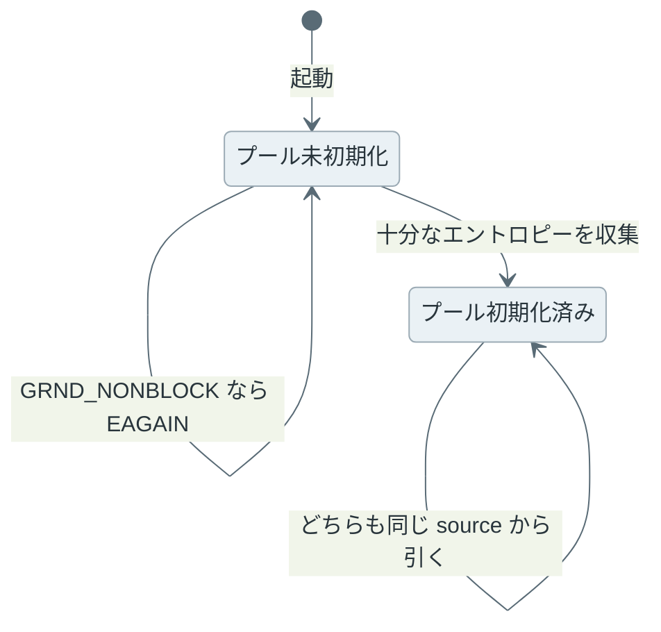

初期化前の `/dev/urandom` はエントロピーの低い値を返す場合があり、`getrandom()` は `GRND_NONBLOCK` 無しならそこで block します。初期化後は、どちらを読んでも同じ質の値が得られます（[random(7)](https://man7.org/linux/man-pages/man7/random.7.html)）。ここで質と呼んでいるのは、min-entropy が用途に対して十分かどうかです。

起動直後には、プールの初期化に使える材料が集まりきっていない時間帯があります。組み込み機器や、起動直後に鍵を作る仮想マシンは、この時間帯に鍵を作ることがあります。

初期化前のプールから作られた鍵は、実際に出回っていました。2012 年に TLS と SSH の公開鍵をインターネット全体から集めた [Mining Your Ps and Qs](https://factorable.net/) の調査では、TLS のホストの 0.50% が RSA の公開鍵に含まれる素数を別の機器と共有していて、公開鍵だけから秘密鍵を計算できました。SSH のホストの 1.03% では、署名ごとの k が別の署名と重なり、署名方式の DSA の秘密鍵を求められました。

弱い鍵を持つホストのほとんどは、キーボードなどの入力装置を持たないことが多いネットワーク機器などの組み込み機器でした。調査チームが計測した Linux の起動では、`/dev/urandom` にエントロピーが混ざり始めるのは起動から 66 秒後で、OpenSSH はそれより前に seed を読んでいました。初期化前でも値を返す `/dev/urandom` の振る舞いが、そのまま鍵の弱さになりました。

起動時の不足を seed ファイルで補う OS にも、別の落とし穴があります。停止時にプールから作った値を seed ファイルに保存して次の起動で読んでも、同じディスクイメージから複製したホストは同じ seed ファイルから始まります。

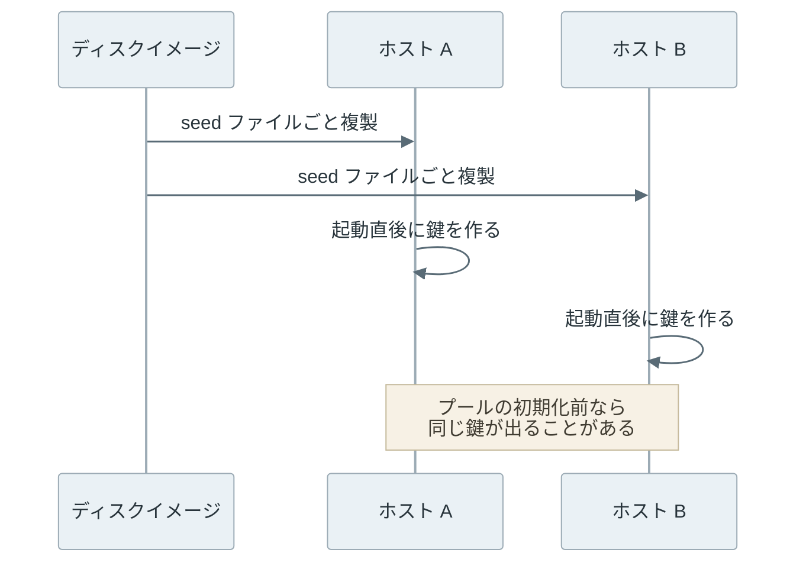

複製先が同じ値を出さないように、初回起動で seed ファイルを新しい値で作り直す手当てが必要です。

予測できる生成器と予測できない生成器の区別は、言語のライブラリにも出ます。Go の `math/rand` は、seed の与え方によらず出力を予測される場合があり、シミュレーション向けです（[math/rand](https://pkg.go.dev/math/rand)）。暗号の用途で呼ぶのは `crypto/rand` で、これは OS の乱数源を読む層です。Go 1.24 以降の `Read` はエラーを返さず、渡したスライスを最後まで埋めます（[crypto/rand](https://pkg.go.dev/crypto/rand)）。それより前のバージョンではエラーを返し得るので、戻り値を確かめます。

```go
package main

import "crypto/rand"

// newKey は 32 byte の鍵を作る。OS の乱数を読み、渡したスライスを最後まで埋める
func newKey() []byte {
	key := make([]byte, 32)
	rand.Read(key)
	return key
}
```

---

### 一様な選択と再利用の禁止

生成器が返すのは bit 列で、必要なのはある範囲の整数です。1 byte を読んで 200 通りへ落とすために剰余を取ると、値ごとの出現回数が揃いません。

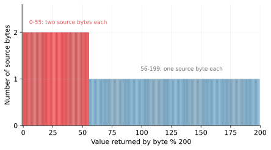

1 から 56 の値は 2 倍出やすく、この偏りは modulo bias と呼ばれます。具体的には、最頻値の確率が 2/256 なので min-entropy は 7 bit になり、一様に選べた場合の 7.64 bit を下回ります。

偏りを消すのは、範囲に収まらない値を捨てて引き直す rejection sampling です。0 から 255 のうち 200 以上の 56 個を捨てれば、残る 200 通りが同じ確率で出ます。Go の `crypto/rand` の `Int` がこの引き直しを行います。

```go
package main

import (
	"crypto/rand"
	"math/big"
)

// pick は 0 以上 200 未満の値を一様に選ぶ。範囲外の値は捨てて引き直される
func pick() (*big.Int, error) {
	return rand.Int(rand.Reader, big.NewInt(200))
}
```

偏りを残した実装が特に問題になるのは、署名方式で使う場合です。DSA と ECDSA（楕円曲線を使う DSA）は電子署名の方式で、この 2 つは署名ごとに k を選びます。k の選び方にわずかな偏りがあるだけで、それを署名方式への攻撃に使える場合があります（[RFC 6979](https://www.rfc-editor.org/rfc/rfc6979.txt) §1）。

一様に選ぶ要求は署名に限りません。[Shamir's Secret Sharing](../shamir-secret-sharing/) は、多項式の係数を独立な一様乱数として選びます。そのため閾値未満の Share からは Secret の候補を絞れませんが、係数が偏るとこの性質が崩れます。

<br>

nonce と IV に必要な性質は、暗号方式によって違います。

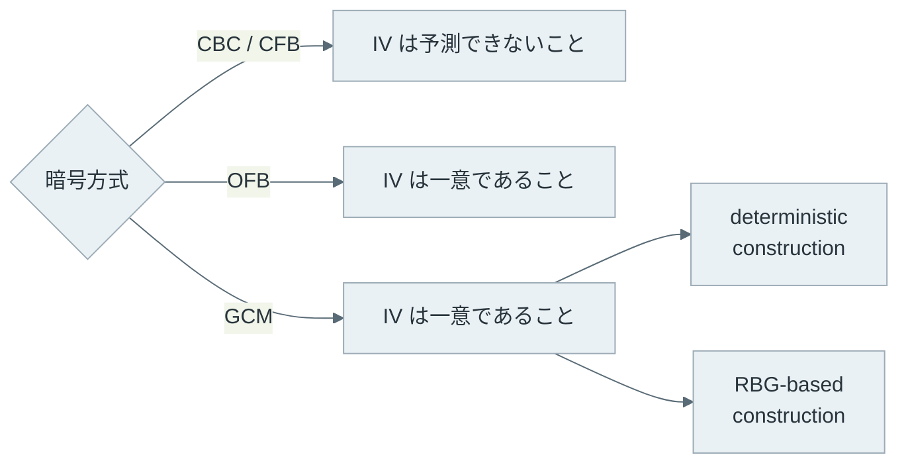

CBC と CFB は予測できない IV を求め、OFB は一意な IV を求めます（[NIST SP 800-38A](https://nvlpubs.nist.gov/nistpubs/Legacy/SP/nistspecialpublication800-38a.pdf) §5.3）。以降は、一意性を求める例として AES-GCM を扱います。IV の作り方は、カウンタなどで決める deterministic construction と、乱数で作る RBG-based construction の 2 通りです。

AES-GCM（認証付き暗号の方式）は、同じ鍵での暗号化の呼び出しを 2^32 回以下に収めることを求めます。この制約が適用されないのは、96 bit の IV を deterministic construction だけで生成する実装です（[NIST SP 800-38D](https://nvlpubs.nist.gov/nistpubs/Legacy/SP/nistspecialpublication800-38d.pdf) §8.3）。RBG-based construction では、96 bit 以上を乱数にした上でこの回数に収めます。衝突の確率がゼロになるわけではなく、NIST はこの 2 つを満たせば一意性の要求を満たすのに十分だとしています。

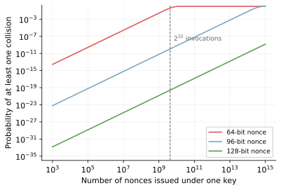

2^32 本を発行した時点の衝突確率は、96 bit なら 2^-33 程度、128 bit ならさらに 9 桁以上小さくなります。64 bit では同じ本数で 4 割近くに達し、発行数が増えるほど長さの差が無視できなくなります。

k の使い回しは、確率ではなく計算の問題です。ECDSA の署名は `r` と `s` の 2 つの値の組で、`r` は k だけから決まります。同じ k で 2 通署名すると `r` が一致するので、攻撃者には k が共通だと分かります。未知数は k と秘密鍵の 2 つ、`s` の式は 2 本あるので、連立させると両方とも解けます。

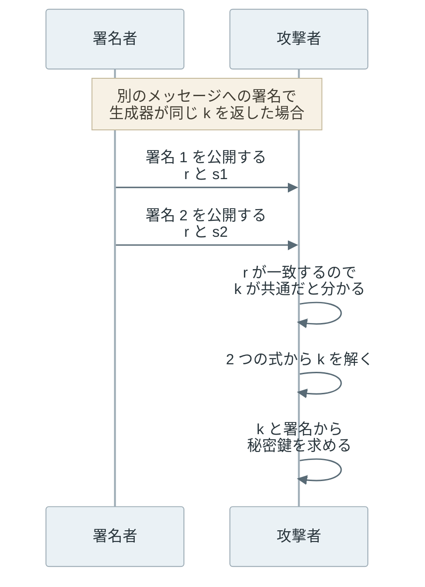

攻撃者が触るのは公開された 2 つの署名だけで、署名者の端末には近付きません（[Digital Signature](../../blockchain-systems/digital-signature/)）。

この危険を乱数なしで避ける設計もあります。決定的 ECDSA は k を秘密鍵とメッセージから HMAC（鍵付きハッシュ）で導出し、署名の生成時に乱数を使いません。ただし秘密鍵の生成には、min-entropy が鍵長に対して十分な乱数が必要です（[RFC 6979](https://www.rfc-editor.org/rfc/rfc6979.txt) §4）。

---

### 利点

- エントロピーの収集と乱数生成器の管理を OS に任せられ、呼び出しは 1 つで済む
- security strength に足りる seed があれば、DRBG がそこから必要な長さの bit 列を作れる
- min-entropy で予測できなさを bit で数え、鍵長と seed の大きさを比べられる
- backtracking resistance と reseed で、内部状態の漏洩が過去と将来の出力へ及ぶ範囲を抑えられる
- rejection sampling で有限の範囲から一様に選ぶ手順は、用途を問わず同じ形で使える

---

### 乱数生成器の壊れ方

乱数生成器の失敗は、使う側から見えない形で現れます。

- 生成器が壊れても出力は正常な bit 列に見え、出力だけでは異常が分からない
- DSA / ECDSA の実装では、乱数源の質が足りているかを自動テストで確実には検出できない
- 共通の生成器が壊れると、そこから値を取る用途が同時に影響を受ける
- 内部状態が漏れると、reseed までの出力を攻撃者が計算できる

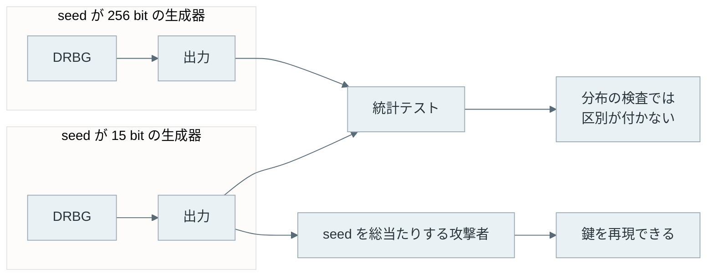

統計テストが見ているのは出力の分布で、どれだけの候補から選ばれた値かは見ていません。

署名の生成のように乱数が結果から読み取れない処理では、生成器の異常はさらに見付けにくくなります（[RFC 6979](https://www.rfc-editor.org/rfc/rfc6979.txt) §1）。

---

### 乱数の質が問題になりにくいケース

判断の基準は、その値を攻撃者が当てた時に何が起きるかです。ログの相関に使う識別子なら、当てられても得られるものはほとんどありません。しかし、同じ値が資源へのアクセスを許すなら、challenge と同じ扱いになります。

- 再現性のために seed を固定するシミュレーションや単体テスト
- 決定的 ECDSA のように、必要な値を秘密鍵とメッセージから導出する署名
- 公開されても損害が出ず、一意性だけが必要な識別子

要求が別の方向へ向く用途もあります。[Timelock Encryption](../timelock-encryption/) が使う drand の乱数ビーコン（一定間隔で誰でも読める乱数を公開する仕組み）は、出力を公開して誰でも検証できることを求めるので、予測できなさに加えて、単独の参加者が値を選べないことが要求されます。
