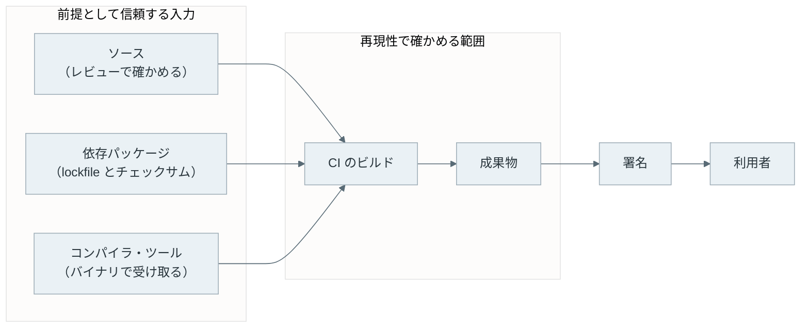

Reproducible Builds（再現可能なビルド）は、同じソースコード・同じビルド環境・同じ手順を与えれば、誰がビルドしてもビット単位で同じ成果物が得られる性質です。[reproducible-builds.org の定義](https://reproducible-builds.org/docs/definition/)では、成果物は実行ファイル・配布パッケージ・ファイルシステムのイメージなどを指し、ビルドのログは通常含めません。

この性質があると、配布されたバイナリが公開されているソースから作られたことを配布元以外の人が確かめられます。開発者と独立したビルダーが同じコミットからビルドし、成果物の [SHA-256](/notes/security/sha-256/) を比べるだけです。一致すれば、配布物はそのソースと記録したツールチェーンから作られたものと同じです。一致しなければ、どこかに差があります。

しかし、2 つのハッシュは素直には一致しません。ビルドは、ソースに書かれていない現在時刻・ディレクトリのパス・ファイルの所有者などを成果物に混ぜるからです。

以下は、本記事の実験で 2 つのビルダーの差を 1 つずつ固定した結果です。



黄土色のセルは、その段階でまだ残っている差です。5 つ全てを固定した段階 5 で、初めて 2 つのハッシュが一致しました。

<br>

本記事では、同じソースを 2 回ビルドしてハッシュが変わる様子を手元で再現し、原因を 1 つずつ固定して一致させます。そのうえで、次の疑問を順に説明します。

- ビルド環境は、どこから成果物に入り込むのか。
- 同じハッシュを得るには、何を固定し、何を記録すれば良いのか。
- 署名があるのに、なぜ再現性も必要なのか。
- ハッシュが一致しなかった時、差分から何が分かるのか。
- 再現性で確かめられる範囲は、どこまでなのか。

---

### 2 回のビルドでハッシュが変わる

実験の題材は、3 つのファイルを持つディレクトリ `project/` を tar.gz に固める、最も単純なビルドです。同じスクリプトを条件の違う 2 つの Docker コンテナ（ビルダー A と B）で動かします。どちらも同じイメージ `debian:stable-slim`（GNU tar 1.35、gzip 1.13）を使い、違いは次の通りです。

| 項目 | ビルダー A | ビルダー B |
| --- | --- | --- |
| 実行ユーザー | root（uid 0） | uid 1000 |
| 作業ディレクトリ | tmpfs 上の `/build` | コンテナ内の `/tmp/work` |
| umask | 022 | 002 |
| タイムゾーン | UTC | Asia/Tokyo |
| 実行時刻 | B より 1 秒以上前 | A の後 |

ビルドのスクリプトは次の通りです。引数の段階（0〜5）が上がるごとに、固定する項目を 1 つ増やします。ファイルを書き出す部分は、`git clone` でソースを取り出す処理の代わりです。

```sh
#!/bin/sh
# 使い方: sh build.sh <段階 0〜5>
# project/ を取り出して tar.gz を作り、標準出力に書きます。
set -eu
stage=$1

# ソースの取り出し（git clone の代わり）。中身は毎回同じです。
rm -rf project
mkdir -p project/docs
printf 'hello\n' > project/README
printf 'usage\n' > project/docs/usage.txt
printf '#!/bin/sh\necho hello\n' > project/hello.sh
chmod +x project/hello.sh

t="--mtime=@${SOURCE_DATE_EPOCH}"
o="--owner=0 --group=0 --numeric-owner"
m="--mode=a=rX,u+w"
case "$stage" in
  0) tar -cf project.tar project ;;
  1) tar -cf project.tar project ;;
  2) tar "$t" -cf project.tar project ;;
  3) tar --sort=name "$t" -cf project.tar project ;;
  4) tar --sort=name "$t" $o -cf project.tar project ;;
  5) tar --sort=name "$t" $o "$m" -cf project.tar project ;;
esac
if [ "$stage" = 0 ]; then
  gzip -c project.tar      # gzip ヘッダーにファイル名と mtime が入る
else
  gzip -n -c project.tar   # -n: ファイル名と mtime を入れない
fi
```

2 つのビルダーを動かして比べるのは [lab/run.sh](https://github.com/nao1215/debimate/blob/main/content/notes/security/reproducible-builds/lab/run.sh) です。段階ごとに A と B を 1 秒ずらして起動し、成果物の sha256 を比べます。

<details>
<summary>run.sh の抜粋（末尾の表示部分を省略）</summary>

```sh
#!/bin/sh
# 条件の違う 2 つのビルダーで同じ build.sh を動かしてハッシュを比べます。
set -eu
IMAGE=debian:stable-slim
LAB=$(cd "$(dirname "$0")" && pwd)
OUT=$(mktemp -d)
trap 'rm -rf "$OUT"' EXIT
export SOURCE_DATE_EPOCH=1762732800   # 2025-11-10 00:00:00 UTC

# ビルダー A: root、tmpfs 上の /build、TZ=UTC、umask 022
builder_a() {
  docker run --rm --name note-reproducible-builds-a \
    -e SOURCE_DATE_EPOCH -e TZ=UTC --tmpfs /build -w /build \
    -v "$LAB":/lab:ro "$IMAGE" sh -c "umask 022; sh /lab/build.sh $1"
}
# ビルダー B: uid 1000、/tmp/work、TZ=Asia/Tokyo、umask 002
builder_b() {
  docker run --rm --name note-reproducible-builds-b \
    -e SOURCE_DATE_EPOCH -e TZ=Asia/Tokyo --user 1000:1000 \
    -v "$LAB":/lab:ro "$IMAGE" \
    sh -c "mkdir -p /tmp/work && cd /tmp/work && umask 002; sh /lab/build.sh $1"
}

for stage in 0 1 2 3 4 5; do
  builder_a "$stage" > "$OUT/a$stage.tar.gz"
  sleep 1
  builder_b "$stage" > "$OUT/b$stage.tar.gz"
  ha=$(sha256sum "$OUT/a$stage.tar.gz" | cut -c1-16)
  hb=$(sha256sum "$OUT/b$stage.tar.gz" | cut -c1-16)
  if [ "$ha" = "$hb" ]; then r=same; else r=DIFFERENT; fi
  echo "stage $stage  A=$ha  B=$hb  $r"
done

# 以降、段階 0 の中身を tar -tv で、gzip ヘッダーを od で表示します（省略）。
```

</details>

以下が実行結果の抜粋です（全体は [lab/output.txt](https://github.com/nao1215/debimate/blob/main/content/notes/security/reproducible-builds/lab/output.txt)）。ハッシュは先頭 16 文字だけを表示しています。

```text
stage 0  A=35766f8b998f6ddd  B=e44dd8355fd054b6  DIFFERENT
stage 1  A=5387d3683c52a63d  B=dfd94911154696c0  DIFFERENT
stage 2  A=12276888995da47f  B=be7564dab1402cec  DIFFERENT
stage 3  A=ff068a3fd506c1d1  B=3730f617a591ac57  DIFFERENT
stage 4  A=1ac65de158344e38  B=c2f5016c54f06759  DIFFERENT
stage 5  A=1ac65de158344e38  B=1ac65de158344e38  same
```

段階 5 だけ、A と B のハッシュが一致しました。何も固定しない段階 0 の tar の一覧は、次の通りです。時刻はホストのタイムゾーン（JST）で表示しています。

```text
--- stage 0 の中身 (A) ---
drwxr-xr-x root/root         0 2026-11-10 07:50:57 project/
-rwxr-xr-x root/root        21 2026-11-10 07:50:57 project/hello.sh
-rw-r--r-- root/root         6 2026-11-10 07:50:57 project/README
（docs/ の 2 行は省略）
--- stage 0 の中身 (B) ---
drwxrwxr-x 1000/1000         0 2026-11-10 07:50:59 project/
-rw-rw-r-- 1000/1000         6 2026-11-10 07:50:59 project/README
-rwxrwxr-x 1000/1000        21 2026-11-10 07:50:59 project/hello.sh
（docs/ の 2 行は省略）
```

ファイルの中身は 3 つとも同じなのに、段階 0 の一覧には 4 種類の差があります。時刻が 2 秒ずれ、A では `hello.sh` が、B では `README` が先に並び、所有者が `root/root` と `1000/1000` で、権限が `rw-r--r--` と `rw-rw-r--` です。

並び順の差は、tar がディレクトリを読む順番をファイルシステムに任せているからで、A の tmpfs と B のコンテナの領域では順番が違いました。

<br>

さらに、[gzip ヘッダー](https://www.rfc-editor.org/rfc/rfc1952#section-2.3)にもビルドの情報が入っています。以下は、A の段階 0 の先頭 24 byte です。

```text
0000000 1f 8b 08 08 51 4e f2 6a 00 03 70 72 6f 6a 65 63
0000016 74 2e 74 61 72 00 ed d6
0000024
```

4 byte 目の `08` は「ファイル名あり」の印で、続く `51 4e f2 6a` は圧縮した `project.tar` の更新時刻（リトルエンディアンの UNIX 時刻）です。その後ろの `00 03`（圧縮の補助情報と OS の種類）に続くのが、`project.tar` という名前です。

段階 1 の `gzip -n` は、この 2 つを書きません。なお、`tar -czf` のようにパイプから圧縮すると、今回の環境ではヘッダーに名前も時刻も入りませんでした。

段階 2 で更新時刻を `SOURCE_DATE_EPOCH` に揃え、段階 3 で名前順に並べ、段階 4 で所有者を 0 にし、段階 5 で権限を揃えると、A と B の sha256 が一致しました。

ちなみに、A の段階 4 と段階 5 は同じハッシュです。A の umask 022 で作った権限が、`--mode=a=rX,u+w` の結果と元から同じだったからです。手元のマシンで 2 回ビルドするだけでは、この種の差は見えません。

---

### SOURCE_DATE_EPOCH と GNU tar の指定

`SOURCE_DATE_EPOCH` は、成果物に埋め込む時刻を外から与える環境変数です。[仕様](https://reproducible-builds.org/specs/source-date-epoch/)（現行は 2017 年の Revision 1.1）では、値は 1970-01-01 00:00:00 UTC からの秒数の整数で、ビルドした時刻ではなくソースに由来する時刻を入れます。Git のリポジトリなら、`git log -1 --format=%ct` で得た最後のコミットの時刻がよく使われます。

仕様がビルドのツールに求めるのは、主に次の 3 つです。現在時刻を埋め込む所では代わりにこの値を使い、ビルド中に生まれた時刻はこの値より後にならないように切り詰め（clamp）、子プロセスに渡す時にこの変数を消しません。

<br>

実験の段階 5 は、[reproducible-builds.org のアーカイブの手引き](https://reproducible-builds.org/docs/archives/)にある GNU tar の推奨指定に、権限を揃える `--mode` を加えた形です。`--sort=name` は GNU tar 1.28 以降で使え、ロケールに依存しない名前順に並べます。手引きには、実験で使わなかった次の 2 つも載っています。

| 指定 | 固定するもの |
| --- | --- |
| `--clamp-mtime`（1.29 以降、推奨の指定とは別の選択肢） | `--mtime` より新しい時刻だけを切り詰め、古い時刻は残す |
| `--pax-option=...,delete=atime,delete=ctime`（推奨の指定） | pax 形式で書かれる atime（アクセス時刻）と ctime（状態の変更時刻） |

今回の GNU tar 1.35 は既定の形式が gnu 形式（`tar --show-defaults` で確認）なので、`--pax-option` が無くても一致しました。`--format=posix` で pax 形式を選ぶなら、この指定も必要です。

---

### Go のビルドに埋まるパス

コンパイラの出力にも同じ種類の差が入ります。[lab/go-build.sh](https://github.com/nao1215/debimate/blob/main/content/notes/security/reproducible-builds/lab/go-build.sh) は、`hello` と表示するだけの `main.go` を 2 つのディレクトリでビルドして、[`-trimpath`](https://pkg.go.dev/cmd/go#hdr-Compile_packages_and_dependencies) の有無でハッシュを比べます。

`-buildvcs=false` は VCS（Version Control System）の情報を埋め込まない指定で、`CGO_ENABLED=0` は C のツールチェーンを使わない指定です。

<details>
<summary>go-build.sh の全体</summary>

```sh
#!/bin/sh
# 同じ main.go を 2 つのディレクトリでビルドし、ハッシュを比べます。
set -eu
LAB=$(cd "$(dirname "$0")" && pwd)
WORK=$(mktemp -d)
trap 'rm -rf "$WORK"' EXIT
export GOFLAGS=-buildvcs=false GOTOOLCHAIN=local CGO_ENABLED=0
go version

for d in alice/src bob/work/hello; do
  mkdir -p "$WORK/$d"
  cp "$LAB/main.go" "$WORK/$d/"
  (cd "$WORK/$d" && go mod init example.com/hello >/dev/null 2>&1 \
    && go build -o hello . && go build -trimpath -o hello-trim .)
done

echo "--- go build ---"
sha256sum "$WORK"/alice/src/hello "$WORK"/bob/work/hello/hello | sed "s|$WORK/||"
echo "--- 埋め込まれたパス ---"
strings "$WORK"/alice/src/hello | grep -m1 "alice/src/main.go" | sed "s|$WORK|<WORK>|"
echo "--- go build -trimpath ---"
sha256sum "$WORK"/alice/src/hello-trim "$WORK"/bob/work/hello/hello-trim | sed "s|$WORK/||"
strings "$WORK"/alice/src/hello-trim | grep -m1 "main.go"
```

</details>

以下が実行結果です（[lab/go-output.txt](https://github.com/nao1215/debimate/blob/main/content/notes/security/reproducible-builds/lab/go-output.txt)）。

```text
go version go1.26.4 linux/amd64
--- go build ---
1dfe5dbb213d0753e01b73abd9c601336a83c2d3fb986a01463c90b0656e6bef  alice/src/hello
eb9e27c26fb06a0c22b703bf0c964e86bf130a8c8d70c2367b74b21fd8520694  bob/work/hello/hello
--- 埋め込まれたパス ---
<WORK>/alice/src/main.go
--- go build -trimpath ---
b0b7333aafe28d335b8f477b910e651e350d68d253c379ddd04b9f64f6fd477d  alice/src/hello-trim
b0b7333aafe28d335b8f477b910e651e350d68d253c379ddd04b9f64f6fd477d  bob/work/hello/hello-trim
example.com/hello/main.go
```

`-trimpath` を付けない場合、バイナリにはソースファイルの絶対パスが入ります。スタックトレースやデバッグ情報に使うためで、ディレクトリ名が違えばハッシュも変わります。`-trimpath` を付けると、パスはモジュール名の `example.com/hello/main.go` に置き換わり、2 つのバイナリが一致しました。

Go は [Go 1.21.0 でツールチェーンを完全に再現可能にした](https://go.dev/blog/rebuild)と公表しており、乱数による順序・ホストの C ツールチェーン・ソースのディレクトリ・ユーザー ID・時刻などを 1 つずつ成果物から外しています。

---

### 非決定性の発生源

ソースとツールチェーンが同じでも結果が変わる要因を非決定性（nondeterminism）と呼びます。実験で差が出た 4 種類（時刻・ビルドパス・列挙順・ユーザーと権限）に、コンパイラやパッケージのツールで起きやすいものを加えると、次の表のようになります。実験ではタイムゾーンも変えましたが、tar は時刻を UTC からの秒数で書くため、成果物には入りませんでした。

| 発生源 | 成果物に入る形 | 主な対処 |
| --- | --- | --- |
| 現在時刻 | アーカイブの mtime、gzip ヘッダー、`__DATE__` のようなビルド日時の埋め込み | `SOURCE_DATE_EPOCH` を使う |
| ビルドパス | デバッグ情報・スタックトレース用のファイル名 | Go の `-trimpath`、GCC の [`-ffile-prefix-map`](https://gcc.gnu.org/onlinedocs/gcc/Overall-Options.html) |
| ファイルの列挙順 | アーカイブの格納順、リンクするオブジェクトの順 | 名前で並べ替える |
| ユーザーと権限 | アーカイブの uid・gid・ユーザー名、umask で変わる権限 | 値を固定して書く |
| ロケール・タイムゾーン | 日付の書式、`sort` の比較順 | `LC_ALL=C`、`TZ=UTC` |
| 乱数とハッシュ表の順序 | 連想配列を走査した順で出力が並ぶ | 出力の前に並べ替える |
| 並列ビルド | 先に終わったジョブの順で結果を連結する | 連結の前に順序を決める |
| ビルド ID・ホスト名 | 実行ごとに作った ID、マシン名の埋め込み | 入力から ID を計算する、埋め込まない |

表の対処は、どれも「ビルド中に生まれた値をソースから計算できる値に置き換える」考え方です。乱数・ハッシュ表・並列ビルドは 1 回の比較では一致することもあり、繰り返しビルドしないと見付かりません。

---

### 同じハッシュを得る条件

非決定性を取り除いた後は、入力を固定します。冒頭の定義でいうビルド環境には、依存パッケージとそのバージョン、ビルドの設定フラグ、ビルドが読む環境変数が含まれます。

- ソース: コミットのハッシュ、または配布したソースのアーカイブのハッシュで指す。
- ツールチェーン: コンパイラ・tar・gzip のバージョン。実験では同じコンテナイメージで揃えている。
- 依存パッケージ: lockfile でバージョンを固定し、内容をチェックサムで照合する（Go の `go.sum`、npm の `package-lock.json` の `integrity`）。
- 手順: ビルドのコマンド、フラグ、環境変数。

別の人が同じ環境を作れるよう、使ったツールチェーンのバージョンや依存の一覧も成果物と一緒に記録し、公開します。例えば、Debian はビルドに使ったパッケージとそのバージョン、成果物の SHA-256 を [`.buildinfo` ファイル](https://wiki.debian.org/ReproducibleBuilds/BuildinfoFiles)に記録します。

---

### 署名との役割分担

配布物の改竄対策には、先に[デジタル署名](/notes/blockchain-systems/digital-signature/)があります。署名と再現性は、答える問いが違います。


- title: 署名
  body: 配布物を「誰が出したか」を確かめる。
  items:
  - 秘密鍵を持つ配布元だけが作れる
  - 検証には、[PKI](/notes/security/pki/) などで配布元の公開鍵を信頼する必要がある
  - 署名する前の成果物が正しいかは確かめない
- title: 再現性
  body: 配布物を「何から作ったか」を確かめる。
  items:
  - 誰でも、同じソースからビルドして比べられる
  - 検証には、ソースと手順の公開が必要
  - 配布元が誰かは確かめない


署名は、署名する時点の成果物が本物だという前提に立っています。ビルドサーバーが乗っ取られ、改竄された成果物が正規の手順で署名されると、署名の検証は正しく通ります。この時、公開されたソースから独立したビルダーが作った成果物とはハッシュが一致せず、再現性の検証で差に気付けます。

一方で、署名を成果物の中に埋め込む形式では、署名した成果物と署名していない成果物でビット列が変わります。[Go の配布物の検証](https://go.dev/blog/rebuild)でも、署名は再現できないため、macOS の実行ファイルは署名部分を除いて比べ、Windows のインストーラーは中身を取り出して比べています。

---

### 差分から改竄を見付ける

ハッシュの不一致は「どこかが違う」ことしか教えてくれません。[diffoscope](https://diffoscope.org/) は、アーカイブやパッケージを再帰的に展開し、ファイル一覧・メタデータ・中身の差を人が読める形で出してくれるツールです。

実験の段階 3（時刻と並び順だけを固定）で作った 2 つの tar.gz を比べた結果の抜粋が、以下です。ディレクトリとファイル 5 件のうち 2 件だけを残しました（全体は [diff-output.txt](https://github.com/nao1215/debimate/blob/main/content/notes/security/reproducible-builds/lab/diff-output.txt)、[`diff.sh`](https://github.com/nao1215/debimate/blob/main/content/notes/security/reproducible-builds/lab/diff.sh) で再現できます）。

```text
diffoscope 297
--- /w/a3.tar.gz
+++ /w/b3.tar.gz
│   --- a3.tar
├── +++ b3.tar
│ ├── file list
│ │ @@ -1,5 +1,5 @@
│ │ --rw-r--r--   0 root         (0) root         (0)        6 2025-11-10 00:00:00.000000 project/README
│ │ --rwxr-xr-x   0 root         (0) root         (0)       21 2025-11-10 00:00:00.000000 project/hello.sh
│ │ +-rw-rw-r--   0     1000     1000        6 2025-11-10 00:00:00.000000 project/README
│ │ +-rwxrwxr-x   0     1000     1000       21 2025-11-10 00:00:00.000000 project/hello.sh
```

差は所有者と権限だけで、ファイルの中身の差は出ていません。改竄があれば、ここに `hello.sh` の中身の差が並びます。非決定性を先に取り除くのは、メタデータの差が大量に並ぶと、調べるべき中身の差が埋もれるからです。

<br>

ビルドの途中や配布の直前で中身が差し替えられた事件は、起きています。いずれも、再現性の検証があれば防げたと断定できる事件ではありません。

1. SolarWinds Orion（2020 年）: [CrowdStrike の解析](https://www.crowdstrike.com/en-us/blog/sunspot-malware-technical-analysis/)によると、ビルドサーバーに置かれた SUNSPOT というマルウェアが `MsBuild.exe` の起動を監視し、Orion のビルド中だけソースファイルを改竄したものに差し替え、ビルド後に元に戻していました。[Mandiant の報告](https://cloud.google.com/blog/topics/threat-intelligence/evasive-attacker-leverages-solarwinds-supply-chain-compromises-with-sunburst-backdoor)では、バックドアを含む DLL は SolarWinds のデジタル署名付きでした。
2. xz-utils（2024 年）: [Andres Freund 氏の報告](https://www.openwall.com/lists/oss-security/2024/03/29/4)によると、5.6.0 と 5.6.1 のリリース tarball にある `build-to-host.m4` には、Git のリポジトリに無い 1 行が入っていました。バックドアの本体は、テスト用のファイルとして Git に含まれていました。

SolarWinds の件は、署名する前の成果物が改竄されていれば署名が正しくても意味を持たない例です。xz-utils の件は、ソースの配布物（リリース tarball）と Git のソースが一致していなかった例で、この 2 つの対応も検証の対象になります。

---

### 再現性が及ぶ範囲

再現性の検証は、「この成果物は、このソースとこのツールチェーンから作られた」ことを示します。ソースやツールチェーンの中身が正しいことは示しません。どこまでを信頼しているかを並べると、以下のようになります。



上記の図の左側は、再現性では確かめられません。ソースに最初から悪意のあるコードがあれば、誰がビルドしても同じ悪意のある成果物が一致します。依存パッケージも同じで、lockfile とチェックサムが保証するのは「前回と同じもの」であって「安全なもの」ではありません。

<br>

コンパイラは、さらに厄介です。Ken Thompson 氏は 1984 年の講演録 [Reflections on Trusting Trust](https://dl.acm.org/doi/10.1145/358198.358210) で、`login` をコンパイルする時に裏口を埋め込み、コンパイラ自身をコンパイルする時にはその仕掛けを複製するコンパイラを示しました。仕掛けがバイナリだけに残ると、ソースを読んでも不正は見付からず、同じコンパイラのバイナリを使う全てのビルダーで成果物が一致します。

対策の取り組みとして、[Bootstrappable Builds](https://bootstrappable.org/) は、コンパイラを作るために最初に信頼するバイナリを最小限まで減らす取り組みです。

David A. Wheeler 氏の [Diverse Double-Compiling](https://dwheeler.com/trusting-trust/) は、別系統のコンパイラを使ってコンパイラのソースを 2 段階でビルドし、結果が元のバイナリと一致するかで検証する手法です。

前提は、検証される側のコンパイラを作ったコンパイラ（自分自身でビルドされたなら同じもの）が決定的に動く（同じ入力から同じ出力を返す）ことで、検証に使う別系統のコンパイラは決定的でなくても構いません。

<br>

図の右側にある CI は、再現性の検証が最も効く場所です。CI のビルドが乗っ取られても、独立したビルダーの結果と比べれば差が出る可能性があります。ただし、作り直す側が全員同じパイプラインのソフトウェアを使っていると、その欠陥を突く 1 度の攻撃で全員が破られることがあります。

[SLSA](https://slsa.dev/spec/v1.2/build-provenance)（Supply-chain Levels for Software Artifacts）の provenance は、成果物を「どこで、いつ、どのように作ったか」を検証可能な形で記録する仕様です。

provenance はビルドの基盤を信頼して記録を受け入れる仕組みで、再現性は記録された入力から作り直して確かめる仕組みです。SLSA は provenance の目的の 1 つに作り直しを挙げつつ、[FAQ](https://slsa.dev/spec/v1.2/faq) では検証済みの再現可能なビルドを直接の要件とせず、再現可能なビルドはソース・依存・配布への脅威には対処しないと整理しています。

CI が使う GitHub Actions の Action も、図の左側の依存パッケージと同じく信頼する入力の 1 つです（更新の運用は [Dependabot で Action を更新する記事](/post/ja/2023-09-30-dependabot%E3%81%A7github-actions%E3%81%AEaction%E3%82%92%E6%9C%80%E6%96%B0%E3%81%AB%E4%BF%9D%E3%81%A4%E6%96%B9%E6%B3%95/)）。

---

### 利点

- 配布元を信頼しなくても、配布物とソースの対応を第三者が確かめられる
- ビルドサーバーや CI が乗っ取られた時、改竄が独立したビルダーとの差として現れる
- 不具合の報告を受けた時、報告されたバイナリと同じものを手元で作り直せる

---

### 欠点

再現性は、ビルドが成果物に混ぜる情報を全てソース由来の値に置き換えることで成り立ちます。その代わりに、次の制約があります。

- 時刻・パス・ホスト名を消すため、成果物を見ても「いつ、どこでビルドしたか」が分からなくなる。必要なら provenance などに分けて記録する
- 非決定性の発生源はツールごとに違い、1 つ残るだけで一致しない。ツールの更新で再び崩れることもある
- 検証には、独立したビルダーが同じツールチェーンを用意し、全てをビルドし直す計算資源が必要になる
- ハッシュが一致しても、ソース・依存パッケージ・コンパイラに最初から入っていた不正は見付からない
- 署名を埋め込む形式やインストーラーでは、署名部分を除いて比べる手順を別に決める必要がある
