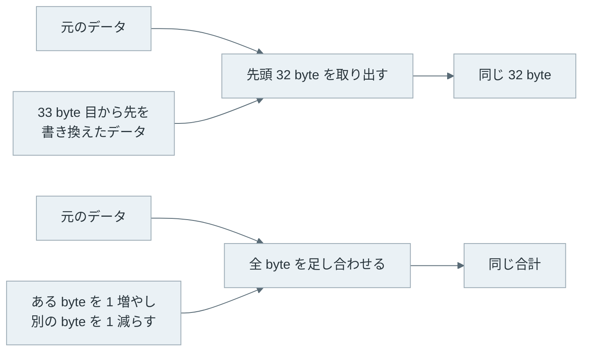
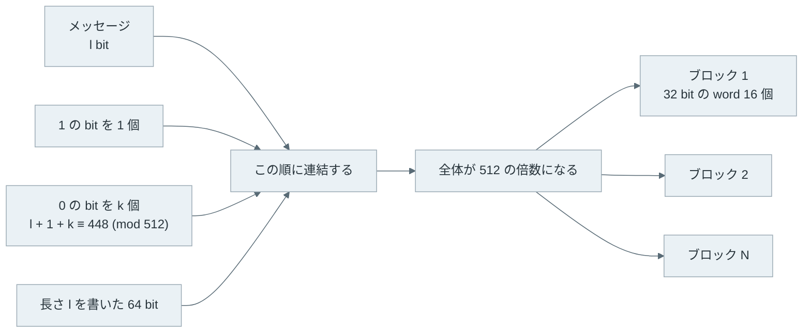
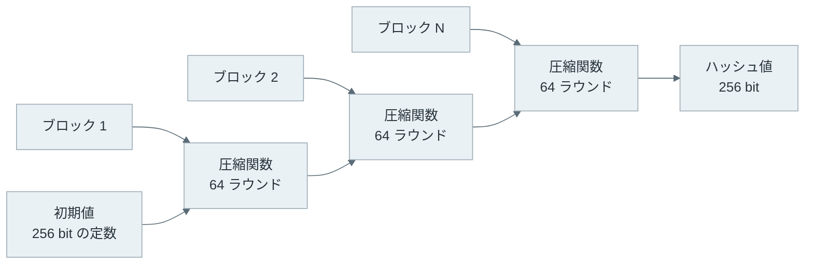

Hash Function（ハッシュ関数）とは、長さの異なるデータを固定長の値へ変換する関数です。変換後の値をハッシュ値と呼びます。

SHA-256（Secure Hash Algorithm 256）はハッシュ関数の 1 つで、仕様上扱える範囲であれば、入力の長さに関係なく 256 bit のハッシュ値を返します。中身が `a` の 1 文字だけの 1 byte のファイルと、0 で埋めた 64 MiB のファイルで、このことを確かめます。

```console
$ printf 'a' > note.txt
$ head -c 67108864 /dev/zero > disk.img
$ wc -c note.txt disk.img
       1 note.txt
67108864 disk.img
67108865 total
$ sha256sum note.txt disk.img
ca978112ca1bbdcafac231b39a23dc4da786eff8147c4e72b9807785afee48bb  note.txt
3b6a07d0d404fab4e23b6d34bc6696a6a312dd92821332385e5af7c01c421351  disk.img
```

note.txt は 1 byte、disk.img は 64 MiB ですが、SHA-256 の出力はどちらも 16 進数 64 文字です。16 進数 1 文字は 4 bit なので、出力長はいずれも 256 bit です。

以下は、2 つのファイルを SHA-256 が読む 512 bit のブロックに分けて並べた図です。



ブロックの数は 1 個と約 105 万個で違いますが、ブロックの間を渡る内部状態はどちらも 256 bit です。黄土色の部分は、データの末尾に足して長さを 64 byte の倍数に揃える padding です。

ハッシュ値は、配布物が途中で書き換えられていないかの確認に使われます。ダウンロードページに載っている 16 進数の文字列は、この用途で置かれています。ただし、この確認が成り立つ前提は、比較元の 64 文字を信頼できる経路で手に入れていることです。配布物と掲載されたハッシュ値の両方を差し替えられる相手に対しては、値が一致しても、配布物が本物だという根拠になりません。

<br>

本記事では、長さの決まっていない入力から 256 bit のハッシュ値ができるまでの手順を説明します。取り上げるのは次の疑問です。

- 先頭を切り出すような素朴な縮め方では、なぜ足りないのか。
- 入力は、どのようにブロックへ分けられるのか。
- 内部状態は、ブロックごとにどう更新されるのか。
- 1 bit の違いが、なぜ出力全体に広がるのか。
- SHA-1 で実際に見つかった衝突（同じハッシュ値の組）は、ハッシュ値から入力を探すこと（原像）や、同じハッシュ値の別の入力を探すこと（第二原像）と何が違うのか。

---

### 素朴な縮め方の限界

固定長に縮めるだけなら、先頭 32 byte を取り出す、全 byte を足し合わせて下位 1 byte だけを残す、といった方法でも実現できます。しかし、どちらの方法でも、同じ値になる別のデータを手で作れます。



配布物の検証では、値の一致だけを根拠に同じデータだと判断します。攻撃者が、手元のファイルと同じ値を持つ別のファイルを作れるなら、この判断は成り立ちません。検証に必要なのは、与えられたデータと同じハッシュ値を持つ別のデータを見つけにくいことです。

---

### padding とブロック分割

SHA-256 の内部にある圧縮処理は、512 bit 単位でブロックを受け取ります。そのため、入力の後ろに bit を加え、全体を 512 の倍数にします。

この手順は padding（詰め物）と呼ばれ、[FIPS 180-4](https://nvlpubs.nist.gov/nistpubs/FIPS/NIST.FIPS.180-4.pdf) §5.1.1 が定めています。メッセージの長さを l bit として、まず 1 の bit を 1 個加え、続けて `l + 1 + k ≡ 448 (mod 512)`（512 で割った余りが 448）を満たす最小の非負の k だけ 0 の bit を加え、最後に l 自身を 64 bit で書きます。



1 ブロックは、32 bit のまとまりを 1 つの word（語）として、16 個に分けて読みます（同 §5.2.1）。先に加える 1 の bit があるので、元のデータの終わりと 0 埋めの始まりを区別できます。長さを 64 bit で書くことから、SHA-256 が対象とするのは 2^64 bit 未満のメッセージです（同 §6.2）。

---

### 内部状態の繰り返し更新

SHA-256 は 32 bit の word 8 個、合わせて 256 bit の値を持ち、ブロックを 1 つ読むごとにこの値を更新します。ここではこの 256 bit を内部状態と呼びます。初期値は FIPS 180-4 §5.3.3 が定数として定めているので、どんな入力でも計算は同じ所から始まります。

512 bit のブロックと 256 bit の内部状態から次の 256 bit を作るので、この処理を圧縮関数と呼びます（同 §6.2.2）。圧縮関数は、8 個の作業変数 a〜h を内部状態で初期化し、同じ混ぜ方を 64 回（64 ラウンド）施します。回し終えた作業変数と、更新前の内部状態を word ごとに足した結果が、次の内部状態です。

この足し算は `2^32` で割った余りを取り、32 bit に収まらない上位の桁を捨てます。これを `2^32` を法とする加算と呼びます。



ブロックを N 個読み終えた時の内部状態が、そのままハッシュ値です。長さの決まっていないデータから固定長のハッシュ値ができるのは、固定サイズの内部状態をブロックごとに繰り返し更新し、最後の状態を出力するからです。

---

### 1 bit の違いが出力全体に広がる理由

1 bit だけ違う 2 つの入力から、共通点の見えない 2 つのハッシュ値が出ます。この広がりを雪崩効果（avalanche effect）と呼びます。SHA-256 では、1 ブロック内の message schedule（メッセージスケジュール）とラウンド処理によって、入力の変化が複数の出力 bit に影響します。

SHA-256 が使う論理関数は 6 個です（FIPS 180-4 §4.1.2）。message schedule が使う `σ0`・`σ1` と、ラウンド処理が使う `Σ0`・`Σ1` は、右回転（ROTR）や右シフト（SHR）と XOR（2 つの bit が違えば 1 を返す演算）を組み合わせ、1 つの word の中で bit の位置を混ぜます。

ラウンド処理の `Ch` は、1 つ目の word の bit で残り 2 つの word のどちらの bit を採るかを選び、`Maj` は 3 つの word の bit の多数決を取ります。

message schedule は、64 ラウンドが使う word `W_t` を用意する手順です（同 §6.2.2）。t が 0 から 15 なら `W_t` はブロックの word そのままですが、16 から 63 では、前に決まっている 4 つの word を `σ1(W_{t-2}) + W_{t-7} + σ0(W_{t-15}) + W_{t-16}` の形で、`2^32` を法として加算します。そのため、ある word の違いは、それより後ろの word に次々と伝わります。

各ラウンドは、`Σ0`・`Σ1`・`Ch`・`Maj` の出力、作業変数 h と d、ラウンドごとに決まる定数、message schedule の word を `2^32` を法とする加算で混ぜて a と e の新しい値を作り、残りの作業変数を 1 つずつ後ろへずらします。回転とシフトが 1 つの word の中で bit の位置を動かし、加算の桁上がりが下の桁の違いを上の桁に伝えます。

```mermaid
%%{init: {"theme":"base","themeVariables":{"primaryColor":"#eaf1f5","primaryTextColor":"#28343b","primaryBorderColor":"#9cabb5","lineColor":"#596b76","textColor":"#28343b","actorBkg":"#eaf1f5","actorBorder":"#9cabb5","actorTextColor":"#28343b","actorLineColor":"#9cabb5","signalColor":"#596b76","signalTextColor":"#28343b","noteBkgColor":"#f7f1e5","noteBorderColor":"#c5b99b","noteTextColor":"#403c32","activationBkgColor":"#edf3ef","activationBorderColor":"#9aafa1"}}}%%
flowchart LR
    D["入力の 1 bit"] --> W["ブロックの 1 word"]
    W --> WS["message schedule<br/>後ろの word へ次々と入る"]
    W --> R["ラウンド処理<br/>回転・シフト・論理演算・<br/>2^32 を法とする加算"]
    WS --> R
    R --> R64["64 ラウンド繰り返す"]
    R64 --> S["作業変数 a〜h<br/>256 bit の全体"]
    S --> NB["更新前の内部状態と<br/>足して次の内部状態へ"]
    classDef default fill:#eaf1f5,stroke:#9cabb5,color:#28343b;
```



出力の各 bit が 1/2 の確率で独立に反転するなら、違う bit の数は平均 128 になります。32 byte の入力で 1 bit だけ違う組を 2000 件作り、ハッシュ値で異なる bit の数を数えました。以下は、その計算部分です（図の描画を含む全体は[生成元の figures.py](https://github.com/nao1215/debimate/blob/main/content/notes/security/sha-256/figures.py)）。

```python
import hashlib

import numpy as np

rng = np.random.default_rng(20260904)  # seed を固定して同じ結果を出す
counts = []
for _ in range(2000):
    msg = bytearray(rng.integers(0, 256, size=32, dtype=np.uint8).tolist())
    flipped = bytearray(msg)
    pos = int(rng.integers(0, 32 * 8))
    flipped[pos // 8] ^= 1 << (pos % 8)  # 1 bit だけ反転する
    h1 = hashlib.sha256(bytes(msg)).digest()
    h2 = hashlib.sha256(bytes(flipped)).digest()
    counts.append(sum(bin(x ^ y).count("1") for x, y in zip(h1, h2)))

counts = np.array(counts)
print(f"mean={counts.mean():.2f} min={counts.min()} max={counts.max()}")
```

```console
mean=127.90 min=103 max=155
```



平均は 127.9 bit で、最も少ない組でも 103 bit、最も多い組で 155 bit が違いました。ただし、bit がよく混ざることは、狙ったハッシュ値になる入力を効率よく作れないことの証明にはなりません。

---

### 原像・第二原像・衝突の違い

ハッシュ値から、その値に対応する入力を効率よく求めにくい性質を原像計算困難性と呼びます。同じハッシュ値になる入力を見つけにくいことは、これとは別の性質です。探す対象は、攻撃者が何を与えられているかで 3 つに分かれます。

| 探索 | 何を探すか | 理想的な 256 bit ハッシュ関数で必要な計算量 |
| --- | --- | --- |
| 原像探索 | 与えられたハッシュ値に対応する入力 | 約 `2^256` |
| 第二原像探索 | 与えられた入力と同じハッシュ値になる、別の入力 | 約 `2^256` |
| 衝突探索 | 同じハッシュ値になる入力の組（両方とも攻撃者が選べる） | 約 `2^128` |

衝突探索だけが `2^128` で済むのは、攻撃者が 2 つの入力をどちらも選べるからです。原像探索は与えられた 1 つのハッシュ値に当てる必要がありますが、衝突探索は自分で計算したハッシュ値を溜めていき、溜めた中のどれか 2 つが一致すれば成功します。一致し得る組の数は溜めた個数の 2 乗に比例して増えるため、出力が `2^256` 通りあっても `2^128` 個ほど溜めた時点で一致が起こります。

23 人集まれば誕生日の同じ組が約 50% の確率で現れるのも、同じ数え方です。この探し方を誕生日攻撃と呼びます。

3 つの性質がそれぞれどの場面で必要になるかは、Blockchain Systems セクションの [Hash Function](../../blockchain-systems/hash-function/) のノートで扱っています。

256 bit で表せる値は有限なので、同じハッシュ値になる入力の組は必ず存在します。成り立っているのは「衝突しない」ではなく、「衝突を見つけるには現実的でない計算量が必要だ」ということです。

<br>

SHA-1 では、2017 年 2 月にこの前提が実際の衝突で崩れました。Google とオランダの研究機関 CWI が公表した [SHA-1 の衝突](https://shattered.io/)は、160 bit の SHA-1 で誕生日攻撃に約 `2^80` 回の計算が必要なのに対し、その 10 万分の 1 ほどの約 `2^63.1` 回で、内容の違う 2 つの PDF を同じハッシュ値にしました。

見つかったのは、2 つの入力をどちらも攻撃者が作れる衝突で、既にあるファイルと同じ値を後から作る第二原像ではありません。それでも、2 つを用意した攻撃者が片方を配ってハッシュ値を掲載させ、後で差し替えれば、ダウンロードページの値と一致したままです。

SHA-256 の安全性に数学的な証明はありません。根拠になっているのは、64 ラウンドすべてを実行する SHA-256 に対して、原像・第二原像・衝突を現実的な計算量で求める攻撃がこれまで見つかっていない、という事実です。一方で、ラウンド数を減らした SHA-256 は攻撃されています。例えば、[Li らの 2024 年の論文](https://eprint.iacr.org/2024/349)は、39 ラウンドに減らし、2 つの入力に共通の初期値を攻撃者が選べる条件で、衝突する組を実際に示しました。
