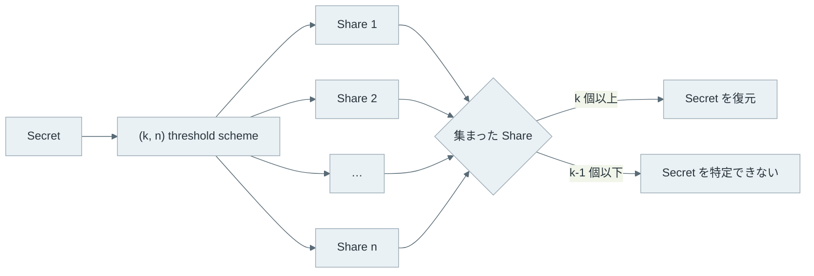
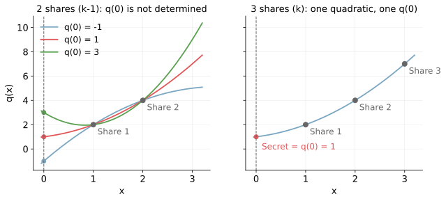
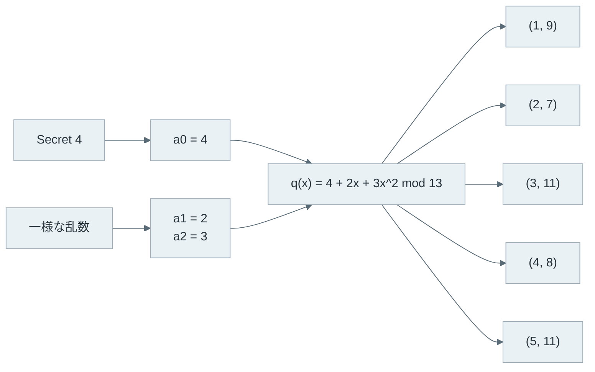
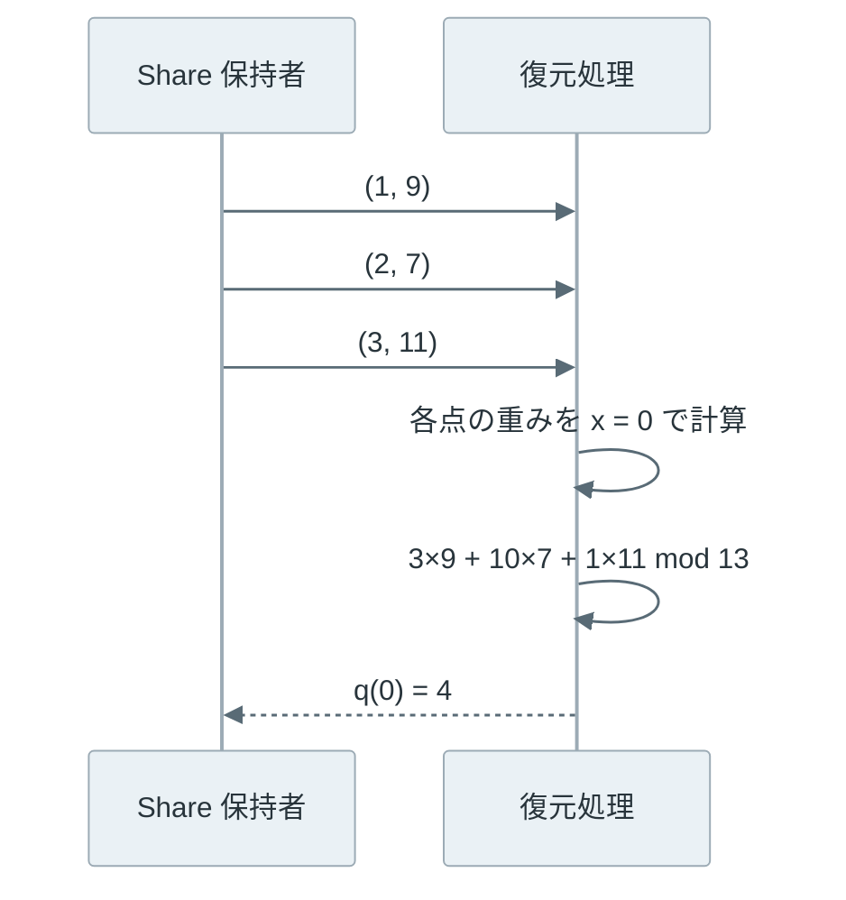
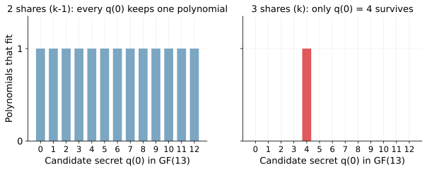
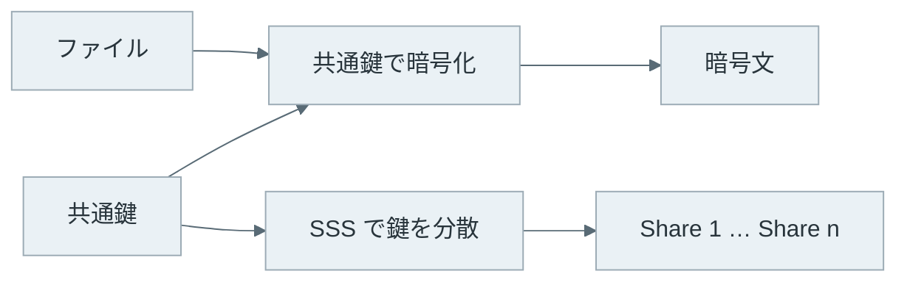

Shamir's Secret Sharing（SSS）は、1つの秘密情報（Secret）をn個の分散片（Share）に分け、そのうち異なる任意の k 個以上で復元できる秘密分散方式です。復元に必要な個数 k を閾値（threshold）と呼び、`(k, n)` threshold scheme と表します。

例えば、サービスの署名鍵を 1 台に置けば、その端末の故障で鍵を失います。鍵を 5 人全員にコピーすると、1 人分のコピーが漏洩しただけで鍵全体が知られます。`(3, 5)` の SSS なら、Share を 2 個失っても復元でき、2 個まで漏れても Secret の候補は絞れません。



SSSの復元処理は、Shareを持つ人の身元を判定しません。閾値以上の数の Share を集められる主体なら、正規の管理者でも攻撃者でも Secret を復元できます。

<br>

本記事では、Secret を Share に分けて復元する手順と、SSS が守らない範囲を説明します。扱う疑問は次の通りです。

- 鍵を 1 か所に置く方法や、全員にコピーする方法では、なぜ足りないのか。
- Share はどのように作り、k 個の点からどう復元するのか。
- x 座標の 0 を整数のまま判定すると、なぜ見逃すのか。
- Share の紛失や漏洩に対して、SSS は何を守らないのか。
- 単純な分割や暗号化と、何が違うのか。

---

### Secret を分散する理由

鍵の保管では、失わないことと漏らさないことを両立させる必要があります。1 か所だけに保管すると紛失に弱く、同じ鍵のコピーを増やすと漏洩の入口も増えます。ファイルを順番に切る方法では、1 個の断片から元データの一部がそのまま読めます。


- title: 1 か所だけに保管
  body: Secret の保存先が故障すると復元不能。
- title: 同じものを複製
  body: Secret のコピーが 1 個漏洩すると、全体が漏れる。
- title: 元データを単純に分割
  body: 断片から元データの一部が読める。


SSS は、n-k 個までの紛失と k-1 個までの漏洩に、別々に耐えられます。

---

### 3 個の Share と 2 次式

`(3, 5)` の k = 3 は、直感的には 2 次式に対応します。Secret を多項式の `x = 0` の値 `q(0)` に置き、0 ではない、異なる 5 個の x 座標で求めた点を Share として配ります。

x 座標が異なる 3 点があれば、それらを通る次数 2 以下の式は 1 本に定まるため、`q(0)` を求められます。2 点しかない場合は、その 2 点を通り、`q(0)` が異なる 2 次式を複数作れます。

次の図は、多項式補間の性質を理解するために実数上で描いた模式図です。実際の SSS の計算は有限体（finite field。有限個の値で計算する体系）上で行います。



左の 3 本はどれも同じ 2 個の Share を通るので、Share を持つ側には、どれが元の式なのかを決める手掛かりがありません。

---

### Share の作り方

SSS では、dealer（Share の生成役）が次数 k-1 以下の多項式を作ります。`k = 3` なら `q(x) = a_0 + a_1x + a_2x^2` という 2 次式です。定数項 `a_0` に Secret を入れ、ほかの係数は互いに独立な[一様乱数](/notes/security/random-number/)として選びます。

Share は多項式の断片ではなく、異なる x 座標で計算した点 `(x, q(x))` です。SSS の計算は有限体で行うので（理由は後述）、以下は 13 を法として（13 で割った余りで）計算します。Secret を 4、残りの係数を 2 と 3 にすると、`q(x) = 4 + 2x + 3x^2 mod 13` です。



| Share | 計算 |
| --- | --- |
| `(1, 9)` | `4 + 2 + 3 = 9` |
| `(2, 7)` | `4 + 4 + 12 = 20 mod 13` |
| `(3, 11)` | `4 + 6 + 27 = 37 mod 13` |
| `(4, 8)` | `4 + 8 + 48 = 60 mod 13` |
| `(5, 11)` | `4 + 10 + 75 = 89 mod 13` |

同じ Secret をもう一度分けても、乱数で選ぶ係数が変われば Share も変わります。dealer が多項式を保存し続ける構成では、dealer だけで元の Share を再生成できます。再生成が不要なら、多項式と Secret を復元できないように消します。

---

### k 個の点からの復元

x 座標が異なる k 個の点があると、次数 k-1 以下で全ての点を通る多項式は 1 本に定まります。

ラグランジュ補間（Lagrange interpolation）は、集めた各点について「自分の x 座標では 1、ほかの x 座標では 0」になる基底多項式を作り、Share の y 値を掛けて足します。Secret を復元するだけなら、多項式の全係数を求めずに、`x = 0` の値 `q(0)` を直接計算できます。



この例の重み 3、10、1 は、13 を法として計算した値です。この計算では、割り算を逆元（掛けると 1 になる数）の掛け算に置き換えます。例えば `(2, 7)` の重みは `(0-1)(0-3) / ((2-1)(2-3)) = 3 / (-1)` です。-1 は 12 と同じで、`12 × 12 = 144` は 13 で割ると 1 余るので 12 の逆元は 12 です。`3 × 12 = 36` の余りの 10 が重みになります。別の組み合わせの 3 個を選ぶと重みは変わりますが、全て同じ多項式上の点なので `q(0)` は 4 に戻ります。

k-1 個では、Secret の候補ごとに条件を満たす多項式を 1 本ずつ作れます。以下は、この例の Share を 13 を法とする有限体（GF(13)）で数え上げた結果です。



乱数係数を独立かつ一様に選ぶので、k-1 個の Share と整合する多項式は、Secret の候補ごとに同じ本数あります。そのため、k-1 個以下の Share を観測しても、Secret の事前分布（Share を見る前の候補ごとの確率）は変わりません。[Shamir 氏の 1979 年の論文](https://people.cs.pitt.edu/~litman/courses/cs2001/lectures/lecture-02-p612-shamir.pdf)は、候補が事前に等確率なら Share を得た後も確率が変わらないことを `(k, n)` threshold scheme の条件にしています。この安全性は総当たりの計算量に頼るものではなく、Share から情報が得られないことによるものです。

---

### 有限体による偏りの除去

整数は無限にあるので、全ての整数から等確率で係数を選ぶことはできず、何らかの範囲から選ぶことになります。例えば係数を正の数から選ぶと、Share の y 座標から Secret の範囲を推測できます。`q(1) = a_0 + a_1 + a_2` なら、正の係数を足した結果から `a_0` の上限が分かるからです。

有限体では、足し算・引き算・掛け算・0 以外での割り算が、有限個の要素の中で閉じます。値は 13 に達すると 0 に戻るので、整数のような上限の手掛かりが生まれません。

| | 整数上で計算 | 有限体上で計算 |
| --- | --- | --- |
| 値の範囲 | 増え続ける | 有限個に収まる |
| 割り算 | 割り切れない場合がある | 0 以外は逆元で計算できる |
| k-1 個を見た結果 | 係数の選び方によって偏る | 候補ごとの確率が変わらない |

一般には、Secret を有限体の要素として表現・符号化します。素数 p を法とするこの例では、Secret を表現でき、かつ Share の x 座標として異なる非ゼロ要素を n 個取れるほど十分に大きな p を選びます。乱数係数は有限体から一様に選びます。

<br>

x 座標が 0 でないことも、有限体の中で確かめます。セキュリティ監査の会社Trail of Bitsが2021年12月に[公表した脆弱性](https://blog.trailofbits.com/2021/12/21/disclosing-shamirs-secret-sharing-vulnerabilities-and-announcing-zkdocs/)は、各参加者が自分の多項式でdealerを務め合う、閾値署名の鍵生成処理で見つかりました。1人のdealerが1つのSecretを分ける構成とは異なります。

暗号資産取引所Binanceのtss-libなどは、参加者が自分で選べるIDをx座標に使い、0かどうかを整数のまま判定していました。13を法とする例なら、x=13は判定を通りますが、有限体の中では0と同じです。その参加者に届くy座標は各dealerの `q(0)` となり、他の参加者のSecretが漏れます。悪意のある参加者は、この不備を使って他の参加者の秘密鍵を盗めました。

---

### 紛失・漏洩と SSS が守らない範囲

SSS が保証する範囲は、正しく生成された異なる Share の個数で表せます。

| 状況 | 結果 |
| --- | --- |
| n-k 個まで紛失 | 残った k 個で復元できる |
| k 個未満しか残らない | 正規の保持者も復元できない |
| k-1 個まで漏洩 | Secret の候補を絞れない |
| k 個以上漏洩 | 攻撃者も Secret を復元できる |


- title: SSS が定める範囲
  items:
  - Share の生成
  - 個数による復元条件
- title: 別に設計する範囲
  items:
  - 誰に渡すか
  - 保持者の Authentication
  - 保存場所の保護
  - 復元後の Secret の消去


Share 保持者が誰なのかを確かめる処理は [Authentication](../authentication/) です。Share の配布先は Authorization（認可）や配布ポリシーで決め、配送経路と保存場所は別に保護します。

SSS には Share の改竄検出も含まれません。書き換えられた Share が混ざると別の値が Secret として復元され、復元処理だけではそれが誤りだと分かりません。値を置き換えられる経路があるなら、各 Share が正しいかを確かめられる検証可能秘密分散などを別に検討します。復元時には Secret が 1 か所のメモリに現れ、その端末も攻撃対象になります。

---

### 改変した Share からの復元

正しい Share が 3 個そろった場合と、1 個だけ書き換えた場合を[再現コード](lab/run.py)で比べます。「Share の作り方」で使った `q(x) = 4 + 2x + 3x^2 mod 13` を使い、5 個から 3 個を選ぶ全 10 通りを復元します。係数と小さな有限体を固定した学習用の計算であり、実際の秘密を保管するコードではありません。

以下が `run.py` の全体です。

```python
"""Educational GF(13) interpolation, not a production secret-sharing library."""

from itertools import combinations

P = 13
THRESHOLD = 3


def recover(shares):
    if len(shares) < THRESHOLD:
        raise ValueError("at least 3 shares required")
    xs = [x % P for x, _ in shares]
    if 0 in xs or len(set(xs)) != len(xs):
        raise ValueError("x must be nonzero and distinct modulo 13")
    secret = 0
    for i, (x, y) in enumerate(shares):
        weight = 1
        for j, (other_x, _) in enumerate(shares):
            if i != j:
                weight = weight * (-other_x) * pow((x - other_x) % P, -1, P) % P
        secret = (secret + y * weight) % P
    return secret


shares = [(x, (4 + 2 * x + 3 * x * x) % P) for x in range(1, 6)]
subsets = list(combinations(shares, THRESHOLD))
assert all(recover(group) == 4 for group in subsets)
print(f"all {len(subsets)} subsets of 3 shares: secret=4")
original = shares[:3]
modified = original[:2] + [(3, 12)]
print(f"original {original}: secret={recover(original)}")
print(f"modified {modified}: secret={recover(modified)} (no error)")
assert recover(modified) == 5
for invalid in (shares[:2], [(1, 9), (1, 7), (3, 11)]):
    try:
        recover(invalid)
    except ValueError as error:
        print(f"invalid input: {error}")
    else:
        raise AssertionError("invalid input accepted")
```

```sh
python3 lab/run.py
```

[実行結果](lab/output.txt)は次のとおりです。

```text
all 10 subsets of 3 shares: secret=4
original [(1, 9), (2, 7), (3, 11)]: secret=4
modified [(1, 9), (2, 7), (3, 12)]: secret=5 (no error)
invalid input: at least 3 shares required
invalid input: x must be nonzero and distinct modulo 13
```

| 復元に使う点 | 復元結果 |
|---|---|
| `(1, 9), (2, 7), (3, 11)` | 正しい Secret の 4 |
| `(1, 9), (2, 7), (3, 12)` | 誤った Secret の 5 |

変更したのは最後の Share の y 座標だけです。「k 個の点からの復元」で求めた重みは `3, 10, 1` なので、その y 座標を 1 増やすと、復元結果も 1 増えます。変更後の 3 点にも 2 次以下の多項式は存在するため、補間の計算はエラーになりません。

末尾の 2 行は、Share の個数不足と x 座標の重複をサンプルが拒否した結果です。この入力検査は、正しい形をした偽の Share を見抜く検査にはなりません。Share の真正性を確かめる仕組みは別に必要です。Share を検証する拡張は、[ZKDocs の Feldman 方式の解説](https://www.zkdocs.com/docs/zkdocs/protocol-primitives/verifiable-secret-sharing/)で説明されています。

---

### 単純分割・暗号化との違い

単純分割は元データの区間を各ファイルに保存します。暗号化は鍵を持つ相手に復号を許し、SSS では、閾値以上の Share を集めると Secret を復元できます。暗号化だけでは、復号鍵をどこに置くかという問題が残ります。

大きなファイルを SSS で直接分けると、元データと同じくらいの大きさの Share を n 個保管することになります。そのためファイルを共通鍵で暗号化し、小さな共通鍵だけを SSS で分ける構成があります。



この構成では、ファイルの秘匿を暗号方式が担い、共通鍵の復元条件を SSS が担います。「[【TypeScript】ファイルを分割し、任意の分割ファイル数で復元できる nao1215/horcrux を作った話【分霊箱】](/post/ja/2025-10-05-typescript%E3%83%95%E3%82%A1%E3%82%A4%E3%83%AB%E3%82%92%E5%88%86%E5%89%B2%E3%81%97%E4%BB%BB%E6%84%8F%E3%81%AE%E5%88%86%E5%89%B2%E3%83%95%E3%82%A1%E3%82%A4%E3%83%AB%E6%95%B0/)」は、この組み合わせを実装した例です。

---

### 利点

- n-k 個を失っても、残りの Share から復元できる
- k-1 個以下の Share は、Secret の候補を絞る情報を与えない
- k と n を変えることで、漏洩への耐性と回収のしやすさを調整できる

---

### 欠点

- dealer を使う構成では、生成時に dealer が正しく動作することを前提とする
- Share の真正性を別の手段で保証しなければ、攻撃者が改竄した値を復元処理へ紛れ込ませられる
- 復元時には Secret が 1 か所に集まり、その場所が攻撃対象になる
- n 個の Share を保管するため、Secret を直接分けると総量が増える

---

### 適さないケース

- 頻繁に使う鍵について、使用のたびに k 人から Share を回収する必要がある用途
- dealer と復元端末を信頼できず、Share の検証機能も追加できない構成
- k 個の Share を長期にわたって回収できる見込みのない保管用途
