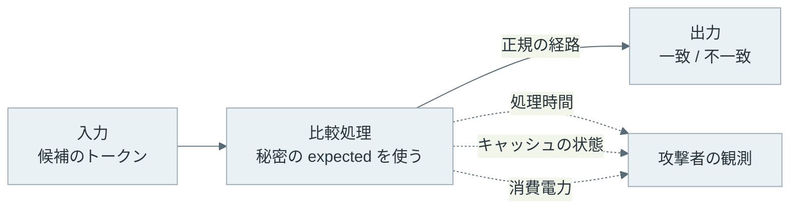
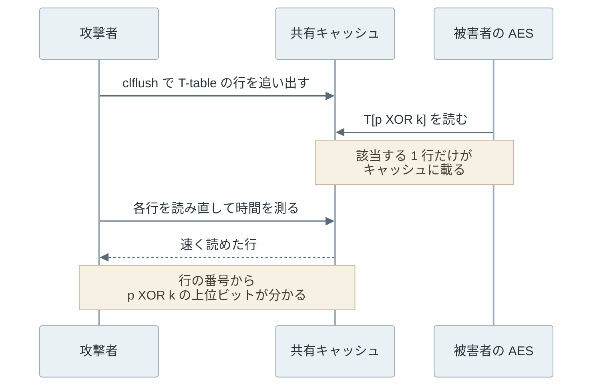

```python
if token == expected:
    return "ok"
```

上記のコードは、受け取ったトークンが正しいかを判定する処理です。返す結果は常に正しく、不一致なら拒否します。しかし、文字列の比較が先頭から 1 文字ずつ進み、違う文字を見つけた所で止まる実装なら、先頭の何文字が一致したかによって応答の時間が変わります。攻撃者は答えを教えてもらえなくても、時間を測れば 1 文字ずつ当てられます。

サイドチャネル攻撃（side-channel attack）は、計算の結果ではなく、計算にかかった時間・消費電力・キャッシュの状態のような副次的な情報から秘密を推測する攻撃です。暗号のアルゴリズムを数学的に破る攻撃とは違い、アルゴリズムが正しくても、それを動かす実装と機械から漏れる情報を狙います。



上記の図の実線が、プログラムが意図して返す情報です。点線は、処理が動いた結果として外から観測できてしまう情報で、プログラムの戻り値をいくら正しくしても塞がりません。

<br>

本記事では、時間とキャッシュを使うサイドチャネル攻撃を中心に、漏れる理由と対策を説明します。手元の C のプログラムで、32 バイトの秘密を比較時間だけから復元する実験も行います。答える疑問は次の通りです。

- 正しい結果を返しているのに、なぜ秘密が漏れるのか。
- 先頭から比べる比較と constant-time な比較で、時間はどう変わるのか。
- ネットワーク越しの揺らぎの中から、どうやって ns〜µs の差を取り出すのか。
- constant-time な実装・マスキング・ランダムな遅延は、それぞれ何を防ぐのか。

電磁波や音を測る攻撃と、故障を起こして誤った出力を得る攻撃（fault attack）は、本記事の範囲外です。

---

### 正しい結果でも秘密が漏れる理由

プログラムの時間は、実行した命令の数と、命令が触ったメモリの場所で変わります。秘密がこの 2 つに影響すると、時間が秘密の情報を運びます。

1 つ目は、秘密に依存した分岐です。冒頭の比較では、一致した文字数だけループが回るので、時間が一致した長さに比例します。RSA の古典的な実装も、秘密の指数のビットが 1 の時だけ乗算をするので、1 のビットの位置によって乗算の回数と時間が変わります。1996 年の [Kocher 氏の論文](https://www.paulkocher.com/doc/TimingAttacks.pdf)は、こうした時間の差から Diffie-Hellman の指数や RSA の鍵を求められることを示しました。

2 つ目は、秘密に依存したメモリアクセスです。命令の数が同じでも、読むアドレスが CPU のキャッシュに載っていれば速く、載っていなければ遅くなります。表を秘密で引く実装では、どの行を引いたかがキャッシュの状態として残ります。この経路は後半の節で説明します。

どちらも、結果の正しさとは関係が無い点が厄介です。テストは全て通り、コードレビューでも「正しい比較」に見えます。

---

### 一致した長さを測る実験

先頭から 1 バイトずつ比べて不一致で抜ける比較（以下、early-exit な比較）と、全バイトの XOR を OR で集めてから判定する constant-time な比較を C で書いて時間を測りました。constant-time は、処理時間が秘密の値に依存しないという意味で、全ての入力で時間が完全に同じという意味ではありません。

実験は 2 段です。1 段目は、一致する接頭辞の長さを 0〜32 バイトに変えて、1 回の比較の時間を測ります。2 段目は、攻撃者の立場で 1 バイト目から 256 通りの候補を順に試し、比較が一番遅くなった候補を正解と見なして次のバイトに進みます。以下は、計測と復元の部分の抜粋です。全体は [compare_timing.c](https://github.com/nao1215/debimate/blob/main/content/notes/security/side-channel-attack/lab/compare_timing.c) にあります。

```c
#define LEN 32
#define REPS 16 /* calls per sample: one call is shorter than the timer step */

__attribute__((noinline)) int early_exit_equal(const uint8_t *a, const uint8_t *b) {
    for (size_t i = 0; i < LEN; i++) {
        if (a[i] != b[i]) {
            return 0; /* returns as soon as one byte differs */
        }
    }
    return 1;
}

__attribute__((noinline)) int constant_time_equal(const uint8_t *a, const uint8_t *b) {
    uint8_t diff = 0;
    for (size_t i = 0; i < LEN; i++) {
        diff |= a[i] ^ b[i]; /* always reads every byte */
    }
    return diff == 0;
}

static uint64_t measure(equal_fn eq, const uint8_t *secret, const uint8_t *guess) {
    unsigned int aux;
    _mm_lfence();
    uint64_t start = __rdtscp(&aux);
    for (int i = 0; i < REPS; i++) {
        volatile int r = eq(secret, guess);
        (void)r;
    }
    uint64_t end = __rdtscp(&aux);
    _mm_lfence();
    return end - start;
}

/* Guess one byte at a time: the candidate that makes the comparison slowest wins. */
static int recover(equal_fn eq, int n) {
    memset(guess, 0, LEN);
    for (int pos = 0; pos < LEN - 1; pos++) {
        for (int s = 0; s < n; s++) {
            for (int c = 0; c < 256; c++) {
                int v = (c + s * 37) & 0xff; /* change the order every round */
                guess[pos] = (uint8_t)v;
                samples[v][s] = measure(eq, secret, guess);
            }
        }
        int best = 0;
        double best_time = 0;
        for (int c = 0; c < 256; c++) {
            double t = trimmed_mean(samples[c], n); /* mean of the fastest 90% */
            if (t > best_time) {
                best_time = t;
                best = c;
            }
        }
        guess[pos] = (uint8_t)best;
    }
    /* The last byte barely changes the time, but a correct guess is accepted. */
    for (int c = 0; c < 256; c++) {
        guess[LEN - 1] = (uint8_t)c;
        if (eq(secret, guess)) return 1;
    }
    return 0;
}
```

時間は、CPU のタイムスタンプカウンタ（TSC）を読む `rdtscp` 命令で測っています。計測に使った AMD RYZEN AI MAX+ 395 では TSC が 10 ns 刻みでしか進まず、1 回の比較（7〜30 ns）は刻みと同程度なので、同じ入力で 16 回呼んだ時間を 1 サンプルにしました。同じプロセスの中で `rdtscp` を直接読めるのは、攻撃者にとって最も有利な条件です。

最後の 1 バイトは、一致しても不一致でも 32 バイト全部を読むので時間がほぼ変わりません。そのため、復元では最後のバイトだけ 256 通りを試し、比較が成功する値を探しています。攻撃者も、正しいトークンが受理されるかどうかは観測できます。

GCC 15.2.0 の `-O2` でビルドし、コア 2 に固定して実行しました（`taskset -c 2 ./compare_timing`）。出力の全体は [output.txt](https://github.com/nao1215/debimate/blob/main/content/notes/security/side-channel-attack/lab/output.txt) にあります。

<details>
<summary>compare_timing の出力</summary>

```text
# tsc_ticks_per_ns=3.000
func,prefix,ns_per_call
early_exit,0,6.65
early_exit,4,8.69
early_exit,8,12.14
early_exit,12,15.13
early_exit,16,18.09
early_exit,20,21.09
early_exit,24,23.92
early_exit,28,26.95
early_exit,32,29.95
constant_time,0,9.10
constant_time,4,9.07
constant_time,8,9.07
constant_time,12,9.06
constant_time,16,9.06
constant_time,20,9.06
constant_time,24,9.06
constant_time,28,9.06
constant_time,32,9.06
func,samples_per_candidate,recovered
early_exit,10,7/20
early_exit,30,16/20
early_exit,100,20/20
early_exit,300,18/20
constant_time,10,0/20
constant_time,30,0/20
constant_time,100,0/20
constant_time,300,0/20
```

</details>

1 段目を図にすると、以下の通りです。



early-exit な比較は、一致するバイトが 1 つ増えるごとに約 0.7 ns ずつ遅くなります（実行ごとに 0.6〜0.7 ns の幅で変わりました）。constant-time な比較は、どの接頭辞でも 9.1 ns 前後で変わりません。接頭辞が短い間は early-exit の方が速く、平均の速さでは early-exit が有利です。しかし、その速さが一致した長さを外に出しています。

2 段目の `recovered` は、乱数で作った 20 個の秘密のうち、時間だけで 32 バイト全部を当てられた数です。1 候補あたりのサンプル数ごとに、2 つの比較で復元できた数を並べると、以下の通りです。



early-exit な比較は、1 候補あたり 100 サンプルで 20 個全てを復元しました。constant-time な比較は、どのサンプル数でも 1 つも復元できていません。

<br>

この結果は、実行するたびに揺れます。計測したマシンでは別の作業が動いており、同じバイナリを 3 回実行すると、10 サンプルでは 0〜7 個、300 サンプルでは 14〜20 個でした。

300 サンプルで 100 サンプルより減った回があるのは、1 バイト間違えるとそれ以降が全て外れる手順なので、計測中に他のプロセスの割り込みが重なった数バイトで失敗が決まるからだと考えています（推測です）。ただ、constant-time な比較の 0 個はどの回でも変わりませんでした。

なお、C の constant-time な比較は、コンパイラの最適化で崩れることがあります。C の規格は実行時間を観測できる振る舞いとして扱わないので、コンパイラは同じ結果を返す範囲で、分岐を足す変形も許されます。この問題は [Simon・Chisnall・Anderson の論文](https://www.cl.cam.ac.uk/~rja14/Papers/whatyouc.pdf)（IEEE EuroS&P 2018）で論じられています。

今回の `-O2` では、`constant_time_equal` は SIMD 命令に展開され、条件分岐は 1 つも残っていませんでした（`objdump -d` で確認）。しかし、これは GCC 15.2.0 のこの書き方での結果で、別のコンパイラやバージョンでの保証にはなりません。

Python では、[hmac.compare_digest](https://docs.python.org/3/library/hmac.html#hmac.compare_digest) が内容による早期の打ち切りを避ける比較を提供しています。冒頭の `token == expected` は、`hmac.compare_digest(token, expected)` に置き換えます。

ドキュメントには、長さが違う場合は長さと型が漏れ得る（値は漏れない）と注記されています。`str` で渡せるのは ASCII だけなので、それ以外の文字を含むなら `bytes` に変換して渡します。トークンの扱い自体は [Authentication](../authentication/) のノートの Bearer Token の節も参考になります。

---

### 秘密に依存したメモリアクセス

分岐を無くしても、秘密で表を引くと時間が漏れます。代表例が、AES の高速な実装で使われてきた T-table です。T-table は、AES の 1 ラウンドの計算を前もって表にしたもので、平文のバイト p と鍵のバイト k の XOR を添字に表を読みます。添字は秘密の鍵に依存するので、どの行を読んだかが分かれば鍵の情報が漏れます。

[Bernstein 氏の論文](https://cr.yp.to/antiforgery/cachetiming-20050414.pdf)（2005 年）は、OpenSSL の AES を使うサーバーに別のコンピュータから平文を送り、サーバーが応答に付けたサイクル数の時刻と、鍵が分かっている同じ構成で集めた時間の傾向との相関から、AES の鍵を全て復元しました。

どの行を読んだかは、キャッシュの状態として残ります。キャッシュはメモリを 64 バイト単位の行（キャッシュライン）で持ち、一度読んだ行は次に速く読めます。[Flush+Reload](https://www.usenix.org/conference/usenixsecurity14/technical-sessions/presentation/yarom)（Yarom・Falkner、USENIX Security 2014）は、被害者と共有しているメモリの行を追い出してから、被害者の処理の後に読み直し、速く読めた行を被害者が触った行と判断する手法です。



上記の図の最後で分かるのは添字の上位ビットだけです。例えば、表の 1 項目が 4 バイトなら 1 行に 16 項目が入るので、行の番号から 8 ビットの添字のうち上位 4 ビットが分かります。平文 p を知っていれば、鍵 k の上位 4 ビットも決められます。



残りのビットは、2 ラウンド目や最終ラウンドの表引きを同じ方法で観測して絞り込みます。Flush+Reload を使い、メモリの重複排除が有効な VMware 上で、別の VM から OpenSSL 1.0.1 の AES 鍵を復元した [Irazoqui らの報告](https://eprint.iacr.org/2014/435)もあります。

[Spectre](https://spectreattack.com/spectre.pdf)（Kocher ら、IEEE S&P 2019）も、最後に秘密を運ぶのはこのキャッシュの経路です。CPU は分岐の結果を待たずに先の命令を投機的に実行し、予測が外れたら結果を捨てます。しかし、投機的に読んだメモリはキャッシュに残ります。

Spectre は、正しい実行経路では決して起きない、範囲外の値を添字にした読み出しを CPU に投機的に実行させ、その痕跡を Flush+Reload などで回収します。プログラムが秘密に依存したアクセスを書いていなくても、CPU が書かせてしまう点が、上記の T-table との違いです。

---

### ネットワーク越しの計測

ネットワーク越しでは、往復の遅延が数百 µs あり、その揺らぎも比較の差より何桁も大きくなります。それでも、同じ要求を何度も送り、統計を取ると差が浮かび上がります。[Brumley・Boneh の論文](https://www.usenix.org/conference/12th-usenix-security-symposium/remote-timing-attacks-are-practical)（USENIX Security 2003）は、同じ LAN にある OpenSSL を使った Web サーバーから、約 143 万回の問い合わせ（約 2 時間）で RSA の秘密鍵を取り出しました。

どの統計を使うかで、必要な回数が変わります。ネットワークの遅延は、ほとんどの応答が下限の近くに集まり、たまに大きく遅れる右に長い分布になります。

[Crosby・Wallach・Riedi の論文](https://www.cs.rice.edu/~dwallach/pub/crosby-timing2009.pdf)（ACM TISSEC 2009）は、平均や中央値より下位のパーセンタイル（例えば 10 パーセンタイル）を使う方が揺らぎに強いと示し、インターネット越しで 15〜100 µs、LAN で 100 ns ほどの差まで測れるとしています。下位のパーセンタイルは、たまに大きく遅れた応答の影響をほとんど受けません。

揺らぎの中から差が見えてくる様子を乱数で作った応答時間でシミュレーションしました（実測ではありません）。遅い候補だけがサーバーで 1 µs 多く処理し、そこに固定の 500 µs と、平均で数十 µs の右に長い揺らぎを足します。各候補を何度か計測し、その統計が大きい方を遅い候補と判断して、正しく選べた割合を見ます。全体は [simulate_remote.py](https://github.com/nao1215/debimate/blob/main/content/notes/security/side-channel-attack/lab/simulate_remote.py) にあります。



10 回の計測では、どの統計も五分五分に近く、差はほとんど見えません。回数を増やすと割合が 1.0 へ近付き、10 パーセンタイルは 1000 回で 0.95 に達しました。1 µs の差が数十 µs の揺らぎに埋もれていても、回数を積めば取り出せます。ランダムな遅延を足した系列（図の赤）は、同じ割合に達するまでに更に多くの回数が必要になりますが、やはり回数を増やせば差は見えます。

---

### 対策の使い分け

サイドチャネルへの対策は、漏れる経路によって選びます。実装を constant-time にすることと、秘密に乱数を混ぜるマスキングは、防ぐ対象が違います。

| 対策 | 何をするか | 効く経路 | 注意点 |
|---|---|---|---|
| constant-time 実装 | 分岐とメモリのアドレスを秘密に依存させない | 時間・キャッシュ | コンパイラの最適化で崩れ得る。計測で確かめる |
| マスキング / blinding | 秘密に乱数を混ぜ、観測値と秘密の相関を切る | 電力・時間 | 乱数の質に依存する。平均の時間は残り得る |
| ランダムな遅延の追加 | 処理に乱数の待ちを足す | 時間（部分的） | 平均すると消え、回数で補える |

constant-time 実装は、実験で見た通り、秘密の値によって処理時間とアクセス先が変わらないようにします。多くの言語には、この目的の比較関数があります。Go の [crypto/subtle](https://pkg.go.dev/crypto/subtle) の `ConstantTimeCompare` の時間は、スライスの長さだけに依存し、内容には依存しません。ただし、長さが違えば直ちに 0 を返すので、長さは漏れます。

マスキングと blinding は、どちらも秘密や入力に乱数を混ぜて、観測値と秘密の相関を切ります。RSA の blinding は、署名や復号の前に入力へ乱数を掛け、後で元に戻すことで、攻撃者が計算の入力を知れないようにします。

ランダムな遅延では攻撃に要する計測回数が増えるだけで、回数を増やせば補われてしまうので、前掲の Kocher 氏の論文は blinding を対策として挙げています。消費電力を狙う差分電力解析（[DPA](https://www.paulkocher.com/doc/DifferentialPowerAnalysis.pdf)、Kocher ら 1999 年）に対しては、秘密を複数の乱数の share に分けて処理するマスキングが使われます。

ランダムな遅延の追加は、単独では弱い対策です。前の節のシミュレーションで見た通り、遅延を足しても回数を増やせば差は見えます。乱数の遅延は両方の候補に同じ分布で加わるので、差を取ると打ち消し合い、増えた分散の分だけ回数が必要になるだけです。Kocher 氏の論文では、必要な計測回数はノイズ（標準偏差）のほぼ 2 乗に比例して増えます。他の対策と組み合わせる補助として考えます。

---

### 実務での確認方法

自分で暗号の関数を書く場面は多くありません。まず、言語やライブラリが用意した比較関数（`hmac.compare_digest`、`crypto/subtle.ConstantTimeCompare` など）を使い、秘密を `==` で比べないことが出発点です。鍵や署名を扱う処理は、枯れたライブラリに任せます。

constant-time を保てているかは、人の目では分かりません。計測で確かめる道具があります。[dudect](https://github.com/oreparaz/dudect) は、固定した入力と乱数の入力で処理時間を多数回測り、2 つの分布の差を Welch の t 検定で判定します。

実装は |t| が 10 を超えると漏れありと判定し、より厳しい 4.5 を使う流儀もあります。ハードウェアのモデル化は不要です。元の論文は Reparaz・Balasch・Verbauwhede の「[Dude, is my code constant time?](https://eprint.iacr.org/2016/1123)」（DATE 2017）です。この種の計測を CI に組み込むと、コンパイラの更新で constant-time が崩れた時に気付けます。

秘密に依存した分岐と表引きを避け、比較は専用の関数に任せ、計測で裏を取る。この 3 つが、サイドチャネルを塞ぐ実務の基本になります。

---

### 適さない対策

- 処理をわざと遅くするだけの対策。乱数の遅延は差を取ると打ち消し合い、計測回数で破られます。
- 秘密を `==` や通常の文字列比較で突き合わせる実装。先頭から比べて早期に抜ける比較は、一致した長さを時間として漏らします。
- 計測せずに「分岐が無いから constant-time」と判断すること。コンパイラの最適化で分岐が入り得るので、生成された命令か実測で確かめます。
- 秘密に依存した添字で表を引く高速化（AES の T-table など）。キャッシュの状態から添字が漏れます。