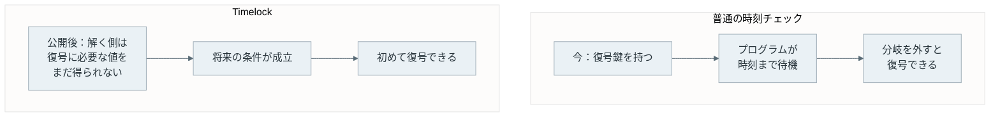
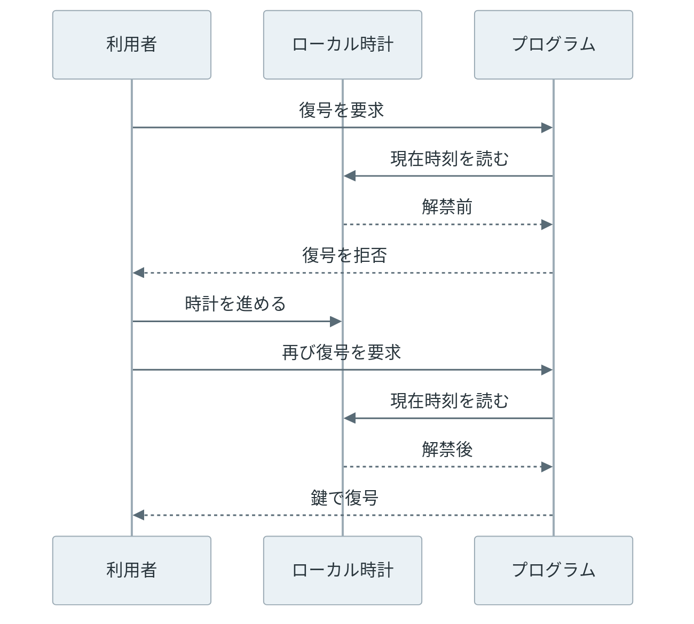
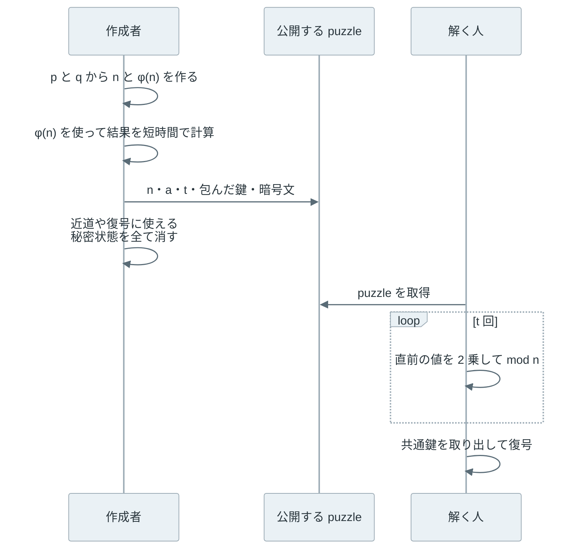
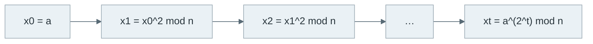
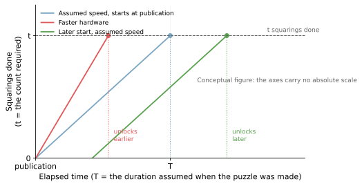
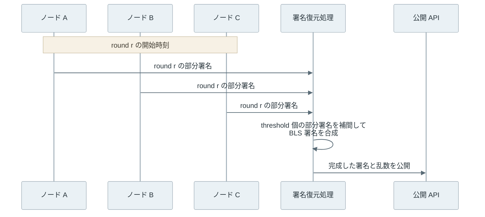
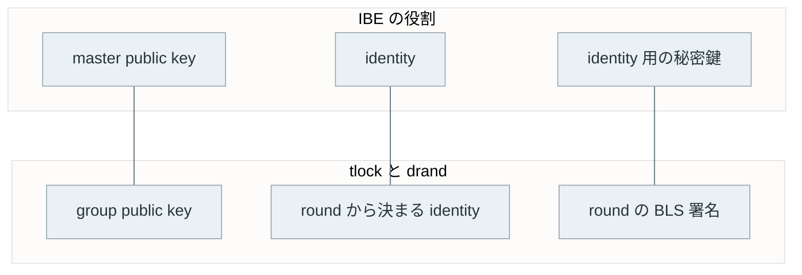
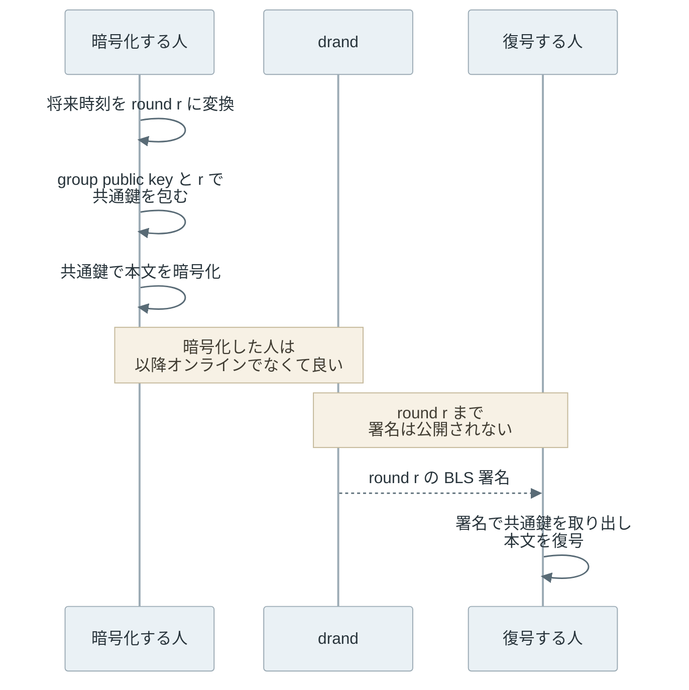

Timelock Encryption は、Timed-release Cryptography（時限公開暗号）とも呼ばれ、将来の条件が成立するまで、あらかじめ作成した暗号文を復号できないようにする仕組みです。方式の前提が守られていれば、暗号化した本人も条件成立前には復号できません。

例えば封印入札（締切まで入札内容を非公開にする方式）では、締切前に主催者が内容を読むと、後から届く入札に影響します。締切後に公開される値があれば、入札者はその時刻に不在でも構いません。

Timelock Encryption は、利用者が復号鍵を最初から持ち、プログラムだけが待機する構成とは違います。暗号文を受け取った側は、公開後も条件が成立するまで、復号に必要な値や計算結果を得られません。

実現の仕方は 2 通りあります。解く側に逐次計算を課して時間を稼ぐ Time-lock Puzzle と、決まった時刻ごとに署名を公開する drand という外部のサービスを使う tlock です。2 つを整理すると、以下の通りです。

| 方式 | 解く側が復号まで得られないもの | 復号条件 |
| --- | --- | --- |
| Time-lock Puzzle | 逐次計算の結果 | 逐次計算を終える |
| drand / tlock | 将来の round（drand が値を公開する一定間隔の回）の署名 | round の署名を取得する |

本記事では、2 つの方式の仕組みと、前提が崩れる条件を説明します。取り上げる疑問は次の 4 つです。

- 時計や sleep で待つ実装では、なぜ足りないのか。
- 逐次計算で時間を稼ぐ Time-lock Puzzle は、35 年の想定だった LCS35 でなぜ 20 年で解かれたのか。
- drand の round の署名から、tlock はどう復号するのか。
- 予定より早く復号される障害と、復号できなくなる障害は、それぞれ何が原因で起きるのか。

---

### 時計や sleep による実装の限界

`if now >= unlockAt { decrypt() }` のように時刻で分岐する実装は、時計とプログラムを管理できる環境なら復号時刻を制御できます。しかし、利用者が復号鍵を持っていれば、ローカル時計を進める、条件分岐を削る、復号関数を直接呼ぶ、という変更で待ち時間を外せます。

sleep も、待機処理を消せば待たずに復号できます。鍵を時刻サーバー 1 台に預けると、運用者が予定より早く鍵を渡せる一方、サーバーが停止すれば鍵を受け取れません。

---

### Time-lock Puzzle と逐次計算

Time-lock Puzzle では、作成者が連続した計算を要する問題を公開し、解く人がその解から共通鍵を取り出します。[Rivest 氏、Shamir 氏、Wagner 氏の 1996 年の論文](https://publications.csail.mit.edu/lcs/pubs/pdf/MIT-LCS-TR-684.pdf)の方式では、大きな素数 p と q の積 `n = pq` を作り、`a^(2^t) mod n` を鍵の保護に使います。t は実時間ではなく、必要な 2 乗の回数です。共通鍵 K に `b = a^(2^t) mod n` を足した値を公開するので、b を求めた人だけが引き算で K を得られます。

作成者は p と q から `φ(n) = (p-1)(q-1)` を求められます。`a^φ(n) ≡ 1 (mod n)` が成り立つので、指数 `2^t` を `φ(n)` で割った余りに置き換えれば t 回の逐次計算を省けます。公開後に作成者も早く開けないよう、p、q、`φ(n)`、短縮した指数、共通鍵など、近道や復号に使える秘密状態を全て消す必要があります。

解く人は n、a、t などの puzzle を受け取りますが、p と q は知りません。逐次 2 乗を大幅に高速化する方法がないという仮定の下では、解く人は repeated squaring（繰り返し 2 乗）を t 回行います。この逐次性は、素因数分解困難性だけから証明されているわけではありません。

各段は直前の値を必要とするため、t 個の計算を別々の CPU に配る単純な並列化は使えません。とは言え、1 回の 2 乗を速くするハードウェアや、より速い実装の影響は受けます。

puzzle が指定できるのは 2 乗の回数 t だけで、それが何秒に相当するかは、解く人の計算速度（図の faster hardware）と、計算を始めた時刻（later start）で決まります。

上記の図は傾向だけを示す概念図で、傾きの比も含めて数値には意味がありません。つまり Time-lock Puzzle は絶対時刻を保証せず、できるのは、公開直後から計算を始める想定で「およそ何時間後」を狙う所までです。

図の faster hardware の線が実際に現れたのが、Rivest 氏が 1999 年に MIT の LCS（Laboratory for Computer Science）の 35 周年に合わせて作った [LCS35](https://people.csail.mit.edu/rivest/pubs/Riv19f.pdf) の puzzle です。約 80 兆回の逐次 2 乗を求める問題で、35 年かかる想定でしたが、2019 年 4 月に Bernard Fabrot 氏が家庭用 PC の CPU で 3 年あまり計算を続けて解きました。続いて、FPGA（回路を書き換えられる半導体）を使ったチームも 2 か月で解いています。

2 乗の回数を減らす近道は見つかっておらず、Rivest 氏は [1 回の 2 乗に要る資源が予想よりはるかに減った](https://www.csail.mit.edu/news/belgian-programmer-solves-mits-20-year-old-cryptographic-puzzle)と述べています。t は破られず、秒数だけが 35 年から 3 年あまりに縮みました。

---

### drand の round と threshold 署名

drand は、一定間隔の round ごとに公開検証できる乱数を生成する randomness beacon（乱数ビーコン）です。genesis time は round 1 の基準時刻、period は round の間隔です。`floor((time - genesis) / period) + 1` は、その時刻に対応する round 番号を返します。drand の停止や遅延があれば、その round の署名がまだ公開されていない場合があります。期限前に開けないことを優先するなら、対象時刻以後に始まる最初の round を選びます。

セットアップでは DKG（Distributed Key Generation、分散鍵生成。ノード間のやり取りで鍵を分けて持つ手順）を実行し、各ノードが秘密鍵 Share を得ます。全体の秘密鍵を知る単独の dealer は存在しません。round の時刻になると各ノードが部分 BLS（Boneh-Lynn-Shacham）署名を出し、threshold 個から 1 つの署名を合成します。BLS 署名は、同じ鍵とメッセージからは常に同じ値になる署名です。

[drand の暗号方式の説明](https://docs.drand.love/docs/cryptography/)によれば、threshold 未満の秘密鍵 Share からは将来の署名を予測できません。この構成は [Shamir's Secret Sharing](../shamir-secret-sharing/) と同じ多項式補間を使いますが、Secret を復元せずに部分署名を合成します。

round と時刻の対応は決定的なので、暗号化時に将来の round を指定できます。しかし、単独ノードの時計が解禁を決めるわけではありません。threshold 個の正しい部分署名が集まった時に署名が生成されます。

---

### tlock と IBE

tlock は group public key と将来の round 番号で暗号化し、その round の BLS 署名で復号します。この対応には IBE（Identity-Based Encryption、識別子ベース暗号）を使います。IBE は文字列などの identity を公開鍵とし、master secret key から identity に対応する秘密鍵を生成する方式です。

tlock では、drand の group public key が IBE の master public key に、将来の round 番号から決定的に求まる署名対象メッセージが identity に、BLS 署名が identity 用の秘密鍵に対応します。

tlock が使う Boneh-Franklin 方式の IBE では、identity 用の秘密鍵が master secret key で identity に BLS 署名した値と同じ形になるので、公開された round の署名がそのまま秘密鍵として働きます。

暗号化時に必要なのは group public key と round 番号で、将来の署名は必要ありません。tlock は payload をランダムな共通鍵で暗号化し、その小さな鍵を round の identity に対する IBE で包みます。これは [tlock の公式リポジトリ](https://github.com/drand/tlock)が説明する hybrid encryption の構成です。

署名は公開値なので、解禁後は暗号文を持つ誰でも復号できます。受信者を限定する場合は、公開鍵暗号を別に重ねます。

tlock には unchained な drand ネットワークが必要です。unchained mode では、各ノードが署名するメッセージが round 番号だけで決まります。chained mode は直前 round の未公開署名も次のメッセージに含めるため、将来の identity を暗号化時に確定できません。

---

### 前提が崩れる条件

Time-lock Puzzle と tlock では、予定より早く復号される障害と、復号できなくなる障害が異なります。

| 前提・故障 | Time-lock Puzzle | drand / tlock |
| --- | --- | --- |
| 計算能力の進歩 | 実時間が短くなる | round の進行条件には影響しない |
| 時刻の精度 | 計算能力と開始時刻で変わる | threshold 以上のノードの時計と period の粒度に依存する |
| threshold 以上のノードの侵害 | threshold を使わない | 攻撃者が将来の署名を早く作り、予定より早く復号できる |
| ネットワーク停止 | オフラインで計算できる | 新しい署名が出ず、復号が遅れる |
| 暗号仮定が破られる | 素因数分解、または逐次性に関する仮定が破られると近道を得られる | いずれかの暗号方式が破られると秘匿性を失う |
| 量子計算機 | RSA 型の仮定が崩れる | BLS と IBE が依拠するペアリング暗号の仮定が崩れる |

[drand の Security Model](https://docs.drand.love/docs/security-model/)は、threshold 未満のノードからは将来の beacon を導出できず、threshold 以上を侵害すると導出できると区別しています。後者の場合、攻撃者は乱数を好きな値に変えられなくても、tlock の暗号文を予定より早く開けます。

停止しても早期復号は起きず、ネットワークが復旧して対象 round の署名を出せば復号できます。公開済みの署名は保持または取得できる限り使えますが、drand が対象の署名を作らないまま秘密鍵 Share も失われれば、その round の暗号文は復号できません。

いずれも耐量子方式ではないので、遠い将来の時刻を指定しても、その時刻まで秘匿が保たれるとは限りません。

---

### 利点

- Time-lock Puzzle は第三者やネットワークを使わず、計算量で待ち時間を作れる
- drand / tlock は将来の round を指定し、暗号化した本人が不在でも公開値から復号できる
- drand / tlock は単独の時刻サーバーではなく、threshold のノード集合に依存する

---

### 欠点

- Time-lock Puzzle の実時間は、解く計算機の能力と計算開始時刻で変わる
- Time-lock Puzzle は待っている間も逐次計算を続ける必要がある
- tlock は drand の継続稼働と、threshold 以上の運用者が結託しない仮定に依存する
- 解禁後の BLS 署名は公開されるため、暗号文を持つ相手を区別できない

---

### 適さないケース

- 絶対時刻を細かい粒度で保証したい用途に Time-lock Puzzle を使う場合
- drand が停止しても必ず取り出せなければならない長期保管
- 現在の暗号学的仮定が数十年後も成り立つことを前提とする保管
