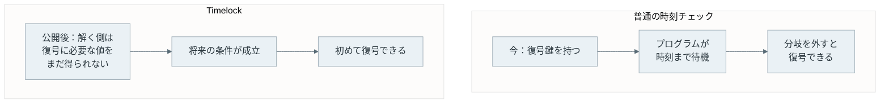
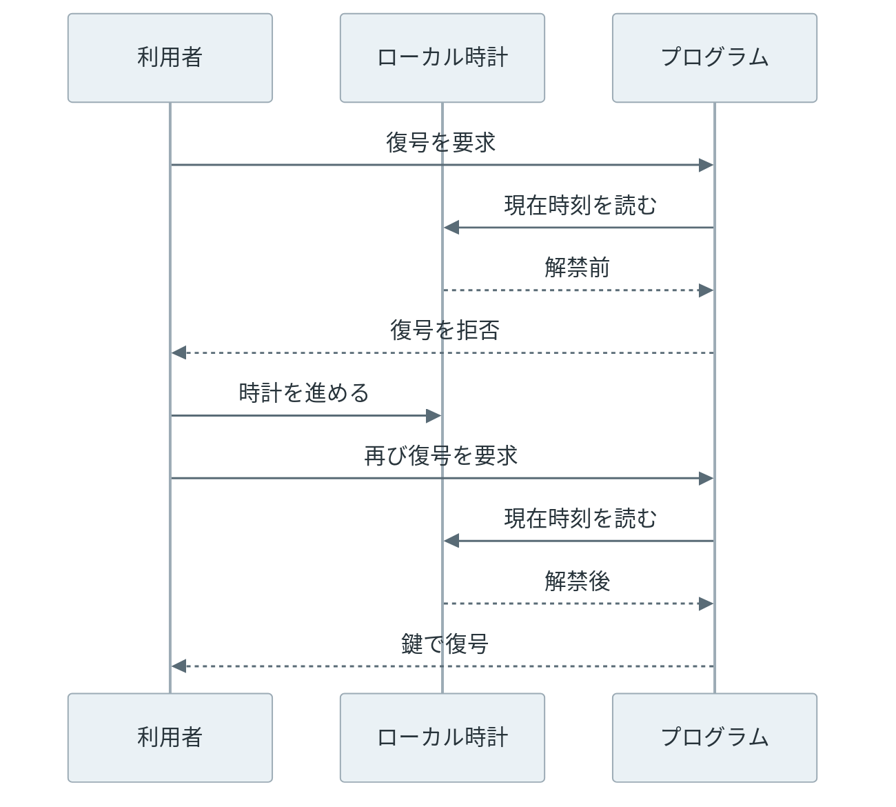
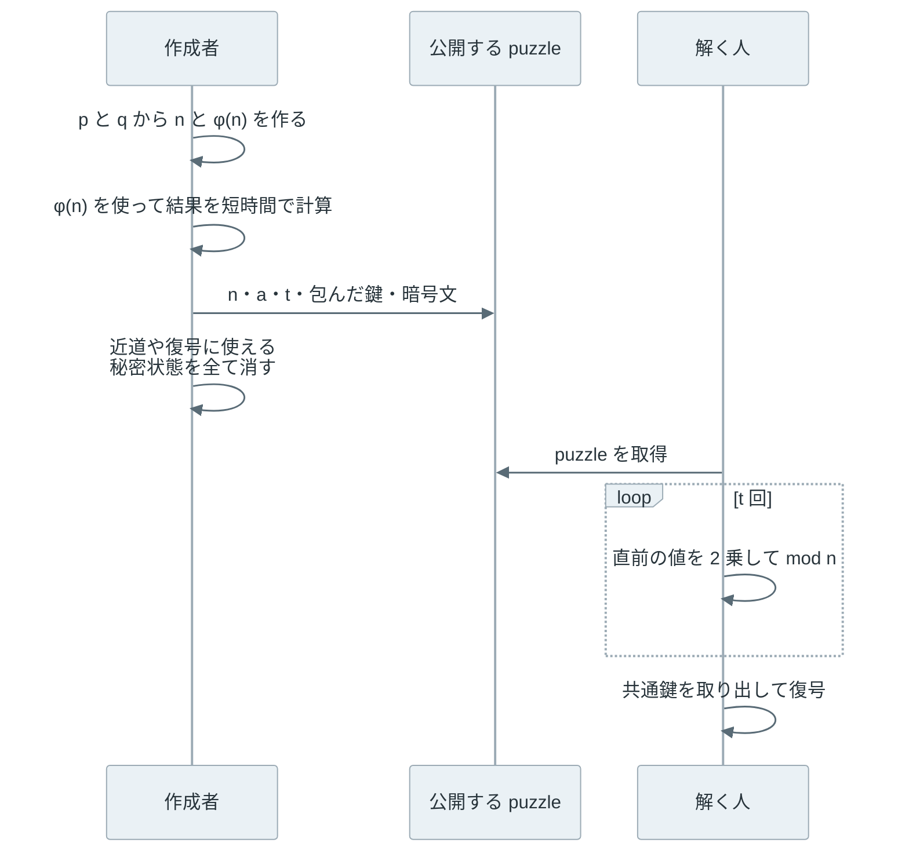
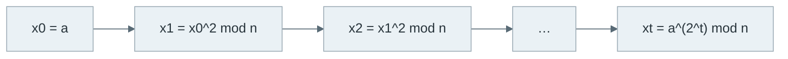
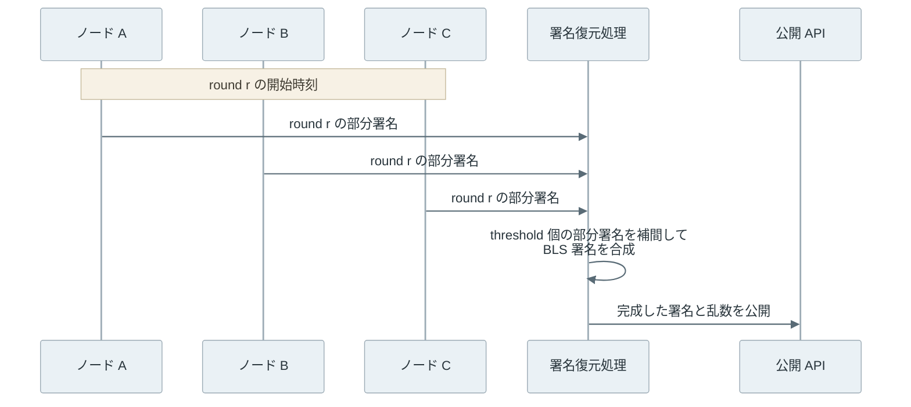
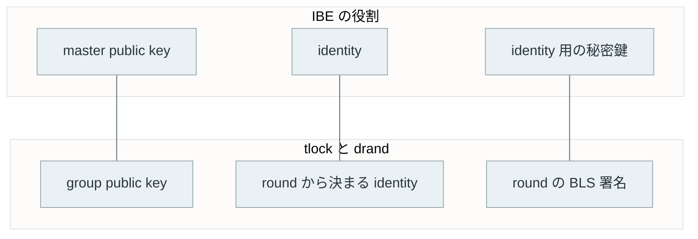
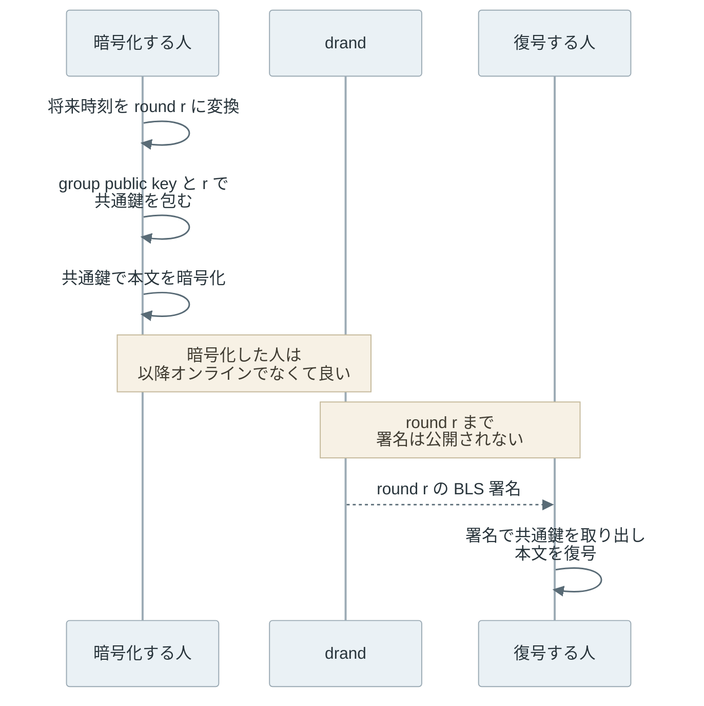

Timelock Encryption は、Timed-release Cryptography（時限公開暗号）とも呼ばれ、将来の条件が成立するまで、あらかじめ作成した暗号文を復号できないようにする仕組みです。方式の前提が守られ、平文や鍵を手元に残さなければ、暗号化した本人も条件成立前には復号できません。

例えば封印入札（締切まで入札内容を非公開にする方式）では、締切前に主催者が内容を読むと、後から届く入札に影響します。各入札者が締切を条件に入札を暗号化しておけば、締切後は誰でも復号できるので、入札者が開封の場にいる必要もありません。

Timelock Encryption は、利用者が復号鍵を最初から持ち、プログラムだけが待機する構成とは違います。暗号文を受け取った側は、公開後も条件が成立するまで、復号に必要な値や計算結果を得られません。



実現の仕方は 2 通りあります。解く側に逐次計算を課して時間を稼ぐ Time-lock Puzzle と、決まった時刻ごとに署名を公開する [drand](https://drand.love/) という外部のサービスを使う [tlock](https://github.com/drand/tlock) です。2 つを整理すると、以下の通りです。

| 方式 | 解く側が復号まで得られないもの | 復号条件 |
| --- | --- | --- |
| Time-lock Puzzle | 逐次計算の結果 | 逐次計算を終える |
| drand / tlock | 将来の round（drand が値を公開する一定間隔の回）の署名 | round の署名を取得する |

<br>

本記事では、2 つの方式の仕組みと、前提が崩れる条件を説明します。取り上げる疑問は次の 4 つです。

- 時計や sleep で待つ実装では、なぜ足りないのか。
- 逐次計算で時間を稼ぐ Time-lock Puzzle は、35 年の想定だった LCS35 でなぜ 20 年で解かれたのか。
- drand の round の署名から、tlock はどう復号するのか。
- 予定より早く復号される障害と、復号できなくなる障害は、それぞれ何が原因で起きるのか。

---

### 時計や sleep による実装の限界

`if now >= unlockAt { decrypt() }` のように時刻で分岐する実装は、時計とプログラムを管理できる環境なら復号時刻を制御できます。しかし、利用者が復号鍵を持っていれば、ローカル時計を進める、条件分岐を削る、復号関数を直接呼ぶ、という変更で待ち時間を外せます。



sleep も、待機処理を消せば待たずに復号できます。鍵を時刻サーバー 1 台に預けると、運用者が予定より早く鍵を渡せる一方、サーバーが停止すれば鍵を受け取れません。

---

### Time-lock Puzzle と逐次計算

Time-lock Puzzle では、作成者が連続した計算を要する問題を公開し、解く人がその解から共通鍵を取り出します。

[Rivest 氏、Shamir 氏、Wagner 氏の 1996 年の論文](https://publications.csail.mit.edu/lcs/pubs/pdf/MIT-LCS-TR-684.pdf)の方式では、大きな素数 p と q の積 `n = pq` を作り、`a^(2^t) mod n` を鍵の保護に使います。t は実時間ではなく、必要な 2 乗の回数です。共通鍵 K に `b = a^(2^t) mod n` を足した値を公開するので、b を求めた人だけが引き算で K を得られます。

作成者は p と q から `φ(n) = (p-1)(q-1)` を求められます。`a^φ(n) ≡ 1 (mod n)` が成り立つので、指数 `2^t` を `φ(n)` で割った余りに置き換えれば t 回の逐次計算を省けます。公開後に作成者も早く開けないよう、p、q、`φ(n)`、短縮した指数、共通鍵など、近道や復号に使える秘密状態を全て消す必要があります。



解く人は n、a、t などの puzzle を受け取りますが、p と q は知りません。逐次 2 乗を大幅に高速化する方法がないという仮定の下では、解く人は repeated squaring（繰り返し 2 乗）を t 回行います。この逐次性は、素因数分解困難性だけから証明されているわけではありません。



各段は直前の値を必要とするため、t 個の計算を別々の CPU に配る単純な並列化は使えません。とは言え、1 回の 2 乗を速くするハードウェアや、より速い実装の影響は受けます。

<br>

作成者の近道と、解く人の逐次 2 乗の差を Python で確かめます。後述の LCS35 と同じ 2048 ビットの n を作り、t を 10 倍ずつ増やして、`φ(n)` を使う計算と t 回の 2 乗の時間を比べます。素数の生成には [SymPy](https://github.com/sympy/sympy) を使いました。

```python
import time
from sympy import randprime

# LCS35 と同じ 2048 ビットの n を作る
p = randprime(2**1023, 2**1024)
q = randprime(2**1023, 2**1024)
n, phi = p * q, (p - 1) * (q - 1)
a = 2

for t in (10**4, 10**5, 10**6):
    start = time.perf_counter()
    b_short = pow(a, pow(2, t, phi), n)  # 作成者の近道（φ(n) を使う）
    short = time.perf_counter() - start

    start = time.perf_counter()
    x = a
    for _ in range(t):  # 解く人の逐次 2 乗
        x = x * x % n
    seq = time.perf_counter() - start

    print(f"t={t:>9,}  近道 {short * 1000:5.1f} ms  逐次 {seq:6.2f} s  一致={x == b_short}")

rate = t / seq
lcs35_t = 79_685_186_856_218
print(f"逐次 2 乗の速度: {rate:,.0f} 回/秒")
print(f"LCS35 の t を同じ速度で解くと: {lcs35_t / rate / (365 * 24 * 3600):.1f} 年")
```

```console
$ uv run --with sympy python rsw_toy.py
t=   10,000  近道  28.7 ms  逐次   0.14 s  一致=True
t=  100,000  近道  28.6 ms  逐次   1.32 s  一致=True
t=1,000,000  近道  28.8 ms  逐次  11.91 s  一致=True
逐次 2 乗の速度: 83,955 回/秒
LCS35 の t を同じ速度で解くと: 30.1 年
```

近道は t に関係なく 29 ms 前後で終わり、逐次 2 乗は t に比例して 0.14 秒、1.32 秒、11.91 秒と伸びました。どちらも同じ値に届くので、p と q を残した作成者は解く人を待たずに開けられます。手元の PC は 32 コアですが、このループが使うのは 1 コアだけです。

最後の 2 行は、この速度のまま LCS35 を解くと 30 年かかるという外挿です。同じ PC で再実行すると 40.4 年になり、他の処理の負荷で揺れます。

### コアを増やしても縮まないことの実測

コアを増やしても 1 つの puzzle が早く解けないことも実測します。各ワーカーを別の物理コアに固定し、200,000 回の 2 乗の鎖を解かせて、最初の 1 つが解けるまでの時間を測りました。比較として、互いに依存しない 200,000 回の 2 乗をワーカーに等分した時間も測っています。他の処理が動いている PC なので、5 回のうち最速の値を採りました。

以下は、測った 2 つの計算の抜粋です（全体は [lab/squaring_time.py](https://github.com/nao1215/debimate/blob/main/content/notes/security/timelock-encryption/lab/squaring_time.py)）。

```python
def chain(args):  # 鎖は分けられないので、ワーカーごとに別の puzzle を解く
    a, t, cpu = args
    os.sched_setaffinity(0, {cpu})
    x = a
    for _ in range(t):
        x = x * x % n
    return x

def independent(args):  # 依存の無い 2 乗を count 回
    seed, count, cpu = args
    os.sched_setaffinity(0, {cpu})
    x = pow(seed, 65537, n)
    for i in range(count):
        _ = (x + i) * (x + i) % n
```

以下が実行結果のグラフです。



<details>
<summary>squaring_time.py の出力（<code>lab/squaring_time_output.txt</code>）</summary>

```console
$ uv run --with sympy python lab/squaring_time.py
part 1: one chain, one core
  t= 50,000    0.41 s   122,454 squarings/s  match=True
  t=100,000    0.82 s   121,808 squarings/s  match=True
  t=200,000    1.93 s   103,460 squarings/s  match=True
  t=400,000    3.58 s   111,728 squarings/s  match=True
  t=800,000    6.45 s   123,990 squarings/s  match=True
part 2: t=200,000, wall time until one result
  workers= 1  chain: first done  1.57 s (all  1.58 s, match=True)  independent squarings:  1.81 s
  workers= 2  chain: first done  1.38 s (all  1.40 s, match=True)  independent squarings:  0.89 s
  workers= 4  chain: first done  1.39 s (all  1.47 s, match=True)  independent squarings:  0.45 s
  workers= 8  chain: first done  1.38 s (all  1.44 s, match=True)  independent squarings:  0.22 s
  workers=16  chain: first done  1.46 s (all  1.93 s, match=True)  independent squarings:  0.19 s
```

</details>

時間は t に比例し、鎖はコアを 16 個使っても 1.4 秒前後のままでした。増えたコアは別の puzzle を同時に解くのに使えるだけです。前述の Python より速いのは、プロセスを物理コアに固定したためと考えられます。固定しないプログラムを同じ PC で動かした時は、毎秒約 7 万回でした。

[LCS35](https://people.csail.mit.edu/rivest/pubs/Riv99b.lcs35-puzzle-description.txt) は、Rivest 氏が 1999 年に MIT の LCS（Laboratory for Computer Science）の 35 周年に合わせて作った puzzle です。1999 年に毎秒 3,000 回の 2 乗から始め、毎年最速の計算機に買い替えて 35 年かかるように、t を約 80 兆回に決めていました。

実際には、2019 年 4 月に Bernard Fabrot 氏が家庭用 PC の CPU（Intel Core i7-6700）と多倍長演算ライブラリの [GMP](https://gmplib.org/) で解きました。想定より 15 年早い解読です。計算期間は [3 年 3 か月](https://people.csail.mit.edu/rivest/pubs/Riv19f.pdf)で、t をこの期間で割ると毎秒 78 万回ほどになり、上記の Python より 1 桁速い計算です。

続いて、FPGA（回路を書き換えられる半導体）を使った Cryptophage のチームも 2 か月で解いています。2 乗の回数を減らす近道は見つかっておらず、Rivest 氏は [1 回の 2 乗に必要な資源が予想よりはるかに減った](https://www.csail.mit.edu/news/programmers-solve-mits-20-year-old-cryptographic-puzzle)と述べています。

<br>

一般化すると、puzzle が指定できるのは 2 乗の回数 t だけで、それが何秒に相当するかは、解く人の計算速度（図の faster hardware）と、計算を始めた時刻（later start）で決まります。



上記の図は傾向だけを示す概念図で、傾きの比も含めて数値には意味がありません。つまり Time-lock Puzzle は絶対時刻を保証せず、できるのは、公開直後から計算を始める想定で「およそ何時間後」を狙う所までです。

---

### drand の round と threshold 署名

drand は、一定間隔の round ごとに公開検証できる乱数を生成する randomness beacon（乱数ビーコン）です。genesis time は round 1 の基準時刻、period は round の間隔です。`floor((time - genesis) / period) + 1` は、その時刻に対応する round 番号を返します。

drand の停止や遅延があれば、その round の署名がまだ公開されていない場合があります。期限前に開けないことを優先するなら、対象時刻以後に始まる最初の round を選びます。

セットアップでは DKG（Distributed Key Generation、分散鍵生成。ノード間のやり取りで鍵を分けて持つ手順）を実行し、各ノードが秘密鍵 Share を得ます。鍵を配る dealer はおらず、全体の秘密鍵はどのノードも単独で知らない形で分散されます。

round の時刻になると各ノードが部分 BLS（Boneh-Lynn-Shacham）署名を出し、threshold 個から 1 つの署名を合成します。BLS 署名は、同じ鍵とメッセージからは常に同じ値になる署名です。



[threshold 未満の秘密鍵 Share](https://docs.drand.love/docs/cryptography/) からは、将来の署名を予測できません。この構成は [Shamir's Secret Sharing](../shamir-secret-sharing/) と同じ多項式補間を使いますが、Secret を復元せずに部分署名を合成します。

round と時刻の対応は決定的なので、暗号化時に将来の round を指定できます。ただし、解禁を決めるのは単独ノードの時計ではなく、threshold 個の正しい部分署名が集まった時に生成される署名です。

---

### tlock と IBE

[tlock](https://eprint.iacr.org/2023/189) は group public key と将来の round 番号で暗号化し、その round の BLS 署名で復号します。この対応には IBE（Identity-Based Encryption、識別子ベース暗号）を使います。IBE は文字列などの identity を公開鍵とし、master secret key から identity に対応する秘密鍵を生成する方式です。

tlock では、drand の group public key が IBE の master public key に、将来の round 番号から決定的に求まる署名対象メッセージが identity に、BLS 署名が identity 用の秘密鍵に対応します。

tlock が使う [Boneh-Franklin 方式](https://crypto.stanford.edu/~dabo/papers/bfibe.pdf)の IBE では、identity 用の秘密鍵が master secret key で identity に BLS 署名した値と同じ形になるので、公開された round の署名がそのまま秘密鍵として働きます。



暗号化時に必要なのは group public key と round 番号だけです。tlock は payload をランダムな共通鍵で暗号化し、その小さな鍵を round の identity に対する IBE で包みます。この構成を hybrid encryption と呼び、[tlock の実装](https://github.com/drand/tlock)では本文の暗号化に [age](https://age-encryption.org/) を使います。



署名は公開値なので、解禁後は暗号文を持つ誰でも復号できます。受信者を限定する場合は、公開鍵暗号を別に重ねます。

tlock には unchained な drand ネットワークが必要です。unchained mode では、各ノードが署名するメッセージが round 番号だけで決まります。chained mode は直前 round の未公開署名も次のメッセージに含めるため、将来の identity を暗号化時に確定できません。

---

### 前提が崩れる条件

Time-lock Puzzle と tlock では、予定より早く復号される障害と、復号できなくなる障害が異なります。

| 前提・故障 | Time-lock Puzzle | drand / tlock |
| --- | --- | --- |
| 計算能力の進歩 | 実時間が短くなる | round の進行条件には影響しない |
| 時刻の精度 | 計算能力と開始時刻で変わる | threshold 以上のノードの時計と period の粒度に依存する |
| threshold 以上のノードの侵害 | threshold を使わない | 攻撃者が将来の署名を早く作り、予定より早く復号できる |
| ネットワーク停止 | オフラインで計算できる | 新しい署名が出ず、復号が遅れる |
| 暗号仮定が破られる | 素因数分解、または逐次性に関する仮定が破られると近道を得られる | いずれかの暗号方式が破られると秘匿性を失う |
| 量子計算機 | RSA 型の仮定が崩れる | BLS と IBE が依拠するペアリング暗号の仮定が崩れる |

threshold 未満のノードを侵害しても[将来の beacon](https://docs.drand.love/docs/security-model/) は導出できませんが、threshold 以上を侵害すると導出できます。後者の場合、攻撃者は乱数を好きな値に変えられなくても、tlock の暗号文を予定より早く開けます。

停止しても早期復号は起きず、ネットワークが復旧して対象 round の署名を出せば復号できます。公開済みの署名は保持または取得できる限り使えますが、drand が対象の署名を作らないまま秘密鍵 Share も失われれば、その round の暗号文は復号できません。

いずれも耐量子方式ではないので、遠い将来の時刻を指定しても、その時刻まで秘匿が保たれるとは限りません。

---

### 利点

- Time-lock Puzzle は第三者やネットワークを使わず、計算量で待ち時間を作れる
- drand / tlock は将来の round を指定し、暗号化した本人が不在でも公開値から復号できる
- drand / tlock は単独の時刻サーバーではなく、threshold のノード集合に依存する

---

### 欠点

- Time-lock Puzzle の実時間は、解く計算機の能力と計算開始時刻で変わる
- Time-lock Puzzle は待っている間も逐次計算を続ける必要がある
- tlock は drand の継続稼働と、threshold 以上の運用者が結託しない仮定に依存する
- 解禁後の BLS 署名は公開されるため、暗号文を持つ相手を区別できない

---

### 適さないケース

- 絶対時刻を細かい粒度で保証したい用途に Time-lock Puzzle を使う場合
- drand が停止しても必ず取り出せなければならない長期保管
- 現在の暗号学的仮定が数十年後も成り立つことを前提とする保管
