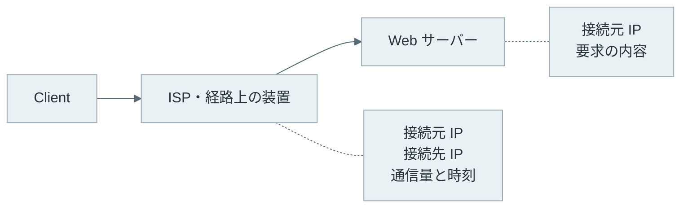
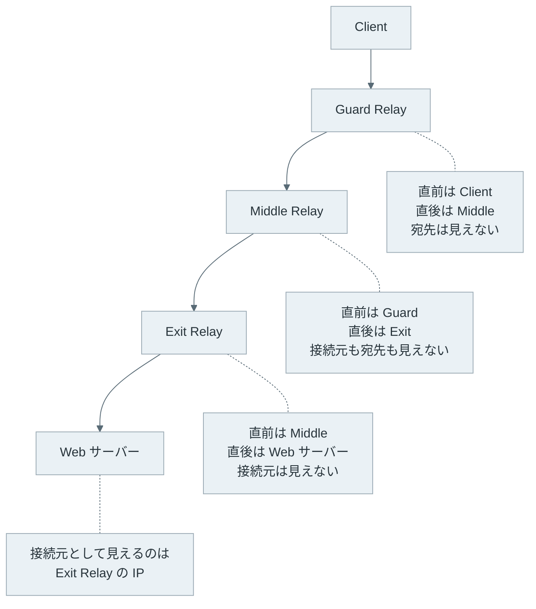
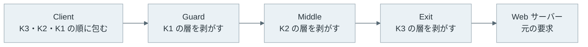
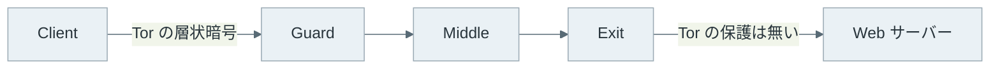
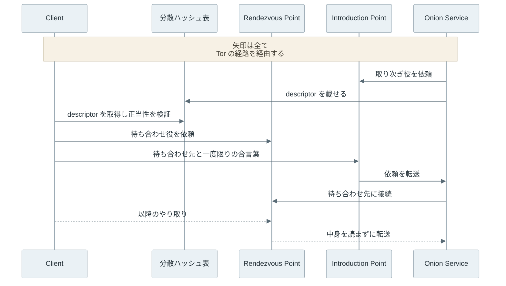
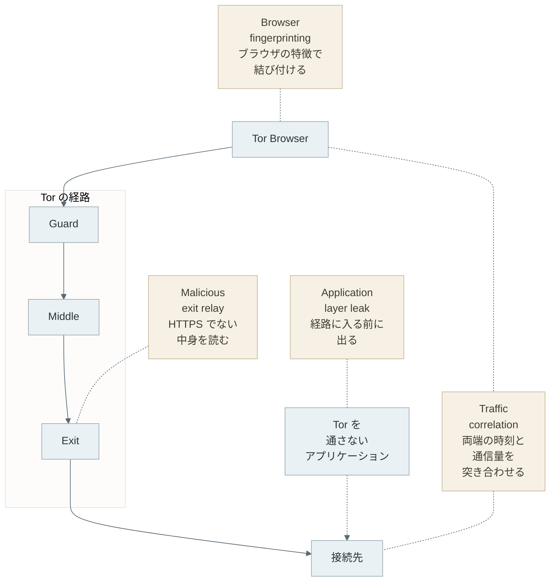
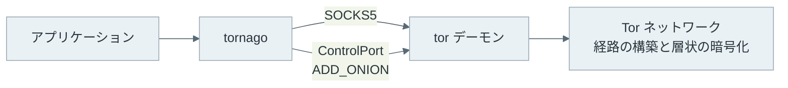

Tor は、通信を複数のリレー（中継役のサーバー）に順に通し、経路のどの 1 台からも接続元と接続先の両方が見えないようにする通信の仕組みです。通常の Web サイトに接続する場合は、Guard・Middle・Exit という 3 台のリレーを経由します。

例えば、自社の情報が無断で転載されていないかを Web サイトで確かめたい時、普通の HTTP クライアントで接続すると、相手のサーバーには調査する側の IP アドレスが残ります。

以下は、各リレーが知る範囲と、リレーを通るたびに暗号の層が 1 枚ずつ剥がれる様子を示した図です。



上記の図のどの帯も、Client と Web サーバーの両方には届きません。Tor の名前は The Onion Router に由来し、リレーごとに別の鍵で通信を包む構造から付いています。

<br>

本記事では、Tor クライアントが経路を作って通信する部分と、`.onion` のアドレスに接続する部分について、以下の疑問に沿って説明します。

- 通常の接続では、誰が何を観測できるのか。
- なぜリレーを 3 台経由し、それぞれのリレーには何が見えるのか。
- Exit Relay から Web サーバーまでの区間は、なぜ Tor で暗号化されないのか。
- Onion Service への接続は、通常の Web サイトへの接続と何が違うのか。
- Tor では、どんな攻撃を防げないのか。2014 年に起きた攻撃は、どこを突いたのか。

後半では、Go から Tor を使うライブラリ tornago を例に、プログラムが触れる Tor の機能を紹介します。リレーの運用方法、Tor Browser の設定手順、特定のサイトへの到達方法、鍵の合意手順と暗号の種類は扱いません。

---

### 接続元と接続先を切り離す理由

TCP/IP の通信では、パケットの先頭に送信元 IP アドレスと宛先 IP アドレスが平文で入ります。HTTPS が守るのは中身であって、この 2 つのアドレスは経路上の装置から見えたままです。IP アドレスから契約者や組織が絞り込まれることもあるため、身元に繋がる情報として扱う必要があります。

以下は、通常の接続で誰が何を観測できるかを示した図です。



上記の図の ISP（Internet Service Provider、契約している回線業者）と経路上の装置は、中身を読めなくても「誰が、どこに、いつ、どれだけ」を記録できます。接続先の Web サーバーは、要求の中身に加えて、接続してきた相手の IP アドレスを受け取ります。

素朴な対策は、プロキシを 1 台挟んで接続元を付け替える方法です。この形では、そのプロキシ 1 台が接続元と接続先の両方を知ります。単純なプロキシは、[Tor Project の説明](https://support.torproject.org/about/how-is-tor-different-from-other-proxies/)の言う「a single point of trust and failure」（信頼と障害が集まる単一の点）になります。Tor はこれに対して、層状に暗号化したうえで通信を複数のリレーに通します。

---

### Onion Routing と各リレーに見える範囲

Onion Routing は、通信を複数の中継役に順に通し、どの 1 台も[直前と直後しか知らない](https://svn-archive.torproject.org/svn/projects/design-paper/tor-design.html)状態を作る方式です。Tor クライアントは、まずリレーの一覧を取得します。一覧はディレクトリ権威（directory authority）と呼ばれる複数の運用者が署名した文書として配られ、クライアントはその中から選んだリレーを繋いで経路（circuit）を作ります。経路上の位置には呼び名が付きます。

- Guard Relay: クライアントが直接つなぐ 1 台目
- Middle Relay: 2 台目。Tor の内部だけと通信する
- Exit Relay: 3 台目。ここから Tor の外にある宛先に接続する

台数は利用者が選ぶ設定ではなく、[Tor Project の FAQ](https://support.torproject.org/about-tor/using-and-sharing/circuit-length/) のとおり、Onion Service に接続する場合を除いて 3 台に固定されています。

各地点が知る情報を図にすると、以下のようになります。



観測できる情報を整理すると次のようになります。

| 地点 | 接続元 IP | 最終的な接続先 | 通信の中身 |
| --- | --- | --- | --- |
| ISP・経路上の装置 | 見える | 見えない | 見えない |
| Guard Relay | 見える | 見えない | 見えない |
| Middle Relay | 見えない | 見えない | 見えない |
| Exit Relay | 見えない | 見える | HTTPS でなければ見える |
| Web サーバー | 見えない | ー | 見える |

契約している回線業者からも、公開されたリレーへの接続そのものは見えるので、Tor を使っている事実までは隠せません。これを補うのが、一覧に載らない [bridge](https://support.torproject.org/tor-browser/circumvention/unblocking-tor/) と、通信を別物に見せる pluggable transport です。

<br>

1 台目は、ほかの 2 台と違い、経路を作るたびにネットワーク全体から選び直すことはせず、[Tor の guard 仕様](https://spec.torproject.org/guard-spec/index.html)に従って少数の候補を使い続けます。1 台目と、接続先に近い端（通常は Exit Relay）の両方を攻撃者が持つと、時刻と通信量を突き合わせて接続元と接続先を結び付けられます（後述の Traffic correlation）。

毎回選び直す構成では、作り直すたびにこの組み合わせを引く機会が生まれます。候補を使い続ければ、最初に攻撃者のリレーを引かなかった利用者は、その後も 1 台目で観測されません。候補は永久に固定されず、入れ替えも起こります。

この差をシミュレーションで確かめます。攻撃者が Guard と Exit の帯域のそれぞれ割合 c を持ち、リレーは帯域に比例して選ばれるとします。

Guard を選び直す場合、1 本の経路の両端が攻撃者になる確率は c^2 で、C 本作ると [guard 仕様](https://spec.torproject.org/guard-spec/index.html)の冒頭が示す `1-(1-F)^C`（F = c^2）になります。Guard を固定する場合は、最初に攻撃者の Guard を引いた割合 c の利用者だけが対象です。

期間中に Guard は入れ替えないと仮定し、利用者 20,000 人を seed 固定の乱数で動かしました（抜粋。全体は [lab/guard_exposure.py](https://github.com/nao1215/debimate/blob/main/content/notes/security/tor/lab/guard_exposure.py)）。

```python
for i in range(1, CIRCUITS + 1):
    g = guard_bad if fixed_guard else rng.random() < c
    if g and rng.random() < c:  # Guard と Exit の両方が攻撃者
        hit = i
        break
    if fixed_guard and not g:
        break  # 正直な Guard を固定した利用者は期間中に観測されない
```

以下は、利用者ごとに作った経路の本数と、両端を握られた利用者の割合です。



<details>
<summary>実行結果（グラフの元の数値）</summary>

同じ出力は [guard_exposure_output.txt](https://github.com/nao1215/debimate/blob/main/content/notes/security/tor/lab/guard_exposure_output.txt) にもあります。

```console
$ python3 lab/guard_exposure.py
users=20,000  circuits per user=1,000  seed=20261110
c=0.05 rotate guard  C=    1:  0.27% (exact  0.25%)  C=   10:  2.62% (exact  2.47%)  C=  100: 22.43% (exact 22.14%)  C=1,000: 91.97% (exact 91.82%)
c=0.05 fixed guard   C=    1:  0.24% (exact  0.25%)  C=   10:  1.86% (exact  2.01%)  C=  100:  4.79% (exact  4.97%)  C=1,000:  4.84% (exact  5.00%)
c=0.10 rotate guard  C=    1:  0.99% (exact  1.00%)  C=   10:  9.37% (exact  9.56%)  C=  100: 63.13% (exact 63.40%)  C=1,000: 100.00% (exact 100.00%)
c=0.10 fixed guard   C=    1:  0.94% (exact  1.00%)  C=   10:  6.49% (exact  6.51%)  C=  100:  9.80% (exact 10.00%)  C=1,000:  9.80% (exact 10.00%)
```

</details>

選び直す構成では、経路を作り続けるほど、ほぼ全員がいつかは両端を握られます。固定すると割合は c で止まります。ただし、攻撃者の Guard を引いた c の利用者は、Exit も攻撃者になった経路を繰り返し観測されます。

---

### 層ごとの鍵による暗号化

各リレーが自分の層だけを開けて次のリレーに渡せるのは、クライアントが鍵を作る順序によるものです。クライアントは経路を 1 台ずつ伸ばしながら、各リレーとの handshake（相手と値をやり取りして、2 者だけが知る鍵を作る手順）を通じて、そのリレーとの通信に使う鍵材料をそれぞれ導出します。

最初に Guard Relay との間で鍵を導出し、その鍵で暗号化した通信の中を通して Middle Relay と handshake します。次に、その 2 重の暗号の中を通して Exit Relay と handshake します。鍵を[入れ子](https://support.torproject.org/about-tor/how-tor-works/key-management/)で作るため、Guard Relay は Middle Relay 以降の鍵を知りません。

以下は、包み方と剥がし方です。図の K1・K2・K3 は 1 リレーにつき 1 つの鍵として書いた概念上の表記で、実際には送信と受信の方向などに応じた鍵が導出されます。



上記の図の Guard Relay は K1 の層だけを開け、同じ経路の次のリレーに流します。転送先は経路を伸ばす時に決まっており、cell（Tor が経路上で通信を運ぶ固定長の単位）を開けると指示が現れるわけではありません。残りは K2 と K3 で包まれたままなので、中身も最終的な宛先も読めません。

---

### Exit Relay 以降の暗号化されない区間

層は Exit Relay で全部剥がれます。そのため、Exit Relay から Web サーバーまでの区間には、Tor による暗号化が残りません。

以下は、暗号化が掛かる区間です。



上記の図のとおり、Tor を使うことと、中身が送信者から受信者まで通しで暗号化されること（End-to-End の暗号化）は別です。Exit Relay から中身を隠すのは HTTPS の仕事で、Tor が隠すのは経路の情報です。

[Tor Project の案内](https://support.torproject.org/faq/staying-anonymous/)も、機微な情報を渡す相手については、アドレス欄の錠前か onion のアイコン、URL の https://、サイトの名前を確かめるよう注意しています。

Tor だけを使う場合と、HTTPS を併用する場合の違いを次に示します。

| | Tor のみ | Tor と HTTPS |
| --- | --- | --- |
| 接続元と接続先の結び付き | Tor が隠す | Tor が隠す |
| 通信の中身 | Exit Relay 以降は平文 | Client から暗号化を終端する地点まで暗号化される |
| Exit Relay から見えるもの | 接続先と平文の中身 | 接続先と暗号文 |

---

### Tor の外に出ない Onion Service の接続

`.onion` で終わるアドレスへの接続では、通信が Tor ネットワークの外に出ません。宛先がインターネット上の IP アドレスではなく、サービスの公開鍵から作ったアドレスなので、外に出す Exit Relay が必要ない構成になります。

[Tor Project の解説](https://community.torproject.org/onion-services/overview/)によると、サービスはまず複数のリレーに長期の経路を張り、自分への取り次ぎ役（introduction point）になってもらいます。この経路も Tor の経路なので、サービスは取り次ぎ役に自分の所在を明かしません。

サービスは取り次ぎ役の一覧を署名付きの descriptor としてまとめ、Tor ネットワーク上の分散ハッシュ表（複数のリレーが descriptor を分担して持つ仕組み）に載せます。

クライアントは `.onion` のアドレスから descriptor の置き場所を割り出して取得し、アドレスに含まれる公開鍵を起点として descriptor の正当性を[検証](../../blockchain-systems/digital-signature/)し、取り次ぎ役の情報を取り出します。別のサービスが用意した descriptor は、この検証を通りません。接続の流れは以下の通りです。



上記の図の Rendezvous Point は、クライアントが選んだ待ち合わせ役で、クライアント側の経路の 3 台目です。クライアントとサービスはそれぞれ自分の経路を張った先で落ち合うので、Rendezvous Point から見えるのは両方の経路で自分の直前にいるリレーだけです。どちらの IP アドレスも分かりません。

接続はクライアント側 3 台とサービス側 3 台の、合計 6 台を経由します。既定の構成では、クライアントとサービスも互いの IP アドレスを知らないまま通信できます。

通信が Tor の外に出ない点も、通常の Web アクセスとの違いになります。[Tor Project の案内](https://support.torproject.org/tor-browser/features/onion-services/)によると、Tor ユーザーと onion service の間の通信は全て End-to-End に暗号化されるので、HTTPS で接続するかどうかを気にする必要はありません。

守られるのはクライアントとサービスの間の転送路で、繋いだ先が意図した相手かどうかは別の問題です。`.onion` のアドレスは長い文字列なので、似せたアドレスに誘導される余地は残ります。

---

### Tor が守らない範囲

「Tor を使えば匿名」という要約は成り立ちません。[Tor の設計論文](https://svn-archive.torproject.org/svn/projects/design-paper/tor-design.html)は、遅延の小さい実用的なシステムでは防げないとして、ネットワークの全ての通信路を観測できる攻撃者（global passive adversary）を想定から外し、通信の一部を観測できる相手を想定しています。

想定の外に残る攻撃を次に示します。

| 攻撃 | 何が起きるか | Tor での位置付け |
| --- | --- | --- |
| Global passive adversary | 全ての通信路を観測される | 設計上の想定外 |
| Traffic correlation | 両端の時刻と通信量のパターンを突き合わせられる | 最小限しか隠せないと論文が明言 |
| Malicious exit relay | HTTPS でない通信の中身を読まれる | 経路の構造として残る |
| Browser fingerprinting | ブラウザの特徴の組み合わせで利用者が結び付けられる | Tor Browser 側の対処 |
| Application layer leak | Tor を通さない通信や、利用者が入力した情報が出る | Tor の外側 |

以下は、表の攻撃のうち 4 つが作用する場所です。



上記の図の Traffic correlation は、経路の中身を解読しない攻撃で、両端を観測できれば global passive adversary でなくても行えます。論文も「Tor only minimally hides such correlations」（Tor がこの相関を隠せるのは最小限にとどまる）と認めています。

この形の攻撃が起きたのが、2014 年の [relay early traffic confirmation attack](https://blog.torproject.org/tor-security-advisory-relay-early-traffic-confirmation-attack/) です。2014 年 1 月 30 日に約 115 台のリレーが加わり、Guard になれるリレー全体の通信容量の約 6.4% を占めました。

これらは Guard に加えて、Onion Service の descriptor を預かる役にも就いています。Exit Relay を運用した形跡はなく、接続先に近い端に立ったのは descriptor を預かる役でした。

descriptor を預かる役は、descriptor を載せに来た経路と取りに来た経路に、relay と relay early という 2 種類の cell の並びで Onion Service の名前を書き込みました。



relay early の cell は通常クライアントの方向には流れないので、同じ攻撃者の Guard Relay はこの印を見付けられます。その結果、接続元の IP アドレスと、その人が載せた、または探した Onion Service が結び付きました。

表の Traffic correlation が両端の時刻と通信量を見比べるのに対し、この攻撃は片方の端で印を付け、もう片方の端で読む能動的な形でした。Tor Project は 7 月 4 日にこれらのリレーを外し、relay early の cell を印に使えなくするバージョン（0.2.4.23 など）を出しました。

さらに、十分なクライアントが更新した後に、使う Guard を 3 台から 1 台に減らす計画も示しています。1 人のクライアントが接するリレーを減らし、攻撃者のリレーに当たる機会を時間をかけて減らすためです。

<br>

Browser fingerprinting と Application layer leak は、経路の外側で起きます。

[Tor Project が定義する](https://support.torproject.org/anti-fingerprinting/) fingerprinting は、Web ブラウザの情報を体系的に集め、利用者の識別情報や特徴を推測する手法です。対処は Tor Browser 側にあり、ブラウザが自分の種類を名乗る User-Agent の値を揃える、画面の大きさをいくつかの区分に丸める、といった方法で、利用者ごとのブラウザの違いを見えにくくしています。

Application layer leak について、Tor Project の案内は「[Tor only protects applications that are properly configured to send their Internet traffic through Tor.](https://support.torproject.org/faq/staying-anonymous/)」（Tor が守るのは、通信を Tor に通すよう正しく設定されたアプリケーションだけ）と注意しています。

利用者が自分で明かす情報も、同じく経路の外側の問題です。サイトにログインしたり氏名を入力したりすれば、経路がどれだけ隠れていても、その相手に対しては匿名ではなくなります。

---

### tornago が使っている Tor の機能

[nao1215/tornago](https://github.com/nao1215/tornago) は、Go から Tor 経由の通信と Onion Service の作成を扱うためのライブラリで、Tor のロジックを実装し直したものではありません。tor コマンド（デーモン）と、SOCKS5 プロキシと ControlPort を通じて通信します。デーモンは自分で起動することも、既に動いているものに繋ぐこともできます。

- SOCKS5 プロキシ: アプリケーションの TCP / HTTP 通信を Tor の経路に中継するプロキシ
- ControlPort: tor デーモンに命令を送るインターフェース。Onion Service の作成や経路の作り直しで使う

以下が役割の分かれ方です。



上記の図のとおり、Guard Relay の選択も層ごとの暗号化も tor デーモンの仕事で、tornago は、これらのインターフェースを使って構築済みの経路を利用します。Onion Service を立てる場合は、ControlPort に `ADD_ONION` を送ってアドレスを作り、例えばその 80 番ポートをローカルの HTTP サーバーに転送する対応付けを設定します。

ControlPort からは Onion Service の作成や経路の制御まで行えるので、外部のネットワークに開かず、cookie 認証やパスワード認証を設定したうえで使います。

[Tor の control 仕様](https://spec.torproject.org/control-spec/implementation-notes.html)も、ControlPort が開いていて認証が無効な場合は、接続してきたローカルの利用者を誰でも信頼すると書き、この状態を勧めていません。

作った経緯と実装の詳細は「[【Golang】tor client/server を実装するための nao1215/tornago ライブラリを作った話](/post/ja/2025-11-21golangtornago%E3%83%A9%E3%82%A4%E3%83%96%E3%83%A9%E3%83%AA%E3%82%92%E4%BD%9C%E3%81%A3%E3%81%9F%E8%A9%B1/)」で扱っています。

---

### 利点

- 経路上の 1 台からは、接続元と接続先の両方を観測できない
- 入口の候補を少数に絞るので、経路を作り直すたびに攻撃者のリレーを引く機会が増えることを避けられる
- Onion Service では、双方が相手の IP アドレスを知らないまま通信できる
- リレーの一覧が公開されており、単一の事業者を信頼する前提を置かずに済む
- TCP の通信を SOCKS5 プロキシに向け、名前解決も Tor 側に委ねれば、既存のアプリケーションを通せる

---

### 欠点

Tor を使う場合の制約は次の通りです。

- 複数のリレーを経由し、経路が地理的に遠回りになることもあるため、直接つなぐ場合より遅延が大きい
- リレーの一覧に署名するディレクトリ権威への信頼は残る
- 経路の両端を観測できる攻撃者は、時刻と通信量のパターンを突き合わせて接続元と接続先を結び付けられる
- Exit Relay から先には Tor の暗号化が掛からず、中身の保護は HTTPS に依存する
- ブラウザやアプリケーションが出す情報は経路の外にあり、Tor では隠せない
- 経路の構築とディレクトリ情報の取得に時間が掛かり、利用可能になるまで待ちが入る
