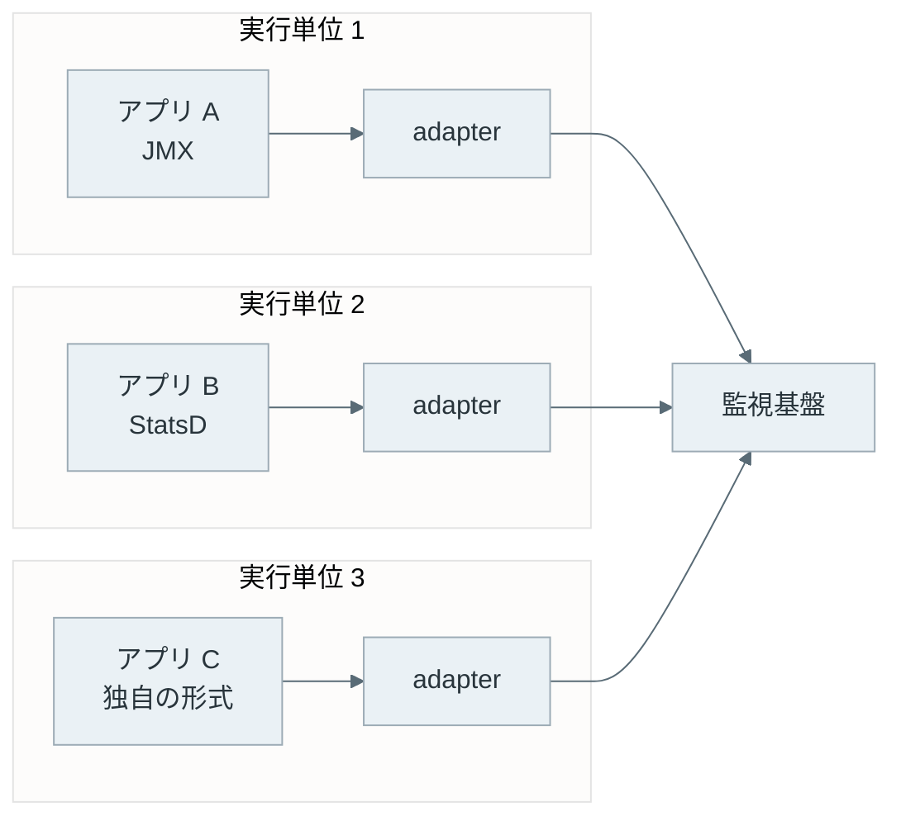
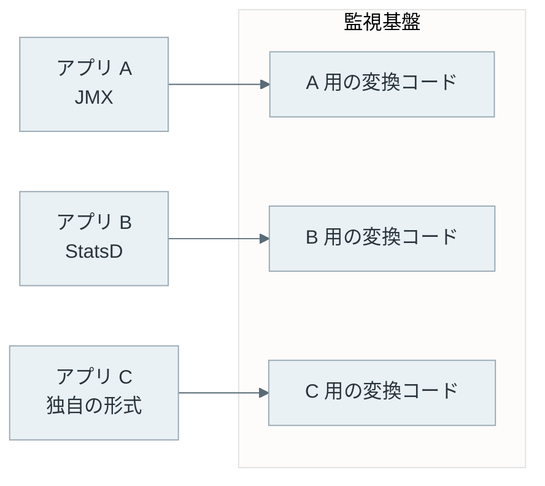
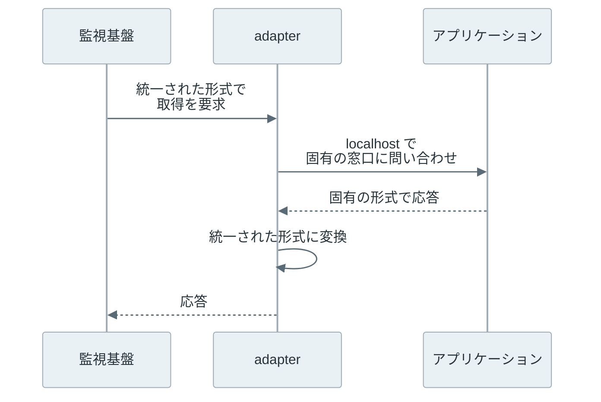

Adapter とは、アプリケーションと同じ実行単位に置かれ、外から見える出力とインターフェースを統一する補助コンテナです。アプリケーションのコードには手を入れず、外から見た形だけを揃えます。手を入れられないミドルウェアと自作のサービスが混ざった環境で、監視やログを 1 か所に揃えたい時に使います。

実行単位とは、同じマシンにまとめて配置され、まとめて作られ削除されるコンテナの集まりで、Kubernetes の [Pod](https://kubernetes.io/docs/concepts/workloads/pods/) や Amazon ECS の [Task](https://docs.aws.amazon.com/AmazonECS/latest/developerguide/task_definitions.html) が当たります（[Sidecar](../sidecar/) のノートと同じ意味です）。同じ実行単位のコンテナはネットワークを共有する設定にできるため、隣のコンテナに localhost で届きます。

以下は、複数のアプリケーションのメトリクスを監視基盤に集める例です。



上記の図の監視基盤が知っているのは 1 つの形式だけです。3 つのアプリケーションはそれぞれ別の方法でメトリクスを出しており、その違いを吸収するのが各実行単位の adapter です。

[JMX](https://docs.oracle.com/javase/8/docs/technotes/guides/jmx/)（Java Management Extensions）は Java の管理と監視のための仕様で、アプリケーションが登録した情報を外から読み書きする窓口です。[StatsD](https://github.com/statsd/statsd) は、メトリクスを短いテキスト 1 行で送るプロトコルと、それを受けて集約するデーモンを指します。どちらも監視基盤が直接読める形とは限りません。

<br>

本記事では、Adapter で外向きの形を揃える理由と、変換が起きる場所を説明します。扱う疑問は以下です。

- 出力の形式を揃えるのに、なぜアプリケーションの外で変換するのか。
- アプリケーションと adapter は何で繋がり、変換はどちらの向きに起きるのか。
- 監視基盤がメトリクスを取りに来る形では、どこで変換が起きるのか。
- PostgreSQL を 17 に上げただけで、なぜ監視の一部が静かに止まったのか。
- どのような構成では、分ける利益が小さいのか。

---

### 名前の由来

Brendan Burns 氏と David Oppenheimer 氏の論文「[Design Patterns for Container-based Distributed Systems](https://www.usenix.org/conference/hotcloud16/workshop-program/presentation/burns)」は、4.3 節で Adapter を「複数のコンテナにまたがって出力とインターフェースを標準化すること」とし、外の世界に「単純化され均質にされたアプリケーションの姿」を見せるものとしています。

この定義は [Ambassador](../ambassador/) との対比になっていて、2 つは単純化して見せる相手が逆です。Ambassador は外の世界を単純化してアプリケーションに見せ、Adapter はアプリケーションを揃えて外の世界に見せます。

名前は、論文より前の Brendan Burns 氏のブログ「[The Distributed System ToolKit](https://kubernetes.io/blog/2015/06/the-distributed-system-toolkit-patterns/)」で Sidecar・Ambassador と並べて紹介されました。冒頭の監視の図は、論文とブログが挙げる例です。3 つのパターンの関係と名前の経緯は、[Sidecar](../sidecar/) のノートにまとめています。

<br>

書籍『オブジェクト指向における再利用のためのデザインパターン』にも同じ名前のパターンがあります。書籍の Adapter は、クライアントが期待する形に既存のクラスのインターフェースを変換するパターンで、形を合わせる境界はコンテナではなくクラスです。

---

### Adapter が必要な理由

出力の形式を最初から揃えておけるなら、変換は必要ありません。論文によると Google 社内ではコードの規約で統一していますが、それはソフトウェアを一から作る場合にしかできません。

実際のシステムには、一から作れないソフトウェアが必ず混ざります。オープンソースのミドルウェアや、手を入れられない既存のシステムがその例です。Adapter を使えば、それらが混ざっていても、元のアプリケーションを改変せずに統一されたインターフェースを外に見せられます。

変換をアプリケーションの外に出さず、監視基盤の中に持たせる方法もあります。以下は、変換を監視基盤の中に持たせた構成です。



上記の図では、変換のコードが監視基盤の中に集まっています。アプリケーションが 1 つ増えるたびに監視基盤に手を入れる必要があり、変換のコードの誤りが監視基盤そのものに及びます。既存の監視ソリューションには、複数種類のバックエンドと通信できるものもあります。ただし論文は、それらが監視システムの中にアプリケーション固有のコードを抱えるため、関心の分離がきれいに保たれないと指摘しています。

---

### 接点と変換の向き

論文の 4.3 節によると、メインのコンテナは localhost または共有の volume（同じ実行単位の複数のコンテナから同じ内容が見えるファイルの置き場）を通じて adapter と通信できます。どちらを使うかは、アプリケーションが出力を何で出しているかで決まります。

| アプリケーションの出し方 | 接点 | adapter が行うこと |
|---|---|---|
| ポートを開いて問い合わせに答える | localhost | 問い合わせて、統一された形式に変換する |
| ファイルに書き出す | 共有 volume | 読み取って、統一された形式に変換する |
| 一定間隔で外に送る | localhost | 受け取って、統一された形式で送り直す |

上記の表の監視の例では、変換されるデータはアプリケーションから外に向かいます。1 行目と 2 行目は adapter が取りに行く形、3 行目はアプリケーションが送る形です。ただし 3 行目では、アプリケーションの送信先を localhost の adapter に変更する必要があります。

論文の 4.3 節は、標準化する対象を「出力とインターフェース」としています。具体例は監視のインターフェースですが、定義がインターフェースまで含んでいるので、外から来る要求の受け口を揃える構成にも当てはまります。

例えば、外部が新しい形式で呼びたいのにアプリケーションが古い形式しか受け付けない場合、adapter が受け口になって変換します。要求を受け取る向きは監視の例と逆でも、外から見たアプリケーションの形を揃えている点は同じです。Adapter と Ambassador を通信の向きではなく見せる相手で分けるのは、このためです。

同じ形は、メトリクス以外でも、出力と接点を持つものなら何にでも当てはまります。日時とログレベルの書き方がまちまちなログを 1 つの構造に揃える用途と、生死の判定の仕方が違うアプリケーションに共通の窓口を用意する用途が代表的です。

---

### 取得の起点

監視の用途では、監視基盤が一定間隔でメトリクスを取りに来る形が多くなります。Prometheus の exporter をアプリケーションと同じ実行単位に同居させる使い方が、この形です。

[Prometheus](https://prometheus.io/) はメトリクスを取りに来て蓄える監視基盤です。[exporter](https://prometheus.io/docs/instrumenting/exporters/) は、サードパーティのシステムが持つ既存のメトリクスを Prometheus のメトリクスとして書き出すライブラリとサーバーで、「HAProxy や Linux のシステム統計のように、対象のシステムに直接 Prometheus のメトリクスを組み込むことが現実的でない場合に有用」なものです。

以下は、監視基盤が取りに来る形での往復です。



上記の図で変換が起きるのは adapter の中だけで、取りに来る形であれば、アプリケーションは自分がどの形式で監視されているのかを知りません。

そのため、監視基盤を入れ替える場合もアプリケーションには手を入れません。adapter が [OpenMetrics](https://prometheus.io/docs/specs/om/open_metrics_spec/)（Prometheus の形式を元にした標準の形式）で出していて、新しい監視基盤も同じ形式を読めるなら、adapter も変えずに済みます。読めない場合も、合わせるのは adapter か監視基盤の設定です。

<br>

exporter を必ず同居させるわけではありません。exporter は、メトリクスの取得元のマシンで[動く必要がありません](https://prometheus.io/docs/guides/multi-target-exporter/)。1 台の exporter が多数の対象を担当する構成もあり、それは変換のコードを 1 か所に集める形なので、ここで扱う Adapter とは配置が違います。

同居させる場合でも、対象によっては設定が必要です。Java のアプリケーションの JMX を別のコンテナから読むには、リモート接続を有効にする起動オプションが必要です。[jmx_exporter](https://prometheus.github.io/jmx_exporter/) は、リモート JMX の設定を避けられるので、同じ JVM（Java の実行環境）の中で動く Java Agent として使う形が大半の利用者に勧められています。

Java Agent はアプリケーションと同じプロセスに読み込ませるコードで、コンテナを分けないので本記事の Adapter からは外れます。変換をプロセスの中に入れるか別のコンテナに出すかは、この手間と、独立した更新や資源の分離との兼ね合いです。

---

### 利点

- アプリケーションを改変せずに、外から見た形を揃えられる
- 変換のコードが監視基盤から出て実行単位の中に閉じるため、アプリケーションが増えても監視基盤に固有の変換コードを足さずに済み、監視基盤の更新とも切り離せる
- 同じ形式で出力する複数のアプリケーションに、同じ adapter を使い回せる

---

### 欠点

Adapter は、アプリケーションを改変しない代わりに、外向きの形を揃える仕事を別のコンテナに持たせます。そのため、次の制約があります。

- 実行単位ごとに adapter のコピーが動き、消費する資源がその数に比例して増える
- 統一された形式に無い項目は、捨てるか独自の名前で載せるかのどちらかになる
- アプリケーションの出力形式が変わると adapter が壊れ、アプリケーションのテストでは気付けない
- 業務と関係のない変換の対応表が、アプリケーションの数だけ保守の対象として残る
- 変換を挟む分だけ、値が外から見えるまでに追加の遅延が生じる

3 番目は、アプリケーションと adapter を別々に更新する構成の弱点です。[postgres_exporter](https://github.com/prometheus-community/postgres_exporter) は、DB（データベース）の [PostgreSQL](https://www.postgresql.org/) の統計を Prometheus の形式に変換する exporter で、DB と同じ実行単位に置けば adapter になります。

この exporter は、PostgreSQL 17（報告時はベータ）に上げた環境で、bgwriter の統計（checkpoint の回数など）を[まとめて取れなくなりました](https://github.com/prometheus-community/postgres_exporter/issues/1060)。PostgreSQL 17 が checkpoint（メモリ上の変更をディスクに書き出す処理）のカラムを `pg_stat_bgwriter` から新しい `pg_stat_checkpointer` に[移し](https://www.postgresql.org/docs/17/release-17.html)、exporter の問い合わせが消えたカラムを読みに行ったからです。

[修正](https://github.com/prometheus-community/postgres_exporter/pull/1072)が取り込まれたのは報告から 4 か月半後の 2025 年 1 月で、リリースは 2 月の v0.17.0 でした。以下は、PostgreSQL 17 と修正前の v0.15.0 を [Docker](https://docs.docker.com/) で動かし、exporter が返すメトリクスとログを確かめる手順です。

```bash
docker network create pgnet
docker run -d --name pg --network pgnet \
  -e POSTGRES_PASSWORD=pw postgres:17-alpine
sleep 5
docker run -d --name exporter --network pgnet \
  -e DATA_SOURCE_NAME="postgresql://postgres:pw@pg:5432/postgres?sslmode=disable" \
  prometheuscommunity/postgres-exporter:v0.15.0
sleep 5
docker run --rm --network pgnet curlimages/curl:8.10.1 -s http://exporter:9187/metrics \
  | grep -E '^pg_up|^pg_scrape_collector_success'
docker logs exporter 2>&1 | grep 'collector failed'
# 後始末: docker rm -f pg exporter && docker network rm pgnet
```

PostgreSQL 17.10 で実行した結果です（`docker run -d` が出すコンテナ ID の行は省きました）。

```text
pg_scrape_collector_success{collector="database"} 1
pg_scrape_collector_success{collector="locks"} 1
pg_scrape_collector_success{collector="replication"} 1
pg_scrape_collector_success{collector="replication_slot"} 1
pg_scrape_collector_success{collector="stat_bgwriter"} 0
pg_scrape_collector_success{collector="stat_database"} 1
pg_scrape_collector_success{collector="stat_user_tables"} 1
pg_scrape_collector_success{collector="statio_user_tables"} 1
pg_scrape_collector_success{collector="wal"} 1
pg_up 1
ts=2026-11-09T10:42:20.778Z caller=collector.go:202 level=error msg="collector failed" name=stat_bgwriter duration_seconds=0.007986937 err="pq: column \"checkpoints_timed\" does not exist"
```

`pg_up` は 1 で、PostgreSQL への接続は成功しています。0 になったのは collector（統計を集める単位）ごとの成否を表す `pg_scrape_collector_success` の `stat_bgwriter` だけで、他の collector は値を返し続けます。失敗はこの値と exporter のログにしか現れないため、この値を監視していないと監視の一部だけが静かに止まります。

exporter のコンテナイメージを v0.17.0 に替えて同じ手順を実行すると、`stat_bgwriter` も 1 になりました。

---

### 分ける利益が小さいケース

- アプリケーションを自分たちで改変でき、最初から統一された形式で出力させられる構成
- 出力する形式が既に 1 つに揃っている構成
- 変換の規則が複雑で、対応表の保守がアプリケーションの改変より重くなる構成
- 実行単位の数が多く、adapter の常駐メモリの総量が無視できない構成

1 番目の構成でも、オープンソースのミドルウェアを 1 つ足した時点で改変できない相手が現れます。
