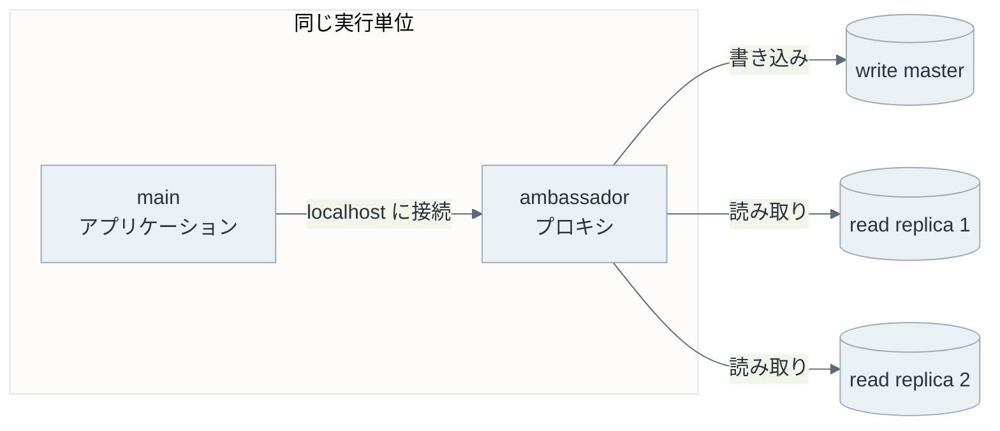
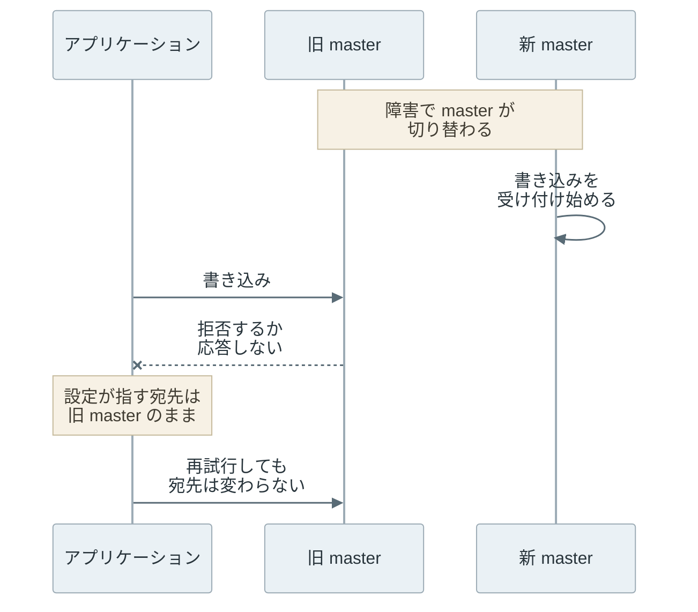
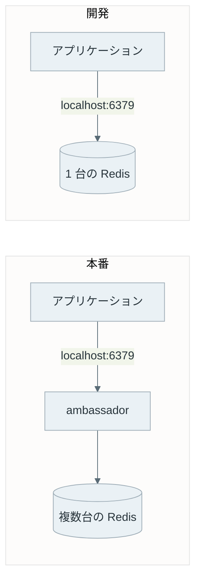

Ambassador とは、アプリケーションのコンテナと同じ実行単位に置かれ、外部との通信を代わりに引き受ける補助コンテナです。実行単位（同じマシンにまとめて配置され、まとめて作られ削除されるコンテナの集まり。Kubernetes の Pod や Amazon ECS の Task）と実行基盤（コンテナの配置とライフサイクルを管理する基盤）は、[Sidecar](../sidecar/) と同じ意味で使います。

通信を代わりに受け取って転送するものをプロキシと呼び、Ambassador はその 1 つです。例えばアプリケーションは localhost の 1 つの宛先へ接続し、実際の接続先が何台あるのか、どれに振り分けるのかは Ambassador が判断します。同じ実行単位のコンテナがネットワークを共有する設定なら、隣のコンテナに localhost で届きます。

以下は、Redis に接続する例です。Redis は主にメモリ上でデータを扱うデータストアで、書き込みを受け付ける 1 台の master と、読み取り専用の複製である複数台の replica という構成を組めます。

上記の図のアプリケーションが知っているのは、localhost の 1 つの宛先だけです。書き込みを master に、読み取りを replica に振り分けるのは ambassador で、replica が 2 台から 5 台に増えた時に接続先の一覧を更新する責任も、ambassador に移ります。

 

本記事では、Ambassador で通信を仲介する理由と、仲介が成り立つ条件を説明します。取り上げる疑問は次の通りです。

- なぜ接続先の判断をアプリケーションの外に出すのか。
- localhost という接点は、どのような条件で成り立つのか。
- ambassador は何を引き受け、アプリケーションから何が消えるのか。
- 後からコンテナに入ると繋がるのに、起動直後の通信だけが失敗するのはなぜか。
- どのような構成では、分ける利益が小さいのか。

---

### 名前の由来

Brendan Burns 氏と David Oppenheimer 氏の論文「[Design Patterns for Container-based Distributed Systems](https://www.usenix.org/conference/hotcloud16/workshop-program/presentation/burns)」は、4.2 節で「Ambassador コンテナは、メインのコンテナに向かう通信と、そこから出る通信を仲介する」と定義しています。

名前は、論文より前の Brendan Burns 氏のブログ「[The Distributed System ToolKit](https://kubernetes.io/blog/2015/06/the-distributed-system-toolkit-patterns/)」で Sidecar・Adapter と並べて紹介されました。冒頭の Redis の図は、このブログが挙げる例です。3 つのパターンの関係と、sidecar を補助コンテナ全般の意味で使う呼び方は、[Sidecar](../sidecar/) のノートにまとめています。
Ambassador も Adapter も外と出入りする通信に関わるので、2 つは通信の向きではなく、単純化して見せる相手で区別します。Ambassador はアプリケーションに外の世界を単純化して見せ、Adapter は外の世界にアプリケーションを均質な形で見せます（論文の 4.3 節）。

---

### Ambassador が必要な理由

接続先が 1 台で済む間は、アプリケーションが直接繋げば足ります。台数が増えて役割で宛先が分かれると、どれに繋ぐのかという判断がアプリケーションの中に入ってきます。判断が入ると、接続先の一覧と振り分けの規則がアプリケーションの設定として必要になります。

この判断と設定をクライアントライブラリに任せる方法もあります。この場合、言語ごとに対応するライブラリが必要な点は [Sidecar](../sidecar/) で見たのと同じです。ambassador に出せば、言語に関わらず同じプロキシを使い回せます。

加えて、静的な接続先の一覧を各アプリケーションに配る方式では、構成が変わるたびにその全部を配り直す必要があります。

以下は、書き込みを受け付ける 1 台が障害で切り替わった場合の流れです。

上記の図のアプリケーションは、旧 master の宛先を静的な設定として持っているため、切り替わりを検出できません。旧 master が停止していれば応答が返らず、読み取り専用の複製に降格していれば、接続はできても書き込みだけが拒否されます。どちらでも、設定を書き換えるまで書き込みは失敗し続けます。

アプリケーションやクライアントライブラリが DNS の再解決（名前から IP アドレスを引き直すこと）や構成の問い合わせ（監視役に現在の master を尋ねること）を持っていれば、Ambassador が無くても切り替わりに追随できます。ただし、その仕組みは言語ごとに必要です。ambassador に任せれば追随をアプリケーションの外で済ませられ、追随できるかどうかは ambassador の実装で決まります。

論文は ambassador の例に、Redis ではなく memcache を扱う twemproxy を挙げています。memcache はメモリ上にデータを置くキャッシュで、twemproxy はそれを複数台に分散させるプロキシです。twemproxy が行うのは複数台への振り分けで、master の切り替わりを検知して宛先を切り替える機能は持ちません。

twemproxy のように追随しない実装でも、書き換える対象はアプリケーションから ambassador の設定に移るので、アプリケーションのコードと設定には触れずに済みます。

---

### 成立の条件

Ambassador が localhost という接点で成り立つのは、同じ実行単位のコンテナがネットワークを共有するからです。

2 つのコンテナはネットワーク名前空間（コンテナごとに分けられたネットワークの区画）を共有し、同じ IP アドレスを持ちます。そのため、アプリケーションは localhost に接続するだけでプロキシに届き、宛先を探す仕組みは必要ありません。宛先を探すとは、接続先の IP アドレスとポートを実行時に調べることです。

ネットワークを共有するかどうかは実行基盤で決まります。Kubernetes の Pod は、同じ Pod の中のコンテナがネットワーク名前空間を共有するので、localhost がそのまま使えます。どのコンテナ実行基盤でも共有されるわけではありません。

例えば、Amazon ECS の Linux/EC2 での既定である bridge モード（コンテナごとに別のネットワークの区画を持つ設定）では、同じ Task のコンテナがそれぞれ別のアドレスを持ちます。共有しない設定では、アプリケーションが ambassador を別のアドレスで呼ぶことになり、宛先を探す手間が再び生じます。探す範囲は同じマシンに限られても、接続先の設定はアプリケーションに 1 つ残ります。

---

### ambassador が引き受ける処理

以下は、ambassador が引き受ける処理と、それによってアプリケーションから消えるものの対応です。

| ambassador が引き受ける処理 | アプリケーションから消えるもの |
|---|---|
| 宛先の探索と選択 | 接続先の一覧を持つ設定 |
| 役割による振り分け | 読み取りと書き込みで宛先を変える分岐 |
| 外部への接続の確立と再利用 | 外部サーバーごとの接続の管理 |
| 失敗した時の再試行と切り替え | 再試行の実装 |

どこまで引き受けるかは実装で決まり、表の全部を担う実装も、振り分けだけの実装もあります。

4 行目の再試行には条件が付きます。同じ操作を 2 回実行しても結果が変わらない冪等な操作でなければ、ambassador の再試行が二重の書き込みになります。例えば値を 1 増やす操作は、1 回目が実は成功していた場合、再試行で 2 増え、アプリケーションはそれを知りません。ambassador が再試行の可否を判断できないなら、再試行して良い操作かを外から伝える仕組みが必要です。

---

### 開発環境での差し替え

接点が localhost の 1 つの宛先に固定されていることは、開発の場面でも役に立ちます。開発環境では、プロキシを外して localhost で動く Redis に直接繋げます。この使い方は 2015 年のブログでも紹介されています。

以下は、本番と開発の構成の違いです。

上記の図の 6379 は Redis が既定で使うポートで、2 つの構成でアプリケーションが繋ぐ先は同じなので、コードも設定も変えずにポートの先の相手だけを差し替えられます。

---

### 利点

- アプリケーションは localhost の 1 つの宛先だけを知ればよく、接続先の構成がコードから消える
- 同じ ambassador を使う範囲では、宛先の一覧と振り分けの規則を共通化できる
- ambassador を外して同じポートの 1 台に繋げば、アプリケーションを単体でテストできる
- 別の言語で書かれたアプリケーションからも、同じ ambassador を使い回せる
- 接続先の選択と、実装によっては接続の再利用や再試行も、アプリケーションの外へ移せる

1・3・4 番目は、論文の 4.2 節が twemproxy の ambassador を組み合わせる構成の利点として挙げているものです。

---

### 欠点

Ambassador は、宛先を選ぶ責任をアプリケーションの外に移します。その分、次の制約が生じます。

- 通信の経路が 1 段増え、往復のたびに遅延が加わる
- ambassador が停止すると外部との通信も止まる
- アプリケーションから見た宛先が 1 つなので、どの実体に繋がったのかがアプリケーションのログに残らない
- 実行単位ごとに ambassador のコピーが動き、その分の常駐メモリと CPU が必要
- 読み書きの振り分けのように中身を見る処理を任せる場合は、扱えるプロトコルが ambassador の対応範囲に縛られる

3 番目については、切り分けに ambassador のログを併せて読む必要があります。

4 番目の常駐コストが問題になる規模では、マシンごとに 1 つだけ置く構成も採れます。ただし、その構成では論文の Ambassador にあった 2 つの前提（localhost で届くこと、ライフサイクルを共有すること）が外れます。そのマシンの ambassador が停止すると、同じマシン上の全てのアプリケーションが影響を受けます。

 

2 番目は、[Sidecar](../sidecar/) の利点として挙げた「補助のコンテナが止まってもアプリケーションは動き続ける」という性質が成り立たない用途です。止まった時だけでなく、ambassador がまだ起動していない時も、外との通信は届きません。

Kubernetes の Pod ごとにプロキシを同居させる Istio は、アプリケーションの外向きの通信を[横取りしてプロキシに通します](https://docs.cloud.google.com/service-mesh/docs/troubleshooting/troubleshoot-proxy)（localhost で呼ぶ本記事の ambassador とは繋ぎ方が違いますが、通信がプロキシを通る点は同じです）。その Istio で、アプリケーションのコンテナがプロキシより先に動き出すと、GitHub からファイルを取得するような単純な通信も[失敗しました](https://github.com/istio/istio/issues/11130)。後からコンテナに入って試すと繋がるため、気付くまで数日掛かるユーザーもいました。当時の回避策は、アプリケーションの起動時に 20〜30 秒待たせることでした。

Istio 1.7 は、プロキシの準備が整うまで同じ Pod の他のコンテナを起動させない設定（holdApplicationUntilProxyStarts、既定は無効）を[追加しました](https://istio.io/latest/news/releases/1.7.x/announcing-1.7/change-notes/)。起動の順序も、ambassador の停止と同じ障害として扱う必要があります。

---

### 分ける利益が小さいケース

- 接続先が 1 台に固定されていて、増える見込みも役割による分岐も無い構成
- 使っているクライアントライブラリが宛先の探索と切り替えを既に持っていて、言語も 1 つの構成
- 許容できる遅延が小さく、プロキシを 1 段挟む余裕が無い通信
- 独自のプロトコルで通信していて、仲介できる実装が無い構成

2 番目の構成でも、扱う言語が 1 つ増えた時点で、同じ探索と切り替えをもう 1 つの言語で用意する必要があります。
