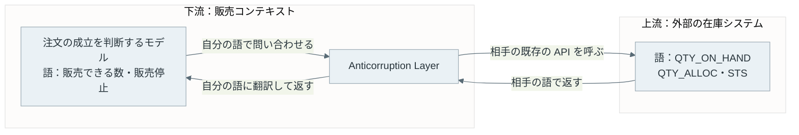
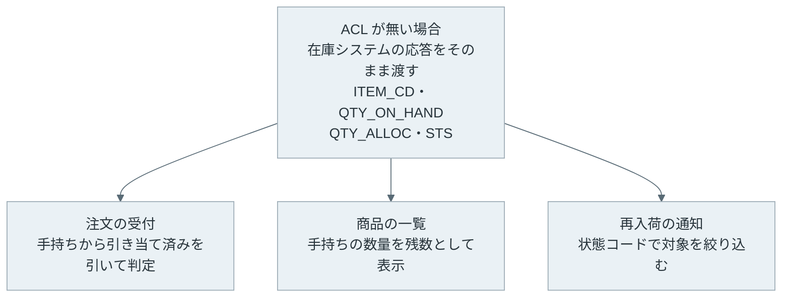
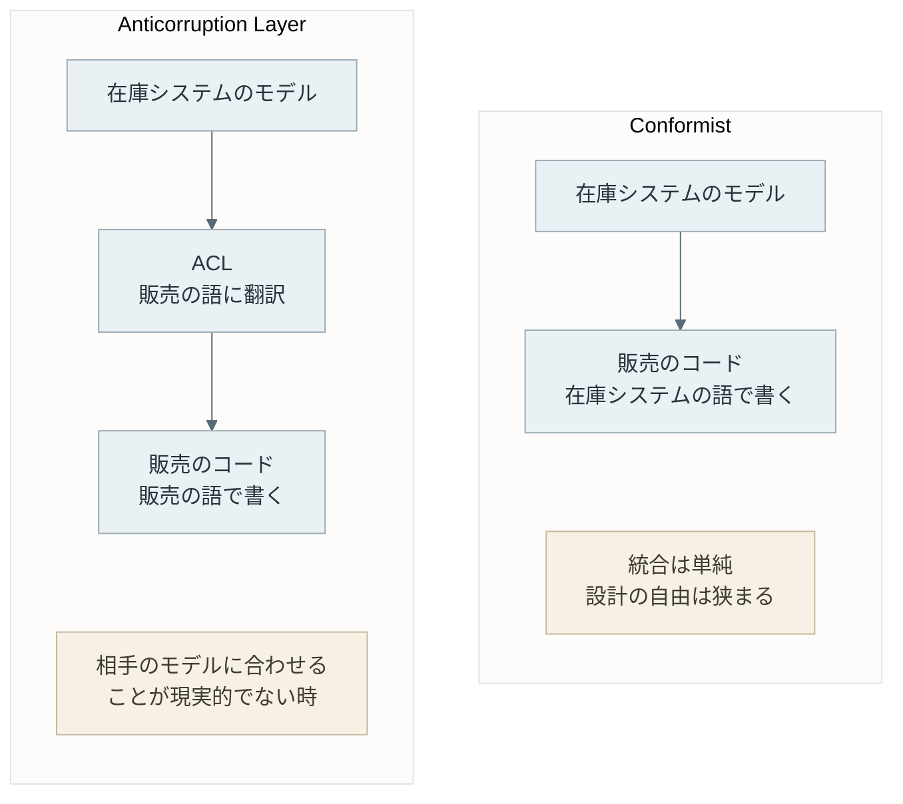
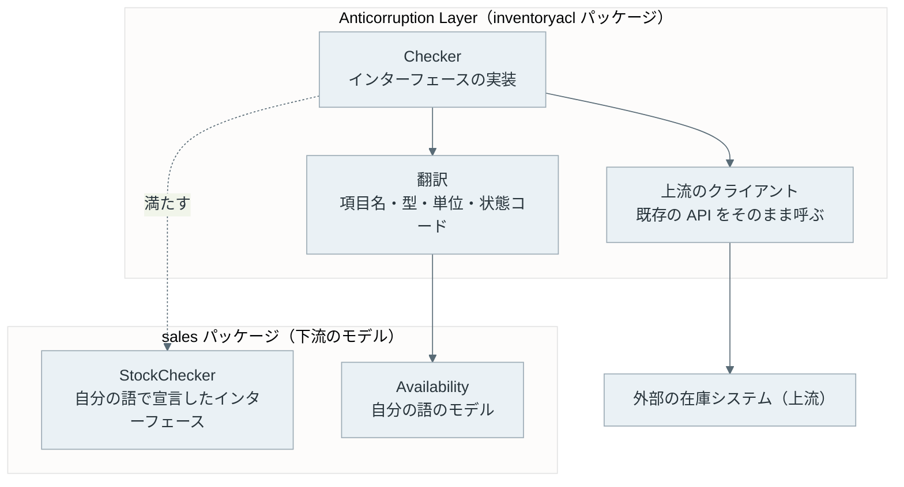
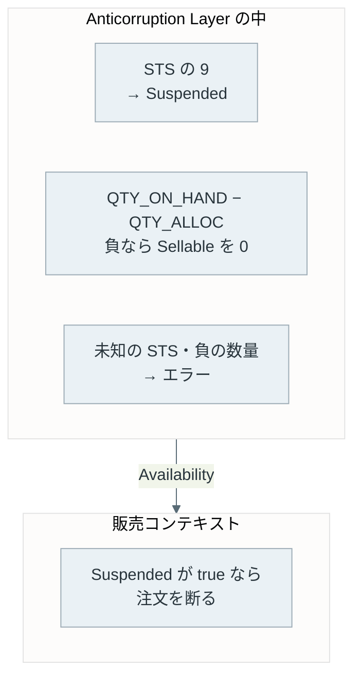

Anticorruption Layer（腐敗防止層。Anti-Corruption Layer とも綴り、ACL と略す）とは、他のシステムを利用する側（下流）が自分の責任で置く隔離層で、相手のモデルを自分のドメインモデル（業務の概念を表すコード上のモデル）の語に翻訳します。ここでいう語は、各システムが業務を表すために使う用語です。変更できない外部システムを呼ぶチームが、相手の項目名や状態コードを自分のコードに広げないために置きます。

DDD（Domain-Driven Design）の用語をまとめた [Evans 氏の DDD Reference](https://www.domainlanguage.com/wp-content/uploads/2016/05/DDD_Reference_2015-03.pdf) によると、ACL は相手の既存のインターフェース越しに通信するため、相手のシステムへの変更をほとんど、あるいは全く必要としません。

以下は、販売コンテキスト（販売の仕事を扱う範囲）が外部の在庫システムを利用する場面での、ACL の位置と語の切り替わりです。



上記の図で在庫システムの語が現れるのは、ACL と在庫システムを結ぶ 2 本の矢印だけです。販売コンテキストのモデルは販売の語だけで問い合わせ、販売の語で応答を受け取ります。正常に終わった問い合わせで `QTY_ON_HAND` のような在庫システムの項目名を目にすることはありません。

<br>

本記事では、ACL で上流のモデルから下流を守る理由と、翻訳の作り方を説明します。具体的には、次の疑問に答えます。

- 相手のクライアントをそのまま使うと、なぜ下流のモデルが崩れるのか。
- ACL の中には何を置き、翻訳で何をするのか。
- 上流が変わった時、その変更はどこで判定されるのか。
- ACL は、アプリケーションの中の部品と独立したサービスのどちらで置くのか。

---

### 前提

語は項目名だけを指しません。販売が使う語は「販売できる数」や「販売停止」で、在庫システムが使う語は `QTY_ON_HAND` や `STS` です。同じ在庫を指していても、名前も、数え方も、状態の表し方も違います。

上流と下流は、開発するチームの間の関係を表す語です。DDD Reference は、上流の行動が下流のプロジェクトの成否に影響する一方、下流の行動は上流のプロジェクトに大きくは影響しない関係だと定義しています。相手が [Bounded Context](../bounded-context/)（1 つのモデルとその語が一貫して通用する範囲）として設計されているとは限らず、その区切りを持たないレガシーシステムも上流になります。

---

### Anticorruption Layer が必要な理由

外部システムが配布するクライアントを直接使えば、変換処理を追加せずに接続できます。問題は、相手の応答の形が下流のコードのどこまで広がるかです。

例に使う在庫システムの応答には、`ITEM_CD`（商品コード）、`QTY_ON_HAND`（手持ちの数量）、`QTY_ALLOC`（引き当て済みの数量）、`STS`（商品の状態コード）が並んでいます。引き当て済みというのは、既に別の注文に割り当ててあり、手元にあっても他には売れない数量です。以下は、この応答の型を下流のコードにそのまま渡した場合です。



上記の図の 3 箇所は、どれも在庫システムの語で書かれています。「販売できる数」という販売の語はどこにも現れません。引き算を重複しているのは注文受付だけですが、`QTY_ON_HAND` を残数として扱う表示と、`STS` を通知対象へ変える判断にも、上流の項目名と意味が漏れています。変更の影響は同じ計算の複製だけに限りません。

上流のシステムとの接点が大きいと、下流のモデルは本来の意図を保てなくなり、その場しのぎで相手のモデルに似せて書き換えられていきます（Evans 氏の説明）。同じ箇所によると、レガシーシステムのモデルは概して弱く（業務の概念を明確に表していない）、明確に設計されていても今のプロジェクトの必要に合うとは限らないので、合わせることは現実的でなくなります。それでも統合が下流にとって大きな価値を持つことや欠かせないことがあり、その時に翻訳を置く選択が残ります。

翻訳を作らない選択もあります。DDD Reference の Conformist は、上流チームのモデルに徹底して従うことで、Bounded Context の間の翻訳の複雑さをなくす選択です。同書は、下流の設計の自由が狭まり、おそらく理想的なモデルにもならない一方で、統合は大きく単純になるとしています。前提に置いているのは、上流に下流の要求に応える動機が無く、下流のチームが無力な状況です。

以下は、上流を動かせない下流が取る 2 つの形です。



Conformist では上流と同じモデルを使い、ACL では下流の業務に合うモデルへ変換します。

翻訳の複雑さは、相手との関係で変わります。DDD Reference によれば、設計の良い Bounded Context どうしを協力的なチームの間で繋ぐなら、翻訳層は単純で見通しの良いものにできます。しかし、Shared Kernel・Partnership・Customer/Supplier（[Bounded Context のノート](../bounded-context/)で並べた、チームどうしが計画や変更を調整する関係）を成り立たせるだけの統制や意思疎通が無いと、翻訳は複雑になり、相手の異常に備える処理（後で示すコードの未知の状態コードや負の数量の検査）が増えます。

---

### ACL の中に置く 3 つの責任

ACL の中身は、ここでは 3 つの責任に分けて見ます。下流の `sales` パッケージが自分の語で宣言したインターフェース `StockChecker` を満たす `Checker`、2 つのモデルを翻訳する部分、上流の既存の API（Application Programming Interface）をそのまま呼ぶクライアントです。この 3 分割は説明のための整理で、DDD Reference が規定している構造ではありません。

以下は、上に挙げた順で並べた 3 つと、下流のモデルの関係です。最初の図では ACL を販売コンテキストの枠に入れましたが、コードでは `sales` とは別のパッケージに置くので、この図では枠を分けます。図の矢印は、呼び出しの流れではなく、コードがどちらを参照するかの向きです。



上記の図で在庫システムを知っているのは ACL の枠の中だけで、`sales` から ACL を参照する矢印はありません。この向きは、下流のパッケージが上流の型を import しているかで、ある程度まで確認できます。しかし、import が 1 本も無くても語は入り込みます。次の `Availability` は在庫システムのパッケージを参照していません。

```go
// Package sales の中に、在庫システムの語が残った例です。
package sales

// Availability は在庫の状態を持ちます。
type Availability struct {
	SKU    string
	OnHand int    // QTY_ON_HAND をそのまま持つ
	Status string // STS の値。"1" が通常、"9" が販売停止
}
```

`Status` に入っているのは在庫システムの状態コードで、`"9"` が販売停止だという知識は販売コンテキストの各所に散ります。`OnHand` も同じで、引き当て済みを引く計算が、`Availability` を使う各所に残ります。外部の型を import していなくても、状態コードや数量の意味が下流に残るため、モデルの定義も確認する必要があります。

---

### 下流のモデルの語

翻訳の行き先になるモデルは、上流を見ずに決めます。注文の成立を判断するために販売コンテキストが知りたいのは、今すぐ売れる数と、その商品の販売を止めているかどうかの 2 つです。

```go
// Package sales は販売コンテキストで、注文が成立するまでを扱います。
package sales

import "context"

// Availability は、在庫について販売コンテキストが知りたいことの全てです。
type Availability struct {
	SKU       string // Stock Keeping Unit。在庫を数える単位に付けた商品の識別子
	Sellable  int    // 今すぐ売れる数
	Suspended bool   // 販売を止めている商品かどうか
}

// StockChecker は在庫の問い合わせ先です。実装は sales パッケージの外に置きます。
type StockChecker interface {
	Check(ctx context.Context, sku string) (Availability, error)
}
```

`StockChecker` は `sales` が自分の語で宣言したインターフェースで、後で示す `inventoryacl` の `Checker` がこれを実装します。呼び出す側の `sales` がインターフェースを持つので、参照は `inventoryacl` から `sales` に向きます（依存性逆転）。

`sales` は在庫システムのパッケージを import せず、後から相手の型を直接使うコードも書きにくくなります。言語が禁じるわけではないので、確実に止めたいなら import を制限する lint（コードの静的検査）が必要です。

同じ向きの変え方は [Repository](../repository/) でも使います。ただし、Repository が隠すのは自分の [Aggregate](../value-object-entity-aggregate/)（まとめて一貫性を保つオブジェクトの集まり）の永続化で、相手のモデルを入口で自分の語に変える ACL とは守る対象が違います。

---

### 翻訳で行う処理

翻訳は、項目名の写し替えだけでは終わりません。以下は、例に使った在庫システムの応答の項目ごとに、下流での扱いを示した表です。

| 上流の項目 | 型と値 | 下流での扱い |
| --- | --- | --- |
| `ITEM_CD` | 商品コードの文字列 | この例では `SKU` と同じ体系と見なし、要求した `SKU` と突き合わせる。体系が違う場合は対応付けも ACL で行う |
| `QTY_ON_HAND` | 数量を表す文字列 | 数値に変換し、引き当て済みを引いて `Sellable` を求める |
| `QTY_ALLOC` | 数量を表す文字列 | `Sellable` の計算にだけ使い、単独では下流に渡さない |
| `STS` | 状態コードの文字列 | `1` は通常、`9` は `Suspended`。未知の値はエラーにする |

翻訳を Go で書くと次のようになります。

```go
// Package inventoryacl は、外部の在庫システムと販売コンテキストの間の翻訳だけを担当します。
package inventoryacl

import (
	"context"
	"fmt"
	"strconv"

	"example.com/shop/sales"
)

// StockLevelResponse は在庫システムが返す構造です。項目名も型も相手の都合で決まっています。
type StockLevelResponse struct {
	ItemCD    string
	QtyOnHand string
	QtyAlloc  string
	Sts       string
}

// legacyClient は在庫システムの既存の API を呼びます。実装は省略します。
type legacyClient interface {
	GetStockLevel(ctx context.Context, itemCode string) (StockLevelResponse, error)
}

// Checker は sales.StockChecker を満たします。
type Checker struct {
	client legacyClient
}

// NewChecker は Checker を作ります。
func NewChecker(c legacyClient) *Checker {
	return &Checker{client: c}
}

// Check は在庫システムに問い合わせ、応答を販売コンテキストの語に翻訳します。
// エラーを返す時の sales.Availability は意味を持ちません。
func (c *Checker) Check(ctx context.Context, sku string) (sales.Availability, error) {
	res, err := c.client.GetStockLevel(ctx, sku)
	if err != nil {
		return sales.Availability{}, fmt.Errorf("在庫システムへの問い合わせに失敗しました: %w", err)
	}
	if res.ItemCD != sku {
		return sales.Availability{}, fmt.Errorf("要求した商品と違う応答が返りました: %q", res.ItemCD)
	}

	switch res.Sts {
	case "1", "9":
		// 通常と販売停止のどちらも、数量は同じ形で翻訳します。
	default:
		return sales.Availability{}, fmt.Errorf("STS が未知の値です: %q", res.Sts)
	}

	onHand, err := strconv.Atoi(res.QtyOnHand)
	if err != nil {
		return sales.Availability{}, fmt.Errorf("QTY_ON_HAND を数値として読めません: %q: %w", res.QtyOnHand, err)
	}
	alloc, err := strconv.Atoi(res.QtyAlloc)
	if err != nil {
		return sales.Availability{}, fmt.Errorf("QTY_ALLOC を数値として読めません: %q: %w", res.QtyAlloc, err)
	}
	if onHand < 0 || alloc < 0 {
		return sales.Availability{}, fmt.Errorf("数量が負の値です: QTY_ON_HAND=%d QTY_ALLOC=%d", onHand, alloc)
	}

	sellable := onHand - alloc
	if sellable < 0 {
		// 引き当てが手持ちを超える状態は在庫システムでは起こり得ます。
		// 販売コンテキストの Sellable は売れる数なので、負の数を渡しません。
		sellable = 0
	}
	return sales.Availability{
		SKU:       sku,
		Sellable:  sellable,
		Suspended: res.Sts == "9",
	}, nil
}

// 静的な検査。シグネチャがずれた時点でコンパイルを止めます。
var _ sales.StockChecker = (*Checker)(nil)
```

未知の状態コードと負の数量は、下流に渡さずにエラーとして返すので、翻訳を通り抜けた `Availability` は既知の状態だけを表します。ただし、エラーの文面には相手の項目名が残ります。そこまで断ちたいなら、下流で定義したエラーの型に包み直す必要があります。

上のコードが `Sellable` を 0 にするのは、`QTY_ON_HAND` から `QTY_ALLOC` を引いた差が負になった時だけです。下流の `Sellable` は今すぐ売れる数として非負に定義してあるので、値域と意味の違いを吸収するこの変換は ACL の中に置けます。

`Suspended` が true だから `Sellable` も 0 にする、という書き換えは行っていません。停止中の商品を何個持っているかと、それを売って良いかは別の事実で、2 つを結び付けるのは販売コンテキスト固有の業務判断だからです。

以下は、ACL の中に置く変換（`STS` の `9` を `Suspended` と読むなど）と、翻訳した結果を使う販売コンテキストの判断との境界です。



上流に書き込む時も同じ ACL を通します。注文の確定を在庫システムに伝えるなら、販売の語で受け取った要求を ACL の中で `ITEM_CD` と数量に翻訳してから相手の API を呼びます。

上のコードの `StockLevelResponse` から `Availability` への変換は、DTO（Data Transfer Object、データを受け渡すためのオブジェクト）の変換でもあります。しかし、ACL と呼べるかは、その変換が上流のモデルから下流のドメインモデルを守る境界に置かれているかで決まります。

---

### 上流の変更の扱い

ACL があると、上流の変更は下流に届く前に、ACL の 1 箇所で検出されます。例えば在庫システムが状態コードに新しい値を足すと、上のコードは未知の値としてエラーを返します。

未知の値を既知の値として扱うと、下流は商品の状態を誤って解釈します。新しい値が販売停止を意味していれば、売れる商品として扱う誤りにもなり得ます。エラーで止めれば意味の確定していない状態は下流のモデルに届かず、直す場所も、状態コードを読む全ての箇所ではなく翻訳の 1 箇所で済みます。このエラーを受けた注文の受付は、翻訳を直すまでその商品の注文を断ります。

<br>

上流の出力を別の意味で読むと何が起きるかは、1996 年 6 月の Ariane 5 の初飛行が示しています。ロケットの姿勢を測る慣性基準装置（SRI）が、ソフトウェアの例外で自分の故障を宣言して停止しました。停止した SRI がメイン計算機（OBC）に送ったのは姿勢のデータではなく診断用のビットパターンで、OBC はそれを[飛行データとして解釈し](https://esamultimedia.esa.int/docs/esa-x-1819eng.pdf)、ノズルを最大限まで振りました。機体は発射の約 37 秒後に進路を外れて自爆しました。

ACL を置く経路は、同期の呼び出しに限りません。上流が発行したイベントを受け取る非同期の経路にも同じ ACL を置き、相手の形式のメッセージを自分の [Domain Event](../domain-event/)（ドメインで既に起きた出来事を表すオブジェクト）に翻訳してから下流のハンドラに渡します。

---

### ACL を置く場所

Microsoft の [Azure Architecture Center](https://learn.microsoft.com/en-us/azure/architecture/patterns/anti-corruption-layer) は、ACL を「同じ意味論を共有しない異なるサブシステムの間に facade または adapter の層を実装する」パターンとして説明しています。意味論は、同じ名前や値が何を指すのかについて、それぞれのシステムが持っている取り決めです。

facade は複雑な相手の API を単純な窓口にまとめる層、adapter は相手のインターフェースを自分が期待する形に合わせる層で、上の `Checker` は両方の役を兼ねています。どちらも書籍『デザインパターン』の用語で、[Adapter](../adapter/) のノートで扱うコンテナのパターンとは別です。

同ドキュメントは、ACL をアプリケーションの中の部品として実装する方法と、独立したサービスとして実装する方法の 2 つを挙げています。どちらでも翻訳の内容は変わらず、運用の単位が変わります。

| | 同じプロセスの中のパッケージ | 独立したサービス |
| --- | --- | --- |
| 呼び出しの遅延 | 関数呼び出しの分だけ | ネットワークの往復が 1 段増える |
| 配布 | 下流と同時に更新する | 下流と別に更新できる |
| 同じ翻訳を複数のプロセスで使う時 | 各プロセスに取り込み、更新のたびに配布し直す | 1 箇所を更新すれば全てのプロセスに届く |
| 運用 | 下流に含まれる | 監視・リリース・設定の対象が 1 つ増える |
| 言語 | 下流と同じ | 上流のクライアントライブラリに合わせて選べる |

下流のアプリケーションが 1 つで、上流のクライアントを同じ言語で書けるなら、パッケージとして置く方が扱いやすいと考えられます。同じ下流コンテキストの複数のプロセスが同じ翻訳を使う場合や、上流のクライアントの言語に合わせたい場合に、独立したサービスを選ぶ理由が出てきます。

独立したサービスにした ACL をアプリケーションのコンテナの隣で別のコンテナとして動かすと、配置だけを見れば、外部との通信を代わりに引き受けるコンテナである [Ambassador](../ambassador/) と重なります。2 つを分けるのは、翻訳の結果が下流のドメインモデルの語になるかどうかです。

<br>

別の Bounded Context が同じ上流を使っていても、1 つの ACL を共用できるとは限りません。翻訳の行き先は下流ごとのモデルで、必要な語も、落として良い情報も違います。2 つの下流の要求を 1 つの ACL に集めると、どちらの語でもない共通のモデルが育ち、統合用の共有サービスに変わります。

ACL は、レガシーシステムから新しいシステムへ段階的に移行する間、新しいシステムをレガシーの語から守る用途にも使います。この場合は、レガシーの機能を全て移した後に撤去するのか、恒久的に残すのかを先に決めます（Microsoft のドキュメントも検討事項に挙げている）。撤去する前提か置き続けるかで、テストの厚さやエラーの型の包み直しに掛けて良いコストが違います。

---

### 利点

- 上流の変更を下流の既存の語に写せる限り、直す箇所が翻訳の 1 箇所に収まる
- 下流のモデルを下流の語だけで書け、上流の項目名や状態コードが混ざらない
- 上流に変更を求めずに統合でき、上流を動かせない関係でも使える
- 新しい上流から下流が必要とする情報を取得できる場合は、ACL の変換処理を変更して対応できる
- 上流の異常値を ACL で止められ、下流のモデルが取り得る状態を絞れる

---

### 欠点

ACL を追加すると、モデル間の変換コードや、その実行方法について次の対応が必要になります。

- 独立したサービスとして置くと、往復のたびに遅延が加わり、監視・リリース・設定の対象も 1 つ増える
- 統合する相手の数だけ、上流と下流の両方の語を知る翻訳のコードを保守する必要がある
- 翻訳で落とした情報が後から必要になった時、ACL とモデルの定義の両方を見直す（例：`QTY_ALLOC` を販売コンテキストが直接見たくなった時）
- 2 つのモデルがずれている箇所の扱いを下流が決め、ACL の中の規則として書く必要がある

---

### 適さないケース

- 上流と下流でモデルの語がほぼ一致していて、翻訳が項目名の写し替えだけになる統合
- モデルの違いが業務上の必要から来ておらず、上流の設計の歪みが原因で、しかも上流を直せる関係
- 1 回限りの移行スクリプトや、次の作り直しまでの繋ぎとして書くコード

語がほぼ一致している統合は、Microsoft のドキュメントも、新旧のシステムに大きな意味論の差が無い場合として適さない例に挙げています。同じ箇所には、この場合は ACL を翻訳の処理に集中させ、業務規則や、複数のシステムの呼び出し順序を組み立てるオーケストレーションを置かないようにとあります。

上流の設計の歪みを理由に挙げたのは、上流と下流でモデルが違うこと自体が問題だからではありません。Bounded Context が違えばモデルが違うのは正常で、同じチームが両方を管理しているだけの理由で 1 つに統合する必要はありません。

上流の設計の歪みが原因なら、ACL を足しても歪みは上流に残るので、直せるなら直す方が根本的な解決になります。ただし、上流に別のチームが居て変更の合意に時間が掛かるなら、下流が自分の判断だけで置ける ACL の方が早く進みます。

移行スクリプトや繋ぎのコードは捨てる前提なので、上流の語が混ざっても困りません。
