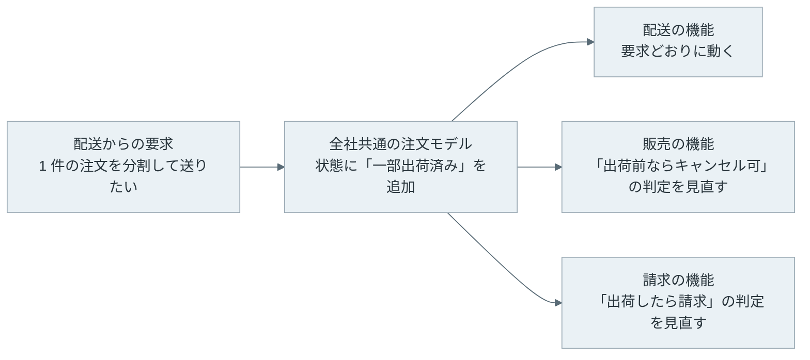
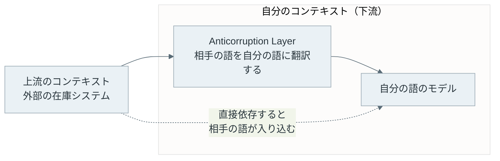

Bounded Context（境界づけられたコンテキスト）とは、あるモデルが定義され、そのまま適用できる範囲を明示した境界です。ここでのモデルは、業務の概念を表す型と、その概念が守る規則の集まりを指します。DDD（Domain-Driven Design、ドメイン駆動設計）を提唱した Eric Evans 氏の [DDD Reference](https://www.domainlanguage.com/wp-content/uploads/2016/05/DDD_Reference_2015-03.pdf) は「特定のモデルが定義され適用される境界の記述であり、多くはサブシステム、または特定のチームの担当範囲となる」と定義しています。

境界の中では「注文」という語が 1 つの意味に定まり、境界の外に出た時、同じ語が同じ意味だとは仮定しません。境界が必要かどうかは、DDD を採用しているかどうかとは関係がありません。1 つの語が部署ごとに違う意味を持つ状況は、設計の流儀に関わらず現れます。境界を引かずに 1 つのモデルにまとめると、どの場所の言葉とも一致しないモデルが残ります。

EC（Electronic Commerce）サイトを例に、1 件の買い物を扱う 3 つの境界を以下に示します。


- title: 販売コンテキスト
  body: 注文
  items:
  - 見積もり
  - 値引き
  - 成立
- title: 請求コンテキスト
  body: 請求
  items:
  - 支払方法
  - 入金
  - 督促
- title: 配送コンテキスト
  body: 出荷
  items:
  - 宛先
  - 箱
  - 追跡番号


上記の図の 3 つは、どれも 1 件の買い物から始まる業務です。同じ買い物を扱っていても、持つ属性も、状態が変わる条件も違います。この例では対応付けに注文 ID を使い、値引き率や追跡番号のような属性は、それぞれの境界が自分の語で持ちます。境界の間で ID しか渡してはいけないという規則があるわけではなく、相手が必要とする値は変換を通して渡せます。

<br>

本記事では、Bounded Context の境界の引き方と、境界をまたぐ時の扱いを説明します。答えたい疑問は以下の 5 つです。

- なぜ 1 つのモデルにまとめずに、境界を分けるのか。
- 境界は、何を手がかりに引くのか。
- 境界の中では、何を守るのか。
- 境界をまたぐ経路には、何を置くのか。
- 境界は、プロセスやサービスの単位とどう対応するのか。

チーム編成や組織構造の設計は、本記事では扱いません。

---

### Bounded Context が必要な理由

会社全体で 1 つの「注文」モデルを作ろうとすると、3 つの業務の要求が 1 つの型に集まります。値引き率と支払方法と追跡番号が同じ構造体に並び、どのフィールドがどの場面で意味を持つのかが型から読み取れなくなります。読み取れないだけなら、規約で補えます。問題は、変更の理由が 3 つの業務から同時に来ることです。



上記の図の左端にある要求は、配送の業務だけから出ています。それでも、販売と請求のコードは同じ注文の状態を見て分岐しているので、状態が 1 つ増えると、その分岐を全部読み直す必要があります。共有されたモデルに手を入れる限り、変更のたびに 3 つ全部の検証が必要になり、変更を出せる速さは最も慎重な業務に合わせて落ちます。

<br>

もう 1 つの症状が用語に出ます。同じ語が場所によって別のものを指す状態を多義語（polyseme）と呼びます。Martin Fowler 氏は [Bounded Context の解説](https://martinfowler.com/bliki/BoundedContext.html)で、電力会社の「メーター」を例に挙げています。送電網と拠点の接続点なのか、送電網と顧客の接続点なのか、故障したら交換できる計器そのものなのかが、部署ごとに違っていました。会話では曖昧なまま流せる違いも、コードでは流せません。

同じ綴りを 2 つの意味で読んで壊れたのが、表計算ソフトによる遺伝子名の変換です。遺伝学では SEPT2 は Septin 2 という遺伝子の記号ですが、Excel は既定の設定で、この文字列を日付と解釈して「2-Sep」に変えます。2005〜2015 年の 18 誌の補足ファイルを機械で調べた[研究](https://doi.org/10.1186/s13059-016-1044-7)では、遺伝子の一覧を Excel で添付した論文の 19.6 % に、この変換の誤りがありました。どちらの意味で読むかは、書き手ではなく表計算ソフトが決めていました。

書籍『Domain-Driven Design』（2003 年）の第 14 章には、大規模なシステムでドメインモデルを完全に統一するのは、実現も難しく、コストにも見合わない、とあります。統一を諦める代わりに置くのが境界です。

---

### 境界の引き方

最も強い手がかりは、語の意味が変わる場所です。ユビキタス言語（ubiquitous language）とは、境界の中の全員が会話・図・コードで同じ語を同じ意味で使う言語です。ドメインモデルを軸に構成された言語で、モデルの型名やフィールド名がそのままこの言語の語になります。

Fowler 氏は、境界を決める要因として支配的なのは人間の文化だと説明しています。モデルがそのままユビキタス言語の役目を担う以上、言葉が変われば別のモデルが必要だからです。用語の一覧を作り、同じ語に 2 つ以上の説明が付く場所を探すと、境界の候補が出てきます。

Evans 氏は、境界を表す観点として、チームの分け方、アプリケーションの中での使われ方、コードベースや DB（データベース）スキーマのような物理的な分かれ方の 3 つを挙げています。組織の形と、コードの置き場所の両方が境界の材料になります。

<br>

もう 1 つの手がかりが、変更の理由です。1 つの要求が 1 つの境界の中で完結するなら、その切り方は業務の形と合っています。1 つの要求への対応で毎回 3 箇所を変更するなら、その業務が複数の境界に分かれています。

境界が業務を横切っている徴候は、[Aggregate](../value-object-entity-aggregate/) にも出ます。Aggregate は、まとめて一貫性を保つオブジェクトの集まりで、Bounded Context の内側で組み立てる単位です。例えば、販売の値引き率と配送の追跡番号を 1 つの Aggregate に持たせていたら、どちらのユビキタス言語でも表せないモデルができています。

---

### 境界の中で守ること

境界の中では、ユビキタス言語を 1 つに保ちます。語を揃える場所は用語集ではなくモデルそのもので、語を変えれば、モデルも変わります。

境界そのものにも名前を付け、その名前をユビキタス言語の一部にします。境界の中では、継続的インテグレーション（コードを頻繁に統合し、チームで用語とモデルの解釈を突き合わせ続けること）で、用語とモデルの概念を厳密に一致させ続けます。どちらも DDD Reference が挙げる手段です。

同じ資料では、モジュール（パッケージ）もモデルの一部として扱われ、その名前もユビキタス言語の一部にするとされています。そのため、モデルを表すコードでは、パッケージ名と型名がそのまま業務の語になります。

例えば、販売の境界を [Go](https://go.dev/) で書くと次の通りです。

```go
// Package sales は販売コンテキストで、注文が成立するまでを扱います。
package sales

// OrderID は販売コンテキストでの注文の同一性です。
type OrderID string

// Order は値引きの交渉と成立を持つ注文です。
type Order struct {
	ID          OrderID
	CustomerID  string
	Lines       []Line
	DiscountPct int
	Placed      bool
}

// Line は注文の 1 明細で、金額の計算に必要な値を持ちます。
// SKU（Stock Keeping Unit）は、在庫を数える単位に付けた商品の識別子です。
type Line struct {
	SKU      string
	Quantity int
	UnitYen  int64
}
```

同じ買い物を配送の境界で書くと、別の型になります。

```go
// Package shipping は配送コンテキストで、荷物を届けるまでを扱います。
package shipping

// OrderRef は販売コンテキストの注文を指す参照です。型は共有しません。
type OrderRef string

// Address は届け先です。定義は省略します。
type Address struct{}

// Shipment は 1 回の配送で運ぶ荷物です。
type Shipment struct {
	Ref      OrderRef
	Address  Address
	Items    []Item
	Tracking string
}

// Item は荷物に入れる 1 品目です。金額は持ちません。
type Item struct {
	SKU      string
	Quantity int
}
```

`shipping` が `sales.OrderID` を使わず、自分で `OrderRef` を定義しているところに、境界が現れています。参照として渡るのは ID の値だけで、型は共有していません。`shipping` が `sales` を import しないので、後から `sales.Order` を直接使うコードも書きにくくなります。

ID の型を共有する選択もあります。後述の Shared Kernel がそれで、共有する部分を小さく保つことと、相手の同意なしに変えないことが条件です。同意の仕組みが無いまま共有すると、型を変えるたびに 2 つの境界が同時に動きます。

どちらを選んでも変わらないのは、ID を受け取る配送が、ID を不透明な値（中身を解釈せず、比較と受け渡しだけに使う値）として扱うことです。配送側が ID の書式を解析したり自分で採番したりすると、配送の実装も販売側の採番規則に依存します。

値引き率と成立の状態が `Shipment` に無いのも意図した結果です。配送の業務にそれらの語は無く、無い語をモデルに持ち込まないという判断が、ユビキタス言語を境界の中に保ちます。

---

### 境界をまたぐ時

境界をまたぐ経路には、変換を置きます。この例の 2 つの境界は対等で、どちらも相手に合わせる立場にありません。どちらかに変換を置くとその境界が相手の型を import することになるので、変換だけを担当する第三のパッケージを作ります。

```go
// Package adapter は 2 つのコンテキストの間の変換だけを担当します。
package adapter

import (
	"example.com/shop/sales"
	"example.com/shop/shipping"
)

// ToShipment は販売の注文を配送の荷物に翻訳します。
// 値引きや成立の状態は配送に意味が無いため、ここで捨てます。
func ToShipment(o sales.Order, addr shipping.Address) shipping.Shipment {
	items := make([]shipping.Item, 0, len(o.Lines))
	for _, l := range o.Lines {
		items = append(items, shipping.Item{SKU: l.SKU, Quantity: l.Quantity})
	}
	return shipping.Shipment{
		Ref:     shipping.OrderRef(o.ID),
		Address: addr,
		Items:   items,
	}
}
```

このパッケージで重要なのは依存の向きです。`adapter` は `sales` と `shipping` の両方を import し、`sales` と `shipping` はどちらも `adapter` を知りません。相手を知っているパッケージが 1 つに限られるため、2 つの境界のモデルは相手の語を持たずに済みます。

片方が一方的に自分を守る場合は、この変換を守る側の内側に置きます。それが後述の Anticorruption Layer です。サービスを分けてもこの境界を保てない状態は、[Distributed Monolith](../distributed-monolith/) で扱います。

境界と境界の関係は、変換の有無だけでは決まりません。関係を一覧にしたものを Context Map（コンテキストマップ）と呼びます。以下の表で「立場」と書いたのは、モデルを提供する側を上流、それを受け取って使う側を下流とした時に、どちらがそのパターンを選ぶかです。

| 関係 | 立場 | 内容 |
|---|---|---|
| Partnership | 両チーム | 変更の計画と統合を共同で管理し、同じリリースに載せる |
| Shared Kernel | 両チーム | モデルとコードの一部を共有し、変更は合意の上で行う |
| Customer/Supplier Development | 両チーム | 下流の要求を上流の計画に組み込み、優先度を交渉する |
| Conformist | 下流 | 上流のモデルにそのまま従い、変換を作らない |
| [Anticorruption Layer](../anti-corruption-layer/) | 下流 | 隔離層を挟み、相手のモデルを自分の語に翻訳する |
| Open-host Service | 上流 | 多数の相手向けに、統合用のプロトコル（API と呼び出しの規約）を公開する |
| Published Language | 合意 | ドメイン情報を表現できる共有言語を文書化し、相互に翻訳する |
| Separate Ways | 両チーム | 連携せず、それぞれで完結させる |

表の 8 つは、DDD Reference の Context Map に続く分類に基づきます。同じ場所に並ぶ Big Ball of Mud は、関係ではなく境界の中が混ざった状態を表すので、表から外しました。

選び方は排他ではありません。上流が Open-host Service を出しつつ Published Language を定め、下流の一部は Conformist として従い、残りは Anticorruption Layer を作る、という組み合わせもよくあります。

上流を動かせるなら、Customer/Supplier Development のように下流の要求を上流の計画に組み込めます。動かせない下流が自分だけで選ぶのは、Conformist か Anticorruption Layer です。

DDD Reference の 2 つの説明を並べると、上流のモデルに合わせる窮屈さを受け入れて統合の単純さを取るなら Conformist です。上流のモデルが自分のプロジェクトの必要に合わず、合わせることが現実的でないなら Anticorruption Layer を挟みます。



上記の図の点線が避けたい経路です。相手のモデルを直接使うと、相手の語とデータの形が下流のモデルの内側まで届き、相手の変更に合わせて下流の設計も変わります。Anticorruption Layer を挟むと、相手が変わった時に直す場所が境界の入口 1 箇所で済みます。

---

### 境界と配置の単位

注意点として、Bounded Context はプロセスやサービスの単位ではありません。1 つのプロセスの中に、複数の境界をパッケージやモジュールとして置けます。逆に、1 つの境界を複数のサービスに分けて実装する構成も取れます。

ただし、配置と無関係というわけでもなく、前述の通りコードベースや DB スキーマの分かれ方は境界の材料に入ります。材料にはなっても、境界とプロセスが 1 対 1 に対応するとは限りません。

境界を引くこと自体が目的になると、名前だけが増えて用語の一貫性は得られません。境界が機能しているかどうかは、境界の中で 1 つの語が 1 つの意味に定まっているか、境界をまたぐ経路に変換が置かれているかで判定できます。

---

### 利点

- 境界の中で語の意味が 1 つに定まり、会話とコードの名前が一致する
- 各境界が自分の都合でモデルを変えられ、変更の影響が境界で止まる
- 統合の関係を明示するので、どこに変換が必要かが設計から読み取れる
- 全社で 1 つのモデルに合意するのを待たず、境界ごとに独立して進められる
- 境界が分割の候補になり、後からプロセスやサービスを分ける時の切れ目として使える

---

### 欠点

Bounded Context は、モデルの一貫性を境界の中だけで保証します。コンテキストを分ける場合は、次の点に注意が必要です。

- 同じ実体の情報が複数の境界に分かれ、全体を見る問い合わせが複数箇所にまたがる
- 境界ごとに似た型と、境界の数だけ変換のコードが増える
- 境界を独立したサービスや DB として配置した場合、境界をまたぐ更新を単一のトランザクションにまとめることが難しくなり、結果整合性（いずれ一致するものの、ある瞬間はずれている状態）を選ぶことが多い
- 境界の位置を誤ると、1 つの要求のたびに複数の境界を触る必要がある
- 境界を引き直す時、コードだけでなく用語と会話も変える必要がある

---

### 適さないケース

- 扱う業務が 1 つで、主要な語の意味が最初から 1 つに定まっているシステム
- 語の意味が場所で変わるかどうかを判断できるだけの知識が、まだ集まっていない段階
- 参照だけの小さなツールや、1 回限りの移行スクリプト
- モデルを長く保守せず、次の作り直しまでの繋ぎとして書くコード
