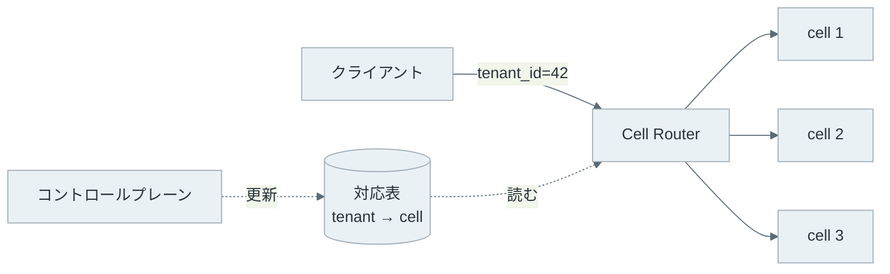
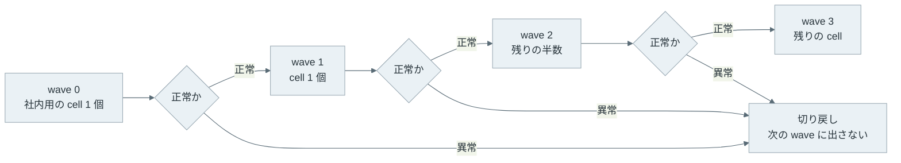
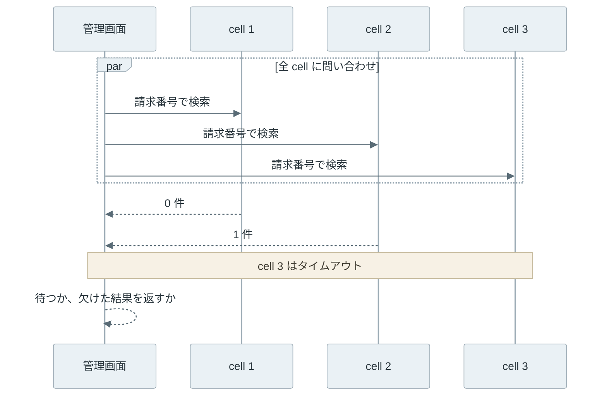

Cell-based Architecture（セルベースアーキテクチャ）は、アプリ・DB（データベース）・キャッシュまで含めたシステム一式を複数用意し、顧客やテナントをそのどれか 1 つに割り当てる構成です。1 つ 1 つの独立した複製を cell と呼びます。cell 同士は状態を共有しないので、ある cell で起きた障害は、その cell に割り当てた顧客の範囲に閉じます。

設定ファイルの 1 行の誤りを本番に出すと、全てのサーバーが同じ設定を読むので、全顧客の要求が一斉に失敗します。同じ誤りでも、10 個の cell に 1 つずつ出していけば、最初の cell の顧客、つまり全体の 1/10 で止められます。cell の分け方は、機能ごとにサービスを分ける [Microservice Architecture](https://martinfowler.com/articles/microservices.html)（マイクロサービスアーキテクチャ）とは軸が違います。



上記の図の左では、決済サービスが止まると全顧客の決済が止まります。右では、cell 2 が止まっても影響するのは顧客 E-H だけです。2 つの軸は排他的ではなく、1 つの cell の中身がマイクロサービスの集まりでも、1 つのモノリスでも構いません。

<br>

本記事では、cell で障害の範囲を小さくする仕組みと、その代わりに増える仕事を説明します。顧客の振り分け方は、Python の実験で巻き込まれる顧客の割合を数えて比べます。主な疑問は次の通りです。

- cell に分けると、どのような障害が 1 つの cell に閉じるのか。
- 顧客をどの cell に送るかは、誰がどう決めるのか。
- 悪い変更を最初の cell で止めるには、どう出していくのか。
- 「影響は 1/N」の代わりに、運用と機能のどこに負担が出るのか。

---

### Blast Radius を小さくする理由

Blast Radius（影響範囲）は、1 つの障害で影響を受ける顧客や要求の範囲を指す呼び名です。冗長化は、1 台のサーバーが止まっても別のサーバーで処理を続けるための仕組みです。しかし、全てのサーバーが同じコードと同じ設定で同じ要求を受けるなら、全台に同時に効く障害は冗長化では防げません。

cell が範囲を狭められる障害は、主に次の 3 つです。

| 障害 | 1 つの構成で起きること | cell に分けた時 |
| --- | --- | --- |
| 毒入りの要求（poison pill） | 特定の入力がプロセスを落とし、再試行で別のサーバーも落とす | 落ちるのは、その顧客がいる cell のサーバーだけ |
| 悪いデプロイ・設定変更 | 全サーバーに同時に入り、全顧客が失敗する | 最初に出した cell で気付けば、残りの cell には出さない |
| 容量超過 | 1 人の顧客の急増で、共有の DB やキューが詰まる | 詰まるのは同じ cell の DB とキューだけ |

毒入りの要求は、ロードバランサーの再試行と組み合わさると、2 台目、3 台目と再送されて全台を落とします。cell に分けると再送先も同じ cell の中なので、他の cell のサーバーには届きません。

cell の考え方は、浸水を 1 区画に留める船の[隔壁（bulkhead）](https://docs.aws.amazon.com/wellarchitected/latest/reducing-scope-of-impact-with-cell-based-architecture/what-is-a-cell-based-architecture.html)と同じです。100 件の要求を 10 個の cell で処理していれば、1 つの cell の障害で影響を受けない要求は 90% です。

<br>

cell の単位は、顧客の部分集合とは限りません。チャットサービスの [Slack の移行の記事](https://slack.engineering/slacks-migration-to-a-cellular-architecture/)では、AWS の AZ（Availability Zone、同じリージョン内で電源やネットワークを分けたデータセンター群）を 1 つの cell として扱っています。

2021 年 6 月 30 日に、1 つの AZ と他の AZ を結ぶネットワークが断続的に故障し、1 つの AZ の不調が利用者に見えるエラーになりました。その後、主要なユーザー向けのサービスを同じ AZ の中だけで通信するように直し、AZ 単位で通信を外せるようにしています。

---

### Cell Router による振り分け

顧客の要求を正しい cell に届けるのが Cell Router（振り分け層）です。クライアントからは 1 つのエンドポイントに見え、ルーターが要求に含まれるパーティションキーから cell を選びます。パーティションキーは顧客 ID やテナント ID のように、ほとんどの API 呼び出しに含まれる値を選びます。



上記の図で、対応表を書き換えるのはコントロールプレーン（cell の追加・削除や顧客の移動を管理する部分）で、ルーターは読むだけです。顧客と cell の対応の決め方は、大きく次のタイプに分かれます。

| 決め方 | 例 | 利点 | 欠点 |
| --- | --- | --- | --- |
| 対応表を引く | `tenant 42 → cell 3` を全件持つ | 顧客を 1 人ずつ好きな cell に移せる | 表の保存と配布が必要 |
| 範囲で決める | ID が 0〜9999 なら cell 1 | 表が小さい | ID の偏りで cell の大きさが偏る |
| ハッシュの剰余 | `hash(id) % N` | 状態を持たない | cell を足すと大半の顧客の行き先が変わる |
| [Consistent Hashing](/notes/distributed-systems/consistent-hashing/) | ハッシュリング上の位置 | cell を足しても移る顧客が少ない | 特定の顧客を動かすには、別に上書き用の表が必要 |

剰余の欠点は、cell の数を 10 から 11 に増やすと、`hash(id) % 10` と `hash(id) % 11` が一致する約 1/11 の顧客を除いて行き先が変わることです。cell は DB を持つので、行き先が変わった顧客のデータも移す必要があります。

以下は、顧客 1 万人の ID のハッシュで、cell を 10 個から 11 個に増やした時の行き先を数えた図です（先頭の 110 人を並べています）。



それでも、ルーターの計算が軽く状態も少ないことから、[AWS のガイドの Cell routing](https://docs.aws.amazon.com/wellarchitected/latest/reducing-scope-of-impact-with-cell-based-architecture/cell-routing.html)は暗号学的ハッシュと剰余の組み合わせを勧めています。この場合、cell を足す時は、行き先が変わる顧客をデータごと移す仕組みを前提にします。

また、どの決め方でも、テストや重い顧客の隔離のために、特定の顧客を特定の cell に固定する上書き用の表を併せて持ちます。

<br>

ルーターは全ての cell の対応を持つ共有部品なので、顧客を cell に分けるのと同じ方法では分けられません。ルーターが止まれば全顧客が止まります。そのため、ルーターには業務ロジックを入れず、できる限り単純にし、1 つの cell に届かない時も他の cell への振り分けを続けられるように作ります。ルーター自体も、冗長化したうえで[複数の独立した単位に分けて作る](https://docs.aws.amazon.com/wellarchitected/latest/reducing-scope-of-impact-with-cell-based-architecture/about-resilience-of-the-cell-router.html)ことが勧められています。

例えば、対応表をルーターのメモリに持ち、表の保存先が止まっても手元の表で振り分けを続ければ、保存先の障害が全顧客の障害になりません。

1 人の顧客が 1 つの cell に収まらないほど大きくなる場合もあります。パーティションキーを顧客 ID だけにしていると、その顧客を 2 つの cell に分けられません。顧客 ID にワークスペース ID のような業務上の単位を足した複合キーにすると、大きな顧客を複数の cell に分けられます。

---

### 切り離しと段階的なデプロイ

cell の障害を検知した時に取れる手は、その cell の構成によって変わります。例外として、cell が状態を持たず、データを cell の外の複製された DB に置く構成なら、ルーターがその cell への振り分けを止め、他の cell に送れます。

Slack は、エッジのロードバランサーが AZ ごとの重みを 1% 刻みで変えられるようにし、重みを 0 にした AZ でも処理中の要求は最後まで処理しています。

しかし、顧客のデータを cell の DB に置く構成では、その顧客を別の cell に送ってもデータがありません。止まった cell の顧客は、cell が直るまで止まったままです。この構成の cell は、障害を止める装置ではなく、障害の範囲を 1 つの cell に限る装置です。どの cell が止まっているかは、[Heartbeat](/notes/distributed-systems/heartbeat/) のような死活監視に加えて、cell ごとのエラー率で判断します。

<br>

cell の効き目が大きいのはデプロイです。新しいバージョンを全 cell に同時に出さず、wave（波）と呼ぶ組に分けて順に出します。



上記の図で wave 1 の後に異常が見つかれば、影響したのは社内用の cell と、顧客の cell 1 個分だけです。次の wave に進む前に待つ時間は、問題が表に出るまでの時間に合わせます。例えば、1 日 1 回の集計処理で初めて落ちる不具合は、数分の待ち時間では見つかりません。

段階的に公開する仕組みには [Feature Flag](/notes/software-architecture/feature-flag/) もあります。Feature Flag は同じバージョンのコードの中で機能を一部の顧客に有効にします。一方、wave はバージョンを cell ごとに出し分けるので、フラグで囲めない変更（ライブラリの更新、DB のスキーマ変更、ランタイムの設定）にも効きます。

---

### 毒入り顧客の巻き込みの実験

cell に分けても、毒入り顧客と同じ cell の顧客は全員巻き込まれます。この巻き込みを減らす方法に、shuffle sharding があります。ワーカー（要求を処理するサーバー）を固定の組に分けず、顧客ごとに n 台から k 台の組み合わせをランダムに選んで割り当てます。

AWS が設計の知見を公開している [Builders' Library の記事](https://builder.aws.com/content/3F06NpJ8YeoIGP8VHTw4n81pFn8/workload-isolation-using-shuffle-sharding)は、DNS サービスの [Amazon Route 53](https://aws.amazon.com/route53/) で 2,048 台の仮想ネームサーバーから 4 台ずつを各ドメインに割り当て、約 7,300 億通りの組を作っている例を紹介しています。

毒入り顧客が自分の組のワーカーを全て止めても、他の顧客の組と完全に重なっていなければ、その顧客は残ったワーカーで処理を続けられます。ただし、クライアントが失敗したワーカーを避けて再試行することが前提です。

[lab/blast_radius.py](lab/blast_radius.py) は、ワーカー 8 台と顧客 1 万人で、2 台ずつの固定の cell と shuffle sharding を比べます。以下は、毒入り顧客の組と比べて人数を数える部分の抜粋です。

```python
def classify(shards, poison):
    """毒入り顧客の組と比べて、全滅・一部停止・無傷の人数を返す。"""
    dead = set(shards[poison])
    full = part = 0
    for c, shard in enumerate(shards):
        if c == poison:
            continue
        hit = len(dead & set(shard))
        if hit == K:
            full += 1  # 使えるワーカーが残らない
        elif hit > 0:
            part += 1  # 残りのワーカーへ再試行すれば動く
    return full, part
```

<details>
<summary>blast_radius.py の全体</summary>

```python
"""1 人の毒入り顧客が、他の顧客をどれだけ巻き込むかを数える。

ワーカー 8 台と顧客 1 万人で、通常の cell（2 台ずつ 4 組）と
shuffle sharding（顧客ごとにランダムな 2 台の組）の割り当てを比べる。
毒入り顧客の要求は、届いたワーカーを全て止めるものとする。
標準ライブラリだけを使う。Python 3.14.4 で実行を確認した。
"""

import random
from math import comb

WORKERS = 8
K = 2  # 1 人の顧客が使うワーカーの数
CUSTOMERS = 10_000
rng = random.Random(1)


def classify(shards, poison):
    """毒入り顧客の組と比べて、全滅・一部停止・無傷の人数を返す。"""
    dead = set(shards[poison])
    full = part = 0
    for c, shard in enumerate(shards):
        if c == poison:
            continue
        hit = len(dead & set(shard))
        if hit == K:
            full += 1  # 使えるワーカーが残らない
        elif hit > 0:
            part += 1  # 残りのワーカーへ再試行すれば動く
    return full, part


def show(label, full, part, others=CUSTOMERS - 1):
    print(f"  {label}  全滅 {full / others:6.2%}  "
          f"一部停止 {part / others:6.2%}  無傷 {1 - (full + part) / others:6.2%}")


# 通常の cell: ワーカー 0-1, 2-3, 4-5, 6-7 を 1 つの cell にして顧客を振り分ける
cells = [tuple(range(i, i + K)) for i in range(0, WORKERS, K)]
cell_shards = [cells[rng.randrange(len(cells))] for _ in range(CUSTOMERS)]
# shuffle sharding: 顧客ごとに 8 台から 2 台をランダムに選ぶ
shuffle_shards = [tuple(rng.sample(range(WORKERS), K)) for _ in range(CUSTOMERS)]

print(f"[1] ワーカー {WORKERS} 台、顧客 {CUSTOMERS:,} 人、1 人あたり {K} 台")
show("通常の cell", *classify(cell_shards, poison=0))
show("shuffle    ", *classify(shuffle_shards, poison=0))

print("[2] 理論値")
total = comb(WORKERS, K)
no_overlap = comb(WORKERS - K, K)
print(f"  組み合わせの数 C({WORKERS},{K}) = {total}")
print(f"  通常の cell  全滅 {1 / len(cells):6.2%}")
print(f"  shuffle      全滅 {1 / total:6.2%}  "
      f"一部停止 {(total - no_overlap - 1) / total:6.2%}")

print("[3] 台数と組の大きさを変えた時、毒入り顧客と組が完全に重なる確率")
for n, k in [(8, 2), (16, 4), (100, 5), (2048, 4)]:
    print(f"  {n:>5} 台から {k} 台: 組み合わせ {comb(n, k):>17,} 通り  "
          f"確率 {1 / comb(n, k):.2e}  （通常の cell なら {k / n:.2%}）")
```

</details>

`python3 blast_radius.py` で実行した結果は次の通りです。

```text
[1] ワーカー 8 台、顧客 10,000 人、1 人あたり 2 台
  通常の cell  全滅 25.84%  一部停止  0.00%  無傷 74.16%
  shuffle      全滅  3.77%  一部停止 43.83%  無傷 52.40%
[2] 理論値
  組み合わせの数 C(8,2) = 28
  通常の cell  全滅 25.00%
  shuffle      全滅  3.57%  一部停止 42.86%
[3] 台数と組の大きさを変えた時、毒入り顧客と組が完全に重なる確率
      8 台から 2 台: 組み合わせ                28 通り  確率 3.57e-02  （通常の cell なら 25.00%）
     16 台から 4 台: 組み合わせ             1,820 通り  確率 5.49e-04  （通常の cell なら 25.00%）
    100 台から 5 台: 組み合わせ        75,287,520 通り  確率 1.33e-08  （通常の cell なら 5.00%）
   2048 台から 4 台: 組み合わせ   730,862,190,080 通り  確率 1.37e-12  （通常の cell なら 0.20%）
```

[1] の通常の cell では、毒入り顧客と同じ cell に入った約 1/4 の顧客が全滅し、残りは無傷です。shuffle sharding では、全滅は組が完全に重なる 1/28（約 3.6%）まで下がります。

その代わりに、ワーカーを 1 台だけ共有して一部が止まる顧客が約 43% 出ます。この 43% は、再試行で残りの 1 台に届けば影響を受けません。しかし、再試行の分だけ応答は遅れ、生き残ったワーカーに負荷が集まります。

[2] の理論値は、組み合わせの数から求めています。2 台の組は C(8,2) = 28 通りあり、毒入り顧客と同じ組を引く確率は 1/28 です。毒入り顧客の 2 台を含まない組は残り 6 台から選ぶ C(6,2) = 15 通りなので、一部が止まる確率は (28 - 15 - 1) / 28 = 12/28 です。[3] の最終行は、Route 53 の約 7,300 億通りと一致します。

台数を 100 台に固定し、1 人あたりの台数 k を変えると、3 つの割合は次のように動きます。



凡例の Cell は k 台ずつの固定の cell、Shuffle sharding は k 台をランダムに選ぶ割り当てです。fully down は全滅、partly down は一部停止を指します。

k を増やすと全滅の確率は桁で下がり、一部停止の割合は上がります。つまり shuffle sharding は、全停止する顧客を減らす代わりに、部分的に劣化する顧客を増やしています。図の生成コードは [figures.py](https://github.com/nao1215/debimate/blob/main/content/notes/software-architecture/cell-based-architecture/figures.py) です。

---

### cell の数だけ増える運用

cell の数を N にすると、障害の範囲は 1/N になります。その代わりに、デプロイ・監視・容量計画の対象も N 倍になります。cell が数十から数千になると手作業のデプロイは成り立たないので、ビルドからデプロイまでを行う [CI/CD を最初から自動化しておく](https://docs.aws.amazon.com/wellarchitected/latest/reducing-scope-of-impact-with-cell-based-architecture/cell-deployment.html)必要があります。

監視では、全体の平均が cell の障害を隠します。例えば 20 個の cell のうち 1 個で全要求が失敗していても、全体のエラー率は 5% に見えます。cell ごとの指標を出し、1 つの cell の異常を全体の数字とは別に通知する必要があります。

容量計画では、cell の上限の大きさを決め、上限に近づいたら新しい cell を足します。cell を大きくすれば数は減りますが、1 つの障害の範囲が広がります。小さくすれば範囲は狭まりますが、cell ごとに固定でかかる DB やキャッシュのコストと、管理する数が増えます。

<br>

顧客を別の cell に移す作業も新しく生まれます。大きくなった顧客を専用の cell に移す時や、cell を足して負荷をならす時です。DB を持つ cell では、データを止めずに移す手順が必要になります。


- title: Clone
  body: 移動先の cell にデータを複製する。この時点では移動元が正しい値を持つ。
- title: Flip
  body: 移動先のデータを正しい値として扱うように切り替える。
- title: Redirect
  body: 移動元への要求を移動先に向け直す。ルーターの対応表の更新や、移動元の cell からの転送で行う。
- title: Forget
  body: 移動元に残ったデータを消す。


Clone と Flip の間にも書き込みは届くので、その差分の移し方や、切り替えの瞬間に書き込みを止めるかは、cell の DB ごとに設計します（[Cell migration](https://docs.aws.amazon.com/wellarchitected/latest/reducing-scope-of-impact-with-cell-based-architecture/cell-migration.html)）。ルーターで移行先を切り替える考え方は、旧システムから新システムに少しずつ移す [Strangler Fig](/notes/software-architecture/strangler-fig/) のファサードとも近く、旧と新の両方に同じ顧客のデータが存在する期間の扱いが難所になります。

---

### cell をまたぐ検索と更新

cell は顧客の部分集合で分けているので、1 人の顧客の中で閉じる処理は得意です。しかし、全顧客を対象にする処理や、2 人の顧客にまたがる処理は、cell の境界を越えます。

全顧客を対象にした検索（例えば、運用者が全テナントから特定の請求番号を探す処理）は、全 cell に問い合わせて結果を集める scatter-gather になります。



全体の応答時間は最も遅い cell で決まり、1 つの cell が止まると結果が欠けます。cell が増えるほど、どれか 1 つが遅い確率も上がります。止まった cell を待ち続けないように、[Circuit Breaker](/notes/software-architecture/circuit-breaker/) やタイムアウトで打ち切り、欠けた cell を結果に明示します。

<br>

2 人の顧客にまたがる更新は、さらに難しくなります。例えば、cell 1 の顧客から cell 3 の顧客にポイントを移すなら、2 つの cell の DB を 1 つのトランザクションで更新できません。

[2PC](/notes/distributed-systems/two-phase-commit/)（2 相コミット）でまとめれば、2 つの cell が互いの停止を待つ関係になり、障害を 1 つの cell に閉じるという目的と衝突します。各 cell でローカルに確定し、失敗したら補償する [Saga](https://learn.microsoft.com/en-us/azure/architecture/patterns/saga) のような手順を選ぶことになります。

全顧客で一意にしたい値も同じ問題を持ちます。メールアドレスやユーザー名の一意制約は、各 cell の DB の一意索引では cell の中でしか効きません。cell 1 と cell 2 で同じユーザー名を同時に登録すると、両方とも成功します。

こうした処理は、cell の外にあるグローバルなサービスに逃がすのが一般的です。

- 一意制約は、全 cell が登録時に問い合わせる小さな予約サービスに置く。
- 全顧客の検索や集計は、各 cell から非同期に集めた別のストアで行う。
- cell 間の呼び出しは cell 同士で直接せず、ルーターを経由させる。

ただし、グローバルなサービスは全 cell が依存する共有部品です。予約サービスが止まれば、全 cell で新規登録が止まります。グローバルに置く処理は、少なく、単純に保つ必要があります。

---

### 利点

- 悪いデプロイ・毒入りの要求・容量超過の影響が、1 つの cell の顧客に閉じる
- 新しいバージョンを cell ごとに出せるので、フラグで囲めない変更も一部の顧客で先に試せる
- 1 つの cell の大きさに上限があるので、負荷試験と容量の見積もりを cell 単位で行える
- 大きな顧客を専用の cell に移し、他の顧客から切り離せる

### 欠点

cell は、状態を共有しない複製を並べて障害の範囲を狭めます。その代わりに、次の負担が生まれます。

- デプロイ・監視・容量計画の対象が cell の数だけ増え、自動化が前提になる
- ルーターとコントロールプレーンは全 cell が頼る共有部品で、高い可用性が必要になる
- cell をまたぐ検索・取引・一意制約に、別の仕組みが必要になる
- cell の間で顧客を移すには、データの複製と切り替えの手順が必要になる
- cell ごとに DB やキャッシュの固定費がかかり、小さな cell を多数並べるとコストが増える

### 適さないケース

- 顧客やテナントのような自然な分割の単位が無く、多くの要求が全データを対象にする（全ユーザーをつなぐ SNS のタイムラインなど）
- 顧客の数が少なく、1 つの cell に全員が収まる規模で、デプロイの自動化も整っていない
- 1 つの DB での強い一貫性を前提にした、顧客をまたぐ取引が業務の中心にある

こうした場合は、1 つのシステムの中でモジュールの境界を整える [Modular Monolith](/notes/software-architecture/modular-monolith/) や、DB だけを分ける [Partitioning](/notes/database-systems/partitioning/) で足りるかを確かめる方が、負担は小さく済みます。
