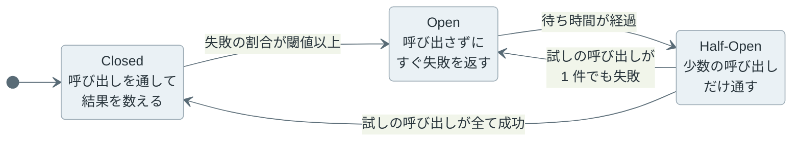

サーキットブレーカー（Circuit Breaker）は、失敗が続いている下流のサービスへの呼び出しを一定時間止め、呼び出し側をすぐに失敗させる仕組みです。配電盤のブレーカーと同じく、異常を検知すると回路を開いて呼び出しを通さなくなり、しばらく経つと少数の呼び出しで回復を確かめます。

Michael Nygard 氏の書籍『[Release It!](https://pragprog.com/titles/mnee2/release-it-second-edition/)』が安定性のパターンの 1 つとして取り上げ、Martin Fowler 氏の [CircuitBreaker](https://martinfowler.com/bliki/CircuitBreaker.html) も実装例付きで紹介しています。

例えば、注文サービスが呼ぶ在庫サービスが 30 秒間だけ応答を返さなくなると、注文サービスのスレッドは応答待ちで埋まり、在庫と関係の無い注文履歴の表示まで受け付けられなくなります。下流 1 つが黙るだけで、呼び出し側も止まるのです。ブレーカーは、この待ちを「すぐに返るエラー」に置き換えます。

ブレーカーは、Closed・Open・Half-Open の 3 つの状態を行き来します。以下は、状態ごとに下流へ届く呼び出しの量を弁の開き具合で表した図です。



下流に呼び出しが届くのは Closed と Half-Open の時だけで、弁で止めた呼び出しは下流を待たずに失敗します。状態は次のように移ります。



<br>

本記事では、呼び出し側のプロセスの中に置くブレーカーを中心に、状態遷移の条件と、Timeout（応答を待つ時間の上限）・Retry・Fallback との組み合わせを説明します。下流が 30 秒黙る状況をシミュレーションで再現し、次の疑問に答えます。

- 下流が遅くなると、なぜ呼び出し側まで止まるのか。
- 失敗をどう数え、いつ Open にし、いつ Closed に戻すのか。
- ブレーカーを入れると何が変わり、何が変わらないのか。
- Timeout と Retry は、ブレーカーの内側と外側のどちらに置くのか。
- Open の間に返す代わりの結果（Fallback）が、成功の代わりにならないのはどんな時か。

---

### Circuit Breaker が必要な理由

呼び出し側のサーバーが同時に処理できる数は、スレッドプールのスレッド数や、DB（データベース）・下流への接続数で限られています。下流の応答を待っている呼び出しは、待っている間ずっとこれらを 1 つずつ握っています。

同時に待っている呼び出しの数は、平均では「到着率 × 1 件あたりの待ち時間」で見積もれます。待ち行列の理論で [Little の法則](https://doi.org/10.1287/opre.9.3.383)（`L = λW`）と呼ばれる関係です。在庫サービスを呼ぶ要求が毎秒 50 件、注文サービスのスレッドが 40 本の場合は以下の通りです。

| 下流の状態 | 1 件の待ち時間 | 同時に待つ呼び出し（平均） |
|---|---|---|
| 正常に 50 ms で応答する | 0.05 秒 | 2.5 |
| 接続を拒否してすぐ失敗する | 0.001 秒 | 0.05 |
| 応答せず、2 秒の timeout で打ち切る | 2 秒 | 100（40 本で頭打ちになり、残りは拒否） |
| 応答せず、timeout が無いまま 30 秒後に戻る | 最大 30 秒 | 最大 1,500（同上） |

下流がすぐに失敗を返すなら、呼び出し側はほとんど困りません。危ないのは、下流が黙っている場合です。

スレッドが全て埋まると、在庫サービスを呼ばない要求も処理できなくなります。さらに上流のサービスも、注文サービスの応答を待って同じように埋まります。障害が呼び出しの連鎖をこうしてさかのぼる現象は、カスケード障害（cascading failure）と呼ばれます。ブレーカーは、失敗が続いていると判断した時点で呼び出しを止め、待ち時間を 0 に近づけて連鎖を断ちます。

---

### 3 つの状態と遷移

Closed は通常の状態で、全ての呼び出しを下流に通し、成功と失敗を記録します。失敗の割合（または数）が閾値以上になると Open に移ります。ここで言う失敗には、例外やエラー応答だけでなく、timeout で打ち切った呼び出しも入ります。

Open の間は、下流を呼ばずにすぐエラーを返します。Java のライブラリ [Resilience4j](https://resilience4j.readme.io/docs/circuitbreaker) では `CallNotPermittedException`、.NET の [Polly](https://www.pollydocs.org/strategies/circuit-breaker.html) では `BrokenCircuitException` が返ります。待ち時間が過ぎると Half-Open に移ります。

Half-Open では、決めた数の呼び出しだけを下流に通し、残りはすぐに失敗させます。全ての呼び出しを一度に戻さないのは、回復途中の下流に一度に要求が押し寄せると、もう一度落ちる場合があるからです（[Azure Architecture Center の Circuit Breaker pattern](https://learn.microsoft.com/en-us/azure/architecture/patterns/circuit-breaker)）。Closed に戻す条件は実装で異なります。

| | Azure の説明と本記事の実装 | Resilience4j |
|---|---|---|
| Half-Open で通す数 | 限られた数 | `permittedNumberOfCallsInHalfOpenState`（既定 10） |
| Closed に戻る条件 | 試しの呼び出しが続けて成功する。1 件でも失敗すれば Open | 試した呼び出しの失敗率と遅い呼び出しの率が閾値未満 |

---

### 30 秒黙る下流のシミュレーション

ブレーカーの有無による違いは、Python の標準ライブラリだけで書いた 1 ミリ秒刻みのシミュレーションで確かめます。ネットワークは使いません。設定は次の通りです。

- 呼び出し側はスレッド 40 本を持ち、空きが無い時に届いた要求はすぐに拒否する（503 を返す想定）
- 要求 A は下流を呼び、要求 B は下流を呼ばずに 5 ms で終わる。どちらも平均毎秒 50 件で、乱数の種を固定したポアソン到着
- 下流は通常 50 ms で応答し、10 秒から 40 秒までは応答を返さない。呼び出し側は 2 秒の timeout で打ち切る

以下が、本記事で使うブレーカーの実装（[lab/breaker.py](https://github.com/nao1215/debimate/blob/main/content/notes/software-architecture/circuit-breaker/lab/breaker.py)）です。直近 20 件の結果を持ち、10 件以上記録された後に失敗率が 50% 以上なら Open にします。Open の待ち時間は 5 秒、Half-Open で通すのは 3 件です。時刻は引数で受け取ります。

```python
"""A minimal count-based circuit breaker driven by an explicit clock."""

from collections import deque


class CircuitBreaker:
    def __init__(self, window=20, min_calls=10, failure_rate=0.5,
                 open_seconds=5.0, half_open_calls=3):
        self.window = deque(maxlen=window)  # True = failure, last N results
        self.min_calls = min_calls
        self.failure_rate = failure_rate
        self.open_seconds = open_seconds
        self.half_open_calls = half_open_calls
        self.state, self.generation = "CLOSED", 0
        self.opened_at = 0.0
        self.trials = 0     # calls admitted in HALF_OPEN
        self.successes = 0  # successful trials in HALF_OPEN

    def allow(self, now):
        """Return a generation number if the call may go downstream, else None."""
        if self.state == "OPEN":
            if now - self.opened_at < self.open_seconds:
                return None
            self._move("HALF_OPEN")
            self.trials = self.successes = 0
        if self.state == "HALF_OPEN":
            if self.trials >= self.half_open_calls:
                return None
            self.trials += 1
        return self.generation

    def record(self, now, ok, generation):
        """Report the result of a call that allow() admitted."""
        if generation != self.generation:
            return  # admitted in an earlier state: not counted
        if self.state == "HALF_OPEN":
            self.successes += ok
            if not ok:
                self._move("OPEN", now)
            elif self.successes == self.half_open_calls:
                self._move("CLOSED")
                self.window.clear()
            return
        self.window.append(not ok)
        if len(self.window) >= self.min_calls:
            if sum(self.window) / len(self.window) >= self.failure_rate:
                self._move("OPEN", now)

    def _move(self, state, now=None):
        self.state, self.generation = state, self.generation + 1
        if now is not None:
            self.opened_at = now
```

このコードでは、結果を数えるのは呼び出しが終わった時で、待っている途中の呼び出しは数えません。状態が変わるたびに `generation` を進め、前の状態で通した呼び出しの遅れた結果は数えません。数えると、Closed の時に通した呼び出しの失敗を Half-Open の試しの結果と取り違えます。

シミュレーション本体（[lab/sim.py](https://github.com/nao1215/debimate/blob/main/content/notes/software-architecture/circuit-breaker/lab/sim.py)）から、`run()` の中で下流の停止・timeout・ブレーカーを組み合わせる部分を抜粋します。メインループは 1 ミリ秒ごとに、終わった呼び出しの結果をブレーカーに渡し、届いた要求をスレッドに割り当てます。到着時刻を作る `arrivals()`、終了の事象を積む `push()`、統計の記録、結果を表示する `main()` は省きました。

```python
# lab/sim.py の run() から抜粋（35〜83 行目）
    def attempt(now, job):
        if cb and retry_outside:  # Retry(CircuitBreaker(call)): every attempt asks
            job["gen"] = cb.allow(now / 1000)
            if job["gen"] is None:
                return False  # rejected attempts are not retried
        st["down_calls"][now // 1000] += 1
        ok = not OUTAGE[0] <= now < OUTAGE[1]  # the outage never answers
        push(now + (LATENCY if ok else timeout), "A", job, ok)
        return True

    def finish(outcome):
        nonlocal busy
        busy -= 1
        st[outcome] += 1

    for now in range(END):
        before = cb.state if cb else None
        while events and events[0][0] == now:
            _, _, kind, job, ok = heapq.heappop(events)
            if kind == "B":
                busy -= 1
                st["b_ok"][now // 1000] += 1
                continue
            job["left"] -= 1
            if cb and retry_outside:
                cb.record(now / 1000, ok, job["gen"])
            if ok or job["left"] == 0:
                if cb and not retry_outside:
                    cb.record(now / 1000, ok, job["gen"])  # CircuitBreaker(Retry(call))
                finish("a_ok" if ok else "a_failed")
            elif not attempt(now, job):
                finish("a_fast_fail")
        for kind in arriving.get(now, []):
            if busy >= POOL:  # no thread left: reject at once (e.g. 503)
                if kind == "A":
                    st["a_rejected"] += 1
                else:
                    st["b_rejected"][now // 1000] += 1
            elif kind == "B":
                busy += 1
                push(now + LOCAL, "B", None, True)
            else:
                gen = cb.allow(now / 1000) if cb and not retry_outside else None
                if cb and not retry_outside and gen is None:
                    st["a_fast_fail"] += 1
                    continue
                busy += 1  # retries follow at once, with no backoff
                if not attempt(now, {"left": attempts, "gen": gen}):
                    finish("a_fast_fail")
```

`retry_outside` と `attempts` は後の節の Retry の構成で使います。`lab/` で `python3 sim.py` を実行した[結果](https://github.com/nao1215/debimate/blob/main/content/notes/software-architecture/circuit-breaker/lab/output.txt)が以下です。`B (local) served` は、下流が黙っていた 30 秒間に届いた要求 B のうち処理できた件数、`fast_fail` はブレーカーに断られた件数です。

```text
== no breaker
  downstream calls during outage: 600
  B (local) served during outage: 619/1567
  A: ok=1494 failed=600 fast_fail=0 rejected=972
== breaker
  downstream calls during outage: 60
  B (local) served during outage: 1499/1567
  A: ok=1239 failed=60 fast_fail=1707 rejected=60
  transitions: 12.28s OPEN, 17.33s HALF_OPEN, 45.50s CLOSED (11 total)
```

<details><summary>timeout と Retry を変えた残り 4 つの構成の出力</summary>

```text
== breaker, timeout 30 s
  downstream calls during outage: 40
  B (local) served during outage: 42/1567
  A: ok=1254 failed=40 fast_fail=259 rejected=1513
  transitions: 40.39s OPEN, 45.44s HALF_OPEN, 45.50s CLOSED (3 total)
== 3 attempts, no breaker
  downstream calls during outage: 600
  B (local) served during outage: 205/1567
  A: ok=1507 failed=200 fast_fail=0 rejected=1359
== Retry(CircuitBreaker), 3 attempts
  downstream calls during outage: 61
  B (local) served during outage: 1492/1567
  A: ok=1239 failed=0 fast_fail=1759 rejected=68
  transitions: 12.28s OPEN, 17.33s HALF_OPEN, 45.50s CLOSED (11 total)
== CircuitBreaker(Retry), 3 attempts
  downstream calls during outage: 165
  B (local) served during outage: 1275/1567
  A: ok=1353 failed=55 fast_fail=1393 rejected=265
  transitions: 16.28s OPEN, 21.29s HALF_OPEN, 43.39s CLOSED (7 total)
```

</details>

ブレーカーなしとありを時間に沿って並べると、以下の図になります。上から、使用中のスレッド数、要求 B を処理できた割合、下流に届いた呼び出しの数で、灰色の区間が下流の黙っている 30 秒です。



ブレーカーなし（no breaker）では、下流を呼ばない要求 B も 1,567 件中 619 件（約 40%）しか処理できませんでした。ブレーカーあり（with breaker）では 1,499 件（約 96%）を処理でき、下流に届いた呼び出しも 600 件から 60 件に減りました。

<br>

一方で、ブレーカーを入れても変わらなかったこともあります。

- 最初の timeout が返るまでの約 2 秒は、ブレーカーありでもスレッドが 40 本とも埋まり、要求 B を拒否した
- 要求 A は、下流が黙っている間はどちらでも成功しない。変わったのは、2 秒待って失敗するか、すぐに失敗するかだけ
- 下流が 40 秒で回復した後も、45.5 秒まで呼び出しを止めた。38.4 秒の Half-Open で通した試しが回復後の 40.4 秒に timeout し、再び Open になったからで、止まる時間は Half-Open の位相で変わる。要求 A の成功数は、ブレーカーなしの 1,494 件に対して 1,239 件に減った

ブレーカーは他の機能を守る仕組みで、要求 A を救う仕組みではありません。

---

### 失敗の数え方と閾値

最も単純な数え方は、連続した失敗の数です。Fowler 氏の例では、失敗するたびにカウンタを 1 増やし、成功すると 0 に戻します。しかし、成功と失敗が交互に来る半分壊れた下流では、いつまでも Open になりません。

そこで多くのライブラリは、スライディングウィンドウ（直近の呼び出しだけを見る窓）の中の失敗率を見ます。窓には「直近 N 件」を見る件数の窓と、「直近 N 秒」を見る時間の窓があります。Resilience4j の主な設定は以下の通りです（2026 年 11 月時点の公式ドキュメント）。

| 観測値 | 設定名（既定値） |
|---|---|
| 窓 | `slidingWindowType`（件数の窓）、`slidingWindowSize`（100） |
| 失敗率の閾値 | `failureRateThreshold`（50%） |
| 最小呼び出し数 | `minimumNumberOfCalls`（100） |
| 遅い呼び出し | `slowCallDurationThreshold`（60 秒）より遅い呼び出しの率が `slowCallRateThreshold`（100%）以上 |
| Open の待ち時間 | `waitDurationInOpenState`（60 秒） |

最小呼び出し数は、標本が少ない時の誤判定を防ぐ下限です。最小呼び出し数が 10 なら、9 件全てが失敗しても Open になりません。

遅い呼び出しの率は、timeout より短いが遅い応答を数えるための観測値です。例えば timeout が 2 秒で、下流が 1.9 秒で成功を返し続けると、失敗率は 0% のままスレッドが埋まります。`slowCallDurationThreshold` を 1 秒にしておけば、この状態を Open の理由にできます。

閾値は、低すぎても高すぎても困ります。

- 低すぎると、一時的な数件の失敗で正常な下流まで止め、Open と Closed を行き来する
- 高すぎると、Open になるまでに多くの呼び出しが timeout まで待ち、その間にスレッドが埋まる
- 時間の窓で最小呼び出し数が大きすぎると、流量の少ないインスタンスは判定されない。Polly の既定（30 秒の窓で最小 100 件）では、毎秒 1 件なら Open にならない

---

### Timeout と Retry との組み合わせ

ブレーカーは、呼び出しの結果を受け取って数えます。そのため、下流が黙る障害では、timeout が無いとブレーカーは働きません。実験でも、timeout を 30 秒にした構成（`breaker, timeout 30 s`）では、Open になったのは下流が回復した後の 40.39 秒でした。下流が黙っている間に処理できた要求 B は 42 件でした。

timeout は、ブレーカーが失敗を知るまでの時間の上限です。

[Retry](/notes/distributed-systems/retry-backoff/)（失敗した呼び出しをやり直すこと）は、ブレーカーとの位置関係で効き方が変わります。

Resilience4j を Java のフレームワーク [Spring Boot](https://spring.io/projects/spring-boot) から使う場合、[既定の順序](https://resilience4j.readme.io/docs/getting-started-3)は `Retry ( CircuitBreaker ( RateLimiter ( TimeLimiter ( Bulkhead ( Function ) ) ) ) )` で、Retry が一番外側です。

以下は、実験の 6 つの構成で、下流が黙っていた間に処理できた要求 B と、下流に届いた呼び出しを並べた図です。下の 3 本が Retry を含む構成です。



Retry を外側に置くと、ブレーカーは試行のたびに失敗を数えるので、ブレーカーだけの構成と同じ 12.28 秒で Open になりました。内側に置くと、1 件の失敗が記録されるまでに 2 秒 × 3 回かかり、Open になったのは 4 秒遅い 16.28 秒で、下流に届いた呼び出しは約 2.7 倍になりました。

Retry だけでブレーカーの無い構成では、処理できた要求 B が 205 件で、ブレーカーなしの 619 件よりも減りました。

外側に置く場合も、Open で断られた呼び出しは、やり直してもすぐに失敗が返るだけなので、やり直しを止めます（[Azure の説明](https://learn.microsoft.com/en-us/azure/architecture/patterns/circuit-breaker)）。

この実験は単純化して、試行の間の待ち時間を 0 にし、断られた時点で打ち切っています。Resilience4j の Retry は既定で 500 ms 待ち、`CallNotPermittedException` もやり直すので、`ignoreExceptions` に入れて外します。

呼び出しが何段も重なる構成では、各段の Retry が掛け算になります。5 段の各段で 3 回試すと、最下段の DB への負荷は `3^5 = 243` 倍です（[Amazon Builders' Library](https://builder.aws.com/content/3EumjoZascWd1oZiEgL8ORlv3qE/timeouts-retries-and-backoff-with-jitter)）。

ブレーカーは、下流が処理できる速さに送る量を合わせる [Backpressure](/notes/distributed-systems/backpressure/) や、同時に実行する呼び出しの数に上限を置く [Bulkhead](/notes/software-architecture/bulkhead/) の代わりにはなりません。

---

### Fallback で代わりにできないこと

Open の間に、エラーの代わりに既定値やキャッシュの値を返すことを Fallback と呼びます。Fallback が使えるのは、古い値や空の値でも受け取った側が誤った判断をしない、読むだけの操作です。例えば、おすすめ一覧を空にする、レビュー件数を数分前の値で表示する場合です。

しかし、決済・在庫の確保・データの保存で「成功したふり」をすると、記録が食い違います。

| 操作 | 成功したふりをした結果 | Open の時に返すもの |
|---|---|---|
| 在庫の確保 | 確保していない在庫を売り、売り越しになる | 確保できなかったこと |
| 決済 | 代金を受け取っていない注文を発送する | 未決済のまま受け付けたこと（後で処理する） |
| データの保存 | 保存できたと思ったデータがどこにも無い | 保存できなかったこと、または後で保存する予約 |

後で処理するなら、依頼を先に自分の DB に記録する [Transactional Outbox](/notes/distributed-systems/transactional-outbox/) の形が使えます。

もう 1 つ注意が必要なのは、timeout で失敗と数えた呼び出しが、下流では処理されている場合があることです。決済 API が課金を記録した後に応答が遅れれば、呼び出し側は失敗と数えますが、下流では課金が成立しています。これを「未決済」と確定させたり、別の要求としてやり直したりすると、記録が食い違うか二重に課金します。

やり直す前に、[冪等キー](/notes/distributed-systems/idempotency/)で同じ要求だと下流に伝えられるようにしておく必要があります。

---

### インスタンスごとの判断と部分障害

ブレーカーは、通常は呼び出し側のインスタンスごとに状態を持つので、流量の多いインスタンスは早く Open になり、少ないインスタンスは Closed のまま待ち続けます。

下流の一部だけが壊れている場合も、判断が割れます。在庫サービスが 5 台で動き、1 台だけが応答しなくなると、全体の失敗率は約 20% です。閾値が 50% なら Open にならず、5 件に 1 件が timeout まで待ちます。閾値を下げて Open にすると、正常な 4 台への呼び出しまで止めます。

この場合は、壊れた宛先だけを振り分けから外す仕組みと組み合わせます。サービスメッシュのプロキシとして使われる [Envoy](https://www.envoyproxy.io/) の [Outlier detection](https://www.envoyproxy.io/docs/envoy/latest/intro/arch_overview/upstream/outlier) は、5xx が続くなど他と違う振る舞いをするホストを一定時間だけ外します。

Envoy の [Circuit breaking](https://www.envoyproxy.io/docs/envoy/latest/intro/arch_overview/upstream/circuit_breaking) は、名前は同じでも接続数や処理中の要求数の上限で、本記事の状態遷移とは別の仕組みです。Envoy を [Sidecar](/notes/software-architecture/sidecar/) や [Ambassador](/notes/software-architecture/ambassador/) として置くと、アプリケーションのコードを変えずにこれらを足せます。

---

### 利点

- 下流が黙っても、呼び出し側のスレッドや接続を握り続けずに済み、下流を呼ばない機能を守れる
- 障害中の下流に届く呼び出しが減り、下流の回復を邪魔しにくくなる
- 状態の変化を記録すれば、どの下流がいつ使えなくなったかを監視できる

---

### 欠点

ブレーカーは、下流の障害を呼び出し側から隠さず、速い失敗に変えて返します。その代わりに、次の制約があります。

- 最初の timeout が返るまでは何も変わらず、その間は呼び出し側のスレッドが埋まる
- 下流が回復しても、Open の待ち時間が明けるまでは呼び出しを止め続ける
- 状態ごとに振る舞いが変わり（modal behavior）、テストしにくい
- 閾値・窓・待ち時間が流量や下流の性質に合わないと、開かないか開きすぎる
- インスタンスごとに判断が割れ、下流の一部だけが壊れた場合を 1 つのブレーカーでは区別できない

---

### 適さないケース

- 呼び出し先がプロセス内のメモリ上のデータ構造で、ネットワーク越しの待ちが無い場合
- 失敗の原因が要求の内容（入力の不備や残高不足）だけで、下流の健康状態と関係しない呼び出し。Resilience4j は既定で全ての例外を失敗として数えるので、絞らないと正常な下流で Open になる
- メッセージキューを介して非同期に処理し、失敗したメッセージを Dead Letter Queue（処理できなかったメッセージを溜める別のキュー）に回して後で処理できる場合
