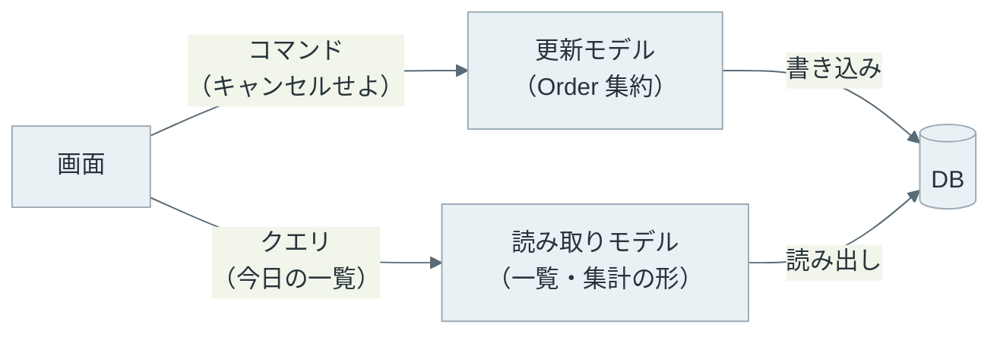
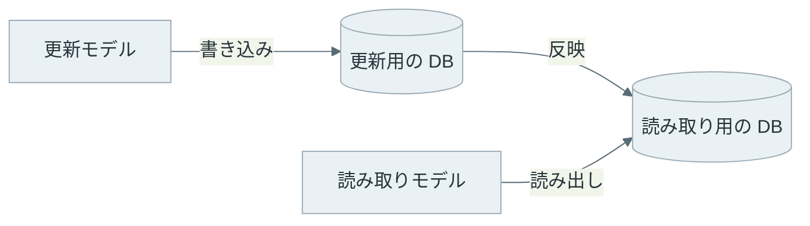

CQRS（Command Query Responsibility Segregation、コマンドとクエリの責務分離）とは、情報の更新に使うモデルと、読み取りに使うモデルを分けられるという考え方です。ここでのモデルは、要求を受けて処理するコードの型と、それが前提にするデータの形の組で、保存先とは別の概念です。Martin Fowler 氏の [CQRS](https://martinfowler.com/bliki/CQRS.html) は、Greg Young 氏から知ったパターンとしてこの考え方を紹介しています。

名前にあるコマンドとクエリのうち、コマンドは状態変更の要求で、`order.Cancel(...)` のようなメソッド呼び出しや、要求を表すオブジェクトで表します。クエリは「今日確定した注文の一覧が欲しい」のような読み取りの要求です。

更新と読み取りで必要なデータの形が大きく違う場合に、CQRS を使います。例えば EC サイトの注文では、確定やキャンセルは「確定前の注文はキャンセルできない」のような業務規則を守る更新で、明細まで含めた `Order` [集約](../value-object-entity-aggregate/)（業務規則を守るために一緒に読み書きするオブジェクトのまとまり）が担います。同じシステムの管理画面に出すのは「今日確定した注文の一覧」や「注文者ごとの購入金額の合計」で、集約の形とは噛み合わない検索です。以降の例では、[Repository](../repository/) や [Event Sourcing](../event-sourcing/) のノートと同じ注文を使います。

2 つのモデルに分けた構成を以下に示します。



上記の図で見てほしいのは、要求の種類で通るモデルが分かれる点です。更新モデルは業務規則の検査に専念し、読み取りモデルは画面や集計に合わせた形を取れます。図の DB は共有しても分けても構いません。

<br>

本記事では、CQRS で 2 つのモデルを分ける理由と、それぞれのモデルの形を説明します。中心になる疑問は次の通りです。

- なぜ更新と読み取りのモデルを分けるのか。
- 更新モデルと読み取りモデルは、それぞれどのような形を取るのか。
- 2 つのモデルは、保存先も含めてどこまで分けるのか。
- 保存したはずの編集が本人の履歴に出ない時、何を待てば良いのか。

---

### 更新と読み取りのモデルを分ける理由

Fowler 氏は、情報システムを扱う主流のやり方は「CRUD データストアとして扱うこと」だと書き、「要求が洗練されるにつれて、そのモデルから着実に離れていく」と続けています。CRUD（Create / Read / Update / Delete）の 1 つのモデルで更新と読み取りの両方を支える設計は、出発点としては自然です。

離れていく理由は、2 種類の要求がモデルに求める性質の違いにあります。以下は、その対比です。

| | 更新（コマンド） | 読み取り（クエリ） |
|---|---|---|
| 扱う単位 | 整合を守る 1 かたまり（ここでは集約） | 問い合わせに必要な単位。複数の集約を横断する場合もある |
| データの形 | 明細まで丸ごと、規則を検査できる形で持つ | 問い合わせに必要な列と形。必要なら結合・集計する |
| 守るもの | 業務規則（常に成り立つべき不変条件） | 表示の形と応答の速さ |

ここで例にする RDB（リレーショナルデータベース）では、CRUD の 1 つのモデルを正規化（normalization、同じ事実を 1 箇所にだけ持つようにテーブルを分ける設計）したテーブルの上に作ることがあります。この構成では画面 1 つ分のデータが複数のテーブルに散らばり、読み出す時に結合で組み立て直します。更新には都合の良いこの形が、読み取りには遠回りになります。

[Repository](../repository/) で見たとおり、集約を丸ごと復元する作りは、注文番号・合計金額・状態の 3 列を 20 件並べる一覧のためにも、20 個の集約を明細まで構築します。逆に一覧の都合にモデルを寄せ、注文が表示用の数個の列だけを持つ形にすると、キャンセル可否の判定に必要な明細や状態が手元に無くなり、業務規則の検査が画面側の処理に散らばります。

CQRS では更新用と読み取り用のモデルを分け、それぞれに必要なデータと処理を定義します。

<br>

コマンドとクエリという語は、Bertrand Meyer 氏の書籍『Object-Oriented Software Construction』にある [Command Query Separation](https://martinfowler.com/bliki/CommandQuerySeparation.html)（CQS）から借りています。CQS は、状態を変えて値を返さないコマンドと、結果を返して観測可能な状態を変えないクエリにメソッドを分ける規律で、1 つのモデルの中でも守れます。CQRS は同じ語を使いながら、分ける単位をメソッドからモデルに移しています。

---

### コマンドを受ける更新モデル

更新モデルは、コマンドを受けて業務規則を検査し、通った変更だけを保存します。[Domain Event](../domain-event/) や [Event Sourcing](../event-sourcing/) のノートと同じ `Order` 集約と [Repository](../repository/) の組が、そのまま更新モデルです。

例えば、キャンセルのコマンドは次のように処理します。

```go
// CancelOrder は、注文をキャンセルするコマンドを処理します。
// 業務規則の検査は Order 集約が行います。
func (u *usecase) CancelOrder(ctx context.Context, id OrderID, reason string) error {
	return u.tx.Do(ctx, func(tx Tx) error {
		order, err := u.orders.Find(tx, id)
		if err != nil {
			return err
		}
		if err := order.Cancel(reason, time.Now()); err != nil {
			return err
		}
		return u.orders.Save(tx, order)
	})
}
```

このコードは、表示用のデータを返さず成否だけを返します。キャンセル後の画面に出す内容は、クエリで読み取りモデルから取り直します。表示用のデータを大量に返して更新モデルを画面の形に寄せると、分離の利点が薄れるからです。

なお、上のコードの `CancelOrder` は、コマンドを処理する側のメソッドです。コマンドをオブジェクトで表す場合は、`CancelOrderCommand` のような命令形の名前を付けます（過去形のイベントとの対比は [Domain Event](../domain-event/) のノート）。

更新モデルの保存先は、集約の復元と、競合の検出（同じ注文への同時更新を片方だけ失敗させる仕組み）に向いた形を選べます。正規化したテーブルでも、[Event Sourcing](../event-sourcing/) のイベントストア（状態を変えた出来事を記録順に追記するだけの保存場所）でも構いません。

---

### クエリに答える読み取りモデル

読み取りモデルは、画面や集計の形に合わせて用意した読み取り専用のデータと、その問い合わせ窓口（問い合わせ用の interface）です。[Repository](../repository/) の末尾で触れた、集約を通らずに表示用の列だけを SELECT する照会サービスは、この窓口の最小の形です。

以下は、窓口と返すデータの例です。

```go
// OrderSummary は、一覧の 1 行分を表示に必要な列だけで表します。
// 業務規則を持たない、読み取り専用のデータです。
type OrderSummary struct {
	OrderID     string
	Total       int
	Status      string
	ConfirmedAt time.Time
}

// OrderQueryService は、読み取りモデルへの問い合わせ窓口です。
// 集約を復元せず、画面の形に合わせたデータを返します。
type OrderQueryService interface {
	FindConfirmedOn(ctx context.Context, day time.Time) ([]OrderSummary, error)
	TotalByCustomer(ctx context.Context, id CustomerID) (int, error)
}
```

`OrderSummary` は `Order` 集約と違ってメソッドを持たず、この型を通じて注文の状態を変える手段は用意していません。一覧で得た注文の ID をキャンセルのコマンドに渡すように、読み取りの結果から更新の入力を作ることは問題ありません。避けたいのは、読み取り用のデータを直接 DB に書き戻す使い方です。集約の業務規則を通らずに書き換わってしまうため、状態を変える時は必ずコマンドとして更新モデルに送る、という規律で防ぎます。

窓口のメソッドは画面の数だけ増やせます。一覧には一覧用の、集計には集計用の形を返すので、1 つの型に全画面の都合を詰め込まずに済みます。画面が消えたら、対応するメソッドとデータを消すだけで済みます。

---

### 2 つのモデルを分ける範囲

モデルを分けることと、保存先を分けることは別の判断です。

冒頭の図のように保存先を共有する構成では、読み取りモデルは更新モデルが書いたテーブルを SELECT やビュー（SELECT の結果をテーブルのように見せる DB の機能）で読みます。反映の仕組みが要らず、コミットした後の値を同じ書き込み先から直接読むので、反映の遅れもありません。

結果を実体として保存しない通常のビューは、問い合わせのたびに正規化されたテーブルの結合と集計を計算し直します。その負荷は更新と同じ DB に載るため、読み取りが増えるほど更新と資源を取り合います。支えきれなくなったら、保存先を分けます。読み取り用の DB に一覧や集計の結果をあらかじめ表の形で持たせれば、問い合わせのたびの結合と集計が要らず、負荷も更新側と分かれます。以下は、保存先を分けた構成です。



上記の図の反映は、多くの実装で更新の完了とは別のタイミングで走ります。その結果、読み取りは[結果整合](../domain-event/)（いずれ一致するものの、ある瞬間を切り取るとずれを許す性質）になることが多く、書いた直後のクエリが古い値を返す場合があります。

Fowler 氏は、別々のモデルを持つこと自体が「モデルをどれだけ厳密に一致させ続けるかという問いを生み、結果整合を使う可能性を高める」と書いています。保存先を共有する構成でも、更新側のテーブルを変えるたびにビューの定義を追従させる必要があります。

更新モデルの節で見た「キャンセル後の画面はクエリで取り直す」形も、この影響を受けます。分けた構成では反映前の古い値が返り得るので、受け付け済みと表示して反映を待つなど、遅れを許す画面設計が必要です。形を変えずに写すだけの複製でも、保存先を分ければ同じ遅れが出ます。

Wikipedia を動かす MediaWiki は、書き込みを primary（書き込みを受け付ける DB）に送り、読み取りの大半を primary の複製から返します。複製は少し遅れるため、編集した本人の投稿履歴に、保存したはずの編集がすぐには出ないことがあります。そこで [ChronologyProtector](https://doc.wikimedia.org/mediawiki-core/master/php/classWikimedia_1_1Rdbms_1_1ChronologyProtector.html) は、書き込んだ要求の終わりに primary がどこまで書いたかを記録し、約 10 秒以内に同じユーザーから来た要求では、複製がそこに追い付くまで最大で数秒待ちます。遅れた複製しか無い時は待つのを打ち切り、古い値を返します。

<br>

反映の実装には、DB の複製機能や CDC（Change Data Capture、DB の変更を捕捉して外部に流す仕組み）で変更を転送する形と、[Domain Event](../domain-event/) を配送して受け取った側が読み取り用のデータを更新し続ける形があります。イベントの配送を取りこぼさない仕組みは、[Transactional Outbox](../../distributed-systems/transactional-outbox/) のノートで扱っています。

更新モデルの保存先に Event Sourcing のイベントストアを選ぶと、読み取り用のデータはイベントを順に読んで作り続けるものになります。この反映を投影と呼び、Event Sourcing のノートで扱っています。CQRS はイベントを保存しなくても成立します。逆に、現在の状態を保存せずイベントだけを記録する構成では、複数の集約を横断する検索に答えるために読み取りモデルが必要になります。Greg Young 氏の [CQRS Documents](https://cqrs.wordpress.com/wp-content/uploads/2010/11/cqrs_documents.pdf) は、この点を CQRS と組み合わせる理由に挙げています。

---

### 利点

- 更新モデルが業務規則の検査に専念でき、読み取りの都合でモデルが崩れない
- 読み取りモデルを画面・集計ごとに最適化でき、集約を丸ごと復元する無駄が消える
- 保存先まで分ける構成では、読み書きで負荷の特性が違う時に読み取り側だけを複製して増やせる
- 読み取り専用の窓口が明示され、集約を通らない更新経路を設計上の逸脱として見分けられる

Fowler 氏が CQRS の使いどころとして挙げるのは、複雑なドメインと、読み書きの負荷を分けて別々にスケールさせたい高性能なアプリケーションの 2 つです。どちらにも当てはまらないなら、次の欠点に見合わない可能性が高いと考えられます。

---

### 欠点

更新用と読み取り用のモデルを分けると、次の負担が増えます。

- 同じ情報を 2 つのモデルが別の形で扱うため、変更の内容によっては両方の修正が必要
- 保存先まで分けると、モデルを繋ぐ反映の仕組みが業務と別に増える
- 保存先を分けた構成では読み取りが結果整合になりやすく、書いた直後のクエリが古い値を返す場合がある
- 要求の単純なシステムでは、分割の複雑さに見合う効果が出ない

Fowler 氏は、ほとんどのシステムにとって「CQRS はリスクを伴う複雑さを加える」と注意しています。自身が出会った事例の大半は良い結果になっておらず、CQRS が「ソフトウェアシステムを深刻な困難に向かわせる大きな要因」と見なされていたとも書いています。

---

### 適さないケース

- 更新も読み取りも単純で、CRUD の 1 つのモデルで両方を支えられているシステム
- 更新と読み取りの形の差も負荷の差も小さく、2 つのモデルの保守が割に合わない業務
- システム全体への一律の適用

最後の項目について、Fowler 氏の記事には「CQRS はシステムの特定の部分（DDD で言う [Bounded Context](../bounded-context/)）だけに使うべきで、システム全体に使うべきではない」とあります（DDD は Domain-Driven Design の略）。注文の部分では割に合い、会員情報の部分では CRUD で足りる、という判断を Bounded Context ごとに下せます。
