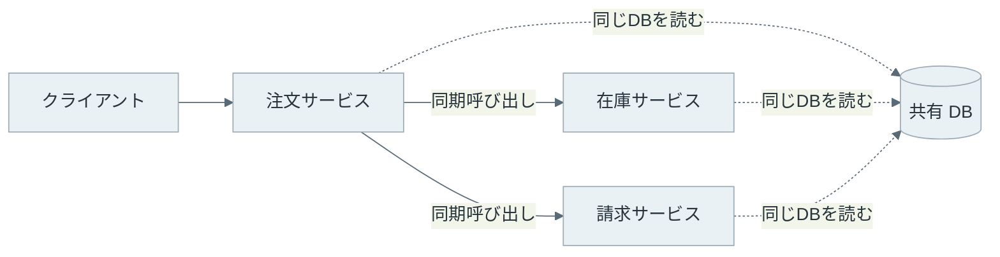
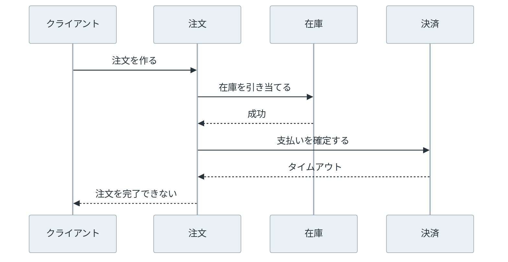

Distributed Monolith は、複数のプロセスやサービスに分かれているにもかかわらず、それらを個別に変更・テスト・デプロイできない構造です。サービスの数やコンテナの数ではなく、変更時にどこまで同時に動かさなければならないかで決まります。

Microservice Architecture（マイクロサービスアーキテクチャ）では、サービスを独立してデプロイできることが重要です。[Martin Fowler 氏の解説](https://martinfowler.com/articles/microservices.html)でも、この性質を取り上げています。しかし、注文サービスの API を変えるたびに在庫サービスと請求サービスを同時に直すなら、実行場所が分かれただけで変更の単位は 1 つのままです。

上の図では、注文サービスだけを新しい API に切り替えても、呼び出す側・呼び出される側・共有 DB のスキーマを一緒に確認する必要があります。通信がネットワークを越えるので、単一プロセスのモノリスより故障点と待ち時間は増えますが、変更の結合は減っていません。

 

本記事では、分散モノリスになる結合を見つけ、業務の境界を回復する順序を説明します。主な疑問は次の 4 つです。

- 同期呼び出しの連鎖は、なぜデプロイを止めるのか。
- 共有 DB と分散トランザクションは、どこで境界を壊すのか。
- API の変更に複数サービスが同時に変わるのは、どのような状態か。
- 分割を続けるか、モジュラーモノリスに戻すかは、何で決めるのか。

---

### 結合の見方

分散モノリスは、製品名で決まるアーキテクチャパターンではありません。次の 3 種類の結合が重なり、サービスを別々に扱えない状態を指す呼び名です。

| 結合 | 起きていること | 変更時の結果 |
| --- | --- | --- |
| 実行時の結合 | 要求の完了に別サービスの応答が必要 | 呼び出し先の停止、遅延、契約違反が呼び出し元まで届く |
| 変更時の結合 | 同じ変更を複数のリポジトリやデプロイに入れる必要がある | 1 サービスだけを先に出せず、リリースを調整する |
| データの結合 | 複数サービスが同じテーブルを直接読む・書く | スキーマや整合性の変更を単独で決められない |

サービスを分ける目的は、これらを全てゼロにすることではありません。注文の作成で在庫を確認するように、業務上必要な連携は残ります。重要なのは、連携の契約とデータの所有者を明らかにし、変更の影響をその境界で止めることです。

---

### 同期呼び出しの連鎖

注文サービスが要求ごとに在庫サービス、決済サービス、配送サービスを順に呼び、全ての応答を待ってから成功を返す構成を考えます。この要求は、最も遅いサービスの待ち時間に加え、どれか 1 つが失敗した時の扱いにも依存します。

この図で決済サービスが停止している間、注文サービスは注文を受け付けられません。再試行を増やせば一時的な失敗には耐えられますが、呼び出し先が復旧しなければ接続やワーカを待たせ続けます。そのため、可用性と待ち時間を下げるには、実行時の結合を小さくする必要があります。[Microservices.io の設計資料](https://microservices.io/patterns/monolithic.html)でも同じ問題を扱っています。

同期通信そのものが誤りではありません。要求を受けた時点で「在庫がある」という結果が必要なら、在庫サービスに問い合わせる境界は残ります。一方で、配送依頼を後から処理してもよいなら、注文の確定後に [Domain Event](../domain-event/) を記録し、配送サービスが読む形に変えられます。呼び出しを非同期にしただけで依存が消えるわけではなく、重複配送、遅延、失敗時の再実行を誰が扱うかも契約に含めます。

---

### 共有 DB の境界

サービスごとに API があっても、請求サービスが注文サービスのテーブルを直接更新できるなら、データの境界はありません。`orders.status` の値を変える時には、そのカラムを読む全サービスを調べる必要があります。権限が共通なら、サービス境界を越える直接書き込みを権限で止められません。

[Database per service](https://microservices.io/patterns/data/database-per-service.html) は、各サービスの永続データをそのサービスの API からだけ利用できるようにするパターンです。これは DB サーバーを必ずサービスごとに分けるという意味ではありません。同じ DB サーバーでも、テーブルまたはスキーマの所有者と接続権限を分け、他のサービスから直接触れないようにできます。

注文の作成と決済の記録を 1 つの ACID トランザクションに入れたい場合、両方が同じ DB にあれば実装は簡単です。サービスを分けた後も同じ原子性を求めて複数 DB の分散トランザクションを導入すると、参加者が停止した間は確定を待つ設計になります。[2PC](../../distributed-systems/two-phase-commit/) のノートで扱う通り、参加者が故障した場合にも全体を待たせる性質があります。

別々のサービスがそれぞれの DB に確定し、メッセージで次の処理を始める場合は、途中までしか反映されない状態を扱います。[Saga パターン](https://learn.microsoft.com/en-us/azure/architecture/patterns/saga) は、ローカルトランザクションを順につなぎ、失敗した時には補償処理を行う方法です。これは分散トランザクションをそのまま置き換える機能ではありません。例えば配送済みの商品を「配送前」に戻せないように、補償できない操作と利用者に見せる状態を先に設計する必要があります。

---

### API とリリースの結合

API を呼ぶサービスが 1 つなら、API の項目を変える時に双方を同時に直す必要があっても範囲は小さくなります。問題になるのは、`POST /orders` の要求・応答やイベントの値を変えるたびに、複数のサービスと利用者向け画面を同時にデプロイしなければならない状態です。

例えば、注文サービスが応答の `total` を整数の最小通貨単位から小数に変えたとします。請求・分析・画面が同じ意味を前提にしていれば、新旧のどちらかだけを出すと金額を誤って扱います。この時の問題は API のバージョン番号ではなく、古い契約と新しい契約を同時に受け入れる期間が無いことです。

変更を小さくするには、次のように互換性を段階に分けます。

1. 呼び出される側が、新しい項目を追加し、古い項目も返す。
2. 呼び出す側を 1 つずつ新しい項目に移す。
3. 全ての利用者が移ったことを確認してから、古い項目を削除する。

追加だけで互換になるとは限りません。必須項目、列挙値、エラーの意味、イベントを処理する順序も契約です。利用者が直接 DB を読んでいれば、この段階的な変更も成立しないので、最初にその経路を API またはイベントに寄せます。

---

### モジュール境界とサービス境界

モジュラーモノリスは、1 つの実行ファイル・デプロイ単位の中に、明確なモジュール境界を持たせる構造です。モジュールの内部データや実装を他のモジュールから直接参照させず、公開した関数やメッセージだけを通します。モノリスだから境界が無いわけではありません。

| | モジュラーモノリス | 独立したサービス | 分散モノリス |
| --- | --- | --- | --- |
| デプロイ | 全モジュールを一緒に出す | サービスごとに出せる | 見かけは個別でも同時リリースが必要 |
| 呼び出し | プロセス内の公開境界 | ネットワーク越しの契約 | 同期連鎖が広く、停止が伝わる |
| データ | モジュールごとに所有を明示する | サービスごとに所有する | 複数サービスが同じデータを直接扱う |
| 主な課題 | デプロイ単位は 1 つ | 分散処理の失敗を扱う | 両方の複雑さを抱える |

分割によって、独立したスケール、異なる可用性、別の技術要件が必要になるなら、サービス境界を維持する理由があります。反対に、常に同じチームが同時に変更し、同じ DB の同じトランザクションに依存し、独立デプロイの利点が得られていないなら、モジュール境界を守ったモノリスに戻す方が単純になる場合があります。

ここで戻す対象は「コードを 1 つのリポジトリに置くこと」ではなく、分散した呼び出し・監視・デプロイを減らすことです。サービスを統合しても、内部 API とデータの所有を曖昧にすれば、次の分割で同じ結合が再び現れます。

---

### 境界を直す順序

分散モノリスを一度に解体する必要はありません。まず、1 つの変更を出すために同時に触るサービス、同期呼び出し、直接読むテーブルを並べます。サービス図だけでは分からないため、デプロイ手順と DB の接続権限も対象にします。

次に、注文・請求・在庫のように、データと規則を誰が決めるかを業務ごとに決めます。これは、モデルが通用する範囲を扱う [Bounded Context](../bounded-context/) と対応させて考えられます。所有者以外の直接更新を止め、必要な情報は API またはイベントで渡します。データの複製や遅延を許容できない操作は、サービスを分ける前提自体を見直します。

最後に、依存先が停止した時も要求を完了する必要がある連携と、後から処理できる連携を分けます。後者をイベントに移す時は、少なくとも重複処理、順序、失敗後の再実行をテストします。境界を変えた結果として、1 サービスだけを変更・テスト・デプロイできるかを確認して初めて、サービス分割による独立性を確かめられます。
