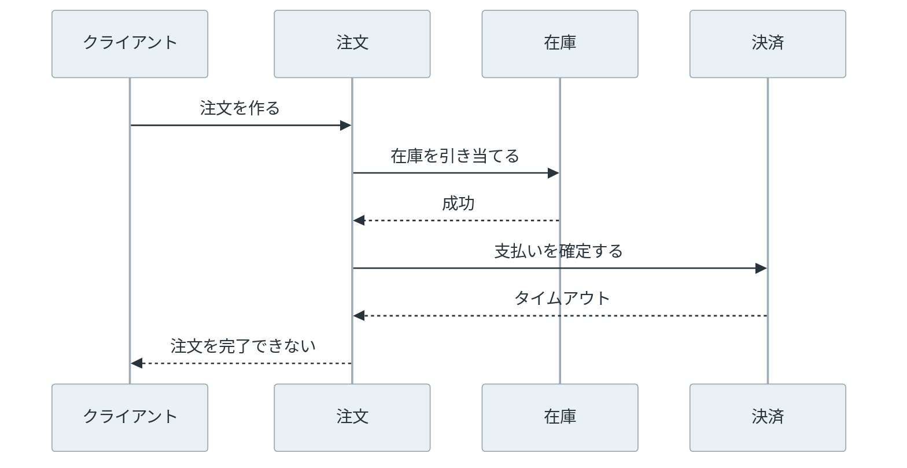

Distributed Monolith は、複数のプロセスやサービスに分かれているにもかかわらず、それらを個別に変更・テスト・デプロイできない構造です。サービスの数やコンテナの数ではなく、変更時にどこまで同時に動かさなければならないかで決まります。

Microservice Architecture（マイクロサービスアーキテクチャ）では、サービスを独立してデプロイできることが重要です。[Martin Fowler 氏の解説](https://martinfowler.com/articles/microservices.html)でも、この性質を取り上げています。しかし、注文サービスの API を変えるたびに在庫サービスと決済サービスを同時に直すなら、実行場所が分かれただけで変更の単位は 1 つのままです。



上記の図の右側では、注文サービスだけを新しい API に切り替えても、呼び出す先の在庫・決済と共有 DB（データベース）のスキーマを一緒に確認する必要があります。通信がネットワークを越えるので、単一プロセスのモノリスより故障点と待ち時間は増えますが、変更の結合は減っていません。

<br>

本記事では、分散モノリスになる結合を見つけ、業務の境界を回復する順序を説明します。同期呼び出しの連鎖は、Python の標準ライブラリだけで手元に再現して数値で確認します。主な疑問は次の 4 つです。

- 同期呼び出しの連鎖は、待ち時間と可用性をどう悪くするのか。
- 共有 DB と分散トランザクションは、どこで境界を壊すのか。
- API の変更に複数サービスが同時に変わるのは、どのような状態か。
- 分割を続けるか、モジュラーモノリスに戻すかは、何で決めるのか。

---

### 結合の見方

分散モノリスは、次の 3 種類の結合が重なり、サービスを別々に扱えない状態を指す呼び名です。

| 結合 | 起きていること | 変更時の結果 |
| --- | --- | --- |
| 実行時の結合 | 要求の完了に別サービスの応答が必要 | 呼び出し先の停止、遅延、契約違反が呼び出し元まで届く |
| 変更時の結合 | 同じ変更を複数のリポジトリやデプロイに入れる必要がある | 1 サービスだけを先に出せず、リリースを調整する |
| データの結合 | 複数サービスが同じテーブルを直接読む・書く | スキーマや整合性の変更を単独で決められない |

サービスを分ける目的は、これらを全てゼロにすることではありません。注文の作成で在庫を確認するように、業務上必要な連携は残ります。重要なのは、連携の契約とデータの所有者を明らかにし、変更の影響をその境界で止めることです。

---

### 同期呼び出しの連鎖

注文サービスが要求ごとに在庫サービス、決済サービス、配送サービスを順に呼び、全ての応答を待ってから成功を返す構成を考えます。この要求の待ち時間は 3 つの呼び出しの合計になり、どれか 1 つが失敗すれば注文も失敗します。



この図で決済サービスが停止している間、注文サービスは注文を受け付けられません。[再試行](/notes/distributed-systems/retry-backoff/)を増やせば一時的な失敗には耐えられますが、呼び出し先が復旧しなければ接続やワーカを待たせ続けます。

[Microservices.io の Self-contained Service パターン](https://microservices.io/patterns/decomposition/self-contained-service.html)は、同期で呼ぶ操作の可用性は呼び出す各サービスの可用性の積になり、再試行は応答時間を延ばすと説明しています。可用性を上げ、待ち時間を下げるには、実行時の結合を小さくする必要があります。

同期通信そのものが誤りではありません。要求を受けた時点で「在庫がある」という結果が必要なら、在庫サービスに問い合わせる境界は残ります。一方で、配送依頼を後から処理してもよいなら、注文の確定後に [Domain Event](../domain-event/) を記録し、配送サービスが読む形に変えられます。注文の確定とイベントの記録を同じトランザクションに入れる方法は、[Transactional Outbox](../../distributed-systems/transactional-outbox/) のノートで扱います。

呼び出しを非同期にしただけで依存が消えるわけではありません。配送サービスは同じ依頼を 2 回受け取ることがあるので、重複配送を防ぐ [冪等性](../../distributed-systems/idempotency/)、遅延の上限、失敗時の再実行を誰が扱うかも契約に含めます。

---

### 連鎖の実験

上記の 3 点（待ち時間の合計、1 サービスの停止、可用性の積）は、手元で確認できます。以下のコードは、在庫・決済・配送の代わりに 127.0.0.1 へ 3 つの HTTP サーバーを立て、注文サービス役の関数から呼びます。処理時間は在庫 50 ms、決済 80 ms、配送 30 ms、1 回の呼び出しを待つ上限は 0.5 秒です。外部への通信はしません。

<br>

<details>
<summary>chain.py の全文（約 120 行）</summary>

```python
"""注文サービスが在庫・決済・配送を同期で呼ぶ時の待ち時間と失敗を測る。

127.0.0.1 に 3 つの HTTP サーバーを立てるだけで、外部には通信しない。
標準ライブラリだけを使う。Python 3.14.4 で実行を確認した。
"""

import random
import statistics
import threading
import time
import urllib.request
from concurrent.futures import ThreadPoolExecutor
from http.server import BaseHTTPRequestHandler, ThreadingHTTPServer

# サービスごとの処理時間（秒）と状態。mode は ok / hang / flaky。
SERVICES = {
    "inventory": {"delay": 0.05, "mode": "ok"},
    "payment": {"delay": 0.08, "mode": "ok"},
    "shipping": {"delay": 0.03, "mode": "ok"},
}
FLAKY_RATE = 0.01  # flaky の時に 500 を返す割合
TIMEOUT = 0.5  # 注文サービスが 1 回の呼び出しを待つ上限（秒）
rng = random.Random(42)
ports = {}


def make_handler(name):
    class Handler(BaseHTTPRequestHandler):
        def do_POST(self):
            conf = SERVICES[name]
            if conf["mode"] == "hang":
                time.sleep(2)  # 応答しないサービスの代わり
            time.sleep(conf["delay"])
            failed = conf["mode"] == "flaky" and rng.random() < FLAKY_RATE
            self.send_response(500 if failed else 200)
            self.end_headers()

        def log_message(self, *args):
            pass

    return Handler


def start_services():
    for name in SERVICES:
        server = ThreadingHTTPServer(("127.0.0.1", 0), make_handler(name))
        ports[name] = server.server_address[1]
        threading.Thread(target=server.serve_forever, daemon=True).start()


def call(name):
    req = urllib.request.Request(f"http://127.0.0.1:{ports[name]}/", method="POST")
    try:
        with urllib.request.urlopen(req, timeout=TIMEOUT):
            return True
    except Exception:  # タイムアウト、HTTP 500 など
        return False


def order_serial(names=("inventory", "payment", "shipping")):
    """順に呼び、1 つでも失敗したら注文を失敗にする。"""
    return all(call(n) for n in names)


def order_parallel():
    """3 つを同時に呼び、全ての応答を待つ。"""
    with ThreadPoolExecutor(3) as pool:
        return all(pool.map(call, SERVICES))


shipping_queue = []  # 後から配送サービスに渡す依頼（実際は outbox テーブルなど）


def order_with_queue():
    """在庫と決済だけ同期で呼び、配送依頼は記録して先に成功を返す。"""
    ok = order_serial(("inventory", "payment"))
    if ok:
        shipping_queue.append("配送依頼")
    return ok


def measure(label, order, n=20):
    results, elapsed = [], []
    for _ in range(n):
        start = time.perf_counter()
        results.append(order())
        elapsed.append((time.perf_counter() - start) * 1000)
    print(f"  成功 {sum(results):>2}/{n}  "
          f"中央値 {statistics.median(elapsed):5.1f} ms  {label}")


start_services()
order_serial()  # 接続の初回コストを測定から外す

print("[1] 全サービスが正常")
measure("順に呼ぶ", order_serial)
measure("同時に呼ぶ", order_parallel)

print("[2] 決済サービスが応答しない")
SERVICES["payment"]["mode"] = "hang"
measure("順に呼ぶ", order_serial)
SERVICES["payment"]["mode"] = "ok"

print("[3] 配送サービスが応答しない")
SERVICES["shipping"]["mode"] = "hang"
measure("順に呼ぶ", order_serial)
measure("配送だけ後から渡す", order_with_queue)
print(f"  未送信の配送依頼 {len(shipping_queue)} 件")
SERVICES["shipping"]["mode"] = "ok"

print(f"[4] 各サービスが {FLAKY_RATE:.0%} の確率で失敗")
for conf in SERVICES.values():
    conf.update(delay=0, mode="flaky")
n = 10000
ok = sum(order_serial() for _ in range(n))
print(f"  注文の成功率 {ok / n:.2%}（理論値 {(1 - FLAKY_RATE) ** 3:.2%}）")
```

</details>

<br>

[lab/chain.py](lab/chain.py) を `python3 chain.py` で実行した結果は次の通りです。待ち時間は実行のたびに数 ms 変わり、全体で 1 分弱かかります。

```text
[1] 全サービスが正常
  成功 20/20  中央値 166.0 ms  順に呼ぶ
  成功 20/20  中央値  83.3 ms  同時に呼ぶ
[2] 決済サービスが応答しない
  成功  0/20  中央値 553.6 ms  順に呼ぶ
[3] 配送サービスが応答しない
  成功  0/20  中央値 635.0 ms  順に呼ぶ
  成功 20/20  中央値 133.4 ms  配送だけ後から渡す
  未送信の配送依頼 20 件
[4] 各サービスが 1% の確率で失敗
  注文の成功率 96.97%（理論値 97.03%）
```

出力の待ち時間と成功率を 1 枚にまとめると、次の図となります。左は各条件の待ち時間の中央値、右は 1% の確率で失敗するサービスを n 段つないだ時の理論値 0.99 の n 乗に、[4] の実測を重ねたものです。



左の赤い 2 本（payment hangs と shipping hangs の serial）は、応答しないサービスが 1 つあるだけで 0.5 秒の上限を越えて待ち、20 件とも失敗した条件です。右の実測 96.97%（measured n=3）は理論値 97.03%（theory 0.99^n）の線上にあり、同じ線を延ばすと 10 段で約 90.4% まで下がります。

[1] の「順に呼ぶ」は 50 + 80 + 30 = 160 ms に通信の分を足した値で、同時に呼ぶと最も遅い決済の 80 ms 前後に縮みます。並列にしても、3 つの応答が全て必要なことは変わりません。

[2] と [3] では、応答しないサービスが 1 つあるだけで注文は全て失敗し、しかも失敗を返すまでに上限の 0.5 秒を待っています。配送の停止は注文の業務とは関係が薄いのに、在庫と決済の 130 ms に 0.5 秒の待ちが加わります。

配送依頼だけを記録して後から渡す形にすると、配送が止まっていても注文は成功し、未送信の依頼が 20 件たまります。この 20 件を配送の復旧後に重複なく届けることが、非同期にした側の新しい仕事です。

[4] の成功率は、99% の 3 乗にほぼ一致しました。1 日 10 万件の注文なら、1 つずつは 99% 動くサービスを 3 段つなぐだけで約 3,000 件が失敗します。

---

### 共有 DB の境界

サービスごとに API があっても、決済サービスが注文サービスのテーブルを直接更新できるなら、データの境界はありません。例えば決済サービスが `orders.status` を `paid` に書き換えているなら、注文サービスがこの値を変える時には、そのカラムを読み書きする全サービスを調べる必要があります。権限が共通なら、サービス境界を越える直接書き込みを権限で止められません。

[Database per service](https://microservices.io/patterns/data/database-per-service.html) は、各サービスの永続データをそのサービスの API からだけ利用できるようにするパターンです。これは DB サーバーを必ずサービスごとに分けるという意味ではありません。同じ DB サーバーでも、テーブルまたはスキーマの所有者と接続権限を分け、他のサービスから直接触れないようにできます。

注文の作成と支払いの記録を 1 つの ACID トランザクションに入れたい場合、両方が同じ DB にあれば実装は簡単です。サービスを分けた後も同じ原子性を求めて [2PC](../../distributed-systems/two-phase-commit/)（2 相コミット）で複数の DB をまとめると、prepare に yes と答えた参加者は、コーディネータの決定が届くまでロックを持ったまま待ちます。その間にコーディネータが止まれば、該当のレコードは確定も中止もできません。

別々のサービスがそれぞれの DB に確定し、メッセージで次の処理を始める場合は、途中までしか反映されない状態を扱います。[Saga パターン](/notes/distributed-systems/saga/)（[Azure Architecture Center の説明](https://learn.microsoft.com/en-us/azure/architecture/patterns/saga)）は、ローカルトランザクションを順につなぎ、失敗した時には補償処理を行う方法です。これは分散トランザクションをそのまま置き換える機能ではありません。例えば配送済みの商品を「配送前」に戻せないように、補償できない操作と利用者に見せる状態を先に設計する必要があります。

---

### API とリリースの結合

API を呼ぶサービスが 1 つなら、API の項目を変える時に双方を同時に直す必要があっても範囲は小さくなります。問題になるのは、`POST /orders` の要求・応答やイベントの値を変えるたびに、複数のサービスと利用者向け画面を同時にデプロイしなければならない状態です。

例えば、注文サービスが応答の `total` を整数の最小通貨単位から小数に変えたとします。決済・分析・画面が同じ意味を前提にしていれば、新旧のどちらかだけを出すと金額を誤って扱います。この時の問題は API のバージョン番号ではなく、古い契約と新しい契約を同時に受け入れる期間が無いことです。

変更を小さくするには、次のように互換性を段階に分けます。

1. 呼び出される側が、新しい項目を追加し、古い項目も返す。
2. 呼び出す側を 1 つずつ新しい項目に移す。
3. 全ての利用者が移ったことを確認してから、古い項目を削除する。

`total` の例で 3 段階を描くと、次の図となります。黄土色は古い `total` を読む利用者、青は新しい項目へ移った利用者です。



追加だけで互換になるとは限りません。必須項目、列挙値、エラーの意味、イベントを処理する順序も契約です。利用者が直接 DB を読んでいれば、この段階的な変更も成立しないので、最初にその経路を API またはイベントに寄せます。

---

### モジュール境界とサービス境界

[モジュラーモノリス](../modular-monolith/)は、1 つの実行ファイル・デプロイ単位の中に、明確なモジュール境界を持たせる構造です。モジュールの内部データや実装を他のモジュールから直接参照させず、公開した関数やメッセージだけを通します。モノリスだから境界が無いわけではありません。

| | モジュラーモノリス | 独立したサービス | 分散モノリス |
| --- | --- | --- | --- |
| デプロイ | 全モジュールを一緒に出す | サービスごとに出せる | 見かけは個別でも同時リリースが必要 |
| 呼び出し | プロセス内の公開境界 | ネットワーク越しの契約 | 同期連鎖が広く、停止が伝わる |
| データ | モジュールごとに所有を明示する | サービスごとに所有する | 複数サービスが同じデータを直接扱う |
| 主な課題 | デプロイ単位は 1 つ | 分散処理の失敗を扱う | 両方の複雑さを抱える |

分割によって、独立したスケール、異なる可用性、別の技術要件が必要になるなら、サービス境界を維持する理由があります。反対に、常に同じチームが同時に変更し、同じ DB の同じトランザクションに依存し、独立デプロイの利点が得られていないなら、モジュール境界を守ったモノリスに戻す方が単純になる場合があります。

ここで戻す対象は「コードを 1 つのリポジトリに置くこと」ではなく、分散した呼び出し・監視・デプロイを減らすことです。サービスを統合しても、内部 API とデータの所有を曖昧にすれば、次の分割で同じ結合が再び現れます。

---

### 境界を直す順序

分散モノリスを一度に解体する必要はありません。まず、1 つの変更を出すために同時に触るサービス、同期呼び出し、直接読むテーブルを並べます。サービス図だけでは分からないため、デプロイ手順と DB の接続権限も対象にします。

次に、注文・決済・在庫のように、データと規則を誰が決めるかを業務ごとに決めます。これは、モデルが通用する範囲を扱う [Bounded Context](../bounded-context/) と対応させて考えられます。所有者以外の直接更新を止め、必要な情報は API またはイベントで渡します。データの複製や遅延を許容できない操作は、サービスを分ける前提自体を見直します。

最後に、依存先が停止した時も要求を完了する必要がある連携と、後から処理できる連携を分けます。後者をイベントに移す時は、実験の [3] でたまった依頼のように、重複処理、順序、失敗後の再実行をテストします。境界を変えた結果として、1 サービスだけを変更・テスト・デプロイできるかを確認して初めて、サービス分割による独立性を確認できます。
