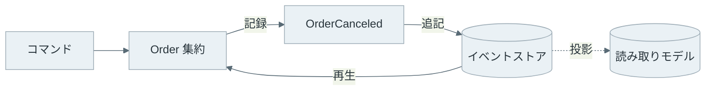
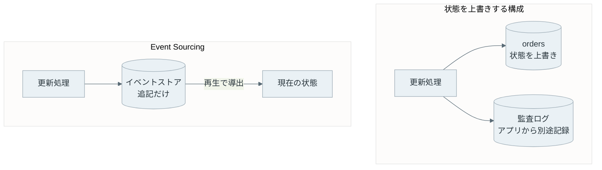
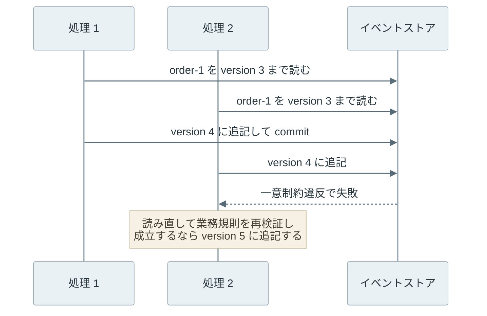
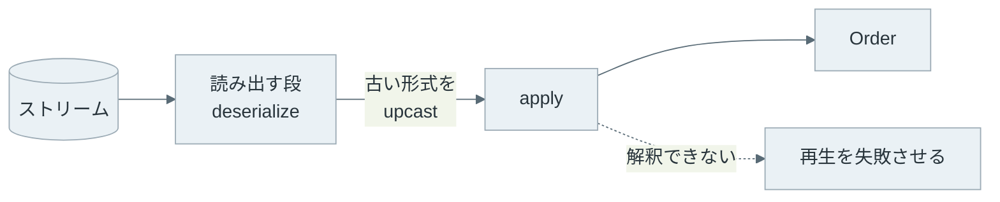
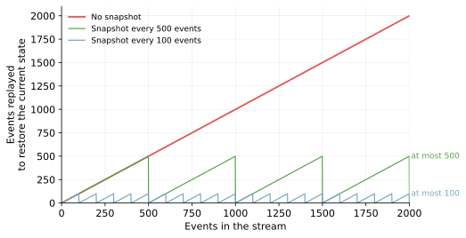
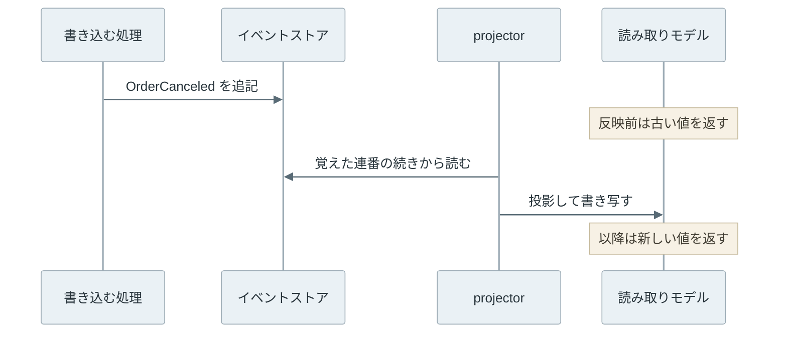

Event Sourcing とは、アプリケーションの現在の状態ではなく、状態を変えた出来事の並びを永続化し、状態はその再生（replay）で復元する[方式](https://martinfowler.com/eaaDev/EventSourcing.html)です。

Event Sourcing は、現在の状態に加えて、そこに至るまでの操作を後から確認したい場合に使います。例えば、EC サイトのサポート窓口には「この注文はなぜキャンセルされているのか」という問い合わせが届きます。現在の状態だけを保存する作りでは、`orders` テーブルの `status` 列に `canceled` と残っているだけで、いつ・どの操作で・どんな内容からそうなったのかは、上書きの瞬間に消えています。

<br>

本記事で扱うのは、全ての状態変更を集約（まとめて一貫性を保つオブジェクトの集まり。ここでは 1 件の注文）が発する Domain Event（業務上起きた出来事を表すオブジェクト）として記録し、そのイベントの並びを一次記録（system of record。状態を作り直す元になり、食い違った時に正しいと見なす記録）とする構成です。Domain Event を使っていても、上書きで保存した状態の方を一次記録にするなら、この構成にはなりません。

状態を上書きする保存と、出来事を追記する保存の違いを、この構成で確認します。



上記の図のコマンドは、`order.Cancel(...)` のようなメソッド呼び出しで表される状態変更の要求です。要求を受けた `Order` 集約が作ったイベントは、唯一の一次記録であるイベントストアに追記され、`Order` の現在の状態はイベントの再生で導出されます。検索用の読み取りモデルも、イベントを順に読んで書き写す投影で後から作ります。

本記事では、次の点を説明します。

- なぜ状態の上書きでは足りないのか。
- イベントストアには、どのように追記するのか。
- イベントを再生して、どのように状態を復元するのか。
- 読み取りモデルには、どのように投影するのか。
- 投影する処理は、なぜイベントを読み飛ばすことがあるのか。

出来事を表すオブジェクトは [Domain Event](../domain-event/) のノートで、それを他のシステムに配送する仕組みは [Transactional Outbox](../../distributed-systems/transactional-outbox/) のノートで扱っているので繰り返しません。例には、Domain Event のノートと同じ注文（`Order` [集約](../value-object-entity-aggregate/)）を使います。

---

### 状態の上書きで足りない理由

`UPDATE orders SET status = 'canceled'` という書き方は、前の値を新しい値で上書きし、前の値を消します。履歴が必要なら監査ログのテーブルを足し、業務データと同じトランザクションで書けば、片方だけ残ることは防げます。それでも、アプリケーションが業務処理の副産物として監査ログを書く構成では、次の 2 つの問題が残り得ます。

1 つは、全ての更新経路がログを書くという前提に頼ることです。書き忘れた経路の更新は履歴に残らず、DB のトリガーで漏れを塞ぐような仕組みを別に作らない限り気付けません。もう 1 つは、状態とログのどちらも相手から作り直せないことです。例えば監査ログに `status` を `canceled` に変えたことだけが残っていて明細や金額の変化が無ければ、ログから orders の行は作れず、orders の行から過去のログも作れません。2 つが食い違った時、どちらが正しいのかを決める根拠がありません。

以下は、2 つの構成の違いです。



上記の図の右側では、記録が業務処理の副産物ではなく本体です。イベントに残らなかった更新は状態にも反映されないため、再生で導出される状態については「状態は変わったのに履歴に無い」という食い違いは構造上起きません。Martin Fowler 氏は、イベントログの上に築ける機能の 1 つとして、「アプリケーションの状態を完全に捨てて、空のアプリケーションにイベントログからイベントを再実行することで再構築できる」ことを挙げています。

---

### イベントストアへの追記

イベントストア（event store）は、イベントを記録順に追記するだけの保存場所です。ここでは、集約 1 つにつき 1 本のストリーム（stream、イベントの列）を持たせます。ストリームの中の順序は通し番号（version）で固定します。番号の起点は実装ごとに決まり、この例では 1 から始めます。

具体的には、以下のような行が並びます。

| stream_id | version | name | payload | occurred_at |
|---|---|---|---|---|
| order-1 | 1 | order.placed | `{"lines": [...]}` | 2026-08-10T09:00:00Z |
| order-1 | 2 | order.confirmed | `{...}` | 2026-08-10T09:05:00Z |
| order-1 | 3 | order.canceled | `{"reason": "..."}` | 2026-08-10T10:30:00Z |

行の更新も削除も行わず、操作は末尾への INSERT だけです。payload の列には、イベントの中身が JSON で入ります。書き込みの流れは、まずストリームを読んで `Order` を復元し（復元の中身は次の節で見ます）、業務規則を検証してから、新しいイベントを追記する、という順になります。

同じ注文への操作が同時に 2 つ走ると、両方が version 4 への追記を試みます。`(stream_id, version)` に一意制約を張っておき、`Order` を読み込んだ時点の version を期待値として追記すると、後から書いた方だけが失敗します。

```go
// Append は、Order のストリームに新しいイベントを追記します。
// expected には、Order を読み込んだ時点の最後の version を渡します。
func (s *eventStore) Append(tx Tx, streamID string, expected int, events []DomainEvent) error {
	for i, ev := range events {
		// (stream_id, version) には一意制約があり、同じ番号への
		// 追記が同時に走ると、後から書いた方が制約違反で失敗する
		if err := s.insert(tx, streamID, expected+i+1, ev); err != nil {
			return err
		}
	}
	return nil
}
```

途中の insert が失敗した場合は、呼び出し側がトランザクションごと巻き戻す前提です。失敗した側は、新しいトランザクションでストリームを読み直し、業務規則を検査し直してから新しい version でやり直します。読み込み時の値を期待して書き、外れたらやり直すこの形は、[Domain Event](../domain-event/) の在庫の例で見た楽観的ロックと同じです。

以下は、競合の流れです。



上記の図の一意制約が防いでいるのは、同じ version への重複した追記です。番号が飛ばないことは、制約ではなく、実際に読んだ末尾の version を expected に渡すという手順が支えています。追記だけの記録から全体を組み立てる発想は [WAL](../../distributed-systems/write-ahead-log/)（Write-Ahead Log、先行書き込みログ）と共通で、WAL が DB 内部の復旧用の記録であるのに対し、イベントストアは業務の語彙で書かれた公式の記録という違いがあります。

---

### 再生による状態の復元

現在の状態は、ストリームを version 順に読み出し、空の `Order` から 1 件ずつ適用すると戻ります。適用の処理と、業務規則の検証は分けて置きます。

```go
// apply は、イベント 1 件を状態に反映します。イベントは既に起きた
// 事実なので、業務規則の検証は行いません。ただし、解釈できない
// イベントはエラーにして、再生そのものを失敗させます。
func (o *Order) apply(ev DomainEvent) error {
	switch e := ev.(type) {
	case OrderPlaced:
		o.id = e.OrderID
		o.status = OrderStatusDraft
		o.lines = e.Lines
	case OrderConfirmed:
		o.status = OrderStatusConfirmed
	case OrderCanceled:
		o.status = OrderStatusCanceled
	default:
		return fmt.Errorf("unsupported event: %T", ev)
	}

	// version は、反映に成功したイベントの分だけ進める
	o.version++
	return nil
}

// replayOrder は、ストリームの全イベントから Order を復元します。
func replayOrder(events []DomainEvent) (*Order, error) {
	o := &Order{}
	for _, ev := range events {
		if err := o.apply(ev); err != nil {
			return nil, err
		}
	}
	return o, nil
}
```

「確定前の注文はキャンセルできない」のような検証は、イベントを新しく作る側のメソッド（Domain Event のノートの `Confirm` と同じ役割の部分）で行います。`apply` が受け取るのは検証を通って記録された過去の事実です。業務規則は後から変わるので、昔の規則で受け付けたキャンセルを今の規則で検証し直すと、記録済みの事実を再生できなくなります。

一方で、`default` でエラーを返すことには理由があります。解釈できないイベントを読み飛ばすと、実際には起きた変化が抜けた状態で `Order` が復元され、その誤った状態を前提に新しい業務処理が走ります。例えば、支払い済みを表す `OrderPaid` を知らない古いコードが再生を続けると、未払いの注文として扱ってしまいます。イベントが一次記録である以上、意味を取り違えた状態で処理を進めるより、再生を失敗させて気付ける方が安全です。

payload の形はコードの変更で変わりますが、記録済みのイベントは書き換えられないので、古い形のイベントがストリームに残ります。そのため、古い形式のイベントは `apply` に渡す前に、現在のコードが解釈できる形に変換（upcast）します。以下は、その置き方です。



読み出す段で upcast しておけば、`apply` の `default` に届くのは本当に解釈できないイベントだけです。

再生には、任意の時点で止められるという性質も付いてきます。問い合わせ対応で「キャンセル直前の注文内容」が必要な時は、version 2 まで再生すれば取り出せます。

1 本のストリームのイベントが数千件に増えると、毎回の再生に時間が掛かります。対策は、一定の件数ごとに状態の写し（スナップショット）を保存し、直近のスナップショットとそれ以降のイベントだけで復元することです。例えば 100 件ごとにスナップショットを取っていれば、1,050 件のストリームでも version 1,000 時点のスナップショットから 1,001 以降の 50 件を再生するだけで済み、再生する件数は 100 件を超えません。



間隔を狭めるほど再生は短くなり、その分だけスナップショットを保存する回数が増えます。スナップショットは導出物なので、壊れても消しても、イベントから作り直せます。

---

### 読み取りモデルへの投影

「注文者ごとの購入金額の合計」のような集計は、ストリーム単位の再生では答えにくい質問です。答えるには、全ストリームを再生して状態を組み立てた上で、集計をやり直す必要があります。そこで、イベントを順に読んで検索用のテーブルを作り続けるプロセス（projector）を置き、検索は projector が作ったテーブルに向けます。このテーブルが読み取りモデルで、イベントを読み取りモデルに書き写す処理を投影と呼びます。

version はストリームごとの番号なので、全ストリームを横断して読む projector は、どこまで読んだかを 1 つの値で覚えられません。そのため、全イベントに共通の追記順の連番を version とは別に振る設計がよく採られます。


- title: 採番
  body: イベントの番号を予約します。まだ他の処理からは読めません。
- title: commit
  body: 保存を確定します。後の番号が先に確定する場合もあります。
- title: projector
  body: 確定したイベントを読み、読み取りモデルを更新します。


ただし、連番を振った順と commit の順は一致するとは限りません。連番 10 を取ったトランザクションより先に連番 11 が commit されると、projector は 11 まで読んで覚え、後から commit された 10 を読み飛ばします。

<br>

.NET の Event Sourcing ライブラリ Eventuous では、PostgreSQL のイベントストアに古いシステムのデータをまとめて取り込んだ時に、[読み飛ばしが報告されました](https://github.com/Eventuous/eventuous/issues/222)。projector に当たる subscription は、どこまで読んだかの記録を先へ進めたのに、一部のイベントで読み取りモデルを更新する処理を呼んでいませんでした。抜けたイベントは DB に入っており、記録を前の値に戻して再起動すると反映されました。

Eventuous の保守者は、連番の順と commit の順が入れ替わったことを疑い、2025 年には別の開発者が、追記に遅れを入れたテストで同じ抜けを再現しました。同年 10 月に[入った修正](https://github.com/Eventuous/eventuous/pull/424)は、連番の抜けを見つけたら一定時間待つ処理です。報告者の環境での原因は確定していません。

連番に抜けがある間は読み進めない、追記後に一定時間が経過した範囲だけを読む、といった対策があります。ただし固定時間の待機には、全てのトランザクションがその時間内に commit されるという前提が必要です。rollback などで永久に欠けた番号を待つと、投影が止まります。

<br>

再読で回復する設計では、処理済みの位置と保留中の番号を追跡し、同じイベントを再び読んでも投影を重ねない仕組みを用意します。欠番を飛ばす判断には、ストア側の確定・中止を識別できる契約や回復手順も必要です。

以下は、本記事で扱う、projector が追記とは別のタイミングで投影する構成です。



追記から反映までの間にずれが生じるので、読み取りは[結果整合](../domain-event/)（いずれ一致するものの、ある瞬間を切り取るとずれを許す性質）になります。その代わり、読み取りモデルはいくつでも持て、検索の形ごとに最適な構造を選べます。後から新しい検索が必要になったら、新しい読み取りモデルを作って過去のイベントを最初から投影し直すだけで済みます。

結果整合だからといって、書いた本人の画面にまで古い値を出すしかないわけではありません。書いた直後に必要なのが、その集約自身の現在の状態だけなら、読み取りモデルを介さず、ストリームを再生して答える手があります。追記先のイベントストアそのものを読むので（読み取り用の複製から読む構成を除く）、自分の書いたイベントまで含めて読めます。ただし、この方法が使えるのは 1 本のストリームで答えられる範囲に限られ、複数の注文を横断する検索には読み取りモデルが必要です。

イベントストアに書き込み、投影で作った読み取りモデルで検索に答える構成は、[CQRS](../cqrs/)（Command Query Responsibility Segregation、更新と読み取りでモデルを分ける考え方）の形です。CQRS はイベントを保存しなくても成立する一方、Event Sourcing は横断する検索に読み取りモデルを必要とします。Greg Young 氏の [CQRS Documents](https://cqrs.wordpress.com/wp-content/uploads/2010/11/cqrs_documents.pdf) は、この点を CQRS と組み合わせる理由に挙げています。

---

### 利点

- 状態が変わった理由をイベントの記録から確認できる
- イベントを漏れなく保持している限り、任意の時点の状態を再生で復元できる
- 読み取りモデルを後から何種類でも追加・再構築できる
- 書き込みを追記中心にでき、単純な RDB 実装なら `(stream_id, version)` の一意制約を使って同一ストリームへの競合を検出できる

---

### 欠点

Event Sourcing は、起きた事実の記録を捨てずに残します。その結果、次の欠点を抱えます。

- イベントの形を後から変えにくく、古い形式のイベントを読み続ける仕組み（イベントの形式の世代管理）が必要
- 現在の状態を見るだけの操作にも、再生かスナップショットか読み取りモデルの用意が必要
- 読み取りモデルを非同期に投影する構成では結果整合になり、書いた直後の検索が古い値を返す場合がある
- 個人情報の削除要求と、イベントを消さない方針が正面から衝突する

1 番目の世代管理は、ストリームの通し番号の version とは別の話です。読み込むコードが古い形式も解釈し続けるか、読み込み時に新しい形式に変換する層を挟むかは、形を変えるたびに決める必要があります。

最後の項目には、イベントには識別子だけを載せて個人情報の本体は消せる別の保存場所に置く、個人ごとの暗号鍵で暗号化しておき鍵を消して読めなくする、といった対処があります。どれもイベントの不変性と削除要求の間の妥協で、設計の初期に決めておく方が安全だと考えられます。

---

### 適さないケース

- 状態の履歴に業務上の価値が無い、CRUD（Create / Read / Update / Delete）中心のシステム
- 一覧や集計の検索が主体で、読み取りモデルの遅れも、イベントと読み取りモデルの形を両方保守する手間も割に合わない業務
- 出来事の語彙がまだ固まっていない探索段階のプロダクト。イベントの設計ミスが記録として残り続ける
