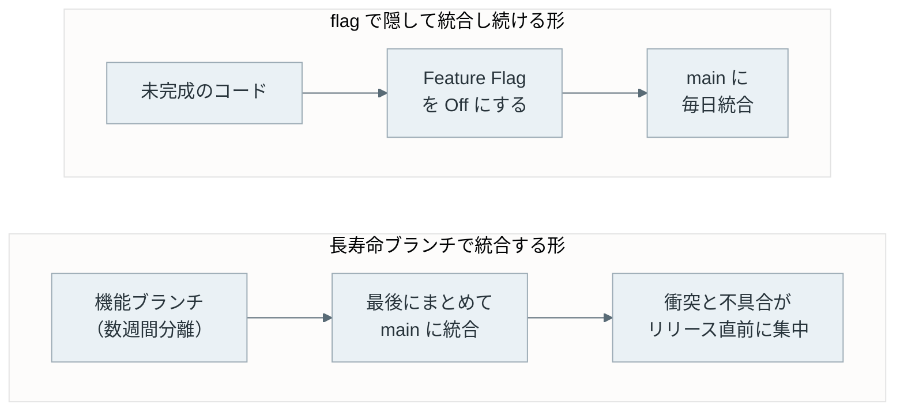
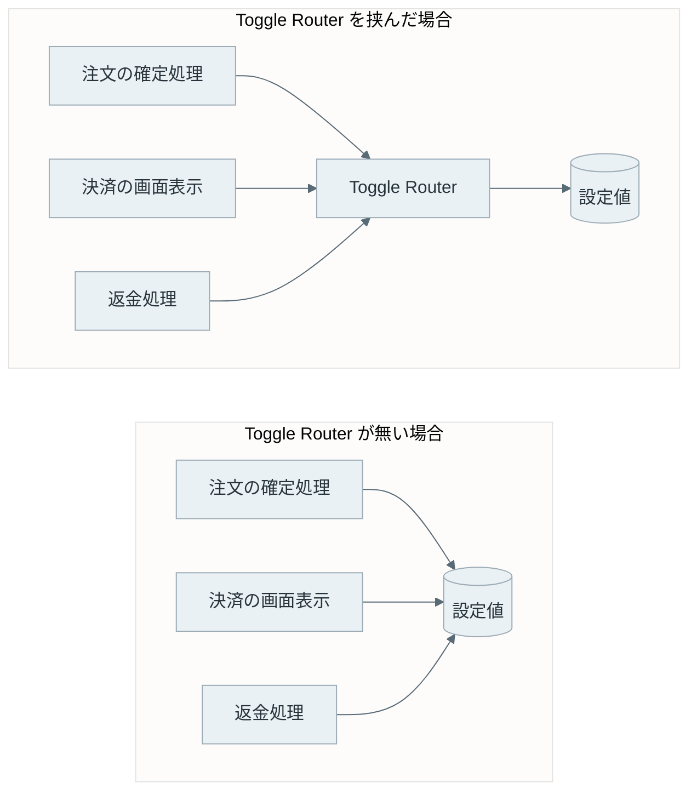
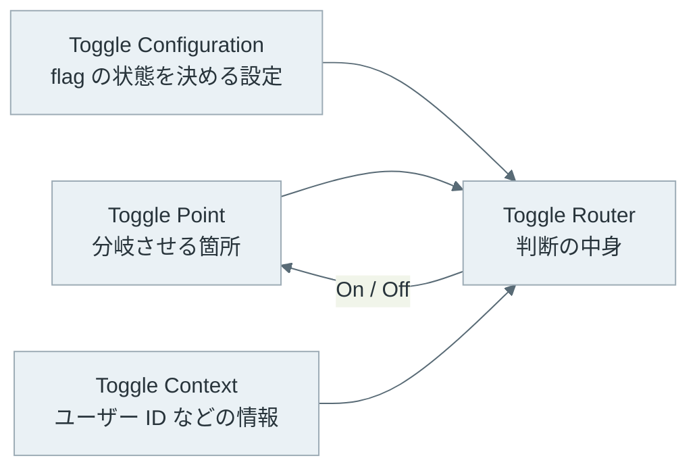
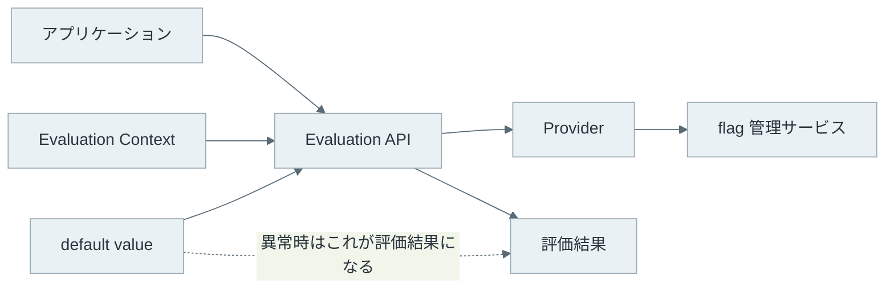
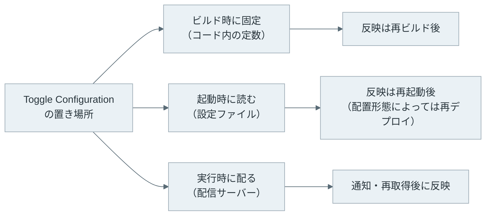

Feature Flag は、デプロイしたコードの振る舞いを設定や実行時の情報によって切り替える仕組みで、Feature Toggle とも呼ばれます。例えば、`if isNewCheckoutEnabled { ... }` という条件分岐で、新しい決済処理を呼び出すかどうかを切り替えます。

Feature Flag を使うと、コードのデプロイと機能の公開を別々のタイミングで行えます。コードを本番環境に置く作業がデプロイ、その機能がユーザーに見え始めることがリリースで、Feature Flag はこの 2 つを切り離します。決済処理を差し替えるなら、Off のまま先にデプロイし、まず社内ユーザーだけに有効化し、問題がなければ一般ユーザーに広げられます。

以下は、同じビルドのまま flag の Off と On でユーザーに届く処理が変わる様子です。



Off の分岐にこれまでの実装を置く方法は、Pete Hodgson 氏の「[Feature Toggles (aka Feature Flags)](https://martinfowler.com/articles/feature-toggles.html)」でも推奨されています。Off で既存の処理を選ぶようにしておくと、問題が起きた時に戻す処理が明確になります。

ただし、共通コードの変更も影響し得るため、Off 側も新しいビルドで動作確認が必要です。検証では、本番で使う設定と、問題が起きた時に切り戻す設定を重点的に確認します。

<br>

本記事では、On と Off の 2 値を返す Boolean Flag を中心に、分岐の設計と削除運用を説明します。

- なぜ Feature Flag が必要なのか。
- 分岐の判断は、コードのどこに置くのか。
- 寿命と判断の動的さによって、flag をどう作り分けるのか。
- 不要になった flag を消さずに残すと、何が起きるのか。

flag が On か Off かを決める処理を評価と呼びます。A/B テストのように、評価時にユーザーの情報を使う場合もあります。Boolean 以外の値を返す flag や、管理サービスの選び方についての説明は省略します。

---

### Feature Flag が必要な理由

機能ごとに長寿命のブランチを切ると、統合は最後にまとまって発生します。同時に完成に近づく機能が多いほど、衝突と不具合がリリース直前に集中します。また、デプロイと同時に新機能を公開する場合、問題が起きると前のビルドを再デプロイして戻すことになります。その際、同じビルドに含まれる別の変更まで元に戻してしまいます。



図の「flag で隠して統合し続ける形」では、未完成のコードを On 側に置き、一般ユーザーには Off を返すことで、新機能を公開せずに main に統合できます。ただし、ユーザーに公開していないコードも本番環境で動くビルドに含まれます。

切り戻しの速さは値の読み込み方と更新方法で変わり、Feature Flag の値を外部の flag 管理サービス（flag の値を保持して配るサービス）から取得する構成なら、値の変更だけで切り替えられます。ビルド時に値を埋め込む構成なら、変更の反映には再ビルドと再デプロイが必要です。

---

### Toggle Point と Toggle Router

どちらのコードパスを通すかが分かれる箇所を Toggle Point、その判断を行うロジックを Toggle Router と呼びます。Hodgson 氏は、Toggle Point が設定値を直接読み、判断のロジックまで抱える形を避けるよう勧めています。

例えば、`new-checkout` を使う判断条件が各処理に散っていると、条件を変更する際に複数箇所の修正が必要になります。Toggle Router に判断をまとめると、各処理は「新しい Checkout を使うか」を問い合わせるだけになり、flag の名前や評価方法に依存しません。

以下は、設定値を直接読む形と、Toggle Router を挟んだ形の比較です。



以下のコードでは、`Checkout` が設定値を直接参照する実装から、判断用のインターフェースを受け取る実装に変更しています。

```go
// Before: 業務ロジックが設定パッケージの値を直接読んでいる。
func Checkout(ctx context.Context, cart Cart) error {
	if config.NewCheckout {
		return checkoutV2(ctx, cart)
	}
	return checkoutV1(ctx, cart)
}
```

```go
// After: 判断用のインターフェースを渡す。Checkout は設定値を直接参照しない。
type CheckoutDecisions interface {
	UseNewCheckout(ctx context.Context) bool
}

func Checkout(ctx context.Context, cart Cart, d CheckoutDecisions) error {
	if d.UseNewCheckout(ctx) {
		return checkoutV2(ctx, cart)
	}
	return checkoutV1(ctx, cart)
}

// Toggle Router 側。flag の名前はここだけに置く。
// EnabledOrDefault は、評価できない時に第 3 引数を返す実装とする。
// 評価に失敗した時は、false を返して既存の実装を使う。
func (r *Router) UseNewCheckout(ctx context.Context) bool {
	return r.config.EnabledOrDefault(ctx, "new-checkout", false)
}
```

変更後の `Checkout` は、`UseNewCheckout` の戻り値で処理を切り替えます。そのため、設定ファイルから値を読む方式を外部の flag 管理サービスに変えても、`Checkout` 側の分岐はそのままにできます。

`EnabledOrDefault` の第 3 引数 false は、flag を評価できなかった場合の fallback です。この例では既存の `Checkout` 処理に戻すために false を選んでいますが、常に false が安全とは限りません。例えば On で重い機能を止める flag では、評価に失敗した時に false（止めない）が返ると、高負荷の時に機能を止められません。

Toggle Router は、flag の設定（Toggle Configuration）と、ユーザー ID などの評価対象の情報（Toggle Context）を使って判断します。



設定だけで決まる flag なら Toggle Context は空で構いません。

---

### OpenFeature の評価 API

Toggle Point や Toggle Router は設計上の役割であり、API の仕様ではありません。[OpenFeature の評価 API](https://openfeature.dev/specification/sections/flag-evaluation/) は、flag 管理サービスの提供会社に依存しない共通の呼び出し方法を定めています。

共通の API を使えば、flag 管理サービスを変える時にも呼び出し側を維持しやすくなります。ただし、flag の設定や評価ルール、対応するデータ型まで自動的に移行されるわけではありません。



アプリケーションは Evaluation API を呼び出す際、ユーザー ID などを Evaluation Context に指定します。Provider は flag 管理サービスに接続するなどして、指定された flag の評価結果を返します。

default value は、呼び出す側が Evaluation API に渡す値です。評価の途中で異常が起きた場合は、その値が評価結果として返ります。先のコードでは、`EnabledOrDefault` の第 3 引数に同じ役割を持たせています。

先の Go の例で OpenFeature を使うなら、Router から Evaluation API を呼ぶ構成にできます。ユーザー ID などは Evaluation Context で渡し、[Provider](https://openfeature.dev/specification/sections/providers/) が接続先に応じて flag を評価します。この構成では、Router が決済処理に関する判断を提供し、Provider が管理サービスとの接続や flag の評価を担当します。

---

### 寿命と判断の動的さによる分類

Feature Flag は、使用する期間と、実行中に評価結果を変える必要があるかで分類できます。ここでの動的さには、リクエストごとに結果が分かれることと、実行中に設定を書き換えられることの 2 種類があります。

この 2 軸で整理すると、以下の 4 種類になります。

| 分類 | 寿命 | 判断の動的さ | 代表的な用途 |
|---|---|---|---|
| Release Toggle | 多くは 1〜2 週間を大きく超えない。公開時期をプロダクト側で決める場合は例外 | 静的で良い | 未完成の機能を隠したまま統合する |
| Experiment Toggle | 同じ設定のまま、有意な結果が出るまで | リクエストごとに分かれる | A/B テストでユーザーを振り分ける |
| Ops Toggle | 多くは短命。高負荷時に機能を縮退させる Kill Switch は例外 | 再設定で即座に変える必要がある | 性能影響が読めない機能を運用側から止める |
| Permissioning Toggle | 年単位になることもある | リクエストごとに分かれる | 有償会員だけに機能を開く |

Release Toggle では、起動時に読み込んだ値を使い続ける構成も可能です。ただし、冒頭の例のように社内ユーザーだけに先に公開するなら、ユーザーごとの判断が必要です。

公開する割合を段階的に上げる時は、ユーザー ID のハッシュ値から 0〜9999 のバケットを作り、バケットが閾値未満のユーザーだけを On にする方法があります。

以下は、この方法とリクエストごとに乱数で On を選ぶ方法を比べたシミュレーション（[lab/rollout.py](https://github.com/nao1215/debimate/blob/main/content/notes/software-architecture/feature-flag/lab/rollout.py)）から、判断の部分を抜粋したものです。ユーザーは 10 万人で、公開割合を 1% → 5% → 25% → 100% と上げ、各段階で 1 人が 10 回リクエストを送ります。新機能には不具合がある前提で、不具合に 1 回でも当たったユーザーを数えました。

```python
# lab/rollout.py から抜粋
def bucket(user_id):
    digest = hashlib.sha256(f"{FLAG}:{user_id}".encode()).digest()
    return int.from_bytes(digest[:8], "big") % 10_000

# ハッシュ: ユーザーが同じなら、何回リクエストしても同じ結果になる
h_hits = sum(buckets[u] < pct * 100 for _ in range(REQUESTS))
# 乱数: リクエストごとに pct% の確率で On を選ぶ
hits = sum(rng.random() < pct / 100 for _ in range(REQUESTS))
```

実行結果は以下です。`exposed` は不具合に当たったユーザー数、`mixed` は同じ段階で新旧の両方を見たユーザー数、`keeps_previous` はハッシュで On になったユーザーが前の段階の On のユーザーを全て含むかどうかです。

```text
users=100000 requests_per_user_per_stage=10
stage  hash_exposed  hash_mixed  keeps_previous  random_exposed  random_mixed
   1%           985           0            True            9518          9518
   5%          4938           0            True           40194         40194
  25%         24913           0            True           94370         94370
 100%        100000           0            True          100000             0
```



1% の段階で不具合に当たったユーザーは、ハッシュ（hash of user ID）では 985 人ですが、乱数（coin flip per request）では 9,518 人です。乱数ではリクエストの回数だけ抽選が繰り返されるので、公開割合より広い範囲に影響が出ます。また、25% の段階では 94,370 人が新旧の決済処理を行き来しました。ハッシュではバケットの値が変わらず閾値だけが上がるので、前の段階で On だったユーザーは次の段階でも On のままです。

短期間で削除する flag なら、単純な条件分岐で実装できます。長期間使う場合は、分岐をインターフェースなどで抽象化すると、変更時に複数の処理を修正せずに済みます。

運用中に値を切り替えるなら、Toggle Configuration の置き場所も問題になります。コードに値を固定するか、起動時に読むか、実行中に更新するかで、変更の反映方法が変わります。設定ファイルでも再読込の仕組みがあれば実行中に更新できるので、保存場所だけでは決まりません。



Hodgson 氏は、flag の性質が許すならソース管理に置いて再デプロイで変える形を勧めています。リリースごとの Toggle Configuration が固定される分、検証すべき構成が減るからです。即座の再設定が必要なのは Ops Toggle のような一部です。

実行中に配信する構成でも、通信、ポーリング間隔、キャッシュの更新による遅延があります。各インスタンスが同時に切り替わるとは限らないため、切り戻しを設計する時は反映までの時間も確認します。

A/B テストではユーザーごとに評価結果を変えますが、実験中に割り当てのルールを変更する必要はありません。実験中に割り当て方や処理を変えると比較条件も変わるため、結果を同じ条件の測定としてまとめられるか見直す必要があります。

---

### flag の削除

新機能の追加時に flag を作り、公開後も削除しないと、使わなくなった分岐がコードに残ります。特に Release Toggle は、全体公開が終われば削除できます。残った分岐は、flag を別の用途に使い回した時に再び動き出します。

2012 年 8 月 1 日、米国の証券会社 Knight Capital は、注文を市場に送るシステムに新機能を載せる際、2003 年から使っていなかった Power Peg という機能を起動する flag を新機能用に流用しました。

8 台のサーバーの 1 台にだけ新しいコードが配られず、その 1 台は flag の付いた注文で Power Peg を動かしました。約 45 分で 400 万回の約定（売買の成立）が生じ、Knight は 4 億 6,000 万ドルを超える[損失](https://www.sec.gov/litigation/admin/2013/34-70694.pdf)を出しました。

この flag は設定ではなく注文ごとに付く値でしたが、使わなくなった分岐を 9 年残し、それを起動する flag を再利用した点は Feature Flag の消し忘れと同じです。不要な分岐を削除していれば、この古いコードを再起動する経路は残りません。ただし、配布漏れや監視・停止手段の不備まで解消するものではなく、flag の削除だけで事故全体を防げるという話ではありません。

<br>

削除漏れを防ぐ方法として、[Release Toggle の追加時に、その flag を消すタスクもバックログに積んでおく運用](https://martinfowler.com/articles/feature-toggles.html)があります。

---

### 利点

- 値を外部の flag 管理サービスから取得する構成なら、公開の取り消しをデプロイと切り離せる
- 未完成のコードを main に入れ続けられ、長寿命ブランチを使わずに済む
- ユーザーの一部だけに段階的に公開でき、問題を小さい範囲で検知できる
- A/B テストや権限による出し分けも、同じ Toggle Router の機構で扱える

---

### 欠点

Feature Flag を増やすと、分岐のテストに加えて、設定の管理や不要なコードの削除も必要です。

- 分岐が増えるほど、検証する構成も増える
- flag の値を管理する仕組み自体が新しい依存になる
- 削除を怠ると、不要になった flag と分岐がコードに溜まっていく。新機能を全体公開した例では旧実装の Off 側、中止した例では新実装の On 側が不要になる
- 同じ機構で扱えても、設定の置き場所と管理者は flag の分類が変われば見直す必要がある
- Experiment Toggle のようにユーザーを群（cohort）に振り分ける flag は、同じユーザーを一貫して同じ群に割り当てる必要がある（アクセスのたびに入れ替わると実験の結果を比べられない）

---

### 適さないケース

- リリース後に判断が変わらない、恒久的な設定の分岐（環境ごとの接続先の切り替えなど）
- 未完成のコードを隠す必要が無く、機能ごとに短い期間で統合し切れるチーム
- flag を削除する運用を続ける体制が無く、増える一方になりやすいチーム
