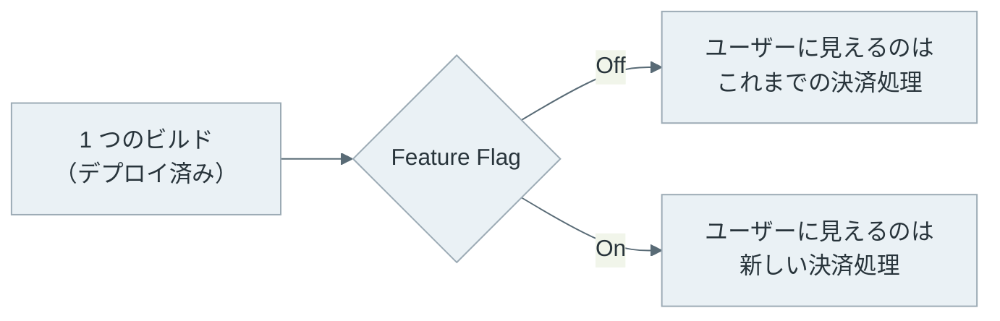
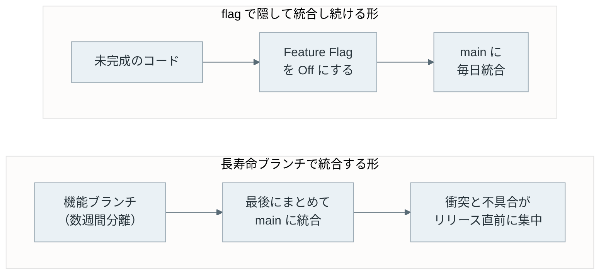
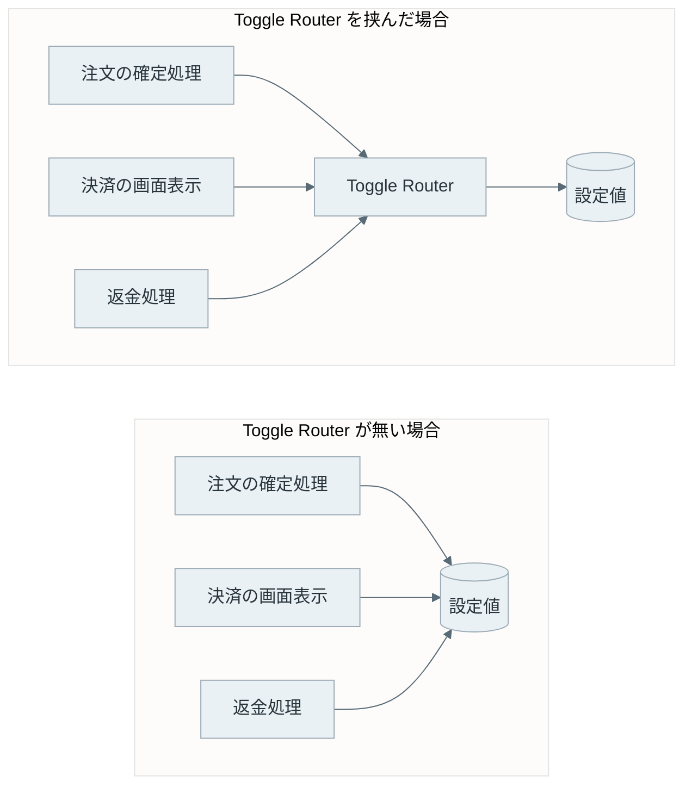
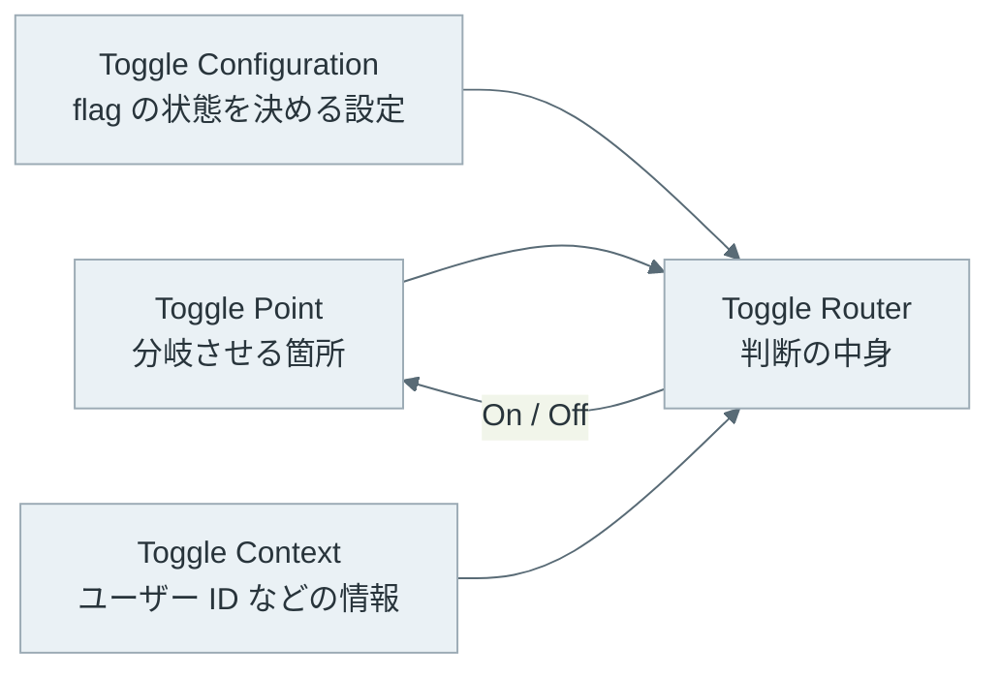
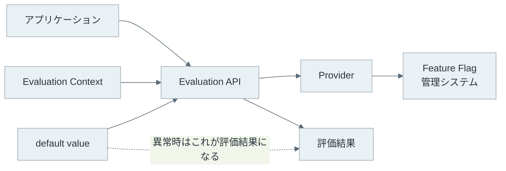
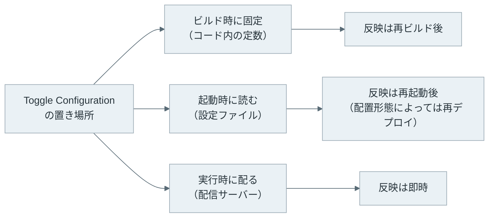

Feature Flag は、デプロイしたコードの振る舞いを設定や実行時の情報によって切り替える仕組みで、Feature Toggle とも呼ばれます。この実践を体系的に整理した Pete Hodgson 氏の「[Feature Toggles (aka Feature Flags)](https://martinfowler.com/articles/feature-toggles.html)」でも 2 つは同じ意味で、本記事では Feature Flag と書きます。例えば、`if isNewCheckoutEnabled { ... }` で新機能を出し分ける分岐が、この仕組みの最小の形です。

Feature Flag が役に立つのは、デプロイとリリースを別のタイミングにしたいチームです。コードを本番環境に置く作業がデプロイ、その機能がユーザーに見え始めることがリリースで、Feature Flag はこの 2 つを切り離します。決済処理を差し替えるなら、Off のまま先にデプロイし、まず社内ユーザーだけに有効化し、問題がなければ一般ユーザーに広げられます。

以下は、1 つのデプロイ済みビルドから、Off と On でユーザーに見えるものが変わる様子です。



Off の分岐にこれまでの実装を置く方針は、Hodgson 氏が勧めています。Off は今まで本番で動いていた構成なので、切り戻し先の動作には実績があります。この方針なら、全ての On と Off の組み合わせではなく、本番で使う構成と切り戻し先を重点的に検証できます。

本記事では、On と Off の 2 値を返す Boolean Flag を中心に、分岐の設計と削除運用を説明します。疑問として扱うのは次の 4 つです。

- なぜ Feature Flag が必要なのか。
- 分岐の判断は、コードのどこに置くのか。
- 寿命と判断の動的さによって、flag をどう作り分けるのか。
- 不要になった flag を消さずに残すと、何が起きるのか。

A/B テストのように、評価（flag が On か Off かを決めること）の結果を決めるために利用者の情報を使う flag も出てきます。boolean 以外の値を返す flag と、値を配信する製品の選び方は対象外とします。

---

### Feature Flag が必要な理由

機能ごとに長寿命のブランチを切ると、統合は最後にまとまって発生します。同時に完成に近づく機能が多いほど、衝突と不具合がリリース直前に集中します。デプロイとリリースを 1 つの操作として扱う設計も、同じ弱さを抱えます。切り戻しが前のビルドの再デプロイになり、直前まで動いていた別の変更まで巻き戻ります。



上記の図の右では、未完成のコードを Off の分岐に閉じ込められる限り、統合を先送りせずに済みます。代わりに、ユーザーにはまだ公開していないコードパスも本番環境に載ります。切り戻しの速さは値の置き場所で変わり、Feature Flag の値を外部の flag 管理サービス（flag の値を保持して配るサービス）から取得する構成なら、値の変更だけで切り替えられます。値をリポジトリで管理する構成なら、変更の反映には再デプロイが必要です。

---

### Toggle Point と Toggle Router

どちらのコードパスを通すかが分かれる箇所を Toggle Point、その判断を行うロジックを Toggle Router と呼びます。Hodgson 氏は、Toggle Point が設定値を直接読み、判断のロジックまで抱える形を避けるよう勧めています。

例えば、各処理が `new-checkout` という設定値を直接読むと、判断条件を変えるたびに、その設定を参照している箇所をすべて修正する必要があります。Toggle Router を挟めば、各処理は「新しい Checkout を使うか」という判断だけを問い合わせ、flag の名前や評価方法を知らずに済みます。

以下は、設定値を直接読む形と、Toggle Router を挟んだ形の比較です。



上記の図の左では、設定値を読む箇所が散るので、直し漏れに気付きにくくなります。

```go
// Before: 業務ロジックが設定パッケージの値を直接読んでいる。
func Checkout(ctx context.Context, cart Cart) error {
	if config.NewCheckout {
		return checkoutV2(ctx, cart)
	}
	return checkoutV1(ctx, cart)
}
```

```go
// After: 判断に名前を付けて渡す。Checkout は Feature Flag を知らない。
type CheckoutDecisions interface {
	UseNewCheckout(ctx context.Context) bool
}

func Checkout(ctx context.Context, cart Cart, d CheckoutDecisions) error {
	if d.UseNewCheckout(ctx) {
		return checkoutV2(ctx, cart)
	}
	return checkoutV1(ctx, cart)
}

// Toggle Router 側。flag の名前はここだけに置く。
// EnabledOrDefault は、評価できない時に第 3 引数に落ちる実装とする。
// ここで false を選んでいるのは、落ちた時に既存の実装を通すためである。
func (r *Router) UseNewCheckout(ctx context.Context) bool {
	return r.config.EnabledOrDefault(ctx, "new-checkout", false)
}
```

After の Checkout が知っているのは `UseNewCheckout` という判断だけです。そのため、設定ファイルから値を読む方式を外部の flag 管理サービスに変えても、`Checkout` 側の分岐はそのままにできます。

`EnabledOrDefault` の第3引数 false は、flag を評価できなかった場合の fallback です。この例では既存の `Checkout` 処理に戻すために false を選んでいますが、常に false が安全とは限りません。例えば On で重い機能を止める flag では、評価に失敗した時に false（止めない）に落ちると、高負荷の時に機能を止められません。

Toggle Router が判断に使うのは、flag の状態を決める Toggle Configuration と、ユーザー ID のように判断に添える Toggle Context です。



設定だけで決まる flag なら Toggle Context は空で構いません。

---

### OpenFeature の評価 API

Hodgson 氏が整理しているのは、Toggle Point・Toggle Router・Toggle Context という設計と運用の概念です。flag の評価をどう呼び出すかを決める、ベンダー（flag 管理サービスの提供会社）に依存しない共通の API までは定めていません。そこを定めているのが [OpenFeature](https://openfeature.dev/) です。呼び出し方が揃えば、flag 管理サービスを乗り換えても呼び出し側は変わりません。



アプリケーションが呼ぶ入口が Evaluation API、判断に添える情報が Evaluation Context です。Feature Flag 管理システム（本記事の flag 管理サービス）との接続を受け持ち、flag の値を解決する境界が Provider です。

default value は、呼び出す側が Evaluation API に渡す値です。評価の途中で異常が起きた場合は、その値が評価結果として返ります。先の `EnabledOrDefault` の第 3 引数がこれに当たります。

Toggle Context と Evaluation Context は役割が近いだけで、同じものではありません。Toggle Router は判断のロジックを含むので、値を解決する境界である Provider とは対応しません。

---

### 寿命と判断の動的さによる分類

Hodgson 氏は、Feature Flag をどれくらい長く残るかと、実行中にどれくらい動的に判断する必要があるかという 2 つの軸で整理しています。ここでの動的さには、リクエストごとに結果が分かれることと、実行中に設定を書き換えられることの 2 種類があります。

この 2 軸で整理すると、以下の 4 種類になります。

| 分類 | 寿命 | 判断の動的さ | 代表的な用途 |
|---|---|---|---|
| Release Toggle | 多くは 1〜2 週間を大きく超えない。公開時期をプロダクト側で決める場合は例外 | 静的で良い | 未完成の機能を隠したまま統合する |
| Experiment Toggle | 同じ設定のまま、有意な結果が出るまで | リクエストごとに分かれる | A/B テストでユーザーを振り分ける |
| Ops Toggle | 多くは短命。高負荷時に機能を縮退させる Kill Switch は例外 | 再設定で即座に変える必要がある | 性能影響が読めない機能を運用側から止める |
| Permissioning Toggle | 年単位になることもある | リクエストごとに分かれる | 有償会員だけに機能を開く |

表の Release Toggle は寿命が短く、判断も静的で足ります。ただし、冒頭の例のように社内ユーザーだけに先に公開するなら、ユーザーごとの判断が要ります。

寿命と判断の動的さによって、設計で気を付ける所も変わります。短命な flag なら単純な条件分岐で足りますが、長く残すなら分岐そのものを抽象化した方が扱いやすくなります。

運用中に値を切り替えるなら、Toggle Configuration の置き場所も問題になります。置き場所で、値の変更が何をきっかけに反映されるか（再ビルド・再起動・即時）が決まります。



Hodgson 氏は、flag の性質が許すならソース管理に置いて再デプロイで変える形を勧めています。リリースごとの Toggle Configuration が固定される分、検証すべき構成が減るからです。即座の再設定が必要なのは Ops Toggle のような一部です。

下ほど反映は速く、部品も増えます。Experiment Toggle は判断そのものが動的でも、Toggle Configuration は静的なままで構いません。実験の途中で設定を変えると、結果が統計的に無効になりかねません。

---

### flag の削除

Feature Flag は放っておくと増え、コードの分岐も積み上がります。特に Release Toggle は、全体公開が終われば役目も終わります。削除を後回しにすると、使われなくなった分岐が残り続けます。

残った分岐は、flag を別の用途に使い回した時に再び動き出します。2012 年 8 月 1 日、米国の証券会社 Knight Capital は、注文を市場に送るシステムに新機能を載せる際、2003 年から使っていなかった Power Peg という機能を起動する flag を新機能用に流用しました。8 台のサーバーの 1 台にだけ新しいコードが配られず、その 1 台は flag の付いた注文で Power Peg を動かしました。約 45 分で 400 万回の約定（売買の成立）が生じ、Knight は 4 億 6,000 万ドルを超える[損失](https://www.sec.gov/litigation/admin/2013/34-70694.pdf)を出しました。

この flag は設定ではなく注文ごとに付く値でしたが、使わなくなった分岐を 9 年残し、それを起動する flag を再利用した点は Feature Flag の消し忘れと同じです。Power Peg を使わなくなった 2003 年の時点で消していれば、配り漏れた 1 台にも古い分岐は無く、flag を流用しても届く先はありませんでした。

Hodgson 氏は、flag を追加した時点で削除タスクもバックログに積む運用を紹介しています。flag が残っている間は、本番で使う予定の構成だけでなく、問題が起きた時に切り戻す構成も[検証しておきます](https://martinfowler.com/articles/feature-toggles.html)。

---

### 利点

- 値を外部の flag 管理サービスから取得する構成なら、公開の取り消しをデプロイと切り離せる
- 未完成のコードを main に入れ続けられ、長寿命ブランチを使わずに済む
- ユーザーの一部だけに段階的に公開でき、問題を小さい範囲で検知できる
- A/B テストや権限による出し分けも、同じ Toggle Router の機構で扱える

---

### 欠点

Feature Flag は、どのコードパスを通すかを実行時に選べるようにします。その自由度と引き換えに、次の制約が付きます。

- 分岐が増えるほど、検証する構成も増える
- flag の値を管理する仕組み自体が新しい依存になる
- 削除を怠ると、もう実行されない Off 側の分岐がコードに溜まっていく
- 同じ機構で扱えても、設定の置き場所と管理者は flag の分類が変われば見直す必要がある
- Experiment Toggle のようにユーザーを群（cohort）に振り分ける flag は、同じユーザーを一貫して同じ群に割り当てる必要がある（アクセスのたびに入れ替わると実験の結果を比べられない）

---

### 適さないケース

- リリース後に判断が変わらない、恒久的な設定の分岐（環境ごとの接続先の切り替えなど）
- 未完成のコードを隠す必要が無く、機能ごとに短い期間で統合し切れるチーム
- flag を削除する運用を続ける体制が無く、増える一方になりやすいチーム
