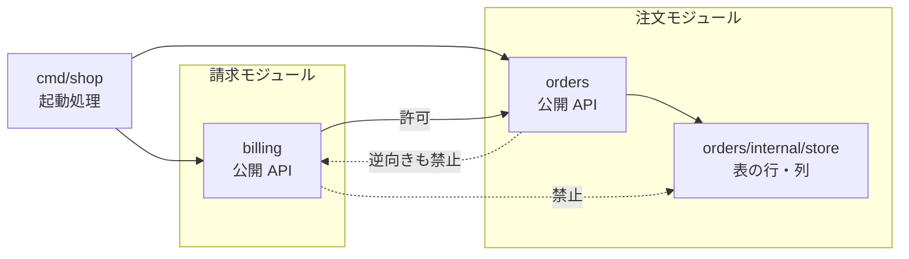
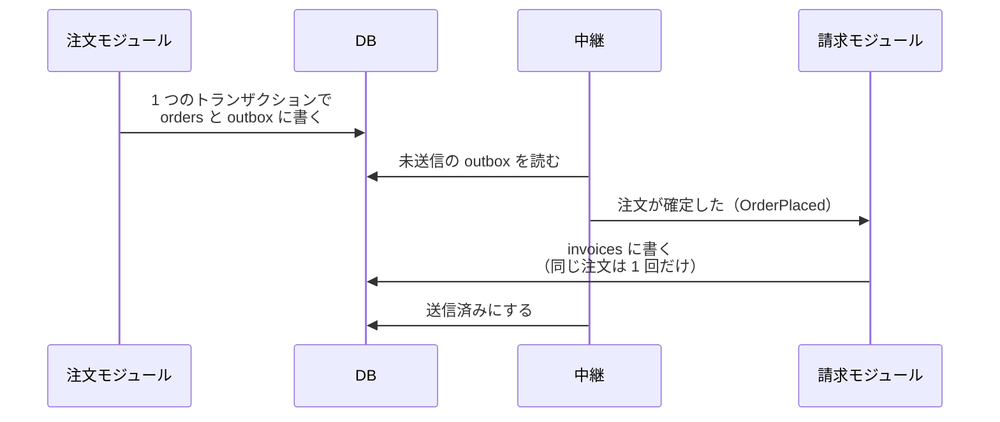

モジュラーモノリス（Modular Monolith）は、アプリケーションを 1 つのデプロイ単位のまま、内部を注文・請求・在庫のようなモジュールに分け、モジュール間の呼び出しを各モジュールが公開した API だけに限る構成です。実行ファイルもリポジトリも 1 つで構いません。分けるのは実行場所ではなく、コードとデータの持ち主です。

境界の無いモノリスでは、請求のコードに注文の内部パッケージを import する 1 行を足すだけで、注文の表を直接書き換えられます。見落とすと、次に注文の仕様を変える時に請求まで直すことになります。

[Distributed Monolith](../distributed-monolith/) は、サービスを分けたのにこの種の結合が残った状態でした。モジュラーモノリスは逆の順序を取り、デプロイを分ける前に境界を作って、境界を破る変更をビルドと CI（Continuous Integration、変更のたびにビルドとテストを自動で回す仕組み）で止めます。



上記の図のように、デプロイ単位を増やすことと境界を強くすることは別の軸です。右下の Distributed Monolith は前者だけを進めた結果で、モジュラーモノリスは左上で後者だけを先に進めています。図の生成コードは [figures.py](https://github.com/nao1215/debimate/blob/main/content/notes/software-architecture/modular-monolith/figures.py) にあります。

<br>

本記事では、Go の小さなプログラムで境界違反をビルドと CI で検出する実験を交えて、モジュラーモノリスの作り方と限界を説明します。主な疑問は次の通りです。

- モジュールの公開 API と依存の向きは、どう決めるのか。
- 同じプロセスの中で、境界を越える import をどう見付けるのか。
- 同じ DB（データベース）を使う時、トランザクションの範囲とモジュールの境界はどうずれるのか。
- マイクロサービスに分ける前に、何を測れば良いのか。

---

### モジュラーモノリスが必要な理由

モノリスは関数呼び出しで全ての機能を繋げられるので、作り始めは速く進みます。しかし、どのコードからでも他の機能の内部を呼べると、変更の影響範囲を誰も言えなくなります。例えば、請求のコードが注文の `status` 列を直接 `paid` に書き換えていれば、注文の担当者は `status` の意味を変える時に請求のコードまで読む必要があります。

サービスに分けてネットワーク越しに呼べば、この結合は断てます。しかし、通信の遅延と失敗、サービスごとの監視とデプロイの仕組みが新しく必要になります。Martin Fowler 氏は、この上乗せされる複雑さを [Microservice Premium](https://martinfowler.com/bliki/MicroservicePremium.html) と呼んでいます。境界が無いまま分ければ、上乗せのコストだけを払って結合は残ります。

モジュラーモノリスは、境界とデプロイ単位を切り離して、境界だけを先に手に入れる方法です。10 年以上・1,000 人を超える開発者が触ってきた Rails のコードを抱えていた Shopify は、2019 年の [Deconstructing the Monolith](https://shopify.engineering/deconstructing-monolith-designing-software-maximizes-developer-productivity) で、サービスに分割する代わりにこの方法を選び、次のように定義しています。

> A modular monolith is a system where all of the code powers a single application and there are strictly enforced boundaries between different domains.
>
> （モジュラーモノリスとは、全てのコードが 1 つのアプリケーションを動かし、かつ業務の領域の間に厳密に強制された境界があるシステムです。）

この定義で重要なのは「強制された」の部分です。ディレクトリを分けて「他のモジュールの内部は触らない」と約束するだけでは、締め切り前の 1 行で境界が崩れます。

---

### 公開 API と依存の向き

各モジュールは、外に出す型と関数を決め、それ以外を内部として隠します。例えば注文モジュールは `Order{ID, Total}` を返し、表の 1 行を表す `Row{ID, Total, Status}` は返しません。表の列を外に出すと、列の追加や改名が他のモジュールの変更になります。

依存の向きは一方向に揃え、モジュール間の循環を禁止します。請求は注文の金額を知る必要がありますが、注文は請求を知らなくても注文を作れます。そのため、請求から注文への依存だけを許します。



上記の図で、実線は許可する依存、破線は禁止する依存です。注文を作った直後に請求を始めたい場合でも、注文から請求を直接呼ぶと循環が生まれます。この時は、注文が「注文が確定した」という [Domain Event](../domain-event/) を出し、請求がそれを受け取る形にすると、依存の向きを保てます。互いに依存したモジュールは、片方だけを変更・テスト・切り出しできません。

---

### 境界違反を検出する実験

Go には、境界の一部をツールチェーン（`go build` などの go コマンド）が強制する仕組みがあります。[cmd/go のドキュメント](https://pkg.go.dev/cmd/go#hdr-Internal_Directories)にある通り、`internal` という名前のディレクトリ以下のコードは、`internal` の親ディレクトリを根とするツリーの中からしか import できません。`orders/internal/store` は `orders` の下からは使えますが、`billing` からは使えません。

以降、「モジュール」は注文や請求のような業務のまとまりを指し、`go.mod` で定義する単位は「Go モジュール」と呼びます。

以下は、注文と請求の 2 モジュールを持つ実験用のプログラムです。注文の表の代わりにメモリ上の map を持つ `orders/internal/store/store.go`、2 つのモジュールを呼ぶだけの `cmd/shop/main.go`、`go.mod` は省略しました。全てのファイルは [lab/shop](https://github.com/nao1215/debimate/tree/main/content/notes/software-architecture/modular-monolith/lab/shop) にあります。

```go
// ---- orders/orders.go ----
// Package orders は注文モジュールの公開 API です。
// 他のモジュールは、このパッケージの型と関数だけを使います。
package orders

import "example.com/shop/orders/internal/store"

// Order は、他のモジュールに見せる注文の形です。
type Order struct {
	ID    string
	Total int // 最小通貨単位（円）
}

var db = store.New()

// Place は注文を作ります。
func Place(id string, total int) Order {
	db.Save(store.Row{ID: id, Total: total, Status: "placed"})
	return Order{ID: id, Total: total}
}

// Get は注文を返します。
func Get(id string) (Order, bool) {
	r, ok := db.Find(id)
	return Order{ID: r.ID, Total: r.Total}, ok
}

// ---- billing/billing.go ----
// Package billing は請求モジュールの公開 API です。
package billing

import (
	"fmt"

	"example.com/shop/orders"
)

// Charge は注文の金額を請求します。注文は orders の公開 API で読みます。
func Charge(orderID string) (string, error) {
	o, ok := orders.Get(orderID)
	if !ok {
		return "", fmt.Errorf("order %s not found", orderID)
	}
	return fmt.Sprintf("charged %d yen for %s", o.Total, o.ID), nil
}
```

`internal` が止めるのは、ツリーの外からの import だけです。モジュール単位の依存の向きは、Go のツールチェーンには伝わりません。そこで、許可する向きを表に書き、`go list` が返す import の一覧と突き合わせるスクリプトを用意しました。テストコードの import と、Go モジュールの根に直接置いたパッケージは対象にしていない単純な作りです。

```sh
#!/bin/sh
# ALLOW に書いた向きのモジュール間 import だけを許可します。
# go.mod のあるディレクトリで実行し、違反があれば終了コード 1 を返します。
set -eu

# モジュール名: import してよい他のモジュール（空白区切り）
ALLOW='
orders:
billing: orders
cmd: orders billing
'

mod=$(go list -m)
# 1 行に「パッケージ 直接 import するパッケージ...」を並べる（テストの import は含まない）
pkgs=$(go list -f '{{.ImportPath}}{{range .Imports}} {{.}}{{end}}' ./...)
violations=$(echo "$pkgs" | awk -v mod="$mod/" -v allow="$ALLOW" '
	BEGIN {
		n = split(allow, lines, "\n")
		for (i = 1; i <= n; i++)
			if (split(lines[i], kv, ":") == 2) ok[kv[1]] = " " kv[2] " "
	}
	# example.com/shop/billing/x -> billing
	function owner(p) { sub("^" mod, "", p); split(p, s, "/"); return s[1] }
	{
		from = owner($1)
		for (i = 2; i <= NF; i++) {
			if (index($i, mod) != 1) continue # 標準ライブラリと外部の依存
			to = owner($i)
			if (to != from && index(ok[from], " " to " ") == 0)
				printf "NG %s -> %s\n", $1, $i
		}
	}')

if [ -n "$violations" ]; then
	echo "$violations"
	exit 1
fi
echo "OK: モジュール間の import は全て許可された向きです"
```

[lab/run.sh](lab/run.sh) は、このプログラムの複製に次の変更を 1 つずつ入れて、`go build ./...` と `depcheck.sh` を実行します。どれも import を 1 行足す変更です。

1. `billing` が `orders/internal/store` を import し、注文の `Status` を `paid` に書き換える
2. `orders` が `billing` を import し、注文の直後に請求する
3. 新しい `orders/notify` パッケージが `billing` を import する
4. Go モジュールの根の `internal/ordersql` に orders 表を読む SQL を置き、`billing` から import する

Go 1.26.4 で `./run.sh` を実行した結果は、以下の通りです。矢印は足した import の向きで、色はそれを止めた検査です。



<details>
<summary>run.sh の出力</summary>

```text
== [0] 変更前
go build: 成功
OK: モジュール間の import は全て許可された向きです
depcheck.sh の終了コード: 0
== [1] billing が orders の internal を import する
package example.com/shop/billing
	billing/markpaid.go:3:8: use of internal package example.com/shop/orders/internal/store not allowed
== [2] orders のパッケージが billing を直接 import する（パッケージの循環）
package example.com/shop/billing
	imports example.com/shop/orders from billing.go
	imports example.com/shop/billing from charge.go: import cycle not allowed
== [3] orders の下に billing を呼ぶパッケージを足す（モジュール間の循環）
go build: 成功
NG example.com/shop/orders/notify -> example.com/shop/billing
depcheck.sh の終了コード: 1
== [4] モジュールの外の internal に orders の表を読む SQL を置く
go build: 成功
NG example.com/shop/billing -> example.com/shop/internal/ordersql
depcheck.sh の終了コード: 1
```

</details>

[1] と [2] は `go build` が止めました。go コマンドはパッケージ同士の import の循環を許さないので、`orders` パッケージ自身が `billing` を import すると、ビルドが通りません。

しかし [3] はビルドが通ります。`orders/notify` → `billing` → `orders` という並びは、パッケージの単位では循環していません。モジュールの単位で見ると注文と請求が互いに依存しているのに、go コマンドには本記事の「モジュール」という単位が無いからです。

[4] もビルドが通ります。`internal` の親が Go モジュールの根なので、同じ Go モジュール内の全てのコードから import できます。「共通処理だから」と根の `internal` に置いたパッケージは、どのモジュールからでも使える裏口になります。

[3] と [4] を止めたのは `depcheck.sh` で、終了コード 1 を返しています。CI で `go build ./...` の次に実行すれば、この 1 行はマージ前に落ちます。

<br>

他の言語にも、同じ役割の手段があります。以下は、2026 年 11 月時点の各公式ドキュメントを元にした整理です。

| 手段 | 対象 | 止めるもの | 検査する時 |
| --- | --- | --- | --- |
| Go の `internal` | Go | `internal` の親より外からの import | `go build` などでパッケージを読み込む時 |
| [JPMS](https://openjdk.org/jeps/261)（Java Platform Module System） | Java 9 以降 | `module-info.java` で `exports` していないパッケージの利用 | コンパイル時と実行時 |
| [ArchUnit](https://www.archunit.org/) | Java | パッケージ・クラス間の依存と循環（規則は自分で書く） | 単体テスト |
| [Spring Modulith](https://docs.spring.io/spring-modulith/reference/verification.html) | Spring Boot | モジュール間の循環、他モジュールの内部パッケージの参照、許可していない依存（許可を設定した場合） | `ApplicationModules.verify()` を呼ぶテスト |
| [packwerk](https://github.com/Shopify/packwerk) | Ruby on Rails | 宣言していないパッケージへの定数の参照 | 静的解析（CI） |

Spring Modulith の[モジュールの定義](https://docs.spring.io/spring-modulith/reference/fundamentals.html)では、モジュールの基点のパッケージが API で、その下のパッケージが内部です。Java では、内部の型を別パッケージから使うには `public` にするしかなく、他のモジュールからも参照できてしまいます。この参照を `verify()` が拾う関係は、[3] と [4] を `depcheck.sh` が拾った関係と同じです。

これらの検査が見るのは、コードに書かれた参照だけです。packwerk も、メソッド呼び出しや受け渡されるオブジェクトは解析しません。Go でも、リフレクション、SQL の文字列、設定ファイルを経由した依存は `go list` に出ません。例えば実験の [4] で、請求のコードが SQL を自分のファイルに直接書いていれば、`depcheck.sh` は何も言いません。

---

### データの所有者

コードの境界と同じく、表にも所有者を決めます。`orders` 表は注文モジュールだけが読み書きし、請求モジュールは `orders` を直接 `JOIN` も `UPDATE` もしません。注文の金額が必要なら注文の公開 API で読み、集計で頻繁に使うなら、注文のイベントを受けて請求側に必要な列だけを写した表を持ちます。

同じ DB にあると、直接の `JOIN` は 1 行で書けます。しかし、その瞬間に請求のクエリは注文の列名と意味に依存し、注文が列を分割しただけで請求の集計が壊れます。この壊れ方は import の検査には出ません。

DB 側で所有を強制するなら、例えば [PostgreSQL のスキーマ](https://www.postgresql.org/docs/current/ddl-schemas.html)を `orders` と `billing` に分け、モジュールごとの接続用ロールに自分のスキーマの権限だけを与えます。全モジュールが 1 つの接続設定を共有していると、この分離は成立しません。

---

### トランザクション境界とのずれ

モジュラーモノリスでは全てのモジュールが同じ DB を使うことが多く、1 つのトランザクションで `orders` と `invoices` の両方を更新できてしまいます。注文の確定と請求書の作成が同時に確定し、片方だけが残ることもありません。モジュールの境界は分けたのに、トランザクションの範囲は境界をまたげる状態です。

境界をまたぐトランザクションは、相手の表まで知っていることを意味します。後から請求を自分の DB を持つサービスとして切り出すと、この原子性は保てなくなり、[2PC](../../distributed-systems/two-phase-commit/)（2 相コミット）か、失敗時に補償処理を行う設計に置き換えることになります。

選択肢は大きく 2 つです。

| 方法 | 書き方 | 向いている場面 |
| --- | --- | --- |
| 境界をまたぐ更新を許す | 呼び出す側が開始したトランザクションを相手の公開 API に引数で渡す | 2 つの更新の間に食い違いを一瞬も許せず、切り出す予定も無い |
| イベントで分ける | 注文は自分の表とイベントを同じトランザクションで書き、請求は別のトランザクションで処理する | 注文があって請求書がまだ無い時間を業務として許せる |

前者でも相手の表は直接書かず、相手の公開 API にトランザクションを渡します。どのモジュール同士が一緒に確定するのかが、関数の引数として見える状態で残るからです。後者は [Transactional Outbox](../../distributed-systems/transactional-outbox/) の形で、同じプロセスの中でも組めます。



上記の図では、注文の確定と「確定した」という記録が同じトランザクションで残るので、イベントだけが失われることはありません。中継はプロセス内の goroutine やスレッドで足り、メッセージブローカーは必須ではありません。一方で、中継が送信済みの印を付ける前に止まると同じイベントをもう一度送るので、請求側は同じ注文の請求書を 2 枚作らないように、[冪等](../../distributed-systems/idempotency/)な処理にします。

ちなみに、多くのユースケースで境界をまたぐトランザクションが必要になるなら、その 2 つは 1 つのモジュールにまとめるべき候補です。トランザクションの範囲は、モジュールの境界が業務の切れ目と合っているかを確かめる材料になります。

---

### 分ける前に測るもの

モジュラーモノリスは分割前の準備段階にもなりますが、境界を作れたことは分割する理由になりません。分割で得たいものが、今の構成で足りていないかを先に測ります。

| 測るもの | 見方 | 分ける理由になる状態 |
| --- | --- | --- |
| デプロイの頻度と待ち | デプロイ回数、他チームの変更待ちで止まった回数 | 待ちが特定のモジュールの変更に偏っている |
| チームとモジュールの対応 | 1 つのモジュールを触るチームの数、リリース周期の違い | チームごとに違うリリース周期が必要になっている |
| 障害の影響範囲 | 1 つのモジュールの不具合（メモリリークなど）がプロセス全体を止めた回数 | 特定の機能の障害を他の機能から隔離する必要がある |
| 負荷の偏り | モジュールごとの CPU・メモリ・要求数 | 1 つのモジュールだけ、桁違いの台数に増やす必要がある |
| 呼び出しの遅延と失敗 | 分割後にネットワーク越しになる呼び出しの回数と遅延・失敗率の見積もり | 回数が少なく、失敗時に待たずに済む連携だけが境界をまたぐ |
| 運用の人手 | サービスごとの監視・デプロイ・障害対応の当番を誰が持つか | 増えるサービスを担当できるチームがある |

同期呼び出しを段数分つなぐと、成功率が各段の積に下がることは [Distributed Monolith の実験](../distributed-monolith/)で示しました。モジュラーモノリスの中では関数呼び出しだった連携が、分割後はタイムアウトと再試行、[Circuit Breaker](../circuit-breaker/) の設計を必要とする連携に変わります。

Shopify も、2020 年の [Under Deconstruction](https://shopify.engineering/shopify-monolith) で、サービスに分ける判断を意図的に行っているとしています。例として挙げているのは、読み取りだけで非常に高い処理量を持つストアフロントの描画と、他の部分を通すべきでない機密データを扱うクレジットカード情報の保管です。上記の表の負荷の偏りの行と、適さないケースに挙げた規制・セキュリティでの隔離に相当します。

---

### 独立性を段階的に高める

境界は一度に完成しません。Shopify は、境界を検査する道具を何度も作り替えています。


- title: 業務ごとに並べ替え（2017 年〜）
  body: models・views・controllers という層別の配置から、注文・配送・在庫・請求などの業務別の配置に移しました。約 6000 個の Ruby のクラスを表で割り当てています。
- title: 実行時の呼び出しを計測（2019 年）
  body: Wedge は CI の実行中に呼び出しの関係を集め、公開 API 以外を通る呼び出しを違反として数えました。2020 年の記事によると、1 回の解析に 1 時間以上かかりました。
- title: 静的解析で PR を止める（2020 年）
  body: packwerk は定数の参照だけを静的に解析し、最大のコードでも数分で終わるので、PR の段階で違反を止められます。当時は依存の向きと、内部の公開範囲の両方を検査していました。
- title: 依存の向きに絞る（2024 年）
  body: packwerk 3.0 で公開範囲の検査を本体から外し、依存グラフの検査に絞りました。公開範囲の検査は拡張 gem の役割になっています。違反ゼロでも実行時に落ちる例が報告されています。


2024 年の [A Packwerk Retrospective](https://shopify.engineering/a-packwerk-retrospective) は、公開範囲の検査が packwerk を「本来の目的ではない API 設計の道具」に変えてしまったと振り返っています。

静的解析では見えない依存もあるので、違反ゼロのパッケージでも実行時に名前の解決エラーで落ちることがあります。現在の [USAGE.md](https://github.com/Shopify/packwerk/blob/main/USAGE.md) でも、本体が持つのは依存の境界の検査だけです。機械の検査は、境界を守る最低線であり、境界が正しいことの証明ではありません。

<br>

以上を踏まえると、単一デプロイの利点を残して独立性を高める手順は、例えば次のように整理できます。

1. モジュールごとにディレクトリと担当チームを決め、層別ではなく業務別にコードを置く
2. 公開 API と内部を分け、依存の許可表を CI で検査する。既存の違反は一覧に記録して新しい違反だけを止める（packwerk の `package_todo.yml` と同じ考え方です）
3. 表の所有者を決め、他のモジュールの表への直接の `JOIN` と更新を API かイベントに置き換える
4. 後から処理できる連携はプロセス内のイベントに移す
5. 前節の測定で理由が見つかったモジュールだけ、[Strangler Fig](../strangler-fig/) の手順でサービスとして切り出す

1〜4 の間、デプロイは 1 つのままです。5 を実行しない選択も、この手順の正しい終わり方です。

---

### 利点

- デプロイ・監視・障害対応の対象が 1 つです。モジュール間の呼び出しは関数呼び出しなので、ネットワークの遅延や部分的な失敗を考える必要がありません。
- 境界を動かすコストが小さくなります。Go や Java のような静的型の言語なら、公開 API を変えた時にコンパイラが壊れた呼び出し元を示してくれます。呼び出し元と同じデプロイで変えられるので、サービス間の API のように新旧の契約を並行して受け付ける期間は必要ありません。
- 境界をまたぐ依存が許可表と CI の結果に残るので、将来どのモジュールが切り出しやすいかは依存の数で比べられます。

### 欠点

- モジュールごとにデプロイできません。1 つの修正でも全体をビルド・テスト・デプロイするので、コードが大きくなるほど全員の待ち時間が増えます。
- プロセスの中では障害を隔離できません。1 つのモジュールのメモリリークや無限ループは、同じプロセスの全モジュールを止めます。台数も全体の単位でしか増やせません。
- 検査できるのは静的に見える依存だけです。リフレクション、SQL の文字列、共有の設定や DB 接続を通る依存は、import の検査を素通りします。
- 同じ DB にある表は、権限を分けない限り直接 `JOIN` できます。

### 適さないケース

- 機能が少なく、1 チームが全体を把握できる小さなアプリケーションでは、許可表や DB の権限を保つ手間に対して効果が小さくなります。
- 規制やセキュリティの要件で、特定のデータを扱う処理を最初から別の実行環境に隔離する必要がある場合は、その部分だけは同じプロセスに置けません。
- モジュールごとに違う言語やランタイムが必要な場合は、1 つのビルドにまとめにくく、プロセスを分ける構成が先に来ます。
