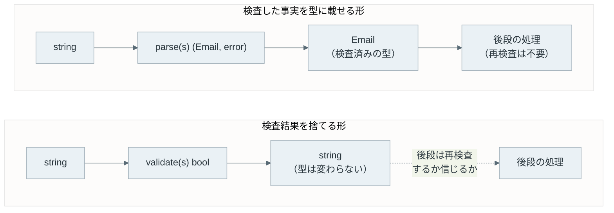
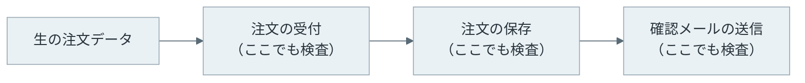
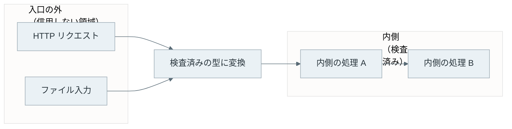
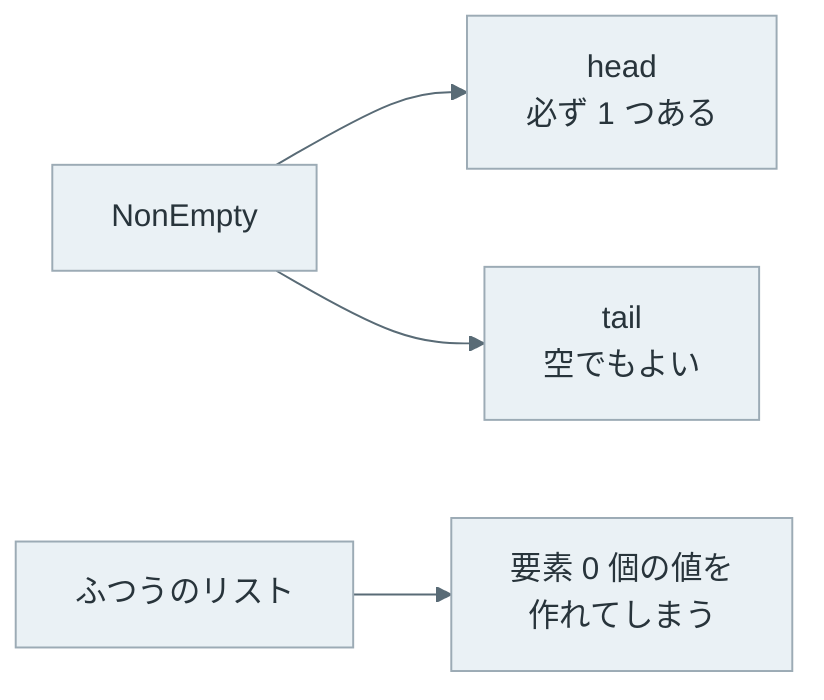
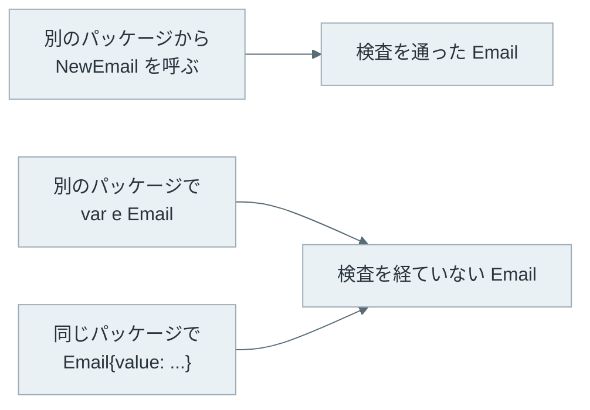
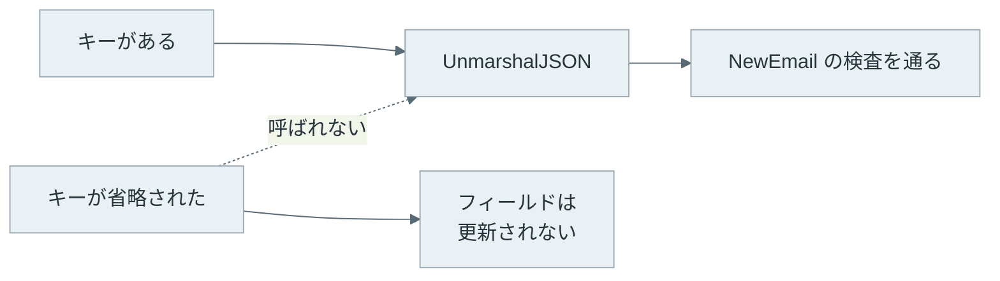

Parse, don't validate は、「外部から来たデータを検査したら、その検査で分かった事実を型として持ち運ぶ」という設計方針です。Alexis King 氏が 2019 年に公開した「[Parse, don't validate](https://lexi-lambda.github.io/blog/2019/11/05/parse-don-t-validate/)」で示しました。ここでの parse は、検査に通った入力を `Email` のような別の型の値に変換し、通らなければ失敗を返す処理です。validate は検査の結果だけを返し、値の型は変えません。

この方針が役に立つのは、外部からの入力を複数の関数に渡しながら処理を進めるコードです。注文データなら、注文 ID・商品コード・数量・メールアドレスがそのまま後段の関数に流れていき、各関数は同じ検査を繰り返すか、検査済みだと暗黙に信じるかのどちらかになります。



上記の図の右では、検査で分かった事実を `Email` という型に載せて後段に渡しています。Go では、宣言しただけの変数に入る初期値（ゼロ値）が、この保証の抜け道になります。

<br>

本記事では、validate で失われる事実と、それを型に載せる方法を説明します。答える疑問は次の 5 つです。

- validate で検査すると、何が失われるのか。
- 検査した値と後段が使う値がずれると、何が起きるのか。
- 外部からの入力は、どこで型に変換するのか。
- 不正な値を作れない型は、Go の型とコンストラクタでどこまで実現できるのか。
- `encoding/json` で読み込む入口でも、同じ検査を通すにはどうするのか。

本記事で扱うのは、入力そのものから判定できる形式・構造・値域などの不変条件です。在庫の有無や権限のように、外部状態に問い合わせなければ決まらない条件は扱いません。

---

### validate で失われる事実

`validate` という名前の関数は多くの場合、`bool` か `error` を返します。`error` なら失敗の理由や種類まで運べます。ただし、検査対象の型は前後で変わりません。`string` は `string` のままなので、検査によって得た「この値は条件を満たしている」という事実は、後段に型として引き継がれません。値を受け取った関数は、それが検査済みかどうかを型から判断できません。



上記の図では同じ検査が 3 箇所に複製されています。問題は重複そのものより、後段の検査で失敗した時には、前段がその入力で既に処理を進めてしまっている点です。例えば確認メールの送信でアドレスの不正が分かった時には、注文は既に保存されています。

解析と検査のコードが処理の各所に散らばるこの状態は、Shotgun parsing と呼ばれるアンチパターンです。King 氏は、この語の定義を 2016 年の論文 The Seven Turrets of Babel から引いています。

<br>

検査した値と、後段が使う値が別物になることもあります。文書指向の DB（データベース）である Apache CouchDB は、ユーザーの登録情報の文書（`_users`）を Erlang で書かれた本体で解析し、重複したキーも両方残したまま JavaScript の検査関数に渡していました。検査関数のパーサーは後に現れた `roles` だけを残し、本体が権限を判定する時は前に現れた `roles` を使います。この差を突いて、検査を通った文書で管理者の役割を得られたのが [CVE-2017-12635](https://docs.couchdb.org/en/stable/cve/2017-12635.html) です。

前の図とは違い、検査は 1 回でした。検査関数が返したのは可否だけで、権限の判定には同じ文書の別の読み方が使われました。問題は権限そのものではなく、同じ JSON の読み方が 2 つあったことです。検査で得た値を後段に渡す形なら、読み方は 1 つで済みます。

---

### 入口での変換

生のデータは、できる限り入口で、後段が必要とする細かさの型に変換します。内側の関数は、受け取った型が検査済みだと前提にできます。



入口に寄せるのは変換の場所で、回数ではありません。避けるのは、解析を終える前にその入力に基づく処理を始めることです。分岐が決まってから更に条件の多い型が必要なら、その時点で追加の解析をして構いません。例えば注文を解析した後で支払い方法がカードだと決まったら、その段でカード番号を専用の型に解析します。

---

### 不正な値を作れない型

King 氏が例に使う `NonEmpty` は、先頭の要素をリスト本体とは別のフィールドとして持つ型です。残りの部分が空でも先頭は必ず存在するので、要素 0 個の値を作れません。前述の記事に "really just a tuple"（実質はただのタプル）とある通り、これは直和型（複数の候補のうちどれか 1 つを持つ型）ではなく直積型（複数の値をまとめて持つ型。struct など）です。



Go でも `type NonEmpty[T any] struct { head T; tail []T }` として同じ形を書けます。

一方、値として取り得る候補を「AかBのどちらか」に限定する直和型（代数的データ型の一種）は、Goにはありません。ジェネリクスの type constraint には `A | B` という union type term があります。これは型引数が満たすべき条件を書くための記法で、値がどちらか一方であることを保持する型ではありません。

直和型の代わりには、interface と型スイッチで近い形を組みます。interface に未公開のマーカーメソッドを置けば、パッケージ外からそのメソッドを直接実装することは防げます。ただし既存の実装型を埋め込んだ型は、メソッドが外側の型に昇格（promote）して interface を満たすため、排除できません。Go の interface を完全な直和型として閉じることはできず、型スイッチが全ての場合を尽くしているかもコンパイラは保証しません。

---

### コンストラクタで塞げる範囲

メールアドレスのように値の中身へ条件を課す場合は、文字列という型だけでは不正な入力を排除できません。

King 氏は、不正な状態を型だけで表現できない場合には、内部表現を隠した型とスマートコンストラクタ（検査を通った時にしか値を返さない公開コンストラクタ）で解析器を模すことを勧めています。Go では型を公開したままフィールドを未公開にし、公開コンストラクタから生成させる形に置き換えられます。別のパッケージからは、未公開フィールドに値を入れた状態で組み立てられません。

```go
package email

// Email はメールアドレスとして扱う文字列を表す。
// ゼロ値は無効で、通常は NewEmail から生成する。
type Email struct{ value string }

func NewEmail(s string) (Email, error) {
	if !strings.Contains(s, "@") {
		return Email{}, errors.New("invalid email format")
	}
	return Email{value: s}, nil
}

func (e Email) String() string { return e.value }
```

`NewEmail` から得た値は、その時点で `NewEmail` の検査条件を満たしています。`Email` という型であること自体が検査を通ったことを示すわけではなく、検査の厳密さも `NewEmail` の実装が決めます。上の実装なら `"@"` という 1 文字も通ります。

この形でも塞げない経路が 2 つあります。Go の変数は宣言しただけで初期化されるので、`var e Email` はコンパイルを通り、空の `Email` が出来上がります。同じパッケージの中なら `Email{value: "bogus"}` も書けます。



未公開フィールドが塞ぐのは、パッケージの外から任意の内部値を直接注入する経路だけです。

---

### `encoding/json` v1 の入口

デシリアライズも外部入力の入口なので、コンストラクタと同じ検査をそこでも通します。以下は標準ライブラリ `encoding/json`（v1）の挙動で、Go 1.25 で `GOEXPERIMENT` として追加された `encoding/json/v2` は API も既定の挙動も異なります。

v1 の `Unmarshal` は未公開フィールドに書き込みません。そのため `Email` に `UnmarshalJSON` を実装しないと、JSON 側がオブジェクトの場合はゼロ値が残り、文字列の場合は型が合わずエラーになります。`Email` は未公開フィールドしか持たないので、`json.Marshal` も `{}` を返し、書き出したものを読み戻せません。入口と出口の両方を自分で実装します。

```go
// UnmarshalJSON は e を書き換えるためポインタレシーバになる。
func (e *Email) UnmarshalJSON(data []byte) error {
	var s string
	if err := json.Unmarshal(data, &s); err != nil {
		return err
	}
	parsed, err := NewEmail(s)
	if err != nil {
		return err
	}
	*e = parsed
	return nil
}

// MarshalJSON は値レシーバにして、値のまま渡した時も扱えるようにする。
// ゼロ値は NewEmail を経ていないので、書き出さずエラーにする。
func (e Email) MarshalJSON() ([]byte, error) {
	if e.value == "" {
		return nil, errors.New("invalid email: zero value")
	}
	return json.Marshal(e.value)
}
```

`UnmarshalJSON` を値レシーバで書くと、書き込み先がコピーになるためコンパイルは通ったまま結果が捨てられます。

`UnmarshalJSON` を実装しても、親オブジェクトからフィールド自体が省略されれば `UnmarshalJSON` は呼ばれず、そのフィールドは更新されません。



JSONを受け取る入力用の型から業務処理用の型へ変換する際に、必須のEmailが設定されているかを確認します。

| 保ちたいこと | Go にあるもの | 無いもの | 代わりに使う手 |
|---|---|---|---|
| 外部から任意の内部値を直接構築できない | 未公開フィールドとコンストラクタ関数の組 | ゼロ値の生成を止める仕組み | 入力用の型と後段の型を分け、変換時にゼロ値を弾く（ゼロ値が有効値と重なる型は除く） |
| 「A か B」を型で閉じる | interface と未公開のマーカーメソッド | 値としての直和型、網羅性を機械的に確かめる手段 | 静的解析ツールやレビューで補う |
| デシリアライズも入口に含める | `json.Unmarshaler` と `json.Marshaler` | `Unmarshal` がコンストラクタを通る保証 | 入出力を自分で実装し、後段の型への変換で必須フィールドの欠落も検出する |

---

### 利点

- 検査した事実を型で運べるため、コンストラクタを通った値については後段の再検査が必要ない
- 不正な状態が生じ得る箇所は、外部入力の変換境界・ゼロ値・同一パッケージ内の直接生成に整理できる

---

### 欠点

Parse, don't validate は、検査の結果を型で保証する方に寄せます。その分、次の制約が加わります。

- 型を増やすたびに、コンストラクタと入出力の実装が定型的に増える
- Go ではゼロ値を止められず、任意の内部値の直接構築を防げるのもパッケージの外に対してだけになる
- 値としての直和型が無いため、型で表現しきる設計を保つには静的解析とレビューによる補強が必要

---

### 適さないケース

- 一度しか使わない使い捨てのスクリプトで、型を増やす手間が検査の手間を上回る場合
- 外部ライブラリの型をそのまま経由する箇所が多く、コンストラクタを強制できない場合
- 検査結果を使い回す前に、値がすぐ使い捨てられる処理
