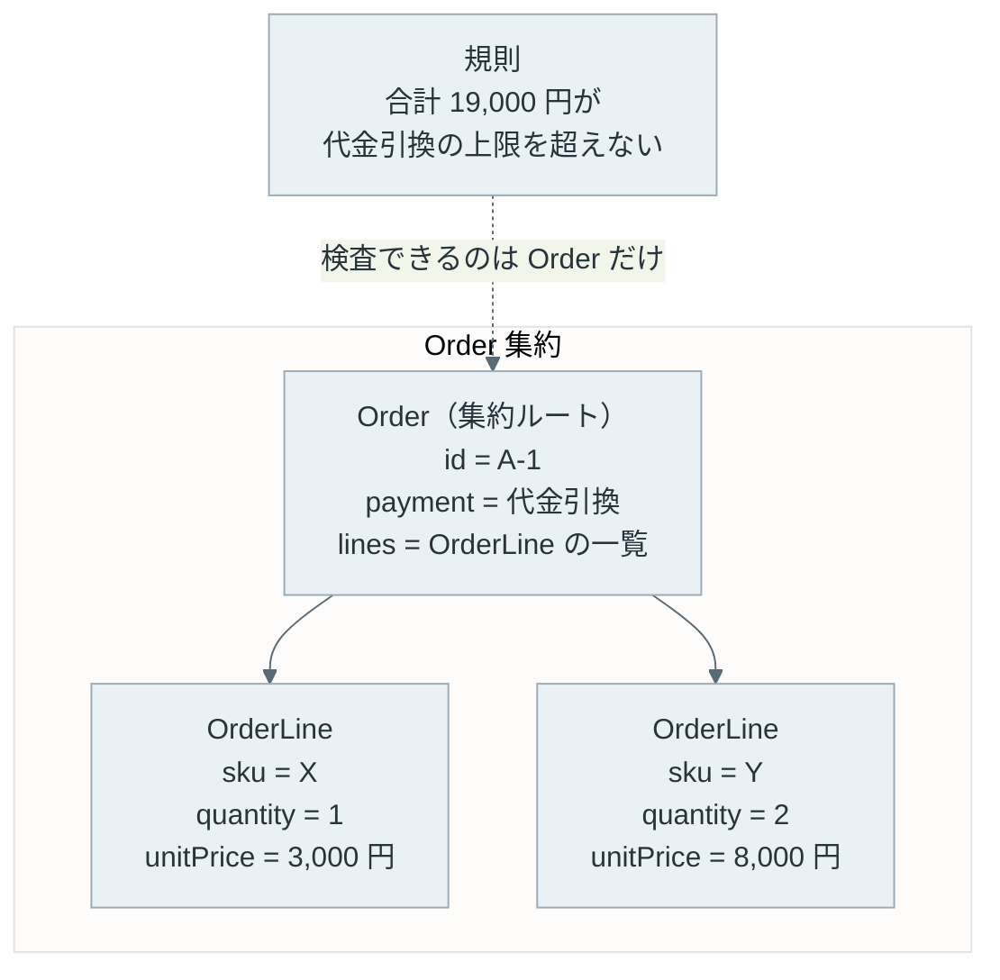
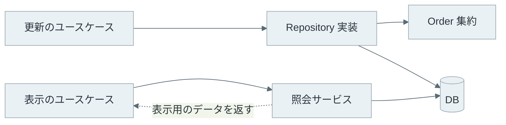

Repository とは、Aggregate（集約。規則を一緒に守るオブジェクトのまとまり）を 1 つの単位として保存・復元する仕組みで、呼び出す側からはメモリ上のコレクションのように見えます。注文と明細のように、まとめて検査すべき規則を持つデータを DB（データベース）に保存する時に、明細だけを書き換える経路を塞ぐために使います。

一般には「ドメイン層とデータマッピング層の仲介役で、コレクションのようなインターフェースを通じてドメインオブジェクトにアクセスさせるもの」と定義されています（Martin Fowler 氏の書籍『Patterns of Enterprise Application Architecture』所収、Edward Hieatt 氏と Rob Mee 氏による [Repository](https://martinfowler.com/eaaCatalog/repository.html)）。

この定義に集約は現れません。出し入れの単位を集約に結び付けているのは DDD（Domain-Driven Design、ドメイン駆動設計）です。

DDD の Repository は「ユビキタス言語で表現された、集約への問い合わせ手段」と要約されています（Eric Evans 氏の [DDD Reference](https://www.domainlanguage.com/wp-content/uploads/2016/05/DDD_Reference_2015-03.pdf)）。ユビキタス言語とは、[Bounded Context](../bounded-context/) の中の全員が会話・図・コードで同じ意味で使う語彙です。

<br>

層は 3 つ出てきます。ドメイン層は業務の規則と、それを表す型を置く場所です。アプリケーション層はユースケースの手順を組み立てる場所で、インフラストラクチャ層は DB やネットワークを実際に触る場所を指します。

例には、注文（`Order`）と、その中にある明細を使います。以下は、3 つの層の間の参照の向きを表した図です。



上記の図の矢印は、どれも外側の層から内側の層へ向いています。点線は、実装がインターフェースを満たす関係です。ドメイン層は DB の存在を知らないまま「注文を保存する」と書けます。

<br>

本記事では、集約単位で保存・復元する Repository の実装を説明します。取り上げるのは、次の疑問です。

- 集約ルートを迂回する経路は、なぜ塞ぐ必要があるのか。
- Repository のインターフェースは、どの層に置くのか。
- 集約を 1 つの単位として出し入れすると、実装は何を引き受けるのか。
- 明細を全て消してから書き直す保存は、何を壊すのか。
- 一覧の表示のような読み取りでは、どこに限界があるのか。

O/R マッパ（Object-Relational Mapper、オブジェクトと DB のテーブルを対応付ける仕組み）の選び方や DB スキーマの設計は本記事では扱わず、[Value Object・Entity・Aggregate](../value-object-entity-aggregate/) で扱った集約ルートと不変条件の話を前提にします。

---

### Repository が必要な理由

以下は、Order 集約の中身と、そこに置かれた規則です。



上記の図の `sku` は SKU（Stock Keeping Unit、在庫管理の最小単位）で、在庫を数える単位ごとに振る番号です。合計 19,000 円は、`unitPrice` と `quantity` を明細 2 件分だけ掛けて足した値です。

`OrderLine` は自分の `sku`、`quantity`、`unitPrice` しか知らないため、合計が上限を超えたかどうかを 1 件では判定できません。判定できるのは、`lines` に 2 件とも持っている `Order` です。集約の外から `OrderLine` に直接届く経路があると、この判定を通らずに `quantity` や `unitPrice` が変わります。

ユースケースが直接 SQL を書くと、その経路ができます。次の 1 文は `Order` を経由しません。

```sql
UPDATE order_lines SET quantity = 10 WHERE order_id = 'A-1' AND sku = 'X';
```

集約ルートを迂回して明細を書き換える経路は、[Aggregate](../value-object-entity-aggregate/) でも扱いました。オブジェクトの参照ではなく SQL で起きているだけで、壊れ方は変わりません。Evans 氏は、制約のないクエリが集約を 2 通りの形で壊し得ると書いています。

1 つは、オブジェクトから特定のフィールドだけを引き出してカプセル化を破ることです。例えば `order_lines` から数量だけを読み、合計の判定をアプリケーション層で行う形です。もう 1 つは、集約の内部にあるオブジェクトだけを単体で構築することです。明細だけを取り出すと、集約ルートである注文は取り出されたことを知らないため、合計金額の上限を検査する機会がありません。

この `UPDATE` はエラーを返しません。壊れた状態が表に出るのは、後で誰かが注文を復元して合計を見た時で、原因になった `UPDATE` とは時間も呼び出し元も離れています。Repository は、この経路を塞ぐために出入り口を集約ルートに一本化します。

<br>

一本化するだけなら、ユースケースの中で毎回 `Order` を組み立て直しても達成できます。その場合、注文を読むたびに 2 つのテーブルへの SELECT と集約の組み立てがユースケースに散り、業務の手順と SQL が同じ関数に並びます。Repository が引き受けるのは、この組み立てと分解を 1 箇所に集め、ドメイン層の語彙で呼べるインターフェースの裏に置くことです。

ドメイン層が DB を知らなくなると、テストで実装を差し替えられるようになります。ただ、差し替えられることは結果であって、Repository を置く理由ではありません。テストのためだけなら、DB のクライアントを引数で渡す形でも同じことができます。

---

### インターフェースの置き場所

どんな語で呼び出すかを決めるのはドメイン層で、それを DB の都合でどう満たすかを決めるのがインフラストラクチャ層、という分担にします。Go でこの分担を書くと次のようになります。

```go
// Package order は販売コンテキストの注文集約です。
package order

import "context"

// ID は注文の同一性です。
type ID string

// Repository は Order 集約の出し入れを表します。実装は infrastructure に置きます。
type Repository interface {
	// FindByID は集約全体を復元して返します。
	FindByID(ctx context.Context, id ID) (*Order, error)
	// Save は集約の現在の状態をそのまま書き込みます。
	Save(ctx context.Context, o *Order) error
	// Remove は集約を取り除きます。
	Remove(ctx context.Context, id ID) error
	// FindUnshipped は出荷が済んでいない注文を返します。
	FindUnshipped(ctx context.Context) ([]*Order, error)
}
```

前の 3 つが集約の出し入れで、`FindUnshipped` は業務の語をそのままメソッド名にしたものです。インターフェースの宣言をドメイン層に置いたことが、依存の向きを決めています。`implements` を書く言語でも、実装がインターフェースを参照する向きは同じです。

この向きの変え方を依存性逆転と呼びます。呼び出す側でインターフェースを宣言し、呼び出される実装がそれを満たすと、参照は実装からインターフェースに向き、上位の層が下位の層を参照する関係が消えます。なお、DDD Reference はインターフェースをどの層に置くかを指定していません。冒頭の図の配置は依存性逆転を当てはめたもので、Repository の定義そのものではありません。

注意点として、インターフェースの置き場所を変えただけでは依存は消えません。Repository のメソッドが返す型が DB の行をそのまま写した構造体なら、ドメイン層はテーブルの形に縛られたままです。返す型が集約であることまで含めて、この配置が成立します。行そのものが自分の保存方法を知る形は、Fowler 氏が Repository と分けている [Active Record](https://martinfowler.com/eaaCatalog/activeRecord.html) です。

`FindByID` が返すのは注文 1 件の行ではなく、明細まで含んだ集約全体です。復元の単位が集約になるのは、集約全体にまたがる不変条件を検査できるのが、集約全体を持っている時だけだからです。明細 1 件で閉じる規則の検査に、集約全体は必要ありません。ただし、`FindByID` を呼ぶ時点では、その後ユースケースがどちらの規則に触るのかを Repository は知らないため、常に全体を返す契約にします。

---

### 集約単位の出し入れ

Evans 氏は、直接アクセスが実際に必要な集約ルートに対してだけ Repository を用意することを求めています。テーブルごとに 1 つ作るものではないので、`OrderLine` のための Repository は作りません。明細は `Order` を通してのみ手に入ります。

テーブルごとに作れば、実装は素直になります。その代わり、`OrderLine` を単体で保存する経路が開き、上で見た `UPDATE order_lines` と同じ更新をアプリケーションのコードから書けてしまいます。

集約を 1 つの単位として扱うには、Repository に次の 4 つの処理が必要です。集約全体の書き戻し、同時更新の検出、検索条件の翻訳、そしてトランザクションの範囲の管理です。

---

### 集約全体の書き戻し

`Save` は集約の現在の状態をそのまま書き込む契約なので、実装は「今ある明細の一覧」を DB に反映します。どの明細が増えたのかは渡されないため、最も単純な実装は、全ての明細を削除してから書き直します。

```go
// saveLines は明細を全て削除してから、集約が今持っている明細を書き直します。
func saveLines(ctx context.Context, tx *sql.Tx, o *order.Order) error {
	if _, err := tx.ExecContext(ctx,
		"DELETE FROM order_lines WHERE order_id = ?", string(o.Identity())); err != nil {
		return err
	}
	for _, l := range o.Lines() {
		if _, err := tx.ExecContext(ctx,
			"INSERT INTO order_lines (order_id, sku, quantity, unit_price) VALUES (?, ?, ?, ?)",
			string(o.Identity()), l.SKU, l.Quantity, l.UnitPrice); err != nil {
			return err
		}
	}
	return nil
}
```

`o.Identity()` は集約ルートの ID を返し、`o.Lines()` は明細のコピーを返します。明細を復元する側も `sku`、`quantity`、`unit_price` を読み、同じ `OrderLine` を組み立てます。これで、図の 3,000 円と 8,000 円の単価を保存・復元の途中で失わず、`Order` が合計を検査できます。例えば、次の条件ではこのやり方が使えません。

- 明細の行が他のテーブルから[外部キー](/notes/database-systems/foreign-key/)で参照されている
- 行ごとの更新履歴やバージョン列を持っている。DB から見た記録が 1 回の更新ではなく削除と挿入になり、行の連続性が切れる
- 主キーが `AUTO_INCREMENT` のような DB 生成の値である。挿入し直した行の ID が変わる

1 つ目の条件を SQLite 3.54.1 で、外部キーの検査を有効にして試しました。注文 A-1 の明細 X に出荷記録を 1 件付け、出荷記録のテーブルから明細の行を外部キーで参照させます。その上で、Y の数量だけを 2 から 3 に変えた集約を上の `saveLines` と同じ処理で保存し、前後の出荷記録の件数を数えました。

```text
ON DELETE CASCADE
  Save の前の出荷記録: 1 件
  Save: 成功
  Save の後の出荷記録: 0 件
ON DELETE RESTRICT
  Save の前の出荷記録: 1 件
  Save: constraint failed: FOREIGN KEY constraint failed (1811)
  Save の後の出荷記録: 1 件
```

CASCADE では、触っていない X の出荷記録がエラーも無く消えました。RESTRICT では、Y を変えただけの保存が X に付いた出荷記録に阻まれて失敗します。どちらも、`Save` に変更内容が渡されないことから起きています。

差分が必要であれば、方法は 2 つあります。1 つは集約に変更内容を記録させる方法で、集約が自分の変更履歴を持ちます。もう 1 つは、読み込んだ時点の状態を Repository が複製して持っておき、`Save` の時に比較する方法です。

例えば明細が X が 1 個・Y が 2 個から、X が 1 個・Y が 3 個・Z が 1 個に変わっていれば、Y だけを UPDATE し、Z を INSERT します。

---

### 同時更新の検出

状態をまるごと上書きする契約には、もう 1 つ気を付ける所があります。2 つの処理が同じ注文を読み、それぞれ別の明細を足して `Save` を呼ぶと、後から書いた方の状態が全体を上書きし、[先に書いた変更が消えます](/notes/database-systems/transaction-isolation/)。集約ルートを通しても、この上書きは防げません。

対処には、集約にバージョン番号を持たせる方法があります。集約ルートのテーブルに `version` 列を足し、`FindByID` で読んだ値を集約が覚えておいて、`Save` が発行する `UPDATE` の条件に渡します。上の `saveLines` と同じトランザクションで、次の 1 文を実行します。

```sql
UPDATE orders SET version = 8 WHERE id = 'A-1' AND version = 7;
```

読み込んだ時のバージョンが 7 で、その間に誰も書いていなければ、上の文は 1 行を更新してバージョンを 8 に上げます。先に別の処理が 8 に上げていた場合、`WHERE` に合う行が無く、更新された行は 0 件になります。実装は 0 件を競合として扱い、明細の削除と挿入ごとトランザクションを rollback します。

バージョンを集約ルートの行にだけ置くのは、明細しか変わっていない場合も同じ番号を上げて、集約全体を 1 つの単位として守るためです。

この対処を入れると、`Save` の契約が変わります。「そのまま書き込む」から「読み込んだ後に他の処理が書き換えていなければ書き込む」になるので、失敗をインターフェースに出します。

```go
// ErrConflict は、読み込んでから Save までの間に
// 他の処理が同じ集約を書き換えていた場合に返ります。
var ErrConflict = errors.New("order: conflict")
```

呼び出す側は `ErrConflict` を受け取ったら、`FindByID` から読み直して同じ操作をやり直すか、利用者に知らせるかを選びます。どちらを選ぶかは操作ごとに変わるため、Repository では決めません。集約を守るのは Repository の仕事で、競合した時にどう振る舞うかはユースケースの判断になります。

先に書いた更新が消える件数は、Python 標準の sqlite3（SQLite 3.46.1）で数えました。K 個の処理が同じ注文 A-1 を `FindByID` で読み、それぞれ明細を 1 件足して `Save` します。

読み込みと保存の順番は seed を固定した乱数で入れ替えるシミュレーションで、SQL は実際の DB で実行し、K ごとに 200 回繰り返しました。バージョンを検査する側は、`ErrConflict` を受けたら読み直してやり直します。以下は `Save` の部分です（[全体](https://github.com/nao1215/debimate/blob/main/content/notes/software-architecture/repository/lab/lost_update.py)からの抜粋）。

```python
def save(con, version, lines, check_version):
    con.execute("BEGIN IMMEDIATE")
    if check_version:
        cur = con.execute(
            "UPDATE orders SET version = ? WHERE id='A-1' AND version = ?",
            (version + 1, version))
        if cur.rowcount == 0:  # ErrConflict
            con.execute("ROLLBACK")
            return False
    con.execute("DELETE FROM order_lines WHERE order_id='A-1'")
    con.executemany("INSERT INTO order_lines VALUES ('A-1', ?, ?)", lines)
    con.execute("COMMIT")
    return True
```




<details>
<summary>件数の出力</summary>

全体は [lost_update_output.txt](https://github.com/nao1215/debimate/blob/main/content/notes/software-architecture/repository/lab/lost_update_output.txt) にあります。

```text
 K  added | no version: lost | version + retry: lost conflicts
 1    200 |                0 |                     0         0
 2    400 |               89 |                     0        98
 4    800 |              379 |                     0       473
 8   1600 |             1074 |                     0      1644
```

</details>

処理が 2 つ重なるだけで、足した明細の 22% がエラーも無く消えました（no version check）。バージョンを検査すると（version check + retry）消える明細は 0 件になり、代わりに読み直しの回数が重なる処理の数とともに増えます。

`Remove` も同じ単位で働き、集約を明細ごと取り除きます。差分の計算とバージョンの管理を実装が引き受ける代わりに、集約を更新する正しい経路が 1 つに定まります。

定まるのは正しい経路であって、他の経路を書けなくするわけではありません。同じアプリケーションの中で `db.Exec` に `UPDATE` を渡すコードは書けてしまうため、塞ぐなら DB 接続を持つ型をインフラストラクチャ層の中に閉じ込め、外のパッケージから触れなくします。

---

### 検索条件の渡し方

Evans 氏は、ドメイン専門家にとって意味のある条件でオブジェクトを選ぶメソッドを用意することを求めています。「出荷が済んでいない注文」は業務で使う語で、`FindUnshipped` はその語をそのままメソッド名にしたものです。一方で、`FindByCustomerIDAndStatusAndCreatedAfter` は SQL の `WHERE` 句を写しただけで、業務の語にはなっていません。

条件の組み合わせが増えれば、メソッドも増えます。対処の方向は 3 つあります。


- title: メソッドを増やす
  body: 業務の語になる条件だけをメソッドにします。
  items:
  - 条件の種類が少なく、名前が業務の語に収まる場面に向く
- title: Specification を渡す
  body: 条件そのものをオブジェクトにして組み合わせます。
  items:
  - 条件を実行時に組み立てる必要がある場面に向く
- title: 照会の経路を分ける
  body: 表示のための検索を Repository の外に出します。
  items:
  - 検索条件が画面の都合で決まり、更新に使わない場面に向く


Specification とは、Evans 氏と Fowler 氏が論文「[Specifications](https://martinfowler.com/apsupp/spec.pdf)」で示したパターンで、候補が条件に合うかを判定する規則をオブジェクトにします。論文が中心の考えとして挙げているのは、合致の判定方法の記述と、判定される候補オブジェクトを分離することです。条件を `and` や `or` で組み合わせられるため、メソッド名の組み合わせ爆発は起きません。

ただし、この論文が扱っているのは、候補を受け取って真偽を返す `isSatisfiedBy` という判定の抽象で、条件を DB のクエリに変換する方法は含まれていません。Repository に Specification を渡す設計では、`WHERE` 句への変換を自分で書く必要があります。

全件を読み込んでから絞る実装は正しい結果を返すものの、時間とメモリが候補数に比例するため、早い段階で実用に耐えなくなります。条件の種類が少ないうちは、メソッドを増やす方が読みやすいです。メソッド名を業務の語で表せなくなったら、Specification を渡すか、照会の経路を分ける方法を検討します。

---

### トランザクションの範囲

Evans 氏は、トランザクションと分散（複数のサーバーに分けて置くこと）の単位として、集約の境界を使うことを求めています。1 つの集約は [1 回のトランザクション](/notes/database-systems/transaction-scope/)で更新し、別々の集約は別の DB やサーバーに置いても構わない、という扱いです。

1 回の操作で 1 つの集約だけを更新するなら、`Save` の中でトランザクションを開いて閉じる形にできます。この形では `FindByID` と `Save` が別のトランザクションになるため、上で書いたバージョン番号による検査が別途必要です。

複数の集約を 1 回の操作で更新したくなった場合、まず境界が業務と合っていない徴候として疑います。2 つの集約にまたがって守るべき規則があるなら、その規則を検査できるのは両方を持っている場所だけで、境界の引き直しが解になるからです。

<br>

集約の境界を変えない場合、トランザクションの扱いには 2 つの方法があります。1 つは、別々のトランザクションに分けて結果整合性（一時的に状態がずれることを認める考え方）で追いつかせる方法で、これは [Aggregate](../value-object-entity-aggregate/) のノートで扱いました。

もう 1 つは、トランザクションを Repository の外で開いて実装に渡し、1 つのトランザクションに収める方法です。Go では `context.Context` に入れて渡す方法と、トランザクションを表す型を引数に足す方法があります。

`context.Context` に入れる方法は `Save(ctx, o)` の形を変えずに済む代わりに、トランザクションが必要かどうかをシグネチャから読み取れません。引数に足す方法では、`Save(ctx, tx, o)` のようにトランザクションが要ることがシグネチャに現れる代わりに、ドメイン層のインターフェースが永続化の語を持ちます。

---

### 読み取りでの限界

Repository は集約全体を復元します。この性質は不変条件を守る時に役に立ち、画面に一覧を出す時には重くなります。注文の一覧に 20 件を並べ、1 件につき注文番号と合計金額と状態の 3 つだけを表示する場合でも、20 個の集約を明細まで含めて構築します。Repository を使っていても、この無駄は避けられます。

Evans 氏は、完全に構築された集約であるかのように見せる proxy を返す選択肢も挙げています。明細を触られた時に初めて DB を読む形になるため、一覧の各行で明細を触ると読み込みが件数分だけ走ります。もう 1 つの方向が、照会の経路を Repository から分けることで、以下ではその方法を扱います。

以下は、更新と表示で経路を分けた構成です。



上記の図の実線は全て呼び出しの向きで、下の経路は集約を通らずに DB に届いています。照会サービスは表示に必要な列だけを SELECT し、集約ではないデータを返すため、明細を構築する処理が発生しません。この分割を明示的な設計として扱い、更新と照会で別のモデルを持つものが CQRS（Command Query Responsibility Segregation）です。CQRS 自体は [CQRS](../cqrs/) で扱います。

照会の経路が読み取りだけに閉じている限り、読み取りが集約を通らないことは規則を弱めません。閉じているという条件が付くのは、照会サービスが返したデータをそのまま更新の入力にすると、集約ルートを通らない更新経路が戻ってくるからです。更新は、必ず集約を復元し直してから行います。

---

### 利点

- 集約の出入り口が 1 箇所に定まり、集約ルートを通らない更新が設計上の逸脱として見分けられる
- ドメイン層に SQL が現れず、業務の規則だけを読める状態でモデルを保てる
- 検索の条件が業務の語でメソッド名に現れ、モデルの語彙として読める
- 保存と復元の単位が集約と一致し、トランザクションの範囲が設計から読み取れる
- 副次的な結果として実装を差し替えられ、DB を立てずにドメインの規則を検証できる

---

### 欠点

Repository は、集約を 1 つの単位として出し入れします。この契約から、次の制約が出てきます。

- 集約全体を復元するため、一覧表示のように一部の属性しか使わない処理で無駄が出る
- 差分ではなく状態を渡す契約になり、どの行を更新すべきかを実装が自分で決める必要がある
- 状態をまるごと上書きするため、同時に保存されると先の更新が消え、バージョン番号による対処が必要
- 条件の組み合わせが増えるとメソッドが増え、Specification のような別の仕組みを用意する必要がある
- 複数の集約を 1 つのトランザクションで更新する時、境界の外にトランザクションを持ち出す必要がある
- インターフェースと実装が別の層に分かれるため、作成と参照しか無い機能では記述だけが増える

---

### 適さないケース

- テーブルの内容をそのまま入出力し、更新の規則がほとんど無いシステム
- 表示のための読み取りが中心で、集約を復元する必要が薄い機能
- 検索条件が画面の都合で頻繁に変わり、業務の語に落とせない機能
- 大量の行を 1 つの UPDATE でまとめて書き換える一括処理（集約を 1 件ずつ取り出して保存すると、往復の回数だけ遅くなる）
