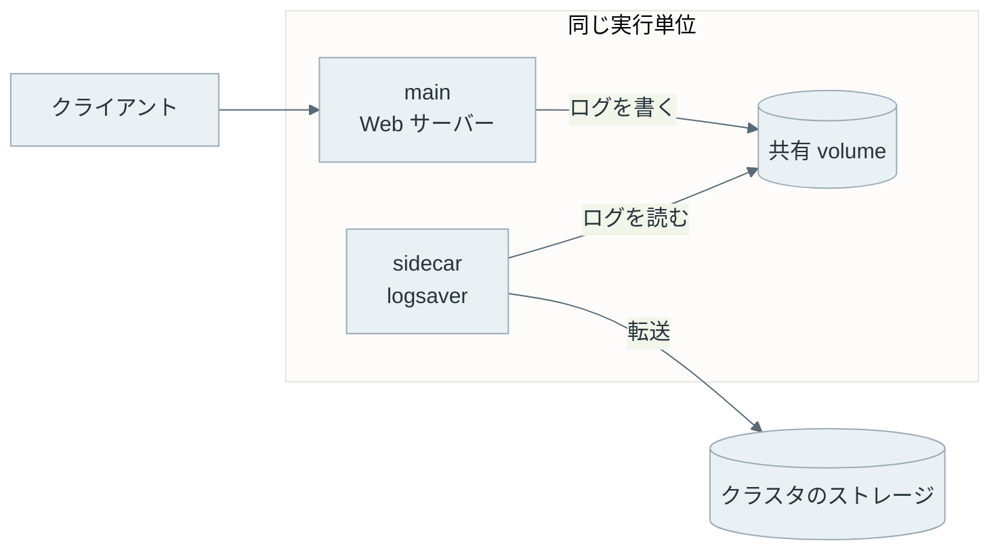
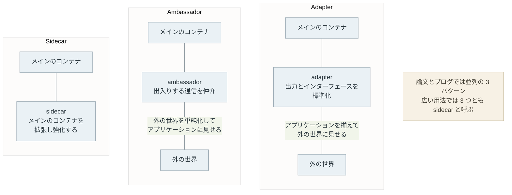
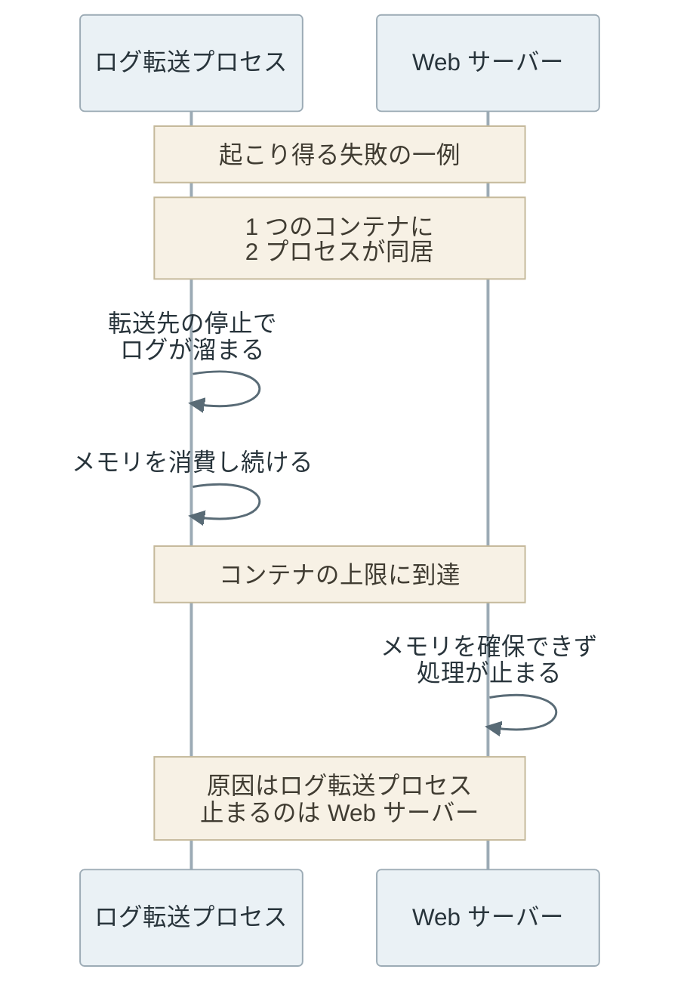
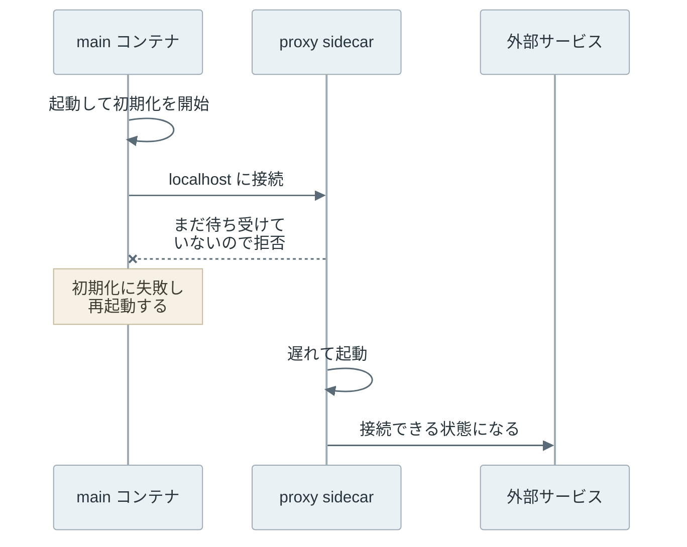
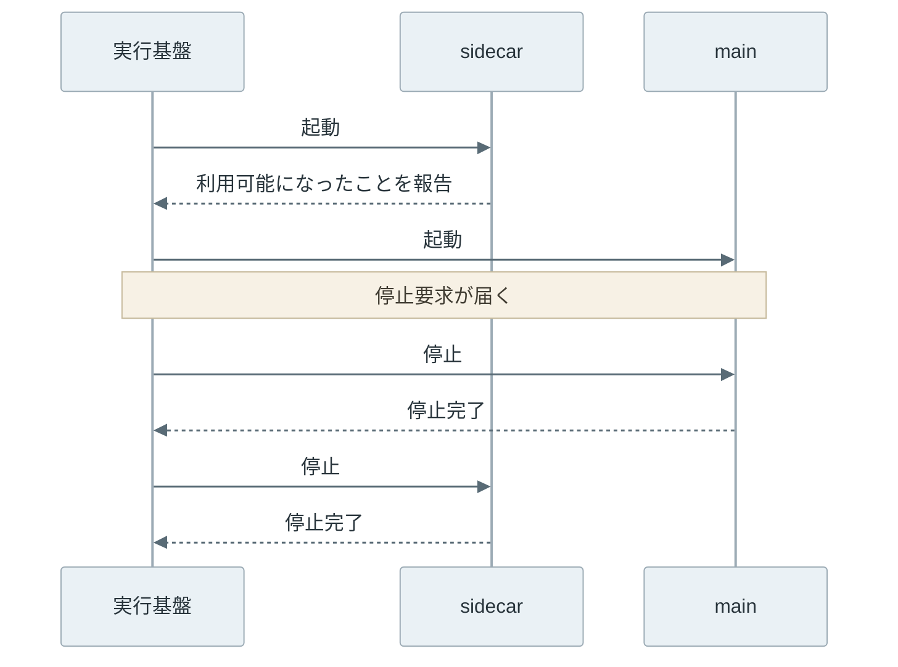

Sidecar とは、主となるアプリケーションのコンテナと同じ実行単位に置かれ、そのアプリケーションに機能を足す補助コンテナです。ログの転送や設定の取得など、業務ロジックとは別の共通処理を担当します。ここで言う実行単位とは、同じマシンにまとめて配置され、まとめて作られ削除されるコンテナの集まりで、Kubernetes の Pod や Amazon ECS の Task が当たります。

本記事では、コンテナの配置とライフサイクルを管理する基盤を実行基盤と呼びます。Kubernetes や Amazon ECS がその例です。

以下は、Web サーバーのログを転送する構成の例です。

上記の図の 2 つのコンテナは、共有 volume だけで繋がっています。volume とは、コンテナの外に置かれ、同じ実行単位の複数のコンテナから同じ内容が見えるファイルの置き場です。マウントとは、volume が自分のファイルシステムの一部として見えるように指定する操作です。Web サーバーはログをファイルに書くだけで、転送先も転送の再試行も知りません。logsaver はログの形式を知っていれば動くので、Web サーバーが何語で書かれていても同じコンテナイメージを使い回せます。

本記事では、Sidecar で機能を足す理由と、同居させる時に決める事柄を説明します。扱う疑問は次の 5 つです。

- 機能をライブラリや同じコンテナに入れず、なぜ別のコンテナに出すのか。
- 同じ実行単位のコンテナは、何を共有し、何を分けるのか。
- 起動と停止の順序は、なぜ問題になるのか。
- sidecar を付けた Kubernetes の Job が終わらなかったのは、なぜか。
- どのような用途に使われ、どのような構成では分ける利益が小さいのか。

本記事で説明するのは、1 台のマシンに同居させる構成だけです。複数のマシンにまたがる [Leader and Followers](../../distributed-systems/leader-and-followers/) のようなパターンは扱いません。

---

### 名前の由来と 3 つのパターンの関係

Brendan Burns 氏と David Oppenheimer 氏が 2016 年に発表した論文「[Design Patterns for Container-based Distributed Systems](https://www.usenix.org/conference/hotcloud16/workshop-program/presentation/burns)」の 4.1 節は、複数のコンテナを 1 つの実行単位に置く構成の中で Sidecar が最も一般的なパターンだとし、「Sidecar はメインのコンテナを拡張し、強化する」と位置付けています。例も冒頭の図と同じ logsaver です。

Sidecar という名前は、Brendan Burns 氏が 2015 年 6 月 29 日に公開したブログ「[The Distributed System ToolKit: Patterns for Composite Containers](https://kubernetes.io/blog/2015/06/the-distributed-system-toolkit-patterns/)」で、[Ambassador](../ambassador/)・[Adapter](../adapter/) と並ぶ 3 つのパターンの 1 つ目として紹介されました。上記の論文は、このブログのパターンを体系化したものです。

ブログでも論文でも 3 つは並列に置かれ、メインのコンテナを拡張するのが Sidecar、メインのコンテナに出入りする通信を仲介するのが Ambassador、出力とインターフェースを標準化するのが Adapter です。

 

一方で、現在の Kubernetes 周辺では、同居する補助コンテナ全般を sidecar と呼ぶ用法も広まっています。この用法では、通信を仲介するプロキシも sidecar に含まれます。以降の節では、この広い意味で sidecar と書き、論文の分類と区別が必要な所だけ Ambassador・Adapter の名前を出します。

以下は、3 つのパターンの関係です。

---

### Sidecar が必要な理由

ログの転送のような機能を足す方法は、Sidecar のほかに 2 つあります。1 つはライブラリとしてアプリケーションのコードに組み込む方法で、もう 1 つはメインのコンテナイメージに同梱し、1 つのコンテナで 2 つのプロセスを動かす方法です。

ライブラリで足すと、言語ごとに実装が必要です。例えば、Go・Java・Python で書かれたアプリケーションに、ログの転送・設定の同期・メトリクスの変換・通信の暗号化の 4 つを足す場合、3 言語 × 4 機能で 12 個の実装を保守する必要があります。転送先の仕様が変わった時に直す場所も 3 箇所あり、直した後は全てのアプリケーションを再ビルドして配り直す必要があります。

同梱する方法では、実装は 1 つで済みます。代わりに、1 つのコンテナに入れた 2 つのプロセスは、実行基盤から見ると 1 つの資源の上限を共有します。更新とロールバックの単位も 1 つにまとまり、ログの転送だけを直したい場合でも Web サーバーのコンテナイメージを作り直す必要があります。

以下は、転送先が停止してログが溜まった場合に起こり得る失敗の例です。

2 つのプロセスが 1 つの上限を分け合っているので、片方が使い切れば、もう片方の使える分が減ります。別のコンテナに分ければ、それぞれに上限を宣言できます。

Sidecar は、足したい機能を別のコンテナに出します。コンテナを分けると、資源の上限・コンテナイメージ・更新とロールバック・障害の範囲がコンテナごとに独立し、同じ sidecar のイメージを別のアプリケーションにも付けられます。

---

### 共有する資源と分ける資源

Sidecar が成り立つのは、同じ実行単位のコンテナが一部の資源を共有するからです。以下は、共有されるものと分かれるものの一覧です。

| 対象 | 同じ実行単位の中での扱い |
|---|---|
| ネットワーク | 実行単位で共有する設定なら、互いを localhost の別ポートとして呼べる |
| volume（ファイルの置き場） | 宣言して双方がマウントすれば共有される |
| プロセス間通信の資源（共有メモリなど） | 実行基盤が用意していれば共有できる |
| コンテナイメージと依存ライブラリ | コンテナごとに分かれる |
| 資源の上限 | コンテナごとに指定できる |
| イメージのバージョン | コンテナごとに分けて管理できる |
| 再起動と障害の波及 | 実行基盤の設定によってコンテナごとに分かれる |

表の上の 3 行が 2 つのコンテナを結ぶ経路で、残りの行がコンテナごとに分けられるものです。ログの転送のようにファイルを介する用途では volume で繋ぎ、通信を仲介する用途では localhost で繋ぎます。何をどこまで分けられるのかは実行基盤ごとに違い、既定が分離とは限りません。ネットワークを共有しない設定では、sidecar を localhost ではなく別のアドレスで呼ぶ必要があります。

Amazon ECS には、コンテナの停止を実行単位の全体に波及させるかどうかを決める `essential` という設定があります。[公式ドキュメント](https://docs.aws.amazon.com/AmazonECS/latest/developerguide/task_definition_parameters.html)によると、`essential` が true のコンテナが何らかの理由で停止した場合、同じ Task の他のコンテナも全て停止します。既定は true なので、sidecar の停止をアプリケーションから切り離すには、この値を明示的に false にします。

---

### 起動と停止の順序

Sidecar を経由して通信する場合は、コンテナの起動順序を管理する必要があります。メインのコンテナが外部と通信する時に、通信を受け取って転送するプロキシの sidecar を経由させる構成では、sidecar が待ち受けを始める前にメインが通信すると失敗します。2 つのコンテナを同時に起動すると、起動にかかる時間の差で、どちらが先に準備を終えるかが実行のたびに変わります。

以下は、順序を制御しない場合に起きる失敗です。

上記の図のメインのコンテナは、外部サービスの障害でも自身の不具合でもなく、同居する sidecar の起動が遅れたことで失敗しています。

停止の順序でも同じ問題が起きます。メインがリクエストを処理している最中に sidecar が先に停止すると、処理の途中で外部への通信が切れます。逆に、バッチ処理のように main が終わったら実行単位ごと終える構成では、sidecar が動き続ける限り実行単位が終わらず、処理がいつまでも完了扱いになりません。

Kubernetes の Job（完了したら終わるバッチ処理を Pod で実行する仕組み）にログやメトリクスを集める sidecar を同居させると、処理のコンテナが終わっても、sidecar が動いている限り Job は完了しません。2016 年 5 月に[報告](https://github.com/kubernetes/kubernetes/issues/25908)された時点では、sidecar 側に main の終了を検知させ、自分で止まるように改造するしか手がありませんでした。

2023 年の Kubernetes 1.28 で試験的に入った [Sidecar Containers](https://kubernetes.io/blog/2023/08/25/native-sidecar-containers/) では、Pod の終了は main のコンテナだけで決まり、sidecar が動いていても Job は完了します。この仕組みは 1.29 で既定で有効になり、1.33 で[正式な機能](https://kubernetes.io/docs/concepts/workloads/pods/sidecar-containers/)になりました。

以下は、望ましい順序です。実行基盤が sidecar のライフサイクルを扱う役目を持ちます。

上記の図では、sidecar の起動と、利用可能になったことの報告が別の段になっています。プロセスが動き出しただけでは待ち受けは始まっていません。実行基盤が待ち受けのポートへの接続や health check の応答で利用可能かどうかを検査できないと、メインのコンテナに待つ処理を書く必要があります。停止では向きが逆になり、メインが完全に止まってから sidecar を止めます。この順序と検査を宣言で表現できる実行基盤を選ぶと、アプリケーションのコードに待ち合わせの処理を持たずに済みます。

main と sidecar を同じ実行単位に置くには、実行基盤に渡す設定の中に両方のコンテナを定義します。順序と依存関係の表し方は実行基盤ごとに違います。Kubernetes では前述の Sidecar Containers を使い、Amazon ECS では Task の中に補助コンテナを並べます。

---

### 代表的な使い方

用途によって、メインのコンテナとの接点が変わります。

| 用途 | sidecar が担う処理 | 接点 |
|---|---|---|
| ログの転送 | ファイルを読み、収集基盤に送る | 共有 volume |
| 設定の同期 | git リポジトリなどから内容を取得して置く | 共有 volume |
| 通信の仲介 | 出入りの通信を経由させ、暗号化・再試行・計測を行う | localhost |
| メトリクスの変換 | アプリケーション固有の形式から、収集基盤が読める形式に変換する | localhost・共有 volume |

3 番目の通信の仲介は、論文の分類では Ambassador の役割で、4 番目のメトリクスの変換は Adapter の役割です。

通信を仲介する sidecar は、service mesh のデータプレーンに使われています。service mesh とは、サービス間の通信の制御をアプリケーションのコードから切り離し、独立した層で扱う構成です。データプレーンとは、その層のうち実際に通信を運ぶ部分で、設定を配る部分をコントロールプレーンと呼んで分けます。

service mesh の実装の 1 つである Istio の sidecar mode は、Envoy というプロキシをアプリケーションごとに sidecar として配置し、サービス間の通信を経由させます。Istio の[アーキテクチャの説明](https://istio.io/latest/docs/ops/deployment/architecture/)では、この配置の利点として「sidecar プロキシのモデルによって、再設計やコードの書き直しを求めずに、既存のデプロイに Istio の機能を追加できる」ことが挙げられています。Envoy が担うのは、例えば宛先の探索・負荷分散・TLS（Transport Layer Security）終端・メトリクスの収集です。

---

### 利点

- 機能を 1 度実装すれば、どの言語で書かれたアプリケーションからも同じイメージを使える
- ログ転送などの共通処理をアプリケーションのコードから分離できる
- コンテナごとに資源の上限を指定できるので、補助の処理がアプリケーションに与える資源面の影響を抑えられる
- 止まってもメインのコンテナが機能を失わない用途なら、コンテナを障害の境界にでき、起動後に sidecar が停止してもアプリケーションを動かし続けられる
- アプリケーションと sidecar を別のチームが開発し、単独でもまとめてもテストできる
- 配布物をコンテナごとに分けられるので、main と sidecar のバージョンを独立して管理できる

通信を仲介する用途では、sidecar の停止が外部との通信の停止そのものになるので、4 番目の利点は成り立ちません。用途のほかにも、条件が 2 つあります。1 つ目は、sidecar が起動を終えていることです。sidecar が起動に失敗し続ける場合、順序を守る実行基盤ではメインのコンテナがいつまでも起動しません。2 つ目は、sidecar の停止が実行単位の全体に波及しない設定になっていることです。

---

### 欠点

コンテナを分けると、資源の使用量やバージョンの組み合わせ、起動と停止の順序などを管理する必要があります。

- 実行単位ごとに sidecar のコピーが動くため、アプリケーションを 10 台分動かすと sidecar も 10 個動く
- main と sidecar のバージョンの組み合わせが増え、テストの対象も増える
- 通信を仲介する用途では経路が 1 段増え、往復のたびに遅延が加わる
- 起動と停止の順序を実行基盤の宣言で表現する必要があり、書き方を誤ると順序が保証されない
- 共有 volume が資源の面では結合点として残り、片方の書き込みがもう片方を巻き込む
- アプリケーションのプロセスから見えない場所で通信の内容が変わるため、障害の切り分けにコンテナをまたいだ調査が必要

バージョンの組み合わせについて、前述の論文には、複数のコンテナを不可分に更新することは一般にできず、更新の途中で新旧が混在するため、本番で現れうるバージョンの組み合わせを全てテストの対象に含める必要があるとあります。5 番目については、共有 volume に容量の上限を置ける実行基盤なら、転送が止まった時にディスクを埋め尽くす所までは防げます。

---

### 分ける利益が小さいケース

- アプリケーションが 1 つの言語だけで書かれ、足したい機能も 1 つしかない構成
- 実行単位の数が多く、sidecar の常駐メモリの総量が無視できない構成
- 許容できる遅延が小さく、プロキシを 1 段挟む余裕が無い通信
- 複数のコンテナを同じマシンにまとめて配置する抽象を持たない実行基盤

1 番目の構成でも、障害の境界・権限の境界・資源の上限・独立した更新のどれかが欲しければ、分ける理由は残ります。求めるものがどれも無いなら、ライブラリとして組み込む方が、通信の経路も短く、運用も軽く済むと考えられます。

2 番目には別の選択肢があり、ログの転送のようにマシン単位でまとめられる処理なら、実行単位ごとではなくマシンごとに 1 つだけ配置する方式を採れます。

Istio の [ambient mode](https://istio.io/latest/docs/overview/dataplane-modes/) は、通信の仲介でこの形を採った構成です。
