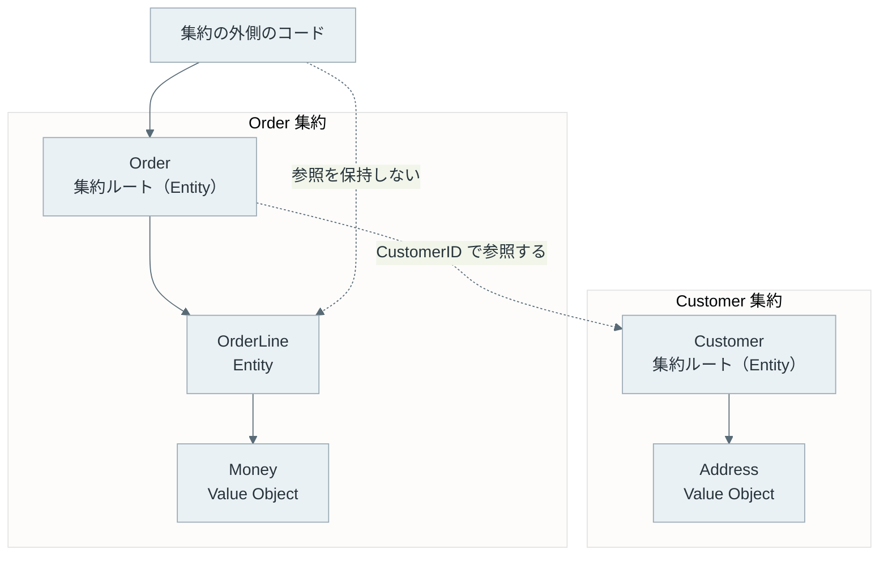
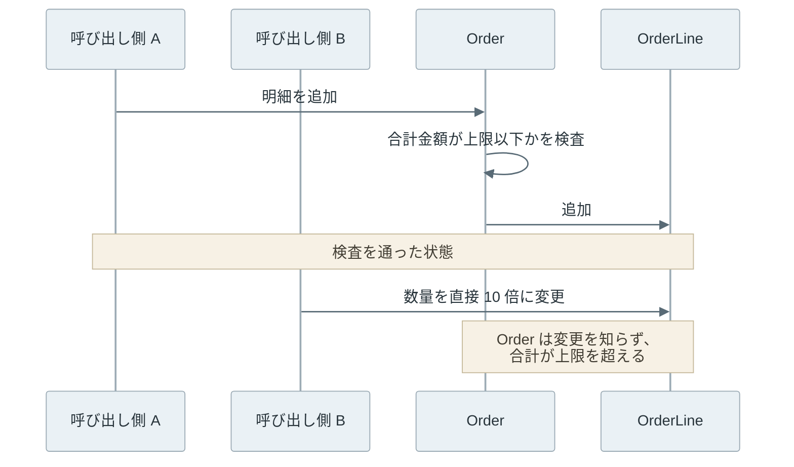
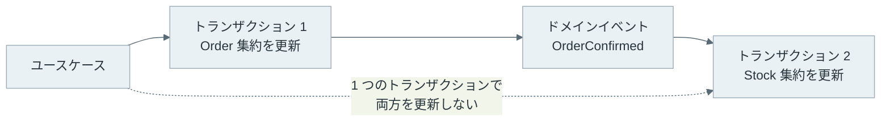
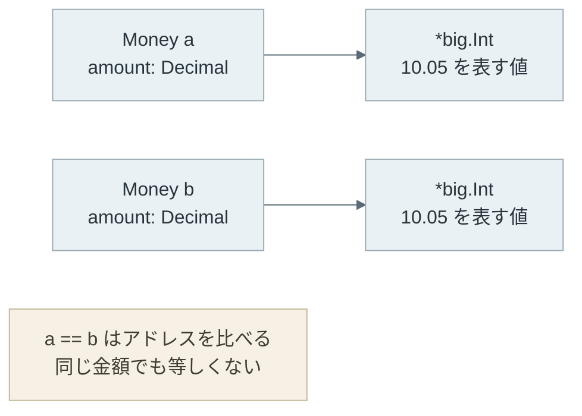
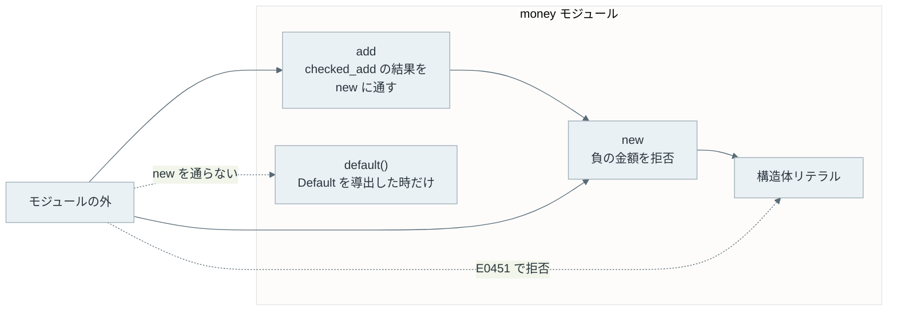
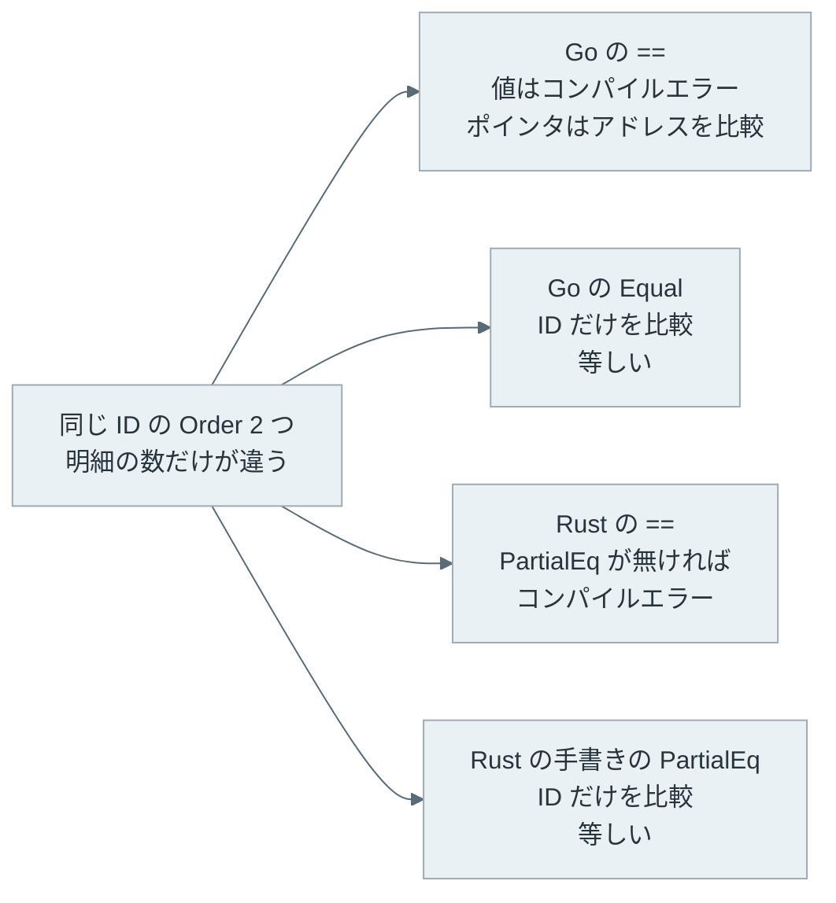

EC サイトの注文に「代金引換で支払う注文は、明細の合計金額が引換の上限額を超えない」という規則を置いたとします。明細を書き換えられる経路が複数あると、規則を検査しない経路から上限を超えた注文ができます。同姓同名の顧客を同じ人として扱う取り違えも、値の比べ方を決めていないと起きます。

Value Object・Entity・Aggregate（集約）は、規則を守る場所と値の比べ方を決めるための単位で、DDD（Domain-Driven Design、ドメイン駆動設計）で使われる名前です。

Value Object は属性だけで決まる値、Entity は同一性を表す ID を持ち、属性が変わっても同じものとして追跡する対象、Aggregate は不変条件（操作が終わった時点で成り立っていなければならない規則）を守るために、その 2 つをまとめた境界を指します。Aggregate の入口になり、集約全体の不変条件を守る Entity を集約ルートと呼びます。

3 つは、どれか 1 つを選ぶ並列の選択肢ではありません。まず個々の概念を Value Object と Entity のどちらで表すかを決め、次にそれらを Aggregate という境界でくくります。

以下は、注文（`Order`）と明細（`OrderLine`）を例にした 3 つの関係です。



上記の図の点線が制約を表しています。集約の外側が参照を保持して良いのは、集約ルートである `Order` だけです。`Customer` 集約に向かう点線は、ルート同士を結んでいます。Entity は ID を持つので、他の集約からはその ID で指せます。

<br>

3 つの関係について、本記事では次の疑問に答えます。

- なぜ 3 つに分けるのか。
- Value Object と Entity は、何で区別するのか。
- 数値から単位が落ちると、何が起きるのか。
- Aggregate の境界は何で決め、集約をまたぐ更新はどう扱うのか。
- Go と Rust の型は、それぞれの性質をどこまで保証するのか。

境界づけられたコンテキスト（[Bounded Context](../bounded-context/)）の切り方のような、モデルより上の設計は扱いません。

---

### 3 つに分ける理由

不変条件は、公開された操作の前後、つまり外部からオブジェクトを観測できる時点では必ず成り立ち、操作の途中だけは一時的に崩れても良い規則です。冒頭の代金引換の規則で言えば、「不変」が指すのは規則が成り立ち続けることで、値が変わらないことではありません。明細が増えて合計金額が変わっても、上限を超えた状態にしてはいけません。

全てのオブジェクトを可変にして相互に参照させると、この規則を守る場所が消えます。以下は、検査を通る経路と通らない経路が同居した場合の流れです。



上記の図の呼び出し側 B は、`Order` を経由せずに `OrderLine` を書き換えています。`OrderLine` に検査を足しても、この問題は解決しません。明細 1 件は他の明細の金額を知らないため、合計が上限を超えたかどうかを自分では判定できません。

複数のオブジェクトにまたがる規則は、まとめて見られる場所でしか守れません。そこで参照の入口を集約ルートに絞り、そこで規則を検査します。

<br>

同一性の判定にも、同じ問題があります。金額の 100 円と別の 100 円は入れ替えても困りません。しかし、同姓同名で同じ住所に住む顧客 2 人は別人で、入れ替えると注文や請求が別の人に付きます。どちらの規則で等価を判定するかをオブジェクトごとに決めておかないと、比較の実装が呼び出し側ごとにばらつきます。

Value Object と Entity のどちらにするかは、属性が同じ 2 つを入れ替えても困らないかどうかで判断します。困らないなら属性で等価を判定する Value Object、困るなら ID で等価を判定する Entity にします。どちらになるかを決めるのはデータの形ではなく、モデルの都合です。

例えば住所は、配送先として値だけを見るなら Value Object です。住所に識別子を与え、同一性や独立したライフサイクルを追跡するなら、Entity として扱う選択肢が生まれます。引っ越しの履歴を残すだけなら、各時点の住所を Value Object のまま保存できます。同じ「住所」という語でも、扱う業務によって分類が変わります。

---

### Value Object

Value Object とは、属性の組み合わせだけで意味が決まり、同一性を持たないオブジェクトです。属性が全て等しければ等価です。[DDD Reference](https://www.domainlanguage.com/wp-content/uploads/2016/05/DDD_Reference_2015-03.pdf)（Eric Evans 氏が DDD のパターンをまとめた文書）に従って不変なものとして扱うので、変更が必要な場合は属性を書き換えずに新しい値を作ります。

数値だけを渡して単位を落とすと、受け取った側は取り違えに気付けません。1999 年 9 月 23 日、NASA の火星探査機 Mars Climate Orbiter は、予定より約 170 km 低い軌道で火星に近づき、失われました。地上のソフトウェアが推進装置の噴射のデータ（力積）をポンド秒で書き出し、軌道を計算する側は、ファイルの仕様に定めたニュートン秒として[読んでいました](https://llis.nasa.gov/llis_lib/pdf/1009464main1_0641-mr.pdf)。1 ポンド重は約 4.45 ニュートンなので、値は 4.45 分の 1 に読まれていました。

この事故の受け渡しはファイルでしたが、数値と単位を組で持たなかった点は、プログラムの中で金額から通貨が落ちる場合と同じです。例えば、金額と通貨を組にした `Money` を Value Object にすれば、通貨の落ちた金額は作れなくなります。足し算は元の値を書き換えずに新しい `Money` を返します。

---

### Entity

Entity とは、属性が変化しても同じものとして追跡する対象で、同一性を表す ID を持ちます。顧客・注文・口座のように、状態が時間とともに変わり、変わった後も同じ 1 つのものとして指し続ける概念が該当します。

何をもって同じと見なすかは、DDD Reference の通りモデルの中で定義します。注文なら注文番号、顧客なら会員番号のように、業務の中で同じものを指し続ける識別子を ID に選びます。ID が同じなら、明細の数が違う 2 つの `Order` も同じ注文として扱います。

---

### Aggregate

Aggregate とは、1 つの単位として扱う一群のドメインオブジェクトで、その中の 1 つを集約ルートに選びます。[Martin Fowler 氏の説明](https://martinfowler.com/bliki/DDD_Aggregate.html)では、集約の外からの参照は集約ルートに向かい、ルートが集約全体の整合性を保証します。読み書きの単位も集約になり、トランザクションも集約の境界をまたがないようにします。

集約の外側は、内側の `OrderLine` を `Order` から受け取って 1 回の操作の中で読むことができます。禁じられているのは、受け取った参照をフィールドに格納したり他のオブジェクトに渡したりして、その操作が終わった後も使える状態にすることです。`Order` から `OrderLine`、`OrderLine` から `Money` への参照にこの制約がかからないのは、集約の内側でオブジェクトがどう繋がっているかが、外側から見えないからです。

境界は、オブジェクトの近さではなく不変条件で決めます。合計金額の上限という規則が注文と明細にまたがるなら、その 2 つは同じ集約に入ります。規則がまたがらない顧客は別の集約になり、`Order` からは `CustomerID` で参照します。

ID 参照は [Vaughn Vernon 氏の Effective Aggregate Design](https://www.dddcommunity.org/wp-content/uploads/files/pdf_articles/Vernon_2011_2.pdf) が推奨する形で、直接参照が禁止されているわけではありません。DDD Reference も、外部のオブジェクトが集約ルートへの参照を持つことは認めています。ID だけを持つ集約は相手を直接書き換えられないので、同じトランザクションで 2 つの集約を変更する誤りを減らせます。

<br>

集約をまたぐ更新は、以下のようにトランザクションを分けて扱います。



上記の図のドメインイベントは、集約に何が起きたかを表すデータです。`OrderConfirmed` は「注文が確定した」を意味します。点線が避けたい経路で、2 つの集約を 1 つのトランザクションで更新すると、境界の意味が消え、ロックの範囲も広がります。

トランザクションを分けると、Order 集約の更新が終わってから Stock 集約に反映が届くまでの間、注文と在庫の状態が食い違います。いずれ一致するものの、ある瞬間を切り取るとずれている状態を結果整合性と呼びます。

Order 集約の更新だけが確定してイベントが届かないことも起き得るので、配送を保証する仕組みが別途必要です。代表的なのは、集約の更新と同じ DB（データベース）のトランザクションでイベントを保存し、後から配送する方式です。イベントの配送は [Domain Event](../domain-event/) のノートで詳しく見ます。

1 つのトランザクションで揃えるか、結果整合性にするかで迷った時の Vernon 氏の目安は、そのデータを整合させるのが、ユースケースを実行するユーザー自身の責任かどうかです。ユーザー自身の責任なら、集約の他の規則を崩さない範囲で、1 つのトランザクションで揃えることを検討し、別のユーザーやシステムの責任なら結果整合性を許します。

---

### Go と Rust の Value Object

ここからは、前半の 3 つの規則（検証を通った値だけを作る、Entity を ID で比べる、集約の内部を外へ漏らさない）が、Go と Rust の型でどこまで守れるかを比べます。

Go では、`==` の意味を型ごとに変えられないこと、全ての型がゼロ値（宣言しただけで入る初期値）を持つこと、可視性がパッケージ単位であることの 3 つが、Value Object の要求とぶつかります。次のコードはフィールドを非公開にし、通貨と金額（負の値は禁止）を検証した値だけを生成します。後の Rust のコードも同じ規則で書きます。

```go
package money

import (
	"errors"
	"fmt"
	"math"
)

type Currency string

const (
	JPY Currency = "JPY"
	USD Currency = "USD"
)

// Money は金額と通貨の組で、生成後に値を変えられません。
// amount は通貨の最小単位（JPY なら円、USD ならセント）で保持します。
type Money struct {
	amount   int64
	currency Currency
}

// New は通貨コードと金額を検証してから Money を組み立てます。
func New(amount int64, currency Currency) (Money, error) {
	if currency != JPY && currency != USD {
		return Money{}, fmt.Errorf("money: unknown currency %q", currency)
	}
	if amount < 0 {
		return Money{}, errors.New("money: negative amount")
	}
	return Money{amount: amount, currency: currency}, nil
}

// Add は自分と other を足した新しい Money を返します。
func (m Money) Add(other Money) (Money, error) {
	if m.currency != other.currency {
		return Money{}, errors.New("money: currency mismatch")
	}
	if other.amount > math.MaxInt64-m.amount {
		return Money{}, errors.New("money: overflow")
	}
	return New(m.amount+other.amount, m.currency)
}
```

Go の `int64` の加算はオーバーフローを報告せずに折り返し、`math.MaxInt64` に 1 を足すと -9223372036854775808 になります。そのため `Add` は先に上限を確かめてオーバーフローとして報告し、合計も `New` に通して負の金額でないかを確かめます。

`Add` が値レシーバで新しい `Money` を返すため、呼び出し側から見た不変性は保たれます。これが成立するのは、フィールドが `int64` と文字列だけで参照を含まないからです。スライスやマップやポインタをフィールドに置くと、値レシーバがコピーするのは参照だけで、参照先を書き換えると元の値も変わります。

等価判定も `a == b` で属性の比較になります。ただし、対象は[比較可能な型](https://go.dev/ref/spec#Comparison_operators)だけです。スライスやマップをフィールドに持つ構造体は比較可能でなくなり、`==` を書いた箇所がコンパイルエラーになります。`float64` を持つと、`NaN` を入れた値は `a == a` が false になります。

上のコードが金額を `int64` で持つのは、通貨の最小単位で持てば足し引きに誤差が出ないからです。しかし、按分・税率・通貨換算のように除算が入ると十進小数の型が必要になります。

Go の標準ライブラリに十進小数の型は無く、広く使われている [shopspring/decimal](https://github.com/shopspring/decimal) の `Decimal` は内部に `*big.Int` を持ちます。以下は、`amount` をこの型に変えた `Money` を `decimal.RequireFromString("10.05")` から 2 つ作り、`==` で比べた場合です。



`==` は上記の図の 2 つの `*big.Int` のアドレスを比べ、コンパイルエラーも警告も出しません。この型を使うなら、`==` を使わず `Equal` を呼ぶ規律を呼び出し側が守る必要があります。

生成の入口にも穴があります。`var m money.Money` と書くだけで、`New` を通っていない[ゼロ値](https://go.dev/ref/spec#The_zero_value)の `Money`（金額 0、通貨が空文字列）が手に入ります。`New` 自身もエラー時にゼロ値を返すので、戻り値の `err` を無視した呼び出し側に同じものが渡ります。

可視性で守れる範囲も限られます。`Money` の非公開フィールドは同じパッケージの中からは自由に書き換えられます。Go の可視性はパッケージ単位で、フィールドを「生成時だけ書き込める」と宣言する構文がありません。

ここまでの制約があるので、Go では Value Object を作るたびに非公開フィールド・Getter・`Equal` を手で書く必要があります。この定型を減らすために、`New`・Getter・`Equal` を生成する [vogen](/post/ja/2024-12-28-golangvalue-objectを生成するvogenライブラリをお試しで作っ/) を私が作りました。ただし、生成で減らせるのは記述の量だけで、ゼロ値を禁止できないことと `==` の意味を変えられないことは残ります。

<br>

同じものを Rust で書くと、生成の経路と取り得る値の範囲を型で絞れます。

```rust
mod money {
    #[derive(Debug, Clone, Copy, PartialEq, Eq)]
    pub enum Currency {
        Jpy,
        Usd,
    }

    #[derive(Debug, Clone, Copy, PartialEq, Eq)]
    pub struct Money {
        amount: i64,
        currency: Currency,
    }

    #[derive(Debug, PartialEq, Eq)]
    pub enum MoneyError {
        Negative,
        Overflow,
        CurrencyMismatch,
    }

    impl Money {
        pub fn new(amount: i64, currency: Currency) -> Result<Money, MoneyError> {
            if amount < 0 {
                return Err(MoneyError::Negative);
            }
            Ok(Money { amount, currency })
        }

        pub fn add(self, other: Money) -> Result<Money, MoneyError> {
            if self.currency != other.currency {
                return Err(MoneyError::CurrencyMismatch);
            }
            let sum = self.amount.checked_add(other.amount).ok_or(MoneyError::Overflow)?;
            Money::new(sum, self.currency)
        }
    }
}
```

`add` は Go の `Add` と同じ順で、`checked_add` でオーバーフローを確かめてから合計を `new` に通します。Rust の整数の加算は、デバッグビルドではオーバーフローで panic し、[リリースビルドの既定](https://doc.rust-lang.org/cargo/reference/profiles.html#overflow-checks)では Go と同じく折り返します。

Rust には暗黙のゼロ値がありません。加えて、非公開フィールドを持つ構造体は、[そのモジュールとその子孫](https://doc.rust-lang.org/reference/visibility-and-privacy.html)の外から構造体リテラルで作れません。`Money { amount: 0, currency: Currency::Jpy }` をモジュールの外に書くと、コンパイラが `E0451` で拒否します。

構造体リテラルを書けるのがモジュールの中だけになるので、検証が漏れていないかはモジュールの中のメソッドを見れば確かめられます。型が絞るのは生成の経路までで、検証の中身は Go と同じく自分で書きます。

以下は、`money` モジュールの外から `Money` を作る経路です。



モジュールの外から使える入口は、上記の図の実線の `new` と `add` だけです。`Default` を導出リストに足すと、点線の `Money::default()` も外から呼べるようになり、Go のゼロ値と同じ穴が開きます。

通貨を `enum` にした点にも意味があります。Go では通貨を定義型にしても `Currency("EUR")` という変換をどこからでも書けるため、`New` が実行時に通貨を検証していました。Rust の `enum` は列挙した変種以外を書けないので、`Currency::Eur` はコンパイルエラーになり、通貨の検証は型が受け持ちます。

十進小数の型を入れた場合も、Rust では `PartialEq` を導出したままで済みます。[rust_decimal](https://github.com/paupino/rust-decimal) の `Decimal` は `PartialEq` を数値の比較として実装しているため、それをフィールドに持つ `Money` に `#[derive(PartialEq)]` を付けると、同じ金額の 2 つが等しくなります。`==` の意味を型ごとに定義できるため、Go のように `Equal` を手で書かなくても、`==` で金額を比べられます。

---

### Go と Rust の Entity と集約ルート

以下は、ID が同じで明細の数だけが違う 2 つの `Order` を比べた場合です。



`Order` は明細をスライスで持つため、Go では値どうしを `==` で比べるとコンパイルエラーになり、ポインタどうしを比べるとアドレスの比較になります。どちらも ID による同一性の判定にはならないので、ID だけを見る `Equal` メソッドを書き、それを使う規律を人間が守る必要があります。

Rust では、`PartialEq` を導出も実装もしなければ `==` 自体が書けないので、ID で比べる実装を忘れたことにはコンパイルエラーで気付けます。ただし、Value Object と同じように導出すると全フィールドの比較になり、コンパイルを通ります。Entity には導出せず、ID だけで `PartialEq` を手で実装するという規律は残ります。

その場合は `Hash` も ID だけで実装します。`==` で等しい 2 つは同じハッシュ値を返す決まりがあり、全フィールドを対象にする導出の `Hash` のままだと、同じ ID の Entity が `HashSet` に 2 つ入ります。

<br>

ID の型付けにも差が出ます。Go で `type OrderID string` のような定義型を作っても、`OrderID("free-text")` という変換がどこからでも書けるため、検証済みの ID と生の文字列を型では区別できません。

Rust では ID をタプル構造体（`pub struct OrderId(String)`）にしてフィールドを非公開にすれば、モジュールの外からは生成関数を通す以外に作る手段が無くなります。集約ごとに ID の型を分けておくと、`OrderId` と `CustomerId` を取り違えても、コンパイル時にエラーになります。

<br>

集約ルートを Go で書くと、内部を隠しきれない所が出ます。

```go
// Lines は明細の一覧を返します。
func (o *Order) Lines() []OrderLine {
	return o.lines
}
```

このメソッドが返すスライスは内部の配列を指しているため、`o.Lines()[0].Quantity = 10000` と書けば集約ルートを経由せずに数量が変わり、`Order` が計算する合計にもその数量が反映されます。防ぐ手段は、要素をコピーして返すか、一覧を返さずに必要な集計値だけを返すかです。Go には読み取り専用のスライス型が無いため、返した後で何をされるかは型に書けません。

Rust では、`&[OrderLine]` という読み取り専用の型で返せます。

```rust
/// 読み取り専用の参照を返す。呼び出し側は要素を書き換えられない。
pub fn lines(&self) -> &[OrderLine] {
    &self.lines
}
```

この戻り値に対して `lines[0].quantity = 10_000` と書くと、コンパイラが `E0594` で拒否します。`lines()` が返した参照を使っている間は集約ルートを変更できないので、一覧を持ったまま明細を追加する処理も通りません。ただし、何を返すかを決めるのは設計者で、`&mut Vec<OrderLine>` を返すメソッドを書けば内部はそのまま漏れます。

---

### 型で守れる範囲

以下は、3 つの構成要素で守りたい性質ごとに、Go と Rust の型が保証する範囲です。

| 守りたい性質 | Go | Rust |
|---|---|---|
| 検証を通らない生成を防ぐ | ゼロ値が作れるので防げない | リテラルを書けるのはモジュール内だけ |
| 取り得る値を絞る | 定義型と定数で近似する | `enum` でコンパイル時に閉じる |
| 生成後の変更を禁止する | パッケージ内では書き換え可 | モジュール内では書き換え可 |
| 属性で等価を判定する | ポインタを含むとアドレス比較 | `PartialEq` を導出できる |
| ID で等価を判定する | `Equal` を書く規律で守る | `PartialEq` の実装が必要 |
| 内部を読み取り専用で渡す | コピーを返すしかない | `&[T]` で型に書ける |

右の 2 列は言語の優劣ではなく、左列の性質を型で表せる範囲です。Go ではモデルの制約の多くをパッケージ分割とテストで守り、Rust では同じ制約の多くをコンパイルエラーとして検出できます。とは言え、どちらもモジュールやパッケージの内側では制約が緩むので、設計者がモジュールやパッケージの範囲を小さくする必要があります。

---

### 利点

- 不変条件を守る場所が集約ルート 1 箇所に定まり、検査の重複が消える
- Value Object を分けると、検証済みの値が型として流通し、呼び出し側の検査が減る
- 等価判定の規則がオブジェクトの種類で決まり、比較の実装がばらつかない
- 読み書きの単位が集約になるため、永続化の対象と粒度が設計から読み取れる
- 集約の間を ID 参照にすると、分割の候補がそのまま境界として見える

---

### 欠点

- 集約が大きいと更新の競合が増え、小さいと集約をまたぐ処理が増える
- 集約をまたぐ更新が結果整合性になり、途中状態を扱う実装が必要
- 集約ルート経由の参照だけを許すと、読み取り専用の画面表示に対して遠回りになる
- Value Object を細かく作るほど型と変換のコードが増える
- 言語によっては、決めた制約を型で表現できず、規律として残る

---

### 適さないケース

- ドメインの規則がほとんど無く、入力をそのまま保存して取り出すシステム
- 表示のための読み取りが中心で、更新の不変条件が単純な機能
- 集約の粒度を決めるだけのドメイン知識が、まだチームに集まっていない段階
- 1 回限りの移行スクリプトのような、モデルを長く保守しないコード
