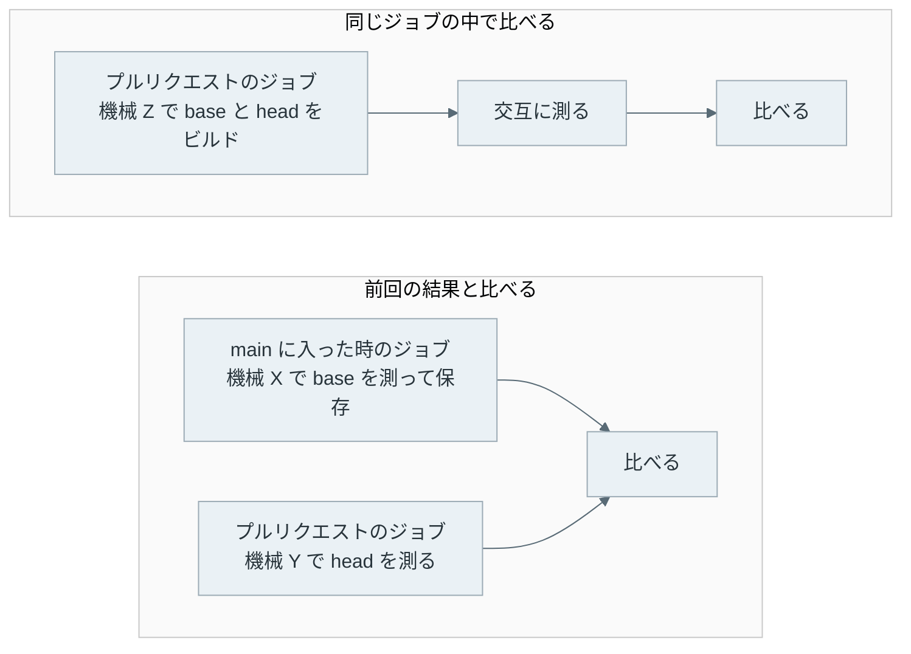

CI のベンチマークは、プルリクエストごとにプログラムの実行時間などを測り、変更の前より遅くなっていないかを確認するテストです。遅くなることを性能の劣化（performance regression）と呼び、劣化を見つけたら CI を落として、マージの前に気付けるようにします。

GitHub Actions では、ワークフローを構成する 1 つ 1 つの処理がジョブで、ジョブを実行する機械がランナーです。本記事では、GitHub が用意するランナー（`ubuntu-latest` など）を標準ランナーと呼びます。

しかし、この標準ランナーはベンチマークに向かない、という話をよく聞きます。CI の性能計測サービスを提供する CodSpeed は、ランナーで測った値の揺れを[数えて](https://codspeed.io/blog/benchmarks-in-ci-without-noise)、自社が用意する専用の機械を勧めています。

一方で、OSS の科学計算ライブラリを支援する Quansight Labs は、2021 年に 16 日分の計測を行い、同じ機械で 2 つの commit を比べるなら標準ランナーでも使えると[結論しています](https://labs.quansight.org/blog/github-actions-benchmarks)。

著者は、CLI の性能を測る [himorime](https://github.com/nao1215/himorime) を作り、自作した CLI に来るプルリクエストを GitHub Actions の上で検査しています。作った経緯は [weeknotes](/weeknotes/2026-09-14/) に書きました。himorime の文書は、判定の精度を合成データで検証したと書いたうえで、特定の CI では検証していないので、自分の CI で同じコードどうしを何度か比べるようにと勧めています。そこで実際に比べました。

標準ランナーで、同じプログラムを 90 回のジョブに分けて測った結果が次の図です。



ジョブは、毎回どれかの機械に割り当てられます。90 回のジョブは 7 種類の CPU に当たり、同じコードの実行時間は 99 ms から 143 ms まで 1.44 倍開きました。

同じ型番でも速さは揃いません。AMD EPYC 9V74 は 35 回のうち 29 回が約 110 ms でしたが、4 回は約 142 ms で 29% 遅く、118 ms と 122 ms のジョブも 1 回ずつありました。AMD EPYC 9V45 も、99 ms から 110 ms まで散っています。

一方で、1 つのジョブの中で 20 回測った時のばらつきは、変動係数の[中央値](/ml/math/median/)で 0.60% です。変動係数は、[標準偏差](/ml/math/stddev/)を平均で割った値です。GitHub Actions で揺れていたのは 1 回ごとの時間よりも、ジョブごとに変わる機械の方でした。

<br>

本記事では、この実験の結果で、CI でベンチマークの結果を比べる方法を説明します。扱う疑問は以下の通りです。

- GitHub Actions でベンチマークを取ると、何がどれだけ揺れるのか。
- 前回のジョブで測った結果と比べる方法は、なぜ外れるのか。
- 同じジョブの中で比べると、どこまで見分けられるのか。
- ランナーより揺れる機械では、どう比べれば良いのか。
- 時間の代わりに命令数を数えると、どうなるのか。
- 自分の CI に入れる前に、何を確認すれば良いのか。

---

### 比べ方は 2 通りある

プルリクエストの変更が遅くしたかを知るには、変更の前と後の 2 つの結果が必要です。本記事では、変更前のコードを base、変更後のコードを head と呼びます。GitHub の呼び方では、base はベースブランチ（マージ先）、head はヘッドブランチ（プルリクエストの中身）です。

比べ方は大きく 2 通りあります。1 つ目は、main に入った時などに測った結果を保存しておき、プルリクエストのジョブでは head だけを測って、保存した結果と比べる方法です。

[github-action-benchmark](https://github.com/benchmark-action/github-action-benchmark) は、この方法で前回の結果と比べる GitHub Actions のアクションです。前回の結果より遅くなった割合が閾値を超えると警告します。閾値の既定は 200% で、これは前回の 2 倍の時間がかかると警告が出る設定です。

警告は既定では出ず、`comment-on-alert` か `fail-on-alert` を有効にした時だけ判定されます。本記事では閾値を「前回より何 % 遅いか」で書くので、この既定は 100% に当たります。

2 つ目は、1 つのジョブの中で base と head の両方をビルドし、同じ機械で測って比べる方法です。himorime の `compare` コマンドはこの方法で、base と head を交互に測ります。



つまり、1 つ目の方法では base と head が別の機械で測られます。冒頭の図で見た通り、機械が変わると同じコードでも時間が変わります。

どちらの方法が誤るかは、同じコードどうしを比べると分かります。この比べ方を A/A テストと呼びます。中身が同じなので、劣化と判定されたら全て誤検知です。反対に、遅くしたと分かっている変更を比べれば、見逃しを数えられます。

---

### 実験の作り

測るプログラムは、決まった量の数を並べ替える Go の CLI です。1 回の繰り返しで 20,000 個の数を作って並べ替え、それを 100 回繰り返します。

遅くする割合は `slowdown.txt` に整数で書き、ビルドの時に埋め込みます。1% ごとに同じ繰り返しを 1 回足すので、`10` と書けば仕事がちょうど 10% 増えます。

```go
//go:embed slowdown.txt
var slowdownText string

const baseRounds = 100

const size = 20_000

func main() {
	percent, err := strconv.Atoi(strings.TrimSpace(slowdownText))
	if err != nil || percent < 0 {
		fmt.Fprintln(os.Stderr, "slowdown.txt: want a non-negative integer percentage")
		os.Exit(2)
	}
	rounds := baseRounds + baseRounds*percent/100

	data := make([]uint32, size)
	var state uint32 = 2463534242
	var sum uint64
	for range rounds {
		n := size
		for i := range n {
			// xorshift32: the same numbers in every run and every build.
			state ^= state << 13
			state ^= state >> 17
			state ^= state << 5
			data[i] = state
		}
		part := data[:n]
		slices.Sort(part)
		for i := 0; i < n; i += 7 {
			sum += uint64(part[(i*7919)%n])
		}
	}
	fmt.Println(sum)
}
```

最初のコードは、端数の仕事を小さな配列の並べ替えで足していました。並べ替えの手間は件数よりも速く増えるので、件数を減らした並べ替えは、件数の割合より安く済みます。その結果、2% 遅くしたはずのビルドが 1.5% しか遅くなりませんでした。そこで、どの繰り返しも同じ件数にしたのが上のコードです。

<br>

#### 1 つのジョブの手順

ワークフローの 1 つのジョブは、新しいランナーの上で次の順に測ります。`$SLOWDOWN` は、ジョブごとに渡す遅くする割合です。

```yaml
- name: Interleaved (himorime compare)
  run: |
    echo "$SLOWDOWN" > slowdown.txt
    himorime compare --against HEAD --quiet --format json --output out/interleaved.json himorime.yaml || rc=$?
    git checkout -- slowdown.txt
- name: Sequential (base runs, then head runs)
  run: |
    himorime run --quiet --format samples-csv --output out/sequential-base.csv himorime.yaml
    echo "$SLOWDOWN" > slowdown.txt
    himorime run --quiet --format samples-csv --output out/sequential-head.csv himorime.yaml
```

`--against HEAD` の `HEAD` は、git で最新の commit を指します。ここでは `slowdown.txt` が 0 のままの commit で、本記事の base です。

`himorime compare` は、その commit と、`slowdown.txt` を書き換えた作業ツリーをそれぞれビルドし、作業ツリーの方を head として測ります。劣化を見つけると終了コード 1 を返すので、`|| rc=$?` で次の手順へ進めます。

`himorime compare` は、base と head を 1 回ずつ測る組を 20 回繰り返します。

本記事では、この組をラウンド（round）と呼びます。himorime の文書と同じ呼び方です。ラウンドの中でどちらを先に測るかは、乱数で決まります。なお、上のコードにある `rounds` は並べ替えの繰り返しの回数で、このラウンドとは別のものです。続けて実行する `himorime run` 2 回は、base を 20 回測り終えてから head を 20 回測る、まとめて測る方法です。



最後に、コマンドの実行時間を測る CLI の [hyperfine](https://github.com/sharkdp/hyperfine) でも、同じ 2 つのビルドを測りました。himorime 自体の計測に誤りがあれば、別の道具で測った値と食い違うはずです。2 つの実装に同じ仕事をさせて結果を比べる考え方は、[Differential Testing のノート](/notes/software-testing/differential-testing/)で扱いました。

ジョブの数は、A/A を 30 回、2%・5%・10%・12%・15%・20% 遅くした変更を 10 回ずつの計 90 回です。計測は 2026-11-13 で、ワークフローと測ったコードは [ci-bench-noise](https://github.com/nao1215/ci-bench-noise) にあります。

<br>

#### himorime の判定

閾値は、著者が他の CLI で使っている 10% にしました。himorime は、base と head の中央値を比べ、その差が偶然の揺れで説明できるかをブートストラップで調べます。ブートストラップは、手元で測った 20 個の値から、重複を許して 20 個を選び直すことを何度も繰り返し、中央値がどれくらい揺れ得るかを見積もる方法です。

himorime は、base と head を 2,000 回選び直し、そのたびに変化の割合を計算します。選び直した変化の 95% 以上が 10% を超えれば `regression`（劣化）、95% 以上が ±10% に収まれば `pass` です。どちらでもなければ `inconclusive`（判定できない）になります。ほかに、95% 以上が -10% を下回った時の `improved`（改善）があります。



3 つ目の行は、測った変化が 8.1% なのに `inconclusive` です。このジョブは揺れが大きく、選び直した変化のうち中央の 95% が 6.9% から 10.7% まで広がって、閾値の線をまたぎました。±10% 以内が 94%、10% 超が 6% で、どちらも 95% に届かなかったからです。

---

### ジョブが変わると、機械が変わる

1 つのジョブの中で、base を測った 20 回の時間を順に並べると次のようになります。



赤と青は、どちらも AMD EPYC 9V74 を引いたジョブです。ジョブの中ではどちらもほぼ平らなのに、段の高さが 29% 違います。高い段も低い段も、2 つのバージョンのランナーイメージ（20261101.186.1 と 20261111.196.1）の両方で出ています。ランナーイメージは、ランナーに入っている OS と道具一式を指します。

黄のように、ジョブの途中で数回だけ 12〜23% 遅くなるジョブもありました。A/A の 30 回のうち 4 回のジョブで、中央値より 10% を超えて遅い実行が混ざっています。himorime は中央値で比べるので、こうした数回の外れは判定を動かしません。

CPU が変わると、速さだけでなく、実行されるコードまで変わることがあります。

C の標準ライブラリである glibc は、CPU が持つ命令やキャッシュの大きさを調べて、関数の実装や動きを切り替えます。CodSpeed は、関係の無い変更で劣化したように見えた事例を調べました。遅くなった時間は多くが glibc にある malloc の処理で、原因の候補はランナーごとに違う CPU だと[報告しています](https://codspeed.io/blog/unrelated-benchmark-regression)。ただし CodSpeed は、CPU が違うことだけでは全てを説明できなかったとも書いています。本記事で測った Go のプログラムは glibc を使わないので、この違いは測っていません。

---

### 前回の結果と比べると外れる

前回の結果と比べる方法は、手元の結果で再現できます。A/A の 30 回のジョブから 2 つを選び、片方で測った base の中央値を前回の結果、もう片方を今回の結果として比べます。前回と今回を入れ替えた組も数えるので、組み合わせは 30 × 29 で 870 組です。

遅くした変更の検出は、遅くしたジョブで測った head の中央値と、A/A のジョブで測った結果を比べて数えました。1 つの割合につき、10 回 × 30 回で 300 組です。



| 閾値 | 誤検知 | 5% の検出 | 10% の検出 | 20% の検出 |
|---|---|---|---|---|
| 5% | 33.9% | 50.7% | 57.3% | 77.7% |
| 10% | 26.9% | 39.0% | 35.7% | 67.3% |
| 20% | 10.1% | 22.7% | 11.3% | 42.3% |
| 50% | 0.0% | 0.0% | 0.0% | 6.0% |
| 100% | 0.0% | 0.0% | 0.0% | 0.0% |

5% の検出は、5% 遅くした変更を警告した割合です。閾値 10% では、何も変えていないプルリクエストの 4 本に 1 本が劣化と判定され、20% 遅くした変更の 3 本に 1 本を見逃します。誤検知を 0 にするには閾値を 40% 以上にする必要があり、既定の 200% では 20% の劣化を 1 本も見つけられませんでした。

表では、5% の検出の方が 10% の検出より高い行があります。10% 遅くしたジョブは 10 回のうち 7 回が速い AMD EPYC 9V74 を引き、5% のジョブは遅い AMD EPYC 7763 や Intel Xeon Platinum 8573C を多く引いたからです。この方法では、検出されるかどうかが、遅くした量よりも引いた機械で決まります。

<br>

#### ブートストラップでも防げない

閾値の割合だけで決めずに、himorime と同じブートストラップで判定しても、結果は変わりません。A/A の 2 つのジョブで測った base どうしを比べると、CPU の型番が違う 716 組の 60% が劣化か改善と判定されました。

型番が同じ 154 組でも、18% が劣化か改善と判定されました。ジョブの中のばらつきが小さいので、ブートストラップは 2 つの機械の差を確かな差と判定します。ブートストラップが見積もるのは、手元の 20 個を選び直して分かる揺れだけです。どの機械を引くかの揺れは 20 個の外にあるので、選び直しても見えません。

[大数の法則と中心極限定理のノート](/ml/math/lln-clt/)でも、標本に入らなかった少数の極端な値のせいで、ブートストラップの区間が真の平均を 32% しか含まなかった実験を扱いました。

---

### 同じジョブの中で比べる

同じ 90 回のジョブで、himorime が同じジョブの中で base と head を比べた結果が次の図です。



| 足した仕事 | ジョブ | himorime の判定 | 測った変化（中央値） |
|---|---|---|---|
| 0%（A/A） | 30 | pass 30 | -0.00%（-0.56〜+0.39%） |
| 2% | 10 | pass 10 | +1.95% |
| 5% | 10 | pass 10 | +4.94% |
| 10% | 10 | pass 5、inconclusive 5 | +9.80% |
| 12% | 10 | regression 10 | +11.86% |
| 15% | 10 | regression 10 | +14.77% |
| 20% | 10 | regression 10 | +19.64% |

A/A の 30 回は全て pass で、測った変化は ±0.6% に収まりました。閾値を超える 12% 以上の劣化は、30 回とも劣化と判定されています。10% ちょうどの変更が半分 inconclusive になるのは、閾値のすぐそばで、上か下かを決められないからです。

なお、ジョブが引いた機械は、前の節と同じく 7 種類です。それでも結果が揃ったのは、base と head が同じ機械で測られ、機械の速さが両方に同じように掛かったからです。

himorime の値も検証しました。JSON に残った生の値から著者がブートストラップをやり直すと、90 回全部で判定が一致しました。hyperfine で測り直した変化も、himorime が測った変化と中央値で 0.02 ポイントしか違いませんでした。

<br>

#### 交互に測るか、まとめて測るか

base を 20 回測り終えてから head を 20 回測る方法でも、この実験ではほぼ同じ結果でした。違いが出たのは A/A の端です。

| 測り方 | A/A で測った変化 | A/A の判定 |
|---|---|---|
| 交互（himorime compare） | -0.56〜+0.39% | pass 30 |
| まとめて（himorime run を 2 回） | -3.20〜+4.85% | pass 30 |

まとめて測ると、ジョブの途中で機械が遅くなった時に、その遅さが片方だけに掛かります。前の図で黄色に描いたジョブのような跳ねが head だけに入ると、変更が遅くしたように見えます。交互に測れば、遅くなった時間に base と head の両方が入ります。

同じ機械で base と head を乱数の順番で交互に測る方法は、クラウドの仮想マシンでも 10% 以下の劣化を見分けられると、[Laaber 氏らの 2019 年の論文](https://research.chalmers.se/publication/?id=511491)が AWS・GCE・Azure で示しています。

2 つのプログラムを同じ機械で同時に走らせる [Duet Benchmarking](https://arxiv.org/abs/2001.05811) も、同じ考え方を推し進めた方法です。本記事の実験は、これを GitHub Actions の標準ランナーで確認したものです。

<br>

#### 閾値 10% は緩い

例えば A/A のずれが ±0.6% なら、5% の劣化も見分けられそうです。実際、5% 遅くした変更は +4.94% と測れています。それでも pass になったのは、閾値を 10% にしたからです。

そこで、閾値を下げて、同じ 90 回のジョブで測った値を判定し直しました。ラウンドを半分に減らした場合も数えています。

| 閾値 | ラウンド | A/A の判定 | 5% の劣化 | 2% の劣化 |
|---|---|---|---|---|
| 3% | 20 | pass 30 | regression 10 | pass 10 |
| 3% | 10 | pass 30 | regression 10 | pass 9、inconclusive 1 |
| 2% | 20 | pass 29、inconclusive 1 | regression 10 | inconclusive 10 |

閾値 3% でも A/A の誤検知は 0 回のままで、5% の劣化は全て見つかりました。閾値 2% にすると、閾値ちょうどの 2% の変更は判定できなくなります。

ただし、本記事で測ったのは CPU だけを使う処理です。実際の CLI は、プロセスの起動、ファイルの読み書き、メモリの確保で、もっと揺れます。閾値を下げる前に、自分のベンチマークで A/A を回して揺れを測る必要があります。

---

### 揺れの大きい機械では、ラウンドごとに比べる

標準ランナーの代わりに、自分で用意した機械をセルフホステッドランナー（self-hosted runner）として登録し、ジョブを動かすこともできます。他の仕事と相乗りする機械や、手元の開発機で測る場合は、標準ランナーよりずっと揺れます。この節では、揺れの大きい機械での比べ方を扱います。

himorime の既定は、base と head の値を別々に選び直す方法です。同じラウンドで測った base と head を組のまま扱う方法もあり、本記事を書いた時点では、himorime の文書はどちらが良いかの判断を保留していました。実際の機械がどれだけ揺れるかによる、という理由です。

組のまま扱う方法では、ラウンドごとに head ÷ base の比を取り、比から 1 を引いて % で表した値の中央値で変化を測ります。同じラウンドの 2 回は時間が近いので、その間に機械が遅くなれば両方が遅くなり、比は変わりません。

この方法が効くかは、同じラウンドの base と head が一緒に遅くなるかで決まります。その傾向の強さを表すのが[相関係数](/ml/math/correlation/)で、-1 から +1 の値を取り、0 なら関係が無く、+1 に近いほど一緒に動きます。

| 機械 | 比較ごとの変動係数（中央値） | 同じラウンドの相関係数（中央値） |
|---|---|---|
| 標準ランナー | 0.60% | +0.19 |
| 著者のデスクトップ | 18% | +0.50 |

標準ランナーでは、揺れが小さく相関も弱いので、2 つの方法で判定はほとんど変わりませんでした。閾値 10% で 10% の変更が inconclusive になった回数が、5 回と 7 回だった程度です。

違いが出たのは、著者のデスクトップです。測った時は裏で別の作業が動いていて、base と head が一緒に揺れていました。



この 1 回では、base と head の中央値どうしを比べると -11.5% で、20% 遅くした変更が速くなったように見えます。

負荷の高いラウンドと低いラウンドが混ざっていて、base と head を別々に並べると、中央値がどのラウンドの値に落ちるかが偶然で決まるからです。ラウンドごとに見ると、20 ラウンドのうち 15 ラウンドで head の方が遅く、比の中央値は +17.0% でした。割り算で、そのラウンドの負荷が消えるからです。

デスクトップで A/A と遅くした変更を 10 回ずつ測り、閾値 10%・20 ラウンドで判定した結果は次の通りです。

| 判定の方法 | A/A の誤検知 | A/A の inconclusive | 20% の劣化の検出 |
|---|---|---|---|
| himorime v0.5.2 が出した判定 | 0 | 5 | 1 |
| 同じ規則で、著者が判定し直した値 | 0 | 6 | 2 |
| ラウンドごとの比 | 0 | 0 | 8 |

2 行目と 3 行目は、同じ値を [lab の paired.py](https://github.com/nao1215/debimate/blob/main/content/notes/software-testing/ci-benchmark/lab/paired.py) で判定し直したものです。選び直しの乱数が違うので、閾値のそばの回は himorime と結果がずれます。

ラウンドごとの比にすると、誤検知は 0 回のまま、A/A の inconclusive が 5〜6 回から 0 回に減り、20% の劣化の検出が 1〜2 回から 8 回に増えました。標準ランナーでは判定がほとんど変わらず、揺れの大きい機械では見分けられる範囲が広がります。揺れる機械で比べるなら、ラウンドごとの比で判定する方が良いと言えます。

<br>

この結果を受けて、himorime に設定 `regression.pairing: rounds` を足しました。2026-11-13 に v0.6.0 として[リリース](https://github.com/nao1215/himorime/releases/tag/v0.6.0)しました。既定は今までの判定のままなので、使う時は設定で選びます。

---

### 時間の代わりに命令数を数える

ジョブが変わると時間が変わるので、機械の速さに左右されない量で比べる手もあります。その 1 つが、プログラムが実行した命令の数です。

[Valgrind](https://valgrind.org/) は、プログラムを Valgrind が用意する仮想的な CPU の上で動かし、メモリの誤りなどを調べる道具の集まりです。その 1 つの [Cachegrind](https://valgrind.org/docs/manual/cg-manual.html) は、命令ごとに数えるコードを差し込んで、実行した命令の数を数えます。

Rust で書かれた TLS ライブラリである [rustls の CI](https://ochagavia.nl/blog/continuous-benchmarking-for-rustls/) は、時間と並べてこの数を測っています。Python の性能を扱う [pythonspeed の解説](https://pythonspeed.com/articles/consistent-benchmarking-in-ci/)は、GitHub Actions の上で時間の代わりにこの数を使う方法です。本記事では、別のワークフローを 24 回のジョブで走らせ、0%・2%・5% 遅くしたビルドの命令数を数えました。

```sh
GOMAXPROCS=1 valgrind --tool=cachegrind --cache-sim=no \
  --cachegrind-out-file=/dev/null ./base
```

`GOMAXPROCS=1` は、Go のランタイムが使うスレッドを 1 つにして、スレッドの切り替えで数が変わらないようにする設定です。`--cache-sim=no` は、Cachegrind が持つキャッシュの模擬を切り、命令を数えるだけにする指定です。既定でも切れていますが、明示しました。出力の `I refs` が命令の数です。

```text
==2589== Cachegrind, a high-precision tracing profiler
==2589== Using Valgrind-3.26.0 and LibVEX; rerun with -h for copyright info
==2589== Command: /home/runner/work/_temp/base
==2589== I refs:        513,456,807
```



24 回のジョブで数えた 0% のビルドの命令数は、5 億 1,344 万から 5 億 1,354 万までで、差は 0.019% でした。CPU の型番ごとの中央値の差は 0.001% 以下です。

同じ 24 回のジョブで測った実行時間は、CPU の型番で最大 20% 違いました。2% 遅くしたビルドの命令数は +1.996〜+2.009%、5% のビルドは +4.995〜+5.007% で、足した仕事がそのまま数に出ています。

Linux の性能を測る道具の `perf` にも、命令を数える `perf stat` があります。

`perf stat` は CPU のパフォーマンスカウンタ（hardware performance counter）で数えますが、ランナーの上では `The instructions:u event is not supported.` と出て動きませんでした。ランナーは仮想マシンで、パフォーマンスカウンタが見えないためと考えられます。Cachegrind はパフォーマンスカウンタを使わないので、仮想マシンでも動きます。

なお、命令数は時間そのものではありません。キャッシュに載らずにメモリを待つ時間、ファイルやネットワークを待つ時間、スレッドがロックを待つ時間は、命令数に出ません。命令が 5% 増えても、時間が 5% 増えるとは限りません。本記事の並べ替えは CPU だけを使う処理なので、命令数と時間がよく揃いました。

---

### CI に入れる前に確認すること

本記事の結果で、GitHub Actions でベンチマークを比べる時の選び方は、次のように分かれます。

| 比べ方 | プルリクエストを止める用途 | 本記事の結果 |
|---|---|---|
| 前回の結果と比べる | 向かない | 閾値 10% で誤検知 27%、20% の劣化の見逃し 33% |
| 同じジョブで交互に測る | 向く | 誤検知 0 回、閾値を超えた劣化は全て検出 |
| 同じジョブで交互に測り、ラウンドごとの比で判定する | 揺れる機械で向く | 手元の機械で 20% の劣化の検出が 1〜2/10 から 8/10 に |
| 命令数を数える | 向く（待ち時間の変化は見えない） | CPU の型番による差 0.001% 以下 |

時間の上限を ms で決めて検査する方法も、引いた CPU で値が 1.44 倍動くので、同じ理由で外れます。

同じジョブの中で比べる場合でも、入れる前に自分のベンチマークで A/A を 20〜30 回回し、ずれの幅を確認してください。ずれが ±1% 程度に収まるなら、本記事のように閾値を 3% まで下げる余地があります。収まらなければ、回数を増やすか、劣化の判定に使う量を CPU 時間やメモリに変えます。CPU 時間は、プロセスが CPU の上で実際に動いた時間で、ファイルや他のプロセスを待った時間を含みません。

集計のスクリプトと出力は [lab](https://github.com/nao1215/debimate/tree/main/content/notes/software-testing/ci-benchmark/lab) に、図の生成元は [figures.py](https://github.com/nao1215/debimate/blob/main/content/notes/software-testing/ci-benchmark/figures.py) にあります。計測のワークフローは [ci-bench-noise](https://github.com/nao1215/ci-bench-noise) にあり、`slowdown.txt` の代わりに自分のベンチマークを置けば、同じ A/A を回せます。
