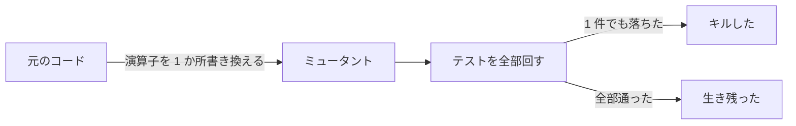

Mutation Testing（ミューテーションテスト）は、テスト対象のコードを 1 か所だけ書き換え、テストがその変化に気づくかで、テストの強さを測る手法です。書き換えたコードをミュータント（mutant）と呼びます。ミュータントでテストが 1 件でも落ちれば、テストはそのミュータントをキルした（killed）と言い、全てのテストが通れば、ミュータントは生き残った（survived）と言います。

著者が Go で書いたライブラリ [filesql](https://github.com/nao1215/filesql) には、PostgreSQL の書き方の SQL を SQLite で動かすために、PostgreSQL の [`width_bucket`](https://www.postgresql.org/docs/current/functions-math.html) を Go で書き直した関数があります。`width_bucket(x, low, high, count)` は、`low` から `high` までを `count` 個の同じ幅の区画に分け、`x` が何番目の区画に入るかを返します。

`x` が範囲より下なら 0、上限以上なら `count+1` を返し、`low` と `high` を逆に渡すと、上から数えます。テストは、PostgreSQL の公式文書にある例 `width_bucket(5.35, 0.024, 10.06, 5)` が 3 を返すことなどを検証しています。

```go
{dialects.PostgreSQL, `SELECT width_bucket(5.35, 0.024, 10.06, 5)`, "3"},
{dialects.PostgreSQL, `SELECT width_bucket(0.0, 0.024, 10.06, 5)`, "0"},
{dialects.PostgreSQL, `SELECT width_bucket(20.0, 0.024, 10.06, 5)`, "6"},
{dialects.PostgreSQL, `SELECT width_bucket(5.0, 10.0, 0.0, 5)`, "3"},
```

範囲から外れる 2 行目と 3 行目は、計算の前に 0 と 6 を返します。区画の番号を計算する行を通るのは、1 行目と 4 行目です。この行の `x-low` を `x+low` に変えると、このテストは落ちるでしょうか。

```go
// 元のコード
return int64(float64(buckets)*(x-low)/(high-low)) + 1, nil
// ミュータント
return int64(float64(buckets)*(x+low)/(high-low)) + 1, nil
```

答えは「落ちない」です。公式文書の例は下限 `low` が 0.024 で 0 に近いので、`low` を引いても足しても、5.35 は同じ 3 番の区画に入ります。下限を 10 にした `width_bucket(15, 10, 20, 5)` なら、正しい答えは 3 で、ミュータントは 13 を返します。



テストは計算の行を通っているので、カバレッジ（テストが実行した行の割合）では、この行は検証済みに数えられます。Mutation Testing は、行を通ったかではなく、行を変えた時にテストが気づくかを数えます。

<br>

本記事では、filesql と、著者が Gleam で作っているテストのライブラリ [metamon](https://github.com/nao1215/metamon) に Mutation Testing を掛けた結果から、手法の仕組みと結果の読み方を説明します。扱う疑問は以下の通りです。

- ミュータントは、どう作られて、どう数えられるのか。
- 生き残ったミュータントは、全てテストの穴なのか。
- どれくらい時間がかかり、どこから回せばよいのか。
- 専用のツールが無い言語でも試せるのか。

---

### ミュータントを作ってテストを回す

Mutation Testing のツールは、元のコードにある演算子や条件を 1 か所だけ書き換えたミュータントを大量に作り、1 個ごとにテストを回します。書き換えの規則をミューテーション演算子（mutation operator）と呼びます。[Fuzzing](../fuzzing/) も入力の変異（mutation）という語を使いますが、Mutation Testing が変えるのは入力ではなくコードです。[Quint](../quint/) のノートでは、1 行を過去の設計に戻したコードを手で作り、ミュータントとして使いました。



Go のツール [gremlins](https://github.com/go-gremlins/gremlins) は、既定で次の 5 つの演算子を使います。冒頭の `x-low` を `x+low` にした書き換えは、算術の演算子を入れ替える ARITHMETIC_BASE が作ったものです。

| 演算子 | 書き換えの例 |
|---|---|
| [ARITHMETIC_BASE](https://gremlins.dev/latest/usage/mutations/arithmetic_base/) | `+` → `-`、`*` → `/` |
| [CONDITIONALS_BOUNDARY](https://gremlins.dev/latest/usage/mutations/conditionals_boundary/) | `<` → `<=`、`>=` → `>` |
| [CONDITIONALS_NEGATION](https://gremlins.dev/latest/usage/mutations/conditionals_negation/) | `==` → `!=`、`<` → `>=` |
| [INCREMENT_DECREMENT](https://gremlins.dev/latest/usage/mutations/increment_decrement/) | `++` → `--` |
| [INVERT_NEGATIVES](https://gremlins.dev/latest/usage/mutations/invert_negatives/) | `-x` → `+x` |

書き換えは 1 か所だけです。この手法は、1978 年の [DeMillo 氏らの論文](https://doi.org/10.1109/C-M.1978.218136)にさかのぼり、プログラマーの書くバグは正しいコードとわずかに違うだけのことが多く、小さな違いを見分けるテストは大きなバグも見分ける、という考えに立っています。

ミュータントのうちキルした割合は、ミューテーションスコア（mutation score）と呼ばれます。gremlins は、テストが 1 度も実行しない行のミュータントを未カバー（NOT COVERED）として実行せず、残りのうちキルした割合を Test efficacy として出します。

---

### filesql の dialect に gremlins を掛ける

filesql の [dialect](https://github.com/nao1215/filesql/tree/21fbc9c7517f095d50d0dee22bd323de397e4d43/dialect) は、MySQL・PostgreSQL・GoogleSQL の書き方の SQL を構文木に読み、SQLite で実行できる SQL に書き直すパッケージです。SQLite に無い関数は、`width_bucket` のように Go で書いた関数を SQLite に登録して補います。

構文を読む parser、SQLite 向けに書き換える lower、関数を集めた runtime などは、dialect 配下の internal にある別のパッケージです。filesql のコミット 21fbc9c で、gremlins v0.6.0 を dialect に掛けました。gremlins は、渡したディレクトリ配下のパッケージも全て書き換えます。

```bash
gremlins unleash --workers 4 ./dialect
```

4 並列で 24 分 55 秒かかり、ミュータントは全部で 5,267 個でした。最後の出力は以下です。

```text
Mutation testing completed in 24 minutes 55 seconds
Killed: 3329, Lived: 744, Not covered: 1140
Timed out: 54, Not viable: 0, Skipped: 0
Test efficacy: 81.73%
Mutator coverage: 78.13%
```

Test efficacy の 81.73% は、キルした数と生き残った数の和 4,073 個で、キルした 3,329 個を割った値です。テストが制限時間内に終わらなかった時間切れ（TIMED OUT）の 54 個は、分母に入っていません。Mutator coverage の 78.13% は、時間切れを除いた 5,213 個のうち、未カバーでなかった 4,073 個の割合です。



図のキル率は、Test efficacy と同じく、未カバーを除いた（テストが届いた）ミュータントのうちキルした割合です。一番大きい runtime は、`go test -cover` で測ったカバレッジが 94.0% で、届いたミュータントのうち 84.7% をキルしていました。つまり、テストが実行している行で 423 個のミュータントが生き残っています。冒頭の `x+low` も、その 1 つです。

<br>

<details>
<summary>dialect のカバレッジ 100% は 105 行だけの数字</summary>

`go test -cover ./dialect` は 100.0% を出します。ただし、この数字は dialect パッケージ自身の dialect.go（105 行）だけを測った値です。`go test -cover ./dialect/...` で下のパッケージを個別に測ると、lower 74.6%、parser 63.2%、render 49.2%、runtime 94.0%、token 72.4% でした。gremlins は `./dialect` を渡すと下のパッケージまで書き換えるので、図の数字は下のパッケージを含みます。

</details>

<br>

---

### 生き残ったミュータントを読む

ミューテーションスコアだけでは、どこにテストの穴があるかは分かりません。生き残ったミュータントを 1 個ずつ読みます。冒頭の [`widthBucket`](https://github.com/nao1215/filesql/blob/21fbc9c7517f095d50d0dee22bd323de397e4d43/dialect/internal/runtime/operators.go#L192-L220) には、gremlins が 20 個のミュータントを作り、13 個をキルし、7 個が生き残りました。

生き残った 7 個のうち 4 個は、ARITHMETIC_BASE と INVERT_NEGATIVES が、L219 にある 2 つの `-` をそれぞれ `+` に書き換えたものです。gremlins v0.6.0 の[対応表](https://github.com/go-gremlins/gremlins/blob/v0.6.0/internal/engine/mappings.go#L58)は、`-` の字句に 2 つの演算子を当てていて、文書では単項のマイナス向けとされる INVERT_NEGATIVES も、引き算の `-` を `+` にします。同じ書き換えの重複を除くと、5 種類になります。

以下は 204〜219 行の抜粋です。行番号のコメントは本記事で足したもので、L219 の直前にあるコメント 2 行は省いています。

```go
if low == high {
	return nil, fmt.Errorf("%w: width_bucket lower bound cannot equal upper bound", ErrInvalidCast)
}
if low > high {                       // L207
	// A descending range is the ascending one counted from the other end.
	low, high, x = high, low, high+low-x
}
if x < low {                          // L211
	return int64(0), nil
}
if x >= high {                        // L214
	return buckets + 1, nil
}
return int64(float64(buckets)*(x-low)/(high-low)) + 1, nil  // L219
```

5 種類を 1 つずつ元のコードに入れ、既存のテストと、新しく足したテストを回しました。足したテストの答えは、PostgreSQL 18.6 で実際に `SELECT width_bucket(...)` を実行して取りました。下限を 0 から離し、値が下限・上限ちょうどの所も入れています。最後の行は、上限ちょうどの値が浮動小数の丸めで 1 つ下の区画に落ちないかを見る入力です。

```go
func TestWidthBucketAwayFromZero(t *testing.T) {
	db := castDB(t)
	for _, tt := range []struct {
		query string
		want  string
	}{
		{`SELECT width_bucket(15, 10, 20, 5)`, "3"},
		{`SELECT width_bucket(10, 10, 20, 5)`, "1"},
		{`SELECT width_bucket(20, 10, 20, 5)`, "6"},
		{`SELECT width_bucket(15, 20, 10, 5)`, "3"},
		{`SELECT width_bucket(0.7, 0, 0.7, 3)`, "4"},
	} {
		got, err := runDialect(t, db, dialects.PostgreSQL, tt.query)
		if err != nil || !got.Valid || got.String != tt.want {
			t.Errorf("%s = %v (%v), want %s", tt.query, got, err, tt.want)
		}
	}
}
```

結果は以下です。

| 行 | 書き換え | 既存のテスト | 足したテスト |
|---|---|---|---|
| L211 | `x<low` → `x<=low` | 生き残る | キル |
| L219 | `x-low` → `x+low` | 生き残る | キル |
| L219 | `high-low` → `high+low` | 生き残る | キル |
| L214 | `x>=high` → `x>high` | 生き残る | キル |
| L207 | `low>high` → `low>=high` | 生き残る | 生き残る |

上の 4 つは、テストの穴でした。足したテストで、L211 のミュータントは `width_bucket(10, 10, 20, 5)` に 0 を返し、L219 の 2 つは `width_bucket(15, 10, 20, 5)` に 13 と 1 を返しました。既存のテストで計算まで進むのは、下限が 0.024 の範囲と、逆向きに渡した 10.0 から 0.0 の範囲だけで、値がちょうど下限の場合も無かったので、下限の扱いを誤ったコードを通していました。

L214 は、最初は書き換えても結果が変わらないように見えました。`x` が `high` と等しい時、ミュータントは L214 を素通りして L219 の式に進みますが、式は `buckets*(high-low)/(high-low)+1` で、数学では元のコードと同じ `buckets+1` になります。ところが float64 で計算すると、割って掛けた値が元に戻らない入力があります。

```text
width_bucket(0.7, 0, 0.7, 3) の場合（x が上限 high と等しい）
元のコード    L214: x >= high が真 → buckets + 1                       = 4
ミュータント  L214: x > high が偽  → L219: 3 × 0.7 ÷ 0.7 = 2.9999999999999996
                                       → int64 で切り捨てて 2、+ 1      = 3
```

PostgreSQL 18.6 は、この入力に 4 を返します。整数の範囲で上限ちょうどの値を足しただけでは、このミュータントはキルできませんでした。

最後の L207 は、どんな入力でも元のコードと同じ値を返すミュータントで、等価ミュータント（equivalent mutant）と呼びます。`low` と `high` が等しい時は、抜粋の先頭にある行でエラーを返すので、`>` を `>=` にしても動きが変わりません。足したテスト 5 行は、等価な L207 を除く 4 つを全てキルします。

等価ミュータントは、どんなテストを足してもキルできません。そのため、ミューテーションスコアは等価ミュータントを分母から外すのが本来の定義です。ただ、あるミュータントが等価かどうかを機械で判定する方法は一般には無く、gremlins の Test efficacy も、等価ミュータントを生き残りに数えます。81.73% を 100% に近づけることを目標にすると、キルできない数を追うことになります。

744 個の生き残りは、全部は読んでいません。`widthBucket` で等価だったのは 7 個のうち L207 の 1 個だけで、L214 のように数学では等価に見えるミュータントも、浮動小数では値が変わることがありました。等価と判断する前に、境界ちょうどの値を浮動小数で試すと見落としが減ります。

---

### 専用のツールが無い言語では

Gleam には、調べた 2026 年 11 月時点で、専用の Mutation Testing のツールが見つかりませんでした。BEAM（Erlang の仮想マシン）で動く言語向けの [muex](https://muex.hexdocs.pm/readme.html) は、対応する言語に Elixir と Erlang を挙げていて、Gleam は挙げていません。`gleam test`（1.18.1）には、カバレッジを取るオプションもありません。

そこで、演算子を 1 か所ずつ書き換えて `gleam test` を回すだけの Python のスクリプトを書きました。抜粋は以下で、全体は [lab の gleam_mutate.py](https://github.com/nao1215/debimate/blob/main/content/notes/software-testing/mutation-testing/lab/gleam_mutate.py) にあります。

```python
# (名前, 正規表現, 置き換え)。Gleam は整数と浮動小数で演算子が分かれる（+ と +.）。
MUTATORS = [
    ("== → !=", r"(?<![=!<>])==(?!=)", "!="),
    ("!= → ==", r"!=", "=="),
    ("<. → <=.", r"<\.", "<=."),
    ("<=. → <.", r"<=\.", "<."),
    (">=. → >.", r">=\.", ">."),
    ("-. → +.", r"-\.", "+."),
    ("&& → ||", r"&&", "||"),
    ("|| → &&", r"\|\|", "&&"),
    ("! を外す", r"!(?=[a-z])", ""),
    ("-> True → -> False", r"-> True\b", "-> False"),
    ("-> False → -> True", r"-> False\b", "-> True"),
    ("== [] → == [Nil]", r"== \[\]", "== [Nil]"),
]

for i, (name, line, src) in enumerate(mutants(original)):
    path.write_text(src)             # ミュータントを書き込む
    code, out, sec = run(proj)       # gleam test を回す
    status = "LIVED" if code == 0 else "KILLED"   # 実物はコンパイルエラーも分ける（簡略化）
```

対象は、metamon の [relation.gleam](https://github.com/nao1215/metamon/blob/459ef87bf45ee8b2d5652ab2b8a8ac3bae02e837/src/metamon/relation.gleam) です。metamon は [Metamorphic Testing](../metamorphic-testing/) と [Property-Based Testing](../property-based-testing/) を同じ形で書けるライブラリで、relation.gleam は、2 つの出力が等しい・近い・並べ替えただけ、といった出力どうしの関係を定義しています。

metamon のテスト 374 件は 1 回 3 秒ほどで終わるので、31 個のミュータントを 2 分足らずで回せました。25 個をキルし、5 個が生き残り、1 個はコンパイルが通りませんでした。下の図は、コンパイルが通らなかった 1 個を除いた 30 個です。図の「N 項の関係」は、2 つではなく複数の出力をまとめて比べる関係（`all_equal`・`pairwise`）のことです。



ほとんどの行は、例を並べたテストと、metamon 自身にプロパティを書いた Property-Based Testing（PBT）の両方でキルされています。一方、N 項の関係を扱う `all_equal_loop` と `pairwise_loop` は、赤い行以外も、N 項の関係を扱うテスト 1 件ずつでしかキルされていません。

赤い 5 行のうち、L55 は等価ミュータントでした。`approximately` は、大きい方の値から小さい方の値を引いて 2 つの値の差を求めます。`>=.` を `>.` にすると、2 つの値が等しい時だけ引く向きが逆になりますが、差はどちらでも 0 です。

<br>

#### 失敗を返す枝にテストが届いていない

残りの 4 行は、複数の出力をまとめて比べる `all_equal` と `pairwise` の中にありました。`all_equal` は、出力が全て等しい時に True を返す関数で、L235 は値が違った時に False を返す枝です。

```gleam
fn all_equal_loop(items: List(b)) -> Bool {
  case items {
    [] -> True                                   // L230
    [_] -> True
    [first, second, ..rest] ->
      case first == second {
        True -> all_equal_loop([second, ..rest])
        False -> False                           // L235
      }
  }
}
```

生き残った行の枝を `panic` に置き換えると、その行を通ったテストは落ちます。カバレッジを測る道具の代わりにこの方法で調べると、L55 では 3 件が落ち、L230・L235・L252・L257 では 374 件が全て通りました。テストは、この 4 行に 1 度も届いていません。N 項の関係を使う metamon の関数 `forall_morph_n` は、元の入力と変換した入力の出力を必ず 2 つ以上渡すので、空のリストを受ける枝（L230・L252）には届きません。

`all_equal` を使うテストは、関係が成り立つ入力しか渡していませんでした。そのため、L235 を `False -> True` にして、値が違っても True を返すようにしても、誰も気づきません。このミュータントを入れたまま、逆順にすると結果が変わる関数を検査しました。下のテストは、metamon が乱数で作ったリストと、それを逆順にしたリストの両方を `first_or_zero` に渡し、2 つの出力が全て等しいかを `all_equal` で検証します。リストの先頭を返す関数なので、正しい `all_equal` なら落ちるはずです。

```gleam
// 逆順にすると結果が変わる関数。all_equal で検査すれば落ちるはず
fn first_or_zero(items: List(Int)) -> Int {
  case list.first(items) {
    Ok(x) -> x
    Error(_) -> 0
  }
}

pub fn first_is_invariant_under_reverse_test() {
  metamon.forall_morph_n(
    generator.list_of(generator.int(range.constant(0, 9)), range.constant(2, 5)),
    [list_t.reverse()],
    relation.all_equal(),
    first_or_zero,
  )
}
```

```text
元のコード: 374 passed, 1 failures
L235 のミュータント: 375 passed, no failures
```

件数は、metamon の 374 件に足したテスト 1 件を加えた 375 件です。元のコードでは、入力 `[0, 1, 9, 8]` で先頭が 0 と 8 に分かれて落ちます。ミュータントでは、誤った関数のテストが通りました。テストのライブラリにこの書き換えが入ると、`all_equal` を使った利用者のテストは全て通るようになり、しかも metamon 自身の 374 件のテストはそれに気づきません。

この 4 行は、カバレッジが取れる言語なら未カバーとして見える穴です。テストのライブラリは「成り立つ時に通る」ことは自然に検証できますが、「成り立たない時に落ちる」ことは、わざと誤った入力を用意しないと検証できません。

<br>

#### Metamorphic Testing で関係の強さを測る

[Metamorphic Coverage の論文](https://arxiv.org/abs/2508.16307)は、同じ行を通る 2 つの関係（metamorphic relation）はカバレッジでは区別できず、ミュータントをキルできるかで区別できる、という例を挙げています。ただ、同じ論文が調べた Metamorphic Testing の手法 10 個のうち、ミューテーションスコアを報告していたのは 1 つだけで、論文は計算が重いことを理由に推しています。metamon のように関係を部品として配るライブラリでは、部品の 1 つが弱いと、それを使った全てのテストが弱くなります。

---

### どこから回すか

filesql の dialect は、5,267 個のミュータントに 4 並列で 25 分かかりました。gremlins は全てのミュータントで `go test` を回し直すので、時間はおおむね「ミュータントの数 × テスト 1 回の時間 ÷ 並列数」です。テストが 1 回 3 秒ほどで終わる metamon の 1 ファイルなら、手書きのスクリプトでも 2 分足らずでした。

毎回のプルリクエストで全体を回すのは重いので、gremlins には変更した行だけを書き換える `--diff` があります。Google の[報告](https://research.google/pubs/state-of-mutation-testing-at-google/)（2018 年）も、変更の差分だけにミュータントを作り、テストが 1 度も実行しない行と、書き換えても意味の薄い行を外して、コードレビューの中で生き残りを見せる形でした。

```bash
# main との差分にある行だけを書き換え、Test efficacy が 80% 以下なら失敗にする
gremlins unleash --diff origin/main --threshold-efficacy 80 .
```

最後の `.` には注意が要りました。

filesql で、コミット ddd2edb の 1 つ前から今までの差分（dialect 配下だけで 2,093 行の追加）を `--diff` に渡しました。モジュールの最上位で回すと、dialect 配下の 147 個を含む 396 個のミュータントを数えたのに、`./dialect` を渡すと 0 個でした。

gremlins v0.6.0 は、`git diff` が出すパスと、ミュータントがあるファイルのパスを[そのまま比べます](https://github.com/go-gremlins/gremlins/blob/v0.6.0/internal/diff/diff.go#L55-L60)。`git diff` はリポジトリの最上位から見たパスを出し、gremlins は渡したディレクトリから見たパスを使うので、`./dialect` を渡すと、どのファイルも差分と一致しません。

```text
git diff が出すパス:               dialect/internal/token/token.go
./dialect で回した時のミュータント:  internal/token/token.go
```

`--diff` を使う時は、最上位で回し、数が 0 個でないことを確認します。`--threshold-efficacy` で Test efficacy の下限を決めて CI を落とすこともできますが、等価ミュータントがある限り 100% には届かないので、下限は今の値から下がらないことを見る使い方が合います。

最初に回すなら、計算をしている関数が集まった 1 パッケージだけを手元で 1 回回すのがおすすめです。生き残ったミュータントのうち、算術の書き換えから読み、等価でなければ、そのミュータントをキルする入力をテストに足します。冒頭の `width_bucket` では、足した 5 行で 4 つの穴が閉じました。

生き残りが 1 つも無い関数でも、「成り立たない時に落ちる」テストがあるかは別に確認する必要があります。metamon の `all_equal` のように、失敗を返す枝にテストが 1 本も届いていなければ、その関数を使う側のテストは、誤ったコードでも全て通ります。

実験に使ったスクリプトと出力は、[lab](https://github.com/nao1215/debimate/tree/main/content/notes/software-testing/mutation-testing/lab) に置いています。図の生成元は [figures.py](https://github.com/nao1215/debimate/blob/main/content/notes/software-testing/mutation-testing/figures.py) です。
