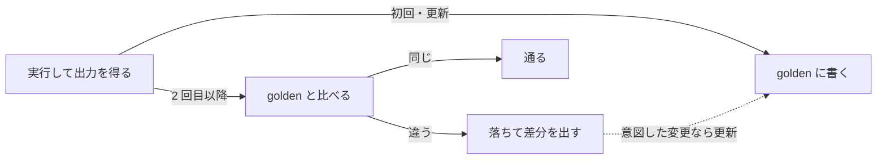

Snapshot Testing（スナップショットテスト）は、プログラムの出力をファイルに保存しておき、次からは保存した出力と今の出力を比べるテストです。保存した出力を golden ファイルと呼ぶので、Golden Testing（ゴールデンテスト）とも呼ばれます。期待値を手で書かずに済むので、Markdown や SQL の生成、CLI の表示のように、長くて手で書きにくい出力のテストに使われます。

著者が Go で書いたライブラリ [markdown](https://github.com/nao1215/markdown) は、Markdown の文書と、文書に埋め込む図の記法 [Mermaid](https://mermaid.js.org/) を生成します。v0.13.0 で、引用符を含むラベルと `#` を含むタイトルを持つ流れ図を作り、その出力を golden ファイルに固定しました。`go test -count=3` で 3 回回してもテストは通り、Mermaid も図をエラー無く描きました。ところが、描かれた図からは引用符と、タイトルの `#prod` が消えています。



golden テストが確認していたのは、出力が前回と同じことだけです。正しい図かどうかは確認していません。生成のコードを直した v1.0.0 に上げると、同じテストは差分を出して落ち、golden を更新すると再び通るようになりました。

<br>

本記事では、まずスナップショットテストが何と何を比べているかを整理し、Mermaid の件で何が固定されていたかを読みます。次に、実行のたびに変わる時刻やパスをマスクする処理を扱います。この処理を正規化（normalization）と呼びます。正規化が壊れる例は、著者が作った CLI のテストツール [atago](https://github.com/nao1215/atago) の古いバージョンで再現します。最後に、golden を更新する時に何を確認するかを扱います。

---

### 前回の出力と比べる

スナップショットテストは、初回と 2 回目以降で動きが変わります。初回は出力を golden ファイルに書くだけで、2 回目以降は今の出力と golden を比べ、違えば差分を出して落ちます。差分が意図した変更なら、人が golden を更新します。



冒頭の実験で使った golden テストは、以下の通りです。テストの中に期待値が書かれていない点が、手で期待値を書くテストとの違いです。環境変数 `UPDATE_GOLDEN` を付けて実行すると golden を書き直し、付けなければ比べます。

```go
// flowchart.go
func Deploy(release string) string {
	return flowchart.NewFlowchart(nil, flowchart.WithTitle("Deploy "+release+" #prod")).
		NodeWithText("A", `run "make release"`).
		NodeWithText("B", "push the tag").
		LinkWithArrowHead("A", "B").
		String()
}

// flowchart_test.go
func TestDeployGolden(t *testing.T) {
	got := Deploy("v1.0")
	const path = "testdata/deploy.mmd"
	if os.Getenv("UPDATE_GOLDEN") != "" {
		if err := os.WriteFile(path, []byte(got), 0o644); err != nil {
			t.Fatal(err)
		}
		return
	}
	want, err := os.ReadFile(path)
	if err != nil {
		t.Fatal(err)
	}
	if string(want) != got {
		t.Errorf("golden mismatch\n--- want\n%s\n--- got\n%s", want, got)
	}
}
```

この形は、道具や言語ごとに名前が違うだけで、どれも同じ仕組みです。Go の標準ライブラリでは、ソースの整形を行う [go/printer のテスト](https://github.com/golang/go/blob/master/src/go/printer/printer_test.go)が、testdata の golden ファイル（主に `*.golden`）と比べ、`-update` フラグで書き直します。

| 道具 | 呼び名 | 書き直し方 |
|---|---|---|
| Go の go/printer | golden ファイル | `go test -update` |
| [Jest](https://jestjs.io/ja/docs/snapshot-testing)（JavaScript） | スナップショット | `jest -u` |
| [insta](https://insta.rs/)（Rust） | スナップショット | `cargo insta review` で 1 件ずつ承認 |

考え方は、Michael Feathers 氏が『[Working Effectively with Legacy Code](https://www.oreilly.com/library/view/working-effectively-with/0131177052/)』で書いた仕様化テスト（characterization test）と同じです。邦訳の『レガシーコード改善ガイド』が、この仕様化テストという訳を使っています。

仕様化テストは、コードがすべきことではなく、今していることを固定し、書き換えで振る舞いが変わらないことを確認します。スナップショットテストが答えるのも「前回と同じか」で、「正しいか」ではありません。この点で、出力の正しさを別の手段で判定する [Metamorphic Testing](../metamorphic-testing/) や [Differential Testing](../differential-testing/) とは役割が違います。

---

### 固定されたのは図ではなくバイト列

冒頭で v0.13.0 が書いた golden には、2 つの誤りがありました。1 つ目はタイトルです。Mermaid は、図の先頭で `---` に挟んだ部分を YAML として読みます。YAML では、空白に続く `#` から行末までがコメントになります。そのため `title: Deploy v1.0 #prod` のタイトルは `Deploy v1.0` です。

2 つ目はノードのラベルです。`A["run "make release""]` は、ラベルを囲む引用符の中に、引用符をそのまま書いています。手元の Mermaid 11.16.1 はエラーを出さず、引用符を落として `run make release` と描きました。

v1.0.0 は、タイトルを引用符で囲み、ラベルの引用符を Mermaid の文字参照 `#quot;` に置き換えます。v0.13.0 で書いた golden のまま v1.0.0 でテストを回すと落ちます。差分のうち、変わった 2 行だけを抜き出すと次の通りです。

```text
--- FAIL: TestDeployGolden (0.00s)
    flowchart_test.go:24: golden mismatch
        --- want
        title: Deploy v1.0 #prod
            A["run "make release""]
        --- got
        title: "Deploy v1.0 #prod"
            A["run #quot;make release#quot;"]
```

<br>

差分は直した結果として出たもので、golden テストがバグを見つけたわけではありません。golden テストは、v0.13.0 の誤った出力も、v1.0.0 の正しい出力も、同じように「前回と同じ」と判定して通しています。

markdown の v1.0.0 では、golden ファイルで全ての出力を固定するのと同時に、生成した図を CI でブラウザの Mermaid に描かせる検査を足しました。描画で例外が出ないことに加えて、宣言したタイトルが描かれた図に現れることを確認します。経緯は [markdown を v1.0.0 にした話](/post/ja/2026-08-13-golangmarkdown%E3%81%A8mermaid%E3%82%92%E7%94%9F%E6%88%90%E3%81%99%E3%82%8Bmarkdown%E3%83%91%E3%83%83%E3%82%B1%E3%83%BC%E3%82%B8%E3%82%92v1.0.0%E3%81%AB%E3%81%97%E3%81%9F%E8%A9%B1/)に書きました。golden ファイルが固定できるのはバイト列までです。そのバイト列が読む人にどう見えるかは、読む側の道具に通して確認するしかありません。

ただし、この検査も万能ではありません。検査が比べる「宣言したタイトル」も YAML として読んだ値なので、`#prod` はコメントとして消えた後です。冒頭で v0.13.0 が書いた出力をこの検査に掛けると、引用符の件も含めて通りました。描画の検査も、何を期待値にするかで見逃しが決まります。

---

### 毎回変わる値をマスクする

CLI の出力には、実行のたびに変わる値が混ざります。時刻、一時ディレクトリのパス、ホームディレクトリ、UUID、空いているポートの番号、端末の色を付けるエスケープ、OS ごとの改行コードなどです。そのまま golden に書くと、次の実行で必ず落ちます。そこで多くの道具は、比べる前に出力を正規化し、変わる値を `<timestamp>` や `~` のような決まった文字に置き換えます。

atago も、出力を golden と比べる `snapshot` を持ち、上に挙げた値をマスクします。atago のテストは、spec と呼ぶ YAML のファイルに書きます。次の spec は、`run` で printf を実行して 2 行を出力し、その標準出力を golden ファイル `snapshots/root.txt` と比べます。出力に `/` が多く入っていることが、この後の実験で効いてきます。

```yaml
version: "1"
suite:
  name: root
scenarios:
  - name: where the binary is installed
    steps:
      - run:
          shell: true
          command: |
            printf 'installed: /usr/local/bin/app\nconfig: /etc/app/config.toml\n'
      - assert:
          stdout:
            snapshot: snapshots/root.txt
```

正規化もコードなので、間違えます。2026-07-05 にリリースした atago の v0.4.2 は、出力の中でホームディレクトリと文字列として一致した所は、全て `~` に置き換えていました。ホームが `/` のコンテナでこの spec の golden を書くと、全ての `/` が `~` になります。

次の図では、この出力に加えて、ホームが `/home/nao` の時に `/home/naoki/data` を出力した例も並べます。右の列は、本記事を書いた時点で最新の v0.26.1 です。



ホームが `/` のコンテナで golden を書き、ホームが `/home/nao` の手元で比べた結果は、次の通りです。lab の出力では、golden を書く実行を record、比べる実行を verify と書いています。golden の各行で末尾にある `$` は、行の終わりを示す印です。

```text
== atago v0.4.2  root.atago.yaml  (record: HOME=/, verify: HOME=/home/nao)
  golden:
    installed: ~usr~local~bin~app$
    config: ~etc~app~config.toml$
  verify: FAILED  1 scenario: 0 passed, 1 failed, 0 errored, 0 skipped (0s)
== atago v0.26.1  root.atago.yaml  (record: HOME=/, verify: HOME=/home/nao)
  golden:
    installed: /usr/local/bin/app$
    config: /etc/app/config.toml$
  verify: PASSED  1 scenario: 1 passed, 0 failed, 0 errored, 0 skipped (1ms)
```

<br>

手元のホームは `/home/nao` なので、比べる時に出力の `/` はマスクされず、`/usr/local/bin/app` のままです。golden は `~usr~local~bin~app` なので一致せず、v0.4.2 は落ちます。出力は同じなのに、golden を書いた機械によって golden が変わったわけです。

ホームが `/home/nao` の時も、`/home/naoki` は `~ki` になります。この誤りは同じ機械で比べる限り通るので、golden を読まない限り気づきません。v0.26.1 は、一致した直後がパスの区切り・空白・引用符・行末の時だけマスクし、ホームが `/` ならマスクしません。修正の内容は [atago のコミット](https://github.com/nao1215/atago/commit/babf504)にあります。

<br>

#### マスクする順番で、秘密が残り、更新の直後に落ちる

正規化は複数の段階からなり、順番にも意味があります。atago では、spec で秘密と宣言した環境変数の値は、golden に書く前に `*` を 3 つ並べた文字へ置き換わります。v0.4.2 は、秘密をマスクしてから改行コードを揃え、その後に色のエスケープを消していました。

改行コードを揃える処理は、Windows の CRLF（`\r\n`）を Unix の LF（`\n`）に置き換えます。色のエスケープは、端末に色を指示する文字列で、図の `\e[0m` は色を元に戻す指示です。



上の段は、出力の一部だけを色付けする CLI で起きる形です。秘密の途中にエスケープがあるので、1 段目は秘密を見つけられません。3 段目でエスケープが消えると秘密がつながり、そのまま golden に書かれます。テストは通るので、秘密は golden と一緒にリポジトリへ commit されます。秘密を消す処理の抜けがログや診断ファイルから秘密を外へ出した事故は、[Secrets in Logs](../../security/log-leak/) のノートにまとめました。

下の段では、改行コードを揃える処理が `\r\n` を `\n` に 1 回置き換えるだけなので、CR（`\r`）が 2 つ続くと 1 つ残ります。golden には `50%\r\n` が書かれます。比べる時、今の出力は同じ正規化を 1 回通って `50%\r\n` になります。一方、golden は読み込んだ後にもう 1 回改行コードを揃えるので `50%\n` になり、両者は一致しません。更新した直後のテストが落ち、何度更新しても通らない状態になります。

```text
== atago v0.4.2  crlf.atago.yaml  (record: HOME=/home/nao, verify: HOME=/home/nao)
  golden:
    progress 50%\r$
    done$
  verify: FAILED  1 scenario: 0 passed, 1 failed, 0 errored, 0 skipped (0s)
== atago v0.4.2  secret.atago.yaml  (record: HOME=/home/nao, verify: HOME=/home/nao)
  golden:
    token: s3cr3t-token$
  verify: PASSED  1 scenario: 1 passed, 0 failed, 0 errored, 0 skipped (1ms)
```

<br>

v0.26.1 は、出力が変わらなくなるまで改行コードを揃える処理を繰り返し、最後にもう 1 回秘密をマスクします。2 つの不具合を直した内容は [atago のコミット](https://github.com/nao1215/atago/commit/86aa124)にあります。v0.26.1 では、golden は `progress 50%` と、`token:` に続く値が `*` 3 つになった行になり、どちらも通ります。

秘密と CR の不具合は、どちらも「正規化を 2 回掛けた結果が、1 回の結果と同じ」という性質が破れていました。v0.4.2 の golden にもう 1 回正規化を掛けると、つながった秘密は今度はマスクされ、残った `\r\n` は `\n` になり、1 回目の結果と変わります。この性質を冪等（idempotent）と呼びます。

atago は修正と一緒に、任意の出力と秘密の組で冪等と秘密の漏れを調べる [Fuzzing](../fuzzing/) の関数を足しました。正規化の関数そのものも [Property-Based Testing](../property-based-testing/) や Fuzzing の対象にしておけば、golden を読まなくても壊れた正規化に気づけます。

---

### マスクした値は確認していない

正規化には、逆向きの問題もあります。マスクした値は、golden と比べる時に見ていません。atago v0.26.1 で、作成時刻を出力する spec の golden を書き、時刻が 1970 年に戻る誤りを入れて比べると、テストは通ります。

```text
== atago v0.26.1  timestamp.atago.yaml
  golden:
    id: 42$
    created: <timestamp>$
  verify with "created: 1970-01-01T00:00:00Z": PASSED  1 scenario: 1 passed, ...
  verify with "created: 2026-11-14": FAILED  1 scenario: 0 passed, 1 failed, ...
```

atago は既定では、`2026-11-14T10:00:00Z` のように日付と時刻がそろった形だけを `<timestamp>` に置き換えます。そのため、時刻の値が誤っていても通り、日付だけになるなど形が変わった時だけ落ちます。マスクした値の中身を確認したいなら、範囲や形を調べる別の検査を足す必要があります。何をマスクするかは、何をテストしないかを決めることでもあります。

---

### golden の更新は承認

スナップショットテストで落ちた時、差分を読まずに `-update` や `-u` で golden を書き直すと、どんな出力でも通るようになります。golden の更新は、新しい出力を正しいと認める承認です。Jest の文書も、スナップショットはコードと一緒に commit し、レビューの対象にするよう勧めています。

atago には、この承認が意図せず起きた不具合がありました。atago は、まだ直していないバグを `expect_fail` のシナリオとして残せます。そのシナリオの golden には、直った後に出るべき出力を書いておきます。今の出力とは一致しないので、失敗が期待通りとして扱われます。

atago では、Go の `-update` と同じ役目を `--update-snapshots` が持ちます。spec 全体にこれを掛けると、`expect_fail` の golden も今の誤った出力で上書きされていました。

| 時点 | golden | 今の出力 | atago の報告 |
|---|---|---|---|
| 更新の前 | 直った後の出力 | 誤った出力 | 失敗は期待通り |
| 一括更新の後 | 誤った出力 | 誤った出力 | バグはもう無い |

atago は、`expect_fail` のシナリオが golden と一致すると、バグが直ったと見なします。バグは残ったままで、消えたのはバグを記録した golden の方です。修正の内容は [atago のコミット](https://github.com/nao1215/atago/commit/ca67337)にあります。

一括の更新は、差分を読む人が 1 件ずつ判断する手間を省きます。そのため、更新で変わった golden も、コードの差分と同じように PR で読む必要があります。insta は、変わったスナップショットを `.snap.new` として保留し、`cargo insta review` で 1 件ずつ確認する流れを用意しています。

---

### 使う前に確認すること

スナップショットテストが向くのは、出力が長く、手で期待値を書くと間違えやすく、差分を人が読んで判断できる時です。Markdown の生成や CLI の表示はこれに当たります。逆に、差分が大きすぎて誰も読まない golden は、更新のたびに承認の意味を失います。

導入する前か、既存のテストで出会った時には、次を確認すると本記事の失敗を避けられます。

- 正規化を 2 回掛けて、1 回と同じ結果になるか
- 別の機械（ホームや OS が違う）で書いた golden が、手元で通るか
- マスクした値は別の検査で確認しているか
- 出力の意味（描画や構文）は、読む側の道具に通して確認しているか

どれかが欠けている時、スナップショットテストは「前回と同じ」ことは保証しますが、前回が正しかったことは保証しません。

実験に使った spec・Go のテスト・描画のスクリプトと出力は、[lab](https://github.com/nao1215/debimate/tree/main/content/notes/software-testing/snapshot-testing/lab) に置いています。
