#### マリンピア日本海の年パス購入を検討して2年経った

[マリンピア日本海](https://www.marinepia.or.jp/)には、年間パスポートの概念がある。大人3,500円、小中学生1,300円、幼児（4歳から）400円だ。1年に3回以上来るなら、年パスを買った方がお得だ。私は丁度年間3回ぐらいの頻度で訪れている気がする。2025年度収支報告書を見ると、年間入館者数は約54万9,000人、入館料がメインの稼ぎ柱だった。物販で稼いでいるのかと想像していたが、そこまで大きな数値ではなかった。

主な事業収入：

| 項目 | 年間金額 |
|---|---:|
| 入館料収入 | 約4億8,098万円 |
| 物販などを含む付帯事業 | 約8,516万円 |
| 教育・普及啓発などの自主事業 | 約1,764万円 |

4回、5回と訪れ続け、年パスで浮いたお金で物販のぬいぐるみを買うと、お互いに Win-Win でマリンピア日本海の存続に貢献できるだろう。私は、お金を払わないでサービスを先細りさせるのがあまり好きではない。今回の来訪では、息子がトドとペンギンの食事にご熱心だった。子供向けの遊び場で遊ぶのが、一番テンション高そうに見えた。






私は、展示されている魚が変わったのではないかと思いながら眺めていた。イワシに近い種類の大きな魚（名前を失念）がいて、初めて見たなと思った。もう少し前は、浜辺に迷いついたウミガメが居たらしい。ウミガメは私が子供の頃しか飼育されていなかったので、見ておきたかった（日本海にウミガメは居ない、的な理由で居なくなったと昔聞いた。真偽は不明）。

天気が良かったので、食事をしながらイルカショーを観覧している人が多かった。天気が悪いと小さい屋内でショーを見るため、ホットスナックを食べる人を見かけないのだ。私は息子が生まれてから、初めて快晴でショーを見たのかもしれない。






魚が飼育されている水族館に刺し身料理の食品サンプルがあり、「食べることしか考えていない民族、日本人」というフレーズが脳裏に浮かんだ。水族館でイカやタコ、海老を見て、「美味しそう」という感想が聞こえてくるのは日本だけではなかろうか。海外の水族館に行ったことないけど。







数億円が手に入ったら、海沿いで住むのも楽しそうだなと考えながら、マリンピア日本海の前にある海を眺めていた。山よりは良い。虫が居ないから。その一方で、塩害に悩まれそうだ。塩害を上回る問題は、数億円が現世で手にはいらないことだろう。150億円欲しい。

---

#### ゲーム開発に使うフレームワークgozen（御膳）を整備している

先月の終わりから、ゲーム開発をずっと続けている。平日は LLM に自動開発をさせ、夜か休日にテストプレイしている。

[hajimehoshi/ebiten](https://github.com/hajimehoshi/ebiten)（Go 製） をゲームエンジンとして利用しており、その上で動作するフレームワークとして、nao1215/gozen（当時はプライベート。現在は[公開済み](https://nao1215.github.io/gozen/)）を作り始めた。エビ天に合わせて、mentsuyu（めんつゆ）にしようかと思ったが、既に先客がいた。gozen はツールセットの側面が強いので、御膳から名前を拝借した。エビ天御膳。蕎麦とかついてきそう。偶然だが、御膳には go の文字が入っていて満足である。なお、ebiten（ebitengine） はマルチプラットフォームであり、この点に関しては強くリスペクトしている。

>Ebitengine のゲームは様々な環境で動きます。デスクトップ (Windows、macOS、Linux、FreeBSD)、 Web ブラウザ (WebAssembly)、モバイル (Android と iOS) で動きます。さらに、 v2.10 からすべてのデスクトップ向けビルドは Pure Go なので、 C コンパイラなしで開発できます。 Nintendo Switch™ もサポートされています。



LLM のおかげで、大学生の頃からの夢だったゲーム開発が実現できるようになった。自分が納得できるゲームを作るまで、暫くは OSS 開発をしない。新しい会社で必要な知識をキャッチアップしつつ、ゲームを作る方針になる。最近は、ゲーム開発の面倒な部分に気づき始めたので、開発の全貌が想像できるようになってきたようだ。ゲームは開発規模が大きく、1週間で雛形すらできない。シナリオ、音楽、ゲームデザインなどの幅広い知識が要求され、仕様変更が激しい。大変だ。

UI に使える画像は [ComfyUI](https://github.com/comfy-org/comfyui) に頼るので、作れないジャンルが多い。例えば、アニメーションを多用するゲームは厳しい。実力値が知りたかったので、画像生成に関しては数千枚の画像を生成して一定の知見を得た。消費電力を増やせば、画像生成が高速化されることに気づいた後、私の部屋は GPU の排熱で灼熱になった。冬でも暖房が要らないのではなかろうか。外気温14度なのに、床冷房を付けている。

伝えたいことは、楽しい遊びを見つけました、という一点。

---

#### Rabbit Run をブラウザ対応した

[hajimehoshi/ebiten](https://github.com/hajimehoshi/ebiten)（Go 製） が WASM 対応しているので、お試しでブラウザ対応した。本格的なテストプレイはしていない。カクツキや音声飛びは修正済み。



---

#### RPG・ADV用ゲームエンジン（CLI・フレームワーク）であるgozenを公開

今まで仮組みしていた RPG・ADV・SLG の機能を [nao1215/gozen](https://nao1215.github.io/gozen/) として公開した。[ebitengine](https://ebitengine.org/ja/) の薄いラッパーである。ebitengine がエビ天から命名されているので、エビ天を拡張するものとして御膳とした。エビ天で御膳というと、蕎麦がついてくる印象がある。エビ天を最後に食べたのはいつだろうか。

| RPG「Go Zen」 | ノベルゲーム「After the Pass」 |
|:--|:--|
| 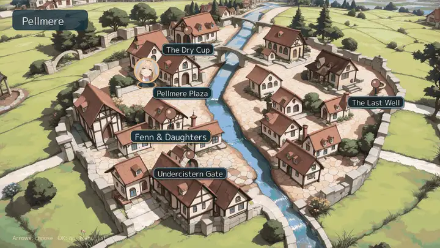 | 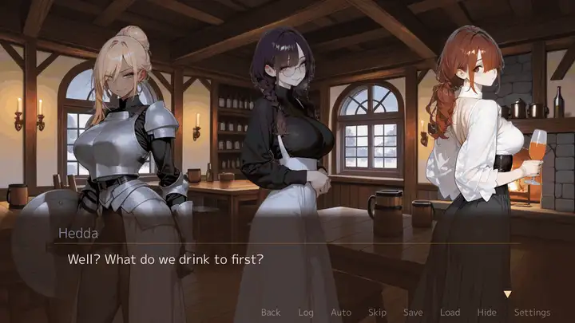 |
| SLG「Five Banners」 | |
| 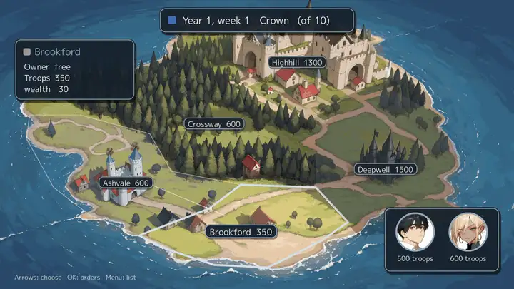 | |

gozen は、ゲームエンジンというより、YAML で定義する RPG ツクールに近い。最近は、YAML で定義するのがマイブームだ（N 度目の主張）。LLM フレンドリーであり、デバッグ機能が豊富だ。例えば、自動プレイや戦闘シミュレーションの機能があり、勝率やフロア突破率をデータとしてチェックできる。プレイ中に「ここ、微妙だな」と感じた場面にメモを残せる。LLM にメモを監視させて、LLM が修正した YAML をホットリロードしてプレイを続けられる。現代的だ。

自分用のツールであるため、静止画でやりきれる範囲の機能だけ提供する。3D モデルだなんてとんでもない。ゲームエディタのような GUI を提供しておらず、エンジニアが LLM を介してゲーム開発しやすいように設計している。ユーザーが増えたら、GUI 提供を考え始めるだろう。避けたいのは、gozen の開発に夢中になることだ。完全に偏見だが、エンジニアはゲーム開発よりも、ゲームエンジン開発に熱心になってしまうケースが多いのではなかろうか。

基本的には、gozen はウィザードリィスタイルのダンジョン、戦闘（ドラクエ式、SLG 式）、会話イベントが作れるだけだ。上手に設計すれば、RPG・ADV・SLG の要素をブレンドしたゲームも作れる。サンプルの[RPG](https://nao1215.github.io/gozen/play/go-zen/)、[ADV](https://nao1215.github.io/gozen/play/novel/)、[SLG](https://nao1215.github.io/gozen/play/campaign/) は、ブラウザプレイできるように公開されている。WASM 万歳。モバイル対応もやれば出来る筈だが、そこまで試していない。

| 会話 | 広場 |
|:--|:--|
| 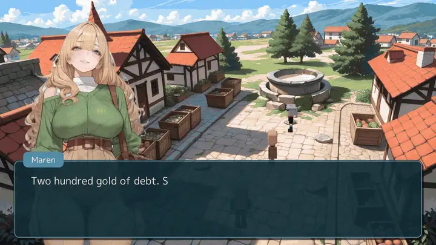 | 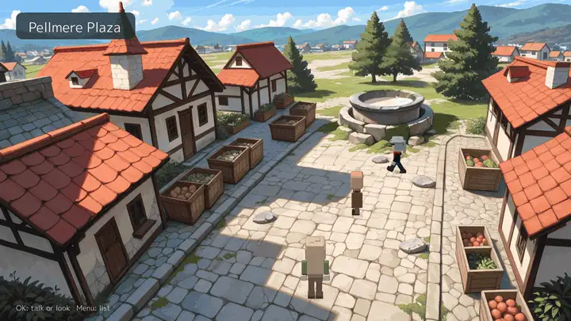 |
| マップ | 一人称視点のダンジョン |
| 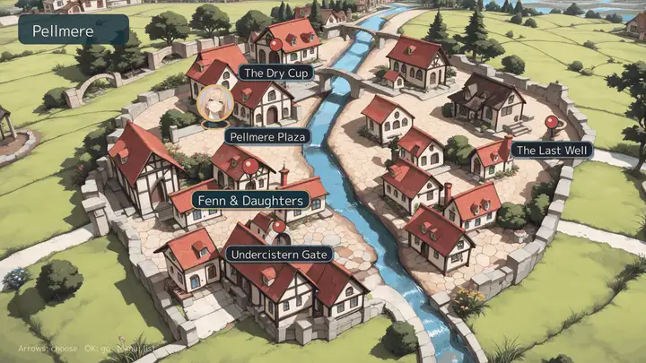 | 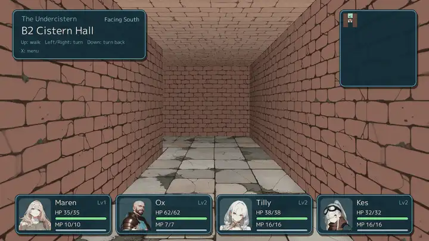 |
| 戦闘 | カットイン |
| 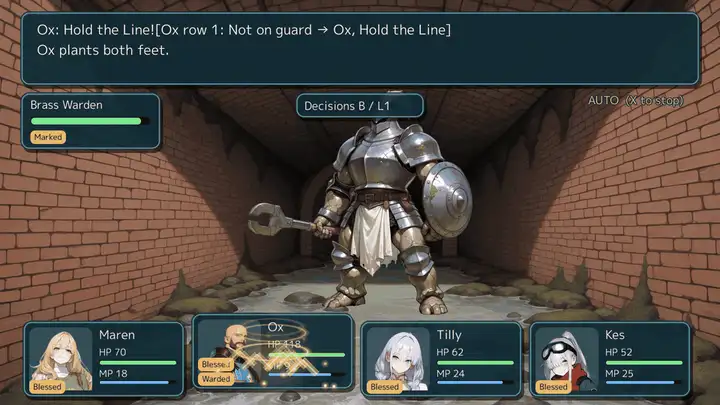 | 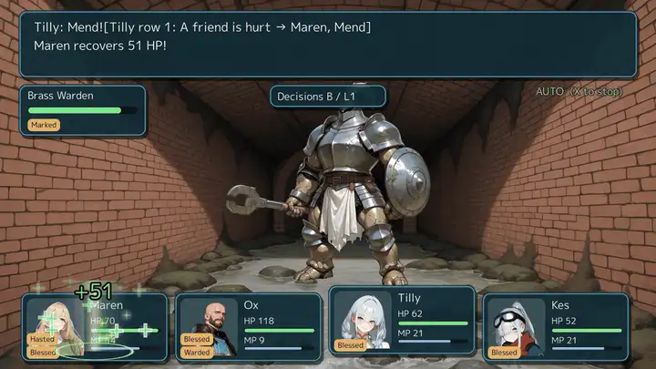 |
| ショップ | スキルツリー |
| 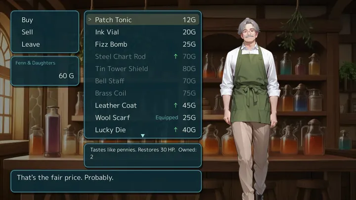 | 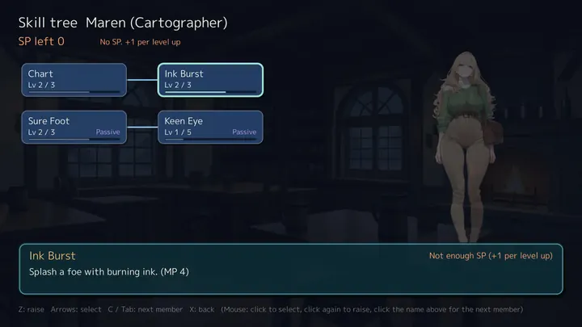 |
| タイトル画面 | |
| 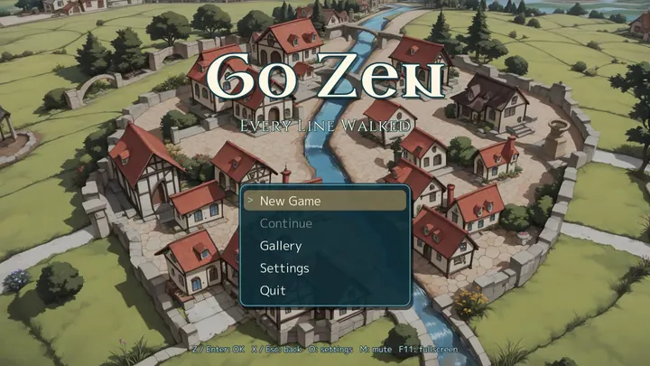 | |

| 巻き戻し（Q、マウスホイール） | 未読箇所までスキップ（N） |
|:--|:--|
| 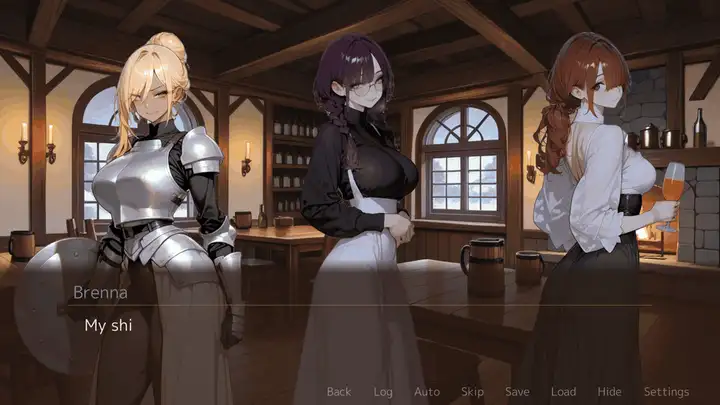 | 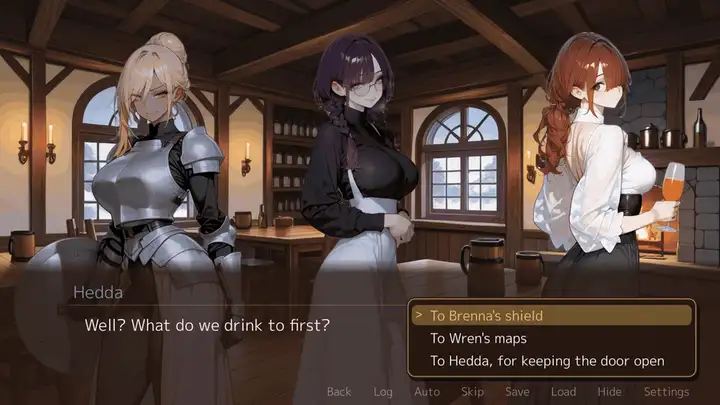 |
| 多言語対応 | 立ち絵の演出（stand、effect） |
|  | 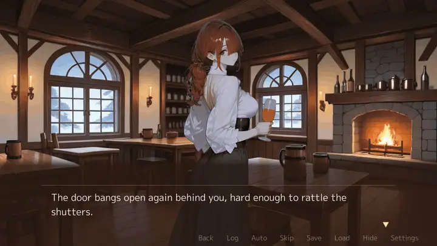 |
| 台詞付きイベント画像 | |
| 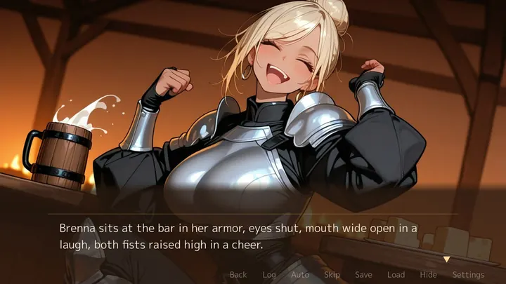 | |

| 戦争マップ | 軍勢の衝突 |
|:--|:--|
| 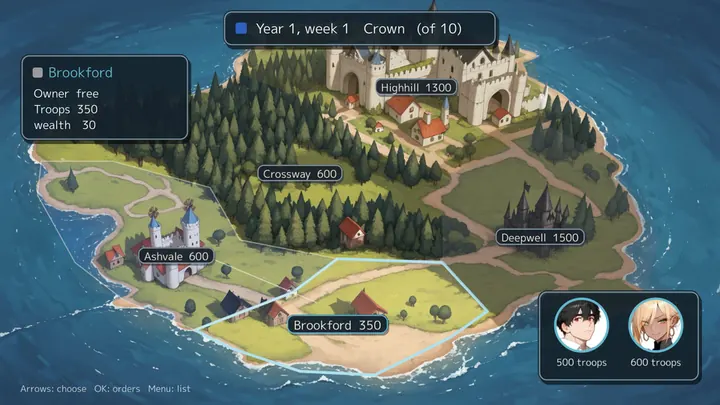 | 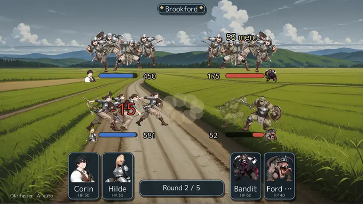 |
| 地域の配置と支配状況を一枚の地図に表示 | 部隊の兵士数に応じて、戦闘中に兵士の群れが縮小 |

| F5：YAMLの変更を同じ場所に反映 | F9：画面と状態をメモに保存 |
|:--|:--|
|  | 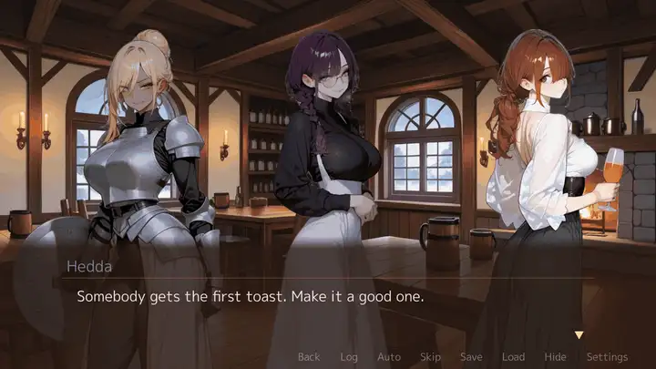 |
| F7：戦闘の勝率 | F8：状態（フラグ・数値） |
| 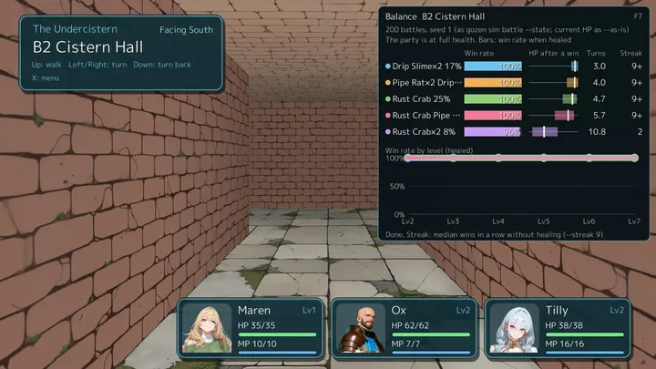 | 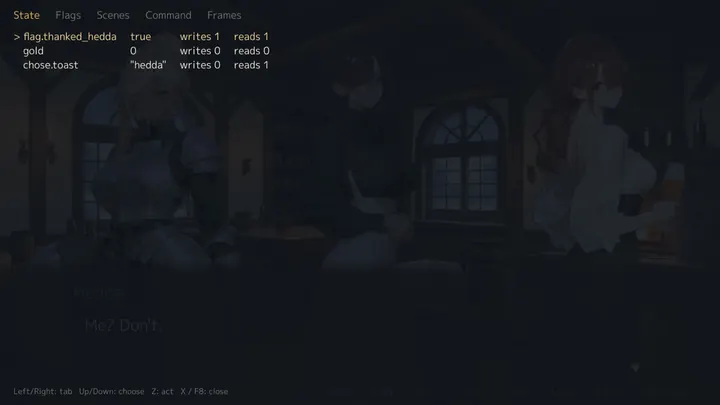 |
| F8：各イベントのフラグ | F8：シーン移動 |
| 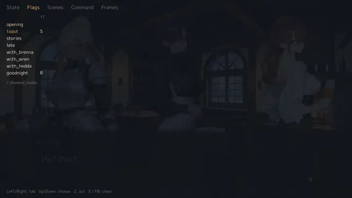 | 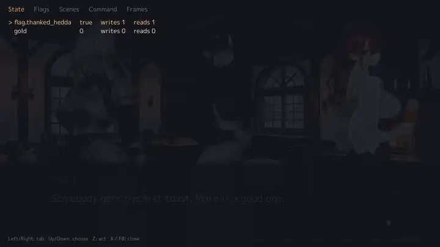 |
| F8：YAMLコマンド実行 | F8：フレーム計測 |
| 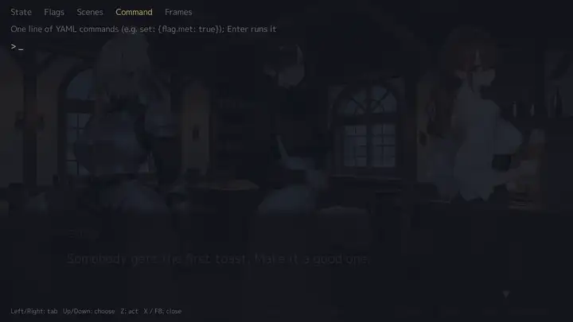 | 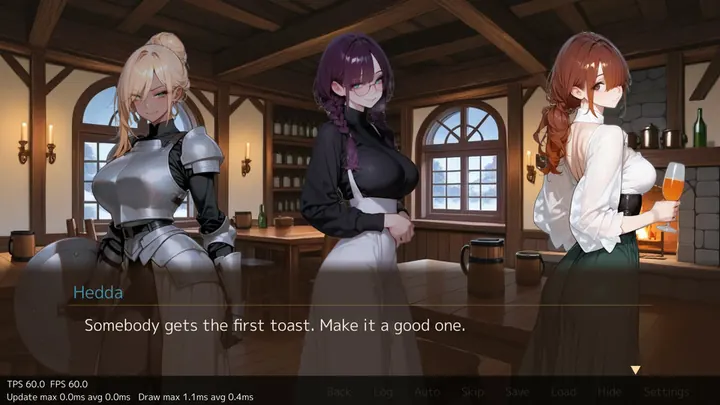 |
| F6：キャラクター図鑑（プロフィール、表情、関係） | |
| 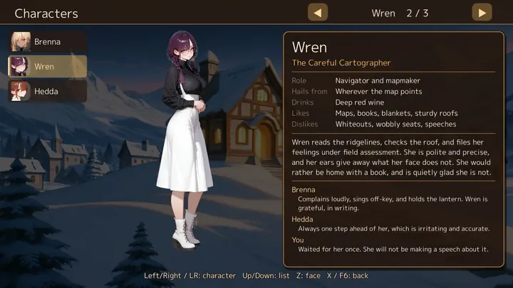 | |

サンプルゲームに登場するキャラの一部は、公開を考えていた RPG のために作った画像から借用している。この RPG は、2〜3週間作り込んだが、面白くならなかった。私が普段作る OSS よりも開発期間をかけたので、元を取るためにゲームエンジンとして切り出した。v0.1.0 が出来上がる直前まで RPG のキャラをサンプルに使うか迷ったが、有効活用することにした（半分ぐらいは、非公開になっている）。ポシャった RPG は ADV としての機能が半分ぐらい実装されていたので、あと付けで ADV も作れる形に gozen を改変した。SLG は、適当に追加したので完成度がまだ低い。

お試しで作ったゲームの機能が部分的に生き残っている。例えば、「VTuber にチャットして読み上げてもらうゲーム」を思いつき、その名残でチャット機能、単語の検閲機能、キャラが Live2D のように表情を変えながら動く機能がある。他にも、町を擬似 3D 空間で歩くために、マインクラフトじみた空間を作ったりした。安っぽかったので、今は奥行きのある一枚絵上をローポリで歩くに留まっている。開発者的には「ブロックの空間だけど、町を歩けてる〜」と感動するのだが、ユーザー視点ではショボいと判断した。

今後は gozen を育てていくというよりは、ゲーム開発で得た知識・経験を gozen に反映していく形になる。gozen を本格的に宣伝するのは、gozen を利用したゲーム1本が完成したタイミングとなる予定。完全に余談だが、LLM に絵の評価を任せると、高解像度の絵を読み込む時にやたらトークンを消費する。

Claude Max 20x を一日中動かしていたら、3日で Weekly Limit に達した。また、v0.1.0公開前にパブリック API が1200個以上あり、なんて酷い設計をするんだと少々驚いた。ゲーム系の場合は、Claude の生成がやや劣る可能性がある。なお、パブリック API は、150個程度まで減らした。正直、50個ぐらいでも成立するのではないかと疑っている。
