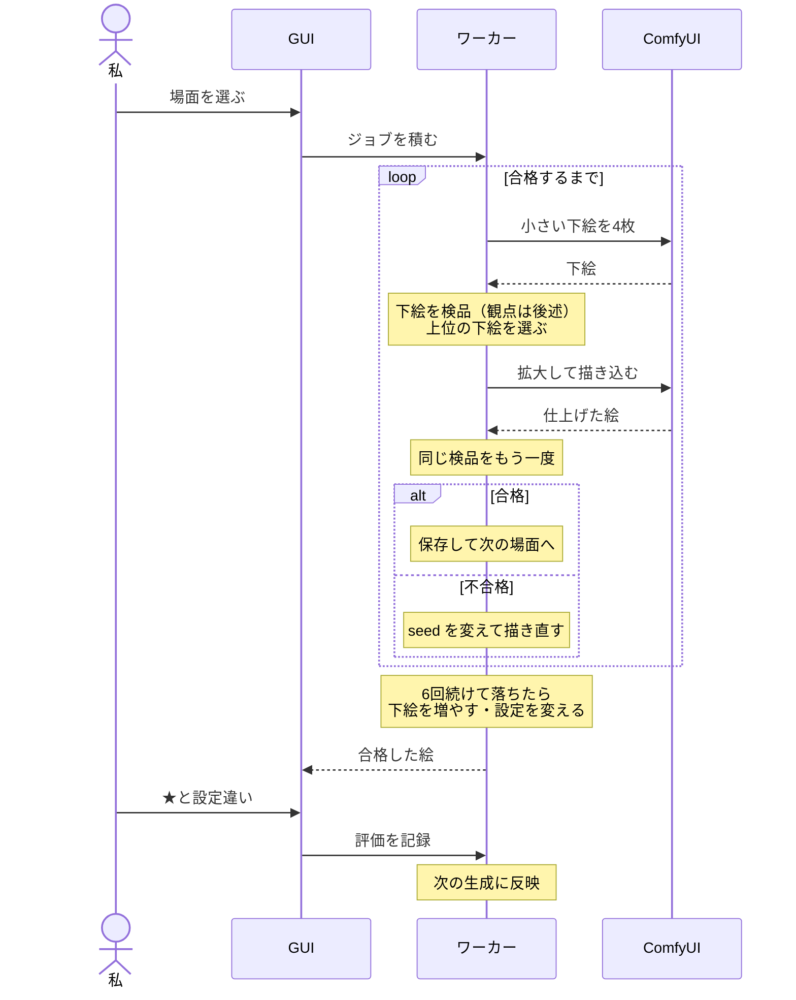
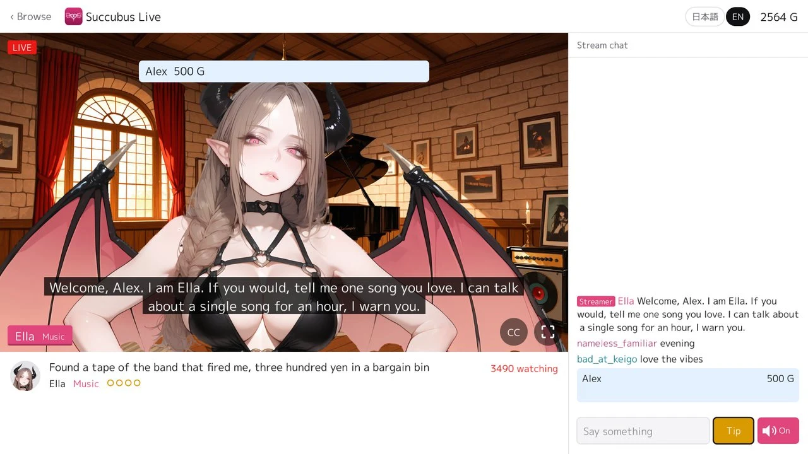

#### 時のオカリナリメイク（switch2込み）を予約

<iframe width="560" height="315" style="display: block; margin-inline: auto; max-width: 100%;" src="https://www.youtube.com/embed/EpMQe14sTWM?si=Q9T8GmTXJPtXluah" title="YouTube video player" frameborder="0" allow="accelerometer; autoplay; clipboard-write; encrypted-media; gyroscope; picture-in-picture; web-share" referrerpolicy="strict-origin-when-cross-origin" allowfullscreen></iframe>

 

息子と時のオカリナの宣伝動画を見ていて、「あと2週間ぐらい（2026年11月5日）で発売か？」と気づき、慌てて予約した。ゲーム機本体とソフトを予約したのは初めて。必要に迫られてゲーム機を買うと、全く後悔がないことを理解した。ゲーム機の中では、PS4 と Switch は不必要な買い物だった。特に、Switch。ほぼ使ってない。

ハードやガジェットを買う時に金額で迷う場合は、本質的には必要のない買い物なんだろう。

---

#### 仮想配信ライブゲーム（放置ゲーム）succubus-liveを公開

[nao1215/gozen](https://github.com/nao1215/gozen) の機能紹介の例として、仮想ライブ配信ゲーム（放置ゲーム）[nao1215/succubus-live](https://github.com/nao1215/succubus-live) を公開した。VTuber の配信を見るようなもので、キャラの表情変化、音声、チャットが楽しめる。話題選出はマニアックになるように LLM へ指示を出したが、まだ全編通してプレイを試していない。ジャンルとしては放置ゲーであり、ラジオとして使う。

ブラウザ版： https://nao1215.github.io/succubus-live/



| ロビー：全チャンネルが同時配信中、賑わっている順 | チャット：コメントを読んで返事をする |
|:--|:--|
|  |  |
| 投げ銭：名前がチャットにピン留めされる | コラボ：2人の配信者が同じ部屋に |
|  |  |

| テーマ：ゲーム | テーマ：独身生活 | テーマ：家族生活 |
|:--:|:--:|:--:|
|  |  |  |
| テーマ：音楽 | テーマ：プログラミング | テーマ：サブカル |
|  |  |  |
| ゲスト：[Rabbit Run](https://github.com/nao1215/rabbitrun) からの出演 | | |
|  | | |

サキュバスを題材にした配信ゲームを最初から作りたかったわけではなく、あまりに技術検証が続いたので一旦何かをリリースしたくて公開した。何回か小規模ゲームを完成させて感づいたが、段々と「あっ、ゲーム作りは大変なんだな」と現実が見え始めた。ここまで来るのに、トランプを使ったゲーム（非公開）、RPG（非公開）、[ゲームエンジンである gozen（初回リリースの後、ライブラリ機能カット）](https://github.com/nao1215/gozen) と続いて、Succubus, inc.という中規模の SLG を作る途中で挫折した。

Succubus, inc.は、サキュバスが働かずに暮らしていける国を作る SLG を想定して、最終的には自動化をテーマにしていた。モンスターを使った防衛（+ モンスター採取）、進軍、食料（人間用、サキュバス用）管理があるゲームだった。部下に業務を任せて社長は楽をし始めるのだが、会社運営のように段々と現場が見えなくなって失敗したり、最終的には魔王も倒せるゲームだった。

あまりに作るものが多すぎて、「ワンボタンでプレイできるゲームにしよう」と方針転換をし、ボタンすら要らない配信ゲーが誕生した。特殊なリアクションを作り込むことも出来るが、配信者の数を増やしすぎたので、シンプルな演出になっている。GitHub Pages には 1GB 制限があり、音声を増やしたり、画像を増やすのが厳しいという背景もある。なお、今回のゲームで配信者が喋る内容も LLM に書かせていて、少ししか監修していない。ピックアップで確認して、会話の仕方やチャット欄の内容も読むように LLM へ指示して、あとは事実の裏取りをさせたぐらい。サボった理由は、自分がラジオとして使いたかったからネタバレを避けたのだ。

ここまでのゲーム制作を通して、画像を1.5万枚生成したので、画像生成に関しては無駄に知見がついた。女性とモンスターに関しては時間があれば基準に達する画像を作れるが、男性や複数人が登場する画像をほぼ生成できない。SLG は開発が辛いな、と感じているところ。

---

#### AI画像生成の面倒臭さと、ワークフローコマンドで立ち向かう話

[一つ前の succubus live リリース報告](#仮想配信ライブゲーム放置ゲームsuccubus-liveを公開)の際に「画像を1.5万枚生成した」と書いた。しかし、この過程で作った画像はゲームをポシャった関係で公開されていない。知見の公開もしていない。そこで、weeknotes に現状の画像生成方法を備忘録として残したい。長文だが、殆ど手書きである。将来的には、一つの記事を書くか、OSS を公開している可能性がある。

 

まず、AI を用いた画像生成にはいくつか課題がある。肖像権や著作権の話が最も重たいが、それ以外の課題について説明する。まずは、生成速度だ。生成速度を速めるには、VRAM 16GB 以上のグラボ、もしくは複数枚挿しが必要だ。VRAM が要るのは、モデル本体（例：アニメ絵で利用される [SDXL](https://huggingface.co/stabilityai/stable-diffusion-xl-base-1.0) 系で約 7GB）と生成途中のデータを全て VRAM に載せないと、メインメモリとのやり取りが発生して極端に遅くなるからだ。SDXL を 1024x1024 で動かすなら 12GB が最低ライン、[ControlNet](https://github.com/lllyasviel/ControlNet)（線画やポーズを渡して構図を指定する追加モデル）やアップスケールを併用するなら 16GB は欲しい。複数枚挿すのは、グラボ毎に別々の画像を並列で生成するためだ。

この解決方法を気軽に採用できない理由は、AI 需要によるメモリ高騰でグラボ価格が跳ね上がったからだ。SDXL の 1024x1024 画像を 1 枚数秒（例：[RTX 4090](https://www.nvidia.com/ja-jp/geforce/graphics-cards/40-series/rtx-4090/) で 4〜6 秒程度）で生成したいなら、現行最上位の [RTX 5090](https://www.nvidia.com/ja-jp/geforce/graphics-cards/50-series/rtx-5090/) が候補になる。しかし、発売時に約 39 万円だった RTX 5090 は、2026 年 10 月時点で 100 万円を超えている。私はグラボの買い増しを諦め、消費電力を上げることで生成速度を速めた。私の環境は [GMKtec EVO-X2](https://www.gmktec.com/ja/products/amd-ryzen%E2%84%A2-ai-max-395-evo-x2-ai-mini-pc)（Ryzen AI Max+ 395、内蔵 GPU に VRAM 64GB を割り当て）で、電力モードを切り替えると次のように変わった。電力を使った方が速く動くのだ。

| 項目 | Quiet（静音） | Balanced | Performance |
|:--|:--|:--|:--|
| GPU電力 | 約54W | 約85W | 約120W |
| GPUクロック | 約1,850MHz | 約2,450MHz | 約2,700MHz |
| 生成時間 | 119秒 | 102秒 | 95秒 |
| Quiet比高速化 | — | 約14% | 約20% |
| 画像の差異 | 基準 | ピクセル単位で同一 | ピクセル単位で同一 |
| GPU温度 | 記録なし | 記録なし | 91〜95℃ |

 

さて、速度の次は、絵の一貫性や正しさに関する課題だ。私が最も苦戦しており、ツールを作って対策中だ。何も考えずに絵を生成すると、以下の状況が発生する。

- 身体のパーツにミスがある（例：手足の本数や指の本数が違う、左右が逆、顔が2つある、身体がネジ曲がる）
- 服装や背景が画像ごとに変わる
- 画風が変わる
- 連続した絵の間で矛盾が生じる（例：1枚目で壊れた盾が2枚目で元に戻っている）
- パラパラマンガ的なアニメーションで、連続性のないコマが交じる

| 伸ばした腕の先に手が無い | 手袋の指が6本ある |
|:--|:--|
|  |  |
| 立ち絵：えんじの給仕服 | 別の場面で生成：緑の服になる |
|  |  |



 

前提として、AI 画像生成では、コーディングと同じようにプロンプトを書く。ただし、短い単語・文章の羅列で positive/negative のプロンプトを設定して画像生成を制御する。ドキュメントを読むまで私は理解していなかったのだが、アニメ向けの SDXL 派生モデル（例：WAI-illustrious）は Danbooru（イラスト投稿サイト）タグの羅列、例えば `1girl, black hair, smile` を書いて、`(smile:1.2)`のような重み付けをしながらタグの効き具合を制御している。同じプロンプトであってもシードを変えた場合は別の絵になり、同一シード同一プロンプトの場合は同じ絵になる。

現実は非情なので、一発で高品質な画像が生成されるわけではない。品質を上げるには、まずプロンプトから小さめの絵を作り、絵を拡大してから細部を描き込み直させ（[hires fix](https://comfyanonymous.github.io/ComfyUI_examples/2_pass_txt2img/)）、最後に崩れた手や顔だけを塗りつぶして描き直させる（[inpaint](https://comfyanonymous.github.io/ComfyUI_examples/inpaint/)）。hires fix を足すだけで、私の環境では 1 枚あたりの生成時間は約 28 秒から約 70 秒へ、2.5 倍に延びる。

 

エンジニアリングに話をつなげよう。私は、初手のプロンプト作成の段階で「人間がやる作業ではない」と感じた。そこで、段階的に改善ループを回し始めた。

1. プロンプト作成：手書きから LLM と対話しながら作成に変更
2. キャラの一貫性チェック：目視確認から LLM による確認に変更
3. LLM が見落とす身体構造・服装のチェック：目視確認から画像判定に変更
4. 生成速度の改善：品質向上を後回しにし、出来の良い下絵を目視で選択してから高品質化
5. プロンプトの共通化：スクリプトに散らばっていたプロンプトをキャラや場所、行動単位で YAML 管理
6. シーン構成：シーンを YAML でテンプレ化してキャラごとに場面の流れを使い回すように
7. ワークフロー化：都度スクリプトを書き換えて実現していた各工程を流れ作業で行えるツールを開発

 

まず、LLM は万能ではない。画像の検品は可能だが見落としがあり、高画質の画像ではトークン消費が大きい。そこで、別のツールを Linter 代わりとし、検品する方法を思いついた。具体例としては、機械学習で手の形を判定したりしている。次にキツかったのはプロンプトの管理で、初期は Python スクリプトで各キャラ専用のプロンプトを書いたりしていた。しかし、プロンプトの取り違えがあったりして時間を無駄にした。そこで、プロンプトをキャラの特徴や場面、行動などでモジュール化（YAML 化）し、[nao1215/gozen](https://github.com/nao1215/gozen) を経由してバリデーションされたプロンプトが生成されるようにした。

 

最後は、自動化だ。トークンを消費せず、かつ仕事中に放置しておけば自動で進むワークフローが欲しかった。人間が最後に一括検品して、その結果から機械学習して振る舞いが変わるワークフローを作れば良いと考え、開発・検証中である。なお、世の中には絵 1 枚の完成度を上げるツールは多いが、シーンの連続性やキャラの一貫性に着目したツールは少ない。下調べしてから開発した感を出しているが、開発してから調査した。

本ワークフローは、以下のような流れになっている。全体像としては、人が GUI 経由でキャラや生成したい画像（複数かつ場面の流れがあるもの）を指定し、ジョブをワーカーにエンキューする。ワーカーは、[ComfyUI](https://github.com/comfyanonymous/ComfyUI)（画像生成の手順をノードでつないで組む、ローカルで動く画像生成ツール）に画像を生成させ、自前の検品フロー（後述）で合格した画像を集め、人に検品を依頼する。人は、5段階評価とキャラ設定との一致を検品結果として残す。この評価を受けて、ワーカーが次回以降の生成に反映していく。LLM が介入せずに成り立っており、トークン消費が一切ない。

 

検品には LLM を使わず、ONNX 形式に変換した判定モデルを [onnxruntime_go](https://github.com/yalue/onnxruntime_go)（[ONNX Runtime](https://onnxruntime.ai/) の Go バインディング。恐らくメモリアクセス違反バグがありそう）でローカル実行している。Python ではなく Go を主にしている理由は、私の経験値の問題だ。Go に慣れている。

検品では、次の観点をチェックしている。

- 人数と余計な物：[WD Tagger v3](https://huggingface.co/SmilingWolf/wd-vit-tagger-v3)（画像から Danbooru タグを推定するモデル）で、`1girl` などの人数タグ、`text`・`watermark`・`collage` などの混入を判定する
- 部位：[Ultralytics YOLOv8](https://github.com/ultralytics/ultralytics) 系の検出モデル（顔、[adetailer](https://huggingface.co/Bingsu/adetailer) の `hand_yolov8s`）で顔や手の有無を数え、場面で必要な部位・出てはいけない部位と比べる
- 手：骨格推定の [DWPose](https://github.com/IDEA-Research/DWPose) で手首と腕の位置を取り、手の領域に [MediaPipe Hand Landmarker](https://ai.google.dev/edge/mediapipe/solutions/vision/hand_landmarker) を当てて、手の本数・指の関節・左右と腕の対応を確かめる
- 服：服の部位を切り分ける [SegFormer（segformer_b2_clothes）](https://huggingface.co/mattmdjaga/segformer_b2_clothes) で上着・スカートなどの領域を取り出し、立ち絵との色の分布と [CLIP](https://huggingface.co/openai/clip-vit-base-patch32) の特徴量の近さを比べる
- 色：青と赤の比率、色かぶり、蛍光色や黄緑の割合を計算し、閾値を越えたら落とす（自前実装）
- 背景：場所ごとに確定した背景画像を持たせ、人物の外側の画素の差で変化を見る。生成時は [ControlNet Union](https://huggingface.co/xinsir/controlnet-union-sdxl-1.0) で部屋の形を寄せ、[IP-Adapter](https://github.com/tencent-ailab/IP-Adapter) で見た目を背景画像に寄せる

 

私は、スマホで GUI を開き、生成された絵に★を付けるだけだ。理由は、面倒なので記載しない仕様にした（記載にトライした時期があったが、疲れるから止めた）。服や髪が設定と違う絵には「設定違い」の印を付ける。GUI は毎日、「無作為に選んだ絵」と「ワーカーの判定が閾値すれすれの絵」を数枚検品させ、学習の補正に使う。手や目だけ崩れた絵は、その部分だけ描き直す指示も出せる。

フィードバックループは、2 つある。1 つ目はワーカーだけで回るループで、同じ場面で 6 回続けて落ちると段階的に手を打つ。下絵の枚数を増やす、落ちた理由に合わせて設定を変える、プロンプトの案を切り替えると続いていく。効果的だった変更は記録し、次から同じ場面・同じ理由で落ちたときに最初から使う。2 つ目は、人の評価を使うループで、溜まった評価を学習データとして、画像の特徴量から評価を予測する小さなモデルを作り、下絵の順位付けに使う。ワーカーが落とした絵の中で、私が採用した絵の実績があれば、色の検品の規則を限定的に緩める。

まるで完璧なシステムのように書いているが、完成度はまだ低い。検証フローが増えると、単純に時間がかかる。各検証それぞれで正常画像を誤って5%棄却すると、すべての検品を通過する確率は約77%となる。各検証が品質に寄与していれば問題ないが、現在は統計情報を見る限りエンジニアの自己満足みたいな状況だ。また、まったく解決できていない課題があり、それは画像間で服が変わることだ。1枚の立ち絵が確定したら、服装がブレなくなるのが理想。

 

ここまでが、私の AI 画像生成の現在地。このワークフローツールを公開していない理由は、出来が微妙な状況であること、GUI があまりにショボいことと、画像生成モデル・検証ツールの切り替え部分などが抽象化されていないからだ。私の開発環境と密結合している。ただし、品質基準は私の OSS と同等で開発しているので、公開までの道のりが凄く遠いわけでもない。

---

#### 転職とゲーム開発に関する感想

10月は、個人的に大きなイベントが2つあった。1つ目は転職、2つ目はゲーム開発を熱心にしていたことだ。約1ヶ月経ったので、感想を残す。現職は情報管理が厳密なので、私のことだけを書く。私は、現職を含めると、5社（数え方によっては6社）経験している。社会人11年そこらでこの数はなかなかのジョブホッパーだ。言い訳がましく補足すると、出向が2回含まれ、数え方によっては経験4社だ。現職には、長く在籍するつもりだ。

今回の転職では、過去の経験が点から線に変化する実感があった。現職はブロックチェーンを扱うが、私はド素人だ。それでも仕事は回っている。理由は、ブロックチェーンはシステムの一部でしかないからだ。今までの経験が活きる領域が当然ある。今までに受託系、toB／toC、デザインが強い会社、自社開発で様々な開発スタイルを実践して、そこにマネージメント経験や OSS 開発経験が含まれてくる。流石に、何らかの方法で貢献できる。

とは言え、ブロックチェーンの勉強をサボるわけにはいかない。そこはキャッチアップが必要だ。私は入社前から、技術ノートに [Blockchain Systems](/notes/blockchain-systems) を作って勉強しているフリをしている。まだ全く血肉になっていない。最新記事は、[Wallet](/notes/blockchain-systems/wallet/) に関するものだ。技術ノートは頑張り始めると記事に近くなり、差別化が難しくなり始めた。トップ画面の構成を変えて、両方読まれやすくする可能性がある。技術ノート側は OGP がないので若干扱いづらさがあるが。

 

続いて、ゲーム開発についてだが、辛い。大変。OSS 開発と比べ物にならない。まず、面白さの定義・探求に終わりない。面白さとは。言語化できない。「[リスクとリターン](https://gigazine.net/news/20120821-sakurai-cedec/)」の話を読んでフムフムとなっても、血肉にするための深堀が足りてないのだ。「古臭い探索ゲーなのに、世界樹の迷宮はなぜ面白いのか」「プレイヤーがゲームを続けたい・止めようと感じるタイミングはどこか」など、今まで曖昧だった部分を言語化しなければならい。「AI 画像で可愛い女の子を褒美で出せば報酬になるでしょ」というゲームデザインは、脳みそを一切使っていない甘えだ。全く面白くない。AI 画像の品質や枚数は、ゲームの面白さに直結しない。

以下のタイムラインを見ると、まるで仕事だ。AI 時代における個人開発の生産性が高すぎる。途中でゲーム開発よりも、補助ツール開発にご熱心になってしまったのが反省点。

| 時期 | 開発方法の変化 | 説明 |
|---|---|---|
| 9月末 | LLMによる試作 | [テトリスを試作](/weeknotes/2026-09-28/e6edf19b0b67/)。ゲーム開発と画像生成を検証。 |
| 10月初旬 | ゲームの完成・公開 | [Rabbit Run](https://github.com/nao1215/rabbitrun)を公開。小規模ゲームを完成。 |
| 10月中旬 | データ駆動開発 | [YAMLによるゲーム定義](/weeknotes/2026-10-12/8d64beaa4754/)とLLMの並列開発を導入。 |
| 10月中旬 | デバッグの仕組み化 | [任天堂の手法を模倣](/weeknotes/2026-10-12/8d64beaa4754/)。プレイ中の指摘をLLMが修正。 |
| 10月下旬 | ゲームエンジンの共通化 | [gozen](https://github.com/nao1215/gozen)を公開。自動プレイ・勝率分析・ホットリロードを実装。 |
| 10月下旬 | ゲームの小規模化 | 中規模SLGの開発を断念。完成可能な小規模ゲームへ転換。 |
| 10月下旬 | 放置ゲームの公開 | [Succubus Live](https://github.com/nao1215/succubus-live)を公開。音声付き仮想配信ゲームを制作。 |
| 10月末 | 画像生成のワークフロー化 | [ComfyUIによる生成・検品・再生成](/weeknotes/2026-10-26/8575939c5076/)を自動化。 |

 

公開したゲームとフレームワークは、以下の3つ。公開に至らなかったものが、4件（ピンボール・テトリス・RPG・SLG）。

| Succubus Live | Rabbit Run | Gozen |
|:--:|:--:|:--:|
|  |  |  |
| [プレイ](https://nao1215.github.io/succubus-live/) / [GitHub](https://github.com/nao1215/succubus-live) | [プレイ](https://nao1215.github.io/rabbitrun/) / [GitHub](https://github.com/nao1215/rabbitrun) | [公式サイト](https://nao1215.github.io/gozen/) / [GitHub](https://github.com/nao1215/gozen) |

 

次のゲーム開発も着手している。今度は、男が登場する（重要）。私が本当に作りたかった SLG 要素と、AI を用いた画像の制約を踏まえて、現実的な落とし所を見つけた。次回作は、リソース管理ゲームであり、名前は「DEATH MARCH（死の行進）」だ。そう、ソフト開発のマネージメントゲーだ。完全に私の得意領域で、残業過多もマネージメントも経験している。派手な演出も不要で、基本的に表情変化だけで成り立つ。問題は、現代的な労務管理に準じているので「言うほどデスマってないな」と感じることだ。お楽しみに（売るか、OSS 公開するかで迷っている）。

---

#### サイトの見た目を変えた（N度目）

下表は、私のサイトの流入経路を示している。OSS リリース報告記事がインフルエンサーの目に留まると、SNS が上位に躍り出る。

| 流入経路 | 割合 |
|---|---:|
| 検索エンジン | 68.2% |
| 直接流入 | 22.6% |
| SNS（X・はてなブックマーク） | 3.5% |
| その他（GitHub・AIなど） | 5.7% |
| 合計（2,077） | 100.0% |

 

メインコンテンツは、[記事](/post/ja/)である。2019年からの記事を書き続けているので、ロングテール記事が存在する。その一方で、記事より更新頻度が高い[技術ノート](/notes/)や [weeknotes](/weeknotes/) が閲覧されていない。具体的には、weeknote の閲覧割合は全体の約2.5%程度である。人気のないコンテンツではあるが、割と長文を書いているので、サイト回遊を狙った UI に変更した。

 

今回の修正範囲は、以下の通りである（唐突の CHANGELOG 感）。
- トップページ右側に weeknotes トピック、技術ノート記事を表示
- トップページの技術ノートリンクをブラウザゲームリンクに変更
- 記事セクションで、各記事をカード表示するように変更（従来は文字で箇条書き）
- weeknotes セクションで、各トピックをカード表示するように変更（従来は文字で箇条書き）
- [ゲームセクション](/games)の新規追加（ブラウザゲーだから遊んでみてね）

 

weeknotes に関しては、トピックの大半が画像なしの内容だったので、カードに表示する画像が殆ど無かった。仕方がないので、ゴリ押しで画像を挿入して、カードに画像が表示されるようにした。どうしても画像をねじ込めない場合は、フクロウを表示している。



「画像ばっかり使って、スマホに優しくない！」というご意見があるかもしれないが、本サイトを閲覧するユーザーは90%以上が PC ユーザーであり、何なら休日は誰も来ない。皆、仕事中に PC から遊びに来ているのだ。
