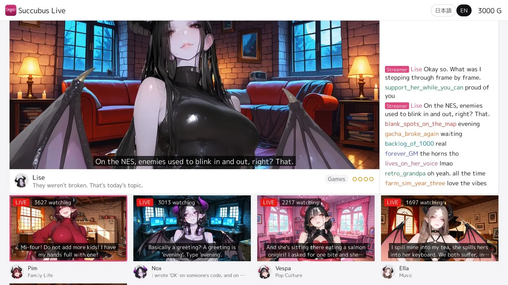
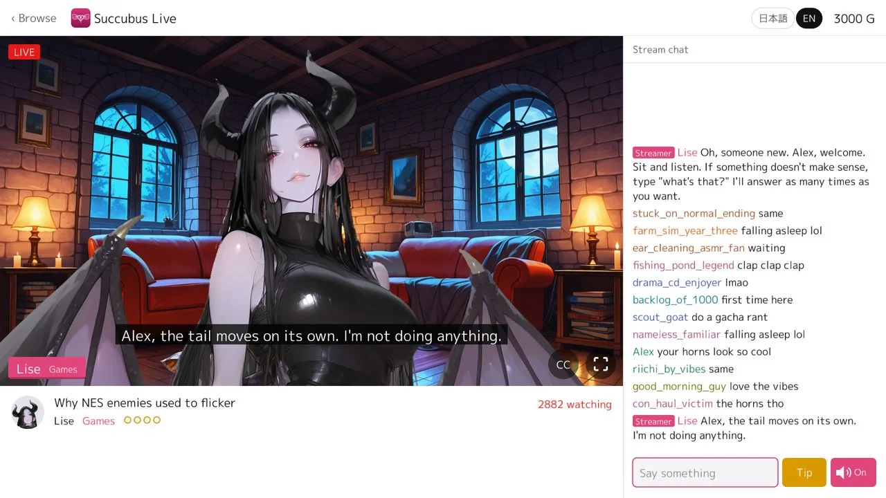
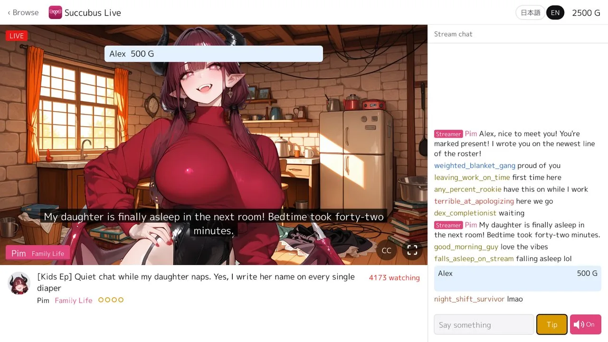
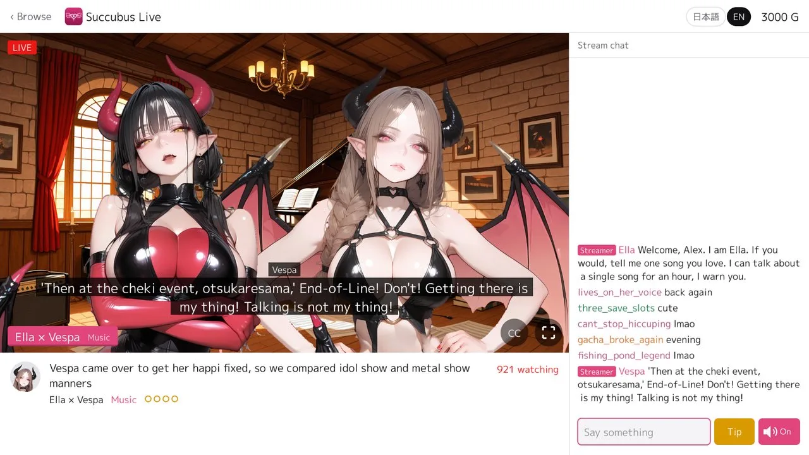

#### 時のオカリナリメイク（switch2込み）を予約

<iframe width="560" height="315" style="display: block; margin-inline: auto; max-width: 100%;" src="https://www.youtube.com/embed/EpMQe14sTWM?si=Q9T8GmTXJPtXluah" title="YouTube video player" frameborder="0" allow="accelerometer; autoplay; clipboard-write; encrypted-media; gyroscope; picture-in-picture; web-share" referrerpolicy="strict-origin-when-cross-origin" allowfullscreen></iframe>

 

息子と時のオカリナの宣伝動画を見ていて、「あと2週間ぐらい（2026年11月5日）で発売か？」と気づき、慌てて予約した。ゲーム機本体とソフトを予約したのは初めて。必要に迫られてゲーム機を買うと、全く後悔がないことを理解した。ゲーム機の中では、PS4 と Switch は不必要な買い物だった。特に、Switch。ほぼ使ってない。

ハードやガジェットを買う時に金額で迷う場合は、本質的には必要のない買い物なんだろう。

---

#### 仮想配信ライブゲーム（放置ゲーム）succubus-liveを公開

[nao1215/gozen](https://github.com/nao1215/gozen) の機能紹介の例として、仮想ライブ配信ゲーム（放置ゲーム）[nao1215/succubus-live](https://github.com/nao1215/succubus-live) を公開した。VTuber の配信を見るようなもので、キャラの表情変化、音声、チャットが楽しめる。話題選出はマニアックになるように指示を出したが、まだ全編通してプレイを試していない。ジャンルとしては放置ゲーであり、ラジオとして使う。

ブラウザ版： https://nao1215.github.io/succubus-live/



| ロビー：全チャンネルが同時配信中、賑わっている順 | チャット：コメントを読んで返事をする |
|:--|:--|
|  |  |
| 投げ銭：名前がチャットにピン留めされる | コラボ：2人の配信者が同じ部屋に |
|  |  |

| テーマ：ゲーム | テーマ：独身生活 | テーマ：家族生活 |
|:--:|:--:|:--:|
|  |  |  |
| テーマ：音楽 | テーマ：プログラミング | テーマ：サブカル |
|  |  |  |
| ゲスト：[Rabbit Run](https://github.com/nao1215/rabbitrun) からの出演 | | |
|  | | |

サキュバスを題材にした配信ゲームを最初から作りたかったわけではなく、あまりに技術検証が続いたので一旦何かをリリースしたくて公開した。何回か小規模ゲームを完成させて感づいたが、段々と「あっ、ゲーム作りは大変なんだな」と現実が見え始めた。ここまで来るのに、トランプを使ったゲーム（非公開）、RPG（非公開）、[ゲームエンジンである gozen（初回リリースの後、ライブラリ機能カット）](https://github.com/nao1215/gozen) と続いて、Succubus, inc.という中規模の SLG を作る途中で挫折した。

Succubus, inc.は、サキュバスが働かずに暮らしていける国を作る SLG を想定して、最終的には自動化をテーマにしていた。モンスターを使った防衛（+ モンスター採取）、進軍、食料（人間用、サキュバス用）管理があるゲームだった。段々と、指示を部下に任せて社長は楽をし始めるのだが、会社運営のように段々と現場が見えなくなって失敗したり、最終的には魔王も倒せるゲームだった。

あまりに作るものが多すぎて、「ワンボタンでプレイできるゲームにしよう」と方針転換をし、ボタンすら要らない配信ゲーが誕生した。特殊なリアクションを作り込むことも出来るが、配信者の数を増やしすぎたので、シンプルな演出になっている。GitHub Pages には 1GB 制限があり、音声を増やしたり、画像を増やすのが厳しいという背景もある。なお、今回のゲームで配信者が喋る内容も LLM に書かせていて、そこまで監修していない。ピックアップで確認して、会話の仕方やチャット欄の内容も読むように指示して、あとは事実の裏取りをさせたぐらい。サボった理由は、自分がラジオとして使いたかったからネタバレを避けたのだ。

ここまでのゲーム制作を通して、画像を1.5万枚生成したので、画像生成に関しては無駄に知見がついた。女性とモンスターに関しては時間があれば基準に達する画像を作れるが、男性や複数人が登場する画像をほぼ生成できない。SLG は開発が辛いな、と感じているところ。
