#### Ebitengine（Hajime Hoshi 氏）のスポンサーになった

私はゲーム開発に [Ebitengine](https://ebitengine.org/ja/) を利用している。約1ヶ月ほどゲーム開発を楽しく続けられたのは、Ebitengine のおかげだ。心ばかりの少額ではあるが、感謝の気持ちを込めてスポンサーになった。



Ebitengine は、シンプルで安定感のあるゲームエンジンであり、私のやりたい事をもれなく実現できている。しかも、クロスプラットフォームサポートであり、WASM やモバイルも対応している。完璧に私好みのゲームエンジンだった。素晴らしい OSS を公開・維持していただき、ありがとうございます。

---

#### AI Image Workflow コマンドが半分ぐらい軌道に乗ってきた

[先週に AI 画像生成のワークフロー（image workflow command）を開発している話](/weeknotes/2026-10-26/8575939c5076/)を長文で書いたが、半分ぐらいは軌道に乗ってきた。半分とは、立ち絵の生成であれば従来よりも LLM を使わずに量産できるようになってきたという意味である。先週は、一枚絵を生成するケースの機能を開発していた。今週は、立ち絵を作る工程を開発していた。



AI 画像を用いてゲーム開発する場合、「良質なプロンプト -> 立ち絵 -> 表情差分・複数の立ち絵 -> 一枚絵」という流れで作業を進めた方が良い。大事な部分は、表情差分・複数の立ち絵であり、これらの情報があると一枚絵の作成時にキャラの服装や顔つきのブレが減る。従来は LLM におんぶ抱っこで対応していたが、現在はワークフローを構築しているので、トークン消費が少なくなっている。

先週も書いたが、プロンプトを手書きするのは無理ゲーである。英語で単語を羅列し、数百という単語を書く必要がある。さらに、単語同士の相性やネガティブプロンプト（例：絵に登場させたくないものを指定する）を書きすぎると、絵が劣化したりする。具体例としては、夜や照明、きらびやかさを意識したプロンプトを書くと、それが強く反映されすぎて以下のように色味のおかしな画像が生成されることがある。



 

そこで、日本語で設定を選択し、選択内容からプロンプトを生成する機能を作った。設定をポチポチ選ぶと、プロンプトが YAML に書き出され、生成する画像に不都合のある単語の組み合わせが見つかると警告が出る。全ての組み合わせを試したわけではないので、この GUI を通しても駄目な画像になるケースもある。そこは画像を生成し続けて、プロンプトデータを収集して分析することで改善している。欠点としては、GUI 操作がそこまで楽ではないこと、生成できる画像がパターン化しがちということだ。



 

先程のプロンプトを用いても、一発で期待通りの画像が生成されるわけではない。まずは、連続生成を行い、ワークフローシステム内で一次チェックを行う。人数が違う、構図が崩れている、頭や足が切れているといった不備は、人の目に届く前に NG 扱いにする。

システムが OK を出した画像を人が検品する。何十枚と溜まった画像をサッサと検品できるようにしている。OK、NG、BASE（立ち絵として確定）、保留のステータスがあり、NG は理由をつけられる。NG 理由データが溜まると、ワークフローが「最近の設定がおかしいのでは？」と気づくようになっている。BASE は立ち絵として確定した画像だが、殆ど押さない。OK は、後ほど補正をすれば立ち絵に昇格できる可能性があるという意味である。



 

なお、完全に設定が固定されていると同じ画像ばかり生成されてしまうので、無作為にプロンプトに追加される単語がある。また、seed も画像生成ごとに当然変えている。ここまでの話を雑にまとめたシーケンス図が以下の通りである。

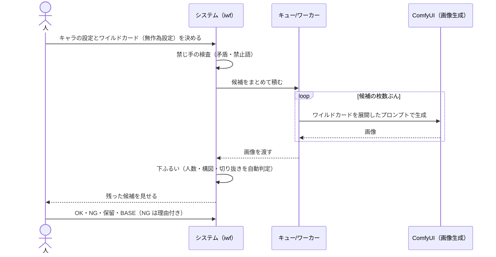

 

OK となった画像は、部位ごとに書き足しを行う。部位を画像処理で判定して、その領域に対して書き足し処理をする。例えば、目の書き込みが甘いケースがあり、パッチリおめめに整形する。部位単位で修正前後画像の比較ができる GUI を用意してあり、比較しやすくしている。この整形がうまく行くと、立ち絵に昇格する。何度直しても上手く行かない場合はボツにする。

BASE（立ち絵）が決まったら、人が手を動かす場面は減る。表情差分、高解像度への仕上げ、衣装や姿勢の違いは、BASE を起点にシステムが自動で生成し続ける。

表情差分は、BASE から表情だけを変える。顔・髪・服は固定し、目と口だけが変わるのが理想である。稀に画風の違う目になってたりする。

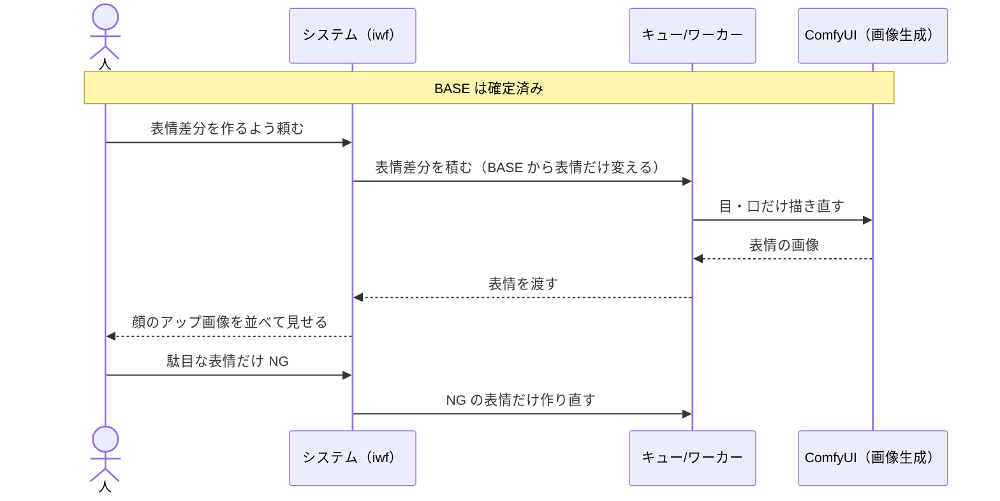

 

仕上げ工程では、画像を2倍に拡大して区画ごとに描き込み、顔、目・口、手、全体の描き直し、背景の切り抜き、2K/4K 化という順で進める。重い処理なので夜間に回す。この作業中に PC を動かすと、画面に黒い線がチラついたりする（私の環境が貧弱なだけ）。

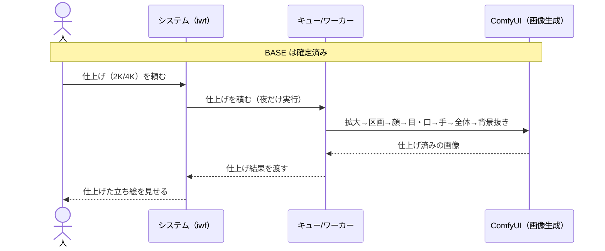

 

立ち絵を増やすときは、BASE から部分直しで派生を作る。例えば、服だけを替える、姿勢だけを替える、という使い方である。派生も、選別を通ったものだけが残る。

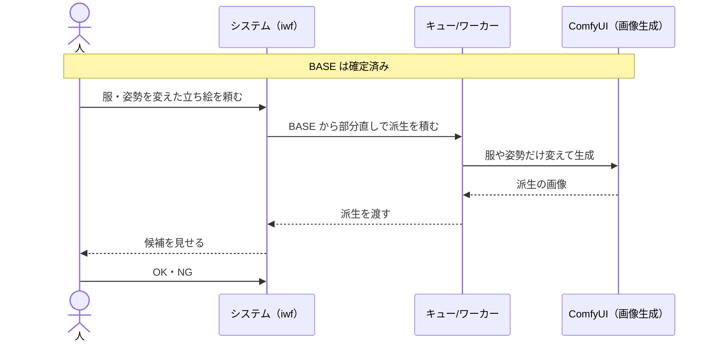

 

立ち絵生成処理と、先週話していた一枚絵の処理フローが見事に噛み合うと、一枚絵をガンガン生成できてゲーム開発が楽になる。しかし、まだワークフロー全体を通して成功させていない。手探りだったのでかなりバギーで、キューが詰まったり残存したりして「素人みたいなバグが沢山出るな」と感じたりした。それでも、立ち絵生成を放置していれば進むようになったのは、かなりの進展である。

なお、ゲーム開発自体も進んでいて、今週中にチラ見せできる見込み。デスマーチプロジェクト管理ゲームだが、想定されるプロジェクト設定を LLM に伝えて、「（ゲームプレイの都合上）主人公たちは4ヶ月で開発するんだが、できそう？」と確認したら、「数年がかりのプロジェクトであり、契約段階で揉めるレベルです」と回答され、泣く泣くプロジェクトレベルを下げた。頑張ってプロジェクト要件定義したのに。

---

#### Nintendo Switch 2 ゼルダの伝説 40周年 アニバーサリーエディションが届いた

Hey! Listen! ちょっとハイラルを救ってくる。



---

#### ゲームフレームワークのgozenにスマホアプリ表示とPC表示を追加



開発中のゲームが IT 系プロジェクト管理をテーマにしているので、スマホや PC の画面を [gozen](https://github.com/nao1215/gozen) で作れるようにした。スマホアプリ表示は、背景画像の上にスマホを縦向きまたは横向きで重ねて表示する機能。ノベルだけでなく、それ以外のゲームでも使える。

| フィード画面 | チャット画面 |
|:--|:--|
| 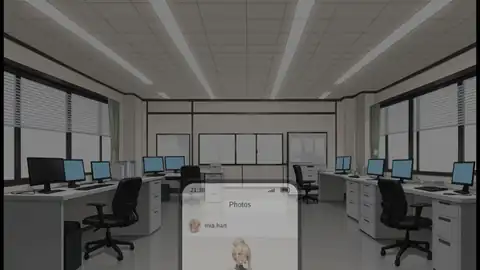 | 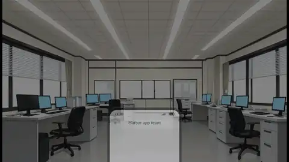 |
| 動画画面 | チャット画面（動画） |
| 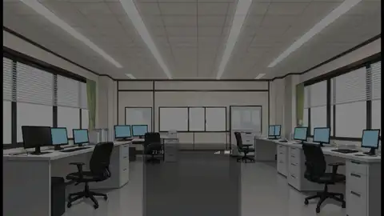 | 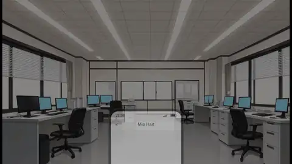 |
| ショップ画面 | 銀行画面 |
| 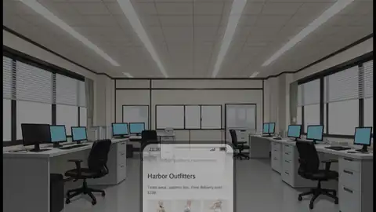 | 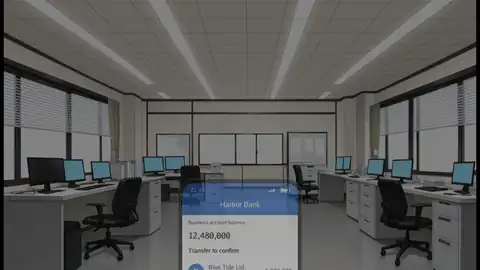 |
| ロック画面 | サインイン承認画面 |
| 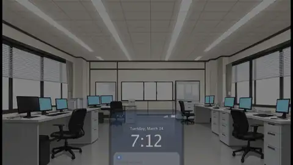 | 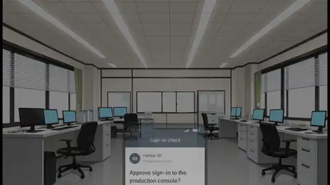 |
| タイムライン画面 | プッシュ通知 |
| 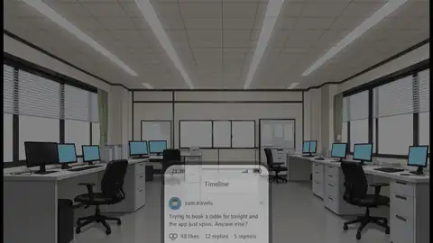 | 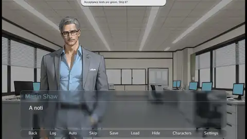 |
| 支援サイト画面 | 連絡先追加画面 |
| 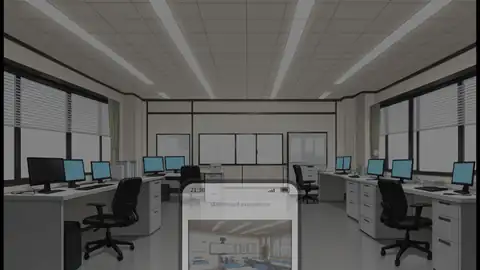 | 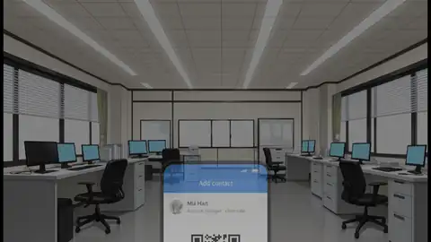 |

 

PC（オフィス系）表示は、ワークスペース・通話・カレンダー・タイムラインの画面と、1日の流れを組み合わせて、経営・マネジメント系のゲームを作るための機能。

| 朝会画面 | メンバー詳細画面 |
|:--|:--|
| 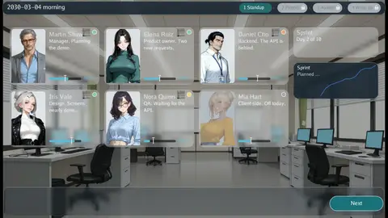 | 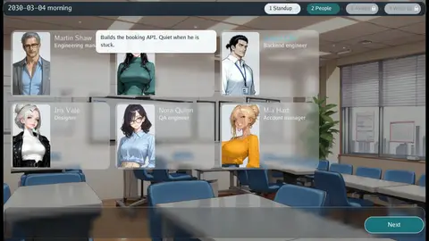 |
| 仕事の割り振り画面 | チケット画面 |
| 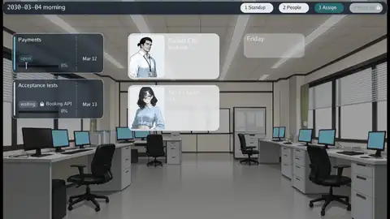 | 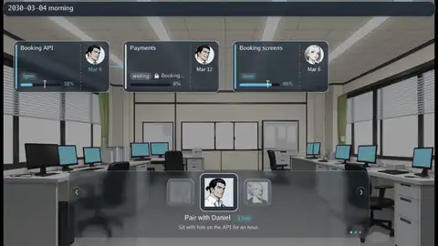 |
| メッセージ画面 | ビデオ通話画面 |
| 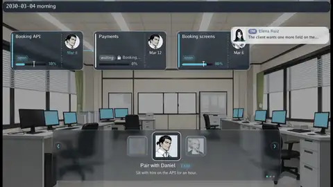 | 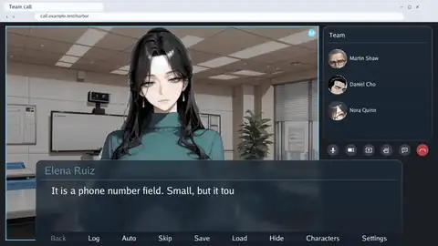 |
| 画面共有 | ガイド画面 |
| 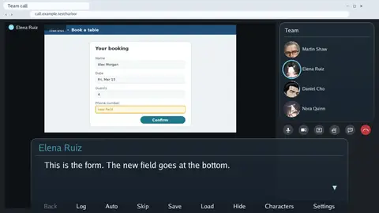 | 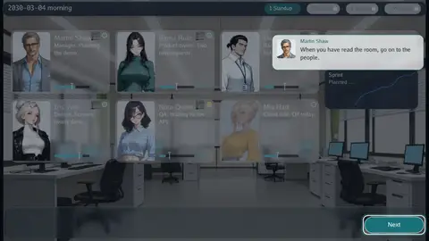 |
| カレンダー画面 | タイムライン画面 |
| 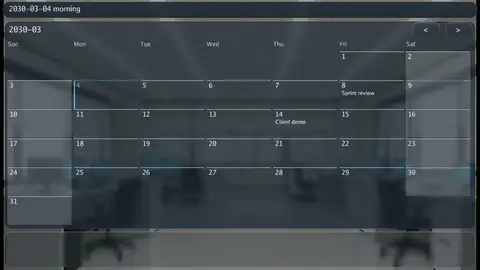 | 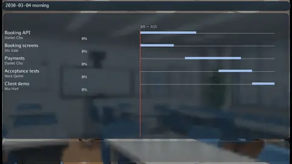 |
| キャラクター一覧画面 | ガラスパネル |
| 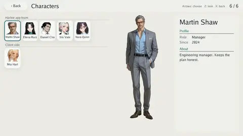 | 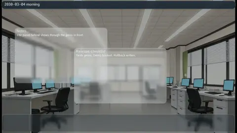 |

---

#### 行き着いた先はバーモントカレー甘口とカレープラスココナッツミルク

2020年前後から本格的に自炊し始めた。自作カレーが美味しくなかった。食べられる味ではあった。しかし、味がペラくてコクがなかった。レトルトの[銀座カリー](https://www.meiji.co.jp/foods/curry/ginza/)ばかり食べてきた弊害で味の基準値が高かった点を差し引いても、実家カレーよりイマイチであった。なお、母親は調理系の資格を持っているので、料理は上手い。

家族に玉ねぎ嫌いがいるので玉ねぎを使っておらず、最初はそれが原因だと予想していた。しかし、玉ねぎを使っても、隠し味的なサムシングを投入しても、カレールー2種類（例：[ジャワカレー](https://housefoods.jp/products/catalog/cat_1,curry,roux,java.html)、[ゴールデンカレー](https://www.sbfoods.co.jp/products/detail/18517.html)）を使っても、全く味が改善されなかった。

結論としては、カレールーと水の比率が問題であった。この結論にたどり着くのに、6年もかかった。原因究明中に幼児向けの甘口を探す必要があったこと、家族に不評でカレーを作らなくなったことが、調査を長引かせた。

 

以下の内容を踏まえて調理すると、家族全員が食べられるカレーとなる。
- [バーモントカレー甘口](https://housefoods.jp/products/catalog/cat_1,curry,roux,vmt.html) 1箱
- [カレープラスココナッツミルク（S&B）](https://www.sbfoods.co.jp/products/detail/18288.html) 1袋
- じゃがいも 4個
- 人参 1本
- 豚肉ブロック（肩ロース） 400〜500g
- 豚肉（モモ） 300g　※ 消費期限の都合で投入したが、味に影響あるか不明
- 水 1.2リットル
- 具材は小さめに切る ※ 味に影響ないと思うが、幼児を意識したサイズ調整
- ルー、じゃがいも、人参、豚肉、水の順番で投入
- [T-Fal 電気圧力鍋（CY3518JPA）](https://www.amazon.co.jp/dp/B0BBM6R6DR?th=1&linkCode=ll2&tag=debimate07-22&linkId=818f7919ef6f2a9f8deb2ac498f435d3&ref_=as_li_ss_tl)のカレーモードで15分調理
- 圧力鍋の調理が終わった後、ココナッツミルクパウダーを投入してよく混ぜる






 

豚肉（と豚肉に含まれる脂）の量が多かったことが勝因の可能性がある。あと数回作って、確度を上げたい。鶏肉、牛肉で味が安定するのかが疑問である。
