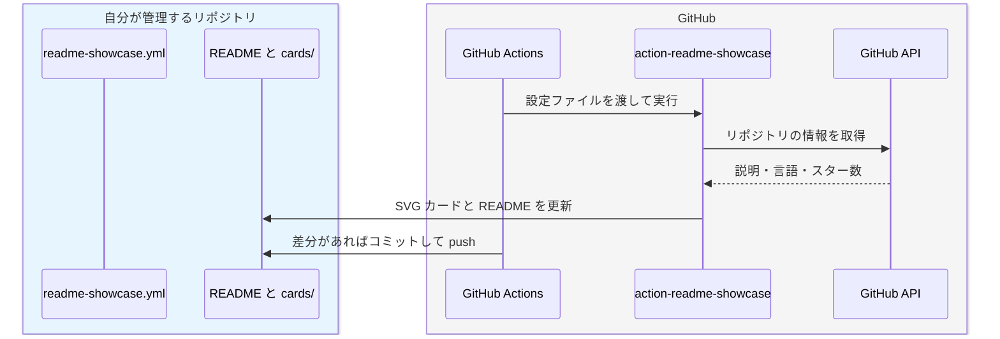

#### READMEにOSSカードやStar Historyを並べるGitHub Actionを作った



GitHub Profile README（例：nao1215/README.md）に、OSS カードとスター数の推移を生成する [nao1215/action-readme-showcase](https://github.com/nao1215/action-readme-showcase) を作った。README を賑やかすスクリプトをシュッと作った後、「GitHub Actions 化すれば、色んな人が使えるのでは？」と考えて、専用リポジトリで公開した。ライトモードとダークモードの両方に対応している（以下は、ダークモード）

<figure class="align-center">
  <a href="https://github.com/nao1215/gup"><picture><source media="(prefers-color-scheme: dark)" srcset="https://raw.githubusercontent.com/nao1215/nao1215/master/cards/dark/nao1215__gup.svg"></picture></a>
  <figcaption><p>featured を付けた gup のカード</p></figcaption>
</figure>

<figure class="align-center">
  <a href="https://github.com/nao1215/sqly"><picture><source media="(prefers-color-scheme: dark)" srcset="https://raw.githubusercontent.com/nao1215/nao1215/master/cards/dark/nao1215__sqly.svg"></picture></a>
  <figcaption><p>featured を付けない sqly の通常カード</p></figcaption>
</figure>

action-readme-showcase は、外部の画像サービスに依存せず、GitHub API から取得した情報を SVG にする。GitHub Actions の実行フロー中に、更新された README と SVG をリポジトリにコミットする。以下が大まかなシーケンスである。



<br>

使い方は、README に更新範囲を示すマーカーを書き、設定ファイルとワークフローを置くだけである。まず README に以下を書いておく。この範囲だけを Action が更新する。

```markdown
<!-- showcase:start -->
<!-- showcase:end -->
```

次に、README に表示したい OSS リポジトリ情報を `.github/readme-showcase.yml` に設定する。カードを特別に目立たせたい場合は、`featured`フラグを使う。

```yaml
# リポジトリ名を owner/repository と書かない場合の所有者
owner: nao1215

# カードの featured とは独立して、スター履歴の個別線を指定する。
# total は owner が所有する全公開リポジトリ（fork・archive を含む）の合計線を追加する。
starHistory:
  repos: [gup, sqly]
  total: true

sections:
  - groups:
      - title: Go CLI tools
        repos:
          # featured は金色の枠とバッジを付ける。
          - name: gup
            featured: true
          # featured を指定しない場合は通常のカードになる。
          - name: sqly
      - title: Libraries
        repos:
          - name: markdown
          - name: golang/go
```

最後に `.github/workflows/readme-showcase.yml` を置く。スケジュール実行か手動実行によって README と SVG が更新され、差分がある場合だけコミットされる。初回は Actions の画面から手動実行すればよい。公開リポジトリの Star History には、GitHub Actions が標準で渡す `${{ github.token }}` を使うため、シークレット `STARS_TOKEN` は不要である。空のシークレットを `with.token` に渡すと既定トークンを上書きして失敗するので、下の設定には書かない。

```yaml
name: README showcase

on:
  schedule:
    # 毎日 12:17（JST）に更新する。
    - cron: "17 3 * * *"
  workflow_dispatch:

permissions:
  contents: write

jobs:
  showcase:
    runs-on: ubuntu-latest
    steps:
      - uses: actions/checkout@v7

      - id: showcase
        uses: nao1215/action-readme-showcase@v0

      - if: steps.showcase.outputs.changed == 'true'
        run: |
          git config user.name "github-actions[bot]"
          git config user.email "41898282+github-actions[bot]@users.noreply.github.com"
          git add README.md cards
          git commit -m "docs: update showcase"
          git push
```

Fine-grained personal access token を使いたい場合は、GitHub の [Settings] > [Developer settings] > [Fine-grained tokens] で発行する。Resource owner は自分のアカウント、Repository access は履歴を読む全リポジトリを対象にする。`starHistory.repos` の個別線だけなら列挙したリポジトリを選べばよいが、上のように `total: true` を使う場合は owner が所有する公開リポジトリ全体を読めるようにする。Repository permissions は `Metadata: Read-only` のままでよく、Contents の書き込み権限は不要である。

発行した `github_pat_...` を、ワークフローを動かすリポジトリの [Settings] > [Secrets and variables] > [Actions] で、`STARS_TOKEN` という Repository secret として登録する。その場合だけ、Action にトークンを渡す。

```yaml
      - id: showcase
        uses: nao1215/action-readme-showcase@v0
        with:
          token: ${{ secrets.STARS_TOKEN }}
```

PAT はスター履歴を読むだけで、生成したファイルのコミットには使わない。コミットは workflow の `permissions: contents: write` と `actions/checkout` が持つ既定トークンで行う。

----

#### Linterとテストが全て。スキルやADRはコードを守らない

Linter やテストなどの機械的な検証で、コードを守る必要性を感じた一週間だった。




直近の一ヶ月は、過去イチでプライベートで LLM トークンを燃やしている。仕事なんて目じゃないぐらいコストをかけてしまった。以下の3点を同時並行で開発しており、開発に苦戦したのが主な理由だ。

- 開発プロジェクト管理（+ クズっぽいプライベートを楽しむ）ゲーム　※ 開発中なので非公開
- ゲームフレームワーク [nao1215/gozen](https://github.com/nao1215/gozen)
- [AI 画像生成ワークフロー](/weeknotes/2026-11-02/e2cecb994e2c) ※ 最も出来が悪いので、公開できない

<br>

開発に苦戦してしまった理由を先に書いておく。基本的には、私の判断ミスだ。
1. ゲーム開発という枠組みで考え、1つの LLM セッションで3つのプロジェクトを開発したこと
2. プライベートツールである AI 画像生成ワークフローに OSS 並の公開基準を適用したこと
3. ゲームの面白さを定義する前に、ボリュームを出したこと（奥深さよりも先に、規模を拡大したこと）

<br>

私の LLM を用いた開発手法を前提として共有する。ワークフロースキルを定義しており、各工程に個別のスキルがあり、各工程の担当者・レビュアーごとにサブエージェントが動く。私と対話しながら段階的にワークフローが進み、工程を跨ぐ前に会話内容を踏まえてスキルを改善する。サブエージェントを使い分ける理由は出力品質を上げるためであり、スキル改善は同じ失敗を繰り返さないためである。基本的には、一機能あたり一つのセッションで開発を進める。

今回は、ゲーム開発という単位でワークフローを動かし、3つのツールを同時開発したため、コンテキストが膨大になった。過去の OSS 開発経験から、LLM はこの程度の開発スコープに対応できるだろうと誤判断した。その結果、LLM は次第にワークフローを守らなくなり、脊髄反射で私の指摘を修正するようになった。開発スコープを狭める重要性を再認識した。

<br>

[AI 画像生成ワークフロー](/weeknotes/2026-11-02/e2cecb994e2c)は、2回作り直したのに失敗している。「良質なプロンプト -> 立ち絵 -> 表情差分・複数の立ち絵 -> 一枚絵」という作成フローを管理するだけにもかかわらず、なぜ失敗したのか（なお、実態としては、ジョブ実行・成果物管理・承認・履歴・リトライ・機械学習・GUI と幅広い機能を取り扱っている）。失敗の理由は、OSS 化を想定して無駄な抽象化を始めたからだ。「ComfyUI 以外で画像生成できるようにしよう」「モデル変更機能を導入するぞ」「評価基準やプロンプトをインポート・エクスポートできれば便利」と、私が欲しかった機能以外にも仕様を拡張した。本当に必要なものは、画像生成を楽にするワークフローだけだった。汎用性は要らなかった。力の入れどころを間違えた良い例だ。

<br>

ゲームの面白さに関しては、今回の開発で一つの学びがあった。「体験版の範疇で面白くないゲームは、ゲーム性が悪い」という学びだ。何がゲームを面白くさせるかは未だに言語化できないが、面白くないゲームを見つける方法は今回理解した。体験版（序盤）で面白くない場合は、規模を拡大する前にゲーム性を見直すべきだ。私は全体を作ってから（= 規模を拡大してから）、「面白くないな……手直しするか」と機能を追加したり、シナリオを書き直したりしていた。この方法は仕様変更が激しく、LLM が段々と混乱するのだ。最初に序盤を作り込み、方針が明確になってから規模を拡大すべきである。なまじ開発力があるせいで、この罠にハマってしまった。この経験を通して、[プロジェクト管理ゲーのサブ要素がメインになりそうな雰囲気](/weeknotes/2026-11-02/11c741861bb0/)がある。

<br>

最後に、皆さん向けにゲーム開発に関係のない知見を共有する。LLM 向けにスキルや ADR（Architecture Decision Records）を作るのは無駄ではないが、本質的ではないと感じている。LLM がスキルを使わず、ADR を読まない可能性があるからだ。今回の開発では、gozen に ADR が60本以上あったが、完全に無視されていた。「ADR を読みなさい」と指示しても、完全には守られない。そこで私は「ADR をテストか Linter に置き換える。極論、ADR を削除しても問題がない状態を目指す」と方針を打ち出した。

今までも E2E テスティングツールである [atago](https://github.com/nao1215/atago) で挙動を縛っていたが、成果物の振る舞いをチェックする意味合いが強かった。今回の開発の学びとして、コード品質・設計を維持するためのテストや Linter を重要視しており、既存の Linter で補えない部分は独自 Linter をプロジェクト内に用意するようにした。例えば、gozen のインプットファイルである YAML に新規キーワードを登録した場合、schema・ドキュメント・E2E でキーワードが登場するか（記載漏れチェック）、利用例が2パターン以上定義されているか（特定用途への作り込みを避けるためのチェック）を検査している。

逆に言えば、一般的な Linter でカバーできる範疇、例えばデッドコード・重複コード検出、命名規則、アーキテクチャルールあたりの管理のために独自 Linter を作るべきではない。エンジニアリングの楽しさに酔いしれてはいけない。本当に必要で効果的な内容だけを独自 Linter に導入すべきだ。

----

#### より良い文章をLLMで書く方法を模索中

私のサイトでは、記事と weeknotes はオーガニック文章だ。その一方で、技術ノートは、LLM 生成だ。純度 100 % の LLM 製だ。恥ずべきことはない。LLM で、正確かつ読みやすい文章を書くための実験場として技術ノートを使っている。ついでに、知らない技術を学ぶためにも活用している。



<br>

私は、文章の品質を上げるために技術ノートを何度も書き直している。初期の頃は、「技術ノートのテンプレート構成」と「[nao1215/omokage](https://github.com/nao1215/omokage)（サイト内の私の文章を学習し、私の文体との一致度を評価する OSS）」の両輪で技術ノートを書き上げていた。当時は素朴なスキルを使っていた。

技術ノートを増やすたびに、課題に気づいてきた。以下が一例である。
- 私が使わない言い回しや表記（例：DB をデータベースと書く）が登場
- 文章だけでは理解しづらい
- 固定化された技術ノート構成では面白みに欠ける
- Mermaid や Markdown を駆使した表や図が分かりづらい
- 用語の説明がない

<br>

上記の課題を解決するために、現在はスキルと git hooks で品質を制御している。執筆前に「読者が最初に知りたい問い」を箇条書きで挙げ、その順で節を組む。面白さは「意外性 × 具体性 × 独自性 × 読者との関連性」と定義し、どれか一つでも 0 なら面白くないと判断する。私の経験が活かせる場合は、その経験をインプットとして渡しておく（例：[画像生成系の技術ノート](/notes/#generative-ai/image-generation)には、直近のゲーム制作での知見が含まれている）。

図は目的で使い分けており、順序や状態は Mermaid、数量は matplotlib、本文と同じ文字組みで並べたい比較や工程は HTML＋CSS、時間で変化するものは動く WebP で描く。書き終えたら、初学者役のサブエージェントが上から読み、別のサブエージェントが一次資料と照合して事実確認する。コミット前の検証は、git hooks で機械的に強制している。[前のトピック](/weeknotes/2026-11-09/f52de4487f18/)でも書いたが、LLM がスキルを守らないので、Linter に寄せた。

<div class="table-wrap table-wrap-fit">
<table>
  <colgroup><col style="width: 20%"><col style="width: 55%"><col style="width: 25%"></colgroup>
  <thead>
    <tr><th>タイミング</th><th>検査内容</th><th>NG の場合</th></tr>
  </thead>
  <tbody>
    <tr>
      <td>pre-commit</td>
      <td>
        <ul>
          <li>太字、括弧の多用</li>
          <li>名詞を「の」で 3 つ以上つなぐ表現</li>
          <li>表記揺れ（私の実文で使用率 5 % 未満）</li>
          <li>WebP 以外の図、図中の英語ラベル</li>
          <li>文字だけが 700 字以上続く区間</li>
          <li>PC 幅で折り返す箇条書きや表</li>
          <li>omokage の一致度 85 % 未満</li>
        </ul>
      </td>
      <td>コミット不可</td>
    </tr>
    <tr>
      <td>pre-push</td>
      <td>
        <ul>
          <li>別のエージェントが採点</li>
          <li>私が良し悪しを決めた基準の 5 本と比べる</li>
          <li>総合 4 点（5 段階評価）以上の記録があるか</li>
        </ul>
      </td>
      <td>push 不可</td>
    </tr>
    <tr>
      <td>書き直し時</td>
      <td>
        <ul>
          <li>新旧を伏せて 3 体のエージェントが読み比べる</li>
          <li>2 体以上が新しい版を選ぶか</li>
          <li>言い過ぎの指摘が 0 件か</li>
        </ul>
      </td>
      <td>コミット不可</td>
    </tr>
    <tr>
      <td>CI（デプロイ時）</td>
      <td>
        <ul>
          <li>hook と同じ規則で再検査</li>
        </ul>
      </td>
      <td>最後に公開した版へ戻す</td>
    </tr>
  </tbody>
</table>
</div>

<br>

現状の課題は、面白さや理解しやすさの評価がブレることだ。5 段階評価で 2 であれば「確かに悪い文章だな」と感じるが、評価 3〜5 は「なぜこれが評価 3 なんだ？」というケースがある。評価をしている LLM 間でも結果がブレる。一応、評価因子があり、採点ロジックを定量的に決めているが、若干の曖昧さがある。この辺りは、「[ISUCON2026 で優勝しました（準備編）](https://zenn.dev/luvtechno/articles/isucon2026-preparation)」の記事を参考にして、改良中である。



----

#### AI画像生成に疲れた私はスターシステムの導入を決めた

説明しよう！スターシステムとは、小説・漫画・アニメのキャラクターを別の作品に再登場させる表現スタイルである。

<br>

……と、テンション高めに書いているが、私は疲れてしまった。1ヶ月強も画像生成をひたすら続けたが、納得のいく[画像生成ワークフロー](/weeknotes/2026-11-02/e2cecb994e2c)ができていない。OSS 開発でもこんなに執念深く対応したことはない。調べた限り、私の方法論が悪いわけではなく、AI 画像生成の分野でも答えがない課題に挑んでいるらしい。あまりに画像生成を続けるので、「仕事でやっているのか？」というレベルで [AI 画像生成関係の技術ノート](/notes/#generative-ai/image-generation)が溜まってしまった。こんなに画像生成しているエンジニアいる......？

<br>

何に苦戦しているかと言えば、[キャラの一貫性](/notes/generative-ai/character-consistency/)を維持することだ。服や容姿、画風がブレるのだ。一貫性を保つには、マスターとなる画像を用意し、そこから設定画や複数の立ち絵を用意し、[学習](/notes/generative-ai/lora/)しなければいけない。前提として、服の装飾が多いとブレが大きくなるので、簡素化する必要がある。それでも、学習に必要な枚数を確保するのが大変であり、以下のようにマスターとは細部が違う画像が量産される。マスターの段階で「鎧が胸の形になっているのは、おかしくね？」という感想があるが、それは置いておく。



<br>

あまりにブレるので、一貫性を保ちやすい動画から画像を切り出して学習したり、一度裸で画像を生成してから服を適用したり、追加で描き直したり......どれも上手くいかない。[システムが検品](/notes/generative-ai/image-linting/)したものを私がチェックしているが、NG の連発だ。そして、時間がかかる。例えば、動画は30分で3秒ぐらいの長さしか作れない。私が本当にしたいのはゲーム開発だったのに、いつの間にか画像をひたすら検品するマシーンとなってしまった。

<br>

最終的な結論は、「最初に作ったゲーム [Rabbit Run](https://github.com/nao1215/rabbitrun)（立ち絵がやたら多い）を作った頃のように、小手先のアイデアを使わずにガンガン画像を生成して OK 画像を選ぶ。システマチックには対応しない」と「スターシステムを取り入れて、完成したキャラを有効活用する。新規キャラは役割にマッチするキャラがいなかったときだけ作る」とした。シンプルな結論は強い。LLM トークンも使わない。どうせ私のゲームをプレイしているユーザーはいないので、使い回しても問題はない。一貫性が保てているキャラを擦り切れるまで使い回すのだ。

ただ、一つだけ問題がある。以下の Rabbit Run の立ち絵は現在の立ち絵基準（2〜4K、書き込みが多い）を満たしていないので、作り直す必要がある。スターシステムを採用するとはいえ、作り直しなのだ。



----

#### 推し買いしているフラー株式会社の決算と、受託開発のAI活用

個別株を買う場合は、会社が好きなだけでは買ってはいけない。その通説に背いて、私はフラー株式会社の株を持っている。理由は、地元の企業であること、フラーで働いた経験があることだ（補足：インサイダーに引っかからないタイミングで株を購入した）。楽しい思い出があって、フラーは好き。

定量的な評価はできないが、国内トップクラスのデザイン会社だとみなしている。退職後に [ORBIS 公式アプリ](https://www.fuller-inc.com/news/202510-orbis-app-renewal)を見てフラーらしさを感じた。過去のノウハウを活かしつつ、顧客に寄り添った感じがする。

<br>

さて、本題。株を買う立場では、AI を有効活用したとしても業績を回復できるかには懐疑的だ。私の中では、株価がいつ頃回復するかのシナリオを描けていない。



<br>

前提をおさらいする。[決算](https://ir.fuller-inc.com/financial-info)を読むと、上場後に売上が伸びないまま利益が減り続けている。2026 年 6 月期の予想も[下方修正](https://www2.jpx.co.jp/disc/387A0/140120260211555291.pdf)している。
- 2025 年 8 月の予想：売上高 22.3 億円、営業利益 2 億円
- 2026 年 2 月の予想：売上高 20.6 億円、営業利益 0.55 億円

原因は、受託企業のあるあるだ。大型案件が終わった後の稼働率の低下、新規案件の確保の遅れ、人件費の増加である。2026 年 6 月期の通期の着地は売上高 20.1 億円（前期比 0.0% 増）、営業利益 0.57 億円（同 69.9% 減）だった。[決算短信](https://www2.jpx.co.jp/disc/387A0/140120260811517476.pdf)でも同じ原因が挙げられている。四半期ごとに見ても、売上は横ばいのまま、利益だけが細っていった。



<br>

しかし、最新の 2027 年 6 月期第 1 四半期は、大型案件を受注して売上高が第 1 四半期として過去最高の 5.39 億円（前年同期比 11.3% 増）になったにもかかわらず、営業損失 0.61 億円の赤字だった（[2027年6月期 第1四半期決算短信](https://www.release.tdnet.info/inbs/140120261112576213.pdf)）。稼働率と案件の確保が改善しても赤字になるなら、稼ぐ仕組みそのものが良くない状態だ。

決算説明資料によると、クリエイティブ人材（ディレクター、デザイナー、エンジニア）1 人あたりの月間売上高は 104.3 万円しかない。外注費と労務費を引いた 1 人あたりの月間粗利は 30.2 万円で、ここから営業や管理部門の人件費、採用費を払うと赤字になる。営業で優良顧客を見つける前に、開発体制を見直す余地があると考えている。



<br>

会社側も対策をしているようで、クリエイティブ人材の生産性を高める取り組みとして、AI 活用が取り上げられていた。生産性向上に効くのは3つ目（右端）であり、「開発工程の AI 最適化」が鍵となる。エンジニア視点では、どのように攻めるのかが気になっている。



<br>

ここからはフラーに関係ない一般的な話とする（AI に関して、自分が考えていることを書く）。受託前提での仕様駆動開発には、二つの難しさがある。
- 新規開発では、要件・仕様が固まっていないケースがあること
- 全案件で使い回せる AI エージェント・スキル・ハーネス・hooks を作ること

複数の受託開発企業での経験だが、要件や仕様が固まっていないことが多い。顧客と対話する時間が長いのだ。エンジニアが無駄にならないコードを仮組みして、何度も仕様変更しながら納期に間に合わせるケースもある。この前提を踏まえると、ディレクターやデザイナーが仕様を考え、そこからモックアプリを生成して顧客に触ってもらい、改善していくループが最も効率的だ。エンジニアの出番は、最後だ。この方針に切り替えると課題が別の場所に移り、「仕様を作れるディレクター・デザイナー、もしくは顧客と調整できるエンジニアは市場にいなくね？」という話になる。どの企業でも課題感は一緒なはずだ。AI の登場によって、ドメインに近い人がアプリを実装する必要性が出ている。

AI エージェントを用いた開発最適化も、簡単ではない。AI エージェントとは、「クラウド実行環境（例：Amazon Bedrock）+ モデル + スキル + ハーネス + hooks（システマチックなガード）」と仮定する。概念が登場してから日が浅い分野なので、試行錯誤しながら最適解を見つける必要がある。AI は思った通りに動かない。スキルは個別の対処で膨らみ、hooks でガードを作り続けても終わりがなく、AI に強い権限を与えながら自動で動かし続けることにセキュリティリスクが一定ある。そんな難しいシステムを全案件で使える状態まで持っていくのは、高度なプラットフォームエンジニアリングだと思う。楽しそうではある。

<br>

私が作るなら、Figma デザインに画面遷移が網羅されていれば、それをインプットとして Android／iOS アプリが自動生成されて、OpenAPI 定義・サーバーコードも自動で作られ、任意インフラに自動デプロイされる状態を目指す。モックとしては上等すぎるぐらいだ。最低限、Android／iOS アプリ（モック）ができれば十分だ。ただし、「あれ、エンジニア要らなくね......？」となるだろう。

<br>

話をフラーに戻すと、フラーはデザイン会社なので、開発フローを適切にデザインできると信じている。だから、株を持ち続けているのだ。
