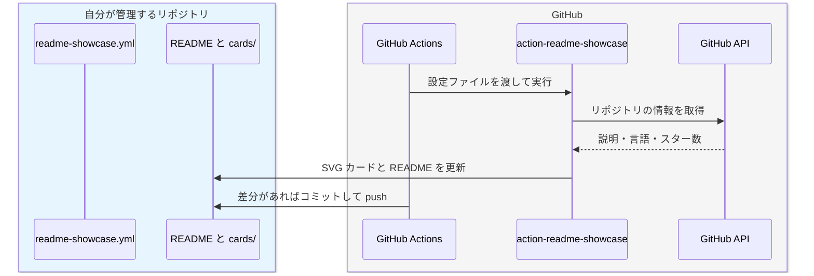

#### READMEにOSSカードやStar Historyを並べるGitHub Actionを作った



GitHub Profile README（例：nao1215/README.md）に、OSS カードとスター数の推移を生成する [nao1215/action-readme-showcase](https://github.com/nao1215/action-readme-showcase) を作った。README を賑やかすスクリプトをシュッと作った後、「GitHub Actions 化すれば、色んな人が使えるのでは？」と考えて、専用リポジトリで公開した。ライトモードとダークモードの両方に対応している（以下は、ダークモード）

<figure class="align-center">
  <a href="https://github.com/nao1215/gup"><picture><source media="(prefers-color-scheme: dark)" srcset="https://raw.githubusercontent.com/nao1215/nao1215/master/cards/dark/nao1215__gup.svg"></picture></a>
  <figcaption><p>featured を付けた gup のカード</p></figcaption>
</figure>

<figure class="align-center">
  <a href="https://github.com/nao1215/sqly"><picture><source media="(prefers-color-scheme: dark)" srcset="https://raw.githubusercontent.com/nao1215/nao1215/master/cards/dark/nao1215__sqly.svg"></picture></a>
  <figcaption><p>featured を付けない sqly の通常カード</p></figcaption>
</figure>

action-readme-showcase は、外部の画像サービスに依存せず、GitHub API から取得した情報を SVG にする。GitHub Actions の実行フロー中に、更新された README と SVG をリポジトリにコミットする。以下が大まかなシーケンスである。



<br>

使い方は、README に更新範囲を示すマーカーを書き、設定ファイルとワークフローを置くだけである。まず README に以下を書いておく。この範囲だけを Action が更新する。

```markdown
<!-- showcase:start -->
<!-- showcase:end -->
```

次に、README に表示したい OSS リポジトリ情報を `.github/readme-showcase.yml` に設定する。カードを特別に目立たせたい場合は、`featured`フラグを使う。

```yaml
# リポジトリ名を owner/repository と書かない場合の所有者
owner: nao1215

# カードの featured とは独立して、スター履歴の個別線を指定する。
# total は owner が所有する全公開リポジトリ（fork・archive を含む）の合計線を追加する。
starHistory:
  repos: [gup, sqly]
  total: true

sections:
  - groups:
      - title: Go CLI tools
        repos:
          # featured は金色の枠とバッジを付ける。
          - name: gup
            featured: true
          # featured を指定しない場合は通常のカードになる。
          - name: sqly
      - title: Libraries
        repos:
          - name: markdown
          - name: golang/go
```

最後に `.github/workflows/readme-showcase.yml` を置く。スケジュール実行か手動実行によって README と SVG が更新され、差分がある場合だけコミットされる。初回は Actions の画面から手動実行すればよい。公開リポジトリの Star History には、GitHub Actions が標準で渡す `${{ github.token }}` を使うため、シークレット `STARS_TOKEN` は不要である。空のシークレットを `with.token` に渡すと既定トークンを上書きして失敗するので、下の設定には書かない。

```yaml
name: README showcase

on:
  schedule:
    # 毎日 12:17（JST）に更新する。
    - cron: "17 3 * * *"
  workflow_dispatch:

permissions:
  contents: write

jobs:
  showcase:
    runs-on: ubuntu-latest
    steps:
      - uses: actions/checkout@v7

      - id: showcase
        uses: nao1215/action-readme-showcase@v0

      - if: steps.showcase.outputs.changed == 'true'
        run: |
          git config user.name "github-actions[bot]"
          git config user.email "41898282+github-actions[bot]@users.noreply.github.com"
          git add README.md cards
          git commit -m "docs: update showcase"
          git push
```

Fine-grained personal access token を使いたい場合は、GitHub の [Settings] > [Developer settings] > [Fine-grained tokens] で発行する。Resource owner は自分のアカウント、Repository access は履歴を読む全リポジトリを対象にする。`starHistory.repos` の個別線だけなら列挙したリポジトリを選べばよいが、上のように `total: true` を使う場合は owner が所有する公開リポジトリ全体を読めるようにする。Repository permissions は `Metadata: Read-only` のままでよく、Contents の書き込み権限は不要である。

発行した `github_pat_...` を、ワークフローを動かすリポジトリの [Settings] > [Secrets and variables] > [Actions] で、`STARS_TOKEN` という Repository secret として登録する。その場合だけ、Action にトークンを渡す。

```yaml
      - id: showcase
        uses: nao1215/action-readme-showcase@v0
        with:
          token: ${{ secrets.STARS_TOKEN }}
```

PAT はスター履歴を読むだけで、生成したファイルのコミットには使わない。コミットは workflow の `permissions: contents: write` と `actions/checkout` が持つ既定トークンで行う。

----

#### Linterとテストが全て。スキルやADRはコードを守らない

Linter やテストなどの機械的な検証で、コードを守る必要性を感じた一週間だった。




直近の一ヶ月は、過去イチでプライベートで LLM トークンを燃やしている。仕事なんて目じゃないぐらいコストをかけてしまった。以下の3点を同時並行で開発しており、開発に苦戦したのが主な理由だ。

- 開発プロジェクト管理（+ クズっぽいプライベートを楽しむ）ゲーム　※ 開発中なので非公開
- ゲームフレームワーク [nao1215/gozen](https://github.com/nao1215/gozen)
- [AI 画像生成ワークフロー](/weeknotes/2026-11-02/e2cecb994e2c) ※ 最も出来が悪いので、公開できない

<br>

開発に苦戦してしまった理由を先に書いておく。基本的には、私の判断ミスだ。
1. ゲーム開発という枠組みで考え、1つの LLM セッションで3つのプロジェクトを開発したこと
2. プライベートツールである AI 画像生成ワークフローに OSS 並の公開基準を適用したこと
3. ゲームの面白さを定義する前に、ボリュームを出したこと（奥深さよりも先に、規模を拡大したこと）

<br>

私の LLM を用いた開発手法を前提として共有する。ワークフロースキルを定義しており、各工程に個別のスキルがあり、各工程の担当者・レビュアーごとにサブエージェントが動く。私と対話しながら段階的にワークフローが進み、工程を跨ぐ前に会話内容を踏まえてスキルを改善する。サブエージェントを使い分ける理由は出力品質を上げるためであり、スキル改善は同じ失敗を繰り返さないためである。基本的には、一機能あたり一つのセッションで開発を進める。

今回は、ゲーム開発という単位でワークフローを動かし、3つのツールを同時開発したため、コンテキストが膨大になった。過去の OSS 開発経験から、LLM はこの程度の開発スコープに対応できるだろうと誤判断した。その結果、LLM は次第にワークフローを守らなくなり、脊髄反射で私の指摘を修正するようになった。開発スコープを狭める重要性を再認識した。

<br>

[AI 画像生成ワークフロー](/weeknotes/2026-11-02/e2cecb994e2c)は、2回作り直したのに失敗している。「良質なプロンプト -> 立ち絵 -> 表情差分・複数の立ち絵 -> 一枚絵」という作成フローを管理するだけにもかかわらず、なぜ失敗したのか（なお、実態としては、ジョブ実行・成果物管理・承認・履歴・リトライ・機械学習・GUI と幅広い機能を取り扱っている）。失敗の理由は、OSS 化を想定して無駄な抽象化を始めたからだ。「ComfyUI 以外で画像生成できるようにしよう」「モデル変更機能を導入するぞ」「評価基準やプロンプトをインポート・エクスポートできれば便利」と、私が欲しかった機能以外にも仕様を拡張した。本当に必要なものは、画像生成を楽にするワークフローだけだった。汎用性は要らなかった。力の入れどころを間違えた良い例だ。

<br>

ゲームの面白さに関しては、今回の開発で一つの学びがあった。「体験版の範疇で面白くないゲームは、ゲーム性が悪い」という学びだ。何がゲームを面白くさせるかは未だに言語化できないが、面白くないゲームを見つける方法は今回理解した。体験版（序盤）で面白くない場合は、規模を拡大する前にゲーム性を見直すべきだ。私は全体を作ってから（= 規模を拡大してから）、「面白くないな……手直しするか」と機能を追加したり、シナリオを書き直したりしていた。この方法は仕様変更が激しく、LLM が段々と混乱するのだ。最初に序盤を作り込み、方針が明確になってから規模を拡大すべきである。なまじ開発力があるせいで、この罠にハマってしまった。この経験を通して、[プロジェクト管理ゲーのサブ要素がメインになりそうな雰囲気](/weeknotes/2026-11-02/11c741861bb0/)がある。

<br>

最後に、皆さん向けにゲーム開発に関係のない知見を共有する。LLM 向けにスキルや ADR（Architecture Decision Records）を作るのは無駄ではないが、本質的ではないと感じている。LLM がスキルを使わず、ADR を読まない可能性があるからだ。今回の開発では、gozen に ADR が60本以上あったが、完全に無視されていた。「ADR を読みなさい」と指示しても、完全には守られない。そこで私は「ADR をテストか Linter に置き換える。極論、ADR を削除しても問題がない状態を目指す」と方針を打ち出した。

今までも E2E テスティングツールである [atago](https://github.com/nao1215/atago) で挙動を縛っていたが、成果物の振る舞いをチェックする意味合いが強かった。今回の開発の学びとして、コード品質・設計を維持するためのテストや Linter を重要視しており、既存の Linter で補えない部分は独自 Linter をプロジェクト内に用意するようにした。例えば、gozen のインプットファイルである YAML に新規キーワードを登録した場合、schema・ドキュメント・E2E でキーワードが登場するか（記載漏れチェック）、利用例が2パターン以上定義されているか（特定用途への作り込みを避けるためのチェック）を検査している。

逆に言えば、一般的な Linter でカバーできる範疇、例えばデッドコード・重複コード検出、命名規則、アーキテクチャルールあたりの管理のために独自 Linter を作るべきではない。エンジニアリングの楽しさに酔いしれてはいけない。本当に必要で効果的な内容だけを独自 Linter に導入すべきだ。
