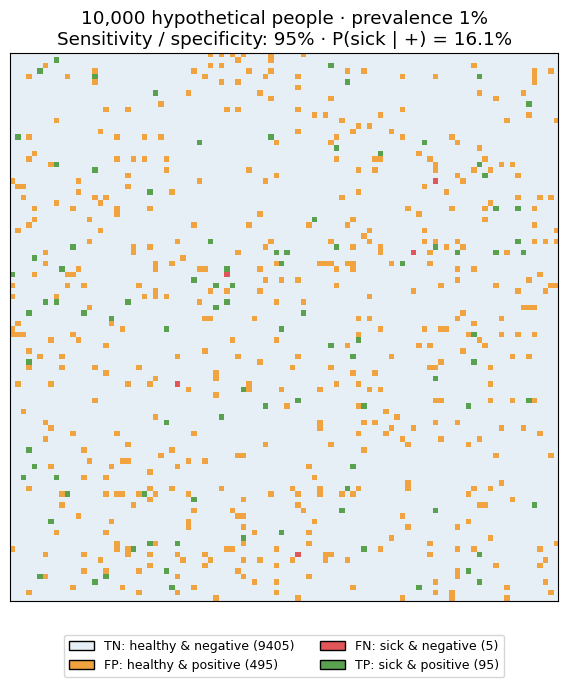
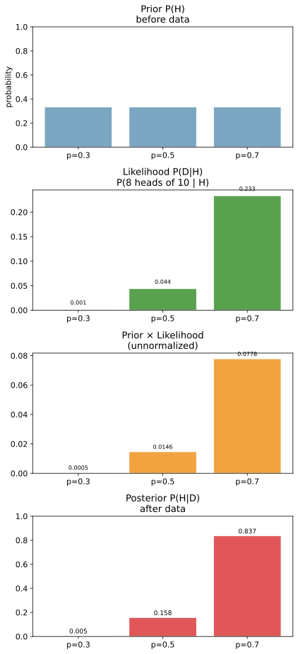
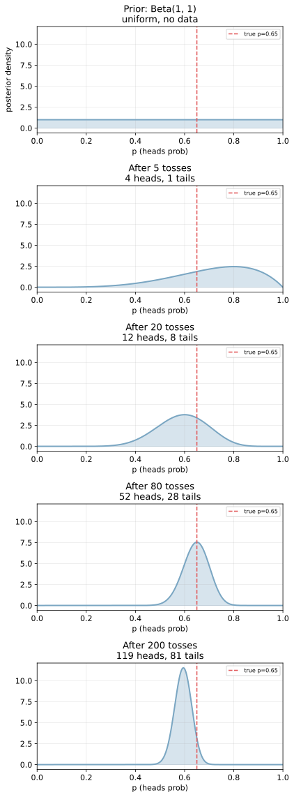
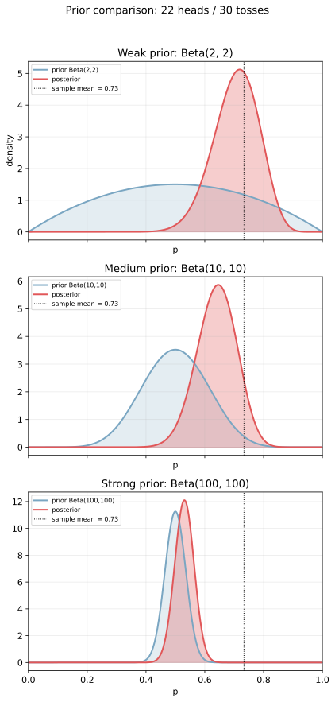
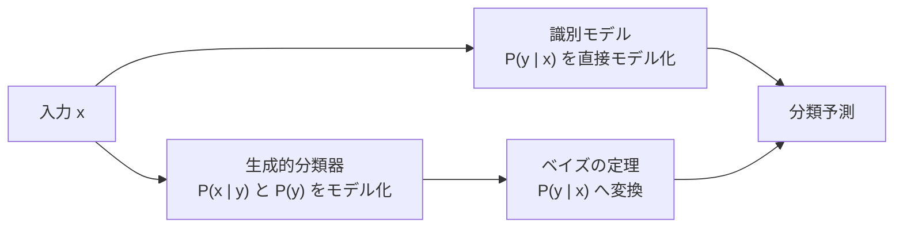

検査の「病気の人が陽性になる確率」と「陽性の人が病気である確率」は異なります。ベイズの定理（Bayes' theorem）は、このように条件を入れ替えたり、観測したデータに基づいて、各仮説が正しいと考える確率を更新したりする規則です。

<br>

本記事では、架空の検査とコイン投げを例に、事前分布・尤度・事後分布の関係を説明します。コードは図の計算部分です。描画を含む[生成コード](https://github.com/nao1215/debimate/blob/main/projects/ml/scripts/notes/bayes-theorem_gen.py)も保存しています。

---

### 陽性の人が病気である確率

仮に、有病率（基準率、base rate）が 1%、感度（病気の人が陽性になる確率）が 95%、特異度（病気でない人が陰性になる確率）が 95% の集団と検査を考えます。以下は仕組みを説明するための数値で、実際の検査のデータではありません。

10,000 人にこの割合を当てはめると、病気の人は 100 人、そのうち陽性は 95 人です。病気でない 9,900 人のうち、5% に当たる 495 人も陽性になります。

| 判定 | 病気 | 病気でない |
|---|---:|---:|
| 陽性 | 95 人（TP） | 495 人（FP） |
| 陰性 | 5 人（FN） | 9,405 人（TN） |

陽性の合計は 590 人なので、陽性者のうち病気である割合は `95 / 590 ≈ 16.1%` です。感度の 95% と違うのは、分母が「病気の人」から「陽性の人」に変わったからです。

```python
N = 10000
n_sick = int(N * 0.01)
n_healthy = N - n_sick
tp = int(n_sick * 0.95)
fn = n_sick - tp
tn = int(n_healthy * 0.95)
fp = n_healthy - tn
print(f"P(sick | +) = {tp / (tp + fp):.1%}")
```

```text
P(sick | +) = 16.1%
```



上記の図では、緑が病気で陽性の人、橙が病気でないのに陽性となった人です。病気でない人が多いため、5% の偽陽性だけで緑の人数を上回っています。感度・特異度を固定しても、有病率が変われば陽性者中の病気の割合は変わります。同様に分類器でも、対象クラスの割合が[適合率](../../ml/roc-pr-auc/)に影響します。

---

### 4 つの成分の関係

仮説を `H`、観測データを `D` とすると、ベイズの定理は次の式です。ただし `P(D) > 0` とします。

`P(H | D) = P(D | H) × P(H) / P(D)`

| 成分 | 意味 |
|---|---|
| 事前確率 `P(H)` | データを見る前に仮説へ与える確率 |
| 尤度 `P(D \| H)` | 仮説を固定した時、観測データが得られる確率 |
| 周辺尤度 `P(D)` | 仮説全体を考慮してデータが得られる確率 |
| 事後確率 `P(H \| D)` | データを見た後に仮説へ与える確率 |

[条件付き確率](../joint-marginal-conditional/)の定義から、同時確率は `P(H, D) = P(D | H)P(H) = P(H | D)P(D)` と書けます。これを `P(D)` で割ると上の式になります。連続量を扱う場合は、対応する箇所に確率密度を使います。

3 枚のコインの表が出る確率をそれぞれ 0.3、0.5、0.7 とし、等確率で 1 枚選びます。そのコインを独立に 10 回投げて、8 回表が出たとします。[SciPy の二項分布](https://docs.scipy.org/doc/scipy/reference/generated/scipy.stats.binom.html)を使うと、各コインでこの結果が出る確率を計算できます。

```python
import numpy as np
from scipy import stats

hyps = np.array([0.3, 0.5, 0.7])
prior = np.array([1/3, 1/3, 1/3])
likelihood = stats.binom.pmf(8, 10, hyps)
unnorm = prior * likelihood
posterior = unnorm / unnorm.sum()
print(np.round(posterior, 3))
```

```text
[0.005 0.158 0.837]
```



事後確率は `p = 0.7` のコインが約 83.7%、`p = 0.5` が約 15.8%、`p = 0.3` が約 0.5% です。`p = 0.7` のコインの可能性が最も高いものの、残り 2 枚の可能性もあります。

尤度の値を仮説について足しても、一般には 1 になりません。事前確率との積を取り、その合計 `P(D)` で割ることで、事後確率の合計を 1 に揃えています。

---

### 観測ごとの更新

前節では表の確率を 3 候補に限定しましたが、0 から 1 の連続量として推定することもできます。表が出る確率 `p` は一定とし、`p` を固定すると各回の結果は独立であると仮定します。事前分布をベータ分布 `Beta(a, b)` とすると、表を `h` 回、裏を `t` 回観測した後は `Beta(a + h, b + t)` になります。尤度の `p^h(1−p)^t` を事前密度に掛けると、ベータ分布の指数に観測回数が加わるからです。

事後分布を次の事前分布として使えば、1 回ずつ更新しても、まとめて更新しても同じ結果になります。以下の例では、区間 `[0, 1]` 上で密度が一定の `Beta(1, 1)` を事前分布に使います。一様分布も事前分布の選択肢の 1 つであり、唯一の「情報を持たない」選択ではありません。

```python
true_p = 0.65
data_seq = np.random.default_rng(0).binomial(1, true_p, size=200)
p_grid = np.linspace(0, 1, 400)
for n in [0, 5, 20, 80, 200]:
    h = int(data_seq[:n].sum())
    a, b = 1 + h, 1 + n - h
    pdf = stats.beta.pdf(p_grid, a, b)
    print(f"n={n}: heads={h}, Beta({a}, {b}), mean={a/(a+b):.4f}")
```

```text
n=0: heads=0, Beta(1, 1), mean=0.5000
n=5: heads=4, Beta(5, 2), mean=0.7143
n=20: heads=12, Beta(13, 9), mean=0.5909
n=80: heads=52, Beta(53, 29), mean=0.6463
n=200: heads=119, Beta(120, 82), mean=0.5941
```



上記の図の縦軸は確率密度です。`p` がある区間に入る確率は、その区間で曲線の下の面積を求めることで計算できます。曲線の高さをその点の確率として読むことはできません。コード中の [`stats.beta.pdf`](https://docs.scipy.org/doc/scipy/reference/generated/scipy.stats.beta.html) は、この確率密度を計算しています。

200 回投げると表が 119 回となり、事後平均は約 0.594 です。80 回の時点では約 0.646 だったため、真値 0.65 からは遠ざかっています。一方で、事後分布の幅は狭くなっています。データを増やすたびに推定値が真値に近づくわけではありません。

---

### 事前分布による推定結果の違い

同じ「30 回投げて 22 回表が出た」というデータに対して、平均がすべて 0.5 の `Beta(2, 2)`、`Beta(10, 10)`、`Beta(100, 100)` を比べます。`Beta(100, 100)` が最も 0.5 の周りに集中し、`Beta(2, 2)` が最も広がっています。

```python
for a_prior, b_prior in [(2, 2), (10, 10), (100, 100)]:
    a_post, b_post = a_prior + 22, b_prior + 8
    print(f"Beta({a_post}, {b_post}): mean={a_post/(a_post+b_post):.4f}")
```

```text
Beta(24, 10): mean=0.7059
Beta(32, 18): mean=0.6400
Beta(122, 108): mean=0.5304
```



観測した表の割合は `22/30 ≈ 0.733` です。弱い事前では事後平均がその値に近づき、強い事前では 0.5 寄りに残ります。ベータ分布の事後平均は、事前平均と観測割合をそれぞれ `a+b`、観測回数で重み付けした平均として読めます。

このベータ分布の例では、`a, b` を固定して観測数を増やすと、事後平均に対する事前の重みは小さくなります。一般のモデルでも同じ結果になるとは限らないため、データ量だけで事前分布の影響を判断することはできません。事前分布は過去データや専門知識を元に選び、複数の候補で結論が変わるかを確認します。

---

### 識別モデル vs 生成モデル

分類では、入力 `x` からクラス `y` を予測します。[ロジスティック回帰](../../ml/logistic-regression/)のような識別モデルは、`P(y | x)` を直接モデル化します。一方で、[ナイーブベイズ](https://scikit-learn.org/stable/modules/naive_bayes.html)のような生成的分類器は、`P(x | y)` と `P(y)` をモデル化し、ベイズの定理で `P(y | x)` を求めます。



ナイーブベイズは、クラスを条件とした特徴量間の独立性を仮定し、`P(x | y)` を各特徴量の確率の積で表します。この仮定は計算を簡単にしますが、実データとのずれがあれば確率出力にも影響します。そのため、分類の正解率が高くても、出力した確率が実際の頻度と一致するとは限りません。

---

### 機械学習での使いどころ

ベイズ線形回帰では重みに事前分布を置き、データを観測した後の重みを事後分布で扱います。重みを 1 つの値に決めず、不確実性を含めた予測に利用できます。時系列の状態推定でも、新しい観測による更新にベイズの定理を使いますが、状態が時間とともに変わるモデルが別途必要です。

本記事のコインの例は解析的に更新でき、サンプリングは不要でした。複雑なモデルでは周辺尤度の積分が難しくなり、モンテカルロ法や変分推論などの近似が必要になることがあります。モデルを選ぶ際には、推論の計算量と近似誤差も確認する必要があります。

---

### 推定時の注意点

データが少ない時は事前分布の選び方が結論を大きく変えます。また、同じデータを独立な新情報として何度も取り込むと、根拠以上に狭い事後分布を作ってしまいます。そのため、更新に使用したデータを管理し、観測間に依存関係がある場合はモデルに反映する必要があります。

事後分布から作る信用区間と、[頻度主義の信頼区間](../hypothesis-test/)では、確率の意味が異なります。95% 信用区間は、指定した事前分布・モデル・観測データの下で、パラメータが区間内にある事後確率が 95% となる区間です。信頼区間の 95% は、同じ標本抽出と計算を繰り返した際に、作った区間が真値を含む割合を指します。
