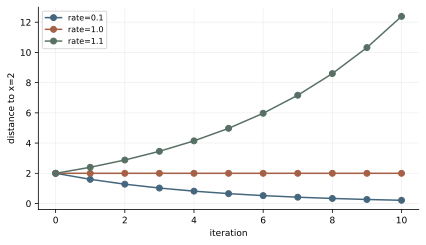

凸関数（convex function）は、グラフ上の任意の2点を結ぶ線分が、グラフの下に入り込まない関数です。凸関数を凸集合の範囲で最小化すると、近くの点と比べて最小になった点は、範囲全体でも最小になります。機械学習では、学習途中で見つけた解より良い解が別の場所に隠れていないかを考える手掛かりになります。

ただし、凸であるだけでは「最小値が存在する」「解が1つに決まる」「どんな学習率でも収束する」とは言えません。

<br>

本記事では、グラフの形と勾配降下法の実験から、この3つの違いを確かめます。

---

### 凸関数の定義

関数の入力として許される範囲を定義域と呼びます。定義域が凸集合、つまり任意の2点を結ぶ線分をすべて含む集合であり、任意の `x, y` と `t ∈ [0, 1]` について、次が成り立つ関数が凸関数です。

`f(t x + (1 - t) y) ≤ t f(x) + (1 - t) f(y)`

左辺は、入力を混ぜてから求めた関数値です。右辺は、2つの関数値を同じ割合で混ぜた値で、グラフ上の2点を結ぶ弦の高さに当たります。以下の図では、青が関数、茶色の破線が弦です。






`f(x) = x²` の図では、`a = -1.3, b = 1.5` の中点は `0.1` です。関数値は `f(0.1) = 0.01`、弦の高さは `(f(a) + f(b)) / 2 = 1.97` となり、不等式を満たします。逆向きの不等式を満たす関数は凹関数（concave function）と呼びます。`log(x)` は `x > 0` で凹です。

凸関数には `x²`、`|x|`、`exp(x)`、`-log(x)`（`x > 0`）などがあります。直線 `ax + b` も不等式を等号で満たすため、凸かつ凹です。「U字型」は一部の例には合いますが、凸関数すべての形を表す言葉ではありません。定義と例は Boyd・Vandenberghe の[凸関数の講義資料](https://see.stanford.edu/materials/lsocoee364a/03ConvexFunctions.pdf)でも確認できます。

---

### 凸関数の判定

微分可能な関数なら、接線が関数を下から支えることが凸性の判定になります。1次元では、定義域のすべての `x, y` について `f(y) ≥ f(x) + f'(x)(y - x)` が成り立つかを調べます。

開区間上で2階微分可能なら、区間全体で `f''(x) ≥ 0` となることと凸性は同値です。多次元では、開いた凸な定義域上で2階微分可能な関数について、ヘッセ行列（2階偏微分を並べた行列）が全点で半正定値であることに対応します。これは、どの方向の曲率も負にならないという条件です。

一方で、`|x|` は `x = 0` で微分できませんが凸です。微分できない関数の凸性は、2点を結ぶ線分についての定義の不等式や、凸性を保つ演算から確認します。凸関数の非負の重み付き和、アフィン変換した入力への適用、凸関数同士の最大値は凸になります。合成については「外側が凸かつ単調非減少で、内側が凸」が十分条件の1つであり、凸関数同士を合成すれば常に凸になるわけではありません。

---

### 最小解の存在と一意性

最小値を取る入力を最小解と呼びます。凸関数の局所最小解は大域最小解でもありますが、最小解の存在や個数は別に確認する必要があります。







- `x²`：最小解は `x = 0` の1点
- `max(|x| - 1, 0)`：`-1 ≤ x ≤ 1` のすべてで最小値 `0` を取る
- `exp(x) - 1`：`x` を負の方向へ動かすと `-1` に近づくが、有限の `x` では到達しない。下限は `-1` でも最小解は存在しない

定義の不等号が、異なる2点と `0 < t < 1` に対して常に厳密な `<` になる関数を厳密凸関数と呼びます。厳密凸なら、最小解が存在する場合は1つです。ただし `exp(x) - 1` も厳密凸なので、一意性の条件だけで存在まで保証することはできません。

存在を保証する条件の例は、空でない閉じた有界な集合上で目的関数が連続であることです。この条件では凸性によらず最小値が存在します。上記に加えて、集合と関数が凸なら、局所的に見つけた最小解が大域的な最小解でもあると判断できます。

---

### 勾配降下法と初期値

勾配降下法（GD, Gradient Descent）は、関数の[勾配](../partial-derivative-gradient/)と反対向きに入力を更新します。1次元なら更新式は `x_next = x - η f'(x)` で、`η` が学習率です。[確率的勾配降下法（SGD）](../gradient-descent-sgd/)では、抽出したデータなどから勾配を推定します。以下は関数の微分を直接使うため、SGDではなくGDの実験です。

凸関数 `f(x) = (x - 2)²` と、非凸関数 `g(x) = 0.3x⁴ - 1.5x² - 0.5x + 2` に対し、学習率 `0.1` で50回更新します。上段は関数の形、下段は更新回数ごとのxの位置です。






| 初期値 | 凸の例：50回後のx | 非凸の例：50回後のx |
|---|---:|---:|
| -2.5 | 1.999936 | -1.490092 |
| 0.5 | 1.999979 | 1.658676 |
| 4.0 | 2.000029 | -1.490092 |

凸の例では3つとも `x = 2` に近づきました。非凸の例では、`x ≈ -1.490092` と `x ≈ 1.658676` の2点に分かれます。関数値はそれぞれ約 `0.893503` と `-0.685407` で、`x ≈ 1.658676` が大域最小解です。初期値 `4.0` からは、最初の更新で `-2.43` まで移動し、左側へ進みます。近い谷に必ず入るわけでもありません。

非凸関数では、勾配がゼロでも最小解でない場合があります。例えば `x² - y²` の原点は、x方向に進むと値が増え、y方向では減る鞍点です。勾配の更新方法を変えることは探索の助けになり得ますが、それだけで鞍点を必ず抜けて大域最小解へ進む保証にはなりません。

---

### 凸でも学習率を大きくすると発散する

`f(x) = (x - 2)²` では、更新式を整理すると `x_next - 2 = (1 - 2η)(x - 2)` になります。そのため `0 < η < 1` なら最小解との距離が縮まり、`η = 1` なら最小解以外の初期値からは振動し、`η > 1` なら最小解以外の初期値からの距離は広がります。

以下は `x = 0` から10回更新するコードです。[NumPy](https://numpy.org/)と[Matplotlib](https://matplotlib.org/)を使い、学習率だけを変えます。

```python
import numpy as np
import matplotlib.pyplot as plt

fig, ax = plt.subplots(figsize=(6, 3.5))
for rate, color in zip([0.1, 1.0, 1.1], ["#45677d", "#a56045", "#587064"]):
    path = [0.0]
    for _ in range(10):
        path.append(path[-1] - rate * 2 * (path[-1] - 2))
    distance = np.abs(np.array(path) - 2)
    ax.plot(range(11), distance, "o-", color=color, label=f"rate={rate}")
ax.set_xlabel("iteration")
ax.set_ylabel("distance to x=2")
ax.legend()
ax.grid(alpha=0.18)
fig.tight_layout()
fig.savefig("convex_learning_rate.svg", bbox_inches="tight")
plt.close(fig)
```



10回後の距離は、学習率 `0.1` で約 `0.215`、`1.0` で `2`、`1.1` で約 `12.383` です。凸性は目的関数の性質であり、更新の刻み幅まで決めるものではありません。一般の滑らかな凸関数では、最小解の存在と勾配の変化率の上限などを仮定し、それに応じた学習率で収束を論じます。[勾配降下法の収束解析](https://www.stat.cmu.edu/~ryantibs/convexopt-F13/scribes/lec6.pdf)では、この条件を式で確認できます。SGDには勾配推定のばらつきなど、上記に加えて考慮する条件があります。

[図と数値の生成コード](https://github.com/nao1215/debimate/blob/main/projects/ml/scripts/notes/convex-functions_gen.py)はGitHubで公開しています。

---

### Jensenの不等式

凸関数 `f` について、必要な期待値が有限で定義される場合、`f(E[X]) ≤ E[f(X)]` が成り立ちます。これがJensenの不等式です。「平均してから関数へ入れる」場合と「関数へ入れてから平均する」場合を比べています。

`X` が区間 `[-2, 2]` の一様分布に従う例を考えます。`E[X] = 0` なので、`f(x) = x²` なら左辺は `0`、右辺は `E[X²] = 4/3` です。下図の値は乱数による標本平均ではなく、分布から計算した期待値です。






両者の差 `E[f(X)] - f(E[X])` はJensen gapと呼ばれます。二乗関数では、この差が[分散](../variance/)に一致します。一方で、アフィン関数 `f(x) = 2x + 3` では両者とも `3` です。Xにばらつきがあっても、一般の凸関数では差がゼロになる場合があります。厳密凸関数では、Xがほぼ確実に一定でない場合に、期待値が有限なら厳密な不等号になります。

<br>

相加平均・相乗平均の関係にも使えます。正の数 `a, b` に対して、凹関数 `log` へ逆向きの不等式を適用すると、`log((a + b) / 2) ≥ (log(a) + log(b)) / 2` です。両辺の指数を取ると `(a + b) / 2 ≥ sqrt(ab)` が得られます。凸関数 `-log` を使っても同じ結果になります。

機械学習では、[KLダイバージェンスの非負性](../information-theory/)や、変分推論における対数尤度の下界の導出にも現れます。ただし、下界を導けることと、その下界を最大化する問題が凹最適化になることは別です。

---

### 制約付きの凸最適化

学習する重みの範囲などに制約がある場合、目的関数だけでなく、許される入力の集合も確認します。標準的な凸最適化問題は次の形です。

```text
minimize  f(x)        # fは凸
subject to g_i(x) ≤ 0 # 各g_iも凸
           Ax = b    # 等式制約はアフィン
```

この形では実行可能集合、つまり制約をすべて満たす入力の集合が凸になります。その集合内の局所最小解は大域最小解です。例えば、`(x - 2)²` を `x ≤ 1` の範囲で最小化すると解は `x = 1` で、そこでの微分はゼロではありません。制約があると、勾配が指す先へ自由に移動できないためです。[凸最適化問題の講義資料](https://see.stanford.edu/materials/lsocoee364a/04ConvexOptimizationProblems.pdf)は、解の存在や制約を含めて整理しています。

<br>

制約付き問題では、求めた解が最適かを確かめるため、目的関数値の下限と比較する方法もあります。この下限を求める側の問題を双対問題と呼びます。元の問題と双対問題の最適値が一致する性質を強双対性と呼びます。凸問題でも自動的には成立せず、十分条件の1つがSlater条件です。これは共通定義域の相対内部に、等式制約を満たし、不等式制約を厳密な `< 0` で満たす点がある、という条件です。相対内部は、定義域を含む最小のアフィン空間の中で考えた内部を指します。

微分可能な凸問題では、実行可能性や勾配の釣り合いなどをまとめたKKT（Karush–Kuhn–Tucker）条件を満たす解は最適です。最適解がKKT条件を満たすという逆向きには、Slater条件などの前提を確認します。条件と強双対性の関係は[双対性の講義資料](https://see.stanford.edu/materials/lsocoee364a/05Duality.pdf)に記載されています。Slater条件は十分条件であり、満たさないだけで強双対性が成り立たないと断定はできません。

---

### 機械学習での使いどころ

[線形回帰](../../ml/linear-regression/)の二乗誤差は、入力データを固定すれば重みについて凸です。[ロジスティック回帰](../../ml/logistic-regression/)の負の対数尤度も、線形なスコアを使うモデルの重みについて凸になります。一方で、同じ二乗誤差でも、予測値を多層ニューラルネットワークで計算すると、重み全体について一般に非凸になります。何に関して凸なのかを区別する必要があります。

[正則化](../../ml/regularization/)で使うL1・L2ペナルティは凸です。凸な損失に非負の係数で足せば凸性を保てます。ただし、非凸な損失へ足すだけで必ず凸になるわけではありません。[SVM](../../ml/svm/)も、固定した特徴表現や適切なカーネルのもとで凸最適化として扱えます。

凸性から分かるのは、指定した目的関数と制約に対する解の性質です。学習データ上の最適解が、未知のデータでも良い予測をするかは別に評価します。

---

### 適さないケース・注意点

- 微分できない目的関数：L1ペナルティを含む問題には、座標降下法や近接勾配法などを検討する
- 制約を持つ問題：通常のGDでは制約の外へ出るため、許される集合へ戻す射影勾配法などを使う
- 非凸なモデル：凸性を前提とする大域最適性の保証をそのまま使わない。初期値や最適化条件を変え、得られた目的関数値を比較する
- 大規模な問題：凸性だけでは必要なメモリや計算時間は分からない。行列の疎性、微分の計算量、要求する精度も確認する
