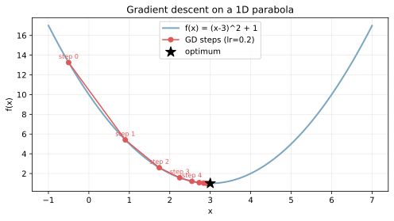
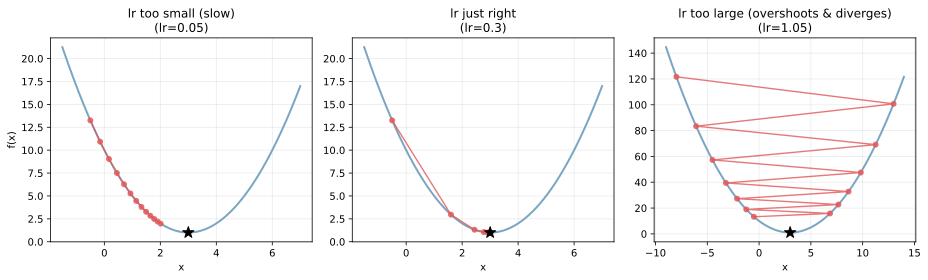
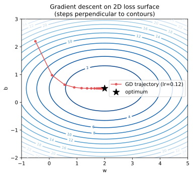
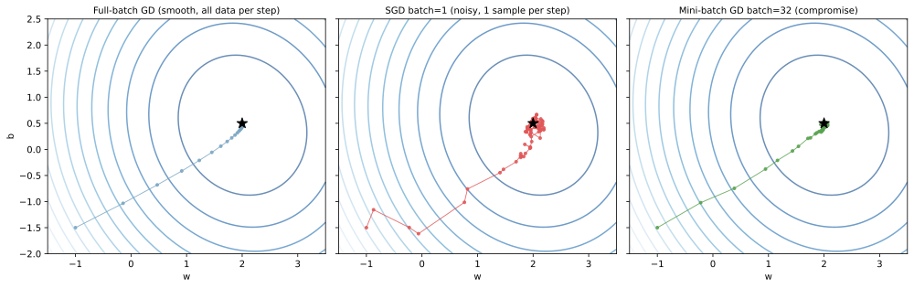

最急降下法（gradient descent, GD）は、関数 `f(x)` を最小化するために「現在地から見て最も急に下る方向（= 負の勾配 `-∇f`）に少しずつ進む」反復アルゴリズムです。確率的勾配降下法（stochastic gradient descent, SGD）は、勾配を全データではなくランダムな 1 サンプル（または小バッチ）から推定して更新する派生で、大規模データでの学習に欠かせない手法となります。

機械学習で「モデルを訓練する」と言う時、その多くは[損失関数](/ml/ml/loss-functions/) `L(θ)` をパラメータ `θ` について最小化する最適化問題を解いています。線形回帰の閉形式解のように、反復せずに最小値を直接計算できる例外もあります。ニューラルネットは GD / SGD 系のアルゴリズムで重みを更新し、ロジスティック回帰も勾配を使う反復法で解きます（[scikit-learn の LogisticRegression](https://scikit-learn.org/stable/modules/generated/sklearn.linear_model.LogisticRegression.html) の既定は準ニュートン法の一種である L-BFGS）。

前提として [偏微分と勾配](../partial-derivative-gradient/) の概念を使うので、必要なら先に確認しておくとよいです。

---

### 更新式の基本形

更新式は次の 1 行に集約されます。

`θ_{t+1} = θ_t - η ∇L(θ_t)`

- `θ_t`: 時刻 `t` のパラメータベクトル
- `η`: 学習率（learning rate）。1 ステップでどれだけ動くかを決める正の小さな数
- `∇L(θ_t)`: 現在のパラメータでの損失の勾配

現在のパラメータから、勾配に学習率を掛けた値を引いて更新します。`η` の選び方・勾配の計算方法・更新のスケジュールの組み合わせで、収束の速さ・安定性・最終的な精度が大きく変わります。

---

### 1 次元での挙動

最も単純な例として `f(x) = (x - 3)^2 + 1` を最小化します。最適解は `x* = 3, f(x*) = 1` です。微分は `f'(x) = 2(x - 3)` で、これが勾配になります。

本記事のコードは [NumPy](https://numpy.org/) 2.5.4 で計算する部分の抜粋です。[Matplotlib](https://matplotlib.org/) の描画を含む[生成コード](https://github.com/nao1215/debimate/blob/main/projects/ml/scripts/notes/gradient-descent-sgd_gen.py)は GitHub で公開しています。

```python
import numpy as np

def f(x):
    return (x - 3) ** 2 + 1

def df(x):
    return 2 * (x - 3)

x_cur = -0.5
lr = 0.2
history = [x_cur]
for _ in range(8):
    x_cur = x_cur - lr * df(x_cur)
    history.append(x_cur)
history = np.array(history)
print("1d:", np.round(history, 2))
```

```text
1d: [-0.5   0.9   1.74  2.24  2.55  2.73  2.84  2.9   2.94]
```



初期値 `x_0 = -0.5` から 8 ステップで `x = 2.94` まで最適解 3 に近づきます。更新式に勾配を代入すると `x_{t+1} - 3 = (1 - 2η)(x_t - 3)` となり、最適解までの距離は 1 回の更新で `1 - 2 × 0.2 = 0.6` 倍に縮みます。最初は距離が大きいので 1 回で大きく動き、最適解に近づくほど更新幅も小さくなります。

---

### 学習率の選び方

`η` の値は GD の挙動を支配します。同じ関数で学習率だけを変え、12 ステップの更新を比較します。

```python
lrs = [0.05, 0.3, 1.05]
histories = []
for lr in lrs:
    x_cur = -0.5
    history = [x_cur]
    for _ in range(12):
        x_cur = x_cur - lr * df(x_cur)
        history.append(x_cur)
    histories.append(np.array(history))
    print(f"lr={lr}:", np.round(history, 2))
```

```text
lr=0.05: [-0.5  -0.15  0.17  0.45  0.7   0.93  1.14  1.33  1.49  1.64  1.78  1.9
  2.01]
lr=0.3: [-0.5   1.6   2.44  2.78  2.91  2.96  2.99  2.99  3.    3.    3.    3.
  3.  ]
lr=1.05: [-0.5   6.85 -1.24  7.66 -2.12  8.64 -3.2   9.82 -4.5  11.25 -6.08 12.99
 -7.98]
```



距離の縮み方 `1 - 2η` で 3 つの結果を説明できます。

- 左（`lr=0.05`）: 距離が 1 回で 0.9 倍にしか縮まず、12 ステップ後も `x = 2.01` で最適解に届かない。収束はするが遅い
- 中央（`lr=0.3`）: 0.4 倍ずつ縮み、5 ステップで `x = 2.96` に到達する
- 右（`lr=1.05`）: 係数が `-1.1` になり、毎回最適解の反対側へ飛び越えながら距離が 1.1 倍に広がる。12 ステップで `-7.98` まで振れ、続ければ発散する

2 次関数では係数 `1 - η f''` の絶対値が 1 未満なら収束するので、`η < 2 / f''` が安定性の境界です。本例は `f'' = 2` なので境界は `η = 1` で、1.05 は境界を 5% 超えただけで発散します。一般の損失関数でも、曲率（2 階微分）が大きい場所ほど許される学習率は小さくなります。

実際の学習では、学習率を何通りか試して損失の推移を確かめ、学習の途中で学習率を下げるスケジュール（step decay や [SGDR](https://arxiv.org/abs/1608.03983) の cosine annealing）も使います。

---

### 2 次元での軌跡

パラメータが 2 つ以上の場合も同じ更新式が成り立ちます。`L(w, b) = (w - 2)^2 + 3 (b - 0.5)^2` の例で軌跡を見ます。

```python
def L(w, b):
    return (w - 2) ** 2 + 3 * (b - 0.5) ** 2

def dL(w, b):
    return 2 * (w - 2), 6 * (b - 0.5)

w_cur, b_cur = -0.5, 2.2
lr = 0.12
hist_w, hist_b = [w_cur], [b_cur]
for _ in range(20):
    gw, gb = dL(w_cur, b_cur)
    w_cur = w_cur - lr * gw
    b_cur = b_cur - lr * gb
    hist_w.append(w_cur)
    hist_b.append(b_cur)
for t in [0, 3, 20]:
    print(f"step {t}: w={hist_w[t]:.3f} b={hist_b[t]:.3f}")
```

```text
step 0: w=-0.500 b=2.200
step 3: w=0.903 b=0.537
step 20: w=1.990 b=0.500
```



各ステップは等高線に直交する方向（= 勾配ベクトルの逆向き）に進んでいます。1 次元と同じく各方向の距離は 1 回で `1 - η × 曲率` 倍になり、曲率 6 の `b` 方向は 0.28 倍、曲率 2 の `w` 方向は 0.76 倍です。3 ステップで `b` のずれは 1.7 から 0.037 まで縮む一方、`w` のずれは 2.5 から 1.097 までしか縮みません。軌跡が先に `b` をほぼ合わせ、その後 `w` 方向へゆっくり進むのはこのためです。

`w` を速めようと学習率を上げても、`η > 2 / 6 ≈ 0.33` で `b` 方向が発散します。方向ごとに曲率が違い、1 つの学習率では全方向を速く収束させられない状態を ill-conditioning（悪条件）と呼びます。パラメータごとに学習率を調整する Adam などの手法は、この偏りを緩和します（次の「派生手法の見取り図」の表）。

---

### バッチ GD・SGD・ミニバッチの違い

訓練データが `n` サンプルある時、勾配 `∇L(θ)` の計算に使うデータ量で次の 3 つに分かれます。


- title: バッチ GD（full-batch）
  items:
  - 全 n サンプルで 1 ステップ
  - 勾配は正確だが 1 ステップが重い
  - 全データを 1 周しても更新は 1 回
- title: SGD（batch=1）
  items:
  - ランダムな 1 サンプルで 1 ステップ
  - 1 ステップは軽いが勾配のノイズが大きい
  - GPU の並列計算を活かしにくい
- title: ミニバッチ GD（batch=k）
  items:
  - ランダムな k サンプル（16〜256 程度）で 1 ステップ
  - GPU の並列計算と更新の安定性を両立


`y = 2x + 0.5` にノイズを足した 500 サンプルで線形回帰の `(w, b)` を学習し、3 つを 80 ステップずつ比べます。SGD だけは揺れが大きいので学習率を 0.05 に下げています。

```python
rng = np.random.default_rng(0)
n_data = 500
x_data = rng.uniform(-2, 2, n_data)
y_data = 2.0 * x_data + 0.5 + rng.normal(0, 0.5, n_data)

def loss_full(w, b):
    return np.mean((y_data - (w * x_data + b)) ** 2)

def grad_full(w, b, idx=None):
    if idx is None:
        xs, ys = x_data, y_data
    else:
        xs, ys = x_data[idx], y_data[idx]
    err = ys - (w * xs + b)
    gw = -2 * np.mean(xs * err)
    gb = -2 * np.mean(err)
    return gw, gb

def run(method, lr, steps, batch=None):
    w_cur, b_cur = -1.0, -1.5
    hist = [(w_cur, b_cur)]
    for s in range(steps):
        if method == "full":
            gw, gb = grad_full(w_cur, b_cur)
        elif method == "sgd":
            i = rng.integers(0, n_data)
            gw, gb = grad_full(w_cur, b_cur, idx=[i])
        elif method == "mini":
            idx = rng.choice(n_data, size=batch, replace=False)
            gw, gb = grad_full(w_cur, b_cur, idx=idx)
        w_cur -= lr * gw
        b_cur -= lr * gb
        hist.append((w_cur, b_cur))
    return np.array(hist)

steps = 80
traj_full = run("full", lr=0.1, steps=steps)
traj_sgd = run("sgd", lr=0.05, steps=steps)
traj_mini = run("mini", lr=0.1, steps=steps, batch=32)

# 本文に載せる数値: 80 ステップ後の (w, b)、全データでの損失、勾配計算に使ったサンプル数
for name, traj, per_step in [("full", traj_full, n_data), ("sgd", traj_sgd, 1),
                             ("mini", traj_mini, 32)]:
    w_end, b_end = traj[-1]
    print(f"{name:4s} w={w_end:.3f} b={b_end:.3f} "
          f"loss={loss_full(w_end, b_end):.4f} samples={steps * per_step}")
```

```text
full w=2.007 b=0.465 loss=0.2191 samples=40000
sgd  w=2.123 b=0.433 loss=0.2372 samples=80
mini w=2.015 b=0.487 loss=0.2197 samples=2560
```



左から full-batch GD（青）・SGD（赤）・ミニバッチ GD（緑）の軌跡です。full-batch はほぼ真っ直ぐ進み、最小二乗解（`np.linalg.lstsq` で求めると `w = 2.007, b = 0.465`）と一致しました。SGD は 1 サンプル分のノイズでジグザグに進み、最適解の近くに来てからも揺れ続けます。学習率を固定したままでは止まらないので、前述の学習率を下げるスケジュールと組み合わせます。

ミニバッチは 2,560 サンプル分の勾配計算で損失 0.2197 に届きました。full-batch の 40,000 サンプル分（損失 0.2191）の約 1/16 の計算で、ほぼ同じ損失です。

深層学習を含めて実用ではミニバッチ GD が標準で、batch size は GPU メモリ・学習の安定性・並列性のトレードオフで決まります。また、SGD やミニバッチの勾配のノイズは、鞍点や浅い局所最小から抜け出す助けになる場合があります。

---

### 派生手法の見取り図

素の GD / SGD はそのまま深層学習で使われることは少なく、収束の速さと安定性を補う派生手法が主流です。代表的なものを並べます。

| 手法 | 中核アイデア | 解決する課題 |
|---|---|---|
| Momentum | 過去の勾配を慣性として蓄積。`v ← μ v - η g; θ ← θ + v` | 谷沿いの振動を抑えて収束を速める |
| Nesterov | Momentum を「見越して」適用 | Momentum の過剰オーバーシュートを軽減 |
| AdaGrad | パラメータごとの学習率を過去の勾配の二乗和の平方根で割る | 疎な特徴量の学習率を相対的に大きく取る |
| RMSProp | AdaGrad の累積を移動平均化 | 学習率が時間とともに 0 に落ちる問題を回避 |
| [Adam](https://arxiv.org/abs/1412.6980) | Momentum + RMSProp の組み合わせ | 多くの実用ケースでデフォルト候補 |

深層学習では、Adam や SGD + Momentum が広く使われます。一方で、Adam のような適応的な手法は汎化性能が SGD + Momentum に劣る場合があるという報告（[Wilson et al., 2017](https://arxiv.org/abs/1705.08292)）もあり、画像分類では SGD + Momentum + cosine annealing もよく選ばれます。

---

### 数学での使いどころ

- 制約なし最適化の汎用解法（[凸関数](../convex-functions/) なら、学習率が適切な範囲で大域最適解に収束）
- 微分可能な関数の極小点を探す基本道具
- 線形方程式 `A x = b`（`A` は対称正定値）の数値解法（共役勾配法は GD の発展形）
- ニュートン法と対比される 1 次法（勾配だけを使う方法）
- SGD の収束理論の土台になった確率近似法（[Robbins-Monro, 1951](https://doi.org/10.1214/aoms/1177729586)）

---

### 機械学習での使いどころ

- 線形モデルの大規模学習（scikit-learn の [SGDClassifier / SGDRegressor](https://scikit-learn.org/stable/modules/sgd.html) はロジスティック回帰や線形 SVM を SGD で学習する。カーネル SVM は [LIBSVM](https://www.csie.ntu.edu.tw/~cjlin/libsvm/) の SMO 型の解法など、GD 以外で解くのが一般的）
- ニューラルネットの全パラメータ更新（[誤差逆伝播法](../../ml/backpropagation/) で各層の勾配を求めて適用）
- [勾配ブースティング](../../ml/gradient-boosting/)（損失の負の勾配に決定木を当てはめて足していく、関数空間での GD）
- 強化学習のポリシー勾配法（報酬の期待値の勾配でポリシーを更新）
- オンライン学習・ストリーミング学習（データが順次到着する場面で SGD が自然）

学習率の決め方や batch size の選び方は [ハイパーパラメータ](../../ml/hyperparameter/) として明示的にチューニングの対象になることが多いです。

---

### 適さないケース / 限界

以下のケースでは別系統の手法を検討する必要があります。

- 微分不可能な点が支配的: 絶対値関数の角や、決定木の分岐は GD で扱えない（劣勾配や離散最適化で対応）
- 強い非凸性 + 鞍点が多い高次元損失: 鞍点付近や平坦な領域で更新が停滞し、悪い局所最小に捕まる場合もある。SGD のノイズや Momentum、Adam が緩和するが完全解決ではない（凸性についての詳細は [凸関数](../convex-functions/) のノート）
- 勾配が得られない: 目的関数がシミュレーションや実験の結果で勾配を計算できない場合は、勾配を使わない手法（ベイズ最適化、遺伝的アルゴリズム）が候補に上がる
- 制約付き最適化: 等式・不等式制約が強い場合は射影勾配法、ラグランジュ乗数、内点法など追加の枠組みが必要
- 厳密解が閉形式で出るケース: 線形回帰の正規方程式 `θ = (X^T X)^-1 X^T y` のように、直接解いた方が速い場合は反復計算そのものが不要になる
