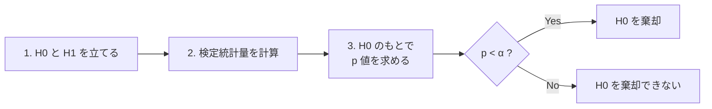
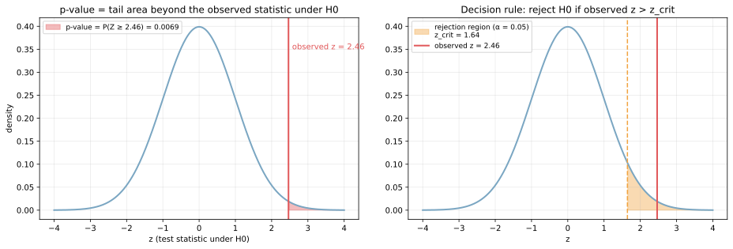
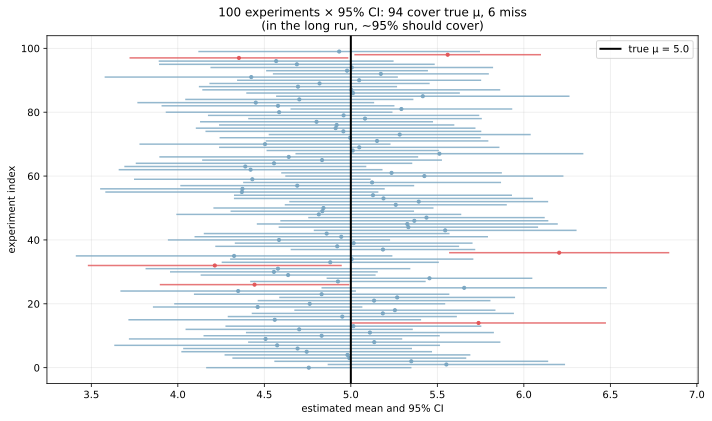
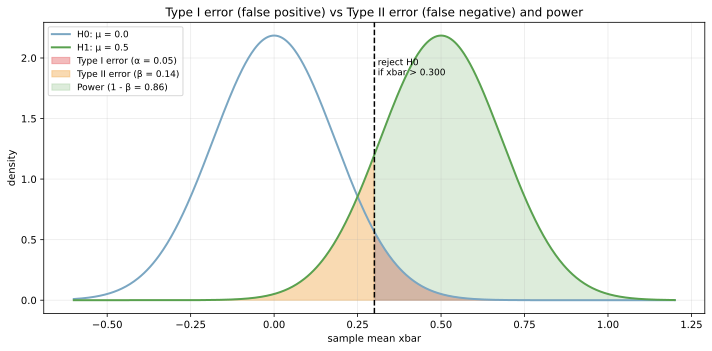
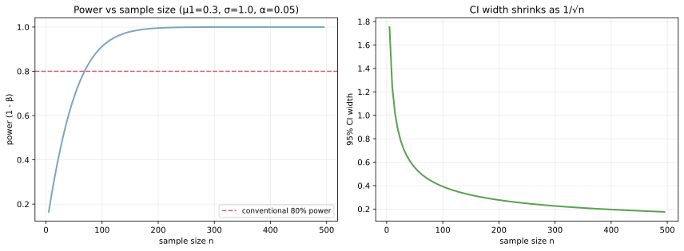

仮説検定（hypothesis testing）は、「差が無い」という主張（帰無仮説）が正しいと仮定した時に、観測したデータがどれくらい珍しいかを確率で測り、その主張を退けるかを決める手続きです。p 値はその珍しさを表す確率、信頼区間（confidence interval）は推定値の不確かさを幅で表したものです。

例えば、新しい推薦モデルを 30 日間動かし、旧モデルとのクリック率の差が 1 日平均 0.45 ポイントだったとします。日ごとのばらつきが大きければ、この程度の差は偶然でも出ます。機械学習では、A/B テスト、モデルのスコア差、[データドリフト](/ml/mlops/data-drift/)の検出で、差を偶然で片付けてよいかを判断します。

<br>

本記事では、上記の例を数値で追いながら次の疑問を扱います。

- p 値は何の確率で、何の確率ではないのか
- 信頼区間の「95%」は何に対する 95% なのか
- 検定力とサンプル数はどういう関係か

---

### 仮説検定の枠組み

検定はおおよそ次の 4 ステップで進みます。



- 帰無仮説 `H0`（null hypothesis）: 「差が無い」「効果が無い」という主張。上記の例では、差の平均 `μ = 0`
- 対立仮説 `H1`（alternative hypothesis）: `H0` の否定。両側（`μ ≠ 0`）か片側（`μ > 0`）かを事前に決める
- 検定統計量: データから計算する 1 つの数で、`H0` のもとでの分布が分かっているもの
- 有意水準 `α`: 第一種誤り（`H0` が正しいのに棄却する誤り）を起こす確率の上限。慣習的に 0.05 や 0.01

平均の検定では、`z = (xbar - μ_0) / (σ / √n)` を使います。`xbar` はサンプル平均、`μ_0` は `H0` での平均、`σ` は母[標準偏差](/ml/math/stddev/)、`n` はサンプル数です。`H0` のもとで `z` は標準正規分布 `N(0, 1)` に従う（母集団が正規分布でなくても、`n` が大きければ[中心極限定理](../lln-clt/)で近似的に従う）ので、観測した `z` の珍しさを確率に変換できます。

---

### p 値の意味

p 値は「`H0` が正しいと仮定した時、観測した検定統計量と同じか、それより極端な値が出る確率」です。片側検定では `p = P(Z ≥ z_obs)`、両側検定では `p = 2 × P(Z ≥ |z_obs|)` です。

冒頭の例で、差のばらつき `σ` が過去の記録から 1 ポイントと分かっているとします。`H0: μ = 0`、`H1: μ > 0` の片側検定を [SciPy](https://docs.scipy.org/doc/scipy/reference/stats.html) で計算します。

```python
import numpy as np
from scipy import stats

n, xbar, sigma, mu0 = 30, 0.45, 1.0, 0.0
z_obs = (xbar - mu0) / (sigma / np.sqrt(n))
print(f"z_obs  = {z_obs:.3f}")
print(f"p      = {stats.norm.sf(z_obs):.4f}")   # P(Z >= z_obs)
print(f"z_crit = {stats.norm.ppf(0.95):.3f}")   # α = 0.05 の境界
```

```text
z_obs  = 2.465
p      = 0.0069
z_crit = 1.645
```



左の図の赤い領域が p 値の面積で、右の図の橙の領域が `α = 0.05` の棄却域（`z > 1.645`）です。`z_obs = 2.46` は棄却域に入るので、`H0` を棄却します。`p < α` と「`z_obs` が棄却域に入る」は同じ判定です。図の描画を含む[生成コード](https://github.com/nao1215/debimate/blob/main/projects/ml/scripts/notes/hypothesis-test_gen.py)は GitHub で確認できます。

p 値は誤って読まれやすい確率です。[ASA（American Statistical Association、アメリカ統計学会）の声明](https://www.amstat.org/asa/files/pdfs/p-valuestatement.pdf)（2016 年）に沿って整理すると、以下のようになります。

| 正しい解釈 | よくある誤解 |
|---|---|
| `H0` のもとで、観測と同じか、より極端なデータが出る確率 | `H0` が正しい確率 |
| データが `H0` とどれだけ食い違うかの目安 | 効果の大きさ |
| 0.049 と 0.051 は、ほぼ同じ強さの証拠 | 0.05 を境に「差がある・無い」が決まる |

p 値は `P(H0 | データ)` ではありません。`H0` が正しい確率は[ベイズの定理](../bayes-theorem/)の事後確率で、事前分布を置かないと計算できません。

---

### 信頼区間と 95% の意味

母標準偏差 `σ` が分かっている時、平均の 95% 信頼区間は `xbar ± 1.96 × σ / √n` です。1.96 は、標準正規分布の両側 5% の境界です。

95% は、同じ手順で実験と区間の計算を繰り返した時に、区間が真値を含む割合です。1 回の実験で得た区間に真値が 95% の確率で入る、という意味ではありません。そう言えるのはベイズ統計の信用区間（credible interval）です。

<br>

多くの場合 `σ` は分からないので、サンプルの標準偏差 `s` で置き換えます。この時、`(xbar - μ) / (s / √n)` は自由度 `n - 1` の t 分布に従い（母集団が正規分布の場合）、1.96 では区間が狭すぎます。平均 5、標準偏差 2 の正規分布から `n = 30` のサンプルを取る実験を繰り返し、区間が真値を含む割合を数えます。

```python
import numpy as np
from scipy import stats

true_mu, sigma, n = 5.0, 2.0, 30
t_crit = stats.t.ppf(0.975, df=n - 1)

def coverage(n_exp, crit):
    rng = np.random.default_rng(0)
    samples = rng.normal(true_mu, sigma, size=(n_exp, n))
    xbar = samples.mean(axis=1)
    se = samples.std(axis=1, ddof=1) / np.sqrt(n)   # σ の代わりに s を使う
    hit = (xbar - crit * se <= true_mu) & (true_mu <= xbar + crit * se)
    return hit.mean()

print(f"t_crit = {t_crit:.3f}")
print(f"100 回,  1.96  : {coverage(100, 1.96):.3f}")
print(f"10 万回, 1.96  : {coverage(100_000, 1.96):.3f}")
print(f"10 万回, t_crit: {coverage(100_000, t_crit):.3f}")
```

```text
t_crit = 2.045
100 回,  1.96  : 0.940
10 万回, 1.96  : 0.940
10 万回, t_crit: 0.950
```



上記の図は、最初の 100 回の区間です。青は真値（黒い縦線）を含む区間、赤は含まない区間で、含んだのは 94 本でした。10 万回でも 94.0% で、1.96 を t 分布の 2.045 に替えると 95.0% になります。`n = 30` でも 1 ポイント足りないので、`σ` が分からない時は t 分布を使います。

「95% 信頼区間が `μ_0` を含まない」ことと「両側検定で `p < 0.05`」は一致します（同じ標準誤差と分布を使う場合）。区間からは効果の大きさと推定の精度も読めるので、p 値だけを報告するより情報が多くなります。

---

### 第一種誤り・第二種誤り・検定力

検定の誤りは 2 種類あります。

| 誤り | 状況 | 起きる確率 |
|---|---|---|
| 第一種誤り（type I error） | `H0` が正しいのに棄却する | `α`（有意水準で抑える） |
| 第二種誤り（type II error） | `H1` が正しいのに `H0` を棄却できない | `β` |

検定力（power）は `1 - β`、つまり `H1` が正しい時に `H0` を正しく棄却できる確率です。実験を設計する時は 80% 以上を目安にします。`n = 30`、`σ = 1`、真の差 `μ1 = 0.5` の場合を計算します。

```python
import numpy as np
from scipy import stats

def power(n, mu1, sigma=1.0, alpha=0.05):
    se = sigma / np.sqrt(n)
    crit = stats.norm.ppf(1 - alpha, loc=0, scale=se)   # 棄却境界（xbar の値）
    return crit, 1 - stats.norm.cdf(crit, loc=mu1, scale=se)

crit, pw = power(30, 0.5)
print(f"crit = {crit:.3f}, β = {1 - pw:.2f}, power = {pw:.2f}")
```

```text
crit = 0.300, β = 0.14, power = 0.86
```



青い曲線が `H0: μ = 0` のもとでの `xbar` の分布、緑が `H1: μ = 0.5` のもとでの分布です。黒い破線が棄却境界 `xbar = 0.300` で、その右側が棄却域です。

- 赤の領域: 第一種誤り `α = 0.05`（`H0` が正しいのに境界を超える）
- 橙の領域: 第二種誤り `β = 0.14`（`H1` が正しいのに境界を超えない）
- 緑の薄い領域: 検定力 `1 - β = 0.86`

`α` を小さくすると境界が右へ動き、赤は減りますが橙は増えます。同じ検定と同じ真の差のまま両方を減らすには、サンプル数を増やして 2 つの分布を細くします。

---

### サンプル数の効果

信頼区間の幅は `2 × 1.96 × σ / √n` なので、`n` を 4 倍にすると半分になります。一方で、検定力は `1/√n` のような単純な式にはなりません。前節の `power` 関数で、真の差を 0.3 に小さくして `n` を変えます。

```python
for n in [25, 50, 69, 100, 200]:
    ci_width = 2 * 1.96 / np.sqrt(n)
    print(f"n={n:3d}: power = {power(n, 0.3)[1]:.3f}, CI 幅 = {ci_width:.3f}")
n_req = ((stats.norm.ppf(0.95) + stats.norm.ppf(0.8)) / 0.3) ** 2
print(f"power 80% に必要な n = {n_req:.1f}")
```

```text
n= 25: power = 0.442, CI 幅 = 0.784
n= 50: power = 0.683, CI 幅 = 0.554
n= 69: power = 0.802, CI 幅 = 0.472
n=100: power = 0.912, CI 幅 = 0.392
n=200: power = 0.995, CI 幅 = 0.277
power 80% に必要な n = 68.7
```



`n` を 25 から 100 へ 4 倍にすると、区間の幅は 0.784 から 0.392 へ半分になります。検定力は 0.442 から 0.912 へ上がり、`n = 200` で 0.995 と 1 に張り付きます。検定力は `Φ(√n × μ1 / σ - 1.645)`（`Φ` は標準正規分布の累積分布関数）なので、`√n` に比例して増えるのではなく、`α = 0.05` から 1 へ S 字の曲線で近づきます。

左の図の検定力の曲線が赤い破線（80%）を超えるのは `n = 69` 付近です。検出したい最小の差と目標の検定力から、実験前に必要なサンプル数を逆算する手続きを検定力分析（power analysis）と呼びます。

---

### 使いどころ

- A/B テスト: 新しいモデルや機能の効果を検定する。`n` と `α` は事前に決める
- モデル比較: [交差検証](/ml/ml/cross-validation/)のスコア差に、対応のある t 検定や Wilcoxon 符号順位検定を使う
- 回帰係数: ロジスティック回帰や線形回帰の係数が 0 かどうかを Wald 検定で調べる
- データドリフト: 訓練データと本番データの分布の差を KS 検定や `χ²` 検定で調べる。PSI（Population Stability Index）は検定ではなく、差の大きさの指標
- 多数の検定: Bonferroni、Holm、Benjamini-Hochberg で多重比較を補正する
- 効果量: Cohen's d や Cramér's V を p 値と一緒に報告する

---

### 落とし穴

よく起きる事故の 1 つが、検定を何回も試して有意なものだけを報告する p ハッキングです。差が全く無い指標を 20 個用意し、`n = 30` の t 検定（[`scipy.stats.ttest_1samp`](https://docs.scipy.org/doc/scipy/reference/generated/scipy.stats.ttest_1samp.html)）を 1 万回繰り返します。

```python
import numpy as np
from scipy import stats

rng = np.random.default_rng(0)
x = rng.normal(0, 1, size=(10_000, 20, 30))   # 1 万回 × 20 指標 × n=30、差は 0
p = stats.ttest_1samp(x, 0, axis=2).pvalue
print(f"1 個の指標で p < 0.05   : {(p[:, 0] < 0.05).mean():.3f}")
print(f"20 個のどれかで p < 0.05: {(p.min(axis=1) < 0.05).mean():.3f}")
print(f"理論値 1 - 0.95**20     : {1 - 0.95**20:.3f}")
```

```text
1 個の指標で p < 0.05   : 0.050
20 個のどれかで p < 0.05: 0.642
理論値 1 - 0.95**20     : 0.642
```

1 個なら偽陽性は 5% ですが、20 個のどれかなら 64% の実験で「有意な差」が見つかります。見る指標は事前に決め、複数見るなら多重比較の補正をかけます。

上記に加えて、以下の落とし穴があります。

- 効果量を見ない: `n` が極端に大きいと、無視できる差でも `p < 0.05` になる
- 「`p > 0.05` だから差が無い」と結論する: 棄却できなかっただけで、検定力不足の可能性が残る
- 分散の違いを無視する: Student の t 検定は 2 群の分散が等しいと仮定するので、分散と群のサイズが異なる時は Welch の t 検定を使う。分散の比を調べる F 検定は、正規分布からのずれに弱い
- 独立でないデータ: 同じユーザーからの繰り返し測定には、対応のある t 検定や混合効果モデルを使う
- 精度差に通常の t 検定をかける: 交差検証の各分割は訓練データを共有して独立ではないので、有意と判定しすぎる。[Nadeau と Bengio の補正](https://doi.org/10.1023/A:1024068626366)や[ベイズ流の比較](https://jmlr.org/papers/v18/16-305.html)を検討する
