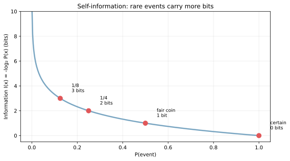
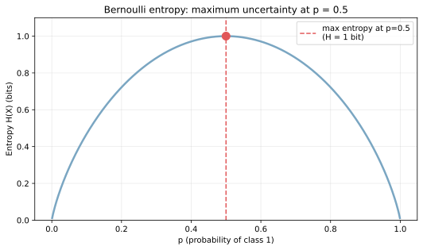
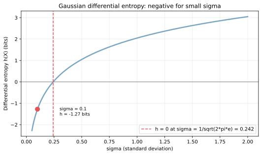
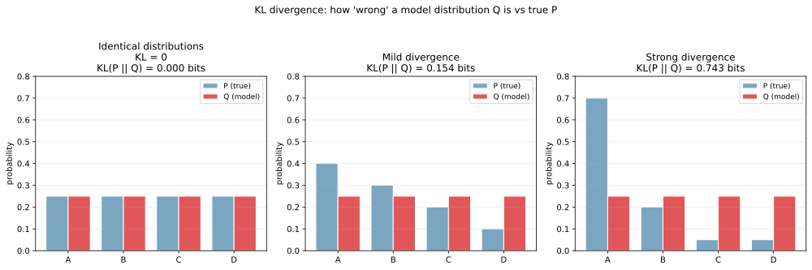
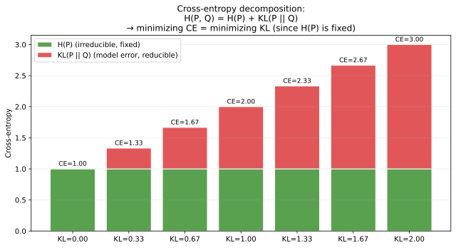
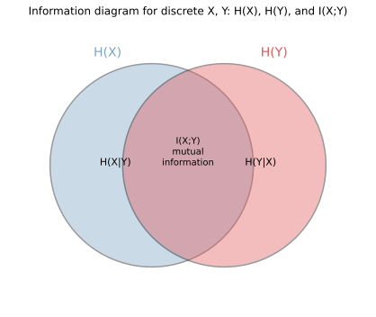

情報理論（information theory）は、Claude Shannon が 1948 年の論文 [A Mathematical Theory of Communication](https://doi.org/10.1002/j.1538-7305.1948.tb01338.x) で築いた、情報の量を数値化する枠組みです。中核となる量は、エントロピー（entropy、不確実性）、KL ダイバージェンス（2 分布の隔たり）、相互情報量（mutual information、2 変数の依存性）です。機械学習では、損失関数・特徴量選択・決定木の分割基準・変分推論などに現れます。

<br>

本記事では、[ベイズの定理](../bayes-theorem/) と [対数・指数関数](../log-exp-logodds/) の知識を前提に、確率分布から情報量を計算する方法を説明します。[損失関数](../../ml/loss-functions/) の交差エントロピー、[決定木](../../ml/decision-tree/) の情報利得、[特徴量選択](../../ml/feature-selection/) の相互情報量は、本記事の量をそのまま使います。

---

### 自己情報量: 珍しい事象ほど情報が大きい

確率 `p(x)` で起こる事象 `x` を観測した時の「驚き」を数値化したものが自己情報量です。

`I(x) = -log_2 p(x)`

底に 2 を取ると単位はビット（bit）、自然対数ならナット（nat）です。機械学習では自然対数を使うのが標準です。

本記事の図は [生成元のスクリプト](https://github.com/nao1215/debimate/blob/main/projects/ml/scripts/notes/information-theory_gen.py) で描いています。以下のコードはその抜粋で、注記や軸の装飾を省いています。2 つ目以降の描画コードは、最初のブロックの import（`np` と `plt`）を前提にします。

```python
import numpy as np
import matplotlib.pyplot as plt

p = np.linspace(0.001, 1, 400)
plt.plot(p, -np.log2(p), color="#7aa6c2", lw=2.5)
plt.xlabel("P(event)")
plt.ylabel("I(x) = -log₂ P(x) (bits)")
plt.savefig("info_self_information.svg", bbox_inches="tight")
```



- `p = 1` の事象（確実に起きる）: `I = 0` ビット（何の情報も得られない）
- `p = 0.5` の事象（コインの裏表）: `I = 1` ビット（YES/NO 1 つ分）
- `p = 1/8` の事象（8 通りから 1 つ）: `I = 3` ビット（2³ = 8 通りを区別するビット数）
- `p → 0` の事象（ほとんど起きない）: `I → ∞`

めったに起きない事象が起きた時ほど、情報量は大きくなります。

---

### エントロピー: 平均情報量

確率変数 `X` の取りうる全ての値 `x` について、自己情報量を確率で重み付けして平均したものがエントロピーです。

`H(X) = -Σ_x P(x) log P(x)`

これは「`X` を予測する時の平均的な不確実性」を表します。底を 2 にすると、`X` を符号化するのに必要な平均ビット数の下限にもなります（シャノンの情報源符号化定理）。

2 値ベルヌーイ分布（コイン投げ）のエントロピーを `p` の関数として描きます。

```python
ps = np.linspace(0.001, 0.999, 400)
H = -(ps * np.log2(ps) + (1 - ps) * np.log2(1 - ps))
plt.plot(ps, H, color="#7aa6c2", lw=2.5)
plt.savefig("info_bernoulli_entropy.svg", bbox_inches="tight")
```



- `p = 0` または `p = 1`: 結果が決まっているのでエントロピー 0
- `p = 0.5`: 完全に半々で結果が予測できない。エントロピー最大 = 1 ビット

クラスが半々の時に最も予測しにくい、という形は [決定木](../../ml/decision-tree/) の Gini 不純度（`1 - Σ p²`）も同じです。scikit-learn の [DecisionTreeClassifier](https://scikit-learn.org/stable/modules/generated/sklearn.tree.DecisionTreeClassifier.html) は既定で Gini を使い、`criterion="entropy"` を指定すると、分割で `H` が下がる量（情報利得）が最大の分割を選びます。

---

### 連続変数の微分エントロピー

連続変数では、和を積分に置き換えた微分エントロピーを使います。`f` は確率密度関数です。

`h(X) = -∫ f(x) log f(x) dx`

離散のエントロピーと違い、微分エントロピーは負になり得ます。密度 `f(x)` は 1 を超えられるので、`-log f(x)` が負になるからです。正規分布 `N(μ, σ²)` では `h = (1/2) log(2πeσ²)` で、`σ` が `1/√(2πe) ≈ 0.242` を下回ると負になります。

```python
sigmas = np.linspace(0.05, 2, 400)
h = 0.5 * np.log2(2 * np.pi * np.e * sigmas**2)
plt.plot(sigmas, h, color="#7aa6c2", lw=2.5)
plt.axhline(0, color="gray", lw=1)
plt.savefig("info_differential_entropy.svg", bbox_inches="tight")
```



`σ = 0.1` では約 `-1.27` ビットです。さらに、`x` の単位を cm から mm に変えると、値は `log_2 10 ≈ 3.32` ビット増えます。微分エントロピーは単位の取り方で動く量なので、離散の場合のように「平均ビット数」とは読めません。

<br>

連続分布の中でエントロピーが最大になるのは、(1) 値域が `[a, b]` で固定なら一様分布、(2) 平均と分散が固定なら正規分布です。分かっている制約だけを仮定し、それ以上の情報を仮定しない分布を選ぶ考え方は最大エントロピー原理と呼ばれ、ベイズ統計の事前分布の選択に利用されます。

---

### KL ダイバージェンス: 2 分布の隔たり

`P` と `Q` の 2 つの確率分布がある時、[KL ダイバージェンス](https://doi.org/10.1214/aoms/1177729694)（Kullback-Leibler divergence）は次の式で定義されます。

`KL(P || Q) = Σ_x P(x) log (P(x) / Q(x))`

「`Q` を `P` の近似と思って符号化した時に、余分に掛かる平均ビット数」と解釈できます。

性質:

- `KL(P || Q) ≥ 0`、等号は `P = Q` の時のみ（ギブスの不等式）
- `KL(P || Q) ≠ KL(Q || P)`（非対称で三角不等式も満たさないため、距離関数ではない）
- `P(x) > 0` だが `Q(x) = 0` の点があると `∞`（モデルが「あり得ない」と言った事象が真分布で起きると無限のペナルティ）

以下のコードは単体で動きます。図は生成元で同じ 3 ケースを棒グラフにしたものです。

```python
import numpy as np

cases = [
    ("identical", [0.25]*4, [0.25]*4),
    ("mild", [0.4, 0.3, 0.2, 0.1], [0.25]*4),
    ("strong", [0.7, 0.2, 0.05, 0.05], [0.25]*4),
]
for name, p, q in cases:
    p, q = np.array(p), np.array(q)
    print(f"{name + ':':<10} KL(P || Q) = {(p * np.log2(p / q)).sum():.3f} bits")
```

出力:

```text
identical: KL(P || Q) = 0.000 bits
mild:      KL(P || Q) = 0.154 bits
strong:    KL(P || Q) = 0.743 bits
```



3 つのパネルで `Q`（赤、一様分布）は固定、`P`（青、真の分布）を徐々に偏らせています。`P` と `Q` が一致する時 KL = 0、`P` が偏るほど KL が増えます。機械学習では、真分布 `P` とモデル `Q` の違いを定量化する尺度として使います。

---

### 交差エントロピー = エントロピー + KL

[損失関数](../../ml/loss-functions/) のノートで扱った交差エントロピーは、エントロピーと KL に分解できます。

`H(P, Q) = -Σ_x P(x) log Q(x) = H(P) + KL(P || Q)`

分布 `P` を固定すると、モデル `Q` を変えても `H(P)` は変わりません。交差エントロピーを下げることは、`KL(P || Q)` を下げることに対応します。


- title: 正解ラベル y
  body: データで観測したクラスです。
- title: 真の分布 P
  body: 同じ入力条件で、各クラスが生じる確率です。
- title: モデルの確率 Q
  body: モデルが出した各クラスの予測確率です。




図の緑は `H(P)`、赤は `KL(P || Q)` です。真の条件付き分布に不確実性があれば、モデルがその分布を正確に予測しても、期待損失に `H(P)` が残ります。

<br>

一方で、one-hot ラベルを使う標本ごとの損失は `-log Q(y)` です。正解クラスの確率が最大なら分類は正解ですが、`Q(y)=0.9` では損失が約 `0.105` ナット残ります。accuracy が 100% でも損失が 0 にならない理由は、ラベルの不確実性だけではありません。

---

### 相互情報量: 2 変数の依存性

確率変数 `X` と `Y` の相互情報量（mutual information, MI）は、

`I(X; Y) = Σ_{x,y} P(x, y) log (P(x, y) / (P(x) P(y)))`
`        = H(X) - H(X | Y) = H(Y) - H(Y | X)`

と表されます。これは「`Y` を知ることで `X` の不確実性がどれだけ減るか」を測る量です。

`I(X; Y) = KL(P(x, y) || P(x) P(y))`

の形でも書けて、「[同時分布](../joint-marginal-conditional/) が周辺分布の積（= 独立を仮定したもの）からどれだけ離れているか」と読めます。独立なら `I = 0`、少しでも依存があれば `I > 0` です。



ベン図的に書くと、`H(X)` と `H(Y)` の重なりが相互情報量で、重なりが大きいほど依存が強くなります。ただし、この読み方は離散変数の場合です。連続変数では微分エントロピーが負にもなるので円の面積としては読めませんが、`I(X; Y)` 自体は 0 以上で、単位の取り方にも依存しません。

<br>

Pearson の [相関係数](../correlation/) が測れるのは線形依存だけです。一方で、相互情報量は非線形の依存も捉えます。[特徴量選択](../../ml/feature-selection/) で使う scikit-learn の [mutual_info_classif](https://scikit-learn.org/stable/modules/generated/sklearn.feature_selection.mutual_info_classif.html) は、k 近傍法に基づく推定値を特徴量の有用性スコアにしています。

---

### 数学での使いどころ

- 分布の隔たり: KL、JS（Jensen-Shannon）ダイバージェンス
- データ処理不等式: `X → Y → Z`（`Z` は `Y` だけから作る）で `I(X; Z) ≤ I(X; Y)`

---

### 機械学習での使いどころ

- [損失関数](../../ml/loss-functions/) の交差エントロピー: 分類タスクの標準損失（softmax + CE）
- [決定木](../../ml/decision-tree/) の情報利得: 分割によるエントロピー減少量で分岐選択
- [特徴量選択](../../ml/feature-selection/) の相互情報量: 線形相関では拾えない依存性を検出
- 変分推論（VAE）: ELBO（Evidence Lower Bound、変分下界）の中で KL ダイバージェンスが事前分布との近さを表す
- GAN（生成器と識別器を競わせる生成モデル）: 元論文の目的関数は、識別器が最適な時に JS ダイバージェンスの最小化になる
- 自己教師あり学習: SimCLR などで使う InfoNCE 損失は、相互情報量の下界を最大化する
- データドリフト検知: PSI（Population Stability Index）はビンに分けた 2 分布の `Σ (p - q) log(p / q)` で、`KL(P || Q) + KL(Q || P)` と等しい（[モデル性能監視](../../mlops/model-performance-monitoring/) 参照）
- クラスタリング評価: 相互情報量ベースの NMI（normalized mutual information）

scikit-learn では [mutual_info_score](https://scikit-learn.org/stable/modules/generated/sklearn.metrics.mutual_info_score.html)、[normalized_mutual_info_score](https://scikit-learn.org/stable/modules/generated/sklearn.metrics.normalized_mutual_info_score.html)、`mutual_info_classif` などが提供されています。

---

### 適さないケース / 落とし穴

- KL を「距離」と呼ぶ: 距離関数ではない。対称な量が欲しい場合は、平均 `M = (P + Q) / 2` を使う JS ダイバージェンス `JS(P, Q) = (KL(P || M) + KL(Q || M)) / 2`
- `Q(x) = 0` の点で `P(x) > 0`: KL が無限大に発散する。softmax のように `Q(x) > 0` を保つ出力にするか、smoothing（`Q + ε` を正規化し直す）を入れる
- 少ないサンプルで離散変数の MI を推定: 頻度から作った推定値は正に偏り、独立でも `MI > 0` が出る
- 連続変数の MI: 密度が分からないと解析的に計算できない。KSG 推定量（Kraskov らによる k 近傍法ベースの推定）や、カーネル密度推定を経由する方法を使う
- 情報量の単位を混在: 1 ナット ≈ 1.443 ビット。同じ計算内で対数の底を揃える