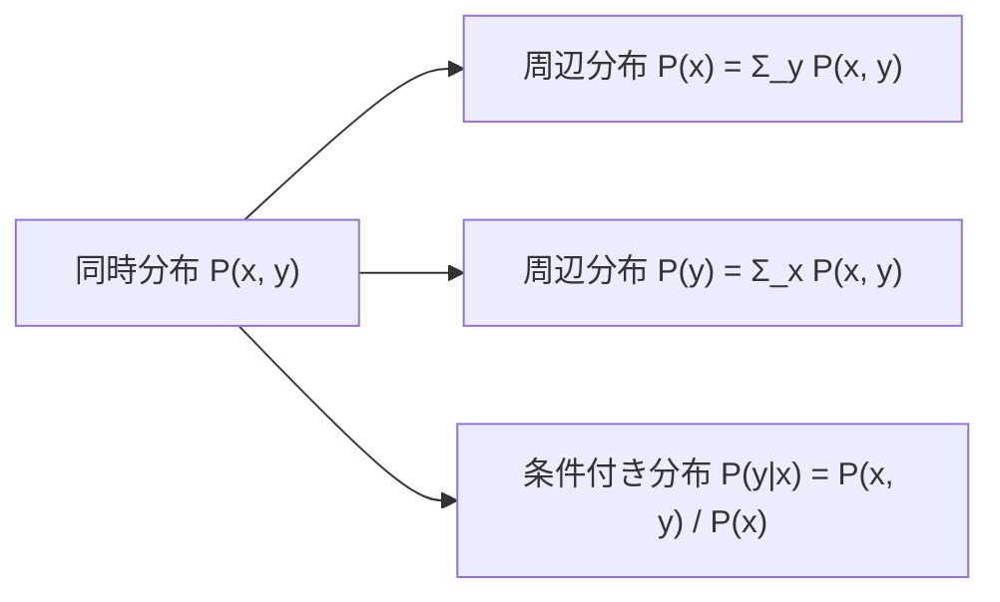
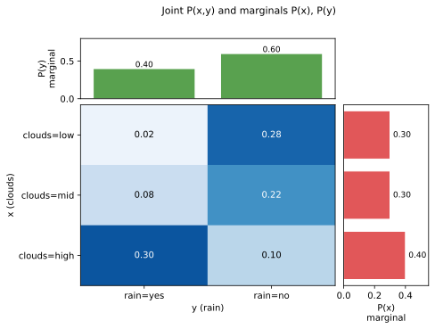
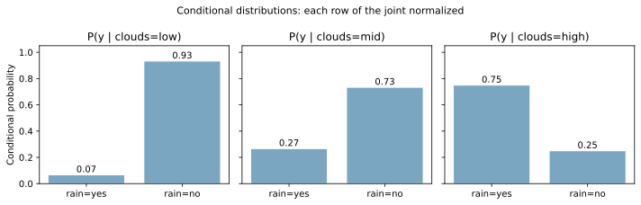
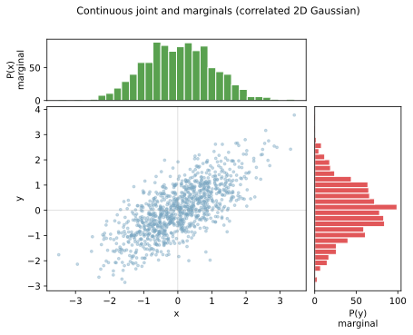
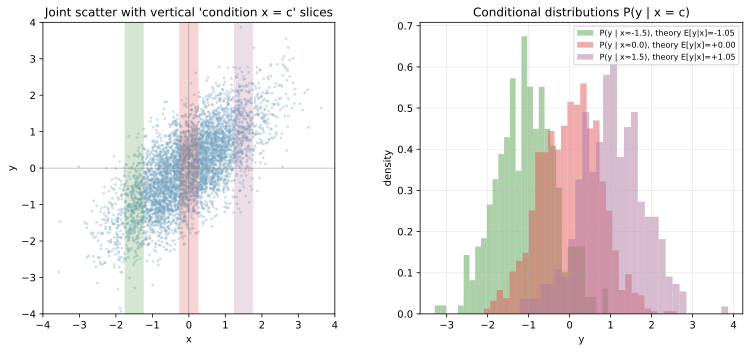
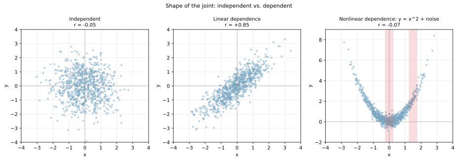

確率変数が複数ある時、それらの関係を表す分布には 3 種類あります。同時分布（joint distribution, `P(x, y)`）、周辺分布（marginal distribution, `P(x)` や `P(y)`）、条件付き分布（conditional distribution, `P(y|x)`）の 3 つで、機械学習の本や論文で繰り返し出てくる基本概念です。

[データドリフト](../../mlops/data-drift/)の分類、[ベイズの定理](../bayes-theorem/)、分類器の確率出力を扱う時に、これらの分布を区別します。周辺分布と条件付き分布は、同時分布から計算できます。

---

### 3 つの分布の関係



- 同時分布: `x` と `y` を同時に観測した時の確率
- 周辺分布: 片方の変数だけに注目した分布。もう片方を足し合わせる（または積分する）操作で得られる
- 条件付き分布: 片方の変数を固定した時の、もう片方の分布

関係式を 1 行で書くと次の通りです。これは「乗法定理」とも呼ばれ、ベイズの定理の出発点になります。

`P(x, y) = P(y|x) × P(x) = P(x|y) × P(y)`

---

### 離散の例: 雲量と雨

具体例として「雲量 `x` ∈ {少, 中, 多}」と「雨 `y` ∈ {降る, 降らない}」を考えます。観測データから次のような同時分布が得られたとします。

```python
import matplotlib.pyplot as plt
import numpy as np

x_labels = ["clouds=low", "clouds=mid", "clouds=high"]
y_labels = ["rain=yes", "rain=no"]
joint = np.array([
    [0.02, 0.28],
    [0.08, 0.22],
    [0.30, 0.10],
])

p_x = joint.sum(axis=1)  # 行方向の和 = P(x)
p_y = joint.sum(axis=0)  # 列方向の和 = P(y)

fig = plt.figure(figsize=(7, 5))
gs = fig.add_gridspec(2, 2, width_ratios=[3, 1], height_ratios=[1, 3],
                      hspace=0.05, wspace=0.05)
ax_top = fig.add_subplot(gs[0, 0])
ax_main = fig.add_subplot(gs[1, 0])
ax_right = fig.add_subplot(gs[1, 1])

ax_main.imshow(joint, cmap="Blues", aspect="auto", vmin=0, vmax=0.35)
for i in range(joint.shape[0]):
    for j in range(joint.shape[1]):
        ax_main.text(j, i, f"{joint[i, j]:.2f}", ha="center", va="center",
                     color="black" if joint[i, j] < 0.2 else "white")
ax_main.set_xticks(range(len(y_labels))); ax_main.set_xticklabels(y_labels)
ax_main.set_yticks(range(len(x_labels))); ax_main.set_yticklabels(x_labels)

ax_top.bar(range(len(y_labels)), p_y, color="#59a14f", edgecolor="white")
ax_top.set_xticks([]); ax_top.set_ylabel("P(y)\nmarginal")
ax_right.barh(range(len(x_labels)), p_x, color="#e15759", edgecolor="white")
ax_right.set_yticks([]); ax_right.invert_yaxis()
ax_right.set_xlabel("P(x)\nmarginal")
fig.suptitle("Joint P(x,y) and marginals P(x), P(y)")
plt.savefig("joint-marginal-conditional_discrete.svg", bbox_inches="tight")
print(f"P(x) = {p_x}")
print(f"P(y) = {p_y}")
```

出力:

```text
P(x) = [0.3 0.3 0.4]
P(y) = [0.4 0.6]
```



中央のヒートマップ 6 マスが同時分布 `P(x, y)` で、すべての値を足すと 1.0 になります。上端の緑のバーは「各列を縦に足し上げて得た `P(y)`」、右端の赤のバーは「各行を横に足し上げて得た `P(x)`」です。図の端（margin）に合計を書くため、marginal（周辺）と呼びます。

---

### 周辺分布（marginal distribution）

複数の変数を持つ同時分布から、一部の変数だけに注目して取り出した分布を周辺分布と呼びます。求め方は、注目しない変数について「足し合わせる」（連続なら「積分する」）だけです。

離散の例で再掲します。

- `P(x=low)`  = `P(x=low, y=yes) + P(x=low, y=no)` = `0.02 + 0.28 = 0.30`
- `P(x=mid)`  = `0.08 + 0.22 = 0.30`
- `P(x=high)` = `0.30 + 0.10 = 0.40`

機械学習の文脈では `P(y)` を「クラス比率」「事前分布」「prior」と呼ぶことが多いです。例えば、不正取引検知では `P(y=1) = 0.01`（陽性 1%）が `P(y)` にあたります。ラベル分布が時間で変わる現象は [label shift / prior shift](../../mlops/data-drift/) と呼ばれ、`P(y)` が動く drift の一種です。

---

### 条件付き分布（conditional distribution）

片方の変数をある値に固定した時の、もう片方の分布です。同時分布の特定の行（または列）を取り出し、その行の合計で割って和を 1 にすると得られます。

`P(y|x) = P(x, y) / P(x)`

雲量の例で計算してみます。

```python
conditionals = joint / p_x[:, None]  # 各行を P(x) で割る

fig, axes = plt.subplots(1, 3, figsize=(10, 3.2), sharey=True)
for i, (ax, xlbl) in enumerate(zip(axes, x_labels)):
    ax.bar(y_labels, conditionals[i], color="#7aa6c2", edgecolor="white")
    for j, v in enumerate(conditionals[i]):
        ax.text(j, v + 0.02, f"{v:.2f}", ha="center", fontsize=10)
    ax.set_title(f"P(y | {xlbl})")
    ax.set_ylim(0, 1.05)
axes[0].set_ylabel("Conditional probability")
fig.suptitle("Conditional distributions: each row of the joint normalized")
plt.tight_layout()
plt.savefig("joint-marginal-conditional_conditional.svg", bbox_inches="tight")
for xlbl, row in zip(x_labels, conditionals):
    print(f"P(y | {xlbl}) = {row.round(2)}")
```

出力:

```text
P(y | clouds=low) = [0.07 0.93]
P(y | clouds=mid) = [0.27 0.73]
P(y | clouds=high) = [0.75 0.25]
```



雲量が多い時に雨が降る確率は 75%、雲量が少ない時は 7% です。分類器の [`predict_proba`](https://scikit-learn.org/stable/glossary.html#term-predict_proba) が出すスコアは、`P(y=1 | x)`（入力 `x` が与えられた時、ラベルが 1 である確率）の推定値です。

---

### 連続の例: 2 次元正規分布

連続変数の場合も考え方は同じで、「足し合わせる」が「積分する」に変わるだけです。相関 0.7 の二次元正規分布から 1000 点をサンプリングし、散布図と周辺ヒストグラムを描きます。

```python
mean = [0, 0]
cov = [[1.0, 0.7], [0.7, 1.0]]
rng = np.random.default_rng(0)  # 以降の乱数はすべてこの rng から引く
samples = rng.multivariate_normal(mean, cov, size=1000)

fig = plt.figure(figsize=(7, 5))
gs = fig.add_gridspec(2, 2, width_ratios=[3, 1], height_ratios=[1, 3],
                      hspace=0.05, wspace=0.05)
ax_top = fig.add_subplot(gs[0, 0])
ax_main = fig.add_subplot(gs[1, 0])
ax_right = fig.add_subplot(gs[1, 1])

ax_main.scatter(samples[:, 0], samples[:, 1], s=8, alpha=0.4, color="#7aa6c2")
ax_main.set_xlabel("x"); ax_main.set_ylabel("y")
ax_top.hist(samples[:, 0], bins=30, color="#59a14f", edgecolor="white")
ax_top.set_xticks([]); ax_top.set_ylabel("P(x)\nmarginal")
ax_right.hist(samples[:, 1], bins=30, color="#e15759", edgecolor="white",
              orientation="horizontal")
ax_right.set_yticks([]); ax_right.set_xlabel("P(y)\nmarginal")
ax_top.set_xlim(ax_main.get_xlim()); ax_right.set_ylim(ax_main.get_ylim())
fig.suptitle("Continuous joint and marginals (correlated 2D Gaussian)")
plt.savefig("joint-marginal-conditional_continuous.svg", bbox_inches="tight")
```



中央の散布図が同時分布 `P(x, y)` のサンプル可視化で、上端と右端のヒストグラムがそれぞれ `P(x)` と `P(y)` の周辺分布です。連続の場合、条件付き分布 `P(y|x=a)` は「`x=a` 付近の縦の細い帯に入る点だけ取り出した分布」に対応します。`x` と `y` に [相関](../correlation/) があるため、`x` が大きい領域では `y` も大きめ、という関係が見えます。

---

### 条件付き分布をスライスとして見る

散布図の縦の帯に入る点を取り出し、条件付き分布 `P(y|x=c)` をヒストグラムにします。

```python
samples = rng.multivariate_normal([0, 0], [[1.0, 0.7], [0.7, 1.0]], size=5000)
fig, (ax1, ax2) = plt.subplots(1, 2, figsize=(11, 5))
ax1.scatter(samples[:, 0], samples[:, 1], s=4, alpha=0.25, color="#7aa6c2")
# x ≈ -1.5, 0, +1.5 の 3 帯を取り出して y の分布を比較
for c, color in zip([-1.5, 0.0, 1.5], ["#59a14f", "#e15759", "#b07aa1"]):
    in_slice = np.abs(samples[:, 0] - c) < 0.25
    y_in_slice = samples[in_slice, 1]
    ax1.axvspan(c - 0.25, c + 0.25, alpha=0.25, color=color)
    ax2.hist(y_in_slice, bins=30, alpha=0.5, color=color, density=True,
             label=f"P(y | x≈{c})")
    print(f"x≈{c:+.1f}: E[y|x] ≈ {y_in_slice.mean():+.2f}  (theory: {0.7*c:+.2f})")
ax2.legend()
plt.savefig("joint-marginal-conditional_slicing.svg", bbox_inches="tight")
```

出力:

```text
x≈-1.5: E[y|x] ≈ -1.05  (theory: -1.05)
x≈+0.0: E[y|x] ≈ +0.02  (theory: +0.00)
x≈+1.5: E[y|x] ≈ +1.03  (theory: +1.05)
```



左の 3 本の色帯が `x ≈ -1.5`, `0`, `+1.5` 付近の範囲で、帯の中の `y` だけを集めたのが右のヒストグラムです。`x` が大きくなると `P(y|x)` の中心も右へ動きます。理論値の `0.7c` は、相関 0.7・分散 1 の 2 次元正規分布で `E[y|x=c] = 0.7c` になることから来ています。

`f(x) = E[y|x]` を学習する回帰モデルは、この帯ごとの平均（`x` を固定した時の `y` の期待値）を推定しています。

---

### 独立と従属

独立性（independence）の定義は `P(x, y) = P(x) × P(y)` です。言い換えると `P(y|x) = P(y)` で、`x` の値を知っても `y` の分布が変わらない状態を指します。散布図の形からある程度は読み取れますが、相関係数だけでは判定できません。独立な 2 変数、線形に従属する 2 変数、`y = x^2 + ノイズ` で非線形に従属する 2 変数を比べます。

```python
indep_x = rng.normal(0, 1, 800)
indep_y = rng.normal(0, 1, 800)
dep = rng.multivariate_normal([0, 0], [[1.0, 0.85], [0.85, 1.0]], size=800)
nl_x = rng.normal(0, 1, 800)
nl_y = nl_x**2 + rng.normal(0, 0.3, 800)  # y = x^2 + ノイズ

panels = [("Independent", indep_x, indep_y),
          ("Linear dependence", dep[:, 0], dep[:, 1]),
          ("Nonlinear dependence: y = x^2 + noise", nl_x, nl_y)]
fig, axes = plt.subplots(1, 3, figsize=(13, 4.6))
for ax, (title, xv, yv) in zip(axes, panels):
    r = np.corrcoef(xv, yv)[0, 1]
    ax.scatter(xv, yv, s=10, alpha=0.4, color="#7aa6c2")
    ax.set_title(f"{title}\nr = {r:+.2f}")
    print(f"{title:<40s} r = {r:+.2f}")
for c in [0.0, 1.5]:
    band = np.abs(nl_x - c) < 0.25
    print(f"nonlinear: E[y | x≈{c:.1f}] = {nl_y[band].mean():.2f}")
plt.savefig("joint-marginal-conditional_independence.svg", bbox_inches="tight")
```

出力:

```text
Independent                              r = -0.05
Linear dependence                        r = +0.85
Nonlinear dependence: y = x^2 + noise    r = -0.07
nonlinear: E[y | x≈0.0] = 0.04
nonlinear: E[y | x≈1.5] = 2.13
```



左の独立な散布図は円形に近く、どの `x` の帯を切っても中の `y` の分布はほぼ同じです。中央の線形の従属は右上がりの楕円に伸び、`x` が大きい帯ほど `y` も大きくなります。

右の `y = x^2 + ノイズ` は、Pearson の[相関係数](../correlation/)が `r = -0.07` でほぼ 0 です。それでも赤く塗った 2 本の帯を比べると、`x ≈ 0` の帯では `y` の平均が 0.04、`x ≈ 1.5` の帯では 2.13 で、`x` を知ると `y` の分布が大きく動きます。相関係数が測るのは線形の関係だけなので、`r ≈ 0` から独立とは言えません。非線形の依存まで調べるなら、同時分布と周辺分布の積の差を測る[相互情報量](../information-theory/)（mutual information）などを使います。

---

### ベイズの定理との関係

3 つの分布をつなぐ式から、ベイズの定理が直接導出できます。

`P(x, y) = P(y|x) × P(x) = P(x|y) × P(y)`

両辺を変形すると次のようになります。

`P(y|x) = P(x|y) × P(y) / P(x)`

これがベイズの定理です。読み方は「事後分布 `P(y|x)` は、尤度 `P(x|y)` と事前分布 `P(y)` の積を証拠 `P(x)` で正規化したもの」となります。

分類では、`P(y|x)` を直接学習するモデル（識別モデル: ロジスティック回帰、決定木、ニューラルネット）と、`P(x|y)` と `P(y)` を別々に学習してベイズの定理で `P(y|x)` を作るモデル（生成モデル: Naive Bayes、線形判別分析（LDA））の 2 系統があります。画像などを作る GAN（Generative Adversarial Network）や拡散モデルも生成モデルと呼ばれます。ただし GAN や拡散モデルは `P(x)`（条件付きなら `P(x|y)`）に従う新しいサンプルを作るのが目的で、ベイズの定理で分類するモデルではありません。

---

### 数学での使いどころ

- 期待値の計算（`E[Y] = Σ_y y P(y)` のように周辺分布を使う）
- 独立性の判定（`P(x, y) = P(x) × P(y)` なら独立）
- 条件付き期待値（`E[Y|X=x] = Σ_y y P(y|x)`）
- 相関と共分散の定義（同時分布から計算する量）

---

### 機械学習での使いどころ

数式やモデルの出力を読む時は、どの分布を表しているか確認します。

- データドリフト分析: covariate shift は `P(x)`、concept drift は `P(y|x)`、label shift は `P(y)` が動くので、3 分類が直接判断軸になる
- ベイズ推論: 事前分布 `P(θ)`、尤度 `P(D|θ)`、事後分布 `P(θ|D)` の関係をベイズの定理でつなぐ
- Naive Bayes 分類器: 特徴量間の条件付き独立 `P(x1, x2, ..., xn | y) = Π_i P(xi | y)` を仮定して計算量を抑える
- 不均衡データの校正: クラス比率 `P(y)` が訓練と本番で違うときの確率出力の再校正

---

### よくある誤解

- 「周辺分布と同時分布は同じもの」ではない: 同時分布は 2 変数を保ったまま、周辺分布は片方を捨てた要約。情報量が減るので、周辺分布から同時分布は復元できない（独立な場合を除く）
- 「`P(y|x)` と `P(x|y)` は同じ」ではない: 条件と被条件を入れ替えると意味も値も変わる。雨の例では `P(雨|雲量=多) = 0.30 / 0.40 = 0.75` と `P(雲量=多|雨) = 0.30 / 0.40 = 0.75` がたまたま同じ値になるものの、問いも意味も違う。混同するとベイズの定理の意味も失われる
- 「条件付き分布の表も全マスを足すと 1 になる」わけではない: 1 になるのは `x` を固定した各行の合計で、雲量の例では 3 行あるので全マスの合計は 3 になる
- 「離散と連続で別の公式を使う必要がある」とは限らない: 足し合わせるか積分するかの違いだけで、関係式 `P(x, y) = P(y|x) × P(x)` は同じ形をしている
