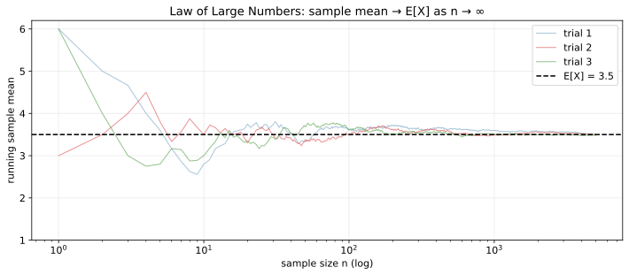
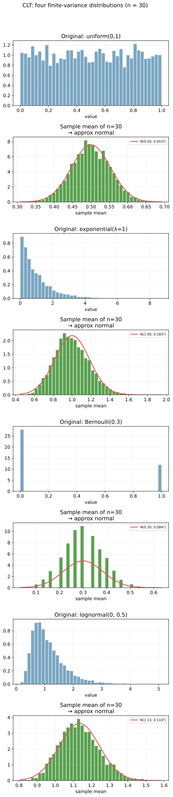
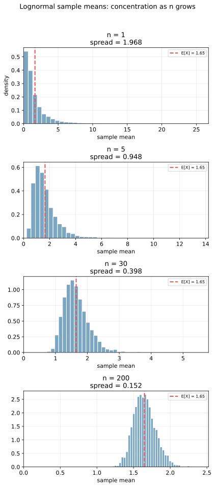
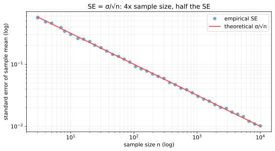

同じ条件でデータを集め直しても、平均値は変動します。データを何件集めれば平均値が安定するかを考える際、大数の法則と中心極限定理が役に立ちます。大数の法則（Law of Large Numbers, LLN）は、平均が期待値に収束することを示します。一方で、中心極限定理（Central Limit Theorem, CLT）は、標準化した平均の分布が正規分布に近づくことを示します。平均値から信頼区間を求める場合も、それぞれの成立条件を確認する必要があります。

<br>

本記事では、独立に同じ分布から得たデータ（独立同分布、i.i.d.）を使い、平均値の収束とばらつきを説明します。サイコロの累積平均と、複数の分布から求めた平均値を Python で比較します。コードは図の計算部分です。描画を含む[生成コード](https://github.com/nao1215/debimate/blob/main/projects/ml/scripts/notes/lln-clt_gen.py)も保存しています。

---

### 大数の法則と平均の収束

サンプル平均を `X̄_n = (X_1 + ... + X_n) / n` とします。独立同分布で `E[|X|] < ∞` なら、平均は有限の[期待値](../expectation/) `μ = E[X]` に収束します。[弱法則](https://www.probabilitycourse.com/chapter7/7_1_1_law_of_large_numbers.php)では、任意の正数 `ε` について `P(|X̄_n − μ| > ε) → 0` と表します。つまり、標本数を増やすと、サンプル平均と期待値 μ の差の絶対値が ε を超える確率は 0 に近づきます。

公平なサイコロの期待値は 3.5 です。乱数の seed を変えて、5,000 回までの累積平均を 3 通り計算します。[NumPy の乱数生成器](https://numpy.org/doc/stable/reference/random/generator.html)は各試行の開始時に初期化し、同じ試行の途中では初期化し直しません。

```python
import numpy as np

n_max = 5000
sample_sizes = np.arange(1, n_max + 1)
for trial in range(3):
    rolls = np.random.default_rng(trial).integers(1, 7, n_max)
    running = np.cumsum(rolls) / sample_sizes
```



初期には試行ごとの差が大きく、回数が増えると 3.5 の近くで変動する様子が見えます。しかし、途中では期待値から遠ざかることもあります。大数の法則は、データが 1 件増えるたびに誤差が小さくなるという定理ではありません。

強法則は、平均の列が `μ` に収束する確率が 1 であることを述べます。弱法則が各時点での確率について述べるのに対し、強法則は平均の列全体が収束する確率について述べています。

---

### 中心極限定理と正規近似

大数の法則だけでは、平均の周りのばらつきを正規分布で扱えるかは分かりません。[中心極限定理](https://www.probabilitycourse.com/chapter7/7_1_2_central_limit_theorem.php)では、独立同分布に加えて、分散が有限かつ正、すなわち `0 < σ² = Var(X) < ∞` であると仮定します。その時、

`(X̄_n − μ) / (σ / √n) →ᵈ N(0, 1)`

が成り立ちます。右辺は標準正規分布、矢印は分布収束です。サンプル平均は `μ` に集中するため、差を `σ/√n` で割って分散を 1 に揃え、その分布を標準正規分布と比較しています。十分大きい有限の `n` では、平均の分布を `N(μ, σ²/n)` で近似する根拠になります。

次は、4 種類の分布から 30 個ずつ取り出して平均を計算し、それを 5,000 回繰り返す例です。1 回の平均に使う個数が `n = 30`、ヒストグラムを作るための繰り返し回数が 5,000 です。

```python
distributions = [
    ("uniform", lambda r, n: r.uniform(0, 1, n)),
    ("exponential", lambda r, n: r.exponential(1, n)),
    ("Bernoulli", lambda r, n: r.binomial(1, 0.3, n)),
    ("lognormal", lambda r, n: r.lognormal(0, 0.5, n)),
]
for name, sampler in distributions:
    raw = sampler(np.random.default_rng(0), 5000)
    rng = np.random.default_rng(0)
    means = np.array([sampler(rng, 30).mean() for _ in range(5000)])
```



各分布の元データは異なる形ですが、その下に示した平均の分布は中心付近に集まります。赤線は `N(μ, σ²/30)` の密度です。ベルヌーイ分布の平均は 1/30 刻みの離散値なので、滑らかな曲線と同じ形になるわけではありません。正規分布で近似する対象は平均の分布です。元データの分布は変わりません。

---

### 標本数と平均のばらつき

右に長い裾を持つ対数正規分布を使い、平均に使うデータ数による違いを確認します。前節より歪みの強い `lognormal(0, 1)` を使い、期待値は `exp(0.5) ≈ 1.649` です。

```python
for n in [1, 5, 30, 200]:
    rng = np.random.default_rng(0)
    means = np.array([rng.lognormal(0, 1, n).mean() for _ in range(5000)])
    print(f"n={n}: mean ≈ {means.mean():.3f}, spread = {means.std():.3f}")
```

```text
n=1: mean ≈ 1.628, spread = 1.968
n=5: mean ≈ 1.648, spread = 0.948
n=30: mean ≈ 1.650, spread = 0.398
n=200: mean ≈ 1.651, spread = 0.152
```



`spread` は 5,000 個の平均の標準偏差です。`n = 1` の 1.968 から `n = 200` の 0.152 へ小さくなっています。図の横軸範囲は図ごとに異なるため、分布の幅は横軸の数値で比較します。`n = 1` では 20 を超える値もありますが、`n = 200` では平均値が 1.649 の近くに集まっています。

平均値が期待値の近くに集まることは、大数の法則と対応します。一方で、中心極限定理による正規近似の精度を調べるには、標準化した平均の分布を標準正規分布と比較する必要があります。

---

### 標準誤差と標本数

平均の[標準偏差](../stddev/)を標準誤差（standard error, SE）と呼びます。独立同分布で分散が有限なら、`Var(X̄_n) = σ²/n` なので、

`SE(X̄_n) = σ / √n`

です。この等式に正規近似や CLT は必要ありません。実データで `σ` が未知なら、標本標準偏差 `s` を使って `s/√n` と推定します。

```python
ns = np.logspace(0.5, 4, 40).astype(int)
rng = np.random.default_rng(0)
empirical_se = []
for n in ns:
    means = np.array([rng.normal(0, 1, n).mean() for _ in range(500)])
    empirical_se.append(means.std())
```



500 回の実験から求めた標準誤差には、乱数によるばらつきがあります。そのため、青い点は理論値の線と完全には一致していません。乱数生成器をループの外で作ることで、平均を求めるたびに別の標本を得ています。同じ seed で毎回初期化すると同じ標本を繰り返し、ばらつきを測れません。

理論上、サンプル数を 4 倍にすると標準誤差は半分になります。ただし、データ収集の偏りはこの計算に含まれません。また、モデルの予測誤差が同じ割合で小さくなるという意味でもありません。

---

### 95% 信頼区間と CLT

母標準偏差 `σ` が既知で正規近似の精度が十分な時、平均の約 95% 信頼区間は、

`X̄_n ± 1.96 × σ/√n`

です。同じ手順で標本を取り直して区間を作ると、その約 95% が固定された真の平均を含む、という意味です。元データが正規分布で `σ` が既知なら、平均も正規分布になるため、小さい標本数でもこの区間を計算できます。

`σ` を標本標準偏差に置き換える場合、正規母集団では t 分布を使う区間が導けます。非正規データの小標本に t 分布を使えば必ず正確になる、というわけではありません。区間と検定の関係は[仮説検定](../hypothesis-test/)で扱います。

---

### 限界と例外

「30 個あれば十分」という一律の境界はありません。歪みや裾の重さ、分布の中心付近と裾のどちらの確率を求めるかによって、近似の精度は変わります。生データの Q-Q プロットで正規性を調べても、それだけで平均の分布に対する CLT 近似を検証したことにはなりません。

コーシー分布には有限の期待値も分散もなく、本記事の LLN・CLT の条件を満たしません。また、時系列のように相関があるデータや、途中で分布が変わるデータには、ここで示した独立同分布の式をそのまま適用できません。依存や分布変化を扱う拡張もありますが、その成立条件を別途確認する必要があります。

---

### 機械学習での使いどころ

独立に抽出した評価データで、固定したモデルの平均損失を求める場合にも利用できます。各データの損失が同じ分布に従い、必要な期待値・分散が有限なら、平均損失の安定性や不確実性を考える際に LLN・CLT を使えます。正解率も正誤を 0/1 とした平均ですが、正解・不正解のどちらかが少ない場合は単純な正規近似が不正確になります。

同じユーザーの記録を何件も含む評価では、行数をそのまま独立なサンプル数と見なせません。[データドリフト](../../mlops/data-drift/)がある場合も、過去の平均が現在の期待値を推定しているとは限りません。そのため、行数だけで判断せず、標本間の独立性と、データを集めた期間・条件を確認する必要があります。
