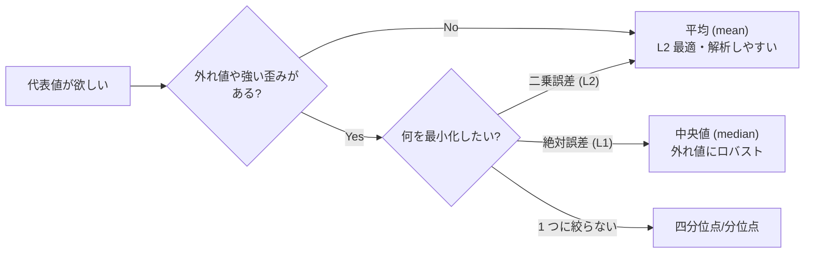

平均（算術平均, mean）は、データの「中心」を表す代表値の中で最も基本的な指標です。全ての値を足して個数で割るというシンプルな計算式ながら、確率論の期待値・最小二乗推定・大数の法則・中心極限定理の定義に直接現れます。[分散](../variance/)・[標準偏差](../stddev/)・[相関係数](../correlation/) の計算でも平均を使います。

- 標本平均: `x_bar = (x1 + x2 + ... + xn) / n`
- 母平均: `mu = E[X]`

ここで `X` は「確率変数」（値がランダムに決まると考える対象）で、`E[X]` はその[期待値](../expectation/)を表します。

平均は計算が軽い一方で、外れ値に引っ張られやすい指標です。[中央値](../median/)が順位の中心を見るのに対し、平均は値の重心を見るからです。右に長い分布（給与・取引金額など）では平均が右側に引きずられるため、典型値を見るなら中央値の方が素直な場面が多くあります。

<br>

本記事では、同じ乱数データを使い、外れ値 1 つで平均がどれだけ動くかと、平均が二乗誤差を最小にする点であることを確かめます。

---

### 平均の数学的特徴付け

平均は、データを 1 つの値 `c` で代表させた時の二乗誤差（L2 損失）を最小にする値です。

```text
mu = argmin_c  E[(X - c)^2]
```

対応する関係として、[中央値](../median/) は L1 損失（絶対誤差）を最小にする点です。この違いは、機械学習の[損失関数](/ml/ml/loss-functions/)を選ぶ時にも関係します。MSE（Mean Squared Error）損失で回帰すると平均的な値を予測し、MAE（Mean Absolute Error）損失で回帰すると中央値に当たる値を予測します。

幾何学的には、平均は各点に等しい質量を置いた時の重心です。遠くの点が 1 つあるだけで重心が引きずられるのは、このためです。

平均と中央値の使い分けは、外れ値の有無と「何を最小化したいか」の 2 軸で整理できます。



---

### Python での実例

以下は、右に長い対数正規分布から 500 個の値を引き、平均と[中央値](../median/)を比べる例です。[NumPy](https://numpy.org/) と [Matplotlib](https://matplotlib.org/) を使います。

```python
import numpy as np
import matplotlib.pyplot as plt

rng = np.random.default_rng(0)
values = rng.lognormal(mean=1.0, sigma=0.7, size=500)

mean = values.mean()
median = np.median(values)

plt.figure(figsize=(6, 4))
plt.hist(values, bins=30, color="#7aa6c2", edgecolor="white")
plt.axvline(mean, color="#e15759", linestyle="--", linewidth=2, label=f"mean = {mean:.2f}")
plt.axvline(median, color="#59a14f", linestyle="--", linewidth=2, label=f"median = {median:.2f}")
plt.title("Mean vs Median on a skewed distribution")
plt.xlabel("Value")
plt.ylabel("Count")
plt.legend()
plt.tight_layout()
plt.savefig("mean_hist.svg", bbox_inches="tight")
```

出力:



平均は 3.41、中央値は 2.62 です。最大 23.25 まで伸びる右の裾が、平均だけを中央値より右へ引っ張っています。

---

### 外れ値 1 つで平均は動く

次は、平均 50・標準偏差 5 の正規分布から引いた 50 個の値に、500 を 1 つだけ追加します。前のコードの続きで、同じ `rng` を使います。

```python
base = rng.normal(50, 5, 50)
contaminated = np.concatenate([base, [500]])

print(f"clean:        mean = {base.mean():.2f}, median = {np.median(base):.2f}")
print(f"with outlier: mean = {contaminated.mean():.2f}, median = {np.median(contaminated):.2f}")
```

出力:

```text
clean:        mean = 50.63, median = 50.67
with outlier: mean = 59.44, median = 50.71
```



51 個中 1 個の値で平均は 8.81 増え、元の 50 個のうち 49 個より大きい 59.44 になりました。中央値は約 0.05 しか動いていません。平均は値の重心なので 500 の距離をそのまま受け取り、中央値は順位の中心なので 1 つ分しかずれないからです。収入・取引額・反応時間のように極端な値が混ざり得るデータでは、平均をそのまま典型値として読むと判断を誤ります。

---

### L2 と L1 の最小化点としての平均・中央値

前半で示した `mu = argmin_c E[(X - c)^2]` の関係は、前節の外れ値入りデータで確かめます。平均と中央値が 9 近く離れたデータなので、2 つの損失の最小点の違いが見えます。中心の候補 `c` を 40〜70 の範囲で 0.05 刻みに並べ、それぞれの損失を計算します。

```python
cs = np.linspace(40, 70, 601)
mse = np.array([np.mean((contaminated - c) ** 2) for c in cs])
mae = np.array([np.mean(np.abs(contaminated - c)) for c in cs])

print(f"argmin MSE: c = {cs[mse.argmin()]:.2f}")
print(f"argmin MAE: c = {cs[mae.argmin()]:.2f}")
```

出力:

```text
argmin MSE: c = 59.45
argmin MAE: c = 50.70
```

候補を 0.05 刻みにしたため、最小点は平均 59.44・中央値 50.71 と 0.01 ずれます。



左の曲線は二乗誤差 `MSE(c) = mean((x - c)^2)`、右は絶対誤差 `MAE(c) = mean(|x - c|)` を `c` の関数として描いたものです。点線は、もう一方の代表値の位置です。二乗誤差は 500 との距離を二乗で数えるので、最小点が外れ値側の平均へ寄ります。図の描画を含む[生成コード](https://github.com/nao1215/debimate/blob/main/projects/ml/scripts/notes/mean_gen.py)は GitHub で確認できます。

---

### 数学での使いどころ

数学・統計の基礎指標の多くは、内部で平均を使います。

- 期待値 `E[X]` としての中心（確率論の最も基本的な量）
- [分散](../variance/) の定義 `Var(X) = E[(X - mu)^2]` の中の `mu`
- [標準偏差](../stddev/) の z スコア `(x - mu) / sigma`
- [相関係数](../correlation/) の共分散 `Cov(X, Y) = E[(X - mu_x)(Y - mu_y)]`
- [大数の法則](../lln-clt/)（標本平均は母平均に確率収束する）
- [中心極限定理](../lln-clt/)（標本平均の分布は正規分布に近づき、その分散は `sigma^2 / n`）
- 最小二乗推定の解（[線形回帰](../../ml/linear-regression/)の係数推定）

---

### 機械学習での使いどころ

機械学習では、前処理・最適化・評価の各段階で平均を使います。

- 特徴量のセンタリング（平均との差を取って平均 0 に揃える）
- [標準化](../../ml/standardization/): 平均 0・[分散](../variance/) 1 に揃える前処理
- [欠損値](../../ml/missing-values/)の平均補完（外れ値が少ない数値特徴量で標準的）
- ミニバッチの平均勾配: [SGD](../gradient-descent-sgd/) やニューラルネットワークの最適化はミニバッチごとの平均勾配で更新する
- 損失関数の構成: MSE（Mean Squared Error）、Cross Entropy など、ほぼ全ての損失関数はサンプルごとの誤差の平均
- アンサンブル予測: [RandomForest](../../ml/random-forest/) の回帰は各決定木の予測を平均し、二乗誤差の[勾配ブースティング](../../ml/gradient-boosting/)は目的変数の平均を初期予測にする
- [交差検証](../../ml/cross-validation/) のスコア集約: 各 fold のスコアを平均して 1 つの推定値にする
- [A/B テスト](../hypothesis-test/): 群間の平均比較が基本
- [バッチ正規化（BatchNorm）](https://arxiv.org/abs/1502.03167): ミニバッチ内の平均と分散で各層の出力を正規化する
- 画像の前処理: 画素値から ImageNet 全体の平均を引く

---

### 適さないケース

- 外れ値が多いデータ（[中央値](../median/)や[四分位点](../quantile/)が有効）
- 分布が大きく[歪んで](../skewness/)いるデータ
- 多峰性が強く、中心が意味を持ちにくいデータ
